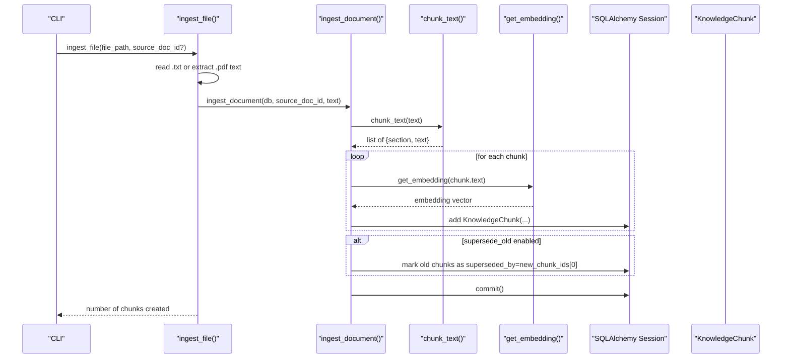
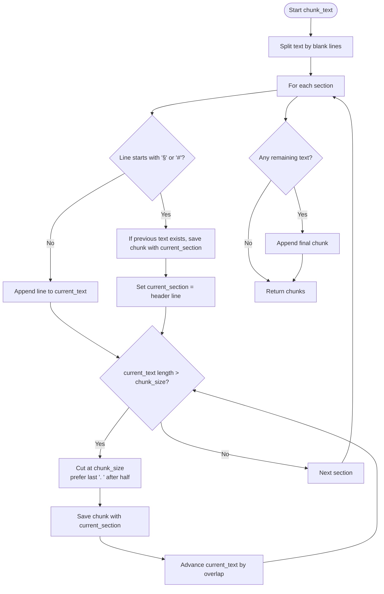
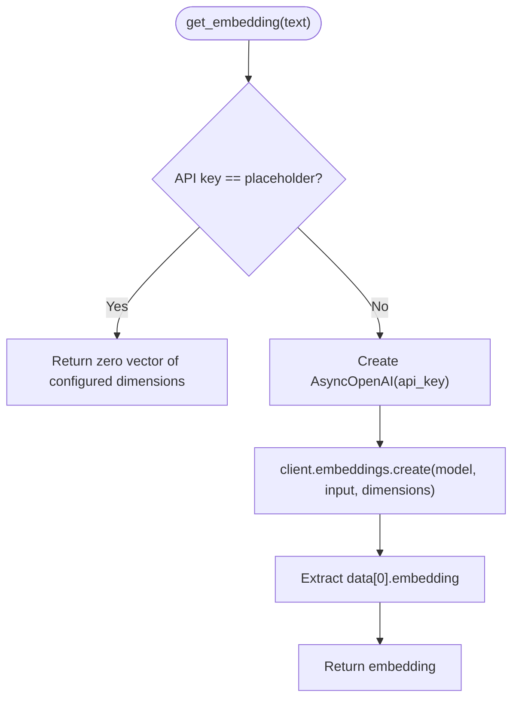
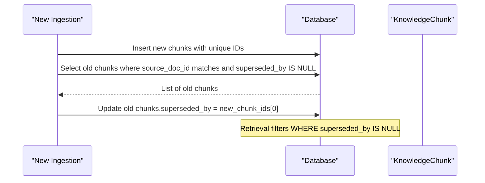
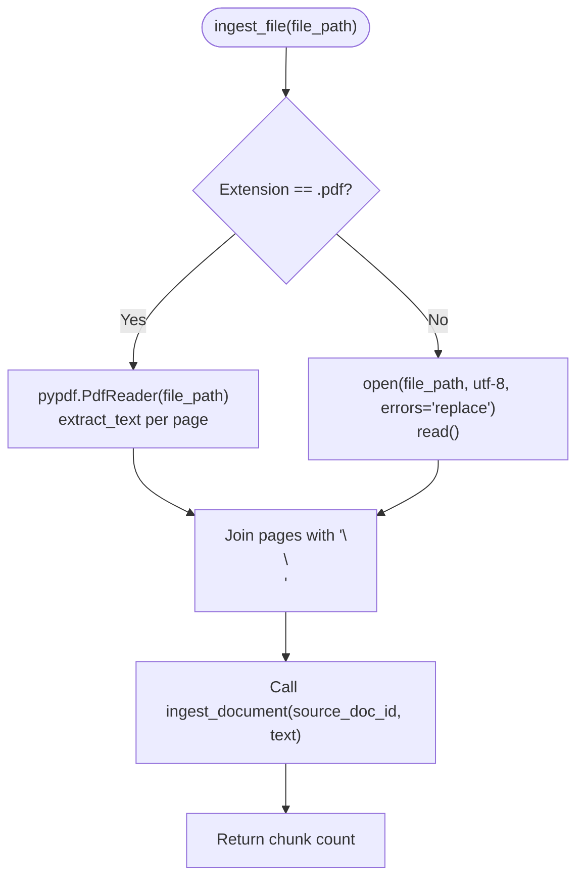
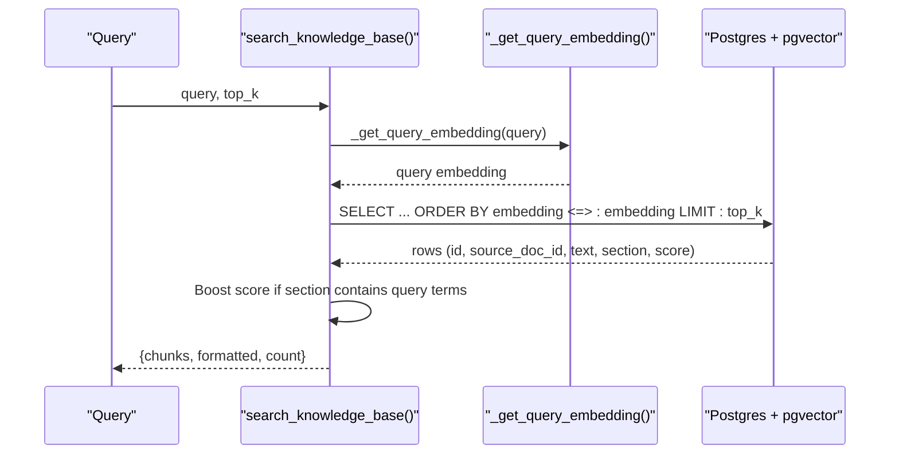
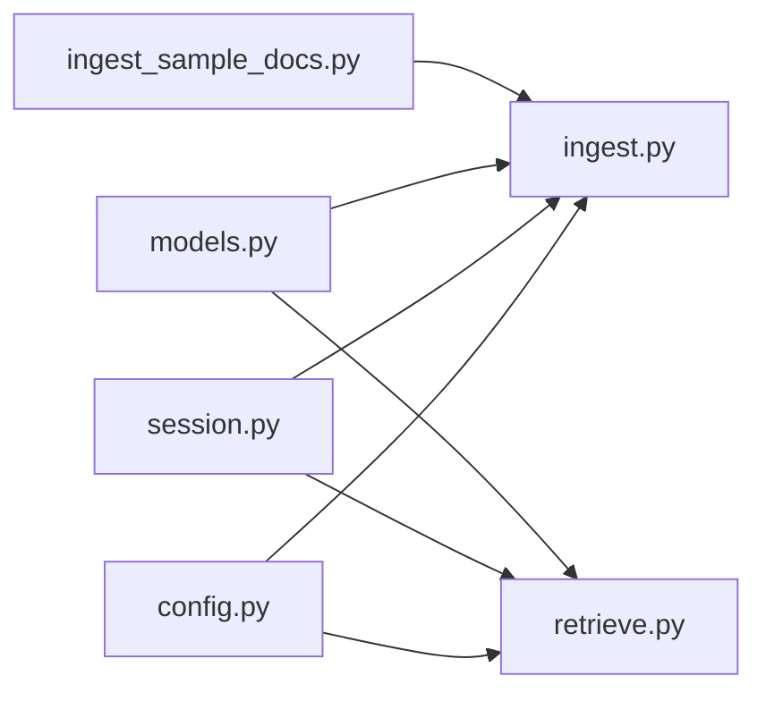

# Document Ingestion Pipeline

<cite>
**Referenced Files in This Document**
- [ingest.py](file://uaea-backend/app/rag/ingest.py)
- [retrieve.py](file://uaea-backend/app/rag/retrieve.py)
- [config.py](file://uaea-backend/app/config.py)
- [models.py](file://uaea-backend/app/db/models.py)
- [session.py](file://uaea-backend/app/db/session.py)
- [ingest_sample_docs.py](file://uaea-backend/scripts/ingest_sample_docs.py)
</cite>

## Table of Contents
1. [Introduction](#introduction)
2. [Project Structure](#project-structure)
3. [Core Components](#core-components)
4. [Architecture Overview](#architecture-overview)
5. [Detailed Component Analysis](#detailed-component-analysis)
6. [Dependency Analysis](#dependency-analysis)
7. [Performance Considerations](#performance-considerations)
8. [Troubleshooting Guide](#troubleshooting-guide)
9. [Conclusion](#conclusion)

## Introduction
This document explains the end-to-end ingestion pipeline that transforms source documents into searchable, vectorized knowledge chunks. It covers:
- How text is split into overlapping chunks while preserving section headers and context
- How embeddings are generated using OpenAI’s text-embedding-3-small model with configurable dimensions and API keys
- The version supersession mechanism that marks old chunks as superseded when new versions are ingested
- File processing for both PDF and plain text formats
- Error handling strategies and performance considerations for large batches

## Project Structure
The ingestion pipeline lives in the backend under the RAG module and integrates with the database models and configuration.

```mermaid
graph TB
subgraph "RAG"
I["ingest.py"]
R["retrieve.py"]
end
subgraph "DB"
M["models.py"]
S["session.py"]
end
subgraph "Config"
C["config.py"]
end
subgraph "CLI"
CLI["ingest_sample_docs.py"]
end
CLI --> I
I --> M
I --> C
I --> S
R --> M
R --> C
R --> S
```

**Diagram sources**
- [ingest.py:1-145](file://uaea-backend/app/rag/ingest.py#L1-L145)
- [retrieve.py:1-97](file://uaea-backend/app/rag/retrieve.py#L1-L97)
- [models.py:124-139](file://uaea-backend/app/db/models.py#L124-L139)
- [session.py:1-14](file://uaea-backend/app/db/session.py#L1-L14)
- [config.py:1-38](file://uaea-backend/app/config.py#L1-L38)
- [ingest_sample_docs.py:1-223](file://uaea-backend/scripts/ingest_sample_docs.py#L1-L223)

**Section sources**
- [ingest.py:1-145](file://uaea-backend/app/rag/ingest.py#L1-L145)
- [retrieve.py:1-97](file://uaea-backend/app/rag/retrieve.py#L1-L97)
- [models.py:124-139](file://uaea-backend/app/db/models.py#L124-L139)
- [session.py:1-14](file://uaea-backend/app/db/session.py#L1-L14)
- [config.py:1-38](file://uaea-backend/app/config.py#L1-L38)
- [ingest_sample_docs.py:1-223](file://uaea-backend/scripts/ingest_sample_docs.py#L1-L223)

## Core Components
- Chunking algorithm: splits text into manageable sections while preserving headers and context
- Embedding generation: uses OpenAI’s text-embedding-3-small with configurable dimensions and API key
- Version supersession: marks older chunks as superseded by newer versions
- File ingestion: supports .txt and .pdf files
- Retrieval: top-k similarity search with pgvector cosine similarity and basic rerank

**Section sources**
- [ingest.py:34-72](file://uaea-backend/app/rag/ingest.py#L34-L72)
- [ingest.py:18-31](file://uaea-backend/app/rag/ingest.py#L18-L31)
- [ingest.py:75-122](file://uaea-backend/app/rag/ingest.py#L75-L122)
- [ingest.py:125-145](file://uaea-backend/app/rag/ingest.py#L125-L145)
- [retrieve.py:17-29](file://uaea-backend/app/rag/retrieve.py#L17-L29)
- [retrieve.py:32-96](file://uaea-backend/app/rag/retrieve.py#L32-L96)
- [config.py:14-18](file://uaea-backend/app/config.py#L14-L18)
- [models.py:124-139](file://uaea-backend/app/db/models.py#L124-L139)

## Architecture Overview
The ingestion pipeline reads a file, extracts text, chunks it, generates embeddings, stores chunks, and optionally supersedes prior versions. Retrieval queries the vector store to find relevant chunks.



**Diagram sources**
- [ingest.py:125-145](file://uaea-backend/app/rag/ingest.py#L125-L145)
- [ingest.py:75-122](file://uaea-backend/app/rag/ingest.py#L75-L122)
- [ingest.py:34-72](file://uaea-backend/app/rag/ingest.py#L34-L72)
- [ingest.py:18-31](file://uaea-backend/app/rag/ingest.py#L18-L31)
- [models.py:124-139](file://uaea-backend/app/db/models.py#L124-L139)
- [session.py:1-14](file://uaea-backend/app/db/session.py#L1-L14)

## Detailed Component Analysis

### Chunking Algorithm
- Splits input text on double newlines to identify sections
- Detects section headers (lines starting with § or #) and preserves them per chunk
- Enforces a maximum chunk size with overlap to maintain context across boundaries
- Attempts sentence-boundary cuts to avoid breaking mid-sentence



**Diagram sources**
- [ingest.py:34-72](file://uaea-backend/app/rag/ingest.py#L34-L72)

**Section sources**
- [ingest.py:34-72](file://uaea-backend/app/rag/ingest.py#L34-L72)

### Embedding Generation (OpenAI text-embedding-3-small)
- Uses AsyncOpenAI client configured via settings
- Supports configurable model name and embedding dimensions
- Falls back to zero vectors when a placeholder API key is detected (for dev/test)



**Diagram sources**
- [ingest.py:18-31](file://uaea-backend/app/rag/ingest.py#L18-L31)
- [config.py:14-18](file://uaea-backend/app/config.py#L14-L18)

**Section sources**
- [ingest.py:18-31](file://uaea-backend/app/rag/ingest.py#L18-L31)
- [config.py:14-18](file://uaea-backend/app/config.py#L14-L18)

### Version Supersession Mechanism
- When ingesting a new version of a document, old active chunks from the same source_doc_id are marked as superseded by pointing to the first new chunk ID
- Retrieval excludes superseded chunks via a WHERE clause filtering out rows where superseded_by is not null



**Diagram sources**
- [ingest.py:75-122](file://uaea-backend/app/rag/ingest.py#L75-L122)
- [retrieve.py:45-55](file://uaea-backend/app/rag/retrieve.py#L45-L55)
- [models.py:124-139](file://uaea-backend/app/db/models.py#L124-L139)

**Section sources**
- [ingest.py:75-122](file://uaea-backend/app/rag/ingest.py#L75-L122)
- [retrieve.py:45-55](file://uaea-backend/app/rag/retrieve.py#L45-L55)
- [models.py:124-139](file://uaea-backend/app/db/models.py#L124-L139)

### File Processing: PDF and Text
- .txt files are read directly with UTF-8 encoding and error replacement for invalid bytes
- .pdf files are parsed page-by-page using pypdf and concatenated with double newlines to preserve section structure



**Diagram sources**
- [ingest.py:125-145](file://uaea-backend/app/rag/ingest.py#L125-L145)

**Section sources**
- [ingest.py:125-145](file://uaea-backend/app/rag/ingest.py#L125-L145)

### Retrieval and Basic Rerank
- Generates query embedding using the same model and dimensions as ingestion
- Performs cosine similarity search with pgvector and limits results to top_k
- Applies a simple rerank boost when section headers contain query terms
- Returns structured results including formatted snippets suitable for LLM tool calls



**Diagram sources**
- [retrieve.py:17-29](file://uaea-backend/app/rag/retrieve.py#L17-L29)
- [retrieve.py:32-96](file://uaea-backend/app/rag/retrieve.py#L32-L96)

**Section sources**
- [retrieve.py:17-29](file://uaea-backend/app/rag/retrieve.py#L17-L29)
- [retrieve.py:32-96](file://uaea-backend/app/rag/retrieve.py#L32-L96)

## Dependency Analysis
- Configuration drives model selection, API key, and vector dimensionality
- Database session provides async SQLAlchemy sessions with connection pooling
- Models define the KnowledgeChunk table with pgvector column and superseded_by link
- CLI orchestrates batch ingestion of sample documents



**Diagram sources**
- [config.py:1-38](file://uaea-backend/app/config.py#L1-L38)
- [session.py:1-14](file://uaea-backend/app/db/session.py#L1-L14)
- [models.py:124-139](file://uaea-backend/app/db/models.py#L124-L139)
- [ingest.py:1-145](file://uaea-backend/app/rag/ingest.py#L1-L145)
- [retrieve.py:1-97](file://uaea-backend/app/rag/retrieve.py#L1-L97)
- [ingest_sample_docs.py:1-223](file://uaea-backend/scripts/ingest_sample_docs.py#L1-L223)

**Section sources**
- [config.py:1-38](file://uaea-backend/app/config.py#L1-L38)
- [session.py:1-14](file://uaea-backend/app/db/session.py#L1-L14)
- [models.py:124-139](file://uaea-backend/app/db/models.py#L124-L139)
- [ingest.py:1-145](file://uaea-backend/app/rag/ingest.py#L1-L145)
- [retrieve.py:1-97](file://uaea-backend/app/rag/retrieve.py#L1-L97)
- [ingest_sample_docs.py:1-223](file://uaea-backend/scripts/ingest_sample_docs.py#L1-L223)

## Performance Considerations
- Chunk size and overlap: Adjust chunk_size and overlap to balance context retention vs. storage and retrieval cost
- Batch operations: The current implementation adds chunks one by one; consider batching inserts for large documents to reduce round-trips
- Embedding calls: Each chunk triggers an API call; for large batches, consider batching embeddings if supported by the provider or introducing concurrency controls
- Database pool: Connection pool_size and max_overflow are configured; ensure they match expected concurrency and workload
- Supersession updates: Marking old chunks occurs after all new chunks are added; for very large documents, this can be optimized with bulk updates

[No sources needed since this section provides general guidance]

## Troubleshooting Guide
- Missing or placeholder API key: If the embedding API key is set to the placeholder value, embeddings will be zero vectors. Ensure a valid key is provided in configuration for real indexing
- No chunks produced: If chunking yields no output, verify that the input text contains meaningful content and section markers; check logs for warnings about empty chunks
- PDF parsing issues: If PDF extraction fails or returns empty text, validate the PDF format and permissions; consider preprocessing scanned PDFs with OCR before ingestion
- Supersession not applied: Confirm that supersede_old is enabled during ingestion and that old chunks do not already have superseded_by set
- Retrieval returns no results: Ensure that chunks exist with non-null embeddings and that superseded_by is null for active chunks; verify pgvector extension and index availability

**Section sources**
- [ingest.py:18-31](file://uaea-backend/app/rag/ingest.py#L18-L31)
- [ingest.py:75-122](file://uaea-backend/app/rag/ingest.py#L75-L122)
- [ingest.py:125-145](file://uaea-backend/app/rag/ingest.py#L125-L145)
- [retrieve.py:45-55](file://uaea-backend/app/rag/retrieve.py#L45-L55)
- [config.py:14-18](file://uaea-backend/app/config.py#L14-L18)

## Conclusion
The ingestion pipeline provides a robust, configurable approach to transforming documents into searchable knowledge chunks. It preserves section context through header-aware chunking, leverages OpenAI embeddings with flexible dimensions, and maintains version integrity via supersession. With careful tuning of chunk sizes, embedding calls, and database connections, it scales effectively for large document batches while ensuring accurate retrieval.

[No sources needed since this section summarizes without analyzing specific files]