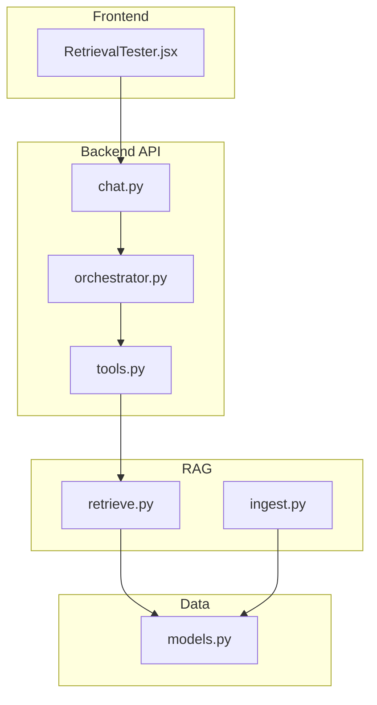
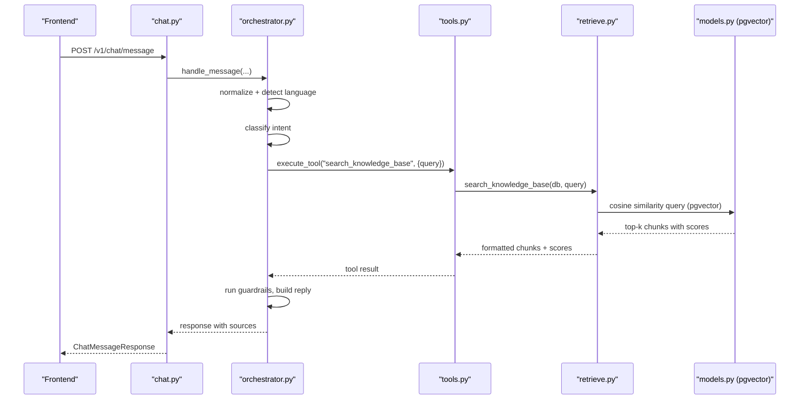
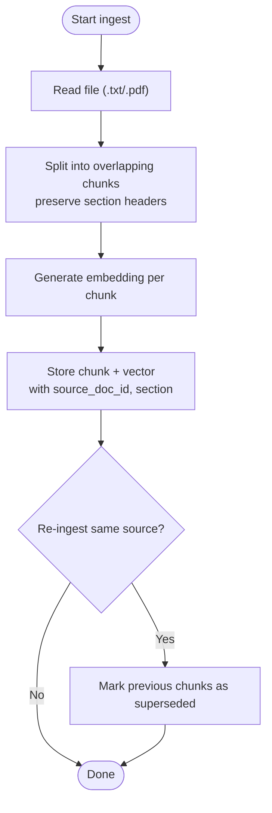
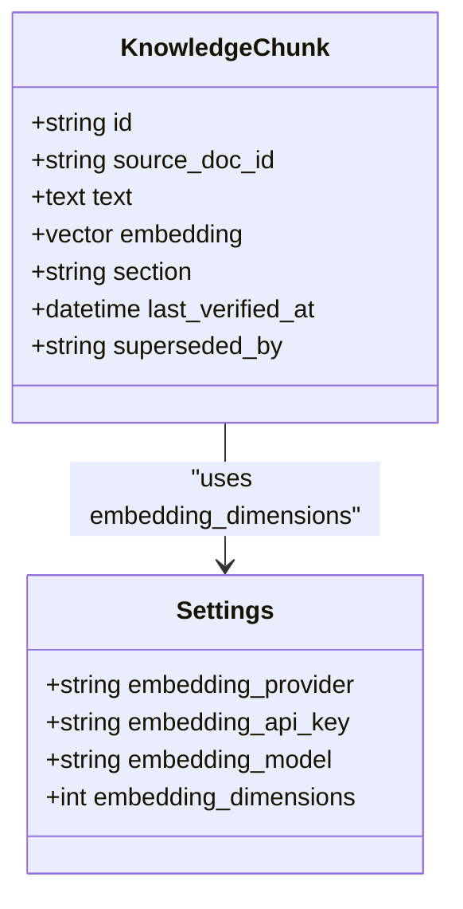
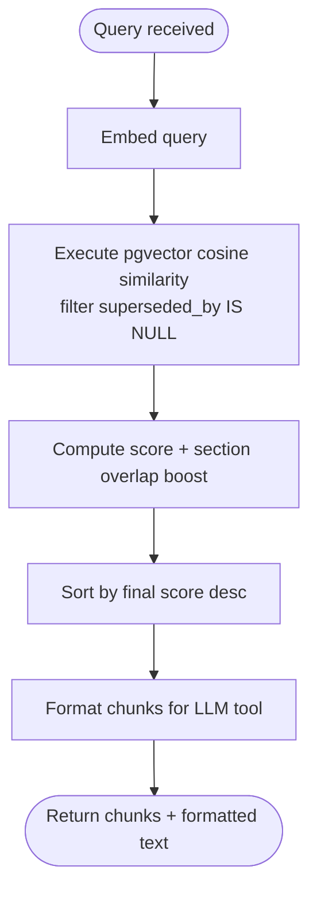
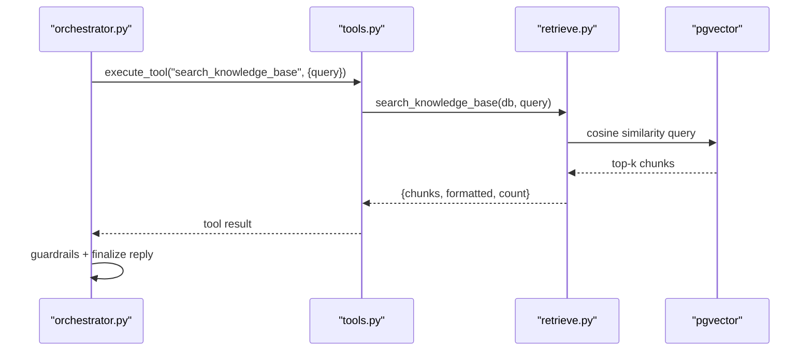
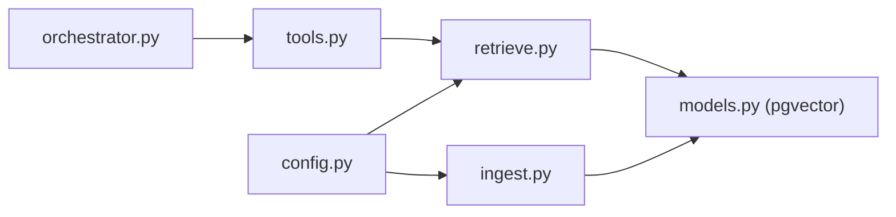

# RAG System

<cite>
**Referenced Files in This Document**
- [ingest.py](file://uaea-backend/app/rag/ingest.py)
- [retrieve.py](file://uaea-backend/app/rag/retrieve.py)
- [config.py](file://uaea-backend/app/config.py)
- [orchestrator.py](file://uaea-backend/app/orchestrator/orchestrator.py)
- [tools.py](file://uaea-backend/app/orchestrator/tools.py)
- [models.py](file://uaea-backend/app/db/models.py)
- [chat.py](file://uaea-backend/app/api/chat.py)
- [schemas.py](file://uaea-backend/app/schemas.py)
- [ingest_sample_docs.py](file://uaea-backend/scripts/ingest_sample_docs.py)
- [RetrievalTester.jsx](file://src/pages/Documents/RetrievalTester.jsx)
</cite>

## Table of Contents
1. [Introduction](#introduction)
2. [Project Structure](#project-structure)
3. [Core Components](#core-components)
4. [Architecture Overview](#architecture-overview)
5. [Detailed Component Analysis](#detailed-component-analysis)
6. [Dependency Analysis](#dependency-analysis)
7. [Performance Considerations](#performance-considerations)
8. [Troubleshooting Guide](#troubleshooting-guide)
9. [Conclusion](#conclusion)
10. [Appendices](#appendices)

## Introduction
This document explains the Retrieval-Augmented Generation (RAG) system that powers university student-service queries. It covers:
- Document ingestion pipeline for ingesting and chunking university documents
- Embedding generation using a vector database with pgvector
- Semantic search and retrieval mechanisms
- How retrieval is combined with LLM tool calls to produce grounded answers
- Relevance scoring and citation generation
- Configuration options for embedding models, vector database setup, and performance tuning for large collections

## Project Structure
The RAG system spans backend modules for ingestion, retrieval, orchestration, and data models, plus frontend utilities for testing retrieval quality.

**Diagram sources**
- [RetrievalTester.jsx:1-102](file://src/pages/Documents/RetrievalTester.jsx#L1-L102)
- [chat.py:1-115](file://uaea-backend/app/api/chat.py#L1-L115)
- [orchestrator.py:1-405](file://uaea-backend/app/orchestrator/orchestrator.py#L1-L405)
- [tools.py:1-235](file://uaea-backend/app/orchestrator/tools.py#L1-L235)
- [ingest.py:1-145](file://uaea-backend/app/rag/ingest.py#L1-L145)
- [retrieve.py:1-97](file://uaea-backend/app/rag/retrieve.py#L1-L97)
- [models.py:1-228](file://uaea-backend/app/db/models.py#L1-L228)

**Section sources**
- [chat.py:1-115](file://uaea-backend/app/api/chat.py#L1-L115)
- [orchestrator.py:1-405](file://uaea-backend/app/orchestrator/orchestrator.py#L1-L405)
- [tools.py:1-235](file://uaea-backend/app/orchestrator/tools.py#L1-L235)
- [ingest.py:1-145](file://uaea-backend/app/rag/ingest.py#L1-L145)
- [retrieve.py:1-97](file://uaea-backend/app/rag/retrieve.py#L1-L97)
- [models.py:1-228](file://uaea-backend/app/db/models.py#L1-L228)
- [RetrievalTester.jsx:1-102](file://src/pages/Documents/RetrievalTester.jsx#L1-L102)

## Core Components
- Ingestion: Splits documents into overlapping chunks, generates embeddings, stores them with version supersession metadata.
- Retrieval: Embeds user queries, performs cosine similarity search via pgvector, applies basic reranking by section overlap, formats results for LLM tools.
- Orchestration: Normalizes input, classifies intent, manages guided flows, runs LLM tool loops, enforces guardrails, persists conversation state.
- Tools: Expose structured functions (including knowledge base search) to the LLM; execute against relational tables or RAG retrieval.
- Data Models: Define pgvector-backed KnowledgeChunk and related entities for conversations, messages, tickets, and domain data.

**Section sources**
- [ingest.py:18-145](file://uaea-backend/app/rag/ingest.py#L18-L145)
- [retrieve.py:17-97](file://uaea-backend/app/rag/retrieve.py#L17-L97)
- [orchestrator.py:46-143](file://uaea-backend/app/orchestrator/orchestrator.py#L46-L143)
- [tools.py:18-235](file://uaea-backend/app/orchestrator/tools.py#L18-L235)
- [models.py:124-140](file://uaea-backend/app/db/models.py#L124-L140)

## Architecture Overview
End-to-end flow from chat message to grounded answer with citations:

**Diagram sources**
- [chat.py:21-39](file://uaea-backend/app/api/chat.py#L21-L39)
- [orchestrator.py:46-143](file://uaea-backend/app/orchestrator/orchestrator.py#L46-L143)
- [tools.py:218-235](file://uaea-backend/app/orchestrator/tools.py#L218-L235)
- [retrieve.py:32-97](file://uaea-backend/app/rag/retrieve.py#L32-L97)
- [models.py:124-140](file://uaea-backend/app/db/models.py#L124-L140)

## Detailed Component Analysis

### Document Ingestion Pipeline
- Chunking: Splits text by paragraph boundaries and preserves section headers detected by specific markers. Oversized sections are split at sentence boundaries with configurable overlap to maintain context continuity.
- Embeddings: Generates vectors using a configured embedding model. A development fallback returns zero vectors when no API key is set.
- Storage: Persists each chunk with source document ID, optional section header, verification timestamp, and a vector column backed by pgvector. Supports supersession so re-ingested versions mark old chunks as superseded.
- File support: Accepts .txt and .pdf files; PDFs are read page-by-page and concatenated.

**Diagram sources**
- [ingest.py:34-72](file://uaea-backend/app/rag/ingest.py#L34-L72)
- [ingest.py:75-122](file://uaea-backend/app/rag/ingest.py#L75-L122)
- [ingest.py:125-145](file://uaea-backend/app/rag/ingest.py#L125-L145)
- [models.py:124-140](file://uaea-backend/app/db/models.py#L124-L140)

**Section sources**
- [ingest.py:18-145](file://uaea-backend/app/rag/ingest.py#L18-L145)
- [models.py:124-140](file://uaea-backend/app/db/models.py#L124-L140)
- [ingest_sample_docs.py:166-193](file://uaea-backend/scripts/ingest_sample_docs.py#L166-L193)

### Embedding Generation and Vector Database
- Embedding provider and model are configured centrally. The system uses an async client to generate embeddings for both document chunks and queries.
- Vector storage: The KnowledgeChunk model includes a pgvector column sized to the configured embedding dimensions. Cosine similarity search is executed directly in SQL using the pgvector operator.
- Query embedding: Same model and dimensions are used for query embeddings to ensure compatibility.

**Diagram sources**
- [models.py:124-140](file://uaea-backend/app/db/models.py#L124-L140)
- [config.py:6-38](file://uaea-backend/app/config.py#L6-L38)

**Section sources**
- [config.py:6-38](file://uaea-backend/app/config.py#L6-L38)
- [ingest.py:18-31](file://uaea-backend/app/rag/ingest.py#L18-L31)
- [retrieve.py:17-29](file://uaea-backend/app/rag/retrieve.py#L17-L29)
- [models.py:124-140](file://uaea-backend/app/db/models.py#L124-L140)

### Semantic Search and Retrieval Mechanism
- Similarity search: Uses pgvector cosine distance to retrieve top-k most similar chunks, filtering out superseded entries.
- Basic reranking: Boosts relevance when the chunk’s section header contains terms matching the query.
- Formatting: Produces both scored chunk objects and a compact formatted string suitable for LLM tool responses.

**Diagram sources**
- [retrieve.py:32-97](file://uaea-backend/app/rag/retrieve.py#L32-L97)

**Section sources**
- [retrieve.py:17-97](file://uaea-backend/app/rag/retrieve.py#L17-L97)

### Retrieval Combined with LLM Responses
- Tool integration: The orchestrator exposes a knowledge base search tool to the LLM. When invoked, it executes semantic search and returns relevant chunks with scores and source references.
- Conversation loop: The orchestrator handles multiple rounds of tool calls up to a maximum, accumulating results and building a final grounded reply.
- Guardrails: Post-processing ensures factual accuracy and compliance with policy constraints before returning the response.

**Diagram sources**
- [orchestrator.py:229-318](file://uaea-backend/app/orchestrator/orchestrator.py#L229-L318)
- [tools.py:218-235](file://uaea-backend/app/orchestrator/tools.py#L218-L235)
- [retrieve.py:32-97](file://uaea-backend/app/rag/retrieve.py#L32-L97)

**Section sources**
- [orchestrator.py:46-143](file://uaea-backend/app/orchestrator/orchestrator.py#L46-L143)
- [orchestrator.py:229-318](file://uaea-backend/app/orchestrator/orchestrator.py#L229-L318)
- [tools.py:18-235](file://uaea-backend/app/orchestrator/tools.py#L18-L235)

### Relevance Scoring Algorithms
- Base score: Derived from pgvector cosine similarity between query and chunk embeddings.
- Section boost: Adds a small additive factor proportional to the number of overlapping terms between the query and the chunk’s section header.
- Final ranking: Results are sorted by the adjusted score in descending order.

**Section sources**
- [retrieve.py:45-81](file://uaea-backend/app/rag/retrieve.py#L45-L81)

### Citation Generation
- Sources extraction: The orchestrator inspects tool call results to collect source references, including document IDs and sections from retrieved chunks.
- Response payload: The chat API returns a list of sources alongside the assistant reply, enabling UI components to display provenance.

**Section sources**
- [orchestrator.py:386-404](file://uaea-backend/app/orchestrator/orchestrator.py#L386-L404)
- [chat.py:21-39](file://uaea-backend/app/api/chat.py#L21-L39)
- [schemas.py:81-100](file://uaea-backend/app/schemas.py#L81-L100)

### Frontend Retrieval Testing
- The RetrievalTester component allows operators to test retrieval quality by entering sample queries and viewing returned chunks with scores and sections. It demonstrates how retrieval performance should be validated across languages and document updates.

**Section sources**
- [RetrievalTester.jsx:1-102](file://src/pages/Documents/RetrievalTester.jsx#L1-L102)

## Dependency Analysis
Key dependencies and coupling:
- Orchestrator depends on tools, which dispatch to either relational lookups or RAG retrieval.
- Retrieval depends on pgvector-enabled database schema and configuration for embedding dimensions.
- Ingestion depends on embedding provider settings and writes to the same KnowledgeChunk table used by retrieval.
- Frontend tests retrieval indirectly via mock data but can be extended to call admin endpoints for live evaluation.

**Diagram sources**
- [orchestrator.py:1-405](file://uaea-backend/app/orchestrator/orchestrator.py#L1-L405)
- [tools.py:1-235](file://uaea-backend/app/orchestrator/tools.py#L1-L235)
- [retrieve.py:1-97](file://uaea-backend/app/rag/retrieve.py#L1-L97)
- [ingest.py:1-145](file://uaea-backend/app/rag/ingest.py#L1-L145)
- [models.py:1-228](file://uaea-backend/app/db/models.py#L1-L228)
- [config.py:1-38](file://uaea-backend/app/config.py#L1-L38)

**Section sources**
- [orchestrator.py:1-405](file://uaea-backend/app/orchestrator/orchestrator.py#L1-L405)
- [tools.py:1-235](file://uaea-backend/app/orchestrator/tools.py#L1-L235)
- [retrieve.py:1-97](file://uaea-backend/app/rag/retrieve.py#L1-L97)
- [ingest.py:1-145](file://uaea-backend/app/rag/ingest.py#L1-L145)
- [models.py:1-228](file://uaea-backend/app/db/models.py#L1-L228)
- [config.py:1-38](file://uaea-backend/app/config.py#L1-L38)

## Performance Considerations
- Chunk size and overlap: Tune chunk_size and overlap to balance context retention vs. retrieval precision. Larger chunks reduce index size but may dilute relevance; smaller chunks improve granularity but increase indexing cost.
- Top-k selection: Adjust top_k to limit latency and token usage while maintaining recall. For high-volume systems, consider caching frequent queries or precomputing popular embeddings.
- pgvector indexing: Ensure appropriate vector indexes are created on the embedding column to optimize cosine similarity queries at scale.
- Embedding provider limits: Respect rate limits and consider batching or caching embeddings for repeated content.
- Supersession strategy: Use supersede_old during re-ingestion to keep the knowledge base current without duplicating active chunks.
- Language handling: Since retrieval relies on embeddings, validate retrieval quality across English, Urdu, and Roman Urdu inputs using the frontend tester.

[No sources needed since this section provides general guidance]

## Troubleshooting Guide
- No chunks produced: If ingestion reports zero chunks, verify document structure and section markers; ensure text is not empty after cleaning.
- Zero-vector fallback: When the embedding API key is unset, embeddings default to zero vectors; configure the correct key to enable real similarity search.
- No relevant documents found: If retrieval returns no results, check that chunks exist and are not superseded; verify query phrasing and consider adjusting top_k or chunking parameters.
- Low confidence or unanswered queries: The system tracks low-confidence intents; review the queue to identify gaps in knowledge coverage or classification accuracy.
- Guardrail blocks: If replies are sanitized or blocked, inspect guardrail rules and adjust tool outputs or prompts accordingly.

**Section sources**
- [ingest.py:88-91](file://uaea-backend/app/rag/ingest.py#L88-L91)
- [ingest.py:18-31](file://uaea-backend/app/rag/ingest.py#L18-L31)
- [retrieve.py:58-59](file://uaea-backend/app/rag/retrieve.py#L58-L59)
- [orchestrator.py:367-384](file://uaea-backend/app/orchestrator/orchestrator.py#L367-L384)

## Conclusion
The RAG system integrates robust document ingestion, vector-based semantic search, and LLM-driven orchestration to deliver accurate, cited responses for university services. By tuning chunking, retrieval parameters, and leveraging pgvector, the system scales to large document collections while maintaining high relevance. The modular design enables easy extension of tools and retrieval strategies, and the frontend testing utility supports continuous validation of retrieval quality across languages.

[No sources needed since this section summarizes without analyzing specific files]

## Appendices

### Configuration Options
- Embedding provider and model: Configure provider, API key, model name, and embedding dimensions to match your vector store and desired vector sizes.
- Database connection: Set asynchronous and synchronous database URLs for SQLAlchemy sessions.
- CORS and rate limiting: Configure allowed origins and rate limits for API access control.
- Admin keys and environment: Manage admin API keys and app-level logging levels.

**Section sources**
- [config.py:6-38](file://uaea-backend/app/config.py#L6-L38)

### Data Model Reference
- KnowledgeChunk: Stores chunked text, embeddings, section headers, verification timestamps, and supersession links.
- Conversations and Messages: Track user interactions, tool calls, and assistant replies for auditability and context management.
- Domain entities: Departments, fees, deadlines, and services provide structured lookup capabilities complementing RAG retrieval.

**Section sources**
- [models.py:71-140](file://uaea-backend/app/db/models.py#L71-L140)
- [models.py:144-179](file://uaea-backend/app/db/models.py#L144-L179)

### API Endpoints
- Chat message: Accepts session and channel identifiers along with user text; returns assistant reply, tool calls, escalation status, confidence, language, and sources.
- Session retrieval: Fetches full conversation history for a session.
- Escalation: Creates human handoff tickets linked to conversations.

**Section sources**
- [chat.py:21-115](file://uaea-backend/app/api/chat.py#L21-L115)
- [schemas.py:81-122](file://uaea-backend/app/schemas.py#L81-L122)