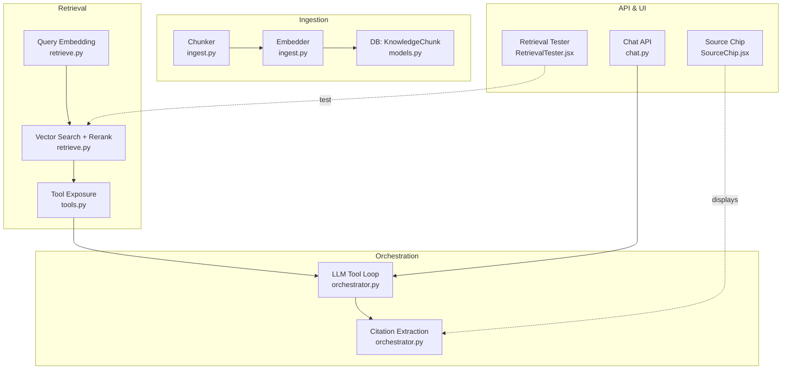
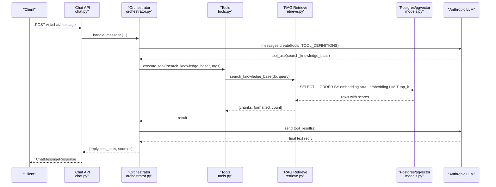
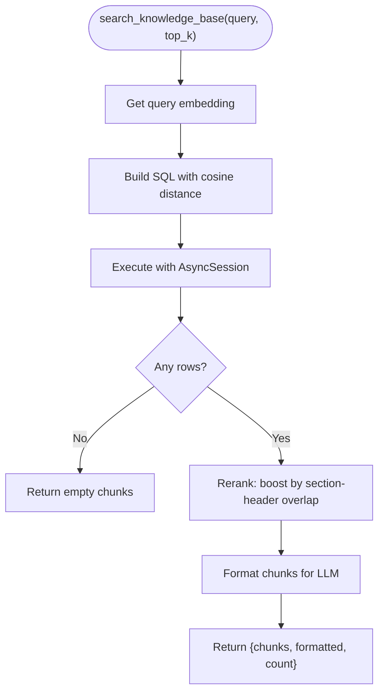
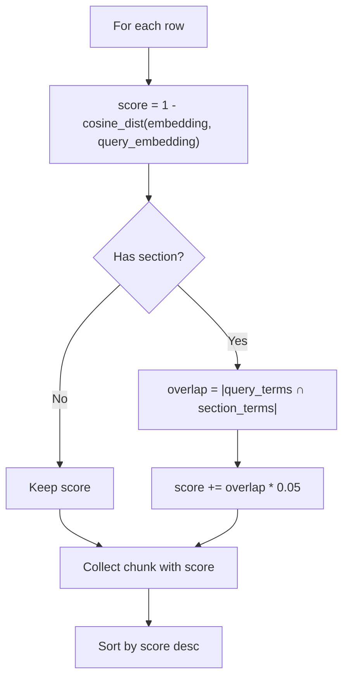
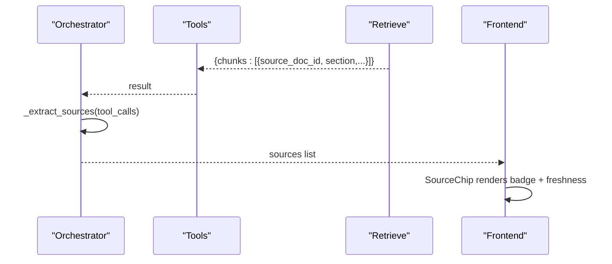
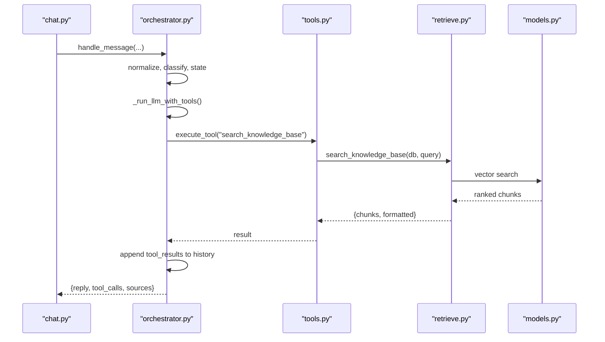
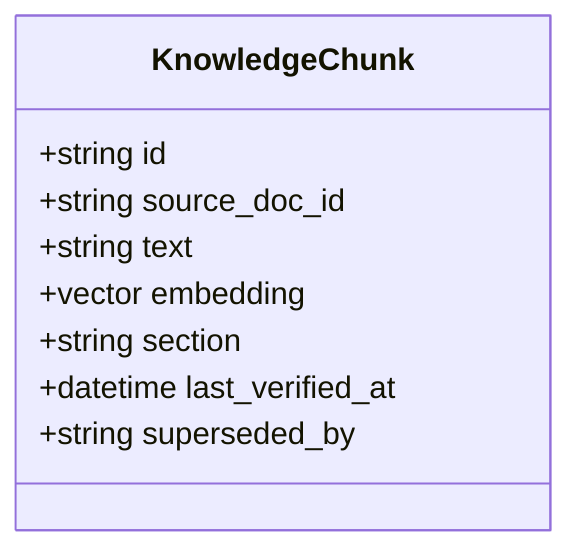
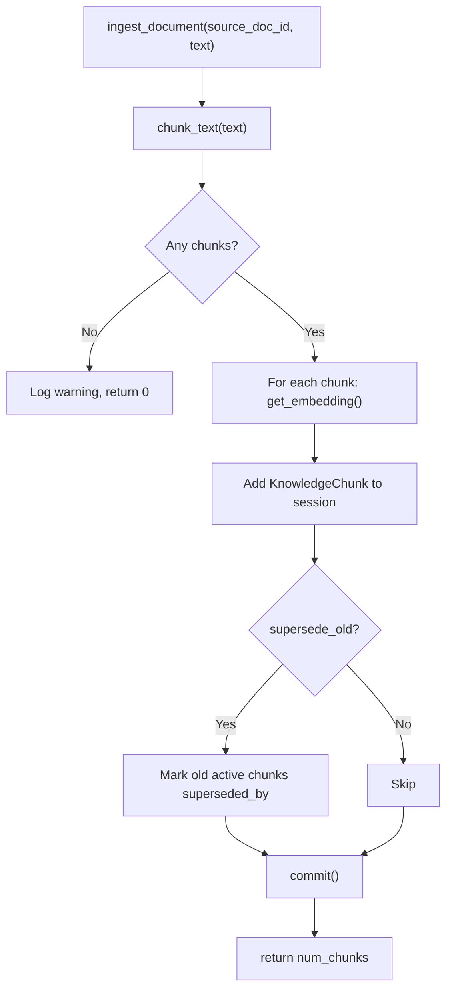
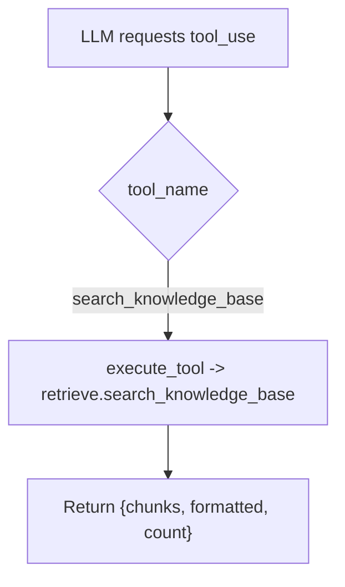
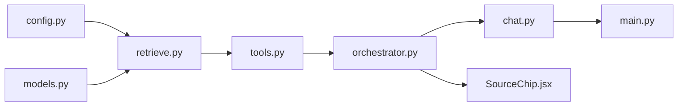

# Semantic Retrieval Engine

<cite>
**Referenced Files in This Document**
- [retrieve.py](file://uaea-backend/app/rag/retrieve.py)
- [ingest.py](file://uaea-backend/app/rag/ingest.py)
- [tools.py](file://uaea-backend/app/orchestrator/tools.py)
- [orchestrator.py](file://uaea-backend/app/orchestrator/orchestrator.py)
- [models.py](file://uaea-backend/app/db/models.py)
- [config.py](file://uaea-backend/app/config.py)
- [chat.py](file://uaea-backend/app/api/chat.py)
- [schemas.py](file://uaea-backend/app/schemas.py)
- [main.py](file://uaea-backend/app/main.py)
- [RetrievalTester.jsx](file://src/pages/Documents/RetrievalTester.jsx)
- [SourceChip.jsx](file://src/pages/student/Chat/SourceChip.jsx)
</cite>

## Table of Contents
1. [Introduction](#introduction)
2. [Project Structure](#project-structure)
3. [Core Components](#core-components)
4. [Architecture Overview](#architecture-overview)
5. [Detailed Component Analysis](#detailed-component-analysis)
6. [Dependency Analysis](#dependency-analysis)
7. [Performance Considerations](#performance-considerations)
8. [Troubleshooting Guide](#troubleshooting-guide)
9. [Conclusion](#conclusion)
10. [Appendices](#appendices)

## Introduction
This document explains the semantic retrieval engine that powers fact-based answers for the assistant. It covers how user queries are converted into vectors, how relevant document chunks are retrieved from a PostgreSQL database using pgvector cosine similarity, how results are scored and reranked, how citations are generated, and how retrieval integrates with the LLM response pipeline. It also provides configuration options, performance tuning guidance for large knowledge bases, debugging techniques to assess retrieval quality, and examples of query processing and result interpretation.

## Project Structure
The retrieval system spans ingestion (chunking and embedding), storage (pgvector-backed table), tool exposure to the LLM, orchestration of tool calls, and frontend utilities for testing and citation display.

**Diagram sources**
- [ingest.py:34-122](file://uaea-backend/app/rag/ingest.py#L34-L122)
- [models.py:126-140](file://uaea-backend/app/db/models.py#L126-L140)
- [retrieve.py:17-96](file://uaea-backend/app/rag/retrieve.py#L17-L96)
- [tools.py:18-87](file://uaea-backend/app/orchestrator/tools.py#L18-L87)
- [orchestrator.py:229-318](file://uaea-backend/app/orchestrator/orchestrator.py#L229-L318)
- [chat.py:21-39](file://uaea-backend/app/api/chat.py#L21-L39)
- [RetrievalTester.jsx:16-100](file://src/pages/Documents/RetrievalTester.jsx#L16-L100)
- [SourceChip.jsx:12-39](file://src/pages/student/Chat/SourceChip.jsx#L12-L39)

**Section sources**
- [main.py:75-79](file://uaea-backend/app/main.py#L75-L79)
- [chat.py:21-39](file://uaea-backend/app/api/chat.py#L21-L39)

## Core Components
- Ingestion: Splits documents into overlapping chunks, preserves section headers, generates embeddings, stores them in a vector-enabled table, and supports version supersession.
- Retrieval: Converts a query into an embedding, performs top-k cosine similarity search, applies a simple reranking boost when section headers match query terms, formats results for the LLM, and returns structured chunk metadata.
- Tool Integration: Exposes search_knowledge_base as an LLM tool; orchestrator executes it within a bounded loop and collects results.
- Citation Generation: Extracts source references from tool call results (including per-chunk source_doc_id and section) to present verifiable citations.
- Configuration: Centralized settings for embedding provider/model/dimensions and other runtime parameters.

**Section sources**
- [ingest.py:34-122](file://uaea-backend/app/rag/ingest.py#L34-L122)
- [retrieve.py:17-96](file://uaea-backend/app/rag/retrieve.py#L17-L96)
- [tools.py:18-87](file://uaea-backend/app/orchestrator/tools.py#L18-L87)
- [orchestrator.py:386-404](file://uaea-backend/app/orchestrator/orchestrator.py#L386-L404)
- [config.py:14-18](file://uaea-backend/app/config.py#L14-L18)

## Architecture Overview
End-to-end flow from user message to cited answer:

**Diagram sources**
- [chat.py:21-39](file://uaea-backend/app/api/chat.py#L21-L39)
- [orchestrator.py:229-318](file://uaea-backend/app/orchestrator/orchestrator.py#L229-L318)
- [tools.py:218-235](file://uaea-backend/app/orchestrator/tools.py#L218-L235)
- [retrieve.py:32-96](file://uaea-backend/app/rag/retrieve.py#L32-L96)
- [models.py:126-140](file://uaea-backend/app/db/models.py#L126-L140)

## Detailed Component Analysis

### Retrieval Pipeline: Query Embedding and Vector Search
- Query embedding is obtained via an async embedding client configured by settings; if no real key is set, a zero-vector fallback is used for development.
- The query embedding is cast to a vector type and used with the cosine distance operator to retrieve the most similar chunks, filtering out superseded versions.
- Results include id, source_doc_id, text, section, last_verified_at, and a computed score derived from cosine similarity.

**Diagram sources**
- [retrieve.py:17-96](file://uaea-backend/app/rag/retrieve.py#L17-L96)

**Section sources**
- [retrieve.py:17-96](file://uaea-backend/app/rag/retrieve.py#L17-L96)

### Relevance Scoring and Reranking
- Base score: cosine similarity between query and chunk embeddings (computed as 1 minus cosine distance).
- Reranking rule: if a chunk has a section header containing words that overlap with the query, add a small boost proportional to the number of overlapping terms.
- Final list is sorted by score descending and limited to top_k.

**Diagram sources**
- [retrieve.py:45-81](file://uaea-backend/app/rag/retrieve.py#L45-L81)

**Section sources**
- [retrieve.py:45-81](file://uaea-backend/app/rag/retrieve.py#L45-L81)

### Citation Generation from Retrieved Chunks
- The orchestrator extracts sources from tool call results. For RAG, it pulls per-chunk source_doc_id and section to build citations.
- Frontend components render these citations, including freshness indicators where applicable.

**Diagram sources**
- [orchestrator.py:386-404](file://uaea-backend/app/orchestrator/orchestrator.py#L386-L404)
- [SourceChip.jsx:12-39](file://src/pages/student/Chat/SourceChip.jsx#L12-L39)

**Section sources**
- [orchestrator.py:386-404](file://uaea-backend/app/orchestrator/orchestrator.py#L386-L404)
- [SourceChip.jsx:12-39](file://src/pages/student/Chat/SourceChip.jsx#L12-L39)

### Integration with LLM Response Pipeline
- The chat API delegates to the orchestrator, which normalizes input, classifies intent, manages guided flows, then runs the LLM with tools.
- When the LLM requests search_knowledge_base, the orchestrator executes it via the tools dispatcher and feeds results back to the LLM until a final text reply is produced or rounds are exhausted.

**Diagram sources**
- [chat.py:21-39](file://uaea-backend/app/api/chat.py#L21-L39)
- [orchestrator.py:46-143](file://uaea-backend/app/orchestrator/orchestrator.py#L46-L143)
- [orchestrator.py:229-318](file://uaea-backend/app/orchestrator/orchestrator.py#L229-L318)
- [tools.py:218-235](file://uaea-backend/app/orchestrator/tools.py#L218-L235)
- [retrieve.py:32-96](file://uaea-backend/app/rag/retrieve.py#L32-L96)
- [models.py:126-140](file://uaea-backend/app/db/models.py#L126-L140)

**Section sources**
- [orchestrator.py:46-143](file://uaea-backend/app/orchestrator/orchestrator.py#L46-L143)
- [orchestrator.py:229-318](file://uaea-backend/app/orchestrator/orchestrator.py#L229-L318)
- [tools.py:218-235](file://uaea-backend/app/orchestrator/tools.py#L218-L235)

### Data Model for Knowledge Chunks
- The KnowledgeChunk model stores the chunk text, its embedding vector, optional section header, verification timestamp, and a supersession pointer to newer chunks.
- The embedding column uses a vector type sized according to configured dimensions.

**Diagram sources**
- [models.py:126-140](file://uaea-backend/app/db/models.py#L126-L140)

**Section sources**
- [models.py:126-140](file://uaea-backend/app/db/models.py#L126-L140)

### Ingestion: Chunking, Embedding, and Version Supersession
- Documents are split into overlapping chunks while preserving section headers. Oversized sections are split at sentence boundaries where possible.
- Each chunk is embedded and stored. When re-ingesting the same source_doc_id, old active chunks are marked as superseded by the first new chunk.

**Diagram sources**
- [ingest.py:34-122](file://uaea-backend/app/rag/ingest.py#L34-L122)

**Section sources**
- [ingest.py:34-122](file://uaea-backend/app/rag/ingest.py#L34-L122)

### Tool Definition and Dispatch for Retrieval
- search_knowledge_base is declared as an LLM tool with a simple input schema requiring a query string.
- The tools dispatcher routes the call to the retrieval function, passing the database session and query.

**Diagram sources**
- [tools.py:18-87](file://uaea-backend/app/orchestrator/tools.py#L18-L87)
- [tools.py:218-235](file://uaea-backend/app/orchestrator/tools.py#L218-L235)
- [retrieve.py:32-96](file://uaea-backend/app/rag/retrieve.py#L32-L96)

**Section sources**
- [tools.py:18-87](file://uaea-backend/app/orchestrator/tools.py#L18-L87)
- [tools.py:218-235](file://uaea-backend/app/orchestrator/tools.py#L218-L235)

## Dependency Analysis
Key dependencies and relationships:
- Retrieval depends on config for embedding provider/model/dimensions and on models for the KnowledgeChunk table.
- Orchestrator depends on tools, which dispatch to retrieval.
- API endpoints depend on orchestrator to process messages and return sources.
- Frontend components visualize retrieval results and citations.

**Diagram sources**
- [config.py:14-18](file://uaea-backend/app/config.py#L14-L18)
- [models.py:126-140](file://uaea-backend/app/db/models.py#L126-L140)
- [retrieve.py:17-96](file://uaea-backend/app/rag/retrieve.py#L17-L96)
- [tools.py:218-235](file://uaea-backend/app/orchestrator/tools.py#L218-L235)
- [orchestrator.py:229-318](file://uaea-backend/app/orchestrator/orchestrator.py#L229-L318)
- [chat.py:21-39](file://uaea-backend/app/api/chat.py#L21-L39)
- [main.py:75-79](file://uaea-backend/app/main.py#L75-L79)
- [SourceChip.jsx:12-39](file://src/pages/student/Chat/SourceChip.jsx#L12-L39)

**Section sources**
- [config.py:14-18](file://uaea-backend/app/config.py#L14-L18)
- [retrieve.py:17-96](file://uaea-backend/app/rag/retrieve.py#L17-L96)
- [tools.py:218-235](file://uaea-backend/app/orchestrator/tools.py#L218-L235)
- [orchestrator.py:229-318](file://uaea-backend/app/orchestrator/orchestrator.py#L229-L318)
- [chat.py:21-39](file://uaea-backend/app/api/chat.py#L21-L39)
- [main.py:75-79](file://uaea-backend/app/main.py#L75-L79)
- [SourceChip.jsx:12-39](file://src/pages/student/Chat/SourceChip.jsx#L12-L39)

## Performance Considerations
- Top-k parameter: Adjust top_k in search_knowledge_base to balance recall vs latency. Larger values increase retrieval cost and may slow responses.
- Embedding dimensions: Ensure embedding_dimensions matches the chosen model to avoid unnecessary computation or mismatched vectors.
- Database indexing: Use pgvector indexes (e.g., IVFFlat or HNSW) on the embedding column for large knowledge bases to accelerate cosine similarity searches.
- Chunk size and overlap: Tune chunk_size and overlap during ingestion to improve retrieval precision without excessive duplication.
- Section boosting: The current reranking adds a modest boost for section-header overlaps; consider weighting strategies based on domain feedback.
- Rate limiting: Configure rate_limit_per_ip and rate_limit_per_session to protect backend under load.
- Asynchronous operations: Leverage async sessions and async embedding clients to reduce contention.

[No sources needed since this section provides general guidance]

## Troubleshooting Guide
- No results returned:
  - Verify that chunks exist and are not superseded.
  - Confirm embedding_api_key is configured; otherwise, zero vectors will be used and similarity will be meaningless.
  - Check that the query language aligns with the indexed content; consider adjusting chunking or adding synonyms.
- Low relevance:
  - Increase top_k to allow more candidates before reranking.
  - Improve chunking to preserve meaningful sections; ensure section headers are consistent.
  - Adjust reranking boost factor if section overlap is too weak or too strong.
- Slow queries:
  - Add appropriate pgvector indexes.
  - Reduce top_k or pre-filter by source_doc_id if applicable.
  - Profile embedding latency; consider caching repeated queries.
- Citation issues:
  - Ensure tool call results include source_doc_id and section fields so citations can be extracted.
  - Validate frontend rendering of SourceChip to show correct badges and freshness warnings.

**Section sources**
- [retrieve.py:17-96](file://uaea-backend/app/rag/retrieve.py#L17-L96)
- [ingest.py:34-122](file://uaea-backend/app/rag/ingest.py#L34-L122)
- [orchestrator.py:386-404](file://uaea-backend/app/orchestrator/orchestrator.py#L386-L404)
- [SourceChip.jsx:12-39](file://src/pages/student/Chat/SourceChip.jsx#L12-L39)

## Conclusion
The semantic retrieval engine combines robust ingestion, efficient vector search, lightweight reranking, and tight integration with the LLM tool-calling pipeline to deliver accurate, cited answers. With proper configuration, indexing, and tuning, it scales to large knowledge bases while maintaining responsiveness and trustworthiness through verifiable citations.

[No sources needed since this section summarizes without analyzing specific files]

## Appendices

### Configuration Options
- Embedding provider and model:
  - embedding_provider: Provider name (e.g., openai)
  - embedding_model: Model identifier (e.g., text-embedding-3-small)
  - embedding_dimensions: Vector dimensionality
  - embedding_api_key: API key for the embedding service
- Application and security:
  - anthropic_api_key: LLM provider key
  - cors_origins: Allowed origins for CORS
  - rate_limit_per_ip, rate_limit_per_session: Rate limits
  - admin_api_key: Admin access key
  - app_env, log_level: Environment and logging

**Section sources**
- [config.py:6-37](file://uaea-backend/app/config.py#L6-L37)

### Example: Query Processing and Result Interpretation
- Example query: “BS CS ki semester fees kitni hai”
- Expected behavior:
  - The orchestrator invokes search_knowledge_base with the normalized query.
  - The retrieval module embeds the query and performs cosine similarity search against stored chunk embeddings.
  - Results are reranked with a small boost for matching section headers.
  - The LLM receives formatted context and produces a reply citing the relevant source_doc_id and section.
- Frontend evaluation:
  - Use RetrievalTester to simulate queries and inspect returned chunks and scores.
  - Use SourceChip to verify citations and freshness indicators in the student chat view.

**Section sources**
- [RetrievalTester.jsx:16-100](file://src/pages/Documents/RetrievalTester.jsx#L16-L100)
- [SourceChip.jsx:12-39](file://src/pages/student/Chat/SourceChip.jsx#L12-L39)
- [orchestrator.py:229-318](file://uaea-backend/app/orchestrator/orchestrator.py#L229-L318)
- [retrieve.py:32-96](file://uaea-backend/app/rag/retrieve.py#L32-L96)