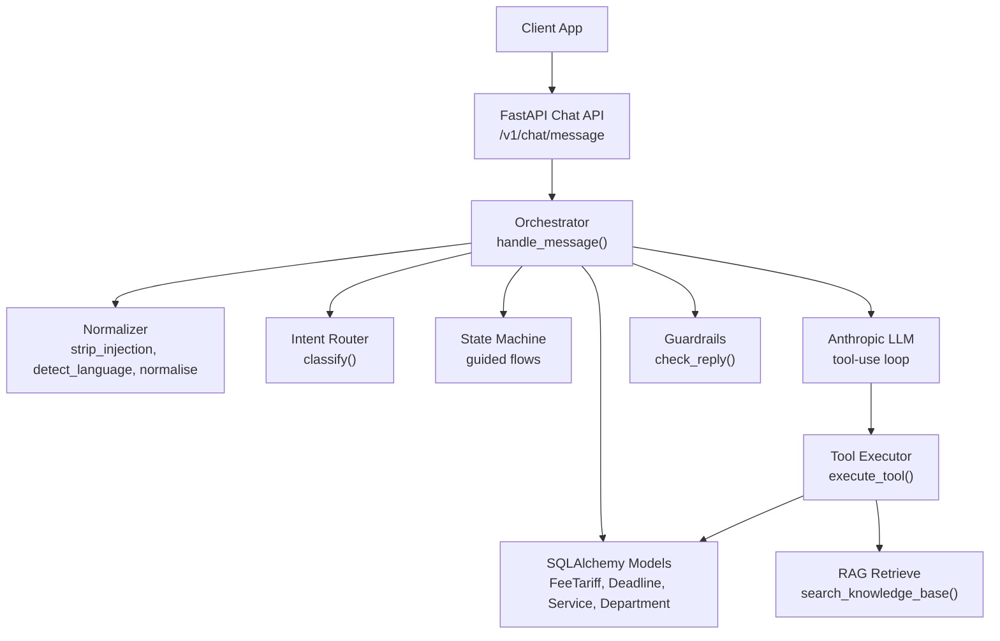
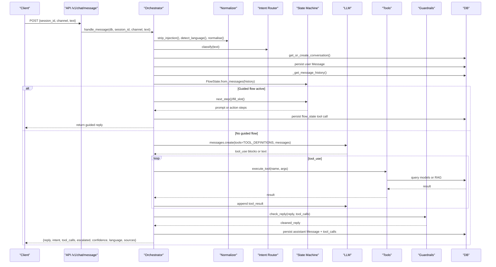
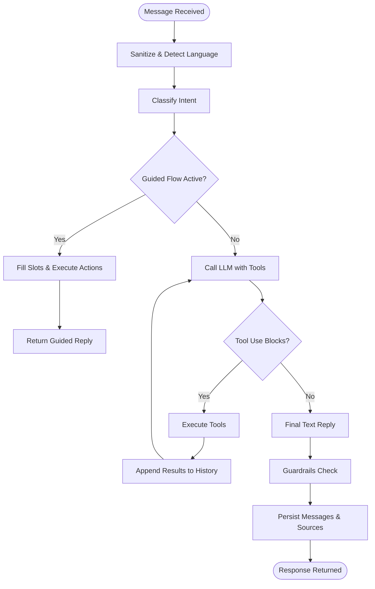
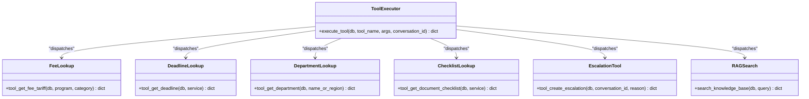
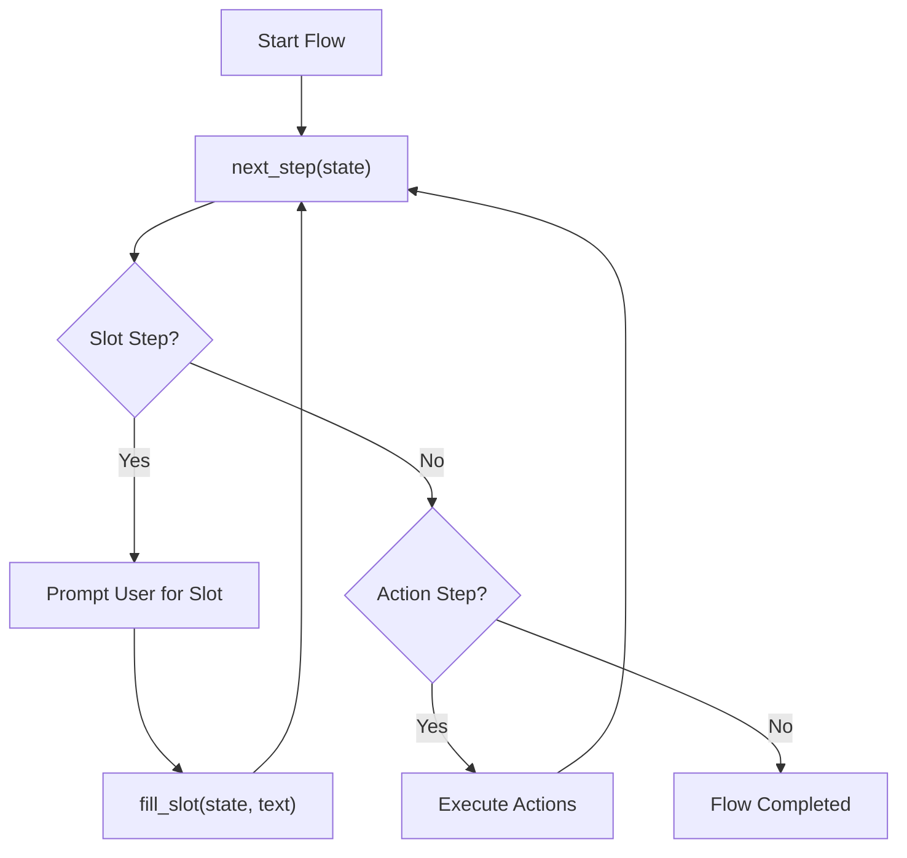
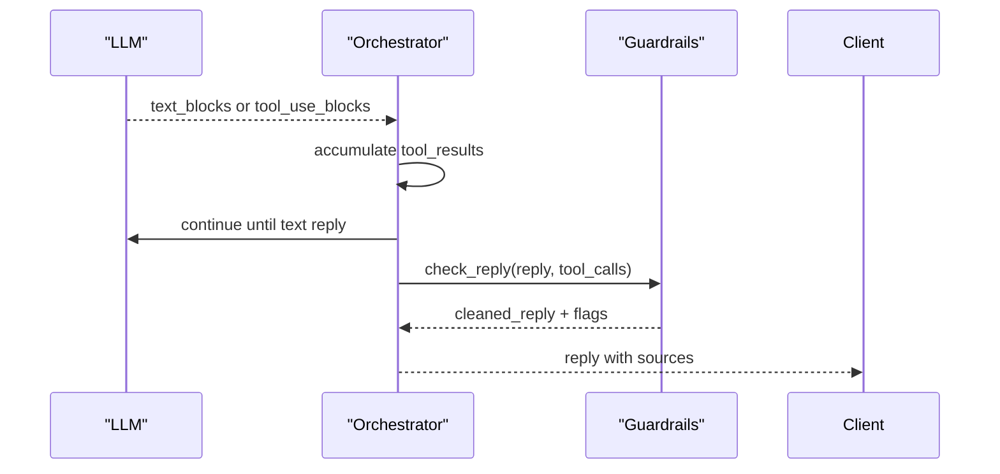
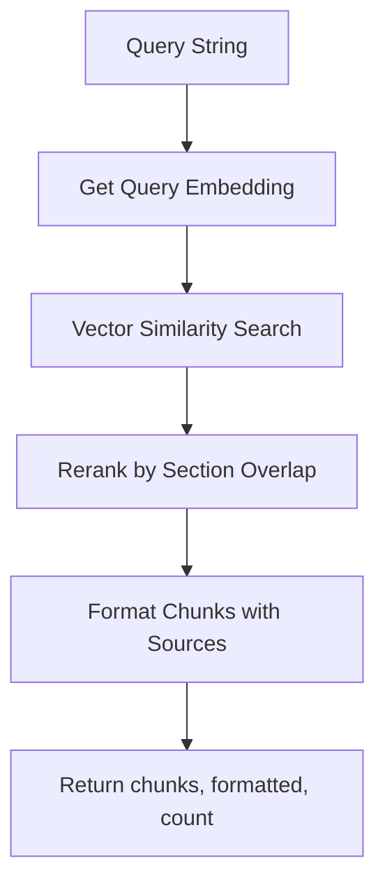
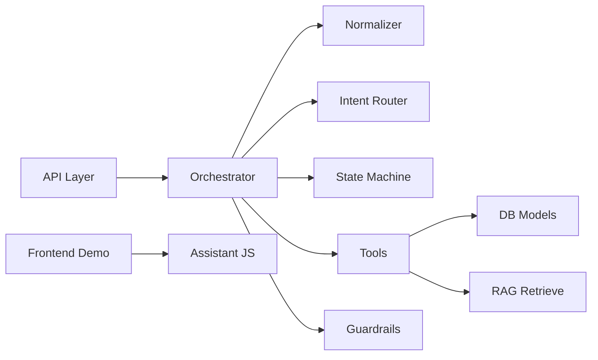

# Assistant Engine

<cite>
**Referenced Files in This Document**
- [orchestrator.py](file://uaea-backend/app/orchestrator/orchestrator.py)
- [tools.py](file://uaea-backend/app/orchestrator/tools.py)
- [intent_router.py](file://uaea-backend/app/orchestrator/intent_router.py)
- [state_machine.py](file://uaea-backend/app/orchestrator/state_machine.py)
- [guardrails.py](file://uaea-backend/app/orchestrator/guardrails.py)
- [retrieve.py](file://uaea-backend/app/rag/retrieve.py)
- [chat.py](file://uaea-backend/app/api/chat.py)
- [models.py](file://uaea-backend/app/db/models.py)
- [normalizer.py](file://uaea-backend/app/orchestrator/normalizer.py)
- [assistant.js](file://src/lib/assistant.js)
- [Chat/index.jsx](file://src/pages/student/Chat/index.jsx)
</cite>

## Table of Contents
1. [Introduction](#introduction)
2. [Project Structure](#project-structure)
3. [Core Components](#core-components)
4. [Architecture Overview](#architecture-overview)
5. [Detailed Component Analysis](#detailed-component-analysis)
6. [Dependency Analysis](#dependency-analysis)
7. [Performance Considerations](#performance-considerations)
8. [Troubleshooting Guide](#troubleshooting-guide)
9. [Conclusion](#conclusion)
10. [Appendices](#appendices)

## Introduction
This document explains the assistant engine that processes user queries through a robust orchestration pipeline. The engine receives classified intents, executes tool calls for data retrieval (database lookups, knowledge base search), and generates contextual responses using LLM integration with guardrails to ensure grounded answers. It also covers guided flows, conversation state management, error handling, fallbacks, and RAG integration.

## Project Structure
The assistant engine is implemented primarily in the backend Python service with a complementary frontend flow for local/demo mode. Key modules:
- API layer exposes chat endpoints and persists conversations/messages.
- Orchestrator coordinates normalization, classification, guided flows, LLM tool-calling loop, guardrails, and persistence.
- Tools module defines and implements tools for fees, deadlines, departments, document checklists, escalation, and knowledge base search.
- State machine manages guided flows across turns.
- Guardrails validate and sanitize LLM output against tool results.
- RAG retrieve performs vector similarity search over knowledge chunks.
- Frontend demonstrates classification, routing, answer composition, and UI interactions.

**Diagram sources**
- [chat.py:21-39](file://uaea-backend/app/api/chat.py#L21-L39)
- [orchestrator.py:46-143](file://uaea-backend/app/orchestrator/orchestrator.py#L46-L143)
- [tools.py:18-87](file://uaea-backend/app/orchestrator/tools.py#L18-L87)
- [retrieve.py:32-96](file://uaea-backend/app/rag/retrieve.py#L32-L96)
- [models.py:71-140](file://uaea-backend/app/db/models.py#L71-L140)

**Section sources**
- [chat.py:21-39](file://uaea-backend/app/api/chat.py#L21-L39)
- [orchestrator.py:46-143](file://uaea-backend/app/orchestrator/orchestrator.py#L46-L143)

## Core Components
- Orchestration pipeline: input sanitization, language detection, normalization, intent classification, guided flow handling, LLM tool-use loop, guardrails, and persistence.
- Tool execution framework: typed tool definitions with schemas; implementations query database models or call RAG; dispatcher routes by name.
- Guided flows: deterministic state machine for multi-turn slot-filling and action sequences (e.g., admission, fee challan, degree).
- Guardrails: post-LLM verification to strip ungrounded numbers, dates, and requirements not backed by tool results.
- RAG integration: vector similarity search over knowledge chunks with optional reranking and formatted citations.
- Conversation state: persisted via messages and flow_state tool calls to survive restarts and support multi-turn context.

**Section sources**
- [orchestrator.py:46-143](file://uaea-backend/app/orchestrator/orchestrator.py#L46-L143)
- [tools.py:218-235](file://uaea-backend/app/orchestrator/tools.py#L218-L235)
- [state_machine.py:16-59](file://uaea-backend/app/orchestrator/state_machine.py#L16-L59)
- [guardrails.py:74-119](file://uaea-backend/app/orchestrator/guardrails.py#L74-L119)
- [retrieve.py:32-96](file://uaea-backend/app/rag/retrieve.py#L32-L96)

## Architecture Overview
End-to-end message processing flow:
1. API receives a chat message and delegates to orchestrator.
2. Orchestrator cleans text, detects language, normalizes, classifies intent.
3. If a guided flow is active, it handles slot-filling and actions before falling back to LLM.
4. Orchestrator calls LLM with tool definitions; LLM may request tool calls.
5. Each tool call is executed and results are appended to message history until final text reply.
6. Guardrails scan the reply and replace ungrounded claims.
7. Messages and flow state are persisted; sources are extracted for citation display.

**Diagram sources**
- [chat.py:21-39](file://uaea-backend/app/api/chat.py#L21-L39)
- [orchestrator.py:46-143](file://uaea-backend/app/orchestrator/orchestrator.py#L46-L143)
- [tools.py:218-235](file://uaea-backend/app/orchestrator/tools.py#L218-L235)
- [state_machine.py:94-146](file://uaea-backend/app/orchestrator/state_machine.py#L94-L146)
- [retrieve.py:32-96](file://uaea-backend/app/rag/retrieve.py#L32-L96)

## Detailed Component Analysis

### Orchestration Pipeline
- Input sanitization and language detection normalize and prepare text for classification.
- Classification uses keyword rules to determine intent and confidence; low-confidence queries are tracked for review.
- Guided flows intercept specific intents to collect slots and execute predefined actions before LLM involvement.
- LLM integration uses Anthropic tool-use; up to a fixed number of rounds to gather information and produce a final reply.
- Guardrails enforce grounding by scanning for numbers, dates, and requirements and replacing unverified claims.
- Persistence stores user and assistant messages, including tool calls and flow state, enabling multi-turn continuity.

**Diagram sources**
- [orchestrator.py:46-143](file://uaea-backend/app/orchestrator/orchestrator.py#L46-L143)
- [orchestrator.py:229-318](file://uaea-backend/app/orchestrator/orchestrator.py#L229-L318)
- [guardrails.py:74-119](file://uaea-backend/app/orchestrator/guardrails.py#L74-L119)

**Section sources**
- [orchestrator.py:46-143](file://uaea-backend/app/orchestrator/orchestrator.py#L46-L143)
- [orchestrator.py:229-318](file://uaea-backend/app/orchestrator/orchestrator.py#L229-L318)
- [guardrails.py:74-119](file://uaea-backend/app/orchestrator/guardrails.py#L74-L119)

### Tool Execution Framework
- Tool definitions include names, descriptions, and JSON schemas for inputs.
- Implementations:
  - Fee lookup: fuzzy match program and category; returns amount, currency, effective date, source reference.
  - Deadline lookup: joins services and deadlines; supports matching by service name or ID; returns date, semester, source.
  - Department contact: searches department and region names; returns contact details and campus info.
  - Document checklist: retrieves required documents and procedure text for a service.
  - Escalation ticket: creates an open ticket and flags conversation escalation.
  - Knowledge base search: integrates RAG retrieval with vector similarity and reranking.
- Dispatcher routes tool_name to corresponding implementation; unknown tools return an error.

**Diagram sources**
- [tools.py:18-87](file://uaea-backend/app/orchestrator/tools.py#L18-L87)
- [tools.py:92-235](file://uaea-backend/app/orchestrator/tools.py#L92-L235)
- [retrieve.py:32-96](file://uaea-backend/app/rag/retrieve.py#L32-L96)

**Section sources**
- [tools.py:18-87](file://uaea-backend/app/orchestrator/tools.py#L18-L87)
- [tools.py:92-235](file://uaea-backend/app/orchestrator/tools.py#L92-L235)
- [retrieve.py:32-96](file://uaea-backend/app/rag/retrieve.py#L32-L96)

### Guided Flows and State Management
- Flow definitions specify slots and steps for admission, fee challan, and degree application.
- State machine determines next step: prompts for unfilled slots or executes actions when all arguments are available.
- Flow state is reconstructed from message history via flow_state tool calls, ensuring persistence across restarts.
- When all steps complete, control returns to LLM to generate a final summary incorporating tool results.

**Diagram sources**
- [state_machine.py:16-59](file://uaea-backend/app/orchestrator/state_machine.py#L16-L59)
- [state_machine.py:94-146](file://uaea-backend/app/orchestrator/state_machine.py#L94-L146)

**Section sources**
- [state_machine.py:16-59](file://uaea-backend/app/orchestrator/state_machine.py#L16-L59)
- [state_machine.py:94-146](file://uaea-backend/app/orchestrator/state_machine.py#L94-L146)

### Response Generation and Grounding
- LLM produces replies based on tool results; system prompt enforces strict grounding rules.
- Guardrails scan for ungrounded numbers, dates, and requirements; replace with placeholders or escalate if too many violations.
- Sources are extracted from tool call results to provide citations and verification metadata in the response.

**Diagram sources**
- [orchestrator.py:229-318](file://uaea-backend/app/orchestrator/orchestrator.py#L229-L318)
- [guardrails.py:74-119](file://uaea-backend/app/orchestrator/guardrails.py#L74-L119)
- [orchestrator.py:386-404](file://uaea-backend/app/orchestrator/orchestrator.py#L386-L404)

**Section sources**
- [orchestrator.py:229-318](file://uaea-backend/app/orchestrator/orchestrator.py#L229-L318)
- [guardrails.py:74-119](file://uaea-backend/app/orchestrator/guardrails.py#L74-L119)
- [orchestrator.py:386-404](file://uaea-backend/app/orchestrator/orchestrator.py#L386-L404)

### RAG Integration
- RAG retrieve computes embeddings for queries and performs cosine similarity search over knowledge chunks.
- Results are reranked with section header overlap boosts and returned with formatted citations.
- Integrated as a tool so the LLM can fetch authoritative content when needed.

**Diagram sources**
- [retrieve.py:17-29](file://uaea-backend/app/rag/retrieve.py#L17-L29)
- [retrieve.py:32-96](file://uaea-backend/app/rag/retrieve.py#L32-L96)

**Section sources**
- [retrieve.py:17-29](file://uaea-backend/app/rag/retrieve.py#L17-L29)
- [retrieve.py:32-96](file://uaea-backend/app/rag/retrieve.py#L32-L96)

### Frontend Assistant Logic (Demo Mode)
- Local demo composes answers from stored data and tool call stubs, providing templates in multiple languages.
- Handles fee lookup, deadline checks, department contacts, and document checklists with fallbacks to human handoff.
- Shows trust lines and follow-up suggestions based on intent.

**Section sources**
- [assistant.js:128-317](file://src/lib/assistant.js#L128-L317)
- [Chat/index.jsx:62-138](file://src/pages/student/Chat/index.jsx#L62-L138)

## Dependency Analysis
- API depends on orchestrator for message handling and schema validation.
- Orchestrator depends on normalizer, intent router, state machine, tools, guardrails, and database models.
- Tools depend on SQLAlchemy models and optionally RAG retrieve.
- RAG retrieve depends on configuration and vector database operations.
- Frontend depends on classification and assistant logic for local demo behavior.

**Diagram sources**
- [chat.py:21-39](file://uaea-backend/app/api/chat.py#L21-L39)
- [orchestrator.py:46-143](file://uaea-backend/app/orchestrator/orchestrator.py#L46-L143)
- [tools.py:218-235](file://uaea-backend/app/orchestrator/tools.py#L218-L235)
- [retrieve.py:32-96](file://uaea-backend/app/rag/retrieve.py#L32-L96)
- [assistant.js:128-317](file://src/lib/assistant.js#L128-L317)

**Section sources**
- [chat.py:21-39](file://uaea-backend/app/api/chat.py#L21-L39)
- [orchestrator.py:46-143](file://uaea-backend/app/orchestrator/orchestrator.py#L46-L143)
- [tools.py:218-235](file://uaea-backend/app/orchestrator/tools.py#L218-L235)
- [retrieve.py:32-96](file://uaea-backend/app/rag/retrieve.py#L32-L96)
- [assistant.js:128-317](file://src/lib/assistant.js#L128-L317)

## Performance Considerations
- Limit message history sent to LLM to recent messages to reduce token usage and latency.
- Use top-k limits in RAG retrieval to constrain vector search cost.
- Fuzzy matching in tools should be optimized with indexes where possible (e.g., program column indexing).
- Guardrails operate on short replies; keep patterns efficient to avoid overhead.
- Batch database queries where feasible and leverage relationships defined in models.

[No sources needed since this section provides general guidance]

## Troubleshooting Guide
Common issues and resolutions:
- LLM API errors: Orchestrator catches API exceptions and returns a friendly fallback message without escalating unless necessary.
- Unknown tool calls: Dispatcher returns an error; ensure tool names match definitions.
- No data found: Tools return structured errors; guardrails will mark ungrounded claims; consider escalation if repeated failures occur.
- Low classifier confidence: Queries are tracked in unanswered queue for review; consider expanding rule sets or adding synonyms.
- RAG embedding misconfiguration: If embedding key is placeholder, vectors default to zeros; configure settings to enable proper retrieval.

**Section sources**
- [orchestrator.py:255-271](file://uaea-backend/app/orchestrator/orchestrator.py#L255-L271)
- [tools.py:218-235](file://uaea-backend/app/orchestrator/tools.py#L218-L235)
- [orchestrator.py:367-383](file://uaea-backend/app/orchestrator/orchestrator.py#L367-L383)
- [retrieve.py:17-29](file://uaea-backend/app/rag/retrieve.py#L17-L29)

## Conclusion
The assistant engine combines deterministic classification, guided flows, LLM tool-use, and rigorous guardrails to deliver accurate, grounded responses. Its modular design separates concerns across normalization, routing, state management, tool execution, and retrieval, enabling scalable maintenance and extensibility. The system ensures reliability through fallback mechanisms, escalation paths, and persistent conversation state.

[No sources needed since this section summarizes without analyzing specific files]

## Appendices

### Example Tool Calls
- Fee lookup: call tool with programme and optional category; returns amount, currency, effective date, source.
- Deadline checking: call tool with service name; returns date, semester, source.
- Department contact retrieval: call tool with department or region; returns phone, email, office hours, campus address.
- Document checklist: call tool with service; returns checklist items and procedure text.
- Knowledge base search: call tool with query; returns relevant chunks with scores and sources.

**Section sources**
- [tools.py:18-87](file://uaea-backend/app/orchestrator/tools.py#L18-L87)
- [tools.py:125-197](file://uaea-backend/app/orchestrator/tools.py#L125-L197)
- [retrieve.py:32-96](file://uaea-backend/app/rag/retrieve.py#L32-L96)

### Conversation State and Context Preservation
- Flow state is persisted via tool calls named flow_state within messages, allowing reconstruction after restarts.
- Message history includes roles, text, intents, and tool calls, enabling multi-turn continuity and context-aware responses.
- Session retrieval endpoint provides full conversation history for UI rendering and debugging.

**Section sources**
- [state_machine.py:70-91](file://uaea-backend/app/orchestrator/state_machine.py#L70-L91)
- [models.py:144-178](file://uaea-backend/app/db/models.py#L144-L178)
- [chat.py:42-85](file://uaea-backend/app/api/chat.py#L42-L85)