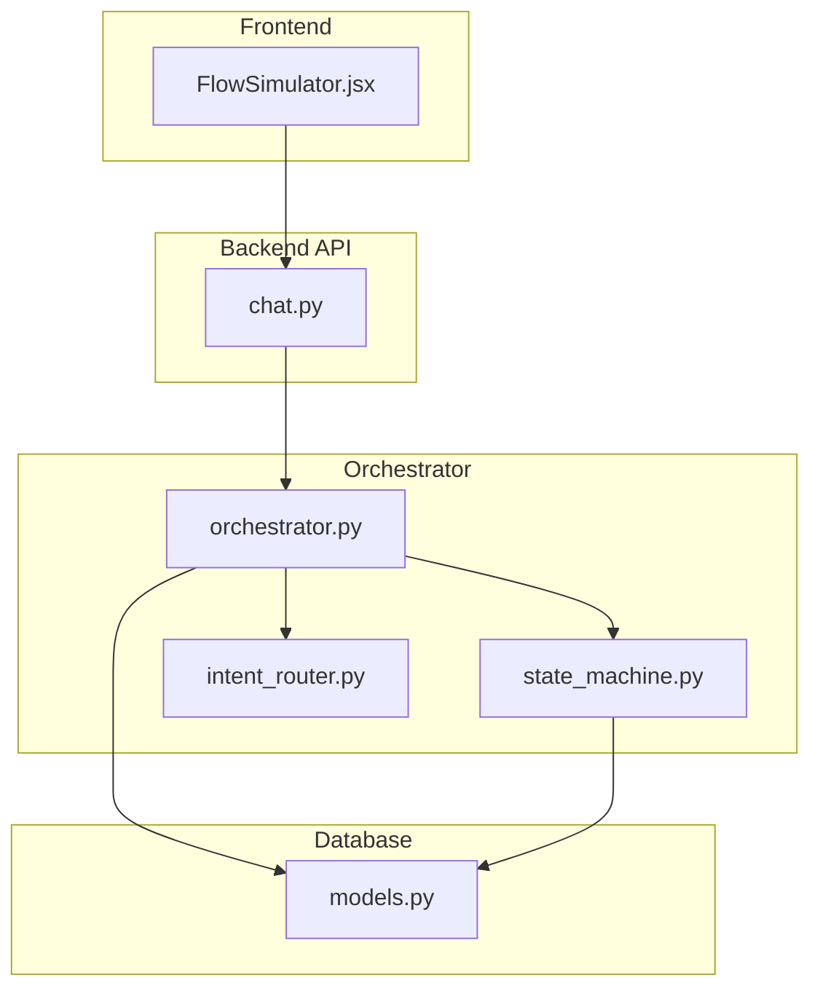
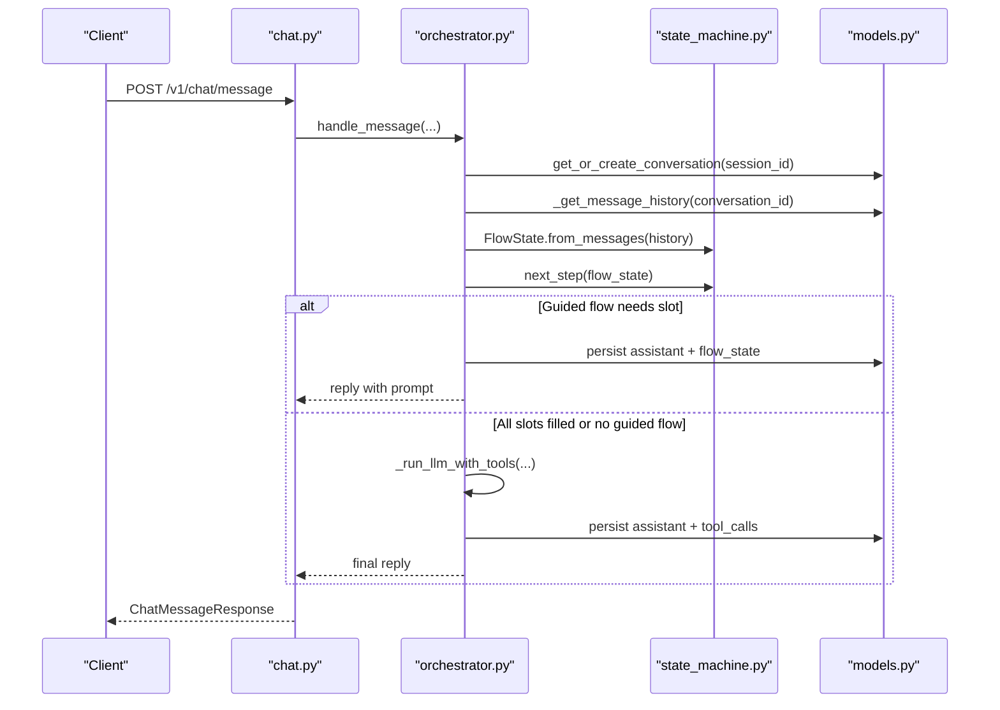
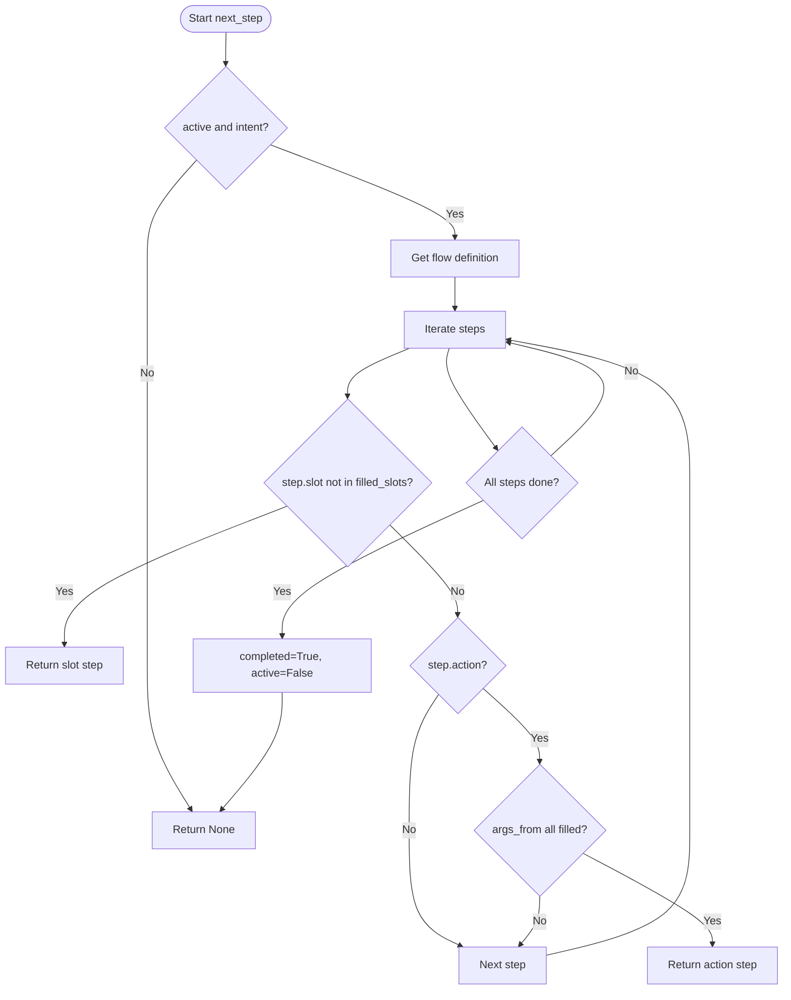
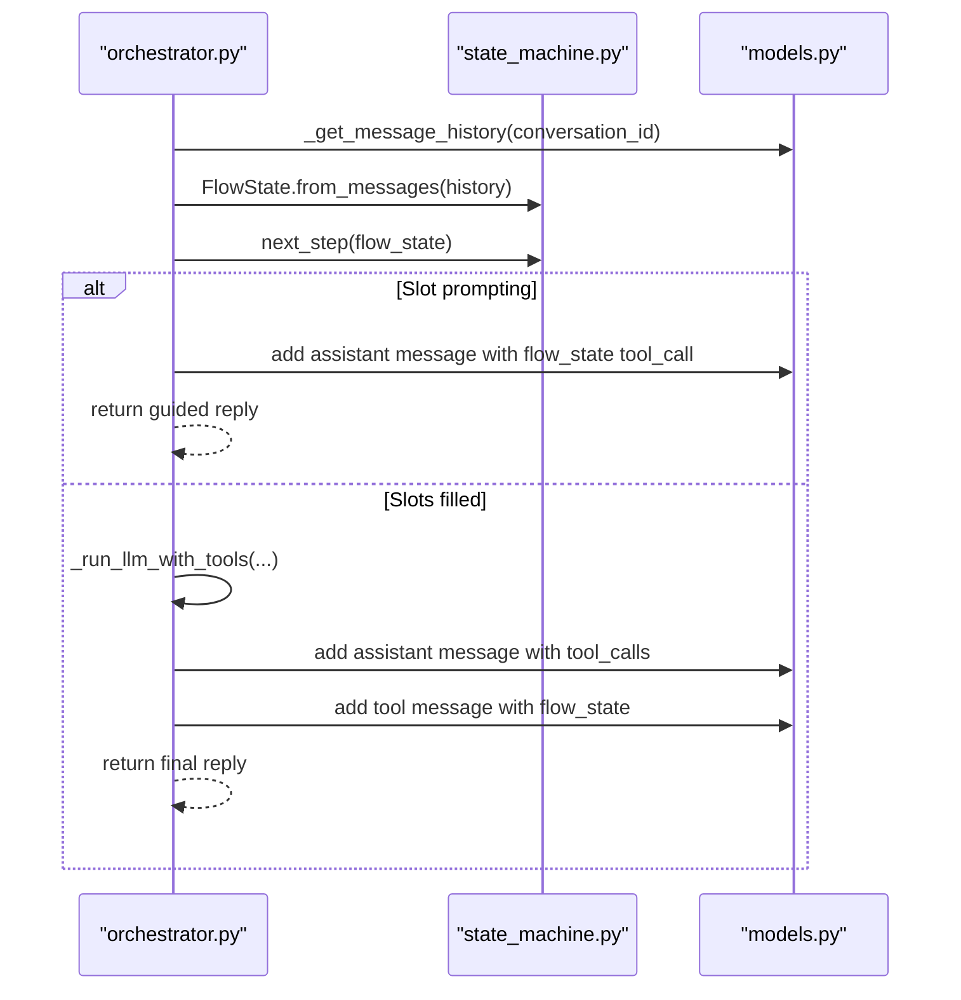
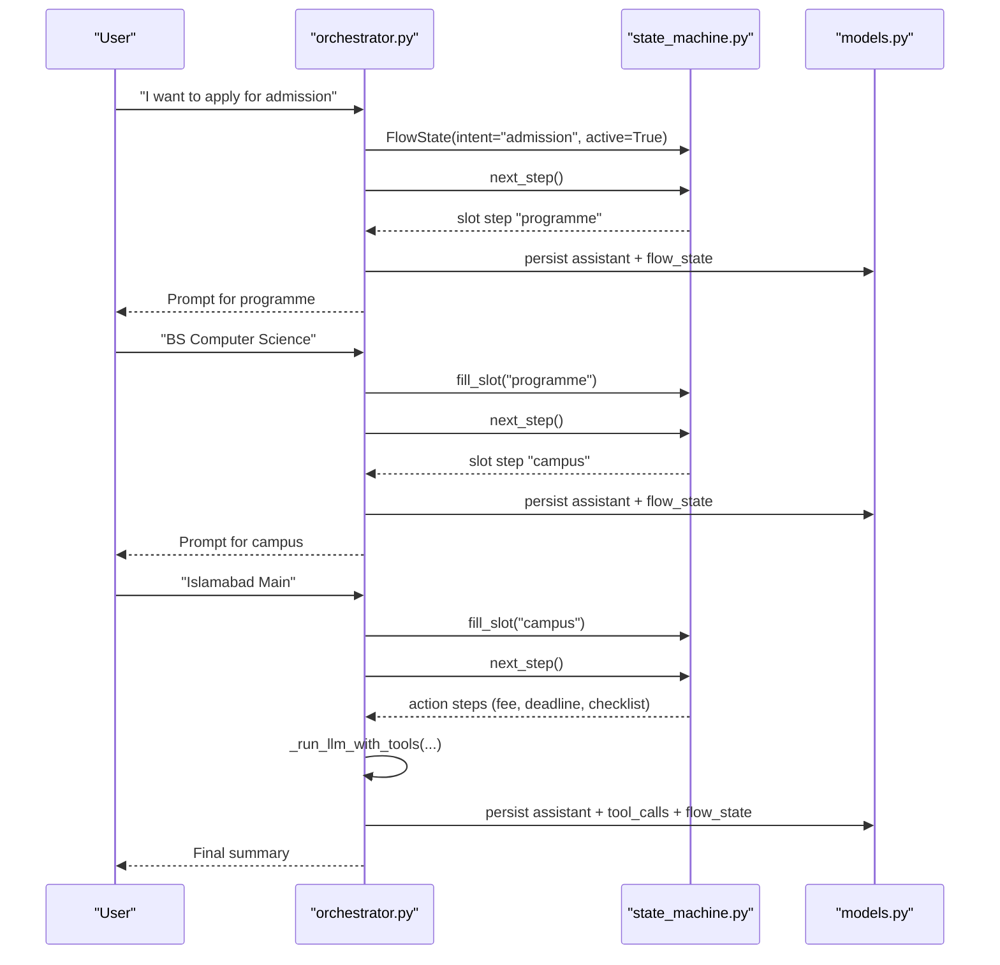
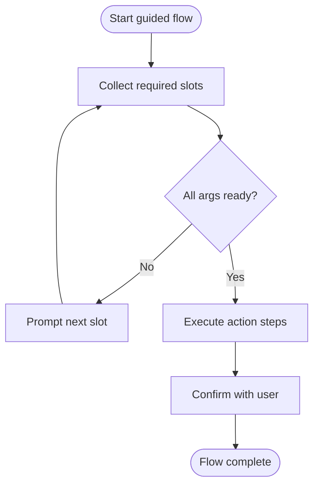
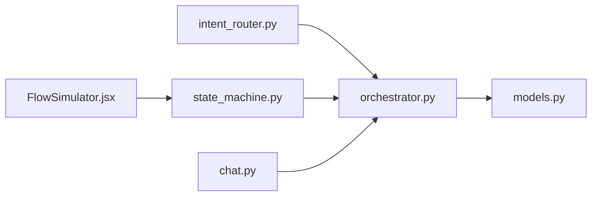

# Conversation State Management

<cite>
**Referenced Files in This Document**
- [state_machine.py](file://uaea-backend/app/orchestrator/state_machine.py)
- [orchestrator.py](file://uaea-backend/app/orchestrator/orchestrator.py)
- [models.py](file://uaea-backend/app/db/models.py)
- [intent_router.py](file://uaea-backend/app/orchestrator/intent_router.py)
- [chat.py](file://uaea-backend/app/api/chat.py)
- [FlowSimulator.jsx](file://src/pages/GuidedFlows/FlowSimulator.jsx)
</cite>

## Table of Contents
1. Introduction
2. Project Structure
3. Core Components
4. Architecture Overview
5. Detailed Component Analysis
6. Dependency Analysis
7. Performance Considerations
8. Troubleshooting Guide
9. Conclusion

## Introduction
This document explains the conversation state management system that tracks user interactions across multiple message exchanges and drives guided workflows such as fee inquiries, admission flows, and degree applications. It focuses on:
- The FlowState class that maintains active guided flows, filled slots, and completion status
- The state machine transitions between steps in guided workflows
- Persistence to the database and restoration for subsequent interactions
- Examples of multi-step form filling, conditional branching, and flow termination
- State validation, timeout handling, and cleanup procedures for abandoned conversations

## Project Structure
The stateful conversation system spans backend orchestration, persistence models, intent classification, and a frontend simulator used to walk through flows.

**Diagram sources**
- [chat.py:21-39](file://uaea-backend/app/api/chat.py#L21-L39)
- [orchestrator.py:46-143](file://uaea-backend/app/orchestrator/orchestrator.py#L46-L143)
- [state_machine.py:14-146](file://uaea-backend/app/orchestrator/state_machine.py#L14-L146)
- [intent_router.py:61-103](file://uaea-backend/app/orchestrator/intent_router.py#L61-L103)
- [models.py:144-178](file://uaea-backend/app/db/models.py#L144-L178)

**Section sources**
- [chat.py:21-39](file://uaea-backend/app/api/chat.py#L21-L39)
- [orchestrator.py:46-143](file://uaea-backend/app/orchestrator/orchestrator.py#L46-L143)
- [state_machine.py:14-146](file://uaea-backend/app/orchestrator/state_machine.py#L14-L146)
- [intent_router.py:61-103](file://uaea-backend/app/orchestrator/intent_router.py#L61-L103)
- [models.py:144-178](file://uaea-backend/app/db/models.py#L144-L178)

## Core Components
- FlowState: A dataclass representing the current state of a guided flow within a conversation, including intent, active flag, filled_slots, and completed flag. It can be reconstructed from message history via from_messages and serialized via to_dict.
- FLOW_DEFINITIONS: Declarative definitions of guided flows (admission, fee_challan, degree), each with slots and ordered steps that may ask for input, execute actions, or confirm results.
- next_step: Determines the next step for an active flow by scanning steps for unfilled slots or executable actions whose required arguments are available. Marks flow complete when all steps are done.
- fill_slot: Fills the next unfilled slot with user-provided text and returns the slot name.
- Orchestrator integration: handle_message orchestrates normalization, intent classification, conversation retrieval, guided flow handling, LLM tool calls, guardrails, and persistence. It persists flow state into messages so it survives restarts.
- Persistence models: Conversation and Message tables store conversation context and tool call histories; flow state is embedded in tool_calls of assistant/tool messages.

**Section sources**
- [state_machine.py:14-146](file://uaea-backend/app/orchestrator/state_machine.py#L14-L146)
- [orchestrator.py:46-143](file://uaea-backend/app/orchestrator/orchestrator.py#L46-L143)
- [models.py:144-178](file://uaea-backend/app/db/models.py#L144-L178)

## Architecture Overview
End-to-end flow for a user message:
- API receives a chat message and delegates to the orchestrator
- Orchestrator normalizes input, classifies intent, retrieves or creates a conversation
- Orchestrator reconstructs FlowState from message history and handles guided flow steps
- If guided flow completes or falls through, orchestrator runs LLM with tools, executes tool calls, applies guardrails, and persists assistant response and flow state
- Frontend simulator demonstrates step-by-step execution and slot filling

**Diagram sources**
- [chat.py:21-39](file://uaea-backend/app/api/chat.py#L21-L39)
- [orchestrator.py:46-143](file://uaea-backend/app/orchestrator/orchestrator.py#L46-L143)
- [state_machine.py:70-125](file://uaea-backend/app/orchestrator/state_machine.py#L70-L125)
- [models.py:144-178](file://uaea-backend/app/db/models.py#L144-L178)

## Detailed Component Analysis

### FlowState and Flow Definitions
FlowState encapsulates:
- intent: the active guided flow identifier
- active: whether the flow is currently running
- filled_slots: key-value pairs of collected inputs
- completed: whether the flow has finished

It supports reconstruction from message history by scanning tool_calls for a special flow_state entry and serialization for persistence.

FLOW_DEFINITIONS include:
- admission: collects programme and campus, then executes lookups and confirms
- fee_challan: collects programme and enrolment_type, then executes lookups and confirms
- degree: executes lookups and confirms without collecting slots

These definitions drive deterministic step execution and ensure consistent user journeys.

**Section sources**
- [state_machine.py:14-91](file://uaea-backend/app/orchestrator/state_machine.py#L14-L91)

### State Machine Transitions
next_step determines the next action:
- Scans steps for unfilled slots and returns the first missing slot’s step
- For action steps, checks if required args_from are present in filled_slots or defined inline
- When all steps are processed, marks completed=True and active=False

fill_slot fills the next unfilled slot with user text and returns the slot name.

**Diagram sources**
- [state_machine.py:94-125](file://uaea-backend/app/orchestrator/state_machine.py#L94-L125)

**Section sources**
- [state_machine.py:94-146](file://uaea-backend/app/orchestrator/state_machine.py#L94-L146)

### Orchestrator Integration and Persistence
handle_message coordinates:
- Input sanitization and language detection
- Intent classification and conversation retrieval
- Reconstruction of FlowState from message history
- Guided flow handling via _handle_guided_flow
- LLM tool execution loop with guardrails
- Persistence of assistant messages and flow state

Guided flow handling:
- If flow is active and has unfilled slots, prompts for the next slot and persists flow state
- If all slots are filled, falls through to LLM to gather tool results and produce final summary
- Persists flow state after each turn to survive restarts

Persistence mechanism:
- Conversation and Message tables store conversation context
- Flow state is stored in tool_calls of assistant/tool messages
- Message history is read back to reconstruct FlowState on subsequent turns

**Diagram sources**
- [orchestrator.py:46-143](file://uaea-backend/app/orchestrator/orchestrator.py#L46-L143)
- [orchestrator.py:146-227](file://uaea-backend/app/orchestrator/orchestrator.py#L146-L227)
- [state_machine.py:70-125](file://uaea-backend/app/orchestrator/state_machine.py#L70-L125)
- [models.py:144-178](file://uaea-backend/app/db/models.py#L144-L178)

**Section sources**
- [orchestrator.py:46-143](file://uaea-backend/app/orchestrator/orchestrator.py#L46-L143)
- [orchestrator.py:146-227](file://uaea-backend/app/orchestrator/orchestrator.py#L146-L227)
- [models.py:144-178](file://uaea-backend/app/db/models.py#L144-L178)

### Example Scenarios

#### Multi-step Form Filling (Admission Flow)
- User triggers admission intent
- Orchestrator starts flow, prompts for programme
- User provides programme; next_step detects next slot campus
- Orchestrator prompts for campus; user provides campus
- Orchestrator executes actions (fee tariff, deadline, checklist) and falls through to LLM for summary
- Flow completes; state marked completed and inactive

**Diagram sources**
- [state_machine.py:16-31](file://uaea-backend/app/orchestrator/state_machine.py#L16-L31)
- [state_machine.py:94-125](file://uaea-backend/app/orchestrator/state_machine.py#L94-L125)
- [orchestrator.py:146-227](file://uaea-backend/app/orchestrator/orchestrator.py#L146-L227)

**Section sources**
- [state_machine.py:16-31](file://uaea-backend/app/orchestrator/state_machine.py#L16-L31)
- [orchestrator.py:146-227](file://uaea-backend/app/orchestrator/orchestrator.py#L146-L227)

#### Conditional Branching Based on User Responses
- Steps check required args_from before executing actions
- If args are missing, next_step returns the corresponding slot step
- Once all args are filled, action steps execute in order
- Confirm steps provide final summaries or instructions

**Diagram sources**
- [state_machine.py:106-125](file://uaea-backend/app/orchestrator/state_machine.py#L106-L125)

**Section sources**
- [state_machine.py:106-125](file://uaea-backend/app/orchestrator/state_machine.py#L106-L125)

#### Flow Termination Conditions
- All steps processed: next_step sets completed=True and active=False
- No matching flow definition: next_step returns None
- Low-confidence intents fall through to LLM unless part of GUIDED_FLOW_INTENTS

**Section sources**
- [state_machine.py:102-125](file://uaea-backend/app/orchestrator/state_machine.py#L102-L125)
- [intent_router.py:61-62](file://uaea-backend/app/orchestrator/intent_router.py#L61-L62)

### State Validation
- next_step validates active and intent before proceeding
- fill_slot validates active and intent and ensures only unfilled slots are overwritten
- Action steps validate args_from presence before execution

**Section sources**
- [state_machine.py:99-125](file://uaea-backend/app/orchestrator/state_machine.py#L99-L125)
- [state_machine.py:128-146](file://uaea-backend/app/orchestrator/state_machine.py#L128-L146)

### Timeout Handling
- LLM tool-call loop is bounded by MAX_ROUNDS to prevent infinite loops
- If rounds exhaust without a final text block, orchestrator escalates and returns a fallback message

**Section sources**
- [orchestrator.py:42-43](file://uaea-backend/app/orchestrator/orchestrator.py#L42-L43)
- [orchestrator.py:255-318](file://uaea-backend/app/orchestrator/orchestrator.py#L255-L318)

### Cleanup Procedures for Abandoned Conversations
- Conversations are identified by session_id and channel; resolved flag indicates closure
- Escalation tickets mark conversations as escalated
- No explicit timeout-based cleanup is implemented in the analyzed code; abandoned conversations remain open until manually resolved or escalated

**Section sources**
- [models.py:144-159](file://uaea-backend/app/db/models.py#L144-L159)
- [orchestrator.py:321-341](file://uaea-backend/app/orchestrator/orchestrator.py#L321-L341)
- [chat.py:88-114](file://uaea-backend/app/api/chat.py#L88-L114)

### Frontend Simulator
The FlowSimulator component walks through flow steps one at a time, simulating slot filling and tool calls to make state transitions visible during design and testing.

**Section sources**
- [FlowSimulator.jsx:20-159](file://src/pages/GuidedFlows/FlowSimulator.jsx#L20-L159)

## Dependency Analysis
Key dependencies and relationships:
- Orchestrator depends on state_machine for flow control and intent_router for classification
- Persistence relies on Conversation and Message models
- API routes expose chat endpoints that delegate to orchestrator
- Frontend simulator uses flow definitions to visualize state transitions

**Diagram sources**
- [intent_router.py:61-103](file://uaea-backend/app/orchestrator/intent_router.py#L61-L103)
- [state_machine.py:14-146](file://uaea-backend/app/orchestrator/state_machine.py#L14-L146)
- [orchestrator.py:46-143](file://uaea-backend/app/orchestrator/orchestrator.py#L46-L143)
- [models.py:144-178](file://uaea-backend/app/db/models.py#L144-L178)
- [chat.py:21-39](file://uaea-backend/app/api/chat.py#L21-L39)
- [FlowSimulator.jsx:20-159](file://src/pages/GuidedFlows/FlowSimulator.jsx#L20-L159)

**Section sources**
- [intent_router.py:61-103](file://uaea-backend/app/orchestrator/intent_router.py#L61-L103)
- [state_machine.py:14-146](file://uaea-backend/app/orchestrator/state_machine.py#L14-L146)
- [orchestrator.py:46-143](file://uaea-backend/app/orchestrator/orchestrator.py#L46-L143)
- [models.py:144-178](file://uaea-backend/app/db/models.py#L144-L178)
- [chat.py:21-39](file://uaea-backend/app/api/chat.py#L21-L39)
- [FlowSimulator.jsx:20-159](file://src/pages/GuidedFlows/FlowSimulator.jsx#L20-L159)

## Performance Considerations
- Bounded LLM rounds prevent excessive tool-call loops
- Message history is truncated to last 20 messages for LLM context to reduce payload size
- Flow state persistence occurs per turn; consider batching or deduplication if high-frequency updates are needed
- Deterministic flow definitions minimize LLM improvisation and improve reliability

[No sources needed since this section provides general guidance]

## Troubleshooting Guide
Common issues and diagnostics:
- Flow does not start: Ensure intent is in GUIDED_FLOW_INTENTS and flow definition exists
- Slot not filling: Verify next_step identifies the correct slot and fill_slot is called with user text
- Actions not executing: Check args_from requirements and filled_slots content
- Infinite loops: MAX_ROUNDS prevents runaway loops; inspect tool call results and error paths
- Abandoned conversations: Use session lookup and escalation endpoint to manage open conversations

**Section sources**
- [intent_router.py:61-62](file://uaea-backend/app/orchestrator/intent_router.py#L61-L62)
- [state_machine.py:94-146](file://uaea-backend/app/orchestrator/state_machine.py#L94-L146)
- [orchestrator.py:255-318](file://uaea-backend/app/orchestrator/orchestrator.py#L255-L318)
- [chat.py:88-114](file://uaea-backend/app/api/chat.py#L88-L114)

## Conclusion
The conversation state management system uses a deterministic state machine to guide users through multi-step workflows, ensuring reliable slot collection, action execution, and final summaries. FlowState captures active flows and progress, while persistence via message history enables robust restoration across sessions. The orchestrator integrates classification, guided flows, LLM tool calls, and guardrails to deliver grounded responses. While timeouts are handled via bounded LLM rounds, explicit cleanup for abandoned conversations is not implemented in the analyzed code and may require additional logic based on operational needs.