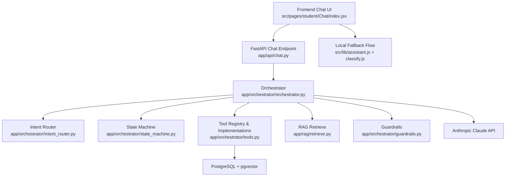
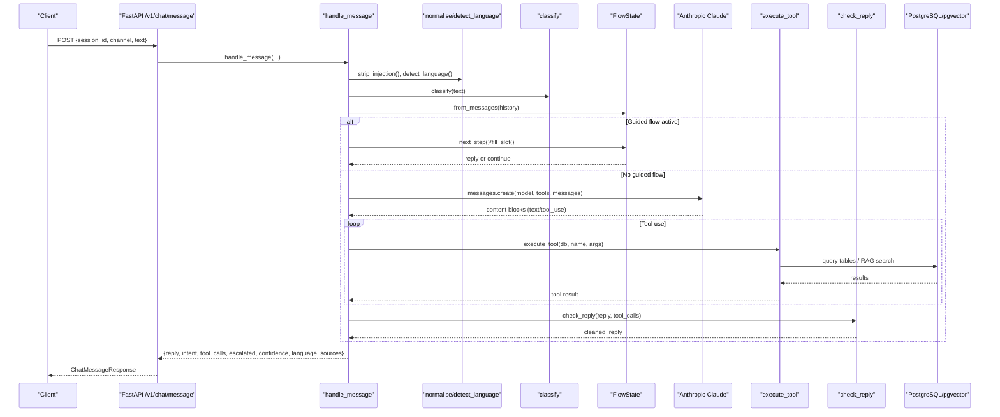
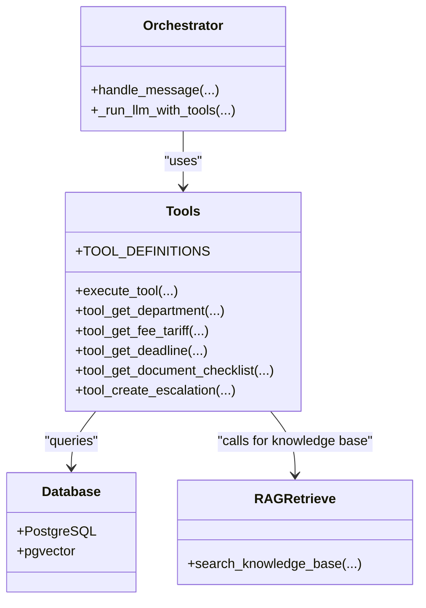
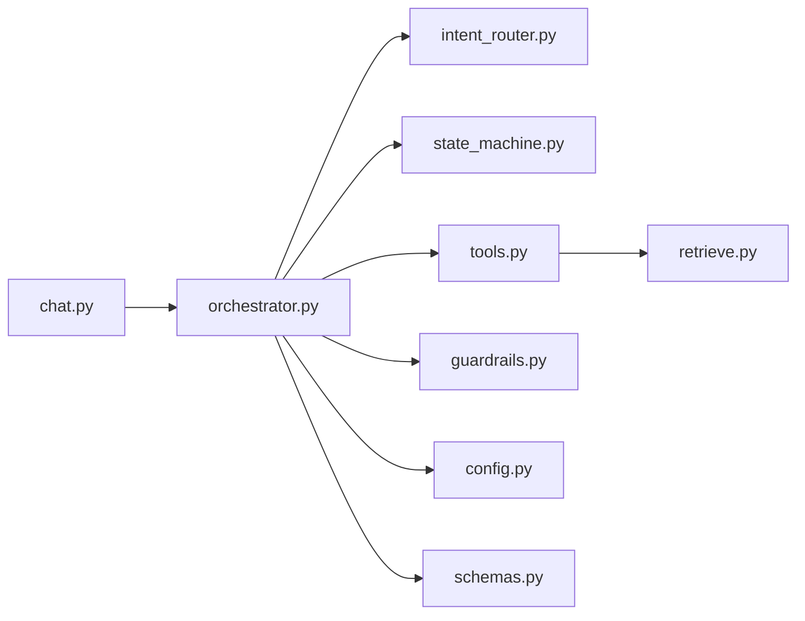

# LLM Integration

<cite>
**Referenced Files in This Document**
- [orchestrator.py](file://uaea-backend/app/orchestrator/orchestrator.py)
- [tools.py](file://uaea-backend/app/orchestrator/tools.py)
- [guardrails.py](file://uaea-backend/app/orchestrator/guardrails.py)
- [intent_router.py](file://uaea-backend/app/orchestrator/intent_router.py)
- [state_machine.py](file://uaea-backend/app/orchestrator/state_machine.py)
- [retrieve.py](file://uaea-backend/app/rag/retrieve.py)
- [chat.py](file://uaea-backend/app/api/chat.py)
- [config.py](file://uaea-backend/app/config.py)
- [schemas.py](file://uaea-backend/app/schemas.py)
- [index.jsx](file://src/pages/student/Chat/index.jsx)
- [assistant.js](file://src/lib/assistant.js)
- [classify.js](file://src/lib/classify.js)
- [README.md](file://uaea-backend/README.md)
</cite>

## Table of Contents
1. Introduction
2. Project Structure
3. Core Components
4. Architecture Overview
5. Detailed Component Analysis
6. Dependency Analysis
7. Performance Considerations
8. Troubleshooting Guide
9. Conclusion
10. Appendices

## Introduction
This document explains how the assistant integrates with Anthropic’s Claude API to provide natural language capabilities for university student services. It covers:
- How messages are processed end-to-end, including intent classification, guided flows, tool calling, and guardrails
- How API keys and rate limiting are configured
- The prompt engineering approach that defines behavior, safety rules, and response formatting
- The structured tool-calling mechanism used to retrieve authoritative data (fees, deadlines, documents, departments, knowledge base)
- Conversation patterns such as direct Q&A, multi-turn dialogues with tool usage, and complex reasoning tasks
- Error handling for API failures, token management strategies, and performance optimizations

## Project Structure
The LLM integration spans a FastAPI backend and a React frontend. The backend orchestrates message processing, while the frontend provides a chat interface and an in-browser fallback flow using local classification and templated answers.

**Diagram sources**
- [chat.py:21-39](file://uaea-backend/app/api/chat.py#L21-L39)
- [orchestrator.py:46-143](file://uaea-backend/app/orchestrator/orchestrator.py#L46-L143)
- [intent_router.py:65-102](file://uaea-backend/app/orchestrator/intent_router.py#L65-L102)
- [state_machine.py:16-59](file://uaea-backend/app/orchestrator/state_machine.py#L16-L59)
- [tools.py:18-87](file://uaea-backend/app/orchestrator/tools.py#L18-L87)
- [retrieve.py:32-96](file://uaea-backend/app/rag/retrieve.py#L32-L96)
- [guardrails.py:74-119](file://uaea-backend/app/orchestrator/guardrails.py#L74-L119)
- [index.jsx:62-138](file://src/pages/student/Chat/index.jsx#L62-L138)
- [assistant.js:135-317](file://src/lib/assistant.js#L135-L317)
- [classify.js:195-269](file://src/lib/classify.js#L195-L269)

**Section sources**
- [chat.py:21-39](file://uaea-backend/app/api/chat.py#L21-L39)
- [orchestrator.py:46-143](file://uaea-backend/app/orchestrator/orchestrator.py#L46-L143)
- [index.jsx:62-138](file://src/pages/student/Chat/index.jsx#L62-L138)

## Core Components
- Orchestrator: Central pipeline that normalizes input, classifies intent, manages guided flows, calls the LLM with tools, enforces guardrails, and persists conversation state.
- Tools: Structured function definitions and implementations for querying fees, deadlines, document checklists, departments, escalation tickets, and the knowledge base via RAG.
- Guardrails: Post-processing step that strips or replaces ungrounded claims (numbers, dates, document requirements) not backed by tool results.
- Intent Router: Deterministic keyword-based classifier that routes queries into intents like admission, fee tariff, result, department lookup, etc.
- State Machine: Tracks per-conversation guided flows (admission, fee challan, degree), prompts for missing slots, and executes actions once slots are filled.
- RAG Retrieve: Embedding-based similarity search over knowledge chunks stored in PostgreSQL with pgvector; returns top-k relevant chunks with reranking.
- API Layer: FastAPI endpoints for sending messages, retrieving session history, and escalating conversations.
- Configuration: Environment-driven settings for database, LLM keys, embeddings, CORS, rate limits, and admin keys.
- Frontend: Student chat UI with local classification and templated answer generation as a fallback when not connected to the backend.

**Section sources**
- [orchestrator.py:46-143](file://uaea-backend/app/orchestrator/orchestrator.py#L46-L143)
- [tools.py:18-235](file://uaea-backend/app/orchestrator/tools.py#L18-L235)
- [guardrails.py:74-119](file://uaea-backend/app/orchestrator/guardrails.py#L74-L119)
- [intent_router.py:65-102](file://uaea-backend/app/orchestrator/intent_router.py#L65-L102)
- [state_machine.py:16-146](file://uaea-backend/app/orchestrator/state_machine.py#L16-L146)
- [retrieve.py:32-96](file://uaea-backend/app/rag/retrieve.py#L32-L96)
- [chat.py:21-115](file://uaea-backend/app/api/chat.py#L21-L115)
- [config.py:6-37](file://uaea-backend/app/config.py#L6-L37)
- [index.jsx:62-138](file://src/pages/student/Chat/index.jsx#L62-L138)
- [assistant.js:135-317](file://src/lib/assistant.js#L135-L317)
- [classify.js:195-269](file://src/lib/classify.js#L195-L269)

## Architecture Overview
The system processes each user message through a deterministic pipeline before invoking the LLM. Guided flows can short-circuit the LLM for slot-filling workflows. When the LLM is invoked, it uses structured tool calls to fetch authoritative data from the database or knowledge base. All factual claims are validated by guardrails before being returned to the client.

**Diagram sources**
- [chat.py:21-39](file://uaea-backend/app/api/chat.py#L21-L39)
- [orchestrator.py:46-143](file://uaea-backend/app/orchestrator/orchestrator.py#L46-L143)
- [orchestrator.py:229-318](file://uaea-backend/app/orchestrator/orchestrator.py#L229-L318)
- [tools.py:218-235](file://uaea-backend/app/orchestrator/tools.py#L218-L235)
- [retrieve.py:32-96](file://uaea-backend/app/rag/retrieve.py#L32-L96)
- [guardrails.py:74-119](file://uaea-backend/app/orchestrator/guardrails.py#L74-L119)

## Detailed Component Analysis

### Orchestrator: End-to-End Message Handling
- Input sanitization and language detection ensure safe and consistent processing.
- Intent classification determines whether to enter a guided flow or proceed to LLM invocation.
- Guided flows manage multi-turn slot collection and action execution without LLM overhead.
- LLM invocation uses Anthropic’s tool-calling API with a strict system prompt and tool definitions.
- Guardrails enforce grounding of all factual claims against tool results.
- Conversation persistence includes messages, tool calls, and flow state.

Key behaviors:
- Maximum LLM rounds limit prevents runaway loops.
- Escalation tracking marks conversations needing human intervention.
- Sources extraction aggregates citations from tool call results for display.

**Section sources**
- [orchestrator.py:29-43](file://uaea-backend/app/orchestrator/orchestrator.py#L29-L43)
- [orchestrator.py:46-143](file://uaea-backend/app/orchestrator/orchestrator.py#L46-L143)
- [orchestrator.py:229-318](file://uaea-backend/app/orchestrator/orchestrator.py#L229-L318)
- [orchestrator.py:386-404](file://uaea-backend/app/orchestrator/orchestrator.py#L386-L404)

#### System Prompt and Safety Guidelines
- The system prompt defines the assistant’s role, critical rules, and formatting expectations:
  - Never quote fees, deadlines, or document requirements unless obtained via tool calls in the current turn.
  - If tool data is missing or errors occur, escalate honestly rather than guessing.
  - Do not rely on training data for university-specific facts.
  - Reply in the same language as the student.
  - Include currency and source references for fees; include source references for deadlines; present checklist items clearly.

These rules are enforced both by prompting and by the guardrails post-processing step.

**Section sources**
- [orchestrator.py:29-43](file://uaea-backend/app/orchestrator/orchestrator.py#L29-L43)
- [guardrails.py:74-119](file://uaea-backend/app/orchestrator/guardrails.py#L74-L119)

### Tool Calling Mechanism
Tools are declared with schemas and implemented as async functions that query the database or knowledge base. The orchestrator executes tool calls returned by the LLM and feeds results back into the conversation context.

Available tools:
- search_knowledge_base: RAG-based retrieval of relevant chunks with cosine similarity and reranking.
- get_department: Lookup department/campus contact details and office hours.
- get_fee_tariff: Retrieve official fee amounts with currency and effective date.
- get_deadline: Retrieve official deadlines with semester and source reference.
- get_document_checklist: Retrieve required documents for a service with procedure text.
- create_escalation_ticket: Create a human handoff ticket when unresolved.

Tool dispatching maps tool names to implementations and handles unknown tools gracefully.

**Diagram sources**
- [orchestrator.py:229-318](file://uaea-backend/app/orchestrator/orchestrator.py#L229-L318)
- [tools.py:18-235](file://uaea-backend/app/orchestrator/tools.py#L18-L235)
- [retrieve.py:32-96](file://uaea-backend/app/rag/retrieve.py#L32-L96)

**Section sources**
- [tools.py:18-235](file://uaea-backend/app/orchestrator/tools.py#L18-L235)
- [retrieve.py:32-96](file://uaea-backend/app/rag/retrieve.py#L32-L96)

### Guardrails: Hallucination Mitigation
- Scans replies for numbers, dates, and document requirement phrases.
- Cross-checks these claims against values extracted from tool call results.
- Replaces ungrounded claims with placeholders or escalates if too many ungrounded claims exist.
- Logs warnings for auditability.

This ensures the assistant never presents unverified facts, aligning with the system prompt’s critical rules.

**Section sources**
- [guardrails.py:30-48](file://uaea-backend/app/orchestrator/guardrails.py#L30-L48)
- [guardrails.py:74-119](file://uaea-backend/app/orchestrator/guardrails.py#L74-L119)

### Intent Routing and Guided Flows
- Intent router uses keyword scoring to classify messages into intents like admission, fee tariff, result, transcript, department lookup, small talk, and knowledge questions.
- Guided flows (admission, fee challan, degree) are state-machine driven:
  - Prompts collect required slots (programme, campus, enrolment type).
  - Once slots are filled, actions execute tool calls to gather data.
  - Final confirmation messages summarize information.

This reduces LLM calls for structured tasks and improves reliability.

**Section sources**
- [intent_router.py:14-62](file://uaea-backend/app/orchestrator/intent_router.py#L14-L62)
- [intent_router.py:65-102](file://uaea-backend/app/orchestrator/intent_router.py#L65-L102)
- [state_machine.py:16-59](file://uaea-backend/app/orchestrator/state_machine.py#L16-L59)
- [state_machine.py:94-146](file://uaea-backend/app/orchestrator/state_machine.py#L94-L146)

### RAG Retrieval
- Generates embeddings for queries using OpenAI embeddings API (or zero vectors in dev/test mode).
- Performs cosine similarity search over knowledge chunks stored in PostgreSQL with pgvector.
- Applies basic reranking by boosting chunks whose section headers match query terms.
- Returns formatted chunks suitable for LLM consumption and citation display.

**Section sources**
- [retrieve.py:17-29](file://uaea-backend/app/rag/retrieve.py#L17-L29)
- [retrieve.py:32-96](file://uaea-backend/app/rag/retrieve.py#L32-L96)

### Frontend Fallback Flow
When not connected to the backend, the frontend performs local classification and generates templated responses based on store data. This demonstrates the intended behavior and allows offline development/testing.

- Detects language (English, Roman Urdu, Urdu script).
- Classifies intent using keyword rules.
- Composes grounded answers from local data and templates.
- Provides follow-up suggestions and trust indicators.

**Section sources**
- [index.jsx:62-138](file://src/pages/student/Chat/index.jsx#L62-L138)
- [assistant.js:135-317](file://src/lib/assistant.js#L135-L317)
- [classify.js:195-269](file://src/lib/classify.js#L195-L269)

## Dependency Analysis
The orchestrator depends on several modules to process messages reliably:

**Diagram sources**
- [chat.py:21-39](file://uaea-backend/app/api/chat.py#L21-L39)
- [orchestrator.py:46-143](file://uaea-backend/app/orchestrator/orchestrator.py#L46-L143)
- [tools.py:218-235](file://uaea-backend/app/orchestrator/tools.py#L218-L235)
- [retrieve.py:32-96](file://uaea-backend/app/rag/retrieve.py#L32-L96)
- [guardrails.py:74-119](file://uaea-backend/app/orchestrator/guardrails.py#L74-L119)
- [config.py:6-37](file://uaea-backend/app/config.py#L6-L37)
- [schemas.py:81-101](file://uaea-backend/app/schemas.py#L81-L101)

**Section sources**
- [orchestrator.py:46-143](file://uaea-backend/app/orchestrator/orchestrator.py#L46-L143)
- [tools.py:218-235](file://uaea-backend/app/orchestrator/tools.py#L218-L235)

## Performance Considerations
- LLM Rounds Limit: The orchestrator caps tool-call loops to a maximum number of rounds to prevent excessive API usage and latency.
- Message History Truncation: Only the last 20 messages are sent to the LLM to control token usage and cost.
- Max Tokens: A reasonable max_tokens value is set for model responses to bound output size.
- Guided Flows: For structured tasks, guided flows bypass the LLM entirely, reducing latency and cost.
- RAG Efficiency: Cosine similarity search with pgvector is efficient for large corpora; reranking adds minimal overhead.
- Local Fallback: The frontend fallback avoids network calls during development and testing.

[No sources needed since this section provides general guidance]

## Troubleshooting Guide
Common issues and resolutions:
- API Key Misconfiguration: Ensure environment variables for Anthropic and embedding providers are correctly set; placeholder keys will cause fallback behavior or errors.
- Rate Limiting: Configure per-IP and per-session rate limits; monitor logs for throttling events.
- Low Confidence Queries: Unrecognized or low-confidence inputs are tracked in an unanswered queue for review and improvement.
- Tool Errors: Unknown tools return error responses; verify tool names and arguments.
- RAG Empty Results: If no chunks are found, adjust query phrasing or ingest more documentation.
- Escalation: When tool data is missing or guardrails flag too many ungrounded claims, the system escalates to a human.

**Section sources**
- [config.py:6-37](file://uaea-backend/app/config.py#L6-L37)
- [orchestrator.py:123-130](file://uaea-backend/app/orchestrator/orchestrator.py#L123-L130)
- [tools.py:218-235](file://uaea-backend/app/orchestrator/tools.py#L218-L235)
- [retrieve.py:17-29](file://uaea-backend/app/rag/retrieve.py#L17-L29)
- [guardrails.py:100-119](file://uaea-backend/app/orchestrator/guardrails.py#L100-L119)

## Conclusion
The LLM integration combines robust orchestration, structured tool calling, and strict guardrails to deliver reliable, grounded responses for university student services. By enforcing that all factual claims originate from verified data sources and by supporting guided flows for common tasks, the system minimizes hallucinations and optimizes performance. The architecture is extensible, allowing new tools, flows, and knowledge bases to be added with minimal changes.

[No sources needed since this section summarizes without analyzing specific files]

## Appendices

### Conversation Patterns and Examples
- Direct Q&A: Simple questions about fees, deadlines, or departments are classified and answered via tools or guided flows.
- Multi-Turn Dialogues: Guided flows collect slots across multiple messages before executing tool calls and summarizing results.
- Complex Reasoning Tasks: Knowledge base searches retrieve relevant chunks; the LLM synthesizes answers grounded in retrieved evidence.

[No sources needed since this section provides conceptual examples]

### API Definitions
- POST /v1/chat/message: Sends a message and receives assistant reply, intent, tool calls, escalation status, confidence, language, and sources.
- GET /v1/chat/session/{session_id}: Retrieves full conversation history for a session.
- POST /v1/chat/escalate: Creates an escalation ticket for a conversation.

**Section sources**
- [chat.py:21-115](file://uaea-backend/app/api/chat.py#L21-L115)
- [schemas.py:81-122](file://uaea-backend/app/schemas.py#L81-L122)

### Environment Variables
- Database URL and connection strings
- Anthropic API key for LLM access
- Embedding provider key and model configuration
- CORS origins for frontend integration
- Rate limiting policies
- Admin API key for protected endpoints

**Section sources**
- [config.py:6-37](file://uaea-backend/app/config.py#L6-L37)
- [README.md:251-262](file://uaea-backend/README.md#L251-L262)