# Message Processing Pipeline

<cite>
**Referenced Files in This Document**
- [orchestrator.py](file://uaea-backend/app/orchestrator/orchestrator.py)
- [normalizer.py](file://uaea-backend/app/orchestrator/normalizer.py)
- [intent_router.py](file://uaea-backend/app/orchestrator/intent_router.py)
- [state_machine.py](file://uaea-backend/app/orchestrator/state_machine.py)
- [tools.py](file://uaea-backend/app/orchestrator/tools.py)
- [guardrails.py](file://uaea-backend/app/orchestrator/guardrails.py)
- [chat.py](file://uaea-backend/app/api/chat.py)
- [models.py](file://uaea-backend/app/db/models.py)
- [schemas.py](file://uaea-backend/app/schemas.py)
- [index.jsx](file://src/pages/student/Chat/index.jsx)
- [assistant.js](file://src/lib/assistant.js)
- [classify.js](file://src/lib/classify.js)
</cite>

## Table of Contents
1. [Introduction](#introduction)
2. [Project Structure](#project-structure)
3. [Core Components](#core-components)
4. [Architecture Overview](#architecture-overview)
5. [Detailed Component Analysis](#detailed-component-analysis)
6. [Dependency Analysis](#dependency-analysis)
7. [Performance Considerations](#performance-considerations)
8. [Troubleshooting Guide](#troubleshooting-guide)
9. [Conclusion](#conclusion)

## Introduction
This document explains the end-to-end message processing pipeline that handles incoming student queries from input to final reply. It covers:
- Input sanitization and language detection
- Intent classification via keyword scoring
- Guided flow state management for multi-turn workflows
- LLM integration with tool execution loops
- Conversation context management and session persistence
- Error handling and fallbacks at each stage
- Typical flows for simple queries, guided workflows, and escalations

The backend orchestrates a deterministic pre-processing and routing layer, then delegates factual retrieval and synthesis to an LLM equipped with tools. A guardrail step ensures only grounded facts appear in replies.

## Project Structure
At a high level:
- Frontend chat UI sends messages to a backend API.
- The backend normalizes text, detects language, classifies intent, manages guided flows, calls the LLM with tools, applies guardrails, persists conversation history, and returns a structured response.
- Data models define conversations, messages, services, deadlines, fees, and escalation tickets.

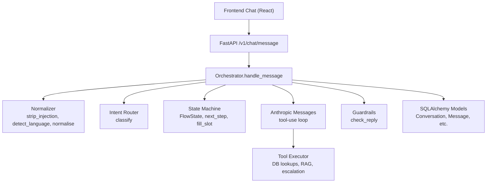

**Diagram sources**
- [chat.py:21-39](file://uaea-backend/app/api/chat.py#L21-L39)
- [orchestrator.py:46-143](file://uaea-backend/app/orchestrator/orchestrator.py#L46-L143)
- [normalizer.py:29-66](file://uaea-backend/app/orchestrator/normalizer.py#L29-L66)
- [intent_router.py:65-103](file://uaea-backend/app/orchestrator/intent_router.py#L65-L103)
- [state_machine.py:16-146](file://uaea-backend/app/orchestrator/state_machine.py#L16-L146)
- [tools.py:18-235](file://uaea-backend/app/orchestrator/tools.py#L18-L235)
- [guardrails.py:74-120](file://uaea-backend/app/orchestrator/guardrails.py#L74-L120)
- [models.py:144-178](file://uaea-backend/app/db/models.py#L144-L178)

**Section sources**
- [chat.py:21-39](file://uaea-backend/app/api/chat.py#L21-L39)
- [orchestrator.py:46-143](file://uaea-backend/app/orchestrator/orchestrator.py#L46-L143)
- [models.py:144-178](file://uaea-backend/app/db/models.py#L144-L178)

## Core Components
- Normalizer: Strips injection patterns, detects language (English, Roman Urdu, Urdu script), and normalizes spelling variants for robust matching.
- Intent Router: Deterministic keyword-scoring classifier that maps user input to intents like admission, fee_challan, result, degree, transcript, department_lookup, small_talk, or knowledge_question.
- State Machine: Manages per-conversation guided flows (admission, fee_challan, degree) by tracking active intent, filled slots, and step progression.
- Tool Executor: Provides concrete functions for retrieving fees, deadlines, document checklists, departments, knowledge base search, and creating escalation tickets.
- Guardrails: Post-processes LLM replies to remove ungrounded numbers, dates, and requirements not backed by tool results; can escalate if too many ungrounded claims are detected.
- Orchestrator: Coordinates the full pipeline: sanitize → classify → guided flow → LLM with tools → guardrails → persist → respond.

**Section sources**
- [normalizer.py:29-66](file://uaea-backend/app/orchestrator/normalizer.py#L29-L66)
- [intent_router.py:65-103](file://uaea-backend/app/orchestrator/intent_router.py#L65-L103)
- [state_machine.py:16-146](file://uaea-backend/app/orchestrator/state_machine.py#L16-L146)
- [tools.py:18-235](file://uaea-backend/app/orchestrator/tools.py#L18-L235)
- [guardrails.py:74-120](file://uaea-backend/app/orchestrator/guardrails.py#L74-L120)
- [orchestrator.py:46-143](file://uaea-backend/app/orchestrator/orchestrator.py#L46-L143)

## Architecture Overview
The message lifecycle is orchestrated as follows:
1. API receives a chat message request.
2. Orchestrator sanitizes input, detects language, and normalizes text.
3. Intent router classifies the query into an intent with confidence.
4. If the intent belongs to a guided flow and no flow is active, a new flow is started.
5. Guided flow slot-filling may prompt the user for missing information before falling through to the LLM.
6. The LLM is called with tool definitions; it may call tools multiple times within a bounded loop.
7. Tool results are appended to the conversation context for subsequent rounds.
8. Guardrails validate the final reply against tool-grounded values.
9. Assistant and user messages, plus flow state snapshots, are persisted.
10. Response includes reply, intent, tool calls, escalation flag, confidence, language, and sources.

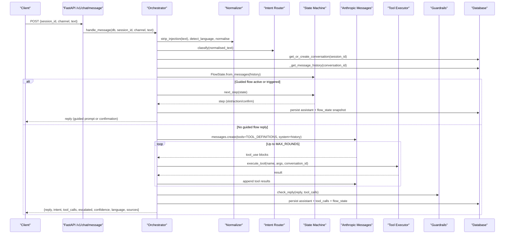

**Diagram sources**
- [chat.py:21-39](file://uaea-backend/app/api/chat.py#L21-L39)
- [orchestrator.py:46-143](file://uaea-backend/app/orchestrator/orchestrator.py#L46-L143)
- [state_machine.py:94-146](file://uaea-backend/app/orchestrator/state_machine.py#L94-L146)
- [tools.py:218-235](file://uaea-backend/app/orchestrator/tools.py#L218-L235)
- [guardrails.py:74-120](file://uaea-backend/app/orchestrator/guardrails.py#L74-L120)

## Detailed Component Analysis

### Input Sanitization and Language Detection
- Strip injection patterns to prevent prompt injection attacks.
- Detect language to ensure replies match the user’s language (English, Roman Urdu, Urdu).
- Normalize text by lowercasing, removing punctuation, and folding Roman Urdu spelling variants to improve intent matching.

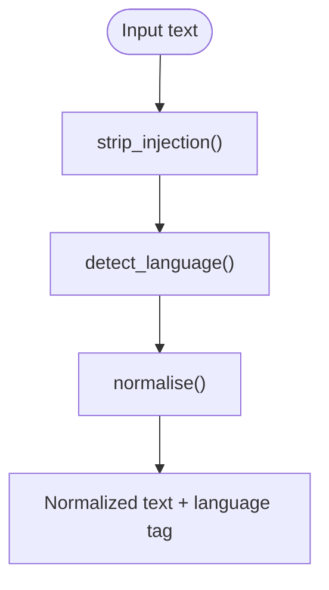

**Diagram sources**
- [normalizer.py:29-66](file://uaea-backend/app/orchestrator/normalizer.py#L29-L66)

**Section sources**
- [normalizer.py:29-66](file://uaea-backend/app/orchestrator/normalizer.py#L29-L66)

### Intent Classification via Keyword Scoring
- Applies normalized text against strong and weak keyword rules.
- Computes a score and confidence; defaults to knowledge_question when no rule matches.
- Identifies which intents qualify for guided flows.

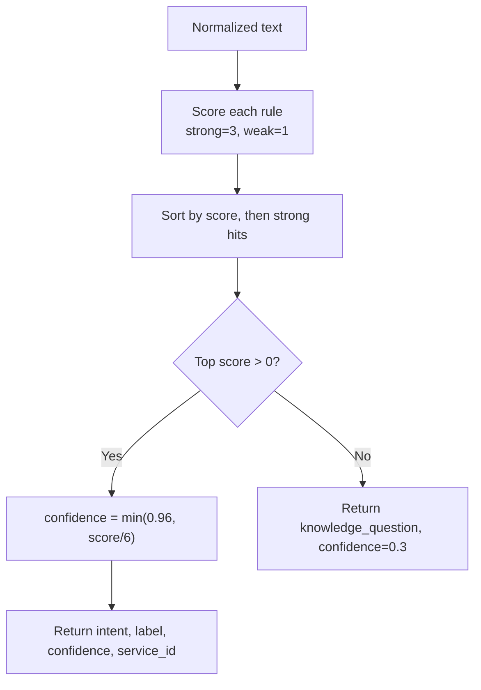

**Diagram sources**
- [intent_router.py:65-103](file://uaea-backend/app/orchestrator/intent_router.py#L65-L103)

**Section sources**
- [intent_router.py:65-103](file://uaea-backend/app/orchestrator/intent_router.py#L65-L103)

### Guided Flow State Management
- Tracks active flow intent, filled slots, and completion status.
- Reconstructs state from message history using flow_state snapshots stored as tool calls.
- Determines next step: prompt for slot, execute action steps, or complete flow.

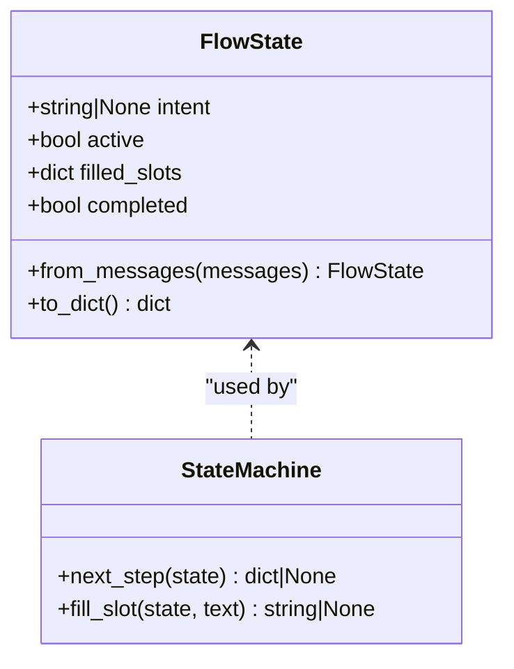

**Diagram sources**
- [state_machine.py:62-146](file://uaea-backend/app/orchestrator/state_machine.py#L62-L146)

**Section sources**
- [state_machine.py:16-146](file://uaea-backend/app/orchestrator/state_machine.py#L16-L146)

### LLM Integration with Tool Execution Loops
- Builds message history (last 20 messages) and sets system prompt with language guidance.
- Calls Anthropic messages with tool definitions; executes tool calls iteratively up to a maximum number of rounds.
- Tracks tool calls and sets escalation flag when create_escalation_ticket is used.
- Returns final text reply or fallback escalation message if rounds are exhausted without text.

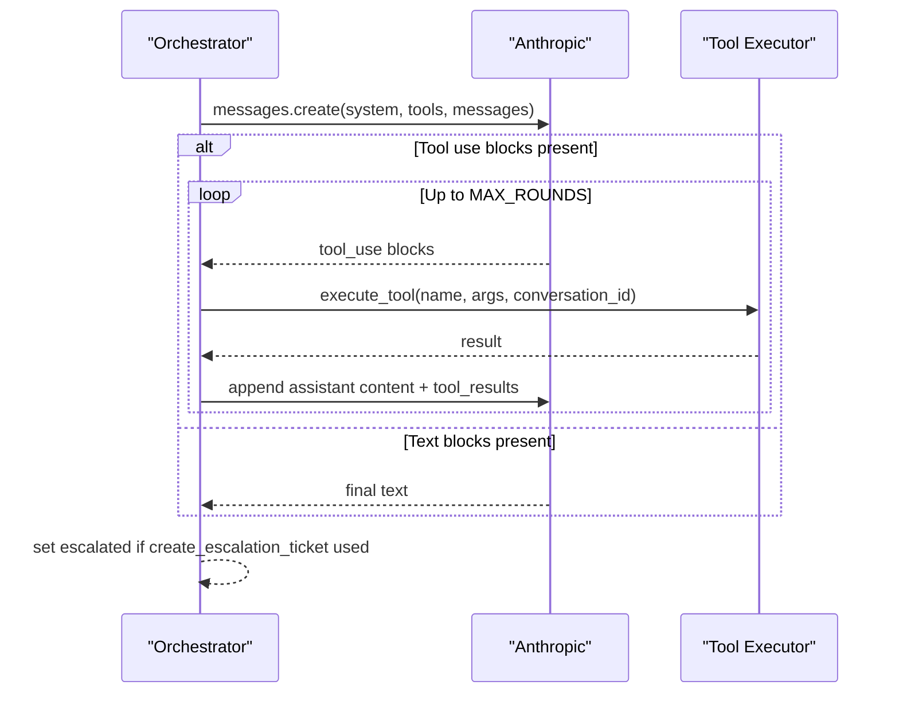

**Diagram sources**
- [orchestrator.py:229-318](file://uaea-backend/app/orchestrator/orchestrator.py#L229-L318)
- [tools.py:218-235](file://uaea-backend/app/orchestrator/tools.py#L218-L235)

**Section sources**
- [orchestrator.py:229-318](file://uaea-backend/app/orchestrator/orchestrator.py#L229-L318)
- [tools.py:18-235](file://uaea-backend/app/orchestrator/tools.py#L18-L235)

### Guardrails and Grounding
- Extracts all string values from tool call results to build a grounding set.
- Scans LLM reply for numbers, dates, and requirement phrases; flags ungrounded claims.
- Replaces ungrounded segments with placeholders; if too many ungrounded claims, replaces entire reply with an escalation note.

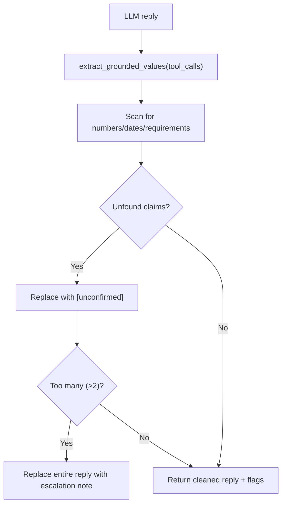

**Diagram sources**
- [guardrails.py:51-120](file://uaea-backend/app/orchestrator/guardrails.py#L51-L120)

**Section sources**
- [guardrails.py:51-120](file://uaea-backend/app/orchestrator/guardrails.py#L51-L120)

### Conversation Context and Session Persistence
- Each session maps to one open conversation; messages are persisted with role, text, intent, and tool_calls.
- Flow state is persisted as tool_call snapshots so guided flows survive restarts and across turns.
- Low-confidence or unrecognized queries are tracked in an unanswered queue for review.

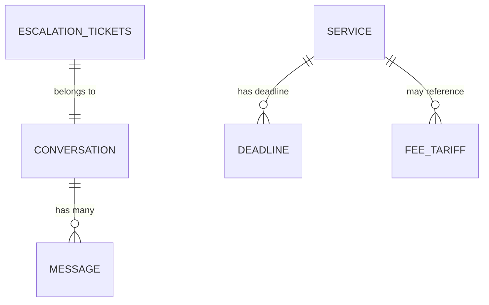

**Diagram sources**
- [models.py:144-178](file://uaea-backend/app/db/models.py#L144-L178)
- [models.py:84-122](file://uaea-backend/app/db/models.py#L84-L122)
- [models.py:183-195](file://uaea-backend/app/db/models.py#L183-L195)

**Section sources**
- [orchestrator.py:321-383](file://uaea-backend/app/orchestrator/orchestrator.py#L321-L383)
- [models.py:144-178](file://uaea-backend/app/db/models.py#L144-L178)

### Typical Message Flows

#### Simple Query Flow
- Example: “What is the fee for BS Computer Science?”
- Steps: sanitize → detect language → normalize → classify (fee_tariff) → LLM calls get_fee_tariff → guardrails verify amount → return grounded reply with source.

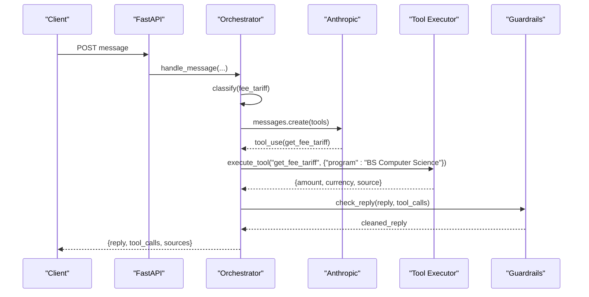

**Diagram sources**
- [orchestrator.py:46-143](file://uaea-backend/app/orchestrator/orchestrator.py#L46-L143)
- [tools.py:125-153](file://uaea-backend/app/orchestrator/tools.py#L125-L153)
- [guardrails.py:74-120](file://uaea-backend/app/orchestrator/guardrails.py#L74-L120)

#### Guided Workflow Flow
- Example: “I want to apply for admission.”
- Steps: classify (admission) → start guided flow → prompt for programme → capture slot → prompt for campus → capture slot → execute actions (fee, deadline, checklist) → fall through to LLM for summary.

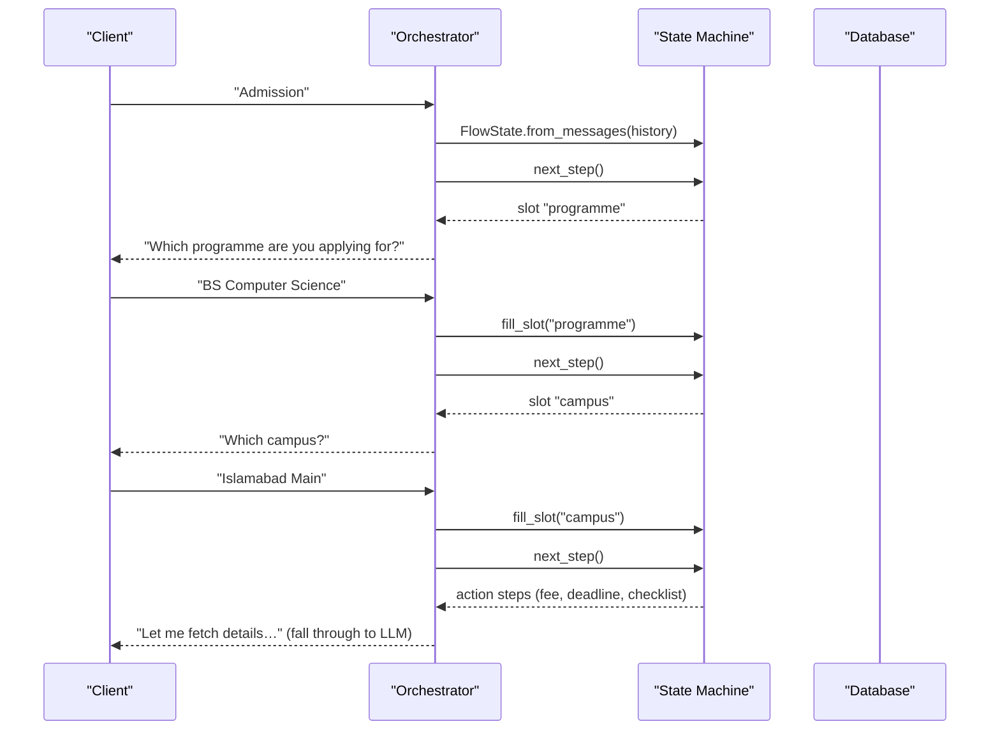

**Diagram sources**
- [state_machine.py:16-146](file://uaea-backend/app/orchestrator/state_machine.py#L16-L146)
- [orchestrator.py:146-227](file://uaea-backend/app/orchestrator/orchestrator.py#L146-L227)

#### Escalation Scenario
- Example: Unrecognized query or too many ungrounded claims.
- Steps: low confidence or guardrails escalation → track unanswered → optionally create escalation ticket → mark conversation escalated.

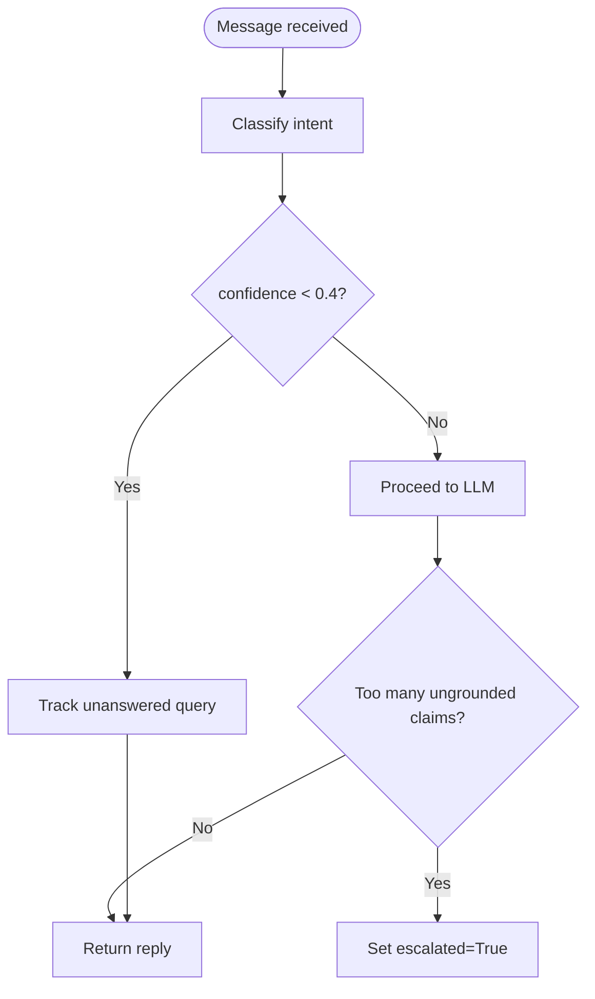

**Diagram sources**
- [orchestrator.py:123-130](file://uaea-backend/app/orchestrator/orchestrator.py#L123-L130)
- [guardrails.py:100-120](file://uaea-backend/app/orchestrator/guardrails.py#L100-L120)

**Section sources**
- [orchestrator.py:123-130](file://uaea-backend/app/orchestrator/orchestrator.py#L123-L130)
- [guardrails.py:100-120](file://uaea-backend/app/orchestrator/guardrails.py#L100-L120)

## Dependency Analysis
- Orchestrator depends on normalizer, intent router, state machine, tools, and guardrails.
- Tools depend on database models for services, fees, deadlines, departments, and escalation tickets.
- Frontend uses local classification and answer composition as a working stand-in; the API seam replaces this with backend orchestration.

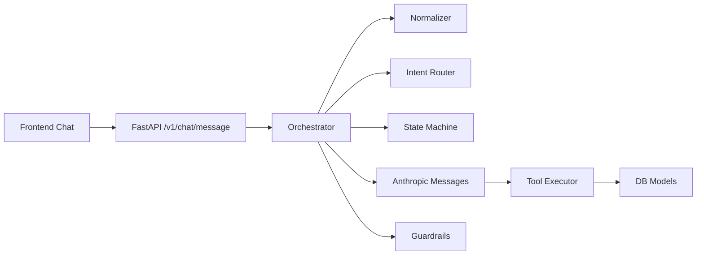

**Diagram sources**
- [orchestrator.py:46-143](file://uaea-backend/app/orchestrator/orchestrator.py#L46-L143)
- [tools.py:218-235](file://uaea-backend/app/orchestrator/tools.py#L218-L235)
- [chat.py:21-39](file://uaea-backend/app/api/chat.py#L21-L39)
- [index.jsx:62-138](file://src/pages/student/Chat/index.jsx#L62-L138)

**Section sources**
- [orchestrator.py:46-143](file://uaea-backend/app/orchestrator/orchestrator.py#L46-L143)
- [tools.py:218-235](file://uaea-backend/app/orchestrator/tools.py#L218-L235)
- [chat.py:21-39](file://uaea-backend/app/api/chat.py#L21-L39)
- [index.jsx:62-138](file://src/pages/student/Chat/index.jsx#L62-L138)

## Performance Considerations
- Limit message history sent to LLM to last 20 messages to control token usage and latency.
- Cap tool-call loops to a maximum number of rounds to avoid excessive API calls.
- Use deterministic keyword scoring for fast intent classification before invoking LLM.
- Persist flow state snapshots to avoid recomputing guided flow state on every turn.
- Extract sources once from tool results to minimize repeated processing.

[No sources needed since this section provides general guidance]

## Troubleshooting Guide
- LLM API errors: Orchestrator catches API exceptions and returns a friendly fallback message offering human handoff.
- Exhausted rounds: If no text reply is produced after max rounds, orchestrator escalates and informs the user.
- Unanswered queries: Low-confidence intents are tracked in the unanswered queue for review and improvement.
- Guardrails escalation: Too many ungrounded claims trigger replacement of the entire reply with an escalation note.
- Missing data: Tool functions return error objects when no matching records exist; LLM is instructed to be honest and offer escalation.

**Section sources**
- [orchestrator.py:255-318](file://uaea-backend/app/orchestrator/orchestrator.py#L255-L318)
- [orchestrator.py:367-383](file://uaea-backend/app/orchestrator/orchestrator.py#L367-L383)
- [guardrails.py:100-120](file://uaea-backend/app/orchestrator/guardrails.py#L100-L120)
- [tools.py:125-198](file://uaea-backend/app/orchestrator/tools.py#L125-L198)

## Conclusion
The message processing pipeline combines deterministic preprocessing and routing with powerful LLM capabilities grounded by tools and validated by guardrails. Guided flows provide structured multi-turn interactions, while conversation history and flow state snapshots ensure continuity across sessions. Robust error handling and fallback mechanisms protect users from hallucinations and service failures, ensuring reliable, transparent responses with clear sourcing.

[No sources needed since this section summarizes without analyzing specific files]