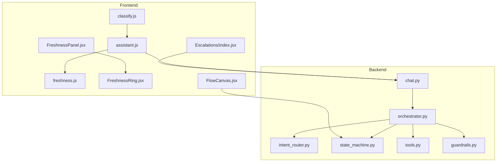
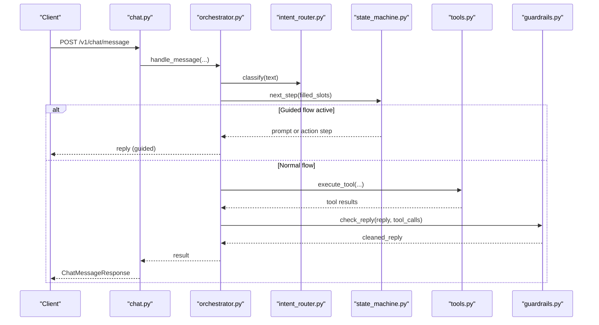
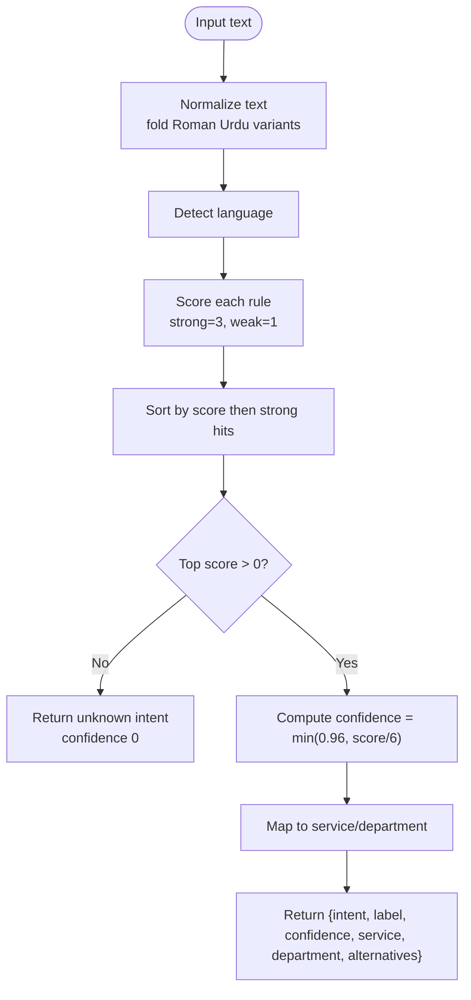
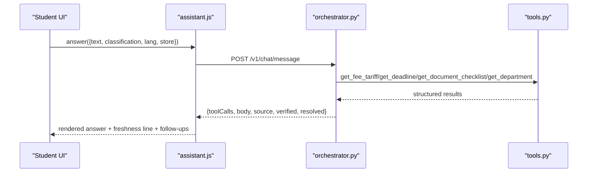
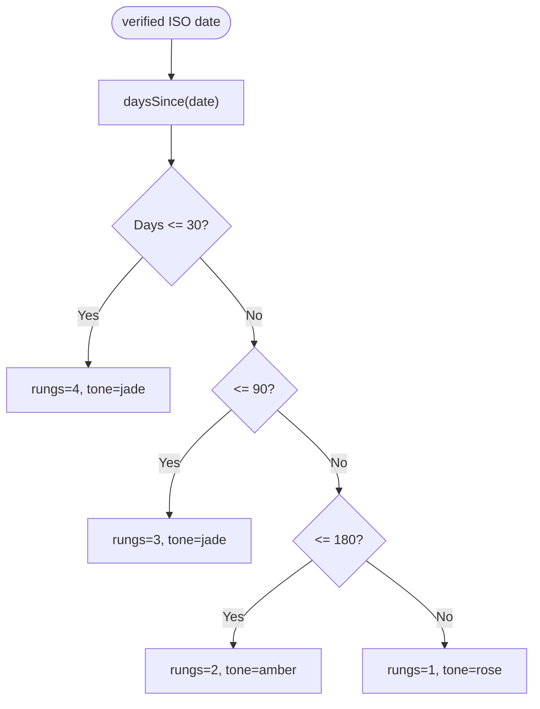
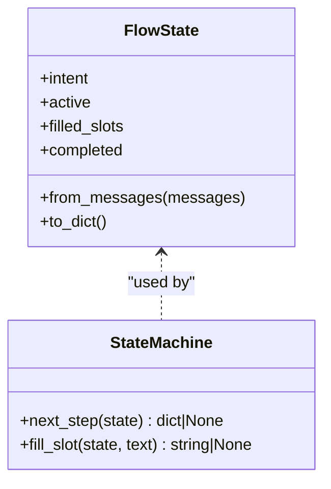
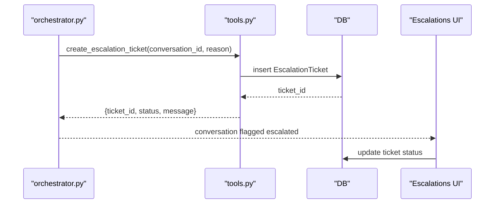
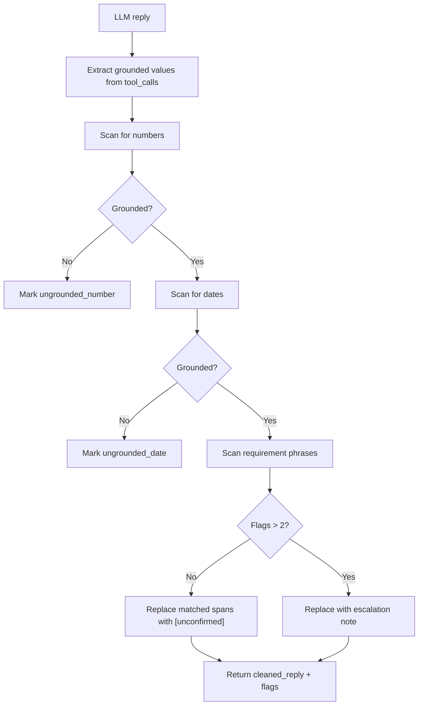
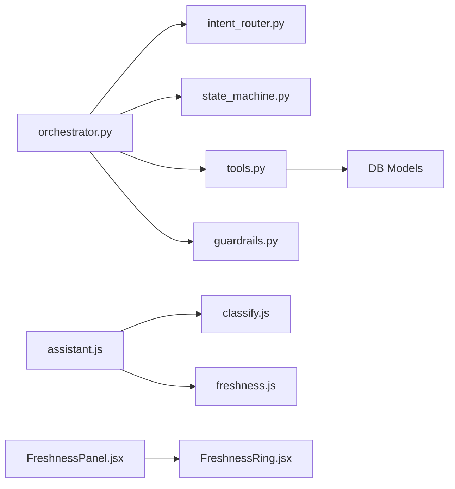

# Core Features

<cite>
**Referenced Files in This Document**
- [classify.js](file://src/lib/classify.js)
- [assistant.js](file://src/lib/assistant.js)
- [freshness.js](file://src/lib/freshness.js)
- [FreshnessPanel.jsx](file://src/pages/Dashboard/FreshnessPanel.jsx)
- [FreshnessRing.jsx](file://src/components/charts/FreshnessRing.jsx)
- [intent_router.py](file://uaea-backend/app/orchestrator/intent_router.py)
- [state_machine.py](file://uaea-backend/app/orchestrator/state_machine.py)
- [guardrails.py](file://uaea-backend/app/orchestrator/guardrails.py)
- [orchestrator.py](file://uaea-backend/app/orchestrator/orchestrator.py)
- [tools.py](file://uaea-backend/app/orchestrator/tools.py)
- [chat.py](file://uaea-backend/app/api/chat.py)
- [FlowCanvas.jsx](file://src/pages/GuidedFlows/FlowCanvas.jsx)
- [Escalations/index.jsx](file://src/pages/Escalations/index.jsx)
</cite>

## Table of Contents
1. Introduction
2. Project Structure
3. Core Components
4. Architecture Overview
5. Detailed Component Analysis
6. Dependency Analysis
7. Performance Considerations
8. Troubleshooting Guide
9. Conclusion

## Introduction
This document explains the core features that power the UAEA Console:
- Intent classification using deterministic keyword scoring with multi-language support and confidence thresholding
- Assistant engine that processes queries via tool calls and generates grounded, contextual responses
- Freshness tracking system that monitors data accuracy through time-based verification and visual indicators
- Guided flow system implementing state machine patterns for structured conversations
- Escalation handling mechanism for low-confidence queries and human handoff scenarios
- Guardrail system ensuring response quality and safety through configurable validation rules

## Project Structure
The console is split into a React frontend (UI, dashboards, guided flows editor) and a Python backend orchestrator (classification, state machine, tools, guardrails, API). The frontend composes user experiences around the backend’s chat API and admin dashboards.

**Diagram sources**
- [classify.js:1-270](file://src/lib/classify.js#L1-L270)
- [assistant.js:1-364](file://src/lib/assistant.js#L1-L364)
- [freshness.js:1-37](file://src/lib/freshness.js#L1-L37)
- [FreshnessPanel.jsx:1-74](file://src/pages/Dashboard/FreshnessPanel.jsx#L1-L74)
- [FreshnessRing.jsx:1-66](file://src/components/charts/FreshnessRing.jsx#L1-L66)
- [intent_router.py:1-103](file://uaea-backend/app/orchestrator/intent_router.py#L1-L103)
- [state_machine.py:1-146](file://uaea-backend/app/orchestrator/state_machine.py#L1-L146)
- [tools.py:1-235](file://uaea-backend/app/orchestrator/tools.py#L1-L235)
- [guardrails.py:1-120](file://uaea-backend/app/orchestrator/guardrails.py#L1-L120)
- [orchestrator.py:1-405](file://uaea-backend/app/orchestrator/orchestrator.py#L1-L405)
- [chat.py:1-115](file://uaea-backend/app/api/chat.py#L1-L115)
- [FlowCanvas.jsx:1-157](file://src/pages/GuidedFlows/FlowCanvas.jsx#L1-L157)
- [Escalations/index.jsx:1-167](file://src/pages/Escalations/index.jsx#L1-L167)

**Section sources**
- [classify.js:1-270](file://src/lib/classify.js#L1-L270)
- [assistant.js:1-364](file://src/lib/assistant.js#L1-L364)
- [freshness.js:1-37](file://src/lib/freshness.js#L1-L37)
- [FreshnessPanel.jsx:1-74](file://src/pages/Dashboard/FreshnessPanel.jsx#L1-L74)
- [FreshnessRing.jsx:1-66](file://src/components/charts/FreshnessRing.jsx#L1-L66)
- [intent_router.py:1-103](file://uaea-backend/app/orchestrator/intent_router.py#L1-L103)
- [state_machine.py:1-146](file://uaea-backend/app/orchestrator/state_machine.py#L1-L146)
- [tools.py:1-235](file://uaea-backend/app/orchestrator/tools.py#L1-L235)
- [guardrails.py:1-120](file://uaea-backend/app/orchestrator/guardrails.py#L1-L120)
- [orchestrator.py:1-405](file://uaea-backend/app/orchestrator/orchestrator.py#L1-L405)
- [chat.py:1-115](file://uaea-backend/app/api/chat.py#L1-L115)
- [FlowCanvas.jsx:1-157](file://src/pages/GuidedFlows/FlowCanvas.jsx#L1-L157)
- [Escalations/index.jsx:1-167](file://src/pages/Escalations/index.jsx#L1-L167)

## Core Components
- Deterministic intent classifier with multi-language normalization and confidence scoring
- Assistant engine that builds answers strictly from tool results and language-appropriate templates
- Freshness tracker that grades records by recency and renders dashboard visuals
- Guided flow state machine that drives slot collection and action execution
- Guardrails that strip ungrounded numbers, dates, and requirements from LLM replies
- Escalation pipeline that creates tickets and flags conversations when safe resolution is not possible

**Section sources**
- [classify.js:18-57](file://src/lib/classify.js#L18-L57)
- [classify.js:63-269](file://src/lib/classify.js#L63-L269)
- [assistant.js:18-78](file://src/lib/assistant.js#L18-L78)
- [assistant.js:128-317](file://src/lib/assistant.js#L128-L317)
- [freshness.js:3-23](file://src/lib/freshness.js#L3-L23)
- [state_machine.py:14-59](file://uaea-backend/app/orchestrator/state_machine.py#L14-L59)
- [guardrails.py:30-120](file://uaea-backend/app/orchestrator/guardrails.py#L30-L120)
- [orchestrator.py:46-143](file://uaea-backend/app/orchestrator/orchestrator.py#L46-L143)

## Architecture Overview
End-to-end message processing combines deterministic classification, guided flows, LLM tool use, and guardrail enforcement.

**Diagram sources**
- [chat.py:21-39](file://uaea-backend/app/api/chat.py#L21-L39)
- [orchestrator.py:46-143](file://uaea-backend/app/orchestrator/orchestrator.py#L46-L143)
- [intent_router.py:65-103](file://uaea-backend/app/orchestrator/intent_router.py#L65-L103)
- [state_machine.py:94-146](file://uaea-backend/app/orchestrator/state_machine.py#L94-L146)
- [tools.py:218-235](file://uaea-backend/app/orchestrator/tools.py#L218-L235)
- [guardrails.py:74-120](file://uaea-backend/app/orchestrator/guardrails.py#L74-L120)

## Detailed Component Analysis

### Intent Classification System
- Multi-language normalization folds Roman Urdu variants before scoring to reduce spelling noise
- Language detection supports English, Urdu script, and Roman Urdu
- Deterministic keyword scoring assigns strong and weak weights per rule; top-scoring intent wins
- Confidence computed from score capped at a maximum; a floor threshold triggers escalation behavior
- Returns service mapping and department ownership for downstream routing

**Diagram sources**
- [classify.js:18-57](file://src/lib/classify.js#L18-L57)
- [classify.js:63-269](file://src/lib/classify.js#L63-L269)

**Section sources**
- [classify.js:18-57](file://src/lib/classify.js#L18-L57)
- [classify.js:63-269](file://src/lib/classify.js#L63-L269)
- [intent_router.py:10-12](file://uaea-backend/app/orchestrator/intent_router.py#L10-L12)
- [intent_router.py:65-103](file://uaea-backend/app/orchestrator/intent_router.py#L65-L103)

### Assistant Engine
- Builds replies exclusively from tool call results; never fabricates facts
- Templates in three languages (English, Roman Urdu, Urdu) selected by detected language
- Handles fee tariff lookup, deadlines, document checklists, department contacts, and result guidance
- Produces follow-up suggestions and freshness caveats tied to verified timestamps

**Diagram sources**
- [assistant.js:128-317](file://src/lib/assistant.js#L128-L317)
- [orchestrator.py:229-318](file://uaea-backend/app/orchestrator/orchestrator.py#L229-L318)
- [tools.py:92-198](file://uaea-backend/app/orchestrator/tools.py#L92-L198)

**Section sources**
- [assistant.js:18-78](file://src/lib/assistant.js#L18-L78)
- [assistant.js:128-317](file://src/lib/assistant.js#L128-L317)
- [assistant.js:319-364](file://src/lib/assistant.js#L319-L364)

### Freshness Tracking System
- Grades records by days since last verification into tiers: Verified (jade), Ageing (amber), Stale (rose)
- Aggregates buckets for dashboard ring visualization
- Dashboard panel lists overdue items and links to catalogue editing

**Diagram sources**
- [freshness.js:3-23](file://src/lib/freshness.js#L3-L23)

**Section sources**
- [freshness.js:3-23](file://src/lib/freshness.js#L3-L23)
- [freshness.js:25-37](file://src/lib/freshness.js#L25-L37)
- [FreshnessPanel.jsx:12-74](file://src/pages/Dashboard/FreshnessPanel.jsx#L12-L74)
- [FreshnessRing.jsx:1-66](file://src/components/charts/FreshnessRing.jsx#L1-L66)

### Guided Flow System (State Machine)
- Defines flows for admission, fee challan, and degree with slots and ordered steps
- Tracks per-conversation state across messages; persists via tool messages
- Prompts for missing slots, executes actions when all args are available, and completes flows

**Diagram sources**
- [state_machine.py:62-91](file://uaea-backend/app/orchestrator/state_machine.py#L62-L91)
- [state_machine.py:94-146](file://uaea-backend/app/orchestrator/state_machine.py#L94-L146)

**Section sources**
- [state_machine.py:14-59](file://uaea-backend/app/orchestrator/state_machine.py#L14-L59)
- [state_machine.py:94-146](file://uaea-backend/app/orchestrator/state_machine.py#L94-L146)
- [FlowCanvas.jsx:9-157](file://src/pages/GuidedFlows/FlowCanvas.jsx#L9-L157)

### Escalation Handling Mechanism
- Low-confidence queries below thresholds are tracked in an unanswered queue
- Tool “create_escalation_ticket” creates a ticket and marks conversation escalated
- Frontend escalations page displays open/in-progress/resolved tickets with status management

**Diagram sources**
- [orchestrator.py:367-384](file://uaea-backend/app/orchestrator/orchestrator.py#L367-L384)
- [tools.py:200-215](file://uaea-backend/app/orchestrator/tools.py#L200-L215)
- [Escalations/index.jsx:30-167](file://src/pages/Escalations/index.jsx#L30-L167)

**Section sources**
- [orchestrator.py:123-130](file://uaea-backend/app/orchestrator/orchestrator.py#L123-L130)
- [orchestrator.py:367-384](file://uaea-backend/app/orchestrator/orchestrator.py#L367-L384)
- [tools.py:200-215](file://uaea-backend/app/orchestrator/tools.py#L200-L215)
- [Escalations/index.jsx:30-167](file://src/pages/Escalations/index.jsx#L30-L167)

### Guardrail System
- Scans LLM replies for numbers, dates, and requirement phrases
- Cross-checks against values extracted from tool call results
- Strips ungrounded claims; replaces entire reply if too many violations
- Logs warnings for auditability

**Diagram sources**
- [guardrails.py:30-120](file://uaea-backend/app/orchestrator/guardrails.py#L30-L120)

**Section sources**
- [guardrails.py:30-120](file://uaea-backend/app/orchestrator/guardrails.py#L30-L120)

## Dependency Analysis
Key runtime dependencies and coupling:
- Orchestrator depends on normalizer, classifier, state machine, tools, and guardrails
- Tools depend on database models and RAG retrieval for knowledge base search
- Frontend assistant uses classification, formatting, and freshness utilities
- Dashboard freshness components consume freshness metrics and bucketing

**Diagram sources**
- [orchestrator.py:17-25](file://uaea-backend/app/orchestrator/orchestrator.py#L17-L25)
- [tools.py:14-87](file://uaea-backend/app/orchestrator/tools.py#L14-L87)
- [assistant.js:1-4](file://src/lib/assistant.js#L1-L4)
- [FreshnessPanel.jsx:1-10](file://src/pages/Dashboard/FreshnessPanel.jsx#L1-L10)

**Section sources**
- [orchestrator.py:17-25](file://uaea-backend/app/orchestrator/orchestrator.py#L17-L25)
- [tools.py:14-87](file://uaea-backend/app/orchestrator/tools.py#L14-L87)
- [assistant.js:1-4](file://src/lib/assistant.js#L1-L4)
- [FreshnessPanel.jsx:1-10](file://src/pages/Dashboard/FreshnessPanel.jsx#L1-L10)

## Performance Considerations
- Deterministic classifier avoids heavy ML inference latency; scoring is O(rules × terms)
- LLM rounds are bounded to prevent long loops; fallback escalation occurs after max rounds
- Tool implementations use simple lookups and fuzzy matching; consider indexing for large datasets
- Freshness computations are lightweight; dashboard aggregation runs over small catalogues

[No sources needed since this section provides general guidance]

## Troubleshooting Guide
- If replies contain “[unconfirmed]”, guardrails found ungrounded claims; verify tool results and sources
- If escalation appears unexpectedly, check classifier confidence and whether tool calls returned empty/error
- For stale freshness indicators, review last verified timestamps and revalidate records
- For guided flows stuck in prompts, ensure slots are filled correctly and flow definitions include required actions

**Section sources**
- [guardrails.py:74-120](file://uaea-backend/app/orchestrator/guardrails.py#L74-L120)
- [orchestrator.py:229-318](file://uaea-backend/app/orchestrator/orchestrator.py#L229-L318)
- [freshness.js:3-23](file://src/lib/freshness.js#L3-L23)
- [state_machine.py:94-146](file://uaea-backend/app/orchestrator/state_machine.py#L94-L146)

## Conclusion
The UAEA Console integrates deterministic classification, grounded assistant responses, freshness governance, guided flows, guardrails, and escalation workflows to deliver reliable, safe, and multilingual student support. The architecture balances speed and correctness by grounding all factual statements in tool results and enforcing strict validation before delivery.