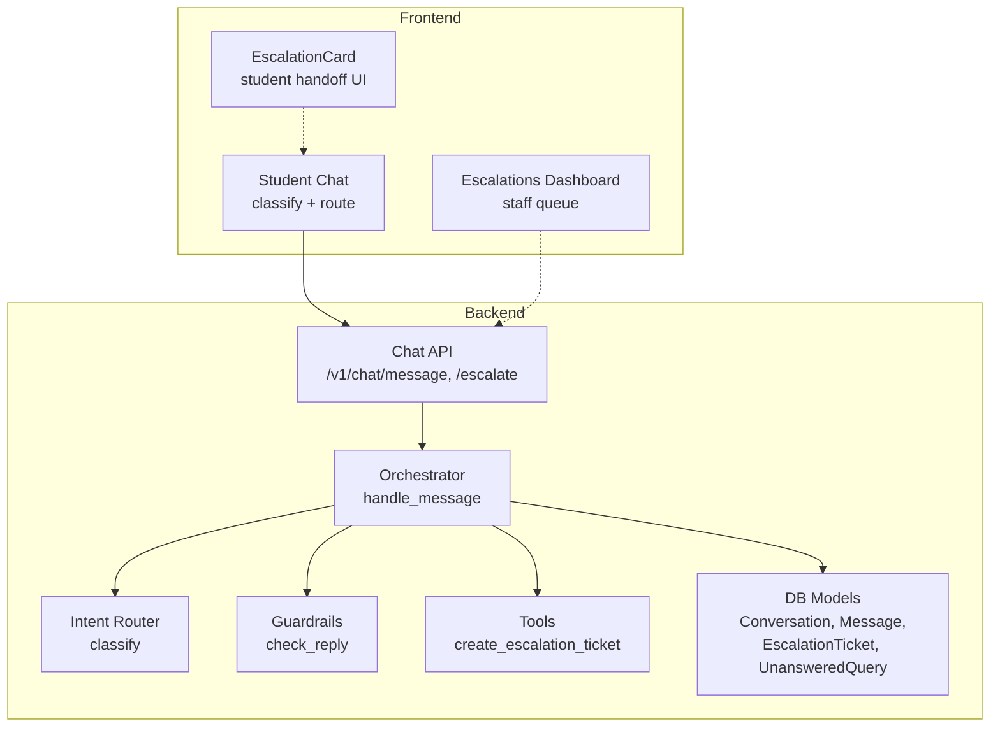
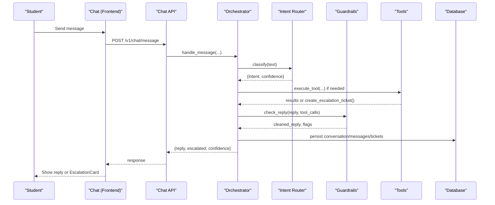
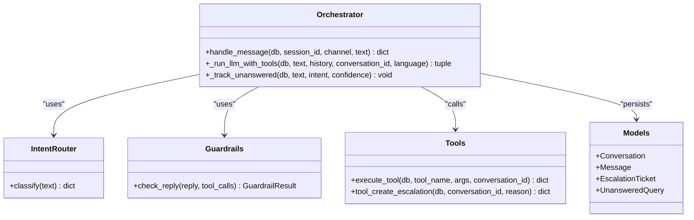

# Escalation Handling

<cite>
**Referenced Files in This Document**
- [orchestrator.py](file://uaea-backend/app/orchestrator/orchestrator.py)
- [intent_router.py](file://uaea-backend/app/orchestrator/intent_router.py)
- [guardrails.py](file://uaea-backend/app/orchestrator/guardrails.py)
- [chat.py](file://uaea-backend/app/api/chat.py)
- [models.py](file://uaea-backend/app/db/models.py)
- [classify.js](file://src/lib/classify.js)
- [Chat index.jsx](file://src/pages/student/Chat/index.jsx)
- [EscalationCard.jsx](file://src/pages/student/Chat/EscalationCard.jsx)
- [Escalations page.jsx](file://src/pages/Escalations/index.jsx)
- [escalations mock](file://src/mocks/escalations.js)
- [routing config](file://src/mocks/routing.js)
</cite>

## Table of Contents
1. Introduction
2. Project Structure
3. Core Components
4. Architecture Overview
5. Detailed Component Analysis
6. Dependency Analysis
7. Performance Considerations
8. Troubleshooting Guide
9. Conclusion

## Introduction
This document explains the escalation handling system that manages low-confidence queries and human handoff scenarios. It covers how the system identifies when a query requires human intervention, how escalations are routed to departments or support staff, the student-facing escalation card, notifications to staff, and the audit trail for resolution tracking.

## Project Structure
The escalation system spans both frontend and backend:
- Backend orchestrates message processing, intent classification, guardrails, tool execution (including creating escalation tickets), and persistence.
- Frontend provides the student chat flow with local classification and fallback routing, an escalation card component for students, and an admin escalations dashboard for staff.

**Diagram sources**
- [chat.py:21-39](file://uaea-backend/app/api/chat.py#L21-L39)
- [orchestrator.py:46-143](file://uaea-backend/app/orchestrator/orchestrator.py#L46-L143)
- [intent_router.py:65-102](file://uaea-backend/app/orchestrator/intent_router.py#L65-L102)
- [guardrails.py:74-119](file://uaea-backend/app/orchestrator/guardrails.py#L74-L119)
- [models.py:144-228](file://uaea-backend/app/db/models.py#L144-L228)

**Section sources**
- [chat.py:21-115](file://uaea-backend/app/api/chat.py#L21-L115)
- [orchestrator.py:46-143](file://uaea-backend/app/orchestrator/orchestrator.py#L46-L143)
- [classify.js:1-270](file://src/lib/classify.js#L1-L270)
- [Chat index.jsx:62-138](file://src/pages/student/Chat/index.jsx#L62-L138)
- [EscalationCard.jsx:10-41](file://src/pages/student/Chat/EscalationCard.jsx#L10-L41)
- [Escalations page.jsx:35-166](file://src/pages/Escalations/index.jsx#L35-L166)

## Core Components
- Intent classification and confidence scoring (frontend and backend).
- Guardrails that detect ungrounded claims and trigger escalation messaging.
- Orchestrator that coordinates flows, tools, and escalation creation.
- Student-facing escalation card that routes to the correct department contact.
- Staff escalations dashboard for managing ticket status and assignment.
- Audit log for tracking changes and resolutions.

**Section sources**
- [intent_router.py:65-102](file://uaea-backend/app/orchestrator/intent_router.py#L65-L102)
- [guardrails.py:74-119](file://uaea-backend/app/orchestrator/guardrails.py#L74-L119)
- [orchestrator.py:229-318](file://uaea-backend/app/orchestrator/orchestrator.py#L229-L318)
- [EscalationCard.jsx:10-41](file://src/pages/student/Chat/EscalationCard.jsx#L10-L41)
- [Escalations page.jsx:35-166](file://src/pages/Escalations/index.jsx#L35-L166)

## Architecture Overview
End-to-end flow from student message to escalation and staff handling:

**Diagram sources**
- [chat.py:21-39](file://uaea-backend/app/api/chat.py#L21-L39)
- [orchestrator.py:46-143](file://uaea-backend/app/orchestrator/orchestrator.py#L46-L143)
- [intent_router.py:65-102](file://uaea-backend/app/orchestrator/intent_router.py#L65-L102)
- [guardrails.py:74-119](file://uaea-backend/app/orchestrator/guardrails.py#L74-L119)

## Detailed Component Analysis

### Low-Confidence Detection and Repeated Failures
- The backend classifies each message and tracks low-confidence queries. If confidence is below a threshold and not part of guided flows, it logs the query to an unanswered queue for review.
- The frontend also performs deterministic keyword-based classification and uses a confidence floor to avoid guessing; below this threshold, it hands over to a human via the escalation path.

Key behaviors:
- Backend: low-confidence queries are persisted with reason and count aggregation for repeated failures.
- Frontend: immediate handoff when no confident match exists, showing a department-specific escalation card.

**Section sources**
- [orchestrator.py:123-129](file://uaea-backend/app/orchestrator/orchestrator.py#L123-L129)
- [orchestrator.py:367-383](file://uaea-backend/app/orchestrator/orchestrator.py#L367-L383)
- [classify.js:201-269](file://src/lib/classify.js#L201-L269)
- [Chat index.jsx:77-110](file://src/pages/student/Chat/index.jsx#L77-L110)

### Explicit User Request for Human Handoff
- Students can explicitly request escalation through the chat interface. The backend exposes an endpoint to create an escalation ticket tied to the active conversation.

Behavior:
- Creates an EscalationTicket with status open and marks the conversation as escalated.

**Section sources**
- [chat.py:88-115](file://uaea-backend/app/api/chat.py#L88-L115)
- [models.py:183-196](file://uaea-backend/app/db/models.py#L183-L196)

### Escalation Workflow and Routing by Intent and Urgency
- Intent classification maps queries to services and departments. The routing configuration defines which department owns each category.
- Priority indicators (e.g., high priority) are surfaced in the escalations dashboard to help staff triage.

Routing logic:
- Frontend: classify returns department mapping based on rules and routing config.
- Backend: intent router returns service_id and label used to guide tool selection and responses.

Urgency:
- Escalation records include priority metadata in the dashboard view to highlight urgent cases.

**Section sources**
- [routing config:11-18](file://src/mocks/routing.js#L11-L18)
- [intent_router.py:14-59](file://uaea-backend/app/orchestrator/intent_router.py#L14-L59)
- [Escalations page.jsx:99-114](file://src/pages/Escalations/index.jsx#L99-L114)

### Student-Facing Escalation Card
- When the assistant cannot answer safely or confidently, the student sees an escalation card that provides direct contact details for the relevant department.

Features:
- Displays department name, phone link, email link, and office hours.
- Provides context about why escalation occurred.

**Section sources**
- [EscalationCard.jsx:10-41](file://src/pages/student/Chat/EscalationCard.jsx#L10-L41)
- [Chat index.jsx:80-110](file://src/pages/student/Chat/index.jsx#L80-L110)

### Staff Escalations Dashboard
- A table-driven dashboard lists pending escalations with filters by status, shows reasons, assigned staff, opening times, and allows status updates for authorized roles.

Capabilities:
- Filter by All/Open/In progress/Resolved.
- Update ticket status with role-based write permissions.
- Visual priority indicator for high-priority tickets.

**Section sources**
- [Escalations page.jsx:35-166](file://src/pages/Escalations/index.jsx#L35-L166)
- [escalations mock:2-10](file://src/mocks/escalations.js#L2-L10)

### Notification System for Staff
- The current implementation persists escalation tickets and marks conversations as escalated. Notifications to staff are not implemented in the provided codebase; integration points exist via database models and API endpoints.

Observations:
- No explicit notification module found in the repository.
- Integration points:
  - Create escalation ticket via tool or API.
  - Mark conversation escalated flag.
  - Future extension could emit events or messages to staff channels.

**Section sources**
- [chat.py:88-115](file://uaea-backend/app/api/chat.py#L88-L115)
- [models.py:183-196](file://uaea-backend/app/db/models.py#L183-L196)
- [orchestrator.py:292-294](file://uaea-backend/app/orchestrator/orchestrator.py#L292-L294)

### Audit Trail for Escalation Resolution
- The audit log captures who changed what and when, including settings like guardrail thresholds. While not specific to escalations, it provides compliance visibility into changes affecting escalation behavior and related data.

Usage:
- Exportable CSV with actor, action, table, record, and changes.
- Append-only entries ensure integrity.

**Section sources**
- [AuditLog index.jsx:20-149](file://src/pages/AuditLog/index.jsx#L20-L149)
- [models.py:200-211](file://uaea-backend/app/db/models.py#L200-L211)

## Dependency Analysis
The escalation system depends on coordinated components across layers:

**Diagram sources**
- [orchestrator.py:46-143](file://uaea-backend/app/orchestrator/orchestrator.py#L46-L143)
- [intent_router.py:65-102](file://uaea-backend/app/orchestrator/intent_router.py#L65-L102)
- [guardrails.py:74-119](file://uaea-backend/app/orchestrator/guardrails.py#L74-L119)
- [models.py:144-228](file://uaea-backend/app/db/models.py#L144-L228)

**Section sources**
- [orchestrator.py:46-143](file://uaea-backend/app/orchestrator/orchestrator.py#L46-L143)
- [models.py:144-228](file://uaea-backend/app/db/models.py#L144-L228)

## Performance Considerations
- Classification is deterministic and lightweight; it runs before any answer composition to avoid unnecessary work on misrouted queries.
- Guardrails scan replies for ungrounded claims; excessive flags replace the entire reply to prevent hallucinated answers.
- Tool loops are bounded by a maximum round limit to prevent runaway interactions.
- Frontend simulates latency to make the classify → look up → answer sequence observable during development.

[No sources needed since this section provides general guidance]

## Troubleshooting Guide
Common issues and diagnostics:
- Low-confidence queries: Check the unanswered queue to identify recurring unclear intents and add missing records or refine rules.
- Hallucination triggers: Review guardrail flags to understand which numbers/dates/requirements were ungrounded and adjust tool coverage.
- Misrouted escalations: Verify intent rules and routing configuration to ensure correct department mapping.
- Staff notifications: If staff do not receive alerts, integrate external notification systems using the escalation creation endpoints and conversation escalation flags.

**Section sources**
- [orchestrator.py:367-383](file://uaea-backend/app/orchestrator/orchestrator.py#L367-L383)
- [guardrails.py:74-119](file://uaea-backend/app/orchestrator/guardrails.py#L74-L119)
- [routing config:11-18](file://src/mocks/routing.js#L11-L18)

## Conclusion
The escalation handling system combines robust intent classification, guardrails against ungrounded claims, and clear handoff paths to human staff. Students receive actionable escalation cards with department contacts, while staff manage tickets through a dashboard with status controls and priority indicators. The audit log ensures accountability for changes affecting escalation behavior. Although explicit staff notifications are not implemented in the current codebase, the architecture provides clear integration points for future extensions.