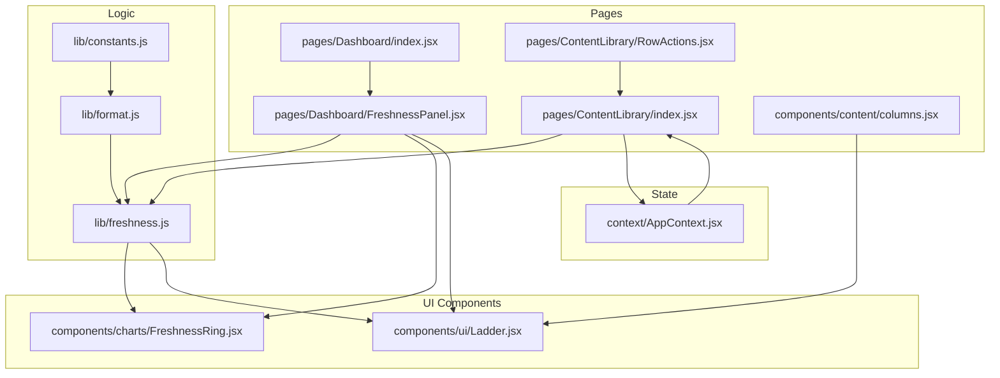
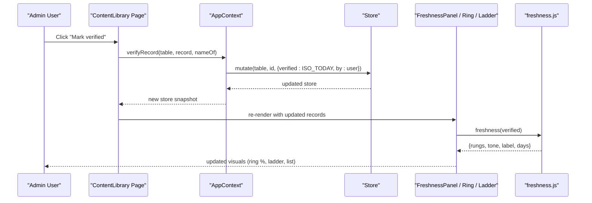
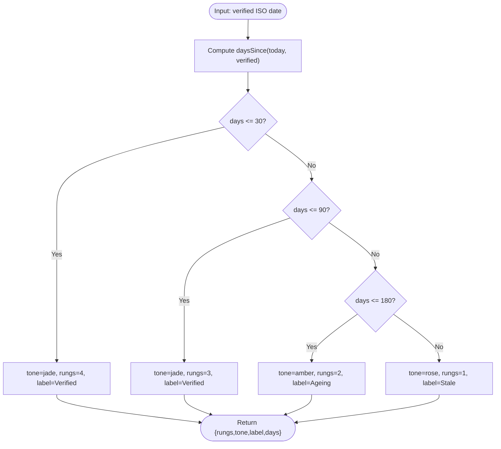
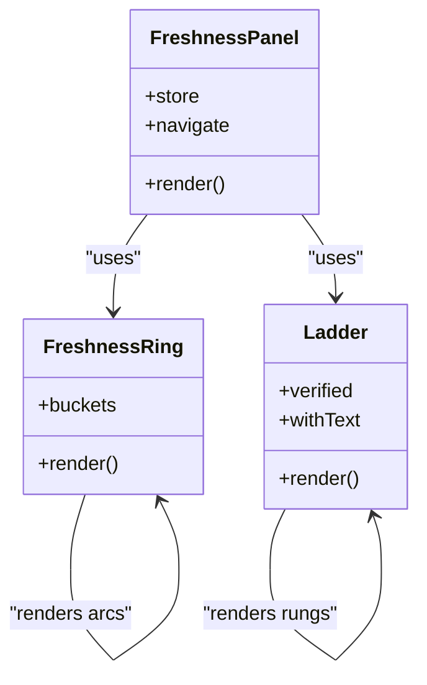
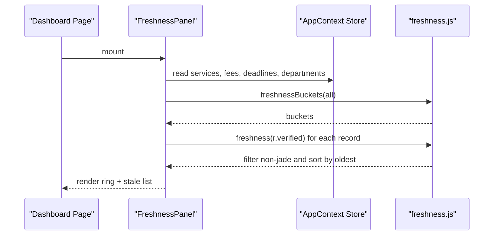
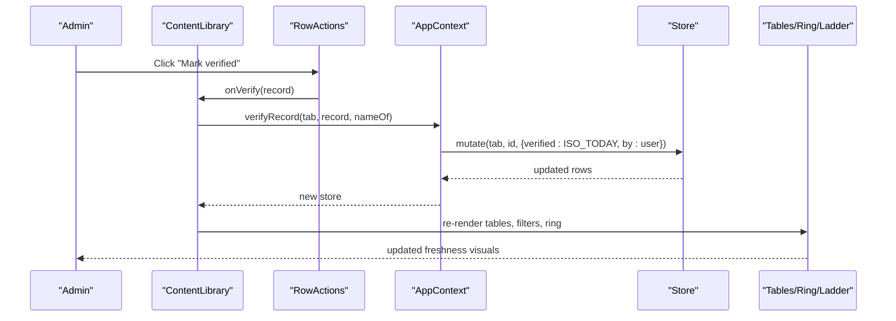
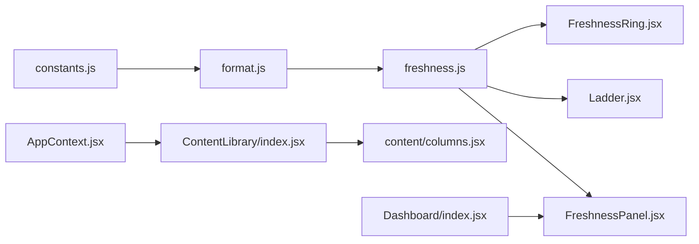

# Freshness Tracking System

<cite>
**Referenced Files in This Document**
- [freshness.js](file://src/lib/freshness.js)
- [format.js](file://src/lib/format.js)
- [constants.js](file://src/lib/constants.js)
- [FreshnessRing.jsx](file://src/components/charts/FreshnessRing.jsx)
- [Ladder.jsx](file://src/components/ui/Ladder.jsx)
- [FreshnessPanel.jsx](file://src/pages/Dashboard/FreshnessPanel.jsx)
- [AppContext.jsx](file://src/context/AppContext.jsx)
- [ContentLibrary/index.jsx](file://src/pages/ContentLibrary/index.jsx)
- [ContentLibrary/RowActions.jsx](file://src/pages/ContentLibrary/RowActions.jsx)
- [content/columns.jsx](file://src/components/content/columns.jsx)
- [Dashboard/index.jsx](file://src/pages/Dashboard/index.jsx)
</cite>

## Table of Contents
1. [Introduction](#introduction)
2. [Project Structure](#project-structure)
3. [Core Components](#core-components)
4. [Architecture Overview](#architecture-overview)
5. [Detailed Component Analysis](#detailed-component-analysis)
6. [Dependency Analysis](#dependency-analysis)
7. [Performance Considerations](#performance-considerations)
8. [Troubleshooting Guide](#troubleshooting-guide)
9. [Conclusion](#conclusion)
10. [Appendices](#appendices)

## Introduction
This document explains the freshness tracking system that monitors data accuracy through time-based verification. It covers how records are scored based on recency and importance, how visual indicators (freshness rings and ladders) communicate status to administrators, and how content management workflows update freshness when records change. It also outlines configuration points for thresholds, scheduling considerations, alerting integration, and dashboard visualization used by administrators to monitor data quality across the platform.

## Project Structure
The freshness system is implemented as a small set of focused modules:
- A pure logic layer computes freshness from a record’s last verified timestamp.
- UI components render freshness visually (ring chart and ladder).
- Dashboard and content library pages aggregate and expose freshness to users.
- The application context provides state and mutation functions to mark records as verified.

**Diagram sources**
- [freshness.js:17-36](file://src/lib/freshness.js#L17-L36)
- [format.js:1-32](file://src/lib/format.js#L1-L32)
- [constants.js:1-35](file://src/lib/constants.js#L1-L35)
- [FreshnessRing.jsx:1-66](file://src/components/charts/FreshnessRing.jsx#L1-L66)
- [Ladder.jsx:1-32](file://src/components/ui/Ladder.jsx#L1-L32)
- [FreshnessPanel.jsx:1-74](file://src/pages/Dashboard/FreshnessPanel.jsx#L1-L74)
- [Dashboard/index.jsx:1-43](file://src/pages/Dashboard/index.jsx#L1-L43)
- [ContentLibrary/index.jsx:1-254](file://src/pages/ContentLibrary/index.jsx#L1-L254)
- [ContentLibrary/RowActions.jsx:1-31](file://src/pages/ContentLibrary/RowActions.jsx#L1-L31)
- [content/columns.jsx:1-171](file://src/components/content/columns.jsx#L1-L171)
- [AppContext.jsx:1-135](file://src/context/AppContext.jsx#L1-L135)

**Section sources**
- [freshness.js:17-36](file://src/lib/freshness.js#L17-L36)
- [FreshnessRing.jsx:1-66](file://src/components/charts/FreshnessRing.jsx#L1-L66)
- [FreshnessPanel.jsx:1-74](file://src/pages/Dashboard/FreshnessPanel.jsx#L1-L74)
- [ContentLibrary/index.jsx:1-254](file://src/pages/ContentLibrary/index.jsx#L1-L254)
- [AppContext.jsx:1-135](file://src/context/AppContext.jsx#L1-L135)

## Core Components
- Freshness calculation: Computes a score and label based on days since last verification. Uses fixed academic-cycle thresholds to classify records into tiers.
- Freshness buckets: Aggregates counts per tier for visualization.
- Visual indicators:
  - Freshness ring: Donut chart showing share of verified records and breakdown by tier.
  - Ladder: Four-rung indicator per record with color-coded status and day count.
- Dashboard panel: Shows overall freshness and lists overdue records for quick action.
- Content library: Provides filtering, sorting, and bulk actions to verify records; integrates with audit trail.
- Application context: Centralizes state and exposes mutate and verifyRecord to update freshness timestamps.

**Section sources**
- [freshness.js:17-36](file://src/lib/freshness.js#L17-L36)
- [FreshnessRing.jsx:1-66](file://src/components/charts/FreshnessRing.jsx#L1-L66)
- [Ladder.jsx:1-32](file://src/components/ui/Ladder.jsx#L1-L32)
- [FreshnessPanel.jsx:1-74](file://src/pages/Dashboard/FreshnessPanel.jsx#L1-L74)
- [ContentLibrary/index.jsx:1-254](file://src/pages/ContentLibrary/index.jsx#L1-L254)
- [AppContext.jsx:105-116](file://src/context/AppContext.jsx#L105-L116)

## Architecture Overview
The system follows a clear separation between logic, state, and presentation:
- Logic: Pure functions compute freshness from ISO dates using a shared “today” constant and date utilities.
- State: The app context holds the current store of records and provides a single entry point to mutate them, including marking records as verified.
- Presentation: Pages and components consume the store and logic to render freshness visuals and enable user actions.

**Diagram sources**
- [ContentLibrary/index.jsx:81-94](file://src/pages/ContentLibrary/index.jsx#L81-L94)
- [AppContext.jsx:105-116](file://src/context/AppContext.jsx#L105-L116)
- [freshness.js:17-36](file://src/lib/freshness.js#L17-L36)
- [FreshnessPanel.jsx:20-34](file://src/pages/Dashboard/FreshnessPanel.jsx#L20-L34)
- [FreshnessRing.jsx:6-42](file://src/components/charts/FreshnessRing.jsx#L6-L42)
- [Ladder.jsx:10-31](file://src/components/ui/Ladder.jsx#L10-L31)

## Detailed Component Analysis

### Freshness Calculation and Scoring
- Input: An ISO date string representing the last human verification.
- Computation:
  - Days since verification are calculated using a shared “today” constant and date math.
  - Thresholds define four tiers:
    - 0–30 days: Verified (jade), 4 rungs
    - 31–90 days: Verified (jade), 3 rungs
    - 91–180 days: Ageing (amber), 2 rungs
    - 181+ days: Stale (rose), 1 rung
- Output: An object containing rungs, tone, label, and days.
- Aggregation: Buckets count records per tone for charts.

**Diagram sources**
- [freshness.js:17-23](file://src/lib/freshness.js#L17-L23)
- [format.js:3-4](file://src/lib/format.js#L3-L4)
- [constants.js:1-9](file://src/lib/constants.js#L1-L9)

**Section sources**
- [freshness.js:17-36](file://src/lib/freshness.js#L17-L36)
- [format.js:1-32](file://src/lib/format.js#L1-L32)
- [constants.js:1-35](file://src/lib/constants.js#L1-L35)

### Freshness Visualization: Ring and Ladder
- FreshnessRing:
  - Accepts buckets (counts per tone).
  - Renders a donut chart where each segment represents a tier.
  - Displays the verified percentage prominently in the center.
- Ladder:
  - Renders four horizontal rungs colored by tone.
  - Shows the number of days since verification or “today”.
  - Used consistently across tables, dashboards, and history drawers.

**Diagram sources**
- [FreshnessRing.jsx:6-66](file://src/components/charts/FreshnessRing.jsx#L6-L66)
- [Ladder.jsx:10-31](file://src/components/ui/Ladder.jsx#L10-L31)
- [FreshnessPanel.jsx:16-74](file://src/pages/Dashboard/FreshnessPanel.jsx#L16-L74)

**Section sources**
- [FreshnessRing.jsx:1-66](file://src/components/charts/FreshnessRing.jsx#L1-L66)
- [Ladder.jsx:1-32](file://src/components/ui/Ladder.jsx#L1-L32)
- [FreshnessPanel.jsx:1-74](file://src/pages/Dashboard/FreshnessPanel.jsx#L1-L74)

### Dashboard Integration and Monitoring
- FreshnessPanel aggregates all catalogue records (services, fees, deadlines, departments) and computes buckets.
- Lists the five most overdue records sorted by oldest verification first.
- Provides navigation to the content library for remediation.
- Dashboard page includes the panel alongside other metrics.

**Diagram sources**
- [FreshnessPanel.jsx:20-34](file://src/pages/Dashboard/FreshnessPanel.jsx#L20-L34)
- [freshness.js:25-36](file://src/lib/freshness.js#L25-L36)
- [Dashboard/index.jsx:1-43](file://src/pages/Dashboard/index.jsx#L1-L43)

**Section sources**
- [FreshnessPanel.jsx:1-74](file://src/pages/Dashboard/FreshnessPanel.jsx#L1-L74)
- [Dashboard/index.jsx:1-43](file://src/pages/Dashboard/index.jsx#L1-L43)

### Content Management Integration and Verification Workflow
- Filtering and sorting:
  - Users can filter by freshness tier (jade, amber, rose).
  - Sorting supports verification date and other fields.
- Verification actions:
  - Row-level “Mark verified” button triggers verification.
  - Bulk verification allows selecting multiple rows and verifying at once.
- State updates:
  - verifyRecord sets verified to the shared “today” and records the verifier’s name.
  - Mutations update the store and trigger re-renders across the UI.
- Audit trail:
  - Verify actions are logged with actor, role, and metadata for traceability.

**Diagram sources**
- [ContentLibrary/index.jsx:81-94](file://src/pages/ContentLibrary/index.jsx#L81-L94)
- [ContentLibrary/RowActions.jsx:1-31](file://src/pages/ContentLibrary/RowActions.jsx#L1-L31)
- [AppContext.jsx:105-116](file://src/context/AppContext.jsx#L105-L116)
- [content/columns.jsx:15-28](file://src/components/content/columns.jsx#L15-L28)

**Section sources**
- [ContentLibrary/index.jsx:1-254](file://src/pages/ContentLibrary/index.jsx#L1-L254)
- [ContentLibrary/RowActions.jsx:1-31](file://src/pages/ContentLibrary/RowActions.jsx#L1-L31)
- [AppContext.jsx:1-135](file://src/context/AppContext.jsx#L1-L135)
- [content/columns.jsx:1-171](file://src/components/content/columns.jsx#L1-L171)

### Freshness States and Examples
- Fresh (Verified):
  - Within 0–90 days of last verification.
  - Jade tone, higher rung count.
  - Example: A fee record verified this month shows jade with full rungs.
- Ageing:
  - Between 91–180 days.
  - Amber tone, two rungs.
  - Example: A deadline notice not checked in three months appears amber.
- Stale:
  - Over 180 days.
  - Rose tone, one rung.
  - Example: A department contact unchanged for six months shows rose.
- Unknown:
  - Not explicitly modeled by the current logic; if a record lacks a verified date, it would not map to a valid tier. In practice, ensure every record has a verified timestamp to avoid undefined states.

[No sources needed since this section summarizes conceptual examples without analyzing specific files]

## Dependency Analysis
- Freshness logic depends on:
  - Date utilities for computing days since verification.
  - Shared constants for “today” to keep mock data coherent.
- UI components depend on:
  - Freshness logic for rendering accurate visuals.
  - AppContext store for reading and updating records.
- Pages orchestrate:
  - Aggregation of multiple record types.
  - User interactions to verify and filter records.

**Diagram sources**
- [freshness.js:17-36](file://src/lib/freshness.js#L17-L36)
- [format.js:1-32](file://src/lib/format.js#L1-L32)
- [constants.js:1-35](file://src/lib/constants.js#L1-L35)
- [FreshnessRing.jsx:1-66](file://src/components/charts/FreshnessRing.jsx#L1-L66)
- [Ladder.jsx:1-32](file://src/components/ui/Ladder.jsx#L1-L32)
- [FreshnessPanel.jsx:1-74](file://src/pages/Dashboard/FreshnessPanel.jsx#L1-L74)
- [ContentLibrary/index.jsx:1-254](file://src/pages/ContentLibrary/index.jsx#L1-L254)
- [content/columns.jsx:1-171](file://src/components/content/columns.jsx#L1-L171)
- [Dashboard/index.jsx:1-43](file://src/pages/Dashboard/index.jsx#L1-L43)
- [AppContext.jsx:1-135](file://src/context/AppContext.jsx#L1-L135)

**Section sources**
- [freshness.js:17-36](file://src/lib/freshness.js#L17-L36)
- [AppContext.jsx:1-135](file://src/context/AppContext.jsx#L1-L135)
- [ContentLibrary/index.jsx:1-254](file://src/pages/ContentLibrary/index.jsx#L1-L254)

## Performance Considerations
- Computation:
  - Freshness calculation is O(1) per record; bucketing is O(n) over the dataset.
  - Dashboard aggregation combines multiple stores; consider memoization to avoid recomputation on unrelated changes.
- Rendering:
  - SVG ring uses stroke-dasharray transitions; large datasets may benefit from virtualization or pagination if expanded beyond current scope.
- State updates:
  - verifyRecord triggers store-wide re-renders; ensure only necessary components subscribe to relevant slices.
- Future scaling:
  - Phase 2 replaces local store with server state; ensure API calls batch updates and minimize round trips.

[No sources needed since this section provides general guidance]

## Troubleshooting Guide
- Records show no freshness:
  - Ensure records have a valid verified timestamp; otherwise, freshness cannot compute a tier.
- Unexpected freshness tier:
  - Confirm the “today” constant aligns with expected environment; in production, replace with real-time date.
- Verification not reflected:
  - Verify that verifyRecord is invoked and mutate updates the store; check audit log for verify actions.
- Filters not working:
  - Confirm freshness filter options match computed tones; ensure filtering logic compares tone correctly.

**Section sources**
- [freshness.js:17-36](file://src/lib/freshness.js#L17-L36)
- [constants.js:1-9](file://src/lib/constants.js#L1-L9)
- [AppContext.jsx:105-116](file://src/context/AppContext.jsx#L105-L116)
- [ContentLibrary/index.jsx:61-79](file://src/pages/ContentLibrary/index.jsx#L61-L79)

## Conclusion
The freshness tracking system provides a robust, time-based mechanism to assess and visualize data accuracy. Through clear thresholds, consistent visuals, and integrated verification workflows, administrators can maintain high-quality content across the platform. The design separates concerns cleanly, enabling future enhancements such as automated schedules, alerts, and server-backed state while preserving a simple, auditable user experience.

[No sources needed since this section summarizes without analyzing specific files]

## Appendices

### Configuration Options
- Freshness thresholds:
  - Defined in the freshness logic; tied to academic cycles (0–30, 31–90, 91–180, 181+ days).
  - To adjust thresholds, modify the decision boundaries in the freshness function.
- Verification schedule:
  - Currently manual via “Mark verified”; could be extended with scheduled jobs that call verifyRecord for overdue records.
- Alerting mechanisms:
  - Dashboard highlights overdue records; integrate with notification systems by observing freshness changes and triggering alerts when records transition to amber or rose.
- Integration with content management:
  - Use verifyRecord whenever records are edited or published to ensure freshness reflects the latest human review.
  - Export CSV includes verification metadata for offline analysis.

**Section sources**
- [freshness.js:17-36](file://src/lib/freshness.js#L17-L36)
- [ContentLibrary/index.jsx:81-94](file://src/pages/ContentLibrary/index.jsx#L81-L94)
- [AppContext.jsx:105-116](file://src/context/AppContext.jsx#L105-L116)
- [FreshnessPanel.jsx:27-34](file://src/pages/Dashboard/FreshnessPanel.jsx#L27-L34)