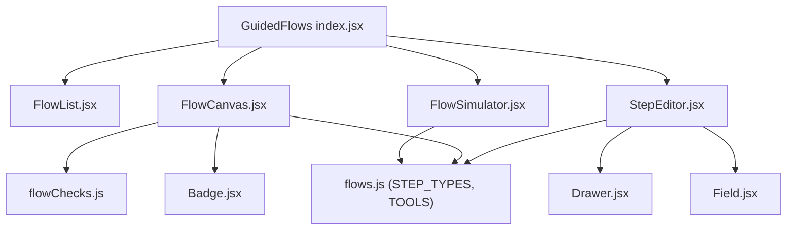
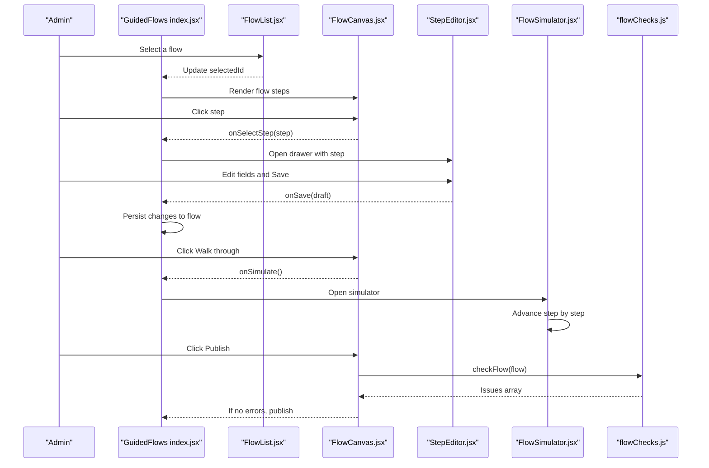
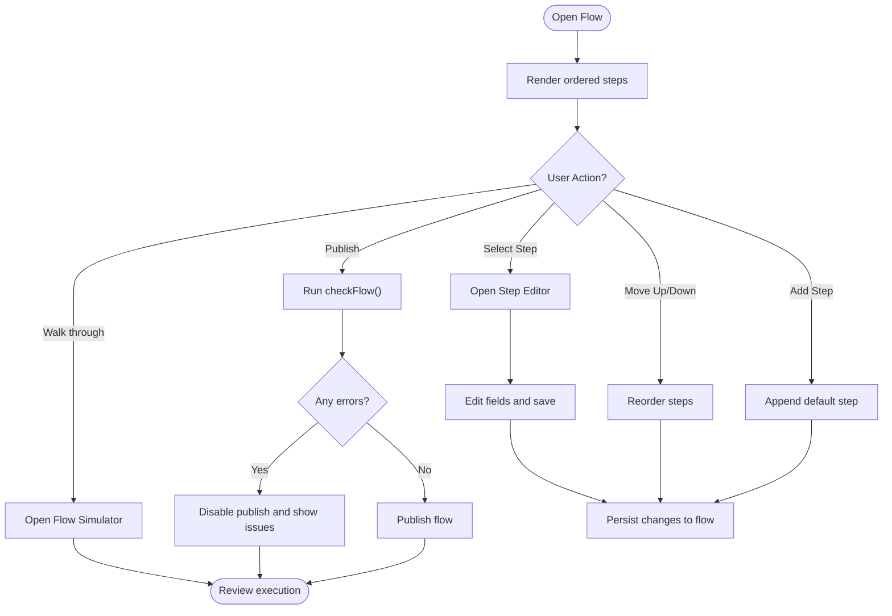
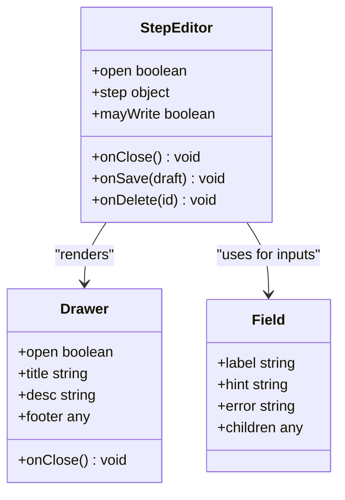
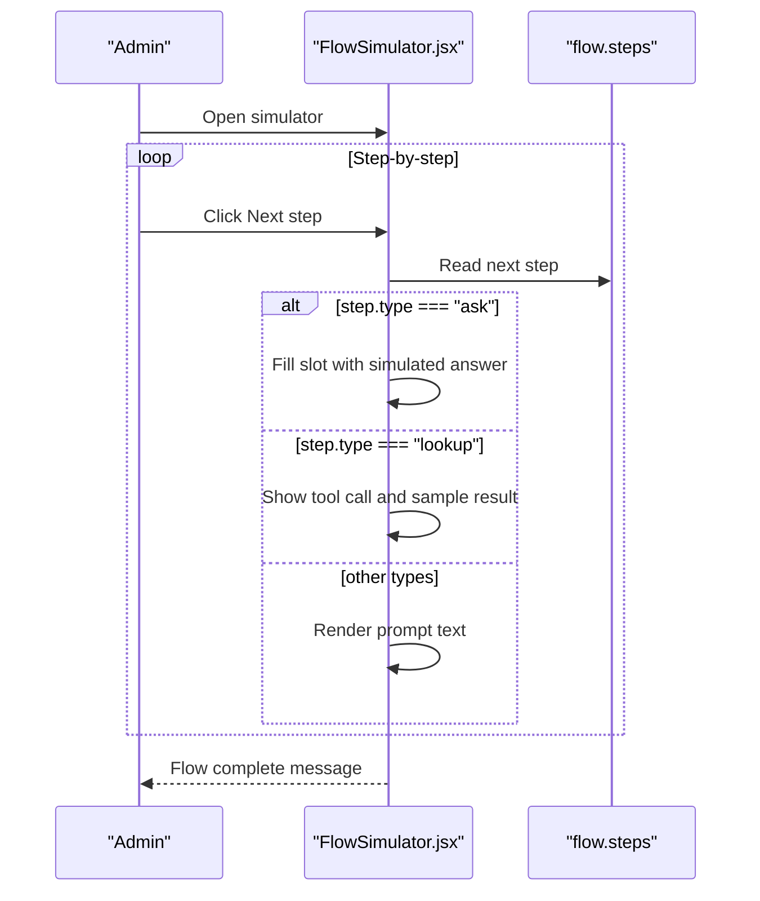
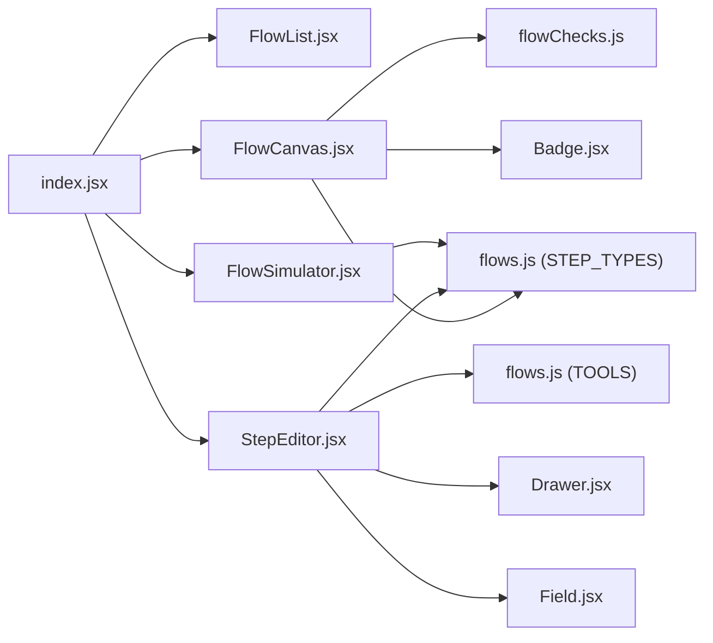

# Flow Builder Interface

<cite>
**Referenced Files in This Document**
- [index.jsx](file://src/pages/GuidedFlows/index.jsx)
- [FlowCanvas.jsx](file://src/pages/GuidedFlows/FlowCanvas.jsx)
- [StepEditor.jsx](file://src/pages/GuidedFlows/StepEditor.jsx)
- [FlowSimulator.jsx](file://src/pages/GuidedFlows/FlowSimulator.jsx)
- [flowChecks.js](file://src/pages/GuidedFlows/flowChecks.js)
- [FlowList.jsx](file://src/pages/GuidedFlows/FlowList.jsx)
- [flows.js](file://src/mocks/flows.js)
- [Drawer.jsx](file://src/components/ui/Drawer.jsx)
- [Field.jsx](file://src/components/ui/Field.jsx)
- [Badge.jsx](file://src/components/ui/Badge.jsx)
</cite>

## Table of Contents
1. [Introduction](#introduction)
2. [Project Structure](#project-structure)
3. [Core Components](#core-components)
4. [Architecture Overview](#architecture-overview)
5. [Detailed Component Analysis](#detailed-component-analysis)
6. [Dependency Analysis](#dependency-analysis)
7. [Performance Considerations](#performance-considerations)
8. [Troubleshooting Guide](#troubleshooting-guide)
9. [Conclusion](#conclusion)

## Introduction
This document explains the visual flow builder interface that enables administrators to create and manage guided workflows. The interface centers on a canvas-based editor where flows are designed as ordered, explicit state machines rather than relying on model improvisation. Administrators configure individual steps with validation rules, conditional tool calls, and output mappings, then preview and test flows before publishing them live.

The system supports multiple flow patterns:
- Linear processes: sequential steps that collect information and provide answers.
- Decision trees: branching via tool outputs and confirmations that guide users down different paths.
- Complex multi-branch workflows: combinations of asks, lookups, confirmations, and handoffs to orchestrate end-to-end journeys.

## Project Structure
The Guided Flows feature is implemented as a cohesive set of components under a single page module. The entry point composes the list view, the canvas editor, step editor drawer, and simulator modal. Supporting utilities enforce publishability rules and mock data defines sample flows and step type metadata.

**Diagram sources**
- [index.jsx:1-152](file://src/pages/GuidedFlows/index.jsx#L1-L152)
- [FlowCanvas.jsx:1-157](file://src/pages/GuidedFlows/FlowCanvas.jsx#L1-L157)
- [StepEditor.jsx:1-161](file://src/pages/GuidedFlows/StepEditor.jsx#L1-L161)
- [FlowSimulator.jsx:1-160](file://src/pages/GuidedFlows/FlowSimulator.jsx#L1-L160)
- [flowChecks.js:1-68](file://src/pages/GuidedFlows/flowChecks.js#L1-L68)
- [flows.js:1-137](file://src/mocks/flows.js#L1-L137)
- [Drawer.jsx:1-33](file://src/components/ui/Drawer.jsx#L1-L33)
- [Field.jsx:1-23](file://src/components/ui/Field.jsx#L1-L23)
- [Badge.jsx:1-12](file://src/components/ui/Badge.jsx#L1-L12)

**Section sources**
- [index.jsx:1-152](file://src/pages/GuidedFlows/index.jsx#L1-L152)
- [FlowList.jsx:1-52](file://src/pages/GuidedFlows/FlowList.jsx#L1-L52)
- [flows.js:1-137](file://src/mocks/flows.js#L1-L137)

## Core Components
- Flow List: Displays all flows with status badges and summary metrics; selection drives the active flow in the canvas.
- Flow Canvas: Visualizes the current flow as an ordered list of steps with inline metadata, move controls, add/remove actions, and validation issues.
- Step Editor: A right-side drawer for editing a selected step’s properties based on its type (ask, lookup, inform, confirm, handoff).
- Flow Simulator: A walkthrough mode that executes steps one by one, showing prompts, tool calls, and slot filling to validate behavior.
- Validation Rules: Publishability checks ensure flows end properly, ask steps have slots and validations, and required tools are present.

**Section sources**
- [FlowList.jsx:1-52](file://src/pages/GuidedFlows/FlowList.jsx#L1-L52)
- [FlowCanvas.jsx:1-157](file://src/pages/GuidedFlows/FlowCanvas.jsx#L1-L157)
- [StepEditor.jsx:1-161](file://src/pages/GuidedFlows/StepEditor.jsx#L1-L161)
- [FlowSimulator.jsx:1-160](file://src/pages/GuidedFlows/FlowSimulator.jsx#L1-L160)
- [flowChecks.js:1-68](file://src/pages/GuidedFlows/flowChecks.js#L1-L68)

## Architecture Overview
The Guided Flows page orchestrates user interactions across four main components:
- Selection and state management occur in the page component, which holds the current flow, selected step, and simulation state.
- The Flow List updates the selected flow ID.
- The Flow Canvas renders the step sequence and exposes actions to move, add, simulate, and publish steps.
- The Step Editor opens when a step is selected, allowing configuration changes that persist back to the flow.
- The Flow Simulator runs a step-by-step execution to validate behavior before publishing.

**Diagram sources**
- [index.jsx:21-149](file://src/pages/GuidedFlows/index.jsx#L21-L149)
- [FlowCanvas.jsx:16-157](file://src/pages/GuidedFlows/FlowCanvas.jsx#L16-L157)
- [StepEditor.jsx:16-161](file://src/pages/GuidedFlows/StepEditor.jsx#L16-L161)
- [FlowSimulator.jsx:27-160](file://src/pages/GuidedFlows/FlowSimulator.jsx#L27-L160)
- [flowChecks.js:8-67](file://src/pages/GuidedFlows/flowChecks.js#L8-L67)

## Detailed Component Analysis

### Flow List
- Purpose: Present all flows with status indicators and key metrics such as completions and last updated time.
- Interaction: Clicking a flow item selects it and updates the active flow in the parent component.
- Visuals: Uses badges to indicate Live or Draft status and displays bilingual titles and summaries.

**Section sources**
- [FlowList.jsx:1-52](file://src/pages/GuidedFlows/FlowList.jsx#L1-L52)

### Flow Canvas
- Purpose: Display the current flow as an ordered list of steps with contextual metadata and actions.
- Features:
  - Shows step label, type badge, optional slot, and tool call details if present.
  - Provides move-up/move-down controls to reorder steps.
  - Adds new steps and triggers simulation or publish actions.
  - Displays validation issues returned by the flow checker.
- Behavior:
  - Errors prevent publishing until resolved.
  - Step selection opens the Step Editor drawer.

**Diagram sources**
- [FlowCanvas.jsx:16-157](file://src/pages/GuidedFlows/FlowCanvas.jsx#L16-L157)
- [flowChecks.js:8-67](file://src/pages/GuidedFlows/flowChecks.js#L8-L67)

**Section sources**
- [FlowCanvas.jsx:1-157](file://src/pages/GuidedFlows/FlowCanvas.jsx#L1-L157)

### Step Editor
- Purpose: Configure individual flow steps with fields relevant to the step type.
- Fields:
  - Step name: displayed in the canvas only.
  - Type: choose among ask, lookup, inform, confirm, handoff.
  - Ask-specific: slot name and validation rule.
  - Lookup/Confirm-specific: tool selection and arguments.
  - Prompts: English and Urdu text for non-lookup steps.
- Behavior:
  - Opens as a right-side drawer with title and description from step type metadata.
  - Supports saving changes and deleting steps.
  - Respects write permissions to disable editing when read-only.

**Diagram sources**
- [StepEditor.jsx:16-161](file://src/pages/GuidedFlows/StepEditor.jsx#L16-L161)
- [Field.jsx:1-23](file://src/components/ui/Field.jsx#L1-L23)
- [Drawer.jsx:1-33](file://src/components/ui/Drawer.jsx#L1-L33)

**Section sources**
- [StepEditor.jsx:1-161](file://src/pages/GuidedFlows/StepEditor.jsx#L1-L161)

### Flow Simulator
- Purpose: Provide a step-by-step walkthrough of a flow to validate behavior and debug issues.
- Behavior:
  - Advances through steps one at a time.
  - For ask steps, simulates filling slots and shows user responses.
  - For lookup steps, displays tool calls and sample results.
  - Shows completed message when the flow finishes without leaving the user waiting.
- Controls: Reset, Start, Next step, and Finish states.

**Diagram sources**
- [FlowSimulator.jsx:27-160](file://src/pages/GuidedFlows/FlowSimulator.jsx#L27-L160)

**Section sources**
- [FlowSimulator.jsx:1-160](file://src/pages/GuidedFlows/FlowSimulator.jsx#L1-L160)

### Flow Properties Panel
- Location: The Flow Canvas header area acts as the properties panel for the current flow.
- Capabilities:
  - Displays flow title, intent, step count, completion metrics, and drop-off percentage.
  - Provides action buttons to start simulation and publish the flow.
  - Disables publish when validation errors exist.
- Metadata and Permissions:
  - Write permissions gate editing actions like adding steps, moving steps, and publishing.
  - Status transitions from draft to live are enforced by validation checks.

**Section sources**
- [FlowCanvas.jsx:16-57](file://src/pages/GuidedFlows/FlowCanvas.jsx#L16-L57)
- [index.jsx:91-105](file://src/pages/GuidedFlows/index.jsx#L91-L105)

### Examples of Flow Types
- Linear process: A straightforward sequence of asks and lookups followed by confirmation and handoff. Example: Admission & Enrolment flow collects programme and campus, checks eligibility, fetches deadlines and fees, reads back checklist, and offers human handoff.
- Decision tree: Branching logic can be modeled by ordering asks and lookups so that tool outputs determine subsequent steps. Example: Fee Challan flow gathers programme and enrolment type, computes amount and due date, explains payment, and offers escalation.
- Complex multi-branch workflow: Combines informs, confirmations, and handoffs to guide users through detailed procedures. Example: Degree Application flow sets expectations, fetches deadlines and fees, lists required documents, and provides human support.

These examples demonstrate how the canvas presents each step with type badges, prompts, and tool calls, while the simulator validates the execution path.

**Section sources**
- [flows.js:19-116](file://src/mocks/flows.js#L19-L116)
- [FlowCanvas.jsx:58-136](file://src/pages/GuidedFlows/FlowCanvas.jsx#L58-L136)
- [FlowSimulator.jsx:98-149](file://src/pages/GuidedFlows/FlowSimulator.jsx#L98-L149)

## Dependency Analysis
- Page-level dependencies:
  - The page component composes FlowList, FlowCanvas, StepEditor, and FlowSimulator.
  - It manages state for selected flow, editing step, and simulation visibility.
  - It handles persistence via mutation helpers and enforces publishability using flowChecks.
- Component-level dependencies:
  - FlowCanvas depends on STEP_TYPES metadata and flowChecks for rendering and validation.
  - StepEditor depends on STEP_TYPES and TOOLS metadata to render appropriate fields.
  - FlowSimulator depends on STEP_TYPES and uses sample tool results for demonstration.
- UI dependencies:
  - Shared UI primitives include Badge, Button, Note, Drawer, and Field for consistent styling and behavior.

**Diagram sources**
- [index.jsx:1-152](file://src/pages/GuidedFlows/index.jsx#L1-L152)
- [FlowCanvas.jsx:1-157](file://src/pages/GuidedFlows/FlowCanvas.jsx#L1-L157)
- [StepEditor.jsx:1-161](file://src/pages/GuidedFlows/StepEditor.jsx#L1-L161)
- [FlowSimulator.jsx:1-160](file://src/pages/GuidedFlows/FlowSimulator.jsx#L1-L160)
- [flowChecks.js:1-68](file://src/pages/GuidedFlows/flowChecks.js#L1-L68)
- [flows.js:1-137](file://src/mocks/flows.js#L1-L137)
- [Drawer.jsx:1-33](file://src/components/ui/Drawer.jsx#L1-L33)
- [Field.jsx:1-23](file://src/components/ui/Field.jsx#L1-L23)
- [Badge.jsx:1-12](file://src/components/ui/Badge.jsx#L1-L12)

**Section sources**
- [index.jsx:1-152](file://src/pages/GuidedFlows/index.jsx#L1-L152)
- [flows.js:118-137](file://src/mocks/flows.js#L118-L137)

## Performance Considerations
- Rendering efficiency: The canvas renders steps as a simple ordered list, minimizing layout complexity and improving readability for maintainers.
- Validation cost: Flow checks run on each render to surface issues immediately; keep step counts reasonable to avoid excessive re-renders.
- Simulation performance: The simulator advances step-by-step, keeping memory usage low and providing clear feedback per step.
- State mutations: Changes are persisted incrementally with minimal diff tracking to reduce overhead and improve responsiveness.

[No sources needed since this section provides general guidance]

## Troubleshooting Guide
Common issues surfaced by the flow checker:
- Empty flow: No steps defined; add at least one step.
- Missing terminal step: Last step must be confirm or handoff; otherwise the conversation ends unresolved.
- Missing handoff: Every guided flow should offer a human at the end; add a handoff step.
- Ask without slot: Each ask must fill a named slot; define the slot field.
- Ask without validation: Add a validation rule to ensure collected values are valid.
- Slot used before collection: Ensure ask steps appear before lookup steps that consume those slots.
- No grounding tools: Include at least one lookup or confirm step to ground answers in catalogue data.

Resolution steps:
- Use the Flow Canvas issue notes to identify specific problems.
- Edit affected steps in the Step Editor to correct missing fields or order.
- Re-run the simulator to verify fixes before publishing.

**Section sources**
- [flowChecks.js:8-67](file://src/pages/GuidedFlows/flowChecks.js#L8-L67)
- [FlowCanvas.jsx:145-153](file://src/pages/GuidedFlows/FlowCanvas.jsx#L145-L153)

## Conclusion
The Guided Flows interface provides a robust, visual way for administrators to design, validate, and publish structured workflows. By modeling flows as explicit state machines with clear step types, validation rules, and simulation capabilities, the system ensures reliable, grounded conversations. The canvas-based editor, step editor drawer, and simulator work together to streamline creation and debugging, while publishability checks protect against incomplete or broken flows.

[No sources needed since this section summarizes without analyzing specific files]