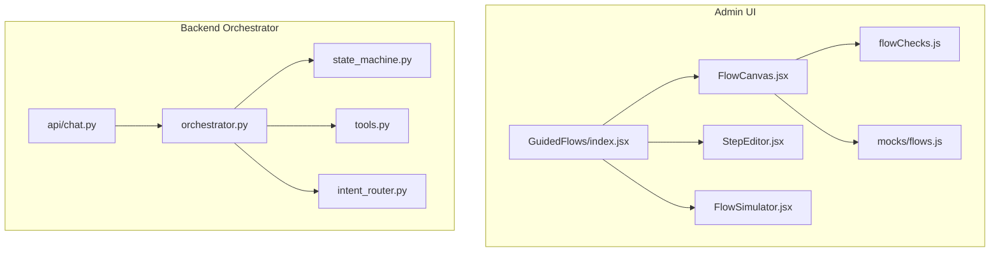
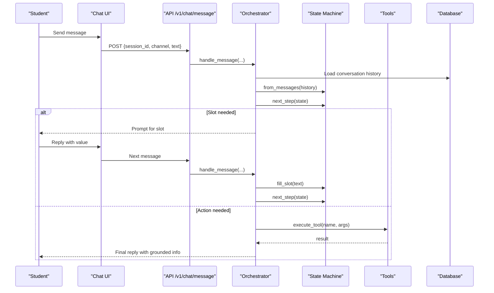
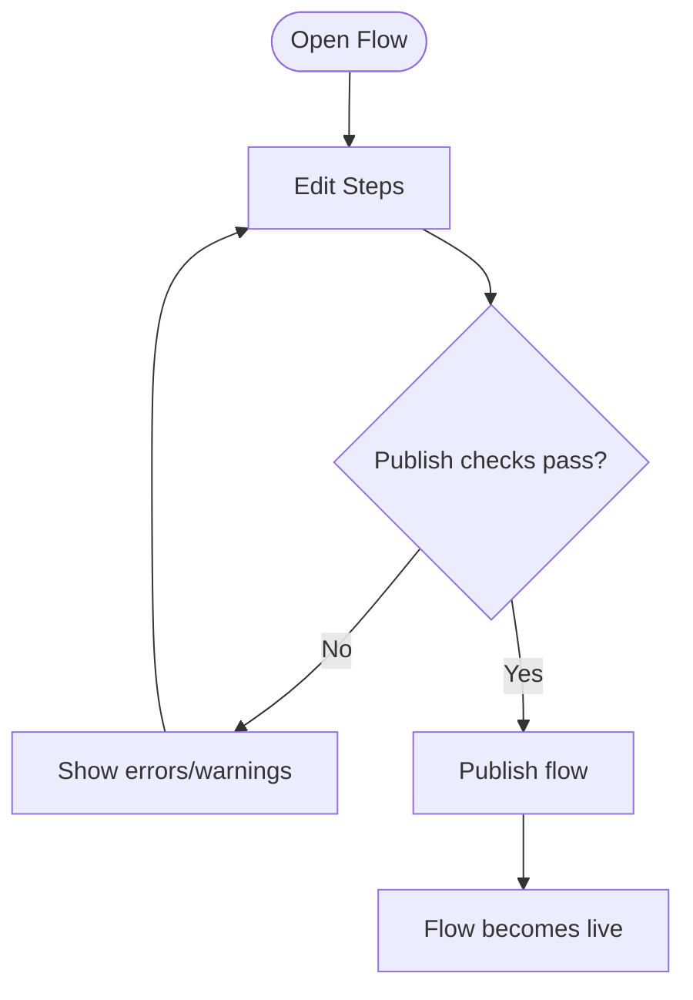
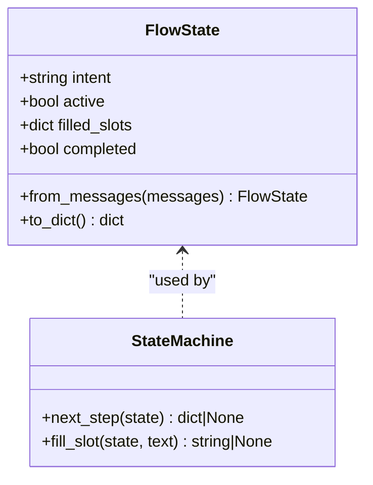
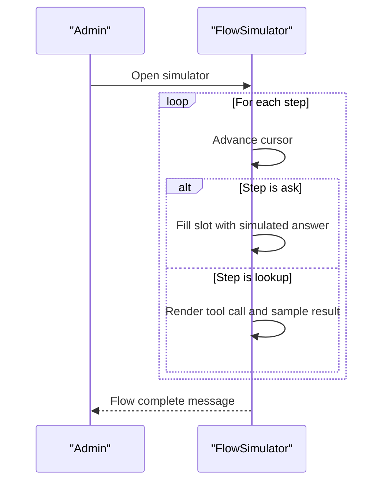
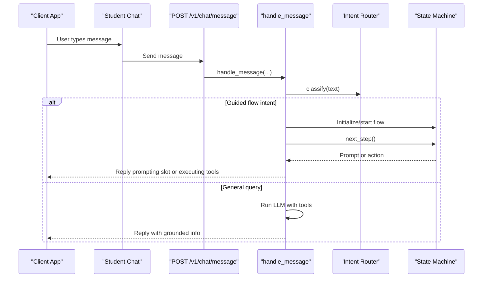
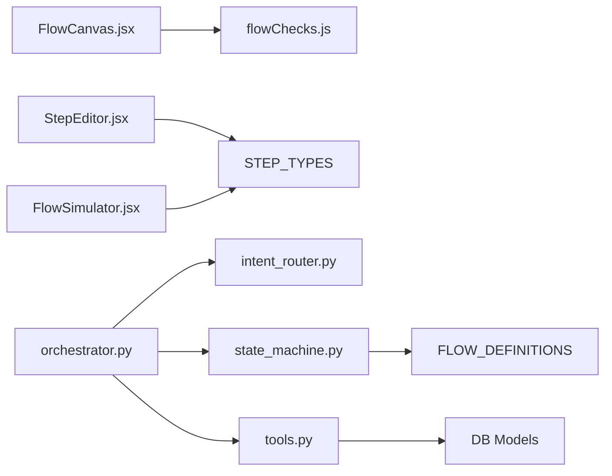

# Guided Flow System

<cite>
**Referenced Files in This Document**
- [index.jsx](file://src/pages/GuidedFlows/index.jsx)
- [FlowCanvas.jsx](file://src/pages/GuidedFlows/FlowCanvas.jsx)
- [StepEditor.jsx](file://src/pages/GuidedFlows/StepEditor.jsx)
- [FlowSimulator.jsx](file://src/pages/GuidedFlows/FlowSimulator.jsx)
- [flowChecks.js](file://src/pages/GuidedFlows/flowChecks.js)
- [flows.js](file://src/mocks/flows.js)
- [state_machine.py](file://uaea-backend/app/orchestrator/state_machine.py)
- [orchestrator.py](file://uaea-backend/app/orchestrator/orchestrator.py)
- [tools.py](file://uaea-backend/app/orchestrator/tools.py)
- [intent_router.py](file://uaea-backend/app/orchestrator/intent_router.py)
- [chat.py](file://uaea-backend/app/api/chat.py)
- [Chat index.jsx](file://src/pages/student/Chat/index.jsx)
</cite>

## Table of Contents
1. [Introduction](#introduction)
2. [Project Structure](#project-structure)
3. [Core Components](#core-components)
4. [Architecture Overview](#architecture-overview)
5. [Detailed Component Analysis](#detailed-component-analysis)
6. [Dependency Analysis](#dependency-analysis)
7. [Performance Considerations](#performance-considerations)
8. [Troubleshooting Guide](#troubleshooting-guide)
9. [Conclusion](#conclusion)
10. [Appendices](#appendices)

## Introduction
This document explains the guided flow system that implements state machine patterns for structured, multi-step conversations. It covers:
- The flow builder interface used by administrators to create and manage workflows with conditional branching and user input collection.
- The backend state machine that manages flow execution, variable persistence across turns, and transition logic.
- Step types available in flows: text prompts (ask), lookups (external integrations), confirmations, and handoffs.
- Common flow patterns: admission application, fee payment process, and document submission workflows.
- Simulation and testing capabilities to validate flow logic before deployment.
- Integration points with the main chat system and how flows are triggered by intents or user actions.

## Project Structure
The guided flow system spans both frontend and backend:
- Frontend admin UI for building, validating, simulating, and publishing flows.
- Backend orchestrator that executes flows during live chat sessions, persists state, and integrates tools.

**Diagram sources**
- [index.jsx:1-152](file://src/pages/GuidedFlows/index.jsx#L1-L152)
- [FlowCanvas.jsx:1-157](file://src/pages/GuidedFlows/FlowCanvas.jsx#L1-L157)
- [StepEditor.jsx:1-161](file://src/pages/GuidedFlows/StepEditor.jsx#L1-L161)
- [FlowSimulator.jsx:1-160](file://src/pages/GuidedFlows/FlowSimulator.jsx#L1-L160)
- [flowChecks.js:1-68](file://src/pages/GuidedFlows/flowChecks.js#L1-L68)
- [flows.js:1-137](file://src/mocks/flows.js#L1-L137)
- [orchestrator.py:1-405](file://uaea-backend/app/orchestrator/orchestrator.py#L1-L405)
- [state_machine.py:1-146](file://uaea-backend/app/orchestrator/state_machine.py#L1-L146)
- [tools.py:1-235](file://uaea-backend/app/orchestrator/tools.py#L1-L235)
- [intent_router.py:1-103](file://uaea-backend/app/orchestrator/intent_router.py#L1-L103)
- [chat.py:1-115](file://uaea-backend/app/api/chat.py#L1-L115)

**Section sources**
- [index.jsx:1-152](file://src/pages/GuidedFlows/index.jsx#L1-L152)
- [orchestrator.py:1-405](file://uaea-backend/app/orchestrator/orchestrator.py#L1-L405)

## Core Components
- Flow Builder UI:
  - Flow list selection and metadata display.
  - Flow canvas showing ordered steps with move/add controls and validation issues.
  - Step editor with type-specific fields (slot, validation, tool, arguments, prompts).
  - Simulator to walk through steps and observe slot filling and tool calls.
- State Machine:
  - Defines flows with slots and steps; determines next step based on filled slots and action readiness.
  - Persists flow state via conversation history so it survives restarts.
- Tools and Integrations:
  - Tool definitions and implementations for fees, deadlines, checklists, departments, knowledge base search, and escalation.
- Intent Routing:
  - Deterministic classifier that routes messages into guided flows or general knowledge queries.
- Chat Integration:
  - API endpoint processes messages, starts guided flows when intent matches, handles slot-filling, and falls back to LLM with tools.

**Section sources**
- [FlowCanvas.jsx:1-157](file://src/pages/GuidedFlows/FlowCanvas.jsx#L1-L157)
- [StepEditor.jsx:1-161](file://src/pages/GuidedFlows/StepEditor.jsx#L1-L161)
- [FlowSimulator.jsx:1-160](file://src/pages/GuidedFlows/FlowSimulator.jsx#L1-L160)
- [state_machine.py:1-146](file://uaea-backend/app/orchestrator/state_machine.py#L1-L146)
- [tools.py:1-235](file://uaea-backend/app/orchestrator/tools.py#L1-L235)
- [intent_router.py:1-103](file://uaea-backend/app/orchestrator/intent_router.py#L1-L103)
- [chat.py:1-115](file://uaea-backend/app/api/chat.py#L1-L115)

## Architecture Overview
The guided flow system is a hybrid of explicit state machines and LLM-powered tool use:
- Admin UI defines flows as ordered lists of steps with slots and tool calls.
- During chat, intents trigger guided flows; the backend orchestrator drives slot collection and action execution.
- When all required slots are collected, the orchestrator executes tool calls to gather grounded data and returns responses.
- Flows can end with confirmations or handoffs to human staff.

**Diagram sources**
- [orchestrator.py:46-143](file://uaea-backend/app/orchestrator/orchestrator.py#L46-L143)
- [state_machine.py:94-146](file://uaea-backend/app/orchestrator/state_machine.py#L94-L146)
- [tools.py:218-235](file://uaea-backend/app/orchestrator/tools.py#L218-L235)
- [chat.py:21-39](file://uaea-backend/app/api/chat.py#L21-L39)

## Detailed Component Analysis

### Flow Builder Interface
- Flow List: Displays flows with status, step count, completions, and last updated time.
- Flow Canvas: Shows ordered steps, supports moving steps up/down, adding new steps, and displays validation issues. Publish button disabled if errors exist.
- Step Editor: Type-aware editing:
  - Ask steps: slot name and validation rule.
  - Lookup steps: tool selection and arguments.
  - Inform/Confirm/Holdoff steps: prompts in English and Urdu.
- Validation Rules: Enforce publishability:
  - Must have at least one step.
  - Last step must be confirm or handoff.
  - Must include a handoff step.
  - All ask steps must have a slot; validation recommended.
  - Slots must be collected before lookup uses them.
  - Prefer tool usage to ground answers.

**Diagram sources**
- [flowChecks.js:1-68](file://src/pages/GuidedFlows/flowChecks.js#L1-L68)
- [FlowCanvas.jsx:26-55](file://src/pages/GuidedFlows/FlowCanvas.jsx#L26-L55)
- [StepEditor.jsx:78-156](file://src/pages/GuidedFlows/StepEditor.jsx#L78-L156)

**Section sources**
- [FlowList.jsx:1-52](file://src/pages/GuidedFlows/FlowList.jsx#L1-L52)
- [FlowCanvas.jsx:1-157](file://src/pages/GuidedFlows/FlowCanvas.jsx#L1-L157)
- [StepEditor.jsx:1-161](file://src/pages/GuidedFlows/StepEditor.jsx#L1-L161)
- [flowChecks.js:1-68](file://src/pages/GuidedFlows/flowChecks.js#L1-L68)

### State Machine Implementation
- Flow Definitions: Define flows with slots and steps including slot collection and actions.
- FlowState: Tracks active intent, filled slots, and completion status; reconstructed from message history.
- next_step: Determines the next step by scanning flow steps for unfilled slots or executable actions.
- fill_slot: Assigns user-provided text to the next unfilled slot.

**Diagram sources**
- [state_machine.py:62-146](file://uaea-backend/app/orchestrator/state_machine.py#L62-L146)

**Section sources**
- [state_machine.py:1-146](file://uaea-backend/app/orchestrator/state_machine.py#L1-L146)

### Step Types and Examples
- Ask: Collects a value into a named slot; requires validation rules for robustness.
- Lookup: Calls grounding tools to fetch official data (fees, deadlines, checklists, departments, knowledge base).
- Inform: States known information without tool calls.
- Confirm: Reads back summaries or checklists to the student.
- Handoff: Terminal step offering human assistance.

Common flow patterns:
- Admission Application:
  - Collect programme and campus.
  - Fetch eligibility, deadline, fee, and document checklist.
  - Confirm and offer handoff.
- Fee Payment Process:
  - Collect programme and enrolment type.
  - Fetch fee amount and due date.
  - Explain payment steps and offer handoff.
- Document Submission Workflow:
  - Collect urgency or semester.
  - Fetch fee and document checklist.
  - Provide instructions and offer handoff.

Examples are defined in mock flows and backend flow definitions.

**Section sources**
- [flows.js:19-116](file://src/mocks/flows.js#L19-L116)
- [state_machine.py:16-59](file://uaea-backend/app/orchestrator/state_machine.py#L16-L59)

### Flow Simulation and Testing
- Simulator walks through steps sequentially, filling slots and invoking sample tool results.
- Helps verify ordering of slot collection and tool usage before publishing.
- Displays slots filled and tool call outputs for clarity.

**Diagram sources**
- [FlowSimulator.jsx:27-159](file://src/pages/GuidedFlows/FlowSimulator.jsx#L27-L159)

**Section sources**
- [FlowSimulator.jsx:1-160](file://src/pages/GuidedFlows/FlowSimulator.jsx#L1-L160)

### Integration Points with Main Chat System
- Intent routing identifies guided flow intents (admission, fee_challan, degree).
- On matching intent, orchestrator initializes flow state and begins slot collection.
- If no guided flow applies, orchestrator runs LLM with tools for general queries.
- Chat API exposes endpoints for sending messages and retrieving session history.

**Diagram sources**
- [intent_router.py:61-103](file://uaea-backend/app/orchestrator/intent_router.py#L61-L103)
- [orchestrator.py:46-143](file://uaea-backend/app/orchestrator/orchestrator.py#L46-L143)
- [chat.py:21-39](file://uaea-backend/app/api/chat.py#L21-L39)

**Section sources**
- [intent_router.py:1-103](file://uaea-backend/app/orchestrator/intent_router.py#L1-L103)
- [orchestrator.py:1-405](file://uaea-backend/app/orchestrator/orchestrator.py#L1-L405)
- [chat.py:1-115](file://uaea-backend/app/api/chat.py#L1-L115)
- [Chat index.jsx:1-200](file://src/pages/student/Chat/index.jsx#L1-L200)

## Dependency Analysis
- Frontend dependencies:
  - FlowCanvas depends on STEP_TYPES and flowChecks for validation and rendering.
  - StepEditor depends on STEP_TYPES and TOOLS for dynamic form fields.
  - FlowSimulator depends on STEP_TYPES and sample tool results for simulation.
- Backend dependencies:
  - Orchestrator depends on intent router, state machine, tools, and guardrails.
  - State machine depends on flow definitions and message history.
  - Tools depend on database models and adapters.

**Diagram sources**
- [FlowCanvas.jsx:1-157](file://src/pages/GuidedFlows/FlowCanvas.jsx#L1-L157)
- [flowChecks.js:1-68](file://src/pages/GuidedFlows/flowChecks.js#L1-L68)
- [StepEditor.jsx:1-161](file://src/pages/GuidedFlows/StepEditor.jsx#L1-L161)
- [flows.js:118-137](file://src/mocks/flows.js#L118-L137)
- [orchestrator.py:1-405](file://uaea-backend/app/orchestrator/orchestrator.py#L1-L405)
- [state_machine.py:1-146](file://uaea-backend/app/orchestrator/state_machine.py#L1-L146)
- [tools.py:1-235](file://uaea-backend/app/orchestrator/tools.py#L1-L235)

**Section sources**
- [FlowCanvas.jsx:1-157](file://src/pages/GuidedFlows/FlowCanvas.jsx#L1-L157)
- [StepEditor.jsx:1-161](file://src/pages/GuidedFlows/StepEditor.jsx#L1-L161)
- [FlowSimulator.jsx:1-160](file://src/pages/GuidedFlows/FlowSimulator.jsx#L1-L160)
- [orchestrator.py:1-405](file://uaea-backend/app/orchestrator/orchestrator.py#L1-L405)
- [state_machine.py:1-146](file://uaea-backend/app/orchestrator/state_machine.py#L1-L146)
- [tools.py:1-235](file://uaea-backend/app/orchestrator/tools.py#L1-L235)

## Performance Considerations
- Keep flows concise to reduce turn counts and improve completion rates.
- Use validation rules to minimize retries and incorrect inputs.
- Prefer deterministic slot collection over free-form text where possible.
- Limit tool calls per turn to avoid excessive latency; batch related lookups when feasible.
- Monitor drop-off metrics in the admin UI to identify bottlenecks.

[No sources needed since this section provides general guidance]

## Troubleshooting Guide
Common issues and resolutions:
- Flow ends without resolution: Ensure last step is confirm or handoff.
- Missing handoff: Add a terminal handoff step to connect students with staff.
- Unfilled slots before lookup: Reorder steps so asks precede lookups that consume those slots.
- No tool usage: Include lookups to ground answers in official data.
- Low confidence classification: Review intent rules and consider adding strong/weak keywords.

**Section sources**
- [flowChecks.js:1-68](file://src/pages/GuidedFlows/flowChecks.js#L1-L68)
- [intent_router.py:14-62](file://uaea-backend/app/orchestrator/intent_router.py#L14-L62)

## Conclusion
The guided flow system combines explicit state machines with LLM-powered tools to deliver reliable, grounded, and structured conversations. Administrators can build, validate, simulate, and publish flows that collect necessary information, retrieve official data, and provide clear outcomes or handoffs. The integration with the chat system ensures seamless transitions between guided flows and general queries, maintaining consistency and trustworthiness throughout the student experience.

[No sources needed since this section summarizes without analyzing specific files]

## Appendices
- Example flows:
  - Admission & Enrolment: collects programme and campus, retrieves eligibility, deadline, fee, and checklist, then confirms and offers handoff.
  - Fee Challan: collects programme and enrolment type, retrieves fee and deadline, explains payment, and offers handoff.
  - Degree Application: retrieves deadline, fee, and checklist, states processing time, and offers handoff.

**Section sources**
- [flows.js:19-116](file://src/mocks/flows.js#L19-L116)
- [state_machine.py:16-59](file://uaea-backend/app/orchestrator/state_machine.py#L16-L59)