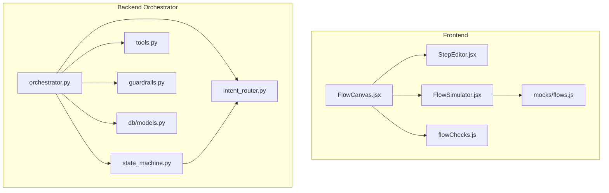
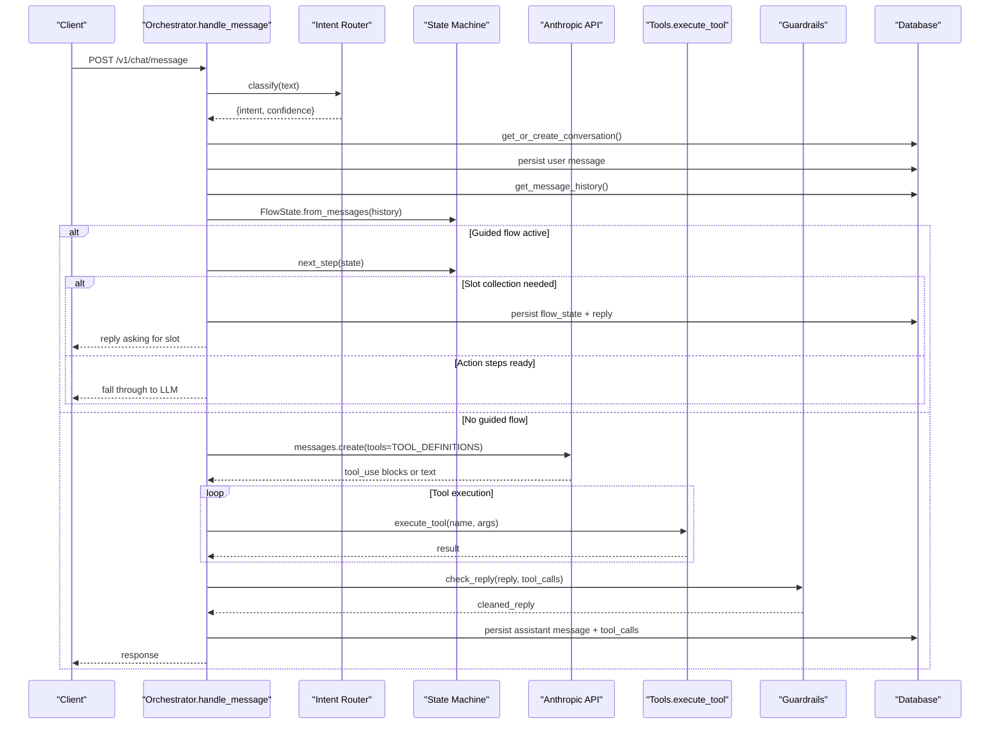
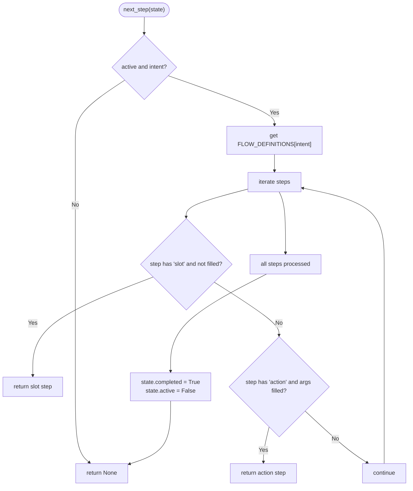
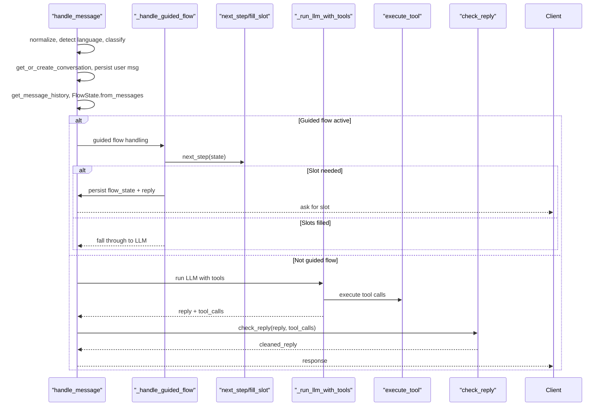
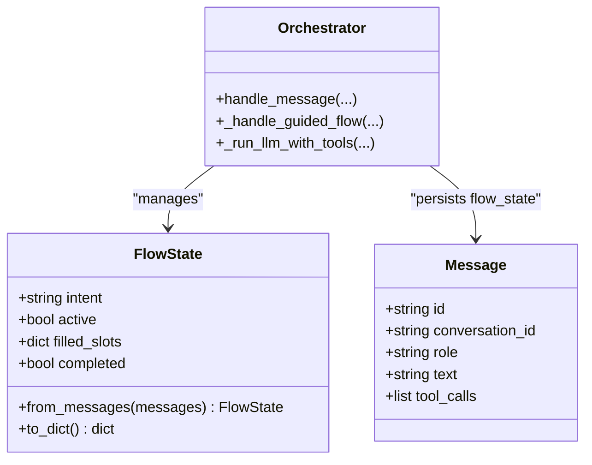
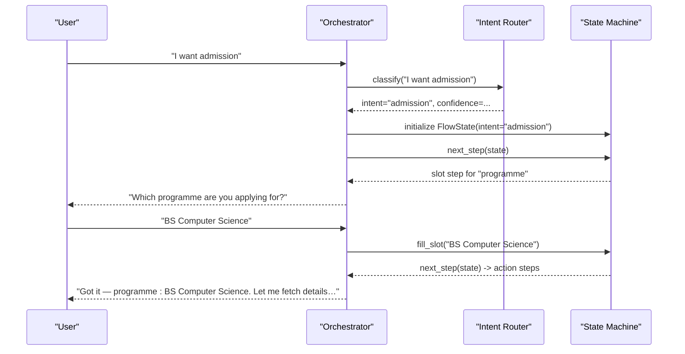
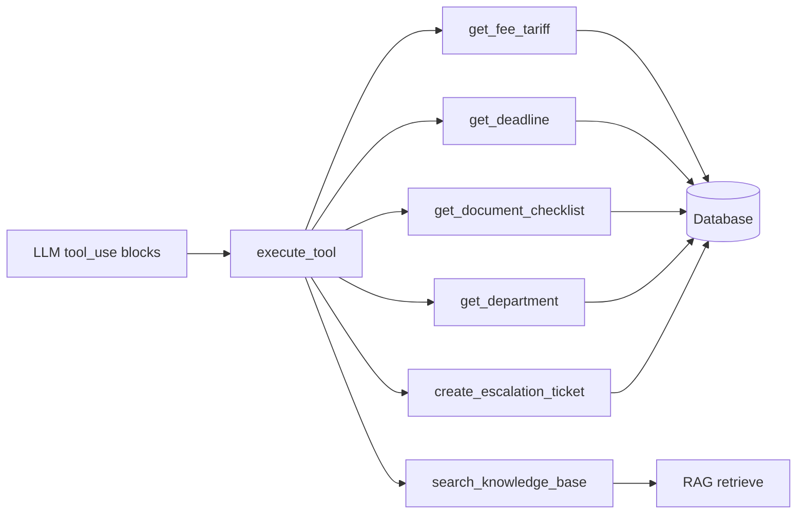
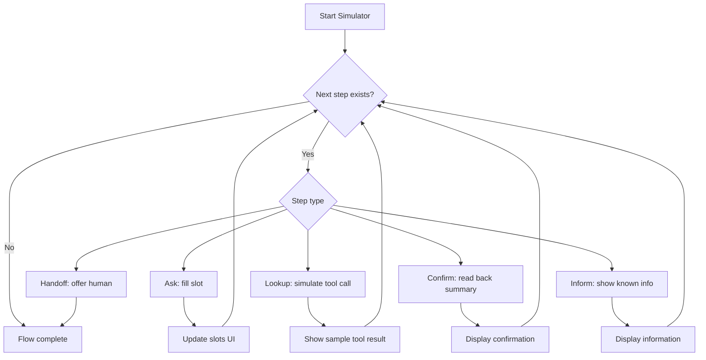
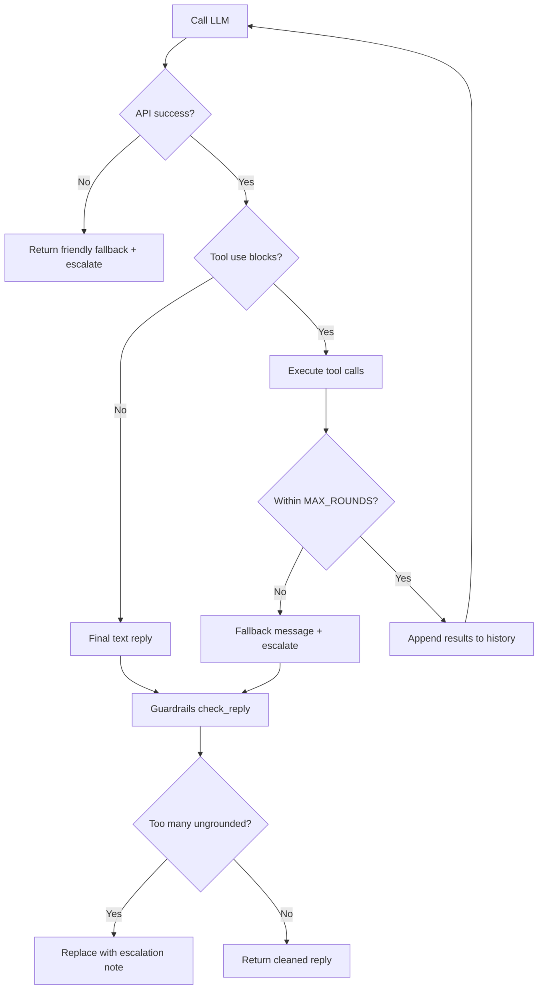
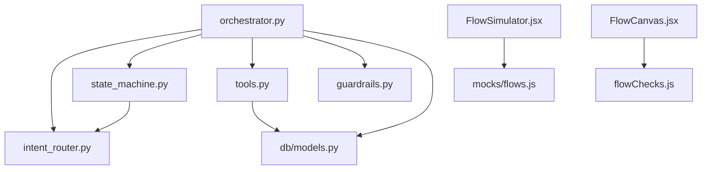

# State Machine Implementation

<cite>
**Referenced Files in This Document**
- [state_machine.py](file://uaea-backend/app/orchestrator/state_machine.py)
- [orchestrator.py](file://uaea-backend/app/orchestrator/orchestrator.py)
- [tools.py](file://uaea-backend/app/orchestrator/tools.py)
- [intent_router.py](file://uaea-backend/app/orchestrator/intent_router.py)
- [guardrails.py](file://uaea-backend/app/orchestrator/guardrails.py)
- [models.py](file://uaea-backend/app/db/models.py)
- [FlowSimulator.jsx](file://src/pages/GuidedFlows/FlowSimulator.jsx)
- [StepEditor.jsx](file://src/pages/GuidedFlows/StepEditor.jsx)
- [flowChecks.js](file://src/pages/GuidedFlows/flowChecks.js)
- [FlowCanvas.jsx](file://src/pages/GuidedFlows/FlowCanvas.jsx)
- [flows.js](file://src/mocks/flows.js)
- [test_chat_flow.py](file://uaea-backend/tests/test_chat_flow.py)
</cite>

## Table of Contents
1. [Introduction](#introduction)
2. [Project Structure](#project-structure)
3. [Core Components](#core-components)
4. [Architecture Overview](#architecture-overview)
5. [Detailed Component Analysis](#detailed-component-analysis)
6. [Dependency Analysis](#dependency-analysis)
7. [Performance Considerations](#performance-considerations)
8. [Troubleshooting Guide](#troubleshooting-guide)
9. [Conclusion](#conclusion)
10. [Appendices](#appendices)

## Introduction
This document explains the state machine that powers guided flow execution for the assistant. It covers how flow instances are managed, how conversation state is maintained and persisted, how transitions between steps occur, and how user inputs drive event-driven state changes. It also documents variable management (slots), complex flow scenarios with branching and loops, external tool integrations, flow simulation capabilities, error handling, timeout management, and recovery mechanisms.

## Project Structure
The guided flow system spans backend orchestration and frontend authoring/simulation:
- Backend orchestrator coordinates intent classification, guided flow state, LLM tool calls, guardrails, and persistence.
- The state machine defines flows, tracks per-conversation state, and computes next steps and slot filling.
- Tools provide grounded data from the database or knowledge base.
- Guardrails ensure replies are grounded in tool results.
- Frontend provides a flow editor, simulator, and publishability checks to validate flows before deployment.

**Diagram sources**
- [orchestrator.py:1-143](file://uaea-backend/app/orchestrator/orchestrator.py#L1-L143)
- [state_machine.py:14-146](file://uaea-backend/app/orchestrator/state_machine.py#L14-L146)
- [intent_router.py:1-103](file://uaea-backend/app/orchestrator/intent_router.py#L1-L103)
- [tools.py:18-235](file://uaea-backend/app/orchestrator/tools.py#L18-L235)
- [guardrails.py:1-120](file://uaea-backend/app/orchestrator/guardrails.py#L1-L120)
- [models.py:142-228](file://uaea-backend/app/db/models.py#L142-L228)
- [FlowCanvas.jsx:1-157](file://src/pages/GuidedFlows/FlowCanvas.jsx#L1-L157)
- [StepEditor.jsx:1-161](file://src/pages/GuidedFlows/StepEditor.jsx#L1-L161)
- [FlowSimulator.jsx:1-160](file://src/pages/GuidedFlows/FlowSimulator.jsx#L1-L160)
- [flowChecks.js:1-68](file://src/pages/GuidedFlows/flowChecks.js#L1-L68)
- [flows.js:1-137](file://src/mocks/flows.js#L1-L137)

**Section sources**
- [orchestrator.py:1-143](file://uaea-backend/app/orchestrator/orchestrator.py#L1-L143)
- [state_machine.py:14-146](file://uaea-backend/app/orchestrator/state_machine.py#L14-L146)
- [FlowCanvas.jsx:1-157](file://src/pages/GuidedFlows/FlowCanvas.jsx#L1-L157)
- [FlowSimulator.jsx:1-160](file://src/pages/GuidedFlows/FlowSimulator.jsx#L1-L160)
- [flowChecks.js:1-68](file://src/pages/GuidedFlows/flowChecks.js#L1-L68)
- [flows.js:1-137](file://src/mocks/flows.js#L1-L137)

## Core Components
- Flow definitions and state machine: define flows, slots, steps, and compute next step and slot filling.
- Orchestrator: processes messages, manages guided flow lifecycle, integrates LLM tools, applies guardrails, and persists state.
- Tools: grounded lookups for fees, deadlines, checklists, departments, knowledge base, and escalation.
- Intent router: deterministic classifier that triggers guided flows.
- Guardrails: post-processing to strip ungrounded claims from LLM replies.
- Persistence: conversations, messages, and escalation tickets stored in the database.
- Frontend: flow editor, simulator, and validation checks to author and test flows safely.

**Section sources**
- [state_machine.py:14-146](file://uaea-backend/app/orchestrator/state_machine.py#L14-L146)
- [orchestrator.py:46-143](file://uaea-backend/app/orchestrator/orchestrator.py#L46-L143)
- [tools.py:18-235](file://uaea-backend/app/orchestrator/tools.py#L18-L235)
- [intent_router.py:61-103](file://uaea-backend/app/orchestrator/intent_router.py#L61-L103)
- [guardrails.py:74-120](file://uaea-backend/app/orchestrator/guardrails.py#L74-L120)
- [models.py:142-228](file://uaea-backend/app/db/models.py#L142-L228)

## Architecture Overview
The message pipeline is event-driven: each incoming message triggers classification, guided flow handling, LLM tool execution, guardrail enforcement, and persistence. Guided flows maintain per-conversation state via messages, enabling recovery across restarts.

**Diagram sources**
- [orchestrator.py:46-143](file://uaea-backend/app/orchestrator/orchestrator.py#L46-L143)
- [state_machine.py:62-146](file://uaea-backend/app/orchestrator/state_machine.py#L62-L146)
- [tools.py:218-235](file://uaea-backend/app/orchestrator/tools.py#L218-L235)
- [guardrails.py:74-120](file://uaea-backend/app/orchestrator/guardrails.py#L74-L120)
- [models.py:142-228](file://uaea-backend/app/db/models.py#L142-L228)

## Detailed Component Analysis

### State Machine: Flow Definitions and Transitions
- Flow definitions declare name, service_id, slots, and ordered steps. Steps can be slot prompts or actions with arguments derived from filled slots or literals.
- FlowState tracks intent, active flag, filled_slots, and completed flag. It reconstructs state from message history by reading tool call records named flow_state.
- next_step determines the next action:
  - If there is an unfilled slot step, return it to prompt the user.
  - If there is an action step whose required args are available, return it for execution.
  - Otherwise, mark flow completed and inactive.
- fill_slot assigns the first unfilled slot value from user input and returns the slot name.

**Diagram sources**
- [state_machine.py:94-125](file://uaea-backend/app/orchestrator/state_machine.py#L94-L125)

**Section sources**
- [state_machine.py:14-146](file://uaea-backend/app/orchestrator/state_machine.py#L14-L146)

### Orchestrator: Message Handling and Guided Flow Integration
- handle_message normalizes input, classifies intent, persists user message, loads conversation history, and reconstructs FlowState.
- If intent matches guided flows and flow is not active, initialize FlowState and start slot collection.
- _handle_guided_flow decides whether to prompt for slots, acknowledge and continue, or fall through to LLM when all slots are filled and action steps are ready.
- _run_llm_with_tools calls the LLM with tool definitions, executes tool calls in a loop up to MAX_ROUNDS, and accumulates tool results.
- Guardrails clean the final reply based on tool-call grounding.
- Flow state is persisted as a tool message named flow_state so it survives restarts.

**Diagram sources**
- [orchestrator.py:46-143](file://uaea-backend/app/orchestrator/orchestrator.py#L46-L143)
- [orchestrator.py:146-227](file://uaea-backend/app/orchestrator/orchestrator.py#L146-L227)
- [orchestrator.py:229-318](file://uaea-backend/app/orchestrator/orchestrator.py#L229-L318)
- [state_machine.py:94-146](file://uaea-backend/app/orchestrator/state_machine.py#L94-L146)
- [guardrails.py:74-120](file://uaea-backend/app/orchestrator/guardrails.py#L74-L120)

**Section sources**
- [orchestrator.py:46-143](file://uaea-backend/app/orchestrator/orchestrator.py#L46-L143)
- [orchestrator.py:146-227](file://uaea-backend/app/orchestrator/orchestrator.py#L146-L227)
- [orchestrator.py:229-318](file://uaea-backend/app/orchestrator/orchestrator.py#L229-L318)

### Variable Management: Slots and Persistence
- Slots are named variables collected during guided flows (e.g., programme, campus, enrolment_type).
- FlowState.filled_slots stores current values; they are reconstructed from message history via flow_state tool messages.
- When slots are filled, the orchestrator acknowledges and either asks for the next slot or proceeds to action steps.
- All flow state changes are persisted as tool messages, ensuring recovery after restarts.

**Diagram sources**
- [state_machine.py:62-91](file://uaea-backend/app/orchestrator/state_machine.py#L62-L91)
- [orchestrator.py:112-121](file://uaea-backend/app/orchestrator/orchestrator.py#L112-L121)
- [models.py:162-178](file://uaea-backend/app/db/models.py#L162-L178)

**Section sources**
- [state_machine.py:62-91](file://uaea-backend/app/orchestrator/state_machine.py#L62-L91)
- [orchestrator.py:112-121](file://uaea-backend/app/orchestrator/orchestrator.py#L112-L121)
- [models.py:162-178](file://uaea-backend/app/db/models.py#L162-L178)

### Event-Driven Processing of User Inputs
- Each user message is an event that triggers classification and potential guided flow activation.
- For guided flows, slot-filling events update FlowState and produce replies that guide the user to the next step.
- Non-guided messages proceed to LLM tool execution, which may create escalations or fetch grounded data.

**Diagram sources**
- [orchestrator.py:80-91](file://uaea-backend/app/orchestrator/orchestrator.py#L80-L91)
- [orchestrator.py:146-227](file://uaea-backend/app/orchestrator/orchestrator.py#L146-L227)
- [state_machine.py:94-146](file://uaea-backend/app/orchestrator/state_machine.py#L94-L146)
- [intent_router.py:61-103](file://uaea-backend/app/orchestrator/intent_router.py#L61-L103)

**Section sources**
- [orchestrator.py:80-91](file://uaea-backend/app/orchestrator/orchestrator.py#L80-L91)
- [orchestrator.py:146-227](file://uaea-backend/app/orchestrator/orchestrator.py#L146-L227)
- [state_machine.py:94-146](file://uaea-backend/app/orchestrator/state_machine.py#L94-L146)
- [intent_router.py:61-103](file://uaea-backend/app/orchestrator/intent_router.py#L61-L103)

### External API Integrations: Tools and Grounded Data
- Tools expose grounded operations: fee tariffs, deadlines, document checklists, department info, knowledge base search, and escalation creation.
- The orchestrator executes tool calls returned by the LLM and appends results back into the conversation context for subsequent rounds.
- Sources are extracted from tool results to support citations in responses.

**Diagram sources**
- [tools.py:18-87](file://uaea-backend/app/orchestrator/tools.py#L18-L87)
- [tools.py:92-235](file://uaea-backend/app/orchestrator/tools.py#L92-L235)
- [orchestrator.py:229-318](file://uaea-backend/app/orchestrator/orchestrator.py#L229-L318)

**Section sources**
- [tools.py:18-235](file://uaea-backend/app/orchestrator/tools.py#L18-L235)
- [orchestrator.py:229-318](file://uaea-backend/app/orchestrator/orchestrator.py#L229-L318)

### Complex Flow Scenarios: Conditional Branching, Loops, and Integrations
- Conditional branching: Flows collect multiple slots (e.g., programme and campus) and then execute multiple action steps (fee, deadline, checklist). The order ensures prerequisites are met before lookups.
- Loops: While the state machine is linear, repeated slot prompts act as iterative loops until all slots are filled.
- External integrations: Action steps trigger tool calls to fetch grounded data; confirm steps summarize results; handoff steps escalate to human staff.

Examples of flows:
- Admission & Enrolment: collects programme and campus, then fetches eligibility, deadline, fee, and checklist, ending with a handoff.
- Fee Challan: collects programme and enrolment type, fetches amount and due date, confirms payment instructions, and offers escalation.
- Degree Application: collects graduating semester, fetches deadline and fee, reads back checklist, states processing time, and offers handoff.

**Section sources**
- [flows.js:19-116](file://src/mocks/flows.js#L19-L116)
- [state_machine.py:14-59](file://uaea-backend/app/orchestrator/state_machine.py#L14-L59)
- [orchestrator.py:146-227](file://uaea-backend/app/orchestrator/orchestrator.py#L146-L227)

### Flow Simulation Capabilities
- FlowSimulator walks through a flow step-by-step, simulating slot fills and tool calls without live users.
- It displays slots filled, tool calls with sample results, and prompts for each step, helping authors verify flow logic and ordering.
- StepEditor allows editing step types, slots, validations, tools, and arguments, ensuring flows are correctly configured before publishing.
- flowChecks validates flows at edit time, enforcing rules like terminal steps, presence of handoff, slot usage before lookups, and grounding via tools.

**Diagram sources**
- [FlowSimulator.jsx:27-159](file://src/pages/GuidedFlows/FlowSimulator.jsx#L27-L159)
- [StepEditor.jsx:16-161](file://src/pages/GuidedFlows/StepEditor.jsx#L16-L161)
- [flowChecks.js:8-67](file://src/pages/GuidedFlows/flowChecks.js#L8-L67)
- [flows.js:118-137](file://src/mocks/flows.js#L118-L137)

**Section sources**
- [FlowSimulator.jsx:27-159](file://src/pages/GuidedFlows/FlowSimulator.jsx#L27-L159)
- [StepEditor.jsx:16-161](file://src/pages/GuidedFlows/StepEditor.jsx#L16-L161)
- [flowChecks.js:8-67](file://src/pages/GuidedFlows/flowChecks.js#L8-L67)
- [flows.js:118-137](file://src/mocks/flows.js#L118-L137)

### Error Handling, Timeout Management, and Recovery
- LLM API errors: Caught and converted to a friendly message offering escalation.
- Round limits: MAX_ROUNDS prevents infinite tool-call loops; if exhausted, a fallback message is returned and escalation may be triggered.
- Guardrails: Strip ungrounded numbers, dates, and requirements; if too many ungrounded claims, replace entire reply with an escalation note.
- Recovery: FlowState is persisted as tool messages in conversation history, allowing reconstruction after restarts.
- Low-confidence queries: Tracked in an unanswered queue for review.

**Diagram sources**
- [orchestrator.py:229-318](file://uaea-backend/app/orchestrator/orchestrator.py#L229-L318)
- [guardrails.py:74-120](file://uaea-backend/app/orchestrator/guardrails.py#L74-L120)
- [state_machine.py:62-91](file://uaea-backend/app/orchestrator/state_machine.py#L62-L91)

**Section sources**
- [orchestrator.py:229-318](file://uaea-backend/app/orchestrator/orchestrator.py#L229-L318)
- [guardrails.py:74-120](file://uaea-backend/app/orchestrator/guardrails.py#L74-L120)
- [state_machine.py:62-91](file://uaea-backend/app/orchestrator/state_machine.py#L62-L91)

## Dependency Analysis
- Orchestrator depends on intent router for classification, state machine for guided flows, tools for grounded data, guardrails for reply safety, and models for persistence.
- State machine depends on flow definitions and intent router constants to identify guided flows.
- Tools depend on database models for structured lookups and knowledge retrieval.
- Frontend components depend on mock flows and step metadata to render editors and simulators.

**Diagram sources**
- [orchestrator.py:1-143](file://uaea-backend/app/orchestrator/orchestrator.py#L1-L143)
- [state_machine.py:14-146](file://uaea-backend/app/orchestrator/state_machine.py#L14-L146)
- [tools.py:18-235](file://uaea-backend/app/orchestrator/tools.py#L18-L235)
- [guardrails.py:1-120](file://uaea-backend/app/orchestrator/guardrails.py#L1-L120)
- [models.py:142-228](file://uaea-backend/app/db/models.py#L142-L228)
- [FlowSimulator.jsx:1-160](file://src/pages/GuidedFlows/FlowSimulator.jsx#L1-L160)
- [FlowCanvas.jsx:1-157](file://src/pages/GuidedFlows/FlowCanvas.jsx#L1-L157)
- [flowChecks.js:1-68](file://src/pages/GuidedFlows/flowChecks.js#L1-L68)
- [flows.js:1-137](file://src/mocks/flows.js#L1-L137)

**Section sources**
- [orchestrator.py:1-143](file://uaea-backend/app/orchestrator/orchestrator.py#L1-L143)
- [state_machine.py:14-146](file://uaea-backend/app/orchestrator/state_machine.py#L14-L146)
- [tools.py:18-235](file://uaea-backend/app/orchestrator/tools.py#L18-L235)
- [guardrails.py:1-120](file://uaea-backend/app/orchestrator/guardrails.py#L1-L120)
- [models.py:142-228](file://uaea-backend/app/db/models.py#L142-L228)
- [FlowSimulator.jsx:1-160](file://src/pages/GuidedFlows/FlowSimulator.jsx#L1-L160)
- [FlowCanvas.jsx:1-157](file://src/pages/GuidedFlows/FlowCanvas.jsx#L1-L157)
- [flowChecks.js:1-68](file://src/pages/GuidedFlows/flowChecks.js#L1-L68)
- [flows.js:1-137](file://src/mocks/flows.js#L1-L137)

## Performance Considerations
- Conversation history truncation: Only the last 20 messages are sent to the LLM to control token usage and latency.
- Tool call batching: Multiple tool_use blocks are executed per round, reducing round-trips.
- Guardrails efficiency: Regex-based scanning over reply text is lightweight; excessive ungrounded claims trigger escalation to avoid costly retries.
- Database queries: Tools perform targeted queries with simple filters; consider indexing on frequently queried fields (e.g., program, service names).

[No sources needed since this section provides general guidance]

## Troubleshooting Guide
- LLM API failures: The orchestrator catches API errors and returns a graceful fallback message. Check logs for API error details.
- Excessive tool rounds: If MAX_ROUNDS is reached, the system falls back to a message and may escalate. Review tool dependencies and flow design to reduce rounds.
- Ungrounded replies: Guardrails will strip or replace ungrounded claims. Ensure tool calls are made before presenting facts; verify tool arguments include necessary slots.
- Flow stuck on slot: Verify flow definitions have correct slot names and that steps collect required slots before lookups. Use the simulator to walk through steps.
- Publishability issues: Editor checks enforce terminal steps, handoff presence, and slot ordering. Fix reported issues before publishing.

**Section sources**
- [orchestrator.py:229-318](file://uaea-backend/app/orchestrator/orchestrator.py#L229-L318)
- [guardrails.py:74-120](file://uaea-backend/app/orchestrator/guardrails.py#L74-L120)
- [flowChecks.js:8-67](file://src/pages/GuidedFlows/flowChecks.js#L8-L67)
- [FlowSimulator.jsx:27-159](file://src/pages/GuidedFlows/FlowSimulator.jsx#L27-L159)

## Conclusion
The guided flow state machine provides a robust, event-driven architecture for managing multi-turn conversations. It maintains per-conversation state via persisted messages, enforces grounded responses through guardrails, and integrates external tools for accurate information. The frontend editor and simulator enable safe authoring and testing of flows, while validation checks prevent common pitfalls. Error handling and timeouts ensure resilience, and recovery mechanisms allow flows to resume after restarts.

[No sources needed since this section summarizes without analyzing specific files]

## Appendices

### Example End-to-End Test Coverage
- Tests cover guided flow initiation, slot filling, session history retrieval, escalation endpoint, small talk classification, admin authentication, and prompt injection stripping.

**Section sources**
- [test_chat_flow.py:1-176](file://uaea-backend/tests/test_chat_flow.py#L1-L176)