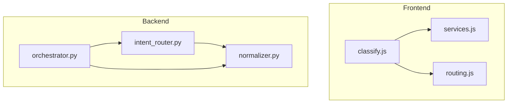
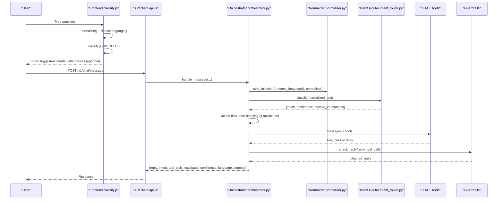
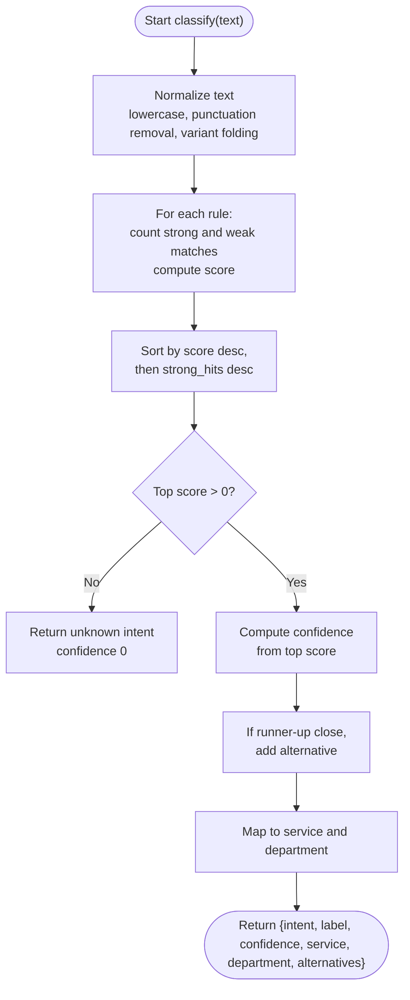
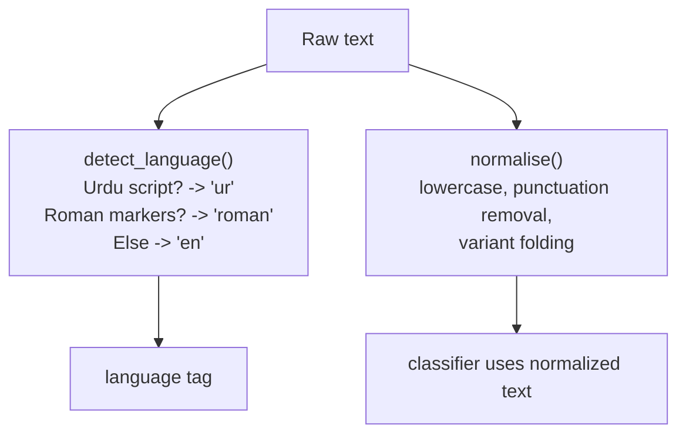
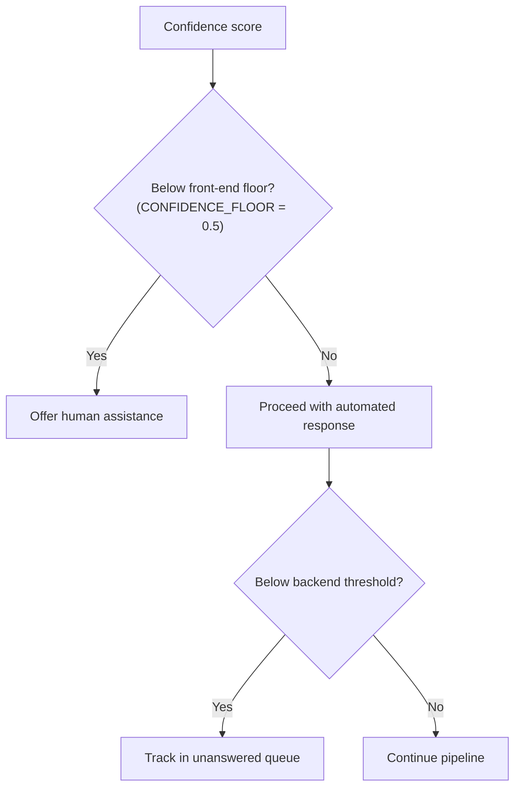
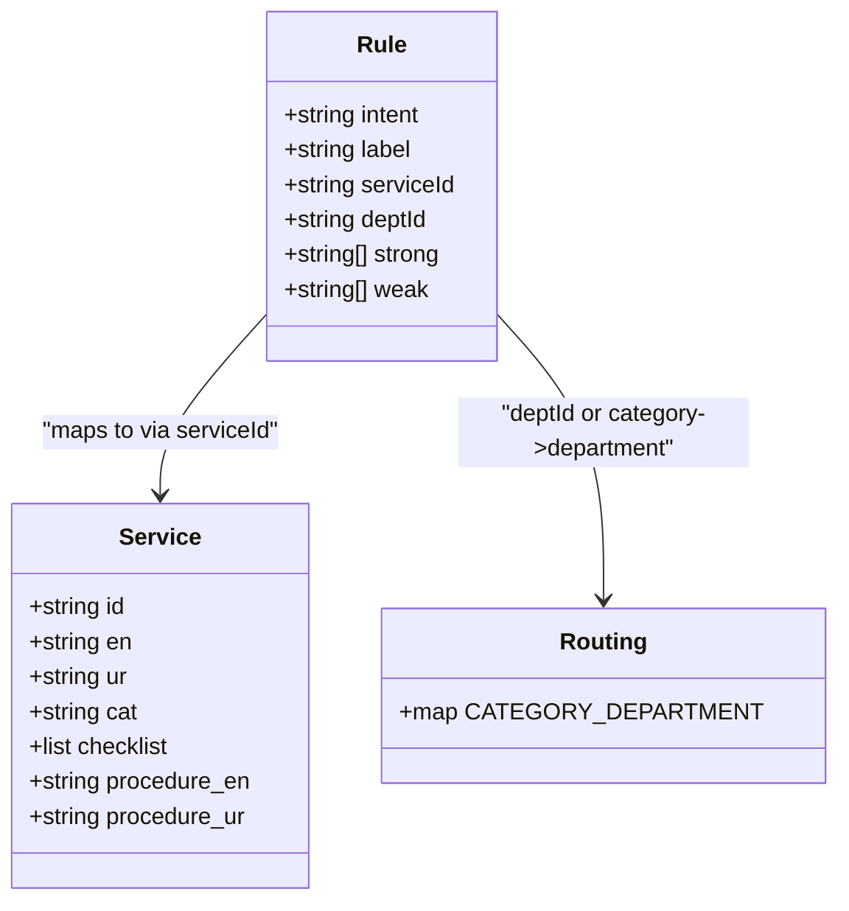
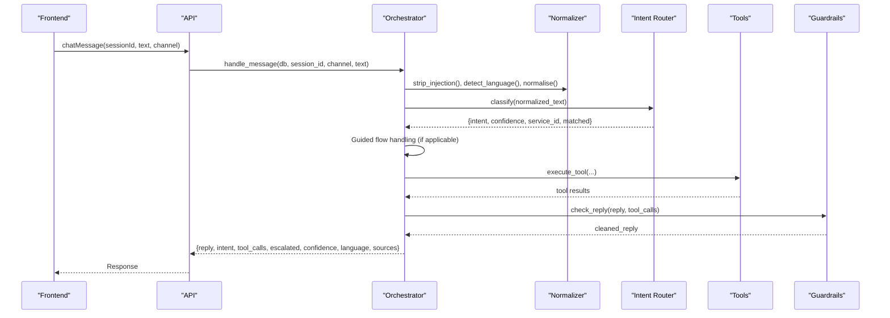
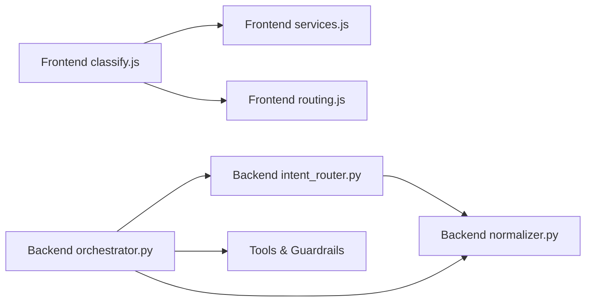

# Intent Classification System

<cite>
**Referenced Files in This Document**
- [classify.js](file://src/lib/classify.js)
- [intent_router.py](file://uaea-backend/app/orchestrator/intent_router.py)
- [normalizer.py](file://uaea-backend/app/orchestrator/normalizer.py)
- [orchestrator.py](file://uaea-backend/app/orchestrator/orchestrator.py)
- [services.js](file://src/mocks/services.js)
- [routing.js](file://src/mocks/routing.js)
- [api.js](file://src/lib/api.js)
</cite>

## Table of Contents
1. [Introduction](#introduction)
2. [Project Structure](#project-structure)
3. [Core Components](#core-components)
4. [Architecture Overview](#architecture-overview)
5. [Detailed Component Analysis](#detailed-component-analysis)
6. [Dependency Analysis](#dependency-analysis)
7. [Performance Considerations](#performance-considerations)
8. [Troubleshooting Guide](#troubleshooting-guide)
9. [Conclusion](#conclusion)

## Introduction
This document explains the intent classification system that powers query routing in UAEA Console. It covers:
- Deterministic keyword scoring with strong and weak term matching
- Multi-language support including Urdu script detection and Roman Urdu normalization with spelling variants
- Confidence thresholding to decide when to escalate to human assistance
- Rule-based classification, service mapping, department assignment, and alternative intent suggestions
- Examples of how different queries are classified
- How classification results flow into the orchestrator pipeline for downstream processing

## Project Structure
The classification logic exists in both the frontend (for demonstration and UI behavior) and the backend (for production chat orchestration). The frontend uses a deterministic classifier with a rich rule set and service catalog; the backend implements a similar but streamlined classifier integrated into an LLM-powered orchestrator.

**Diagram sources**
- [classify.js:1-270](file://src/lib/classify.js#L1-L270)
- [services.js:1-309](file://src/mocks/services.js#L1-L309)
- [routing.js:1-77](file://src/mocks/routing.js#L1-L77)
- [normalizer.py:1-66](file://uaea-backend/app/orchestrator/normalizer.py#L1-L66)
- [intent_router.py:1-103](file://uaea-backend/app/orchestrator/intent_router.py#L1-L103)
- [orchestrator.py:1-405](file://uaea-backend/app/orchestrator/orchestrator.py#L1-L405)

**Section sources**
- [classify.js:1-270](file://src/lib/classify.js#L1-L270)
- [intent_router.py:1-103](file://uaea-backend/app/orchestrator/intent_router.py#L1-L103)
- [normalizer.py:1-66](file://uaea-backend/app/orchestrator/normalizer.py#L1-L66)
- [orchestrator.py:1-405](file://uaea-backend/app/orchestrator/orchestrator.py#L1-L405)
- [services.js:1-309](file://src/mocks/services.js#L1-L309)
- [routing.js:1-77](file://src/mocks/routing.js#L1-L77)

## Core Components
- Normalization and language detection:
  - Frontend normalizer folds common Roman Urdu spellings before scoring and detects language as Urdu script, Roman Urdu, or English.
  - Backend normalizer performs the same normalization and includes prompt-injection stripping.
- Deterministic classifier:
  - Scans normalized text against rules with strong and weak terms. Strong matches score higher than weak matches.
  - Computes confidence from top score and provides alternatives when close competitors exist.
- Service and department mapping:
  - Rules map intents to services and departments. Services include checklists and procedures used by the assistant.
  - Department mapping is via category-to-department lookup.
- Orchestrator integration:
  - The backend orchestrator runs normalization, classification, guided flows, LLM tool calls, guardrails, and tracks low-confidence queries.

**Section sources**
- [classify.js:18-57](file://src/lib/classify.js#L18-L57)
- [classify.js:63-190](file://src/lib/classify.js#L63-L190)
- [classify.js:195-269](file://src/lib/classify.js#L195-L269)
- [normalizer.py:9-49](file://uaea-backend/app/orchestrator/normalizer.py#L9-L49)
- [intent_router.py:14-62](file://uaea-backend/app/orchestrator/intent_router.py#L14-L62)
- [services.js:10-309](file://src/mocks/services.js#L10-L309)
- [routing.js:11-18](file://src/mocks/routing.js#L11-L18)
- [orchestrator.py:46-143](file://uaea-backend/app/orchestrator/orchestrator.py#L46-L143)

## Architecture Overview
End-to-end flow for a user message:

**Diagram sources**
- [classify.js:37-57](file://src/lib/classify.js#L37-L57)
- [classify.js:201-269](file://src/lib/classify.js#L201-L269)
- [api.js:42-47](file://src/lib/api.js#L42-L47)
- [orchestrator.py:46-143](file://uaea-backend/app/orchestrator/orchestrator.py#L46-L143)
- [normalizer.py:29-49](file://uaea-backend/app/orchestrator/normalizer.py#L29-L49)
- [intent_router.py:65-102](file://uaea-backend/app/orchestrator/intent_router.py#L65-L102)

## Detailed Component Analysis

### Deterministic Keyword Scoring Algorithm
- Strong vs weak terms:
  - Strong terms contribute more points than weak terms.
  - Rules are ordered most-specific first so specific phrases beat generic ones.
- Scoring and ranking:
  - For each rule, count strong and weak matches, compute total score, and track matched terms.
  - Sort by descending score and then by number of strong hits to break ties.
- Confidence calculation:
  - Confidence is derived from the top score normalized against a reference value, capped at a maximum.
  - In the frontend implementation, the constant CONFIDENCE_FLOOR = 0.5 defines the threshold below which human assistance is offered instead of answering.
- Alternatives:
  - If the runner-up intent has a non-zero score and is within a small margin of the top score, it is included as an alternative suggestion.

**Diagram sources**
- [classify.js:37-44](file://src/lib/classify.js#L37-L44)
- [classify.js:201-269](file://src/lib/classify.js#L201-L269)
- [intent_router.py:65-102](file://uaea-backend/app/orchestrator/intent_router.py#L65-L102)

**Section sources**
- [classify.js:63-190](file://src/lib/classify.js#L63-L190)
- [classify.js:195-269](file://src/lib/classify.js#L195-L269)
- [intent_router.py:14-62](file://uaea-backend/app/orchestrator/intent_router.py#L14-L62)
- [intent_router.py:65-102](file://uaea-backend/app/orchestrator/intent_router.py#L65-L102)

### Multi-Language Support and Normalization
- Language detection:
  - Urdu script is detected by Unicode range.
  - Roman Urdu is detected using function words that rarely appear in English sentences.
  - Otherwise, the input is treated as English.
- Roman Urdu normalization:
  - Common spelling variants are folded to canonical forms before scoring (e.g., multiple spellings of “fee,” “admission,” “result,” etc.).
  - Punctuation is normalized and whitespace collapsed.
- Prompt injection protection (backend):
  - Strips instruction-like patterns to reduce manipulation risk.

**Diagram sources**
- [classify.js:46-57](file://src/lib/classify.js#L46-L57)
- [normalizer.py:29-49](file://uaea-backend/app/orchestrator/normalizer.py#L29-L49)
- [normalizer.py:52-66](file://uaea-backend/app/orchestrator/normalizer.py#L52-L66)

**Section sources**
- [classify.js:46-57](file://src/lib/classify.js#L46-L57)
- [normalizer.py:9-49](file://uaea-backend/app/orchestrator/normalizer.py#L9-L49)
- [normalizer.py:52-66](file://uaea-backend/app/orchestrator/normalizer.py#L52-L66)

### Confidence Thresholding and Escalation
- Frontend threshold:
  - CONFIDENCE_FLOOR = 0.5 is defined as the floor below which the assistant offers a human rather than answering.
- Backend handling:
  - Low-confidence queries (below a backend threshold) are tracked in an unanswered queue for review.
  - Escalation can also be triggered by tool calls (e.g., creating an escalation ticket), marking the conversation as escalated.

**Diagram sources**
- [classify.js:268-269](file://src/lib/classify.js#L268-L269)
- [orchestrator.py:123-129](file://uaea-backend/app/orchestrator/orchestrator.py#L123-L129)
- [orchestrator.py:367-383](file://uaea-backend/app/orchestrator/orchestrator.py#L367-L383)

**Section sources**
- [classify.js:268-269](file://src/lib/classify.js#L268-L269)
- [orchestrator.py:123-129](file://uaea-backend/app/orchestrator/orchestrator.py#L123-L129)
- [orchestrator.py:367-383](file://uaea-backend/app/orchestrator/orchestrator.py#L367-L383)

### Rule-Based Classification, Service Mapping, and Department Assignment
- Rules define intents with strong and weak terms and map to services and departments:
  - Some rules directly specify a serviceId and deptId.
  - Others derive department from category via CATEGORY_DEPARTMENT mapping.
- Service catalogue:
  - Each service includes bilingual labels, category, verified metadata, source references, and procedural checklists used by the assistant.
- Category-to-department mapping:
  - Categories like Admissions, Finance, Examinations, Academics, Certification, Records map to department IDs.

**Diagram sources**
- [classify.js:63-190](file://src/lib/classify.js#L63-L190)
- [services.js:10-309](file://src/mocks/services.js#L10-L309)
- [routing.js:11-18](file://src/mocks/routing.js#L11-L18)

**Section sources**
- [classify.js:63-190](file://src/lib/classify.js#L63-L190)
- [services.js:10-309](file://src/mocks/services.js#L10-L309)
- [routing.js:11-18](file://src/mocks/routing.js#L11-L18)

### Examples of Query Classification
- Fee challan:
  - Queries mentioning “challan,” “fee challan,” or related payment terms match the fee_challan rule with strong and weak terms.
- Fee amount:
  - Queries about “fee,” “tariff,” or amounts match fee_tariff.
- Admission:
  - Queries about applying, eligibility, or deadlines match admission.
- Result:
  - Queries about results, marks, or gazette match result.
- Date sheet:
  - Queries about exam schedules or clashes match date_sheet.
- Roll number slip:
  - Queries about downloading or printing roll slips match roll_number_slip.
- Assignments:
  - Queries about submitting assignments or tutor-related tasks match assignments.
- Degree application:
  - Queries about applying for degree documents match degree.
- Transcript:
  - Queries about transcripts or urgent copies match transcript.
- Verification:
  - Queries about attestation or verification match verification.
- Rechecking:
  - Queries about rechecking or revaluation match rechecking.
- Record correction:
  - Queries about name changes or DOB corrections match correction.
- NOC:
  - Queries about no objection certificates match noc.
- Migration:
  - Queries about transferring universities match migration.
- Bonafide/MOI:
  - Queries about medium of instruction letters match bonafide.
- Department lookup:
  - Queries asking for contact details or campus numbers match department_lookup.

These examples reflect the rule sets and their strong/weak terms across English and Urdu scripts, with normalization handling Roman Urdu variants.

**Section sources**
- [classify.js:63-190](file://src/lib/classify.js#L63-L190)
- [intent_router.py:14-62](file://uaea-backend/app/orchestrator/intent_router.py#L14-L62)
- [services.js:10-309](file://src/mocks/services.js#L10-L309)
- [routing.js:67-76](file://src/mocks/routing.js#L67-L76)

### Relationship to Downstream Processing in the Orchestrator Pipeline
- Message handling steps:
  - Sanitize input, detect language, normalize text.
  - Classify intent and confidence.
  - Manage guided flows for certain intents.
  - Call LLM with tools, execute tool calls, and run guardrails.
  - Persist messages and flow state.
  - Track low-confidence queries and mark escalations.
  - Extract sources from tool call results for citation display.
- API contract:
  - The frontend sends chat messages via an API endpoint and receives structured responses including intent, tool calls, escalation status, confidence, language, and sources.

**Diagram sources**
- [api.js:42-47](file://src/lib/api.js#L42-L47)
- [orchestrator.py:46-143](file://uaea-backend/app/orchestrator/orchestrator.py#L46-L143)
- [normalizer.py:29-49](file://uaea-backend/app/orchestrator/normalizer.py#L29-L49)
- [intent_router.py:65-102](file://uaea-backend/app/orchestrator/intent_router.py#L65-L102)

**Section sources**
- [orchestrator.py:46-143](file://uaea-backend/app/orchestrator/orchestrator.py#L46-L143)
- [api.js:42-47](file://src/lib/api.js#L42-L47)

## Dependency Analysis
- Frontend dependencies:
  - classify.js depends on services.js for service metadata and routing.js for category-to-department mapping.
  - The frontend’s classifier is self-contained and deterministic, suitable for quick demonstrations and UI behaviors.
- Backend dependencies:
  - intent_router.py depends on normalizer.py for text normalization and language detection.
  - orchestrator.py integrates normalizer, intent router, state machine, tools, and guardrails to process messages end-to-end.
- Coupling and cohesion:
  - Normalization is cohesive and reusable across classifiers.
  - Rules are decoupled from service definitions, enabling easy updates to mappings without changing scoring logic.
- External integrations:
  - Orchestrator interacts with external LLM APIs and executes tools that may return sources for citations.

**Diagram sources**
- [classify.js:1-270](file://src/lib/classify.js#L1-L270)
- [services.js:1-309](file://src/mocks/services.js#L1-L309)
- [routing.js:1-77](file://src/mocks/routing.js#L1-L77)
- [intent_router.py:1-103](file://uaea-backend/app/orchestrator/intent_router.py#L1-L103)
- [normalizer.py:1-66](file://uaea-backend/app/orchestrator/normalizer.py#L1-L66)
- [orchestrator.py:1-405](file://uaea-backend/app/orchestrator/orchestrator.py#L1-L405)

**Section sources**
- [classify.js:1-270](file://src/lib/classify.js#L1-L270)
- [intent_router.py:1-103](file://uaea-backend/app/orchestrator/intent_router.py#L1-L103)
- [normalizer.py:1-66](file://uaea-backend/app/orchestrator/normalizer.py#L1-L66)
- [orchestrator.py:1-405](file://uaea-backend/app/orchestrator/orchestrator.py#L1-L405)

## Performance Considerations
- Deterministic scoring is fast and predictable, avoiding model latency for classification.
- Normalization reduces false negatives by consolidating spelling variants early.
- Rule ordering ensures specific phrases take precedence, improving accuracy without extra computation.
- In the backend, guided flows short-circuit complex paths for high-confidence intents, reducing LLM calls.
- Guardrails and tool execution add overhead; minimizing unnecessary tool calls improves responsiveness.

[No sources needed since this section provides general guidance]

## Troubleshooting Guide
- Misclassification issues:
  - Check if the query contains normalized variants present in VARIANTS; ensure new variants are added to both frontend and backend normalizers.
  - Verify rule ordering and strong/weak term lists to avoid ambiguous matches.
- Low confidence escalations:
  - Review CONFIDENCE_FLOOR usage in the frontend and backend thresholds to adjust handover behavior.
  - Inspect tracked unanswered queries to identify recurring misclassifications.
- Language detection problems:
  - Confirm Urdu script detection and Roman Urdu marker words are appropriate for the student population.
  - Ensure prompt injection stripping does not remove meaningful content.
- Service and department mapping errors:
  - Validate service IDs and category-to-department mappings in services.js and routing.js.
  - Update service metadata when procedures or checklists change.

**Section sources**
- [classify.js:18-57](file://src/lib/classify.js#L18-L57)
- [classify.js:63-190](file://src/lib/classify.js#L63-L190)
- [classify.js:268-269](file://src/lib/classify.js#L268-L269)
- [normalizer.py:9-49](file://uaea-backend/app/orchestrator/normalizer.py#L9-L49)
- [normalizer.py:52-66](file://uaea-backend/app/orchestrator/normalizer.py#L52-L66)
- [services.js:10-309](file://src/mocks/services.js#L10-L309)
- [routing.js:11-18](file://src/mocks/routing.js#L11-L18)
- [orchestrator.py:123-129](file://uaea-backend/app/orchestrator/orchestrator.py#L123-L129)
- [orchestrator.py:367-383](file://uaea-backend/app/orchestrator/orchestrator.py#L367-L383)

## Conclusion
The intent classification system combines deterministic keyword scoring, robust normalization, and clear service/department mapping to route student queries effectively. Multi-language support handles Urdu script and Roman Urdu with spelling variants, while confidence thresholding ensures reliable escalation to human assistance when needed. Integration with the orchestrator pipeline enables guided flows, tool-driven responses, and guardrailed outputs, providing a comprehensive and maintainable solution for query routing in UAEA Console.

[No sources needed since this section summarizes without analyzing specific files]