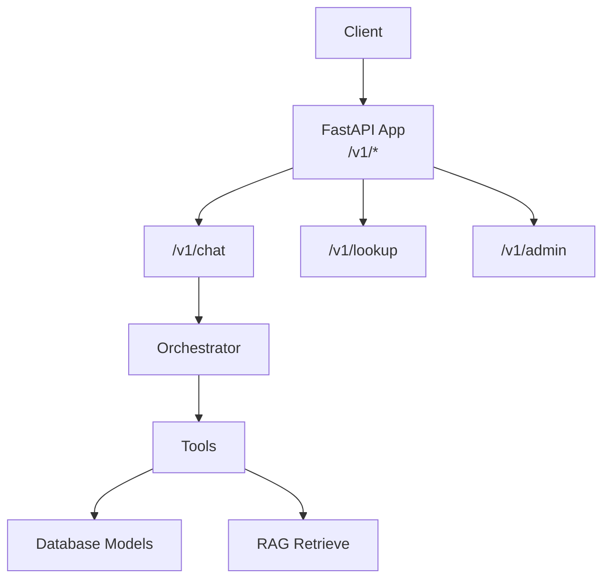
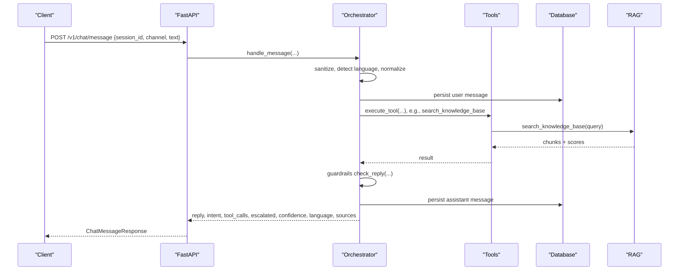
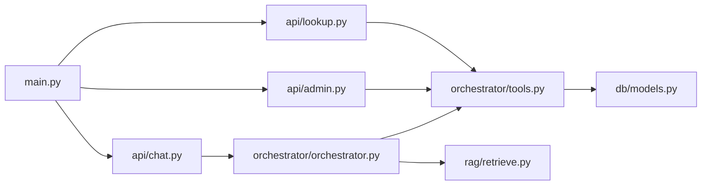

# API Schemas

<cite>
**Referenced Files in This Document**
- [main.py](file://uaea-backend/app/main.py)
- [schemas.py](file://uaea-backend/app/schemas.py)
- [chat.py](file://uaea-backend/app/api/chat.py)
- [lookup.py](file://uaea-backend/app/api/lookup.py)
- [admin.py](file://uaea-backend/app/api/admin.py)
- [models.py](file://uaea-backend/app/db/models.py)
- [orchestrator.py](file://uaea-backend/app/orchestrator/orchestrator.py)
- [tools.py](file://uaea-backend/app/orchestrator/tools.py)
- [retrieve.py](file://uaea-backend/app/rag/retrieve.py)
</cite>

## Table of Contents
1. [Introduction](#introduction)
2. [Project Structure](#project-structure)
3. [Core Components](#core-components)
4. [Architecture Overview](#architecture-overview)
5. [Detailed Component Analysis](#detailed-component-analysis)
6. [Dependency Analysis](#dependency-analysis)
7. [Performance Considerations](#performance-considerations)
8. [Troubleshooting Guide](#troubleshooting-guide)
9. [Conclusion](#conclusion)
10. [Appendices](#appendices)

## Introduction
This document specifies the REST API schemas for the UAEA Console backend. It covers request and response models for chat, conversation management, content operations, and lookup services. It also documents validation rules, required vs optional fields, data types, error responses, versioning strategy, security considerations, and client implementation guidance.

## Project Structure
The backend is a FastAPI application that mounts three routers:
- Chat endpoints under /v1/chat
- Lookup endpoints under /v1/lookup
- Admin endpoints under /v1/admin

Schemas are defined centrally using Pydantic models. The orchestrator processes chat messages end-to-end, invoking tools (database lookups, RAG retrieval, escalation), then applies guardrails before returning structured responses.

**Diagram sources**
- [main.py:75-79](file://uaea-backend/app/main.py#L75-L79)
- [chat.py:18-18](file://uaea-backend/app/api/chat.py#L18-L18)
- [lookup.py:23-23](file://uaea-backend/app/api/lookup.py#L23-L23)
- [admin.py:26-26](file://uaea-backend/app/api/admin.py#L26-L26)
- [orchestrator.py:46-143](file://uaea-backend/app/orchestrator/orchestrator.py#L46-L143)
- [tools.py:218-235](file://uaea-backend/app/orchestrator/tools.py#L218-L235)
- [retrieve.py:32-96](file://uaea-backend/app/rag/retrieve.py#L32-L96)

**Section sources**
- [main.py:38-79](file://uaea-backend/app/main.py#L38-L79)

## Core Components
- Request/response schemas: centralized in schemas.py
- Chat endpoints: message submission, session retrieval, escalation
- Lookup endpoints: departments, fee tariffs, deadlines, document checklists
- Admin endpoints: FAQ creation, fee tariff creation, analytics, unanswered queue
- Data models: SQLAlchemy ORM definitions for persistence
- Orchestrator: end-to-end processing pipeline for chat messages
- Tools: database queries and RAG retrieval used by both LLM tool calls and public lookup endpoints

Key schema groups:
- Lookup: ContactOut, CampusOut, DepartmentOut, FeeTariffOut, ChecklistItem, ServiceOut, DeadlineOut
- Chat: ChatMessageRequest, ToolCallOut, ChatMessageResponse, EscalateRequest, EscalateResponse, SessionOut
- Admin: FAQCreate, FAQOut, FeeTariffCreate, AdminWriteResponse, IntentCount, UnansweredQueryOut
- RAG: ChunkResult

**Section sources**
- [schemas.py:11-178](file://uaea-backend/app/schemas.py#L11-L178)
- [models.py:30-228](file://uaea-backend/app/db/models.py#L30-L228)

## Architecture Overview
Chat flow:
- Client sends a message to POST /v1/chat/message
- Orchestrator sanitizes input, detects language, normalizes text, classifies intent
- Persists user message, manages guided flows if applicable
- Calls LLM with tools; executes tool calls (DB queries, RAG search, escalation)
- Applies guardrails to ensure grounded replies
- Persists assistant message and returns structured response

Lookup flow:
- Public endpoints expose read-only access to departments, fees, deadlines, and document checklists
- Reuses the same logic as internal tools to avoid duplication

Admin flow:
- Protected by API key or bearer token
- Creates knowledge chunks (FAQs) and fee tariffs with audit logging
- Exposes analytics and queue endpoints

**Diagram sources**
- [chat.py:21-39](file://uaea-backend/app/api/chat.py#L21-L39)
- [orchestrator.py:46-143](file://uaea-backend/app/orchestrator/orchestrator.py#L46-L143)
- [tools.py:218-235](file://uaea-backend/app/orchestrator/tools.py#L218-L235)
- [retrieve.py:32-96](file://uaea-backend/app/rag/retrieve.py#L32-L96)

## Detailed Component Analysis

### Chat API
Endpoints:
- POST /v1/chat/message
- GET /v1/chat/session/{session_id}
- POST /v1/chat/escalate

Request schemas:
- ChatMessageRequest
  - session_id: string, required
  - channel: string, default "web", optional
  - text: string, required
- EscalateRequest
  - session_id: string, required
  - reason: string, required

Response schemas:
- ChatMessageResponse
  - reply: string
  - intent: string | null
  - tool_calls: list[ToolCallOut]
  - escalated: boolean
  - confidence: float
  - language: string, default "en"
  - sources: list[dict[str, Any]]
- ToolCallOut
  - name: string
  - args: dict[str, Any] | null
  - result: any
- EscalateResponse
  - ticket_id: string
  - status: string, default "open"
- SessionOut
  - id: string
  - session_id: string
  - channel: string
  - started_at: datetime
  - resolved: boolean
  - escalated: boolean
  - messages: list[dict]

Validation and constraints:
- All fields validated via Pydantic models
- Missing required fields return HTTP 422 with standard FastAPI validation errors
- Optional fields default when not provided

Error handling:
- 404 when session not found on GET /v1/chat/session/{session_id}
- 404 when no active conversation exists for escalation
- Rate limiting returns 429 with detail field

Example requests/responses:
- Message submission:
  - Request body: { "session_id": "...", "channel": "web", "text": "What is the deadline for admission?" }
  - Response: { "reply": "...", "intent": "...", "tool_calls": [...], "escalated": false, "confidence": 0.95, "language": "en", "sources": [...] }
- Session retrieval:
  - URL: GET /v1/chat/session/{session_id}
  - Response: { "id": "...", "session_id": "...", "channel": "web", "started_at": "...", "resolved": false, "escalated": false, "messages": [...] }
- Escalation:
  - Request body: { "session_id": "...", "reason": "Cannot resolve query" }
  - Response: { "ticket_id": "...", "status": "open" }

Security:
- No authentication required for chat endpoints
- Per-session rate limiting middleware present but currently IP-based via slowapi

Implementation notes:
- Orchestrator sanitizes input and runs guardrails to ensure grounded replies
- Sources extracted from tool call results for citation display

**Section sources**
- [chat.py:21-115](file://uaea-backend/app/api/chat.py#L21-L115)
- [schemas.py:79-122](file://uaea-backend/app/schemas.py#L79-L122)
- [orchestrator.py:46-143](file://uaea-backend/app/orchestrator/orchestrator.py#L46-L143)
- [main.py:51-58](file://uaea-backend/app/main.py#L51-L58)

### Lookup API
Endpoints:
- GET /v1/lookup/departments?region=&query=
- GET /v1/lookup/fee-tariff?program=&category=
- GET /v1/lookup/deadlines?service=
- GET /v1/lookup/document-checklist?service=...

Response schemas:
- list[DepartmentOut]
  - id: string
  - name_en: string
  - name_ur: string | null
  - category: string
  - region: CampusOut | null
  - contact: ContactOut | null
- list[FeeTariffOut]
  - id: string
  - program: string
  - category: string
  - amount: int
  - effective_from: date
  - source_doc_ref: string | null
- list[DeadlineOut]
  - id: string
  - service_id: string
  - semester: string
  - date: date
  - source_doc_ref: string | null
- Document checklist response (returns dict):
  - service: string
  - checklist: list[ChecklistItem]
  - procedure: string | null
  - source: string | null
  - last_verified: string | null

Validation and constraints:
- Query parameters validated via FastAPI Query
- document-checklist requires service parameter; missing returns 422

Behavior:
- Departments filtered by region (via campus join) and search query across name_en, name_ur, category
- Fee tariffs filtered by program and category with fuzzy matching in tools
- Deadlines joined with services and filtered by service name
- Document checklist reuses tool_get_document_checklist

Examples:
- List departments: GET /v1/lookup/departments?region=Karachi&query=Admission
- List fee tariffs: GET /v1/lookup/fee-tariff?program=BS+Computer+Science&category=Semester+(new)
- List deadlines: GET /v1/lookup/deadlines?service=Admission+%26+Enrolment
- Get checklist: GET /v1/lookup/document-checklist?service=Degree+Application

**Section sources**
- [lookup.py:26-104](file://uaea-backend/app/api/lookup.py#L26-L104)
- [schemas.py:11-78](file://uaea-backend/app/schemas.py#L11-L78)
- [tools.py:92-198](file://uaea-backend/app/orchestrator/tools.py#L92-L198)

### Admin API
Authentication:
- Requires X-API-Key header or Authorization: Bearer <token>
- Token must match configured admin_api_key; otherwise returns 403

Endpoints:
- POST /v1/admin/content/faq
- POST /v1/admin/content/fee-tariff
- GET /v1/admin/analytics/intents
- GET /v1/admin/queue/unanswered

Request schemas:
- FAQCreate
  - source_doc_id: string, required
  - text: string, required
  - section: string | null, optional
- FeeTariffCreate
  - program: string, required
  - category: string, required
  - amount: int, required
  - effective_from: date, required
  - source_doc_ref: string | null, optional

Response schemas:
- AdminWriteResponse
  - id: string
  - status: string, default "ok"
- list[IntentCount]
  - intent: string
  - count: int
- list[UnansweredQueryOut]
  - id: string
  - text: string
  - intent: string | null
  - confidence: float | null
  - count: int
  - reason: string | null

Behavior:
- FAQ creation embeds text and stores as KnowledgeChunk; logs audit entry
- Fee tariff creation persists FeeTariff; logs audit entry
- Analytics aggregates message intents grouped by intent
- Unanswered queue lists low-confidence or unresolved queries sorted by count

Examples:
- Create FAQ: POST /v1/admin/content/faq with { "source_doc_id": "...", "text": "...", "section": "Fees" }
- Create fee tariff: POST /v1/admin/content/fee-tariff with { "program": "...", "category": "...", "amount": 12345, "effective_from": "2025-01-01" }
- Get intents: GET /v1/admin/analytics/intents
- Get unanswered: GET /v1/admin/queue/unanswered

Security:
- Admin routes protected by verify_admin dependency
- Audit logging records actor, action, table_name, record_id, detail

**Section sources**
- [admin.py:31-48](file://uaea-backend/app/api/admin.py#L31-L48)
- [admin.py:67-161](file://uaea-backend/app/api/admin.py#L67-L161)
- [schemas.py:124-167](file://uaea-backend/app/schemas.py#L124-L167)
- [models.py:124-140](file://uaea-backend/app/db/models.py#L124-L140)
- [models.py:198-228](file://uaea-backend/app/db/models.py#L198-L228)

### RAG Retrieval
Function:
- search_knowledge_base(db, query, top_k=5)

Response structure:
- chunks: list[ChunkResult]
  - id: string
  - text: string
  - source_doc_id: string
  - section: string | null
  - score: float
  - last_verified_at: datetime | null
- formatted: string (for LLM consumption)
- count: integer

Behavior:
- Computes embedding via configured provider
- Uses pgvector cosine similarity to retrieve top-k chunks
- Applies basic reranking based on section overlap
- Returns scored results suitable for tool use

**Section sources**
- [retrieve.py:17-96](file://uaea-backend/app/rag/retrieve.py#L17-L96)
- [schemas.py:169-178](file://uaea-backend/app/schemas.py#L169-L178)

## Dependency Analysis
- FastAPI app mounts routers for chat, lookup, admin
- Chat router depends on orchestrator and database session
- Lookup router depends on database models and shared tools
- Admin router depends on database models, RAG ingest, and RBAC stub
- Orchestrator depends on tools and RAG retrieve for knowledge base search
- Tools depend on database models and may call RAG retrieve

**Diagram sources**
- [main.py:75-79](file://uaea-backend/app/main.py#L75-L79)
- [chat.py:10-16](file://uaea-backend/app/api/chat.py#L10-L16)
- [lookup.py:13-21](file://uaea-backend/app/api/lookup.py#L13-L21)
- [admin.py:14-23](file://uaea-backend/app/api/admin.py#L14-L23)
- [orchestrator.py:17-25](file://uaea-backend/app/orchestrator/orchestrator.py#L17-L25)
- [tools.py:11-14](file://uaea-backend/app/orchestrator/tools.py#L11-L14)
- [retrieve.py:7-12](file://uaea-backend/app/rag/retrieve.py#L7-L12)

**Section sources**
- [main.py:75-79](file://uaea-backend/app/main.py#L75-L79)
- [chat.py:10-16](file://uaea-backend/app/api/chat.py#L10-L16)
- [lookup.py:13-21](file://uaea-backend/app/api/lookup.py#L13-L21)
- [admin.py:14-23](file://uaea-backend/app/api/admin.py#L14-L23)
- [orchestrator.py:17-25](file://uaea-backend/app/orchestrator/orchestrator.py#L17-L25)
- [tools.py:11-14](file://uaea-backend/app/orchestrator/tools.py#L11-L14)
- [retrieve.py:7-12](file://uaea-backend/app/rag/retrieve.py#L7-L12)

## Performance Considerations
- Rate limiting is applied per IP via slowapi; configurable via settings
- Chat endpoint includes per-session middleware placeholder; current behavior relies on IP-based limiter
- RAG retrieval uses pgvector cosine similarity with top-k limit; consider tuning top_k and embedding dimensions
- Database queries use joins and indexes where appropriate (e.g., services.category, fee_tariffs.program)
- Guardrails run post-LLM to ensure grounded replies; minimize unnecessary transformations

[No sources needed since this section provides general guidance]

## Troubleshooting Guide
Common errors:
- Validation errors (422): Missing or invalid fields in request bodies; inspect FastAPI’s validation error payload
- Not found (404): Session or active conversation not found in chat endpoints
- Unauthorized (403): Invalid or missing admin API key/token
- Rate limited (429): Exceeded rate limits; adjust client retry/backoff

Error response formats:
- Standard FastAPI validation errors include field-level details
- Custom handlers:
  - Rate limit handler returns JSON with detail field
  - HTTPException usage returns JSON with detail field

Client strategies:
- Retry with exponential backoff on 429
- Handle 404 gracefully by prompting users to start a new session
- Validate inputs on the client side to reduce 422 errors
- For admin endpoints, ensure correct headers are set

**Section sources**
- [main.py:51-58](file://uaea-backend/app/main.py#L51-L58)
- [chat.py:54-55](file://uaea-backend/app/api/chat.py#L54-L55)
- [chat.py:101-102](file://uaea-backend/app/api/chat.py#L101-L102)
- [admin.py:45-46](file://uaea-backend/app/api/admin.py#L45-L46)

## Conclusion
The UAEA Console API provides a robust set of endpoints for chat interactions, lookup services, and administrative content management. Schemas are well-defined using Pydantic, ensuring consistent validation and clear contracts. Security is enforced for admin operations, and rate limiting protects endpoints. Clients should implement robust error handling, input validation, and retry strategies to interact reliably with the API.

[No sources needed since this section summarizes without analyzing specific files]

## Appendices

### Schema Evolution Strategy and Versioning
- API versioning:
  - Base path prefix /v1 indicates API version; future versions can be introduced as /v2 while maintaining backward compatibility
- Schema evolution:
  - Use optional fields with defaults to add new capabilities without breaking clients
  - Avoid removing or changing required fields; deprecate gradually with documentation
  - Maintain backward-compatible responses; introduce new fields rather than replacing existing ones
- Deprecation policy:
  - Announce deprecations in release notes
  - Provide migration guides and extended support windows

[No sources needed since this section provides general guidance]

### Input Validation, Sanitization, and Security Considerations
- Input validation:
  - Pydantic models enforce type and presence checks
  - Query parameters validated via FastAPI Query
- Sanitization:
  - Orchestrator strips injection attempts and normalizes input before processing
- Security:
  - Admin endpoints require API key or bearer token
  - CORS configured via settings; restrict origins in production
  - Rate limiting prevents abuse
- Payload size and content:
  - Ensure text fields are reasonably bounded to prevent abuse
  - Avoid sending sensitive data in chat messages unless necessary

**Section sources**
- [schemas.py:1-178](file://uaea-backend/app/schemas.py#L1-178)
- [orchestrator.py:56-59](file://uaea-backend/app/orchestrator/orchestrator.py#L56-L59)
- [admin.py:31-48](file://uaea-backend/app/api/admin.py#L31-L48)
- [main.py:61-73](file://uaea-backend/app/main.py#L61-L73)

### Client Implementation Patterns and Error Handling Strategies
- Pattern:
  - Always validate inputs on the client side before sending requests
  - Handle pagination for list endpoints if added in the future
  - Cache lookup results where appropriate to reduce load
- Error handling:
  - Retry on transient errors (429) with backoff
  - Surface user-friendly messages for 404 and 403
  - Log detailed error payloads for debugging
- Authentication:
  - Include X-API-Key or Authorization header for admin endpoints
  - Rotate keys regularly and store securely

[No sources needed since this section provides general guidance]