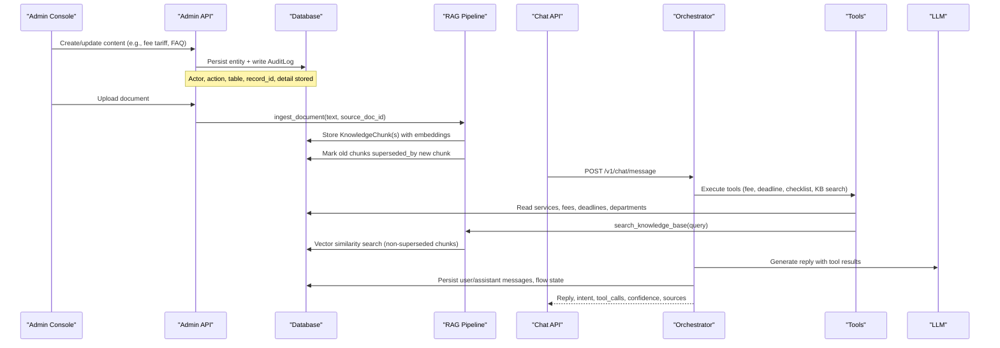
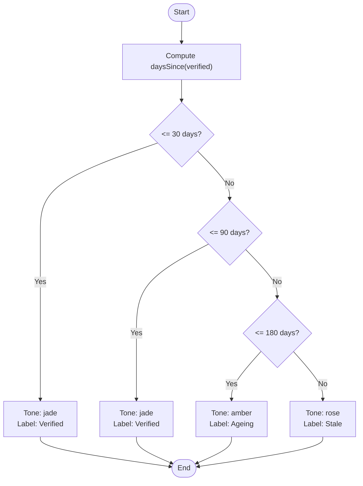
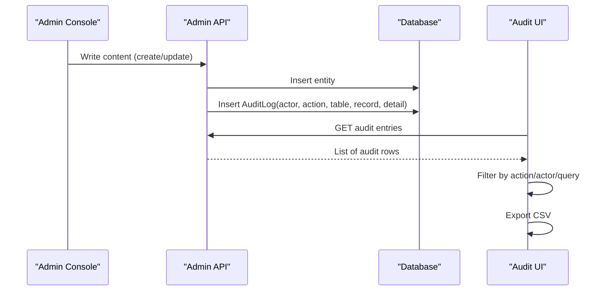
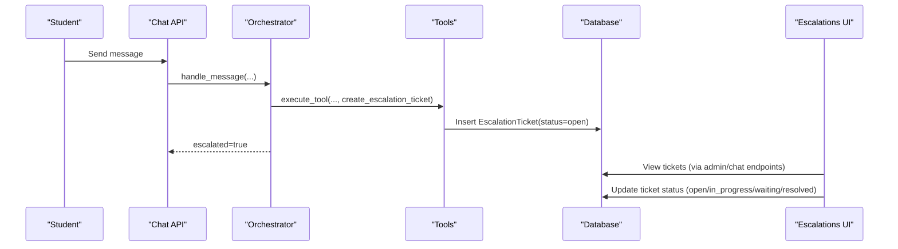
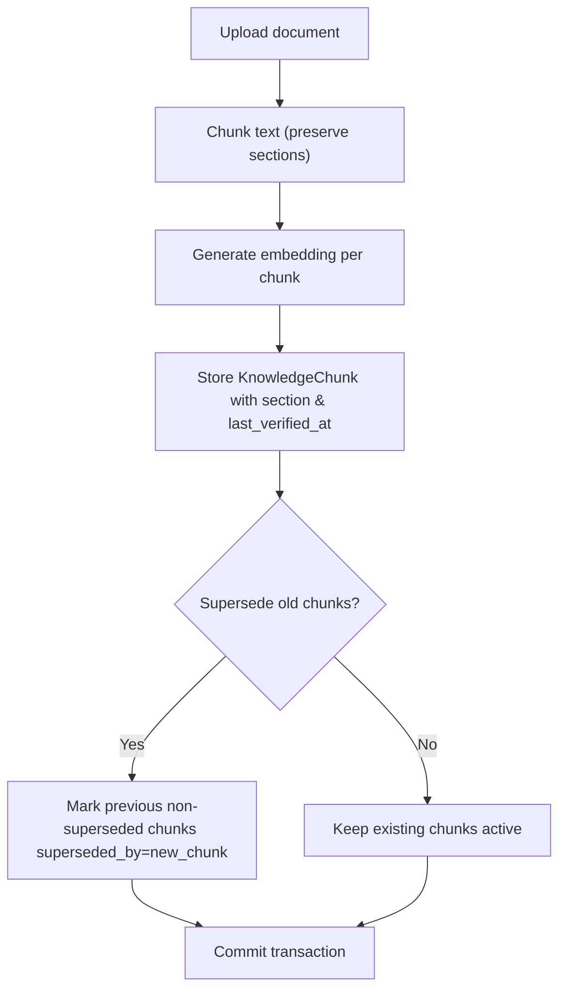
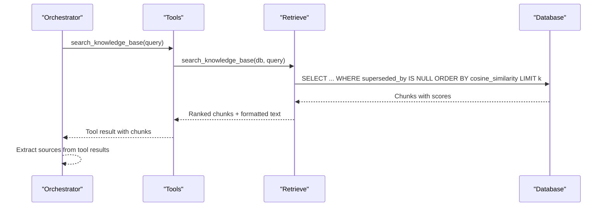
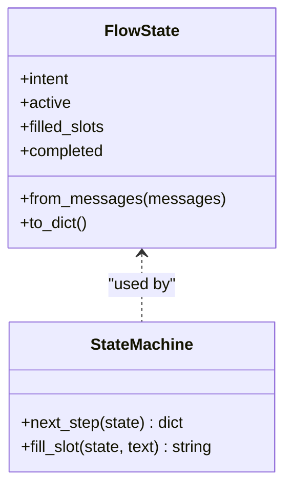
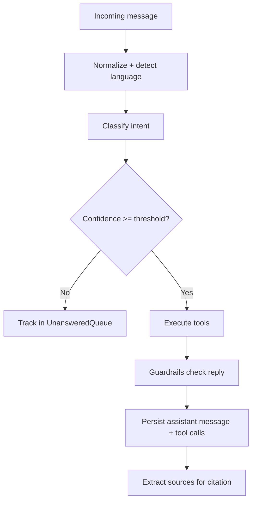
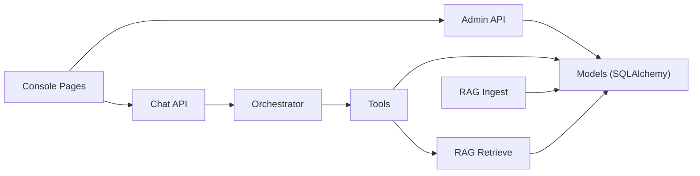

# Data Lifecycle Management

<cite>
**Referenced Files in This Document**
- [models.py](file://uaea-backend/app/db/models.py)
- [ingest.py](file://uaea-backend/app/rag/ingest.py)
- [retrieve.py](file://uaea-backend/app/rag/retrieve.py)
- [orchestrator.py](file://uaea-backend/app/orchestrator/orchestrator.py)
- [tools.py](file://uaea-backend/app/orchestrator/tools.py)
- [state_machine.py](file://uaea-backend/app/orchestrator/state_machine.py)
- [admin.py](file://uaea-backend/app/api/admin.py)
- [chat.py](file://uaea-backend/app/api/chat.py)
- [freshness.js](file://src/lib/freshness.js)
- [FreshnessPanel.jsx](file://src/pages/Dashboard/FreshnessPanel.jsx)
- [FreshnessRing.jsx](file://src/components/charts/FreshnessRing.jsx)
- [index.jsx (Documents)](file://src/pages/Documents/index.jsx)
- [index.jsx (AuditLog)](file://src/pages/AuditLog/index.jsx)
- [RecordHistory.jsx](file://src/components/content/RecordHistory.jsx)
- [index.jsx (Escalations)](file://src/pages/Escalations/index.jsx)
- [config.py](file://uaea-backend/app/config.py)
- [format.js](file://src/lib/format.js)
</cite>

## Table of Contents
1. Introduction
2. Project Structure
3. Core Components
4. Architecture Overview
5. Detailed Component Analysis
6. Dependency Analysis
7. Performance Considerations
8. Troubleshooting Guide
9. Conclusion

## Introduction
This document describes the end-to-end data lifecycle in the UAEA Console system. It covers how data is created, verified, retrieved for student-facing answers, escalated when unresolved, and archived or superseded over time. It also explains freshness tracking that measures data currency, audit trails that record every change with actor attribution, escalation workflows for unresolved queries, and the knowledge chunk lifecycle used by Retrieval-Augmented Generation (RAG).

## Project Structure
The system consists of a React-based admin console and a FastAPI backend with PostgreSQL (pgvector) storage. Key areas:
- Backend models define entities such as Services, Fees, Deadlines, KnowledgeChunks, Conversations, Messages, EscalationTickets, UnansweredQueries, and AuditLogs.
- RAG pipeline ingests documents into chunks, generates embeddings, stores them, and supports supersession of older versions.
- Orchestrator processes chat messages, runs guided flows, executes tools against the database, and persists conversation history.
- Admin APIs provide secure endpoints to create content and manage queues.
- Frontend pages visualize freshness, audit logs, escalations, and document ingestion status.

```mermaid
graph TB
subgraph "Frontend"
FE_Docs["Documents Page"]
FE_Audit["Audit Log Page"]
FE_Escalations["Escalations Page"]
FE_Freshness["Dashboard Freshness Panel"]
end
subgraph "Backend API"
API_Admin["Admin API (/v1/admin/*)"]
API_Chat["Chat API (/v1/chat/*)"]
end
subgraph "Orchestrator"
Orchestrator["Message Handler"]
Tools["Tool Executor"]
StateMachine["Guided Flow State Machine"]
end
subgraph "RAG"
Ingest["Document Ingestion"]
Retrieve["Knowledge Retrieval"]
end
subgraph "Data"
DB[("PostgreSQL + pgvector")]
end
FE_Docs --> API_Admin
FE_Audit --> API_Admin
FE_Escalations --> API_Chat
FE_Freshness --> API_Admin
API_Admin --> DB
API_Chat --> Orchestrator
Orchestrator --> Tools
Orchestrator --> StateMachine
Tools --> DB
Tools --> Retrieve
Ingest --> DB
Retrieve --> DB
```

**Diagram sources**
- [admin.py:1-161](file://uaea-backend/app/api/admin.py#L1-L161)
- [chat.py:1-115](file://uaea-backend/app/api/chat.py#L1-L115)
- [orchestrator.py:1-405](file://uaea-backend/app/orchestrator/orchestrator.py#L1-L405)
- [tools.py:1-235](file://uaea-backend/app/orchestrator/tools.py#L1-L235)
- [state_machine.py:1-146](file://uaea-backend/app/orchestrator/state_machine.py#L1-L146)
- [ingest.py:1-145](file://uaea-backend/app/rag/ingest.py#L1-L145)
- [retrieve.py:1-97](file://uaea-backend/app/rag/retrieve.py#L1-L97)
- [models.py:1-228](file://uaea-backend/app/db/models.py#L1-L228)

**Section sources**
- [models.py:1-228](file://uaea-backend/app/db/models.py#L1-L228)
- [admin.py:1-161](file://uaea-backend/app/api/admin.py#L1-L161)
- [chat.py:1-115](file://uaea-backend/app/api/chat.py#L1-L115)
- [orchestrator.py:1-405](file://uaea-backend/app/orchestrator/orchestrator.py#L1-L405)
- [ingest.py:1-145](file://uaea-backend/app/rag/ingest.py#L1-L145)
- [retrieve.py:1-97](file://uaea-backend/app/rag/retrieve.py#L1-L97)

## Core Components
- Data models: Services, FeeTariff, Deadline, Department, Campus, Contact, KnowledgeChunk, Conversation, Message, EscalationTicket, UnansweredQuery, AuditLog.
- RAG ingestion: chunking, embedding generation, persistence, and supersession of older chunks.
- RAG retrieval: vector similarity search with optional reranking and source citation.
- Orchestrator: message handling, guided flow state machine, tool execution, guardrails, and conversation persistence.
- Admin API: secure endpoints for creating content and querying analytics/unanswered queues.
- Frontend dashboards: freshness visualization, audit log viewer, escalation management, and document ingestion UI.

**Section sources**
- [models.py:30-228](file://uaea-backend/app/db/models.py#L30-L228)
- [ingest.py:34-122](file://uaea-backend/app/rag/ingest.py#L34-L122)
- [retrieve.py:32-97](file://uaea-backend/app/rag/retrieve.py#L32-L97)
- [orchestrator.py:46-143](file://uaea-backend/app/orchestrator/orchestrator.py#L46-L143)
- [admin.py:51-161](file://uaea-backend/app/api/admin.py#L51-L161)
- [FreshnessPanel.jsx:16-74](file://src/pages/Dashboard/FreshnessPanel.jsx#L16-L74)
- [index.jsx (AuditLog):20-150](file://src/pages/AuditLog/index.jsx#L20-L150)
- [index.jsx (Escalations):35-167](file://src/pages/Escalations/index.jsx#L35-L167)

## Architecture Overview
The data lifecycle spans creation, verification, retrieval, escalation, and archival/supersession.



**Diagram sources**
- [admin.py:67-125](file://uaea-backend/app/api/admin.py#L67-L125)
- [ingest.py:75-122](file://uaea-backend/app/rag/ingest.py#L75-L122)
- [retrieve.py:32-97](file://uaea-backend/app/rag/retrieve.py#L32-L97)
- [orchestrator.py:46-143](file://uaea-backend/app/orchestrator/orchestrator.py#L46-L143)
- [tools.py:18-235](file://uaea-backend/app/orchestrator/tools.py#L18-L235)
- [models.py:124-228](file://uaea-backend/app/db/models.py#L124-L228)

## Detailed Component Analysis

### Freshness Tracking System
Freshness evaluates how recently a human has verified records tied to the academic cycle. The system computes days since verification and assigns rungs/tone:
- 0–30 days: Verified (jade)
- 31–90 days: Verified (jade)
- 91–180 days: Ageing (amber)
- 181+ days: Stale (rose)

The dashboard aggregates buckets and highlights overdue items.



**Diagram sources**
- [freshness.js:17-23](file://src/lib/freshness.js#L17-L23)
- [format.js:3-4](file://src/lib/format.js#L3-L4)

**Section sources**
- [freshness.js:1-37](file://src/lib/freshness.js#L1-L37)
- [FreshnessPanel.jsx:16-74](file://src/pages/Dashboard/FreshnessPanel.jsx#L16-L74)
- [FreshnessRing.jsx:1-66](file://src/components/charts/FreshnessRing.jsx#L1-L66)
- [format.js:1-32](file://src/lib/format.js#L1-L32)

### Audit Trail Mechanism
Every administrative write is recorded as an append-only audit entry with actor attribution and change details. The frontend provides filtering, export, and per-record history views.

Key behaviors:
- Admin writes call a helper that inserts AuditLog rows with actor, action, table_name, record_id, and JSON detail.
- Audit page filters by action, actor, and free-text query; supports CSV export.
- Per-record drawer shows changes for a specific record.



**Diagram sources**
- [admin.py:51-125](file://uaea-backend/app/api/admin.py#L51-L125)
- [models.py:198-212](file://uaea-backend/app/db/models.py#L198-L212)
- [index.jsx (AuditLog):20-150](file://src/pages/AuditLog/index.jsx#L20-L150)
- [RecordHistory.jsx:1-58](file://src/components/content/RecordHistory.jsx#L1-L58)

**Section sources**
- [admin.py:51-125](file://uaea-backend/app/api/admin.py#L51-L125)
- [models.py:198-212](file://uaea-backend/app/db/models.py#L198-L212)
- [index.jsx (AuditLog):20-150](file://src/pages/AuditLog/index.jsx#L20-L150)
- [RecordHistory.jsx:1-58](file://src/components/content/RecordHistory.jsx#L1-L58)

### Escalation Process for Unresolved Queries
When the assistant cannot answer safely or confidently, it creates an escalation ticket linked to the conversation. Staff can view and update ticket status via the Escalations page.



**Diagram sources**
- [orchestrator.py:229-318](file://uaea-backend/app/orchestrator/orchestrator.py#L229-L318)
- [tools.py:200-215](file://uaea-backend/app/orchestrator/tools.py#L200-L215)
- [chat.py:88-115](file://uaea-backend/app/api/chat.py#L88-L115)
- [models.py:181-196](file://uaea-backend/app/db/models.py#L181-L196)
- [index.jsx (Escalations):35-167](file://src/pages/Escalations/index.jsx#L35-L167)

**Section sources**
- [orchestrator.py:229-318](file://uaea-backend/app/orchestrator/orchestrator.py#L229-L318)
- [tools.py:200-215](file://uaea-backend/app/orchestrator/tools.py#L200-L215)
- [chat.py:88-115](file://uaea-backend/app/api/chat.py#L88-L115)
- [models.py:181-196](file://uaea-backend/app/db/models.py#L181-L196)
- [index.jsx (Escalations):35-167](file://src/pages/Escalations/index.jsx#L35-L167)

### Knowledge Chunk Lifecycle (Ingestion, Embedding, Supersession)
Documents are ingested, split into overlapping chunks, embedded, stored, and older versions marked as superseded to avoid duplication.



**Diagram sources**
- [ingest.py:34-122](file://uaea-backend/app/rag/ingest.py#L34-L122)
- [models.py:124-140](file://uaea-backend/app/db/models.py#L124-L140)

**Section sources**
- [ingest.py:1-145](file://uaea-backend/app/rag/ingest.py#L1-L145)
- [models.py:124-140](file://uaea-backend/app/db/models.py#L124-L140)
- [index.jsx (Documents):11-65](file://src/pages/Documents/index.jsx#L11-L65)

### RAG Retrieval and Citation
Retrieval uses vector similarity on non-superseded chunks and optionally boosts relevance based on section headers. Results include source references for citations.



**Diagram sources**
- [tools.py:18-29](file://uaea-backend/app/orchestrator/tools.py#L18-L29)
- [tools.py:218-235](file://uaea-backend/app/orchestrator/tools.py#L218-L235)
- [retrieve.py:32-97](file://uaea-backend/app/rag/retrieve.py#L32-L97)
- [orchestrator.py:386-405](file://uaea-backend/app/orchestrator/orchestrator.py#L386-L405)

**Section sources**
- [retrieve.py:1-97](file://uaea-backend/app/rag/retrieve.py#L1-L97)
- [tools.py:18-235](file://uaea-backend/app/orchestrator/tools.py#L18-L235)
- [orchestrator.py:386-405](file://uaea-backend/app/orchestrator/orchestrator.py#L386-L405)

### Guided Flows and State Persistence
Guided flows collect slots and execute actions to assemble complete answers. Flow state is persisted via tool messages so it survives restarts.



**Diagram sources**
- [state_machine.py:62-146](file://uaea-backend/app/orchestrator/state_machine.py#L62-L146)
- [orchestrator.py:146-227](file://uaea-backend/app/orchestrator/orchestrator.py#L146-L227)

**Section sources**
- [state_machine.py:1-146](file://uaea-backend/app/orchestrator/state_machine.py#L1-L146)
- [orchestrator.py:146-227](file://uaea-backend/app/orchestrator/orchestrator.py#L146-L227)

### Data Quality Assurance, Validation Rules, and Consistency Checks
- Guardrails enforce that sensitive facts (fees, deadlines, document requirements) must come from tool results, not memory.
- Low-confidence intents are tracked in an unanswered queue for review.
- Retrieval excludes superseded chunks to ensure only current knowledge is cited.
- Admin writes are audited with actor attribution and detailed metadata.



**Diagram sources**
- [orchestrator.py:46-143](file://uaea-backend/app/orchestrator/orchestrator.py#L46-L143)
- [orchestrator.py:367-384](file://uaea-backend/app/orchestrator/orchestrator.py#L367-L384)
- [retrieve.py:45-53](file://uaea-backend/app/rag/retrieve.py#L45-L53)
- [admin.py:51-125](file://uaea-backend/app/api/admin.py#L51-L125)

**Section sources**
- [orchestrator.py:46-143](file://uaea-backend/app/orchestrator/orchestrator.py#L46-L143)
- [orchestrator.py:367-384](file://uaea-backend/app/orchestrator/orchestrator.py#L367-L384)
- [retrieve.py:45-53](file://uaea-backend/app/rag/retrieve.py#L45-L53)
- [admin.py:51-125](file://uaea-backend/app/api/admin.py#L51-L125)

### Data Retention Policies, Cleanup Procedures, and Archival Strategies
- Supersession: When new chunks are ingested for a source document, older non-superseded chunks are marked superseded_by to prevent duplication while preserving history.
- Query exclusion: Retrieval explicitly filters out superseded chunks to ensure only current knowledge is returned.
- Append-only audit trail: AuditLog entries are never edited or removed from the console, ensuring long-term traceability.
- No explicit purge/cleanup routines are implemented in the analyzed code; archival relies on supersession and append-only retention.

**Section sources**
- [ingest.py:108-122](file://uaea-backend/app/rag/ingest.py#L108-L122)
- [retrieve.py:45-53](file://uaea-backend/app/rag/retrieve.py#L45-L53)
- [index.jsx (AuditLog):13-19](file://src/pages/AuditLog/index.jsx#L13-L19)

## Dependency Analysis
The following diagram maps key runtime dependencies between components.



**Diagram sources**
- [admin.py:1-161](file://uaea-backend/app/api/admin.py#L1-L161)
- [chat.py:1-115](file://uaea-backend/app/api/chat.py#L1-L115)
- [orchestrator.py:1-405](file://uaea-backend/app/orchestrator/orchestrator.py#L1-L405)
- [tools.py:1-235](file://uaea-backend/app/orchestrator/tools.py#L1-L235)
- [ingest.py:1-145](file://uaea-backend/app/rag/ingest.py#L1-L145)
- [retrieve.py:1-97](file://uaea-backend/app/rag/retrieve.py#L1-L97)
- [models.py:1-228](file://uaea-backend/app/db/models.py#L1-L228)

**Section sources**
- [admin.py:1-161](file://uaea-backend/app/api/admin.py#L1-L161)
- [chat.py:1-115](file://uaea-backend/app/api/chat.py#L1-L115)
- [orchestrator.py:1-405](file://uaea-backend/app/orchestrator/orchestrator.py#L1-L405)
- [tools.py:1-235](file://uaea-backend/app/orchestrator/tools.py#L1-L235)
- [ingest.py:1-145](file://uaea-backend/app/rag/ingest.py#L1-L145)
- [retrieve.py:1-97](file://uaea-backend/app/rag/retrieve.py#L1-L97)
- [models.py:1-228](file://uaea-backend/app/db/models.py#L1-L228)

## Performance Considerations
- Vector search: Retrieval uses pgvector cosine similarity with LIMIT top_k to control query cost.
- Chunk size and overlap: Ingestion splits text into manageable chunks with configurable overlap to balance recall and performance.
- Guardrails and tool loops: Maximum rounds limit LLM tool-call loops to prevent runaway processing.
- Audit logging: Append-only writes add minimal overhead but ensure integrity.

[No sources needed since this section provides general guidance]

## Troubleshooting Guide
Common issues and where to investigate:
- Missing or stale knowledge: Ensure documents are ingested and chunks are not superseded; verify retrieval excludes superseded chunks.
- Low-confidence intents: Review UnansweredQueue to identify gaps in classification or missing data.
- Escalations: Check EscalationTicket status and reasons; confirm conversation escalation flags are set.
- Audit discrepancies: Use AuditLog filters and per-record history to trace exact changes and actors.
- Configuration errors: Validate API keys and settings for LLM and embeddings.

**Section sources**
- [retrieve.py:45-53](file://uaea-backend/app/rag/retrieve.py#L45-L53)
- [orchestrator.py:367-384](file://uaea-backend/app/orchestrator/orchestrator.py#L367-L384)
- [chat.py:88-115](file://uaea-backend/app/api/chat.py#L88-L115)
- [index.jsx (AuditLog):20-150](file://src/pages/AuditLog/index.jsx#L20-L150)
- [config.py:1-38](file://uaea-backend/app/config.py#L1-L38)

## Conclusion
The UAEA Console enforces a rigorous data lifecycle grounded in verification, traceability, and safety. Freshness metrics drive timely reviews, audit trails provide full accountability, and RAG ensures accurate, sourced answers. Escalations capture edge cases, while supersession maintains knowledge currency without duplication. Together, these mechanisms support reliable student-facing information and robust administrative oversight.

[No sources needed since this section summarizes without analyzing specific files]