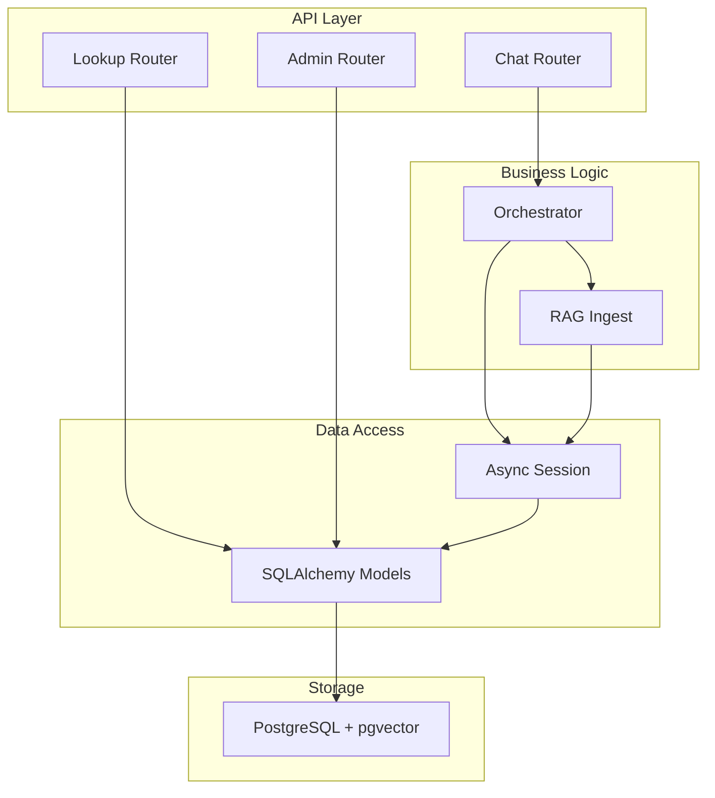
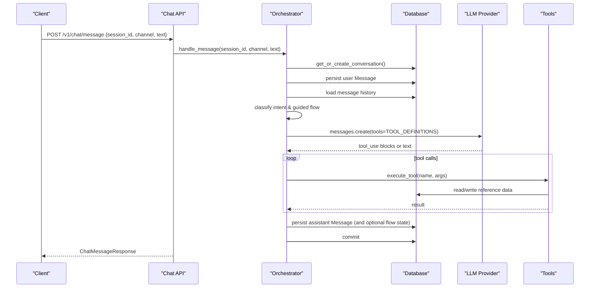
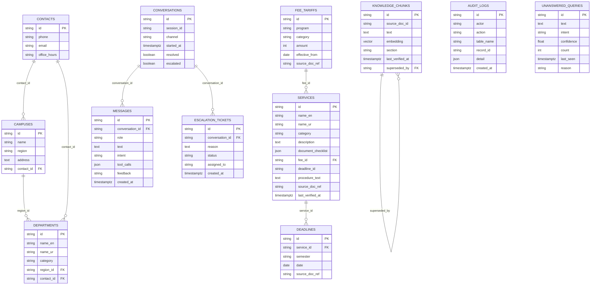
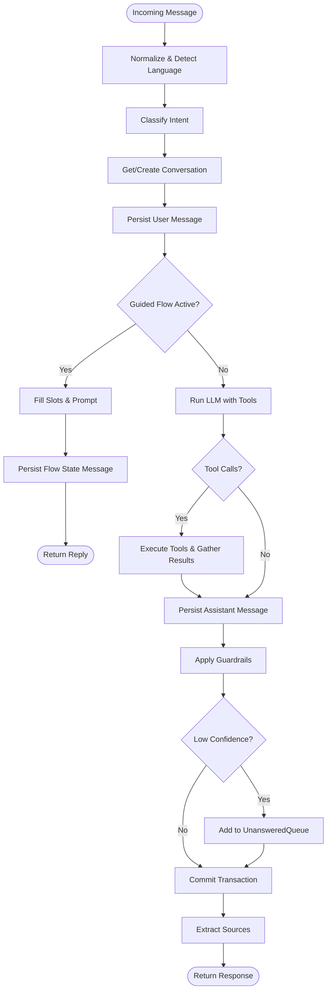
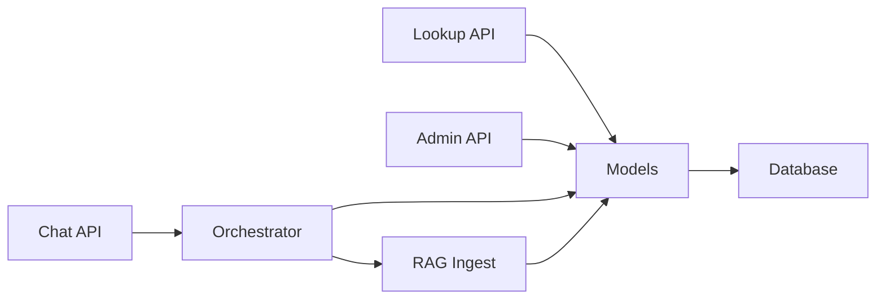

# Data Models and Schemas

<cite>
**Referenced Files in This Document**
- [models.py](file://uaea-backend/app/db/models.py)
- [schemas.py](file://uaea-backend/app/schemas.py)
- [0001_initial.py](file://uaea-backend/alembic/versions/0001_initial.py)
- [chat.py](file://uaea-backend/app/api/chat.py)
- [admin.py](file://uaea-backend/app/api/admin.py)
- [lookup.py](file://uaea-backend/app/api/lookup.py)
- [orchestrator.py](file://uaea-backend/app/orchestrator/orchestrator.py)
- [ingest.py](file://uaea-backend/app/rag/ingest.py)
- [seed.py](file://uaea-backend/app/db/seed.py)
- [config.py](file://uaea-backend/app/config.py)
- [session.py](file://uaea-backend/app/db/session.py)
</cite>

## Table of Contents
1. Introduction
2. Project Structure
3. Core Components
4. Architecture Overview
5. Detailed Component Analysis
6. Dependency Analysis
7. Performance Considerations
8. Troubleshooting Guide
9. Conclusion
10. Appendices

## Introduction
This document provides comprehensive data model documentation for the UAEA Console system. It covers all database entities, their relationships, constraints, API request/response schemas, validation rules, data lifecycle from creation to archival, entity relationship diagrams, indexing strategies, query optimization patterns, Alembic migration strategy, version management, security and privacy considerations, compliance requirements, sample data structures, and common query patterns used throughout the application.

## Project Structure
The backend is a FastAPI application with:
- Data models defined via SQLAlchemy ORM
- Pydantic schemas for API request/response validation
- Alembic migrations for schema evolution
- Routers for chat, lookup, and admin operations
- Orchestrator pipeline that processes messages, persists conversations/messages, and integrates LLM tool calls
- RAG ingestion pipeline for knowledge chunks with vector embeddings

**Diagram sources**
- [chat.py:21-39](file://uaea-backend/app/api/chat.py#L21-L39)
- [lookup.py:26-103](file://uaea-backend/app/api/lookup.py#L26-L103)
- [admin.py:67-160](file://uaea-backend/app/api/admin.py#L67-L160)
- [orchestrator.py:46-143](file://uaea-backend/app/orchestrator/orchestrator.py#L46-L143)
- [ingest.py:75-122](file://uaea-backend/app/rag/ingest.py#L75-L122)
- [session.py:7-13](file://uaea-backend/app/db/session.py#L7-L13)
- [models.py:18-228](file://uaea-backend/app/db/models.py#L18-L228)

**Section sources**
- [main.py:40-79](file://uaea-backend/app/main.py#L40-L79)
- [config.py:6-37](file://uaea-backend/app/config.py#L6-L37)

## Core Components
- Entities: Contact, Campus, Department, FeeTariff, Service, Deadline, KnowledgeChunk, Conversation, Message, EscalationTicket, AuditLog, UnansweredQuery
- Relationships:
  - Service references FeeTariff (optional)
  - Deadline belongs to Service
  - Department belongs to Campus and optionally links to Contact
  - Conversation has many Messages (ordered by created_at)
  - EscalationTicket belongs to Conversation
  - KnowledgeChunk may supersede another KnowledgeChunk
- Indexes:
  - services.category
  - fee_tariffs.program
  - conversations.session_id
  - escalation_tickets.conversation_id
  - knowledge_chunks.source_doc_id

Key responsibilities:
- Conversations and Messages persist chat sessions and interactions
- Services encapsulate university services with optional fees and deadlines
- Deadlines bind time-bound obligations to services
- FeeTariff defines program/category-based pricing
- KnowledgeChunk stores chunked, embedded content for retrieval
- AuditLog records administrative actions
- UnansweredQuery tracks low-confidence or unresolved queries

**Section sources**
- [models.py:32-228](file://uaea-backend/app/db/models.py#L32-L228)
- [0001_initial.py:17-163](file://uaea-backend/alembic/versions/0001_initial.py#L17-L163)

## Architecture Overview
The chat flow orchestrates message processing, intent classification, guided flows, LLM tool execution, guardrails, and persistence. Lookup endpoints expose read-only access to reference data. Admin endpoints manage content and analytics with audit logging.

**Diagram sources**
- [chat.py:21-39](file://uaea-backend/app/api/chat.py#L21-L39)
- [orchestrator.py:46-143](file://uaea-backend/app/orchestrator/orchestrator.py#L46-L143)
- [orchestrator.py:229-318](file://uaea-backend/app/orchestrator/orchestrator.py#L229-L318)
- [models.py:144-178](file://uaea-backend/app/db/models.py#L144-L178)

## Detailed Component Analysis

### Entity Relationship Diagram

**Diagram sources**
- [models.py:32-228](file://uaea-backend/app/db/models.py#L32-L228)
- [0001_initial.py:17-163](file://uaea-backend/alembic/versions/0001_initial.py#L17-L163)

### API Schemas and Validation Rules
- Chat endpoints:
  - Request: ChatMessageRequest with session_id (required), channel (default "web"), text (required)
  - Response: ChatMessageResponse with reply (required), intent (optional), tool_calls (array), escalated (bool), confidence (float), language (string), sources (array)
  - Escalation: EscalateRequest requires session_id and reason; EscalateResponse returns ticket_id and status
  - Session retrieval: SessionOut includes conversation metadata and messages array
- Lookup endpoints:
  - Departments: list with optional region and query filters
  - Fee tariffs: list with optional program and category filters
  - Deadlines: list with optional service filter
  - Document checklist: requires service parameter
- Admin endpoints:
  - FAQ creation: FAQCreate requires source_doc_id and text; optional section
  - Fee tariff creation: FeeTariffCreate requires program, category, amount, effective_from; optional source_doc_ref
  - Analytics: IntentCount lists intent and count
  - Unanswered queue: UnansweredQueryOut exposes fields for review

Validation highlights:
- Pydantic models enforce required fields and types
- Optional fields default to None or empty collections where appropriate
- Date and datetime fields are validated against ISO formats
- JSON fields accept structured payloads for checklists and tool calls

**Section sources**
- [schemas.py:13-178](file://uaea-backend/app/schemas.py#L13-L178)
- [chat.py:21-115](file://uaea-backend/app/api/chat.py#L21-L115)
- [lookup.py:26-103](file://uaea-backend/app/api/lookup.py#L26-L103)
- [admin.py:67-160](file://uaea-backend/app/api/admin.py#L67-L160)

### Data Lifecycle: Creation, Verification, Archival
- Creation:
  - Conversations are created on first message per session_id if none exists
  - Messages are appended for both user and assistant turns
  - KnowledgeChunks are created during document ingestion with embeddings
  - FeeTariffs, Services, Deadlines are managed via admin endpoints
- Verification:
  - last_verified_at timestamps on Service and KnowledgeChunk indicate when content was verified
  - Guardrails validate replies before persistence
  - Low-confidence queries are tracked in UnansweredQuery for review
- Archival:
  - Superseded KnowledgeChunks are marked via superseded_by to maintain version history
  - Escalation tickets mark conversations as escalated for follow-up
  - AuditLog entries record administrative changes for traceability

**Diagram sources**
- [orchestrator.py:46-143](file://uaea-backend/app/orchestrator/orchestrator.py#L46-L143)
- [orchestrator.py:146-227](file://uaea-backend/app/orchestrator/orchestrator.py#L146-L227)
- [orchestrator.py:229-318](file://uaea-backend/app/orchestrator/orchestrator.py#L229-L318)
- [orchestrator.py:367-384](file://uaea-backend/app/orchestrator/orchestrator.py#L367-L384)

### Indexing Strategies and Query Optimization Patterns
- Indexes:
  - services.category: supports filtering services by category
  - fee_tariffs.program: supports filtering tariffs by program
  - conversations.session_id: supports retrieving latest open conversation per session
  - escalation_tickets.conversation_id: supports listing tickets per conversation
  - knowledge_chunks.source_doc_id: supports retrieval by source document
- Query patterns:
  - Latest open conversation: select by session_id, filter resolved=false, order by started_at desc, limit 1
  - Message history: select by conversation_id, order by created_at asc
  - Department search: join campuses for region filter; ilike across name_en, name_ur, category
  - Deadline lookup: join services to filter by service name
  - Intent analytics: group by intent, filter role=user, order by count desc
  - Unanswered queue: order by count desc for prioritization

**Section sources**
- [0001_initial.py:61-163](file://uaea-backend/alembic/versions/0001_initial.py#L61-L163)
- [lookup.py:26-103](file://uaea-backend/app/api/lookup.py#L26-L103)
- [admin.py:130-160](file://uaea-backend/app/api/admin.py#L130-L160)
- [chat.py:42-85](file://uaea-backend/app/api/chat.py#L42-L85)
- [orchestrator.py:321-364](file://uaea-backend/app/orchestrator/orchestrator.py#L321-L364)

### Migration Strategy Using Alembic and Version Management
- Initial migration creates all tables and indexes, including pgvector extension
- Revision ID: 0001_initial; down_revision is None indicating base revision
- Upgrade function:
  - Enables pgvector extension
  - Creates contacts, campuses, departments, fee_tariffs, services, deadlines, knowledge_chunks, conversations, messages, escalation_tickets, audit_logs, unanswered_queries
  - Adds indexes for performance
- Downgrade function:
  - Drops tables in reverse dependency order
  - Drops pgvector extension

Version management approach:
- Each schema change should be captured as a new Alembic migration file
- Use descriptive revision IDs and branch labels for complex changes
- Ensure downgrade paths are implemented for safe rollbacks

**Section sources**
- [0001_initial.py:1-180](file://uaea-backend/alembic/versions/0001_initial.py#L1-L180)

### Security, Privacy, and Compliance
- Authentication:
  - Admin endpoints require X-API-Key or Authorization Bearer token matching configured admin_api_key
  - Future phases plan OTP-based authentication
- Rate Limiting:
  - IP-based rate limiting via slowapi middleware
  - Per-session rate limiting placeholder for chat endpoints
- CORS:
  - Configurable origins based on environment settings
- Data Protection:
  - AuditLog captures actor, action, table_name, record_id, and detail for traceability
  - Personal data (phone, email) stored in Contact table; ensure access controls and encryption at rest
- Compliance:
  - Maintain audit trails for administrative changes
  - Implement data retention policies for conversations and messages
  - Ensure PII handling complies with applicable regulations

**Section sources**
- [admin.py:31-48](file://uaea-backend/app/api/admin.py#L31-L48)
- [main.py:25-73](file://uaea-backend/app/main.py#L25-L73)
- [config.py:20-32](file://uaea-backend/app/config.py#L20-L32)
- [models.py:200-211](file://uaea-backend/app/db/models.py#L200-L211)

### Sample Data Structures and Common Query Patterns
- Sample seed data demonstrates realistic entries for contacts, campuses, departments, fee tariffs, services, deadlines, knowledge chunks, and unanswered queries
- Common queries:
  - List departments by region or search term
  - Retrieve fee tariffs by program and category
  - Fetch deadlines associated with a service
  - Get document checklist for a service
  - Retrieve conversation history for a session
  - Analyze message intents for reporting

**Section sources**
- [seed.py:26-157](file://uaea-backend/app/db/seed.py#L26-L157)
- [lookup.py:26-103](file://uaea-backend/app/api/lookup.py#L26-L103)
- [chat.py:42-85](file://uaea-backend/app/api/chat.py#L42-L85)
- [admin.py:130-160](file://uaea-backend/app/api/admin.py#L130-L160)

## Dependency Analysis
- API routers depend on:
  - SQLAlchemy models for data access
  - Pydantic schemas for validation
  - Orchestrator for chat processing
  - RAG ingest for knowledge chunk management
- Orchestrator depends on:
  - Database session for persistence
  - LLM provider for response generation
  - Tools for executing business logic
- RAG ingest depends on:
  - Embedding provider configuration
  - Database session for storing chunks

**Diagram sources**
- [chat.py:21-39](file://uaea-backend/app/api/chat.py#L21-L39)
- [lookup.py:26-103](file://uaea-backend/app/api/lookup.py#L26-L103)
- [admin.py:67-160](file://uaea-backend/app/api/admin.py#L67-L160)
- [orchestrator.py:46-143](file://uaea-backend/app/orchestrator/orchestrator.py#L46-L143)
- [ingest.py:75-122](file://uaea-backend/app/rag/ingest.py#L75-L122)
- [models.py:18-228](file://uaea-backend/app/db/models.py#L18-L228)

**Section sources**
- [main.py:75-79](file://uaea-backend/app/main.py#L75-L79)
- [config.py:6-37](file://uaea-backend/app/config.py#L6-L37)

## Performance Considerations
- Use indexes on frequently filtered columns (category, program, session_id)
- Limit message history size for LLM context to reduce payload size
- Batch operations where possible (e.g., inserting multiple knowledge chunks)
- Monitor database connection pool settings and adjust as needed
- Consider pagination for large datasets (e.g., messages, knowledge chunks)

[No sources needed since this section provides general guidance]

## Troubleshooting Guide
- Chat endpoint errors:
  - 404 when session not found
  - Handle LLM API errors gracefully with fallback responses
- Admin endpoint errors:
  - 403 when invalid API key provided
- Database issues:
  - Check connection string and credentials in settings
  - Verify Alembic migrations applied successfully
- RAG ingestion:
  - Ensure embedding provider key is configured
  - Validate chunking logic for large documents

**Section sources**
- [chat.py:42-85](file://uaea-backend/app/api/chat.py#L42-L85)
- [admin.py:31-48](file://uaea-backend/app/api/admin.py#L31-L48)
- [config.py:6-37](file://uaea-backend/app/config.py#L6-L37)
- [ingest.py:18-31](file://uaea-backend/app/rag/ingest.py#L18-L31)

## Conclusion
The UAEA Console system implements a robust data model with clear relationships and constraints, supporting chat interactions, reference data management, and administrative operations. The architecture leverages SQLAlchemy, Pydantic, and Alembic for reliable data handling and schema evolution. Security measures include API key authentication, rate limiting, and audit logging. Performance optimizations through indexing and query patterns ensure efficient data access. The RAG pipeline enables intelligent retrieval of knowledge chunks with version control via supersession.

[No sources needed since this section summarizes without analyzing specific files]

## Appendices

### API Endpoints Summary
- Chat:
  - POST /v1/chat/message: Send message and receive assistant reply
  - GET /v1/chat/session/{session_id}: Retrieve conversation history
  - POST /v1/chat/escalate: Create escalation ticket
- Lookup:
  - GET /v1/lookup/departments: List departments with filters
  - GET /v1/lookup/fee-tariff: List fee tariffs with filters
  - GET /v1/lookup/deadlines: List deadlines with filters
  - GET /v1/lookup/document-checklist: Get checklist for service
- Admin:
  - POST /v1/admin/content/faq: Create FAQ knowledge chunk
  - POST /v1/admin/content/fee-tariff: Create fee tariff entry
  - GET /v1/admin/analytics/intents: Get intent counts
  - GET /v1/admin/queue/unanswered: Get unanswered queries

**Section sources**
- [chat.py:21-115](file://uaea-backend/app/api/chat.py#L21-L115)
- [lookup.py:26-103](file://uaea-backend/app/api/lookup.py#L26-L103)
- [admin.py:67-160](file://uaea-backend/app/api/admin.py#L67-L160)