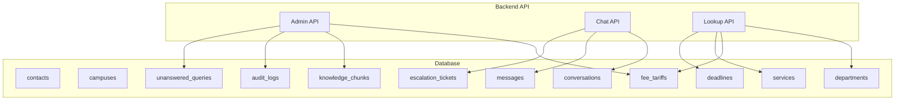
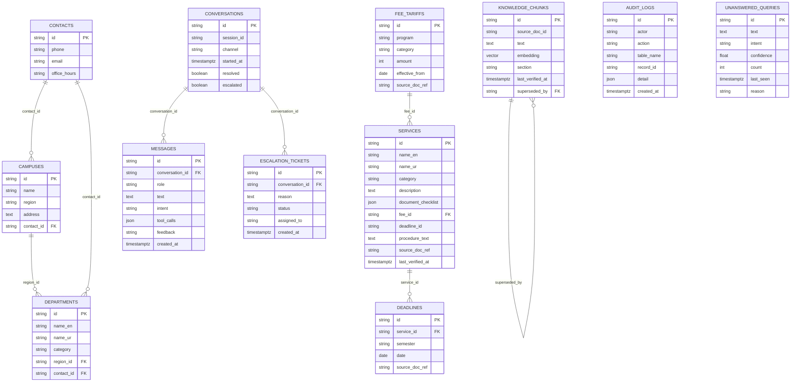
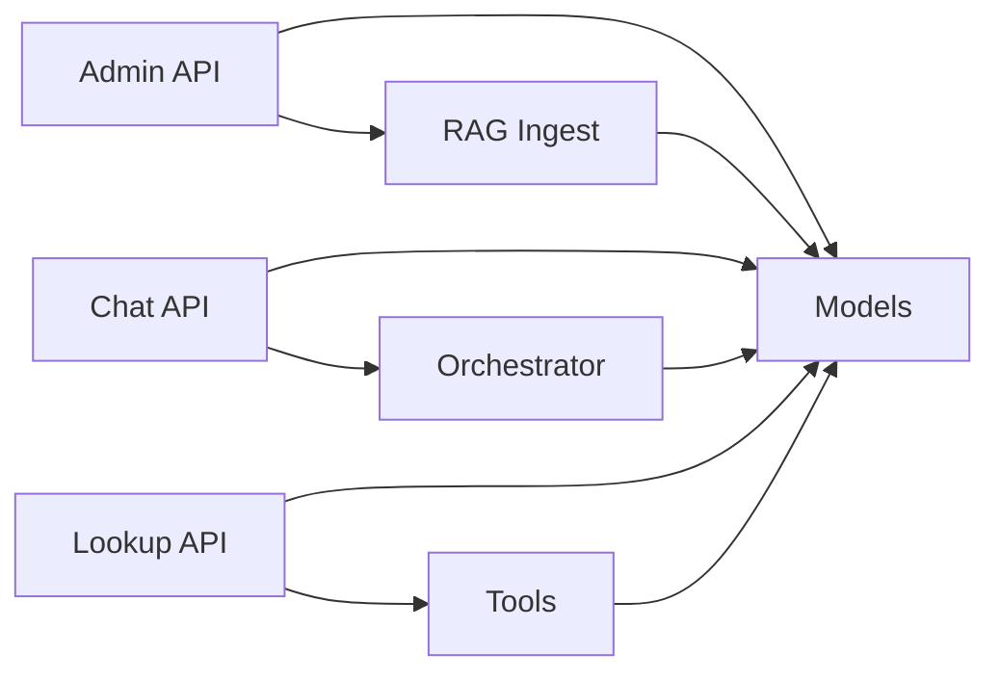

# Database Schema

<cite>
**Referenced Files in This Document**
- [models.py](file://uaea-backend/app/db/models.py)
- [0001_initial.py](file://uaea-backend/alembic/versions/0001_initial.py)
- [config.py](file://uaea-backend/app/config.py)
- [retrieve.py](file://uaea-backend/app/rag/retrieve.py)
- [ingest.py](file://uaea-backend/app/rag/ingest.py)
- [admin.py](file://uaea-backend/app/api/admin.py)
- [chat.py](file://uaea-backend/app/api/chat.py)
- [lookup.py](file://uaea-backend/app/api/lookup.py)
</cite>

## Table of Contents
1. Introduction
2. Project Structure
3. Core Components
4. Architecture Overview
5. Detailed Component Analysis
6. Dependency Analysis
7. Performance Considerations
8. Troubleshooting Guide
9. Conclusion

## Introduction
This document provides comprehensive database schema documentation for the UAEA Console system. It details all entities (Contact, Campus, Department, Service, FeeTariff, Deadline, KnowledgeChunk, Conversation, Message, EscalationTicket, AuditLog, UnansweredQuery), their fields, data types, constraints, relationships, indexes, and table-specific constraints. It also explains the purpose and usage of each table within the business domain, documents pgvector integration for semantic search, and outlines performance considerations, indexing strategies, and query optimization patterns used throughout the application.

## Project Structure
The database schema is defined using SQLAlchemy models and enforced via Alembic migrations. The backend exposes APIs that read and write to these tables. RAG (Retrieval-Augmented Generation) functionality uses pgvector for embedding-based similarity search over knowledge chunks.

**Diagram sources**
- [admin.py:1-161](file://uaea-backend/app/api/admin.py#L1-L161)
- [chat.py:1-115](file://uaea-backend/app/api/chat.py#L1-L115)
- [lookup.py:1-104](file://uaea-backend/app/api/lookup.py#L1-L104)
- [models.py:30-228](file://uaea-backend/app/db/models.py#L30-L228)

**Section sources**
- [models.py:30-228](file://uaea-backend/app/db/models.py#L30-L228)
- [0001_initial.py:17-163](file://uaea-backend/alembic/versions/0001_initial.py#L17-L163)

## Core Components
This section summarizes each entity’s purpose, key fields, constraints, and relationships.

- Contact
  - Purpose: Stores contact information for campuses and departments.
  - Key fields: id (PK), phone, email, office_hours.
  - Constraints: id is primary key; other fields nullable.
  - Relationships: Referenced by Campus.contact_id and Department.contact_id.

- Campus
  - Purpose: Represents a university campus with region and address.
  - Key fields: id (PK), name, region, address, contact_id (FK to contacts).
  - Constraints: name and region are required; contact_id optional.
  - Relationships: Has many Departments via region_id FK; optional contact.

- Department
  - Purpose: Represents academic or administrative departments with bilingual names and category.
  - Key fields: id (PK), name_en, name_ur, category, region_id (FK to campuses), contact_id (FK to contacts).
  - Constraints: name_en and category required; others optional.
  - Relationships: Belongs to a Campus via region_id; optional contact.

- FeeTariff
  - Purpose: Defines fee amounts per program/category with effective dates.
  - Key fields: id (PK), program, category, amount, effective_from, source_doc_ref.
  - Constraints: All except source_doc_ref required; program has an index.
  - Relationships: Referenced by Service.fee_id.

- Service
  - Purpose: Describes a student-facing service including description, checklist, procedure text, and verification timestamp.
  - Key fields: id (PK), name_en, name_ur, category, description, document_checklist (JSON), fee_id (FK to fee_tariffs), deadline_id, procedure_text, source_doc_ref, last_verified_at.
  - Constraints: name_en and category required; category has an index.
  - Relationships: Optional link to FeeTariff; optional link to Deadline via deadline_id.

- Deadline
  - Purpose: Associates deadlines to services per semester.
  - Key fields: id (PK), service_id (FK to services), semester, date, source_doc_ref.
  - Constraints: service_id, semester, date required.
  - Relationships: Belongs to a Service.

- KnowledgeChunk
  - Purpose: Stores segmented content with embeddings for semantic search.
  - Key fields: id (PK), source_doc_id, text, embedding (pgvector vector), section, last_verified_at, superseded_by (FK to knowledge_chunks.id).
  - Constraints: source_doc_id and text required; superseded_by optional self-reference.
  - Indexes: source_doc_id indexed.
  - Relationships: Self-referencing supersession via superseded_by.

- Conversation
  - Purpose: Represents a user session with channel metadata and status flags.
  - Key fields: id (PK), session_id, channel, started_at, resolved, escalated.
  - Constraints: session_id required; channel defaults to web; timestamps default to now.
  - Indexes: session_id indexed.
  - Relationships: Has many Messages.

- Message
  - Purpose: Stores individual messages within a conversation, including role, intent, tool calls, feedback, and timestamp.
  - Key fields: id (PK), conversation_id (FK to conversations on delete cascade), role, text, intent, tool_calls (JSON), feedback, created_at.
  - Constraints: conversation_id and role required; created_at defaults to now.
  - Relationships: Belongs to a Conversation.

- EscalationTicket
  - Purpose: Tracks escalations linked to a conversation.
  - Key fields: id (PK), conversation_id (FK to conversations), reason, status, assigned_to, created_at.
  - Constraints: conversation_id, reason, status required; status defaults to open; created_at defaults to now.
  - Indexes: conversation_id indexed.
  - Relationships: Belongs to a Conversation.

- AuditLog
  - Purpose: Records administrative actions for compliance and traceability.
  - Key fields: id (PK), actor, action, table_name, record_id, detail (JSON), created_at.
  - Constraints: actor, action, table_name required; created_at defaults to now.
  - Relationships: No foreign keys; generic audit trail.

- UnansweredQuery
  - Purpose: Aggregates low-confidence or unrecognized queries for review.
  - Key fields: id (PK), text, intent, confidence, count, last_seen, reason.
  - Constraints: text required; last_seen defaults to now; count defaults to 1.
  - Relationships: No foreign keys; analytics queue.

**Section sources**
- [models.py:30-228](file://uaea-backend/app/db/models.py#L30-L228)
- [0001_initial.py:17-163](file://uaea-backend/alembic/versions/0001_initial.py#L17-L163)

## Architecture Overview
The database supports three main functional areas:
- Lookup and reference data: Contact, Campus, Department, FeeTariff, Service, Deadline.
- Conversational state: Conversation, Message, EscalationTicket.
- Content and analytics: KnowledgeChunk (with pgvector), AuditLog, UnansweredQuery.

**Diagram sources**
- [models.py:30-228](file://uaea-backend/app/db/models.py#L30-L228)
- [0001_initial.py:17-163](file://uaea-backend/alembic/versions/0001_initial.py#L17-L163)

## Detailed Component Analysis

### Reference Data Entities
- Contact, Campus, Department, FeeTariff, Service, Deadline form the core lookup layer.
- Indexes:
  - fee_tariffs.program
  - services.category
- Foreign keys:
  - campuses.contact_id -> contacts.id
  - departments.region_id -> campuses.id
  - departments.contact_id -> contacts.id
  - services.fee_id -> fee_tariffs.id
  - deadlines.service_id -> services.id

Usage patterns:
- Lookup endpoints filter by region, program, category, and service names.
- Services may optionally link to a fee tariff and a deadline.

**Section sources**
- [lookup.py:26-104](file://uaea-backend/app/api/lookup.py#L26-L104)
- [models.py:30-122](file://uaea-backend/app/db/models.py#L30-L122)
- [0001_initial.py:21-88](file://uaea-backend/alembic/versions/0001_initial.py#L21-L88)

### Conversational State Entities
- Conversation tracks sessions with channel metadata and status flags.
- Message stores chat turns with roles, intents, tool calls, and feedback.
- EscalationTicket records escalation events tied to a conversation.

Indexes:
- conversations.session_id
- escalation_tickets.conversation_id

Constraints:
- messages.conversation_id on delete cascade ensures message cleanup when conversations are removed.

Usage patterns:
- Chat endpoints create/update conversation state and persist messages.
- Escalation endpoint marks conversation as escalated and creates a ticket.

**Section sources**
- [chat.py:21-115](file://uaea-backend/app/api/chat.py#L21-L115)
- [models.py:142-195](file://uaea-backend/app/db/models.py#L142-L195)
- [0001_initial.py:104-139](file://uaea-backend/alembic/versions/0001_initial.py#L104-L139)

### Knowledge Base and RAG Integration
- KnowledgeChunk stores chunked content with embeddings for semantic retrieval.
- Embedding dimensions are configured via settings.embedding_dimensions (default 384).
- Ingestion pipeline:
  - Chunk text while preserving section headers.
  - Generate embeddings via OpenAI embeddings API (or zero vectors in dev mode).
  - Store chunks with optional supersession linking old versions to new ones.
- Retrieval pipeline:
  - Generate query embedding.
  - Use pgvector cosine distance operator (<=>) to find top-k similar chunks.
  - Apply basic reranking by boosting chunks whose section header matches query terms.
  - Return scored results formatted for LLM consumption.

Indexes and constraints:
- knowledge_chunks.source_doc_id indexed.
- knowledge_chunks.superseded_by self-references knowledge_chunks.id for version control.

Operational notes:
- Superseded chunks are excluded from retrieval via WHERE superseded_by IS NULL.
- Vector extension is enabled during migration.

**Section sources**
- [ingest.py:18-122](file://uaea-backend/app/rag/ingest.py#L18-L122)
- [retrieve.py:17-97](file://uaea-backend/app/rag/retrieve.py#L17-L97)
- [models.py:124-140](file://uaea-backend/app/db/models.py#L124-L140)
- [0001_initial.py:90-103](file://uaea-backend/alembic/versions/0001_initial.py#L90-L103)
- [config.py:14-18](file://uaea-backend/app/config.py#L14-L18)

### Admin and Analytics Entities
- AuditLog records admin actions with actor, action, target table, record ID, and JSON detail.
- UnansweredQuery aggregates unrecognized or low-confidence queries for review, including intent, confidence, count, and reason.

Usage patterns:
- Admin endpoints create FAQ chunks and fee tariffs, logging actions to AuditLog.
- Admin endpoints expose intent analytics and unanswered query queues.

**Section sources**
- [admin.py:51-161](file://uaea-backend/app/api/admin.py#L51-L161)
- [models.py:198-228](file://uaea-backend/app/db/models.py#L198-L228)
- [0001_initial.py:141-163](file://uaea-backend/alembic/versions/0001_initial.py#L141-L163)

## Dependency Analysis
The following diagram shows how API routes depend on database models and RAG components:

**Diagram sources**
- [admin.py:1-161](file://uaea-backend/app/api/admin.py#L1-L161)
- [chat.py:1-115](file://uaea-backend/app/api/chat.py#L1-L115)
- [lookup.py:1-104](file://uaea-backend/app/api/lookup.py#L1-L104)
- [ingest.py:1-145](file://uaea-backend/app/rag/ingest.py#L1-L145)
- [models.py:30-228](file://uaea-backend/app/db/models.py#L30-L228)

**Section sources**
- [admin.py:1-161](file://uaea-backend/app/api/admin.py#L1-L161)
- [chat.py:1-115](file://uaea-backend/app/api/chat.py#L1-L115)
- [lookup.py:1-104](file://uaea-backend/app/api/lookup.py#L1-L104)

## Performance Considerations
- Indexing strategy:
  - fee_tariffs.program: improves filtering by program.
  - services.category: improves filtering by category.
  - conversations.session_id: fast lookup by session.
  - escalation_tickets.conversation_id: efficient retrieval of tickets per conversation.
  - knowledge_chunks.source_doc_id: fast retrieval by source document.
- Query optimization patterns:
  - Use joins only when necessary; e.g., deadlines joined to services for filtering by service name.
  - Leverage ILIKE for case-insensitive partial matching in lookups.
  - For RAG retrieval, use pgvector cosine similarity operator and limit top_k to reduce result set size.
  - Exclude superseded chunks in retrieval to avoid redundant data.
- Vector search:
  - Ensure pgvector extension is enabled.
  - Keep embedding dimensions consistent across ingestion and retrieval.
  - Consider adding a vector index (e.g., IVF or HNSW) at scale for faster similarity searches if needed.
- Timestamps and defaults:
  - Use server-side defaults for created_at and last_verified_at to reduce client overhead.
- Cascade deletes:
  - messages.conversation_id on delete cascade ensures referential integrity without manual cleanup.

[No sources needed since this section provides general guidance]

## Troubleshooting Guide
Common issues and resolutions:
- Missing pgvector extension:
  - Symptom: Errors when creating or querying vector columns.
  - Resolution: Ensure CREATE EXTENSION IF NOT EXISTS vector runs during migration.
- Incorrect embedding dimensions:
  - Symptom: Mismatch between stored vectors and query vectors causing errors or poor results.
  - Resolution: Align settings.embedding_dimensions with model configuration and ensure consistency across ingestion and retrieval.
- Empty retrieval results:
  - Symptom: No relevant chunks found.
  - Resolution: Verify that chunks exist and are not superseded; check query embedding generation path (dev fallback returns zero vectors).
- Session not found:
  - Symptom: 404 when retrieving session history.
  - Resolution: Confirm session_id exists and conversation is active.
- Escalation failures:
  - Symptom: Unable to escalate due to missing active conversation.
  - Resolution: Ensure conversation exists and is not resolved before escalating.

**Section sources**
- [0001_initial.py:17-19](file://uaea-backend/alembic/versions/0001_initial.py#L17-L19)
- [retrieve.py:17-59](file://uaea-backend/app/rag/retrieve.py#L17-L59)
- [chat.py:42-115](file://uaea-backend/app/api/chat.py#L42-L115)

## Conclusion
The UAEA Console database schema provides a robust foundation for managing reference data, conversational state, and knowledge retrieval. With well-defined relationships, appropriate indexes, and pgvector-powered semantic search, the system supports scalable and performant operations. Proper adherence to indexing strategies, query patterns, and RAG pipelines ensures reliable performance and maintainability.

[No sources needed since this section summarizes without analyzing specific files]