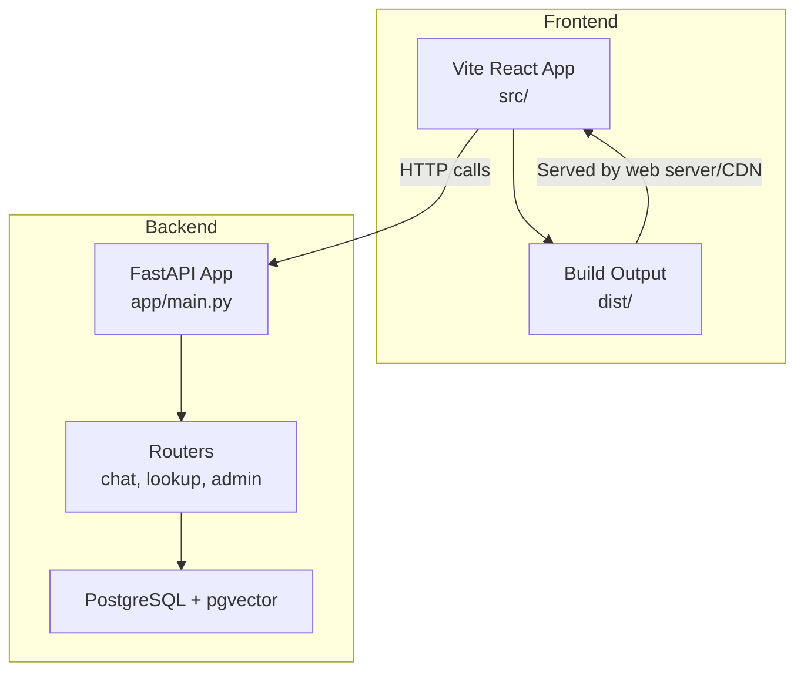
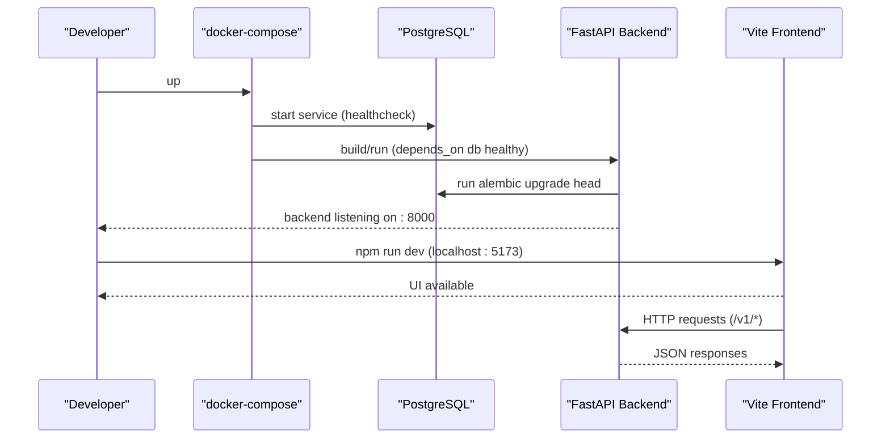
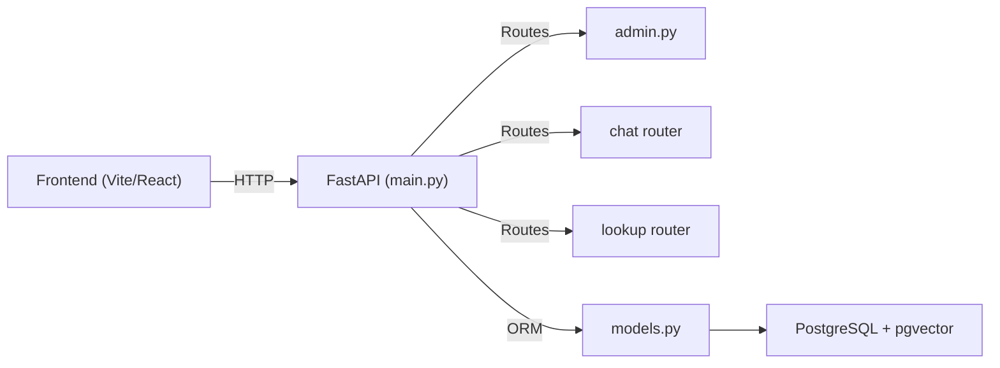

# Deployment Guide

<cite>
**Referenced Files in This Document**
- [README.md](file://README.md)
- [package.json](file://package.json)
- [vite.config.js](file://vite.config.js)
- [Dockerfile](file://uaea-backend/Dockerfile)
- [docker-compose.yml](file://uaea-backend/docker-compose.yml)
- [requirements.txt](file://uaea-backend/requirements.txt)
- [app/config.py](file://uaea-backend/app/config.py)
- [app/main.py](file://uaea-backend/app/main.py)
- [app/api/admin.py](file://uaea-backend/app/api/admin.py)
- [app/db/models.py](file://uaea-backend/app/db/models.py)
- [alembic.ini](file://uaea-backend/alembic.ini)
- [tests/conftest.py](file://uaea-backend/tests/conftest.py)
</cite>

## Table of Contents
1. Introduction
2. Project Structure
3. Core Components
4. Architecture Overview
5. Detailed Component Analysis
6. Dependency Analysis
7. Performance Considerations
8. Troubleshooting Guide
9. Conclusion
10. Appendices

## Introduction
This guide documents how to containerize, build, deploy, and operate the UAEA Console application across local development and production environments. It covers:
- Containerization strategy for frontend (Vite/React) and backend (FastAPI + PostgreSQL with pgvector).
- docker-compose orchestration for local development and staging.
- Production build process, environment configuration, and security hardening.
- Cloud deployment patterns, CI/CD pipeline setup, and automated testing integration.
- Monitoring, logging, health checks, scaling considerations.
- Backup and recovery procedures, disaster recovery planning, and operational maintenance tasks.

The project currently ships a frontend console that runs on mocks and a backend service with database models, migrations, and admin APIs ready for Phase 2 integration.

**Section sources**
- [README.md:1-209](file://README.md#L1-L209)

## Project Structure
At a high level:
- Frontend: React + Vite app under src/, built into static assets for serving.
- Backend: FastAPI application under uaea-backend/, with Postgres via pgvector, Alembic migrations, and admin/chat/lookup routers.
- Orchestration: docker-compose defines db and backend services; frontend is served by a web server or CDN in production.

**Diagram sources**
- [vite.config.js:1-13](file://vite.config.js#L1-L13)
- [package.json:1-23](file://package.json#L1-L23)
- [app/main.py:1-104](file://uaea-backend/app/main.py#L1-L104)
- [app/api/admin.py:1-161](file://uaea-backend/app/api/admin.py#L1-L161)
- [app/db/models.py:1-228](file://uaea-backend/app/db/models.py#L1-L228)

**Section sources**
- [README.md:135-156](file://README.md#L135-L156)
- [package.json:1-23](file://package.json#L1-L23)
- [vite.config.js:1-13](file://vite.config.js#L1-L13)

## Core Components
- Frontend build and dev server configured via Vite and React plugin.
- Backend FastAPI app with CORS, rate limiting, lifespan hooks, and health endpoint.
- Database schema defined with SQLAlchemy models including pgvector embeddings.
- Docker image for backend with Alembic migrations and seed step at startup.
- docker-compose for local development with Postgres service and dependency health checks.

Key responsibilities:
- Frontend: UI for student and staff console; builds static assets.
- Backend: Admin APIs, chat/lookup endpoints, RAG ingestion helpers, and data persistence.
- Database: Relational tables plus vector storage for knowledge chunks.

**Section sources**
- [package.json:7-11](file://package.json#L7-L11)
- [vite.config.js:5-12](file://vite.config.js#L5-L12)
- [app/main.py:30-86](file://uaea-backend/app/main.py#L30-L86)
- [app/db/models.py:124-140](file://uaea-backend/app/db/models.py#L124-L140)
- [Dockerfile:1-17](file://uaea-backend/Dockerfile#L1-L17)
- [docker-compose.yml:1-36](file://uaea-backend/docker-compose.yml#L1-L36)

## Architecture Overview
The system consists of:
- A Vite-built React frontend served as static assets.
- A FastAPI backend exposing REST endpoints under /v1/* with admin authentication.
- PostgreSQL with pgvector for relational data and semantic search.
- Optional external LLM/embedding providers configured via environment variables.

**Diagram sources**
- [docker-compose.yml:4-33](file://uaea-backend/docker-compose.yml#L4-L33)
- [Dockerfile:14-16](file://uaea-backend/Dockerfile#L14-L16)
- [app/main.py:77-86](file://uaea-backend/app/main.py#L77-L86)

## Detailed Component Analysis

### Backend Containerization and Startup
- Base image: Python slim with build tools and PostgreSQL client libraries.
- Dependencies installed from requirements.txt.
- Application entrypoint runs Alembic migrations, seeds data, then starts Uvicorn on 0.0.0.0:8000.

Operational notes:
- Ensure DATABASE_URL and DATABASE_URL_SYNC are set when running outside docker-compose.
- For production, mount only the necessary files and avoid source code volumes.

**Section sources**
- [Dockerfile:1-17](file://uaea-backend/Dockerfile#L1-L17)
- [requirements.txt:1-21](file://uaea-backend/requirements.txt#L1-L21)

### Local Development with docker-compose
- Services:
  - db: PostgreSQL with pgvector extension, exposed on port 5432, persistent volume.
  - backend: Builds from Dockerfile, exposes 8000, reads env_file .env, depends on db health.
- Health check ensures db readiness before backend starts.

Environment variables:
- POSTGRES_USER, POSTGRES_PASSWORD, POSTGRES_DB default to uaea unless overridden.
- DATABASE_URL and DATABASE_URL_SYNC constructed from compose environment.

**Section sources**
- [docker-compose.yml:1-36](file://uaea-backend/docker-compose.yml#L1-L36)

### Backend Configuration and Security
- Settings loaded from environment and optional .env file.
- Key settings include database URLs, LLM keys, embedding provider/model/dimensions, CORS origins, rate limits, admin API key, app environment, and log level.
- Admin routes require an API key via header X-API-Key or Authorization Bearer token.

Security recommendations:
- Never commit secrets; use environment variables or secret managers.
- Restrict CORS origins to known domains in production.
- Rotate admin_api_key regularly and enforce strong values.

**Section sources**
- [app/config.py:1-38](file://uaea-backend/app/config.py#L1-L38)
- [app/api/admin.py:29-48](file://uaea-backend/app/api/admin.py#L29-L48)

### API Endpoints and Authentication Flow
- Routers mounted: chat, lookup, admin.
- Admin endpoints protected by verify_admin dependency checking API key or bearer token.
- Example admin endpoints:
  - POST /v1/admin/content/faq
  - POST /v1/admin/content/fee-tariff
  - GET /v1/admin/analytics/intents
  - GET /v1/admin/queue/unanswered

Authentication flow:
- Client includes X-API-Key or Authorization: Bearer <token>.
- Server validates against settings.admin_api_key; otherwise returns 403.

**Section sources**
- [app/main.py:75-79](file://uaea-backend/app/main.py#L75-L79)
- [app/api/admin.py:29-48](file://uaea-backend/app/api/admin.py#L29-L48)
- [app/api/admin.py:67-161](file://uaea-backend/app/api/admin.py#L67-L161)

### Database Schema and Migrations
- Models define tables for contacts, campuses, departments, fee tariffs, services, deadlines, knowledge chunks (with pgvector), conversations, messages, escalation tickets, audit logs, and unanswered queries.
- Alembic manages migrations; Dockerfile runs alembic upgrade head at startup.
- Default alembic URL points to local Postgres; override via environment in production.

Migration workflow:
- Ensure DATABASE_URL is correct.
- Run alembic upgrade head during container startup or as a separate migration job.
- Use alembic downgrade for rollback if needed.

**Section sources**
- [app/db/models.py:1-228](file://uaea-backend/app/db/models.py#L1-L228)
- [alembic.ini:1-37](file://uaea-backend/alembic.ini#L1-L37)
- [Dockerfile:14-16](file://uaea-backend/Dockerfile#L14-L16)

### Frontend Build and Serve Strategy
- Development: npm run dev serves on port 5173 with hot reload.
- Production: npm run build generates optimized static assets in dist/.
- Serve dist/ via a static web server (e.g., Nginx, Caddy) or cloud hosting (e.g., S3 + CloudFront, Azure Static Web Apps, Vercel).

CORS configuration:
- Configure backend CORS to allow frontend origin(s) in production.
- Update settings.cors_origins accordingly.

**Section sources**
- [package.json:7-11](file://package.json#L7-L11)
- [vite.config.js:5-12](file://vite.config.js#L5-L12)
- [app/config.py:20-22](file://uaea-backend/app/config.py#L20-L22)

### Testing Setup and Execution
- Tests use SQLite in-memory/temp file for speed and isolation.
- Fixtures create schema, seed sample data, and override DB dependency for tests.
- Environment overrides ensure deterministic test behavior.

Running tests:
- pytest discovers tests under uaea-backend/tests/.
- Use fixtures to interact with the app via ASGI transport.

**Section sources**
- [tests/conftest.py:17-28](file://uaea-backend/tests/conftest.py#L17-L28)
- [tests/conftest.py:48-79](file://uaea-backend/tests/conftest.py#L48-L79)
- [tests/conftest.py:81-191](file://uaea-backend/tests/conftest.py#L81-L191)

## Dependency Analysis
Runtime dependencies include FastAPI, Uvicorn, SQLAlchemy async drivers, Alembic, Pydantic settings, pgvector, and third-party LLM clients. The frontend depends on React, React Router, and Vite tooling.

**Diagram sources**
- [app/main.py:75-79](file://uaea-backend/app/main.py#L75-L79)
- [app/api/admin.py:1-26](file://uaea-backend/app/api/admin.py#L1-L26)
- [app/db/models.py:1-20](file://uaea-backend/app/db/models.py#L1-L20)

**Section sources**
- [requirements.txt:1-21](file://uaea-backend/requirements.txt#L1-L21)
- [package.json:12-21](file://package.json#L12-L21)

## Performance Considerations
- Rate limiting: IP-based limiter configured; per-session logic stubbed for chat endpoints. Tune limits based on traffic patterns.
- CORS: Limit allowed origins to reduce attack surface.
- Database: Use connection pooling and tune pgvector indexing for retrieval performance.
- Frontend: Leverage Vite’s production build optimizations; consider CDN caching for static assets.
- Logging: Set appropriate log levels per environment to balance observability and overhead.

[No sources needed since this section provides general guidance]

## Troubleshooting Guide
Common issues and resolutions:
- Database not ready: Ensure docker-compose healthcheck passes before backend starts; verify POSTGRES_* variables.
- Migration errors: Confirm DATABASE_URL matches target database; run alembic upgrade head manually inside container if needed.
- Admin access denied: Verify X-API-Key or Authorization header matches settings.admin_api_key.
- CORS errors: Update cors_origins to include frontend domain in production.
- Rate limit exceeded: Adjust rate_limit_per_ip and rate_limit_per_session in settings.

Health check:
- GET /health returns status ok for the backend service.

**Section sources**
- [docker-compose.yml:14-18](file://uaea-backend/docker-compose.yml#L14-L18)
- [app/main.py:82-86](file://uaea-backend/app/main.py#L82-L86)
- [app/api/admin.py:29-48](file://uaea-backend/app/api/admin.py#L29-L48)
- [app/config.py:20-32](file://uaea-backend/app/config.py#L20-L32)

## Conclusion
UAEA Console provides a modern frontend and a robust backend with secure admin APIs, vector-enabled retrieval, and comprehensive database modeling. With docker-compose for local development and a clear path to production builds, the system supports scalable deployment, monitoring, and maintenance. Follow the guidelines in this document to containerize, configure securely, automate CI/CD, and operate reliably in production.

[No sources needed since this section summarizes without analyzing specific files]

## Appendices

### A. Local Development Workflow
- Start services: docker-compose up --build
- Frontend dev server: npm run dev
- Access:
  - Frontend: http://localhost:5173
  - Backend: http://localhost:8000
  - Health: GET http://localhost:8000/health

**Section sources**
- [docker-compose.yml:20-33](file://uaea-backend/docker-compose.yml#L20-L33)
- [package.json:7-11](file://package.json#L7-L11)
- [app/main.py:82-86](file://uaea-backend/app/main.py#L82-L86)

### B. Production Build and Serve
- Build frontend: npm run build
- Serve dist/ via a static web server or cloud hosting.
- Build backend image using Dockerfile; ensure environment variables are set via secret management.
- Configure CORS to restrict to production frontend domains.

**Section sources**
- [package.json:7-11](file://package.json#L7-L11)
- [Dockerfile:1-17](file://uaea-backend/Dockerfile#L1-L17)
- [app/config.py:20-22](file://uaea-backend/app/config.py#L20-L22)

### C. Environment Variables Reference
- Database:
  - DATABASE_URL, DATABASE_URL_SYNC
  - POSTGRES_USER, POSTGRES_PASSWORD, POSTGRES_DB
- LLM/Embeddings:
  - anthropic_api_key
  - embedding_provider, embedding_api_key, embedding_model, embedding_dimensions
- Security:
  - cors_origins
  - rate_limit_per_ip, rate_limit_per_session
  - admin_api_key
- App:
  - app_env, log_level

**Section sources**
- [app/config.py:6-32](file://uaea-backend/app/config.py#L6-L32)
- [docker-compose.yml:6-27](file://uaea-backend/docker-compose.yml#L6-L27)

### D. CI/CD Pipeline Suggestions
- Stages:
  - Lint and type checks (frontend/backend)
  - Unit tests (pytest)
  - Build frontend artifacts
  - Build backend image
  - Push images to registry
  - Deploy to staging/production with environment-specific configs
- Secrets:
  - Store API keys and database credentials in CI secret store.
- Artifacts:
  - Cache node_modules and pip packages to speed up builds.

[No sources needed since this section provides general guidance]

### E. Automated Testing Integration
- Run tests in CI using pytest; leverage fixtures for isolated DB state.
- Report coverage and publish results.
- Gate deployments on passing tests.

**Section sources**
- [tests/conftest.py:17-28](file://uaea-backend/tests/conftest.py#L17-L28)
- [tests/conftest.py:48-79](file://uaea-backend/tests/conftest.py#L48-L79)

### F. Monitoring and Logging
- Backend logs configured via logging.basicConfig with configurable log level.
- Health endpoint for liveness probes.
- Consider structured logging and centralized log aggregation in production.

**Section sources**
- [app/main.py:18-23](file://uaea-backend/app/main.py#L18-L23)
- [app/main.py:82-86](file://uaea-backend/app/main.py#L82-L86)

### G. Scaling Considerations
- Horizontal scaling:
  - Run multiple backend replicas behind a load balancer.
  - Use managed PostgreSQL with read replicas if needed.
- Statelessness:
  - Keep sessions out of process memory; use shared stores if required.
- Caching:
  - Consider CDN for frontend assets and response caching where appropriate.

[No sources needed since this section provides general guidance]

### H. Backup and Recovery
- Database backups:
  - Schedule regular pg_dump or use managed backup features.
  - Encrypt backups and store offsite.
- Recovery procedures:
  - Restore from latest backup; run alembic upgrade head to align schema.
  - Validate data integrity post-restore.

**Section sources**
- [alembic.ini:1-3](file://uaea-backend/alembic.ini#L1-L3)
- [Dockerfile:14-16](file://uaea-backend/Dockerfile#L14-L16)

### I. Operational Maintenance Tasks
- Rotate secrets (admin_api_key, LLM keys).
- Update dependencies periodically; review requirements.txt and package.json.
- Monitor health endpoints and logs; set alerts for failures.
- Review rate limits and adjust as traffic grows.

**Section sources**
- [app/config.py:20-32](file://uaea-backend/app/config.py#L20-L32)
- [requirements.txt:1-21](file://uaea-backend/requirements.txt#L1-L21)
- [package.json:12-21](file://package.json#L12-L21)