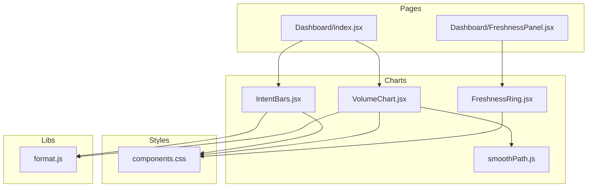
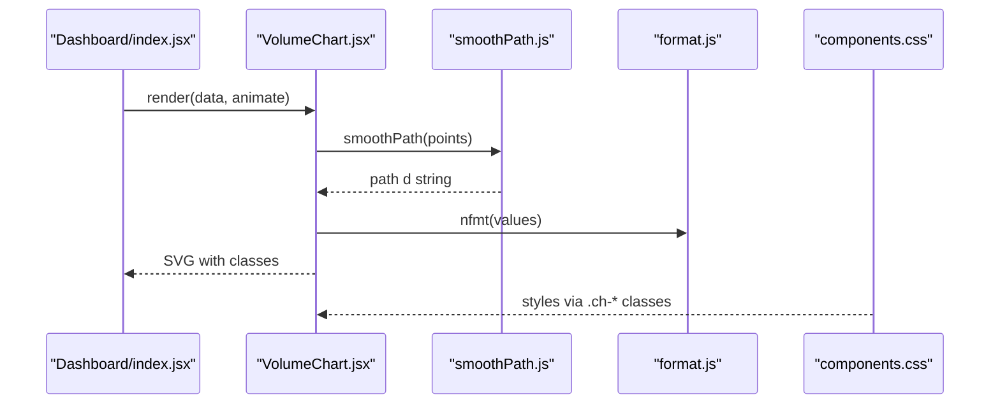
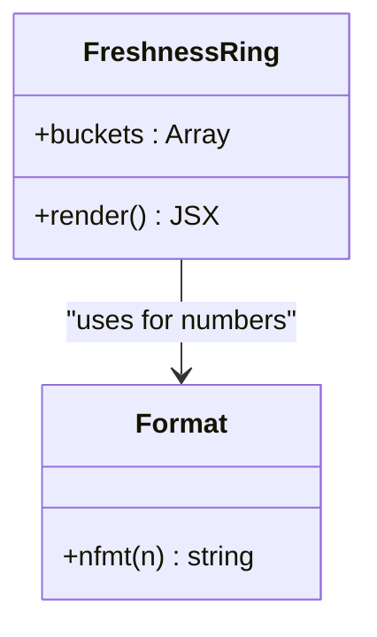
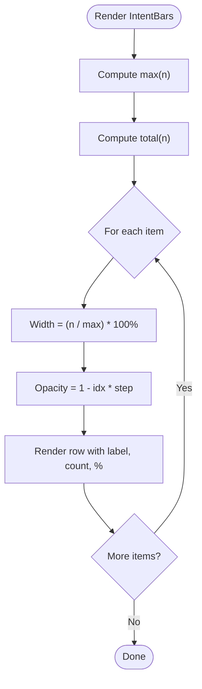
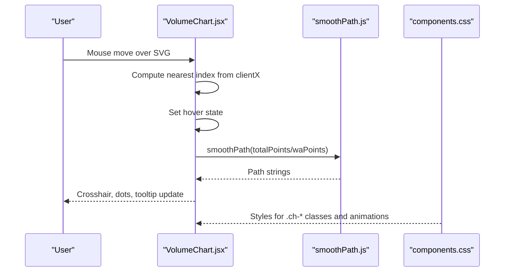
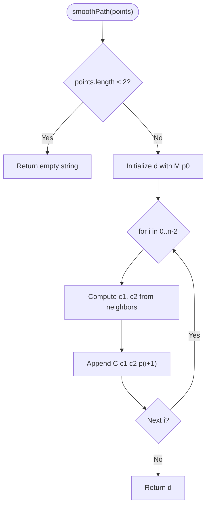
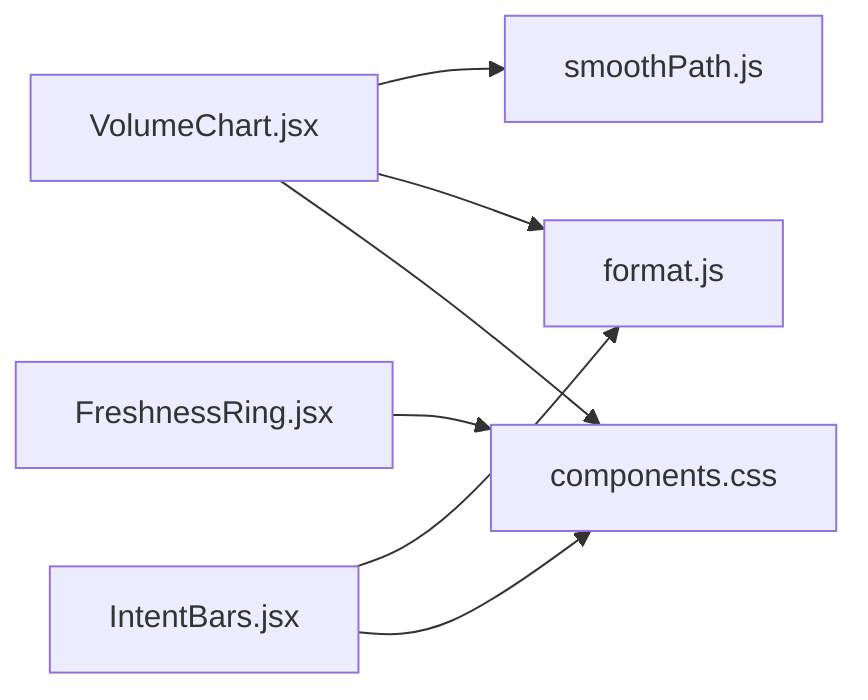

# Chart Components

<cite>
**Referenced Files in This Document**
- [FreshnessRing.jsx](file://src/components/charts/FreshnessRing.jsx)
- [IntentBars.jsx](file://src/components/charts/IntentBars.jsx)
- [VolumeChart.jsx](file://src/components/charts/VolumeChart.jsx)
- [smoothPath.js](file://src/components/charts/smoothPath.js)
- [format.js](file://src/lib/format.js)
- [components.css](file://src/styles/components.css)
- [Dashboard/index.jsx](file://src/pages/Dashboard/index.jsx)
- [Dashboard/FreshnessPanel.jsx](file://src/pages/Dashboard/FreshnessPanel.jsx)
</cite>

## Table of Contents
1. Introduction
2. Project Structure
3. Core Components
4. Architecture Overview
5. Detailed Component Analysis
6. Dependency Analysis
7. Performance Considerations
8. Troubleshooting Guide
9. Conclusion

## Introduction
This document explains the chart and visualization components used for data representation: FreshnessRing (circular progress indicators), IntentBars (bar charts showing intent distribution), and VolumeChart (trend visualization). It also documents the smoothPath utility that creates smooth SVG paths, and covers data binding, animation transitions, responsive scaling, color schemes, accessibility features, customization options, and performance guidance for real-time updates and large datasets.

## Project Structure
The charting code is organized under a dedicated charts folder with one component per visualization and a shared smoothing utility. The dashboard page composes these components and supplies data from mocks or application state. Styles are centralized in a CSS file using semantic class names to support theming.

**Diagram sources**
- [Dashboard/index.jsx:6-7](file://src/pages/Dashboard/index.jsx#L6-L7)
- [Dashboard/FreshnessPanel.jsx:4](file://src/pages/Dashboard/FreshnessPanel.jsx#L4)
- [VolumeChart.jsx:2-3](file://src/components/charts/VolumeChart.jsx#L2-L3)
- [IntentBars.jsx:1](file://src/components/charts/IntentBars.jsx#L1)
- [components.css:882-915](file://src/styles/components.css#L882-L915)

**Section sources**
- [Dashboard/index.jsx:1-151](file://src/pages/Dashboard/index.jsx#L1-L151)
- [Dashboard/FreshnessPanel.jsx:1-74](file://src/pages/Dashboard/FreshnessPanel.jsx#L1-L74)
- [components.css:882-915](file://src/styles/components.css#L882-L915)

## Core Components
- FreshnessRing: Renders a donut-style ring segmented by freshness buckets, with a central percentage and a legend. Uses stroke-dasharray/dashoffset for segments and CSS classes for colors.
- IntentBars: Renders ranked horizontal bars with opacity decreasing by rank, showing counts and percentages. Supports Urdu labels via a prop.
- VolumeChart: Two-series area chart (total and WhatsApp-only) with crosshair hover, grid lines, axis labels, gradient fill, and optional draw-on-mount animation.
- smoothPath: Converts a sequence of points into a smooth Catmull-Rom spline expressed as cubic Bezier commands for SVG path data.

Key props and behaviors:
- FreshnessRing(buckets): expects an array of { tone, label, n } describing bucket categories and counts; computes total and segment lengths.
- IntentBars(items, urdu): expects items as [{ key, label, ur?, n }] and renders ranked bars with percentage formatting.
- VolumeChart(data, animate): expects data as [{ day, wa, web }] and renders a two-line area chart with interactive hover.

Data binding examples:
- Dashboard passes VOLUME_90 slice to VolumeChart and INTENTS to IntentBars.
- FreshnessPanel computes buckets via freshnessBuckets and passes them to FreshnessRing.

Animation and responsiveness:
- VolumeChart uses a CSS-driven draw animation when animate is true.
- All charts use relative units and percentage widths where applicable; VolumeChart scales via viewBox and width: 100%.

Accessibility:
- VolumeChart includes role="img" and aria-label for screen readers.
- Semantic text elements and numeric formatting improve readability.

Color scheme and theming:
- Colors are applied via CSS classes bound to design tokens (e.g., --brass-bright, --sky-bright, --jade-bright, --line, --t3).
- FreshnessRing uses tone-based classes to map to tokenized colors.

Customization:
- IntentBars supports Urdu rendering through the urdu prop.
- VolumeChart accepts an animate flag to toggle drawing animation.
- Colors can be adjusted by updating CSS variables or adding new classes.

**Section sources**
- [FreshnessRing.jsx:6-65](file://src/components/charts/FreshnessRing.jsx#L6-L65)
- [IntentBars.jsx:4-51](file://src/components/charts/IntentBars.jsx#L4-L51)
- [VolumeChart.jsx:12-127](file://src/components/charts/VolumeChart.jsx#L12-L127)
- [smoothPath.js:8-26](file://src/components/charts/smoothPath.js#L8-L26)
- [Dashboard/index.jsx:102-141](file://src/pages/Dashboard/index.jsx#L102-L141)
- [Dashboard/FreshnessPanel.jsx:20-48](file://src/pages/Dashboard/FreshnessPanel.jsx#L20-L48)
- [components.css:882-915](file://src/styles/components.css#L882-L915)

## Architecture Overview
The dashboard composes the three chart components and provides data. VolumeChart depends on smoothPath for curve generation and format utilities for number formatting. All charts rely on shared CSS classes for consistent theming.

**Diagram sources**
- [Dashboard/index.jsx:102-124](file://src/pages/Dashboard/index.jsx#L102-L124)
- [VolumeChart.jsx:2-3](file://src/components/charts/VolumeChart.jsx#L2-L3)
- [VolumeChart.jsx:28-84](file://src/components/charts/VolumeChart.jsx#L28-L84)
- [smoothPath.js:8-26](file://src/components/charts/smoothPath.js#L8-L26)
- [format.js:20](file://src/lib/format.js#L20)
- [components.css:882-915](file://src/styles/components.css#L882-L915)

## Detailed Component Analysis

### FreshnessRing
Purpose:
- Visualize the proportion of verified content across freshness buckets with a donut chart and a legend.

Data model:
- Input: buckets array of objects with fields like tone, label, and n.
- Computes total count and segment lengths based on circumference.

Rendering logic:
- Draws a base circle and overlays multiple circles with stroke-dasharray/dashoffset to form segments.
- Displays the primary metric (verified share) in the center and a legend below.

Styling and theming:
- Segment colors come from tone-based classes mapped to design tokens.
- Text uses theme-aware classes for size and color.

Accessibility:
- Numeric values are presented as readable text.
- For enhanced accessibility, consider adding aria attributes to describe the chart’s purpose and current values.

Performance:
- Efficient for small to medium datasets; each bucket adds one SVG element.
- Avoid excessive re-renders by memoizing computed totals and segments if buckets change frequently.

Usage example:
- FreshnessPanel computes buckets and passes them to FreshnessRing.

**Section sources**
- [FreshnessRing.jsx:6-65](file://src/components/charts/FreshnessRing.jsx#L6-L65)
- [Dashboard/FreshnessPanel.jsx:20-48](file://src/pages/Dashboard/FreshnessPanel.jsx#L20-L48)
- [components.css:894-899](file://src/styles/components.css#L894-L899)

#### Class Diagram

**Diagram sources**
- [FreshnessRing.jsx:6-65](file://src/components/charts/FreshnessRing.jsx#L6-L65)
- [format.js:20](file://src/lib/format.js#L20)

### IntentBars
Purpose:
- Show ranked intents with proportional bar widths and descending opacity to emphasize ranking.

Data model:
- Input: items array with keys, labels, optional Urdu labels, and counts.
- Computes max and total for scaling and percentages.

Rendering logic:
- Maps over items to create rows with label, formatted count and percentage, and a bar whose width is proportional to the maximum.
- Opacity decreases per index to reinforce rank.

Styling and theming:
- Bar background and track use theme tokens.
- Optional Urdu font class applied conditionally.

Accessibility:
- Use descriptive headings and ensure keyboard navigation for any interactive parts.
- Consider adding aria-describedby to link bars to their labels.

Performance:
- Lightweight DOM operations; suitable for typical intent lists.
- If items grow large, consider virtualization or limiting displayed items.

Usage example:
- Dashboard passes INTENTS and language preference to IntentBars.

**Section sources**
- [IntentBars.jsx:4-51](file://src/components/charts/IntentBars.jsx#L4-L51)
- [Dashboard/index.jsx:127-141](file://src/pages/Dashboard/index.jsx#L127-L141)
- [format.js:20](file://src/lib/format.js#L20)

#### Flowchart

**Diagram sources**
- [IntentBars.jsx:4-51](file://src/components/charts/IntentBars.jsx#L4-L51)

### VolumeChart
Purpose:
- Display conversation volume trends over time with two series: total and WhatsApp-only, plus hover crosshair and tooltip.

Data model:
- Input: data array with daily values for WhatsApp (wa) and Web (web).
- Computes x/y scales based on data length and max value.

Rendering logic:
- Builds point arrays for both series and generates smooth paths via smoothPath.
- Draws grid lines, axis labels, area fill with gradient, and line paths.
- Tracks mouse movement to compute nearest index and show crosshair and dots.

Animation:
- When animate is true, applies a CSS class that triggers a stroke-dashoffset draw animation for the total line.

Responsiveness:
- Uses viewBox and width: 100% to scale fluidly within containers.

Accessibility:
- Includes role="img" and aria-label for screen reader context.
- Tooltip provides precise values on hover.

Performance:
- Recomputes scales and paths on data changes; keep data updates efficient.
- For frequent updates, consider debouncing or throttling mouse move handlers and minimizing re-renders.

Usage example:
- Dashboard slices mock data by range and passes it to VolumeChart along with an animate flag.

**Section sources**
- [VolumeChart.jsx:12-127](file://src/components/charts/VolumeChart.jsx#L12-L127)
- [Dashboard/index.jsx:102-124](file://src/pages/Dashboard/index.jsx#L102-L124)
- [components.css:882-915](file://src/styles/components.css#L882-L915)

#### Sequence Diagram

**Diagram sources**
- [VolumeChart.jsx:32-98](file://src/components/charts/VolumeChart.jsx#L32-L98)
- [smoothPath.js:8-26](file://src/components/charts/smoothPath.js#L8-L26)
- [components.css:882-915](file://src/styles/components.css#L882-L915)

### smoothPath Utility
Purpose:
- Convert a sequence of points into a smooth SVG path using Catmull-Rom to cubic Bezier conversion without overshooting.

Algorithm overview:
- Iterates over points and computes control points based on neighboring points to produce smooth curves.
- Returns a path data string compatible with SVG path d attribute.

Complexity:
- Time complexity O(n) over the number of points.
- Space complexity O(1) beyond the output string.

Usage:
- Called by VolumeChart to generate smooth lines for both series.

**Section sources**
- [smoothPath.js:8-26](file://src/components/charts/smoothPath.js#L8-L26)
- [VolumeChart.jsx:28-84](file://src/components/charts/VolumeChart.jsx#L28-L84)

#### Flowchart

**Diagram sources**
- [smoothPath.js:8-26](file://src/components/charts/smoothPath.js#L8-L26)

## Dependency Analysis
Components depend on shared utilities and styles:
- VolumeChart depends on smoothPath for curve generation and format utilities for number formatting.
- IntentBars uses format utilities for number formatting.
- All charts rely on CSS classes for theming and consistent visuals.

**Diagram sources**
- [VolumeChart.jsx:2-3](file://src/components/charts/VolumeChart.jsx#L2-L3)
- [IntentBars.jsx:1](file://src/components/charts/IntentBars.jsx#L1)
- [components.css:882-915](file://src/styles/components.css#L882-L915)

**Section sources**
- [VolumeChart.jsx:1-127](file://src/components/charts/VolumeChart.jsx#L1-L127)
- [IntentBars.jsx:1-51](file://src/components/charts/IntentBars.jsx#L1-L51)
- [FreshnessRing.jsx:1-65](file://src/components/charts/FreshnessRing.jsx#L1-L65)
- [components.css:882-915](file://src/styles/components.css#L882-L915)

## Performance Considerations
- Data updates:
  - Debounce or throttle input events (e.g., mouse moves) to reduce re-renders in VolumeChart.
  - Memoize derived data (totals, scales) in parent components to avoid unnecessary recalculations.
- Large datasets:
  - Limit visible points or aggregate data for very long time ranges.
  - Consider virtualizing lists for IntentBars if the number of intents grows significantly.
- Rendering efficiency:
  - Prefer CSS animations for visual effects (as used in VolumeChart) to leverage GPU acceleration.
  - Keep SVG element counts reasonable; FreshnessRing adds one element per bucket.
- Memory:
  - Reuse computed paths and avoid creating large intermediate arrays on every render.

[No sources needed since this section provides general guidance]

## Troubleshooting Guide
- Colors not applying:
  - Ensure CSS classes match those defined in the stylesheet and that design tokens are available in the theme.
- Animation not playing:
  - Verify the animate prop is true and that the CSS animation class is present on the target element.
- Hover not working:
  - Confirm the SVG has event listeners and that coordinates are calculated relative to the container bounds.
- Accessibility:
  - Add appropriate ARIA attributes to non-SVG elements if needed and ensure text alternatives exist for screen readers.

**Section sources**
- [components.css:882-915](file://src/styles/components.css#L882-L915)
- [VolumeChart.jsx:41-48](file://src/components/charts/VolumeChart.jsx#L41-L48)

## Conclusion
The chart components provide a cohesive, themed, and accessible set of visualizations for dashboards. FreshnessRing offers clear segmentation of freshness metrics, IntentBars communicates intent distribution with emphasis on ranking, and VolumeChart delivers interactive trend analysis with smooth curves and tooltips. The smoothPath utility ensures visually pleasing curves while maintaining performance. By leveraging CSS classes and design tokens, these components adapt to different themes and customization needs. For real-time or large-scale data, apply debouncing, memoization, and aggregation strategies to maintain responsiveness.

[No sources needed since this section summarizes without analyzing specific files]