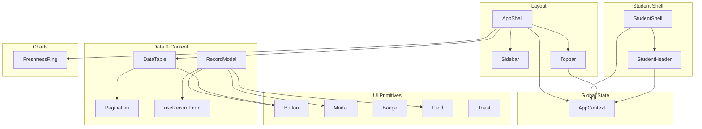
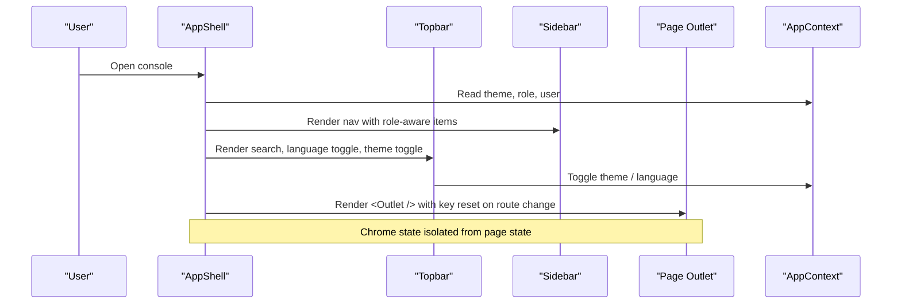
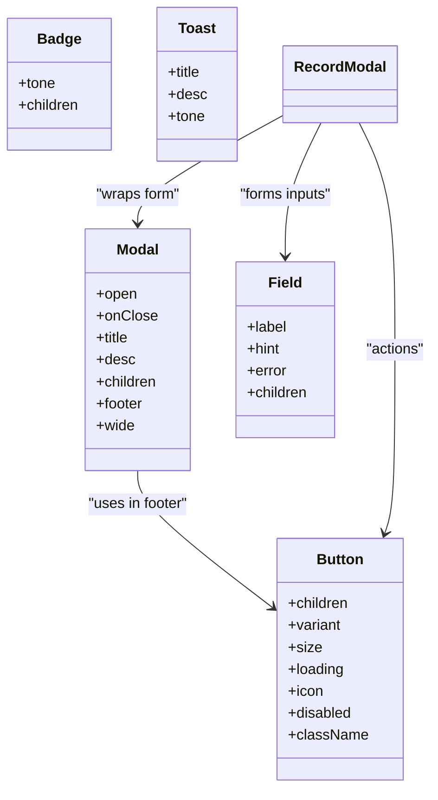
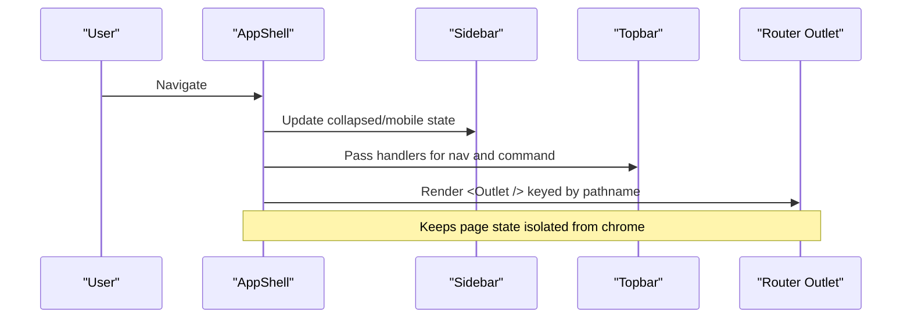
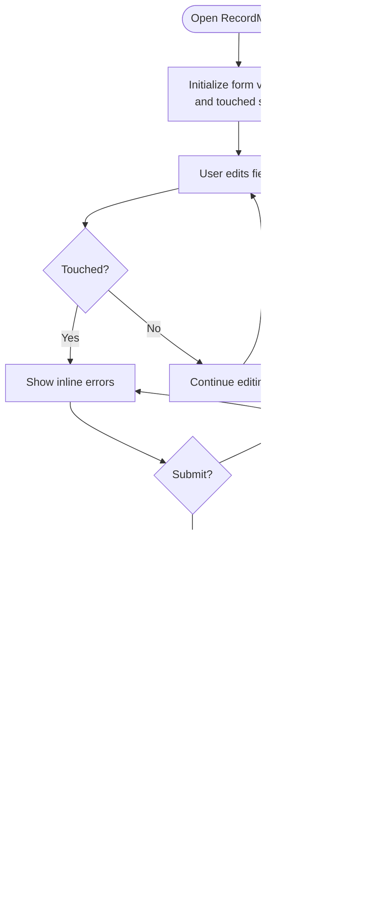
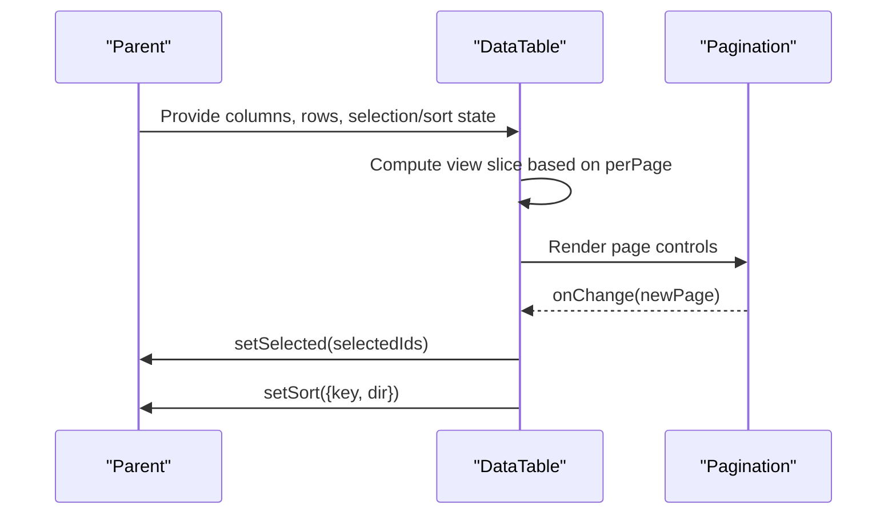
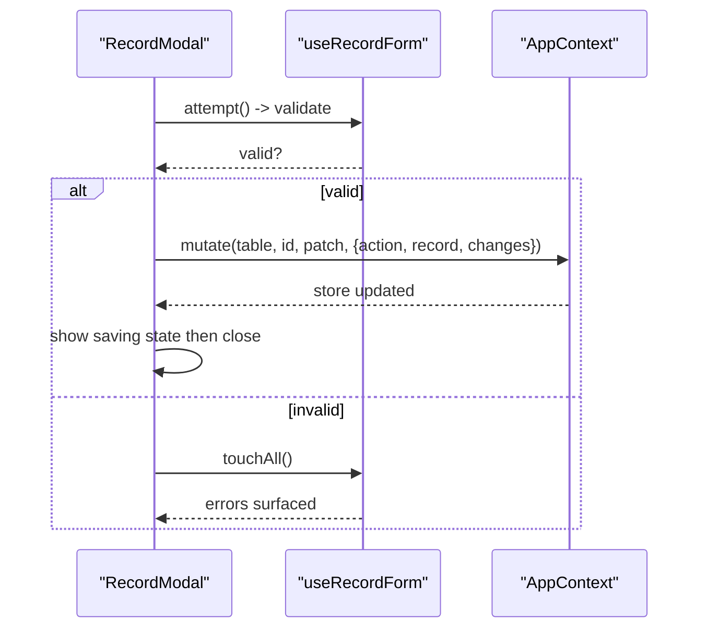
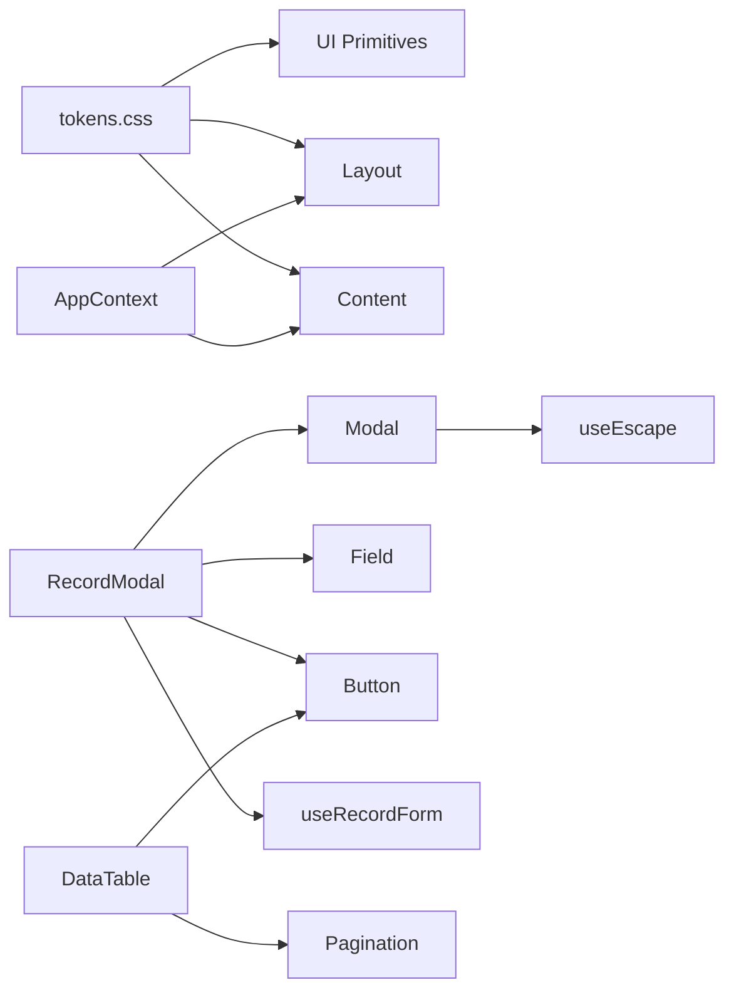

# Component System

<cite>
**Referenced Files in This Document**
- [AppShell.jsx](file://src/components/layout/AppShell.jsx)
- [Sidebar.jsx](file://src/components/layout/Sidebar.jsx)
- [Topbar.jsx](file://src/components/layout/Topbar.jsx)
- [StudentShell.jsx](file://src/components/student/StudentShell.jsx)
- [StudentHeader.jsx](file://src/components/student/StudentHeader.jsx)
- [Button.jsx](file://src/components/ui/Button.jsx)
- [Modal.jsx](file://src/components/ui/Modal.jsx)
- [Badge.jsx](file://src/components/ui/Badge.jsx)
- [Field.jsx](file://src/components/ui/Field.jsx)
- [Toast.jsx](file://src/components/ui/Toast.jsx)
- [DataTable.jsx](file://src/components/data/DataTable.jsx)
- [Pagination.jsx](file://src/components/data/Pagination.jsx)
- [RecordModal.jsx](file://src/components/content/RecordModal.jsx)
- [useRecordForm.js](file://src/components/content/useRecordForm.js)
- [FreshnessRing.jsx](file://src/components/charts/FreshnessRing.jsx)
- [AppContext.jsx](file://src/context/AppContext.jsx)
- [useEscape.js](file://src/hooks/useEscape.js)
- [tokens.css](file://src/styles/tokens.css)
</cite>

## Table of Contents
1. Introduction
2. Project Structure
3. Core Components
4. Architecture Overview
5. Detailed Component Analysis
6. Dependency Analysis
7. Performance Considerations
8. Troubleshooting Guide
9. Conclusion
10. Appendices

## Introduction
This document explains the React component system architecture used by the console and student interfaces. It covers the hierarchical structure from base UI components to layout shells, content forms, data tables, charts, and specialized student-facing components. It also documents composition patterns, prop contracts, event handling, accessibility considerations, responsive behavior, theme integration, and best practices for creating new components that follow established patterns.

## Project Structure
The component library is organized into focused directories:
- ui: Base UI primitives (Button, Modal, Badge, Field, Toast, etc.)
- layout: Application chrome (AppShell, Sidebar, Topbar) and navigation
- content: Domain-specific forms and editors (RecordModal, ChecklistEditor, useRecordForm)
- data: Data presentation (DataTable, Pagination)
- charts: Visualizations (FreshnessRing, IntentBars, VolumeChart)
- student: Student shell and header/footer
- context: Global state (AppContext)
- hooks: Reusable behaviors (useEscape, useHotkey, useDebounced, useCountUp)
- styles: Design tokens and component CSS

**Diagram sources**
- [AppShell.jsx:1-49](file://src/components/layout/AppShell.jsx#L1-L49)
- [Sidebar.jsx:1-109](file://src/components/layout/Sidebar.jsx#L1-L109)
- [Topbar.jsx:1-51](file://src/components/layout/Topbar.jsx#L1-L51)
- [StudentShell.jsx:1-25](file://src/components/student/StudentShell.jsx#L1-L25)
- [StudentHeader.jsx:1-64](file://src/components/student/StudentHeader.jsx#L1-L64)
- [Button.jsx:1-29](file://src/components/ui/Button.jsx#L1-L29)
- [Modal.jsx:1-39](file://src/components/ui/Modal.jsx#L1-L39)
- [Badge.jsx:1-12](file://src/components/ui/Badge.jsx#L1-L12)
- [Field.jsx:1-23](file://src/components/ui/Field.jsx#L1-L23)
- [Toast.jsx:1-16](file://src/components/ui/Toast.jsx#L1-L16)
- [DataTable.jsx:1-161](file://src/components/data/DataTable.jsx#L1-L161)
- [Pagination.jsx:1-49](file://src/components/data/Pagination.jsx#L1-L49)
- [RecordModal.jsx:1-316](file://src/components/content/RecordModal.jsx#L1-L316)
- [useRecordForm.js:1-123](file://src/components/content/useRecordForm.js#L1-L123)
- [FreshnessRing.jsx:1-66](file://src/components/charts/FreshnessRing.jsx#L1-L66)
- [AppContext.jsx:1-135](file://src/context/AppContext.jsx#L1-L135)

**Section sources**
- [AppShell.jsx:1-49](file://src/components/layout/AppShell.jsx#L1-L49)
- [StudentShell.jsx:1-25](file://src/components/student/StudentShell.jsx#L1-L25)
- [tokens.css:15-131](file://src/styles/tokens.css#L15-L131)

## Core Components
- Button: Provides loading state, icon support, variants, sizes, and disabled behavior. It disables itself when loading to prevent double submissions.
- Modal: Accessible dialog with keyboard Escape support, backdrop dismissal, title/description, optional footer, and wide variant.
- Badge: Small status pill using semantic tone tokens; tone maps to meaning (e.g., jade for verified).
- Field: Label + control + inline error with hint support; errors render only after a field is touched.
- Toast: Single toast with tone-based icons for success or warning states.
- DataTable: Generic table driven by column descriptors, supports sorting, selection, bulk actions, pagination, empty states, and skeleton loading.
- Pagination: Collapsible page control with first/last and windowed pages around current page.
- FreshnessRing: Donut chart showing verification coverage with animated segments and legend.

Key design principles reflected in these components:
- Accessibility: aria attributes, roles, keyboard interactions, and labels are consistently applied.
- Theme integration: All components consume CSS variables via the .uaea root element’s data-theme attribute.
- Responsive behavior: Layouts adapt to mobile via hidden/shown elements and flexible containers.
- Composition: Higher-level components compose lower-level primitives to build complex UIs.

**Section sources**
- [Button.jsx:1-29](file://src/components/ui/Button.jsx#L1-L29)
- [Modal.jsx:1-39](file://src/components/ui/Modal.jsx#L1-L39)
- [Badge.jsx:1-12](file://src/components/ui/Badge.jsx#L1-L12)
- [Field.jsx:1-23](file://src/components/ui/Field.jsx#L1-L23)
- [Toast.jsx:1-16](file://src/components/ui/Toast.jsx#L1-L16)
- [DataTable.jsx:1-161](file://src/components/data/DataTable.jsx#L1-L161)
- [Pagination.jsx:1-49](file://src/components/data/Pagination.jsx#L1-L49)
- [FreshnessRing.jsx:1-66](file://src/components/charts/FreshnessRing.jsx#L1-L66)
- [tokens.css:15-131](file://src/styles/tokens.css#L15-L131)

## Architecture Overview
The application has two primary shells:
- AppShell: Admin console frame with sidebar, topbar, command palette, and main content area. Owns chrome state (sidebar collapse, mobile drawer, command palette).
- StudentShell: Student interface frame with header and footer; hides footer on chat routes to keep composer pinned.

Both shells apply theming via data-theme on a root container and integrate global state through AppContext.

**Diagram sources**
- [AppShell.jsx:1-49](file://src/components/layout/AppShell.jsx#L1-L49)
- [Topbar.jsx:1-51](file://src/components/layout/Topbar.jsx#L1-L51)
- [Sidebar.jsx:1-109](file://src/components/layout/Sidebar.jsx#L1-L109)
- [AppContext.jsx:1-135](file://src/context/AppContext.jsx#L1-L135)

**Section sources**
- [AppShell.jsx:1-49](file://src/components/layout/AppShell.jsx#L1-L49)
- [StudentShell.jsx:1-25](file://src/components/student/StudentShell.jsx#L1-L25)
- [AppContext.jsx:1-135](file://src/context/AppContext.jsx#L1-L135)

## Detailed Component Analysis

### Base UI Components
- Button
  - Props: children, variant, size, loading, icon, disabled, className, ...rest
  - Behavior: Disables when loading; swaps content to spinner; passes rest props to native button
  - Accessibility: Inherits native button semantics; ensure accessible names via children or aria-label
  - Theming: Uses token-driven classes ua-btn, ua-spin
  - Usage example path: [Button usage in RecordModal footer:67-81](file://src/components/content/RecordModal.jsx#L67-L81)

- Modal
  - Props: open, onClose, title, desc, children, footer, wide
  - Behavior: Renders overlay; closes on backdrop mousedown and Escape key
  - Accessibility: role="dialog", aria-modal, aria-label, Escape key handler via hook
  - Hook: useEscape(active, onClose)
  - Usage example path: [RecordModal wraps form inside Modal:61-82](file://src/components/content/RecordModal.jsx#L61-L82)

- Badge
  - Props: tone, children, ...rest
  - Behavior: Applies semantic tone class; tone conveys meaning (e.g., jade = verified)
  - Theming: Uses tone tokens

- Field
  - Props: label, hint, error, children
  - Behavior: Displays label, optional hint, and inline error after touch
  - Accessibility: Associates label with child control via DOM structure; error includes icon and message

- Toast
  - Props: title, desc, tone
  - Behavior: Single toast with tone-based icon; stack managed by context elsewhere

**Diagram sources**
- [Button.jsx:1-29](file://src/components/ui/Button.jsx#L1-L29)
- [Modal.jsx:1-39](file://src/components/ui/Modal.jsx#L1-L39)
- [Badge.jsx:1-12](file://src/components/ui/Badge.jsx#L1-L12)
- [Field.jsx:1-23](file://src/components/ui/Field.jsx#L1-L23)
- [Toast.jsx:1-16](file://src/components/ui/Toast.jsx#L1-L16)
- [RecordModal.jsx:1-316](file://src/components/content/RecordModal.jsx#L1-L316)

**Section sources**
- [Button.jsx:1-29](file://src/components/ui/Button.jsx#L1-L29)
- [Modal.jsx:1-39](file://src/components/ui/Modal.jsx#L1-L39)
- [Badge.jsx:1-12](file://src/components/ui/Badge.jsx#L1-L12)
- [Field.jsx:1-23](file://src/components/ui/Field.jsx#L1-L23)
- [Toast.jsx:1-16](file://src/components/ui/Toast.jsx#L1-L16)

### Layout Components
- AppShell
  - Responsibilities: Frame chrome state (sidebar collapsed, mobile drawer, command palette), applies theme via data-theme, renders Sidebar, Topbar, and Outlet
  - Navigation: Resets scroll and local state between pages using key on pathname
  - Keyboard: Command palette toggled via hotkey

- Sidebar
  - Responsibilities: Renders navigation groups, active states, counts, role-switching popover, collapse toggle, and link to student site
  - Integration: Reads role and user from AppContext; uses RBAC to filter/label items

- Topbar
  - Responsibilities: Search trigger, language toggle (EN/اردو), theme toggle, quick links to queue and audit
  - Integration: Reads/writes theme and language from AppContext

- StudentShell
  - Responsibilities: Frames student pages with header and conditional footer; hides footer on chat routes

- StudentHeader
  - Responsibilities: Logo, navigation links, language toggle, theme toggle, staff link

**Diagram sources**
- [AppShell.jsx:1-49](file://src/components/layout/AppShell.jsx#L1-L49)
- [Sidebar.jsx:1-109](file://src/components/layout/Sidebar.jsx#L1-L109)
- [Topbar.jsx:1-51](file://src/components/layout/Topbar.jsx#L1-L51)

**Section sources**
- [AppShell.jsx:1-49](file://src/components/layout/AppShell.jsx#L1-L49)
- [Sidebar.jsx:1-109](file://src/components/layout/Sidebar.jsx#L1-L109)
- [Topbar.jsx:1-51](file://src/components/layout/Topbar.jsx#L1-L51)
- [StudentShell.jsx:1-25](file://src/components/student/StudentShell.jsx#L1-L25)
- [StudentHeader.jsx:1-64](file://src/components/student/StudentHeader.jsx#L1-L64)

### Content Components
- RecordModal
  - Purpose: Add or edit catalogue records across tabs (fees, deadlines, departments, services)
  - Composition: Wraps Form fields using Field, Button, and Modal; integrates ChecklistEditor and DiffRow
  - Validation: Powered by useRecordForm with per-tab rules and source citation requirement
  - Save flow: Validates, simulates save, calls onSave with record and changes, updates audit via AppContext

- useRecordForm
  - Responsibilities: Local form state, validation, touched tracking, change diff computation, helpers for set/setValue/blur
  - Validation highlights: Per-tab required fields, format checks, ceiling constraints, email regex, date picker enforcement
  - Change detection: Computes human-readable diffs including checklist reordering

**Diagram sources**
- [RecordModal.jsx:21-82](file://src/components/content/RecordModal.jsx#L21-L82)
- [useRecordForm.js:34-123](file://src/components/content/useRecordForm.js#L34-L123)

**Section sources**
- [RecordModal.jsx:1-316](file://src/components/content/RecordModal.jsx#L1-L316)
- [useRecordForm.js:1-123](file://src/components/content/useRecordForm.js#L1-L123)

### Data Components
- DataTable
  - Props: columns, rows, rowKey, rowActions, selectable, selected, setSelected, sort, setSort, loading, perPage, bulkBar, emptyTitle, emptyBody, emptyAction
  - Features: Sorting, selection (single/all), bulk bar, pagination, empty state, skeleton loading
  - Accessibility: Select-all and row-select buttons include aria-labels

- Pagination
  - Props: page, pages, onChange
  - Features: First/last, ellipsis window, aria-current for active page

**Diagram sources**
- [DataTable.jsx:18-161](file://src/components/data/DataTable.jsx#L18-L161)
- [Pagination.jsx:7-49](file://src/components/data/Pagination.jsx#L7-L49)

**Section sources**
- [DataTable.jsx:1-161](file://src/components/data/DataTable.jsx#L1-L161)
- [Pagination.jsx:1-49](file://src/components/data/Pagination.jsx#L1-L49)

### Charts
- FreshnessRing
  - Props: buckets (array of {n, tone, label})
  - Behavior: Renders SVG donut with animated stroke-dasharray segments and a legend; center text shows verified percentage
  - Theming: Uses CSS variables for colors and transitions

**Section sources**
- [FreshnessRing.jsx:1-66](file://src/components/charts/FreshnessRing.jsx#L1-L66)

### Hooks and Context
- useEscape
  - Purpose: Adds/removes window keydown listener to close overlays when Escape is pressed
  - Used by: Modal, Drawer, CommandPalette

- AppContext
  - Provides: theme, role, urdu, store (services, fees, deadlines, departments, documents, flows, adapters), mutate, verifyRecord, audit, logAudit, user
  - API seam: mutate(table, id, patch, meta) designed to be rewritten for server calls in Phase 2
  - Audit trail: logAudit appends entries with actor, role, timestamp, action, table, recordId, record, changes

**Diagram sources**
- [RecordModal.jsx:21-82](file://src/components/content/RecordModal.jsx#L21-L82)
- [useRecordForm.js:34-123](file://src/components/content/useRecordForm.js#L34-L123)
- [AppContext.jsx:79-116](file://src/context/AppContext.jsx#L79-L116)

**Section sources**
- [useEscape.js:1-14](file://src/hooks/useEscape.js#L1-L14)
- [AppContext.jsx:1-135](file://src/context/AppContext.jsx#L1-L135)

## Dependency Analysis
- Theme propagation: Root containers (.uaea) set data-theme; all components rely on CSS variables defined in tokens.css
- Global state: AppContext supplies theme, language, role, data store, and mutation functions consumed by layout and content components
- Accessibility: Modal uses useEscape; DataTable and Pagination expose appropriate aria attributes
- Composition: RecordModal composes Modal, Button, Field, and useRecordForm; DataTable composes Pagination and UI primitives

**Diagram sources**
- [tokens.css:15-131](file://src/styles/tokens.css#L15-L131)
- [AppContext.jsx:1-135](file://src/context/AppContext.jsx#L1-L135)
- [Modal.jsx:1-39](file://src/components/ui/Modal.jsx#L1-L39)
- [useEscape.js:1-14](file://src/hooks/useEscape.js#L1-L14)
- [RecordModal.jsx:1-316](file://src/components/content/RecordModal.jsx#L1-L316)
- [DataTable.jsx:1-161](file://src/components/data/DataTable.jsx#L1-L161)
- [Pagination.jsx:1-49](file://src/components/data/Pagination.jsx#L1-L49)

**Section sources**
- [tokens.css:15-131](file://src/styles/tokens.css#L15-L131)
- [AppContext.jsx:1-135](file://src/context/AppContext.jsx#L1-L135)
- [Modal.jsx:1-39](file://src/components/ui/Modal.jsx#L1-L39)
- [useEscape.js:1-14](file://src/hooks/useEscape.js#L1-L14)
- [RecordModal.jsx:1-316](file://src/components/content/RecordModal.jsx#L1-L316)
- [DataTable.jsx:1-161](file://src/components/data/DataTable.jsx#L1-L161)
- [Pagination.jsx:1-49](file://src/components/data/Pagination.jsx#L1-L49)

## Performance Considerations
- Avoid unnecessary re-renders:
  - Keep chrome state in shells; pass minimal props to pages
  - Use memoization in hooks where appropriate (useRecordForm already uses useMemo for errors and changes)
- Efficient list rendering:
  - DataTable slices rows per page; ensure stable keys via rowKey
- Animations:
  - Charts use CSS transitions; prefer lightweight transforms and opacity for smooth performance
- Network-bound operations:
  - AppContext’s mutate is designed to be replaced with server calls; batch mutations and debounce input-heavy flows

[No sources needed since this section provides general guidance]

## Troubleshooting Guide
- Modal does not close on Escape:
  - Ensure open prop is true and useEscape is called with correct active flag
  - Verify no custom event listeners prevent default behavior
- Form validation not surfacing:
  - Confirm blur handlers mark fields as touched; call touchAll before submit
- DataTable selection/bulk actions not updating:
  - Ensure setSelected is provided and used consistently; check rowKey matches unique identifier
- Theme not applying:
  - Verify root container has data-theme and tokens.css is loaded
- Toast not visible:
  - Ensure ToastContext provider is mounted and toast is enqueued

**Section sources**
- [Modal.jsx:1-39](file://src/components/ui/Modal.jsx#L1-L39)
- [useEscape.js:1-14](file://src/hooks/useEscape.js#L1-L14)
- [useRecordForm.js:34-123](file://src/components/content/useRecordForm.js#L34-L123)
- [DataTable.jsx:18-161](file://src/components/data/DataTable.jsx#L18-L161)
- [tokens.css:15-131](file://src/styles/tokens.css#L15-L131)

## Conclusion
The component system follows a clear hierarchy: base UI primitives compose into layout shells and domain-specific content. Accessibility, theme integration, and responsive behavior are baked into the foundation. AppContext centralizes state and provides an API seam for future server integration. Following the documented patterns ensures consistency, maintainability, and scalability as new features are added.

[No sources needed since this section summarizes without analyzing specific files]

## Appendices

### Prop Interfaces Summary
- Button: children, variant, size, loading, icon, disabled, className, ...rest
- Modal: open, onClose, title, desc, children, footer, wide
- Badge: tone, children, ...rest
- Field: label, hint, error, children
- DataTable: columns, rows, rowKey, rowActions, selectable, selected, setSelected, sort, setSort, loading, perPage, bulkBar, emptyTitle, emptyBody, emptyAction
- Pagination: page, pages, onChange
- FreshnessRing: buckets (array of {n, tone, label})
- RecordModal: open, record, tab, onClose, onSave

**Section sources**
- [Button.jsx:1-29](file://src/components/ui/Button.jsx#L1-L29)
- [Modal.jsx:1-39](file://src/components/ui/Modal.jsx#L1-L39)
- [Badge.jsx:1-12](file://src/components/ui/Badge.jsx#L1-L12)
- [Field.jsx:1-23](file://src/components/ui/Field.jsx#L1-L23)
- [DataTable.jsx:18-34](file://src/components/data/DataTable.jsx#L18-L34)
- [Pagination.jsx:7-8](file://src/components/data/Pagination.jsx#L7-L8)
- [FreshnessRing.jsx:6-7](file://src/components/charts/FreshnessRing.jsx#L6-L7)
- [RecordModal.jsx:21-24](file://src/components/content/RecordModal.jsx#L21-L24)

### Best Practices for New Components
- Compose from primitives: Prefer building on Button, Field, Modal rather than reinventing
- Accessibility first: Include roles, labels, keyboard support, and focus management
- Theme compliance: Use CSS variables via tokens; avoid hard-coded colors
- Responsiveness: Support mobile layouts with flexible containers and conditional visibility
- State management: Keep local state within components; lift only what is necessary to parents or context
- Validation: Centralize validation logic in hooks; surface errors only after touch
- Event handling: Use explicit handlers; avoid mutating external state directly outside context

[No sources needed since this section provides general guidance]