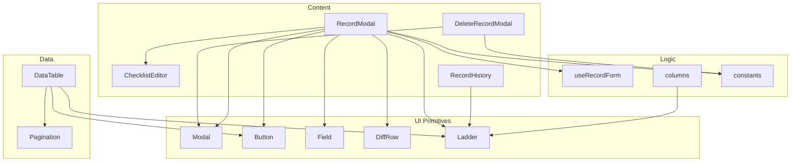
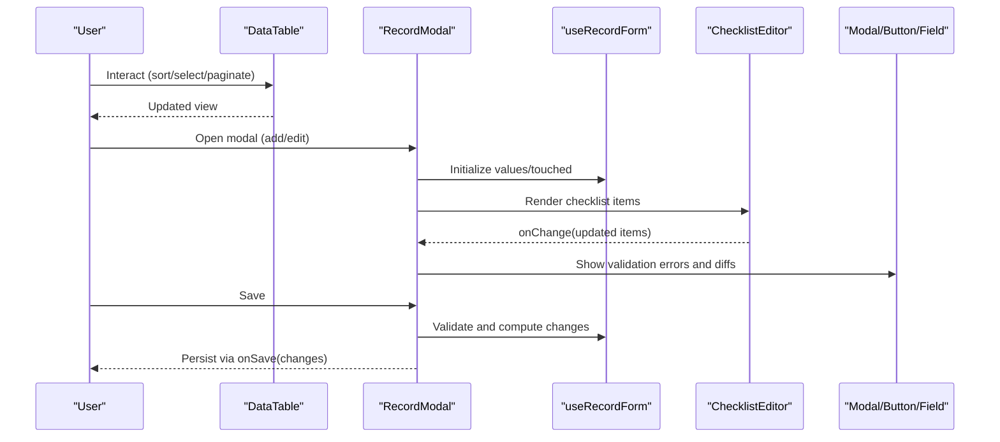
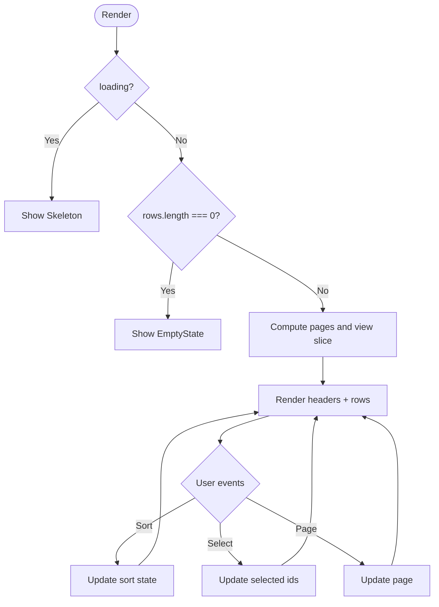
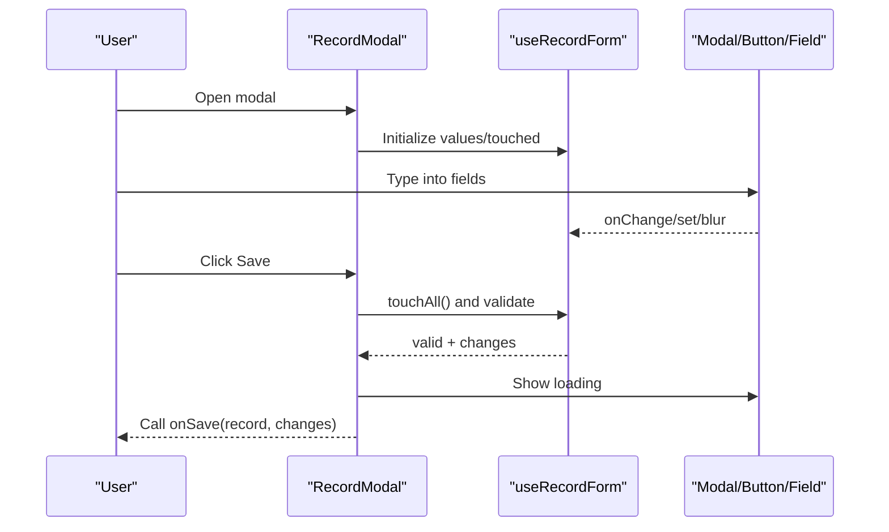
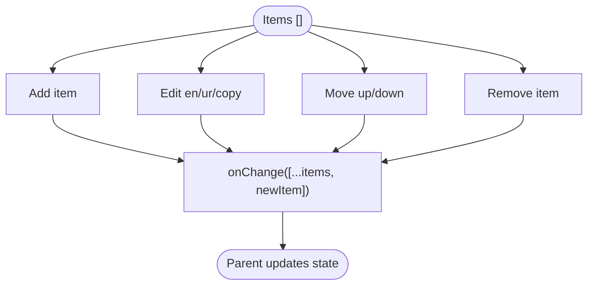
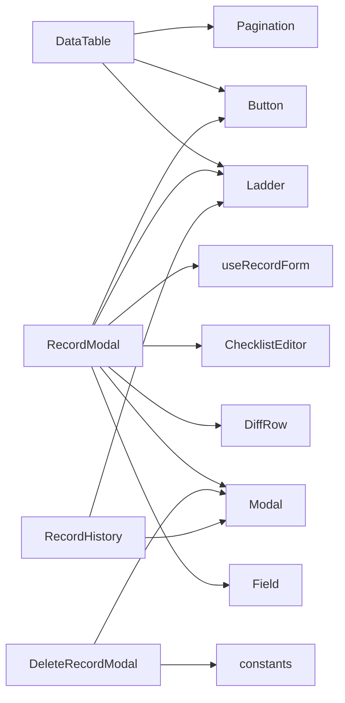

# Content Components

<cite>
**Referenced Files in This Document**
- [DataTable.jsx](file://src/components/data/DataTable.jsx)
- [Pagination.jsx](file://src/components/data/Pagination.jsx)
- [RecordModal.jsx](file://src/components/content/RecordModal.jsx)
- [ChecklistEditor.jsx](file://src/components/content/ChecklistEditor.jsx)
- [DeleteRecordModal.jsx](file://src/components/content/DeleteRecordModal.jsx)
- [RecordHistory.jsx](file://src/components/content/RecordHistory.jsx)
- [useRecordForm.js](file://src/components/content/useRecordForm.js)
- [columns.jsx](file://src/components/content/columns.jsx)
- [Modal.jsx](file://src/components/ui/Modal.jsx)
- [Button.jsx](file://src/components/ui/Button.jsx)
- [Field.jsx](file://src/components/ui/Field.jsx)
- [DiffRow.jsx](file://src/components/ui/DiffRow.jsx)
- [Ladder.jsx](file://src/components/ui/Ladder.jsx)
- [constants.js](file://src/lib/constants.js)
</cite>

## Table of Contents
1. [Introduction](#introduction)
2. [Project Structure](#project-structure)
3. [Core Components](#core-components)
4. [Architecture Overview](#architecture-overview)
5. [Detailed Component Analysis](#detailed-component-analysis)
6. [Dependency Analysis](#dependency-analysis)
7. [Performance Considerations](#performance-considerations)
8. [Troubleshooting Guide](#troubleshooting-guide)
9. [Conclusion](#conclusion)

## Introduction
This document explains the content-focused components that power data display and manipulation across the console. It covers:
- DataTable for tabular presentation with sorting, selection, pagination, and bulk actions
- RecordModal for creating and editing records with validation, change previews, and audit context
- ChecklistEditor for structured multi-field list input (e.g., service document checklists)
- DeleteRecordModal for safe deletion with impact messaging
- RecordHistory for per-record audit trails via a side drawer

It also documents data binding patterns, event handling, state management, accessibility, keyboard navigation, responsive behavior, and performance strategies for large datasets.

## Project Structure
The content layer is organized into:
- Data presentation: DataTable and Pagination
- Content editors and dialogs: RecordModal, ChecklistEditor, DeleteRecordModal, RecordHistory
- Shared UI primitives: Modal, Button, Field, DiffRow, Ladder
- Column definitions and form logic: columns.jsx, useRecordForm.js
- Constants and formatting utilities used by components

**Diagram sources**
- [DataTable.jsx:1-161](file://src/components/data/DataTable.jsx#L1-L161)
- [Pagination.jsx:1-49](file://src/components/data/Pagination.jsx#L1-L49)
- [RecordModal.jsx:1-316](file://src/components/content/RecordModal.jsx#L1-L316)
- [ChecklistEditor.jsx:1-114](file://src/components/content/ChecklistEditor.jsx#L1-L114)
- [DeleteRecordModal.jsx:1-49](file://src/components/content/DeleteRecordModal.jsx#L1-L49)
- [RecordHistory.jsx:1-58](file://src/components/content/RecordHistory.jsx#L1-L58)
- [Modal.jsx:1-39](file://src/components/ui/Modal.jsx#L1-L39)
- [Button.jsx:1-29](file://src/components/ui/Button.jsx#L1-L29)
- [Field.jsx:1-23](file://src/components/ui/Field.jsx#L1-L23)
- [DiffRow.jsx:1-15](file://src/components/ui/DiffRow.jsx#L1-L15)
- [Ladder.jsx:1-32](file://src/components/ui/Ladder.jsx#L1-L32)
- [useRecordForm.js:1-123](file://src/components/content/useRecordForm.js#L1-L123)
- [columns.jsx:1-171](file://src/components/content/columns.jsx#L1-L171)
- [constants.js:1-35](file://src/lib/constants.js#L1-L35)

**Section sources**
- [DataTable.jsx:1-161](file://src/components/data/DataTable.jsx#L1-L161)
- [RecordModal.jsx:1-316](file://src/components/content/RecordModal.jsx#L1-L316)
- [ChecklistEditor.jsx:1-114](file://src/components/content/ChecklistEditor.jsx#L1-L114)
- [DeleteRecordModal.jsx:1-49](file://src/components/content/DeleteRecordModal.jsx#L1-L49)
- [RecordHistory.jsx:1-58](file://src/components/content/RecordHistory.jsx#L1-L58)
- [useRecordForm.js:1-123](file://src/components/content/useRecordForm.js#L1-L123)
- [columns.jsx:1-171](file://src/components/content/columns.jsx#L1-L171)
- [Modal.jsx:1-39](file://src/components/ui/Modal.jsx#L1-L39)
- [Button.jsx:1-29](file://src/components/ui/Button.jsx#L1-L29)
- [Field.jsx:1-23](file://src/components/ui/Field.jsx#L1-L23)
- [DiffRow.jsx:1-15](file://src/components/ui/DiffRow.jsx#L1-L15)
- [Ladder.jsx:1-32](file://src/components/ui/Ladder.jsx#L1-L32)
- [constants.js:1-35](file://src/lib/constants.js#L1-L35)

## Core Components
- DataTable: A generic, column-driven table with optional selection, sorting, pagination, empty states, loading skeletons, and a bulk action bar.
- RecordModal: A modal form for adding/editing records across multiple tabs (services, fees, deadlines, departments), with validation, change preview, and audit context.
- ChecklistEditor: A structured editor for ordered lists with bilingual fields and an original/copy flag, supporting add/remove/reorder.
- DeleteRecordModal: A confirmation dialog that communicates real-world impact to users before deletion.
- RecordHistory: A side drawer showing per-record changes from the shared audit trail.

Key responsibilities:
- Data binding: Controlled inputs driven by form state; parent components own data and callbacks.
- Event handling: Local handlers for sort, selection, pagination, and CRUD operations; parent handles persistence.
- State management: Lightweight React state and hooks; reusable form hook centralizes validation and change tracking.

**Section sources**
- [DataTable.jsx:18-160](file://src/components/data/DataTable.jsx#L18-L160)
- [RecordModal.jsx:21-316](file://src/components/content/RecordModal.jsx#L21-L316)
- [ChecklistEditor.jsx:11-114](file://src/components/content/ChecklistEditor.jsx#L11-L114)
- [DeleteRecordModal.jsx:16-49](file://src/components/content/DeleteRecordModal.jsx#L16-L49)
- [RecordHistory.jsx:13-58](file://src/components/content/RecordHistory.jsx#L13-L58)
- [useRecordForm.js:34-123](file://src/components/content/useRecordForm.js#L34-L123)

## Architecture Overview
The system composes small, focused components:
- DataTable renders rows based on column descriptors and manages local page/sort/selection state while delegating data ownership to the caller.
- RecordModal orchestrates form state via useRecordForm, renders tab-specific fields, and shows a diff of changes before saving.
- ChecklistEditor updates a list of items through an onChange callback, enabling reordering and removal.
- DeleteRecordModal and RecordHistory provide safety and transparency around destructive or historical actions.

**Diagram sources**
- [DataTable.jsx:18-160](file://src/components/data/DataTable.jsx#L18-L160)
- [RecordModal.jsx:21-316](file://src/components/content/RecordModal.jsx#L21-L316)
- [useRecordForm.js:34-123](file://src/components/content/useRecordForm.js#L34-L123)
- [ChecklistEditor.jsx:11-114](file://src/components/content/ChecklistEditor.jsx#L11-L114)
- [Modal.jsx:1-39](file://src/components/ui/Modal.jsx#L1-L39)
- [Button.jsx:1-29](file://src/components/ui/Button.jsx#L1-L29)
- [Field.jsx:1-23](file://src/components/ui/Field.jsx#L1-L23)

## Detailed Component Analysis

### DataTable
Responsibilities:
- Renders a table driven by a columns array with label, key, sortable flag, width, and render function.
- Manages local pagination, selection, and sorting state; resets page when data or sort changes.
- Provides selectable rows, bulk selection, and a bulk action bar placeholder.
- Shows loading skeleton and empty state when appropriate.

Key behaviors:
- Sorting: Click header toggles direction; controlled via setSort.
- Selection: Toggle all on current page or individual rows; controlled via setSelected.
- Pagination: Slices rows by perPage and uses Pagination component for navigation.
- Accessibility: Buttons have aria-labels for select-all and row selection; keyboard focusable controls.

Performance notes:
- Client-side slicing for pagination; suitable for moderate datasets. For very large datasets, consider server-side pagination and virtualization.

**Diagram sources**
- [DataTable.jsx:18-160](file://src/components/data/DataTable.jsx#L18-L160)
- [Pagination.jsx:1-49](file://src/components/data/Pagination.jsx#L1-L49)

**Section sources**
- [DataTable.jsx:18-160](file://src/components/data/DataTable.jsx#L18-L160)
- [Pagination.jsx:1-49](file://src/components/data/Pagination.jsx#L1-L49)

### RecordModal
Responsibilities:
- Presents a modal form for adding or editing records across different tabs.
- Uses useRecordForm for controlled inputs, validation, and change detection.
- Displays a human-readable diff of changes and contextual notes about impact and audit logging.

Validation and UX:
- Validation runs on every keystroke but only surfaces errors after a field is touched.
- Save button disabled until valid; shows loading state during save.
- Tab-specific forms include bilingual fields, categories, dates, amounts, and procedures.

Accessibility:
- Modal provides role="dialog", aria-modal, and aria-label; Escape closes via hook.

**Diagram sources**
- [RecordModal.jsx:21-316](file://src/components/content/RecordModal.jsx#L21-L316)
- [useRecordForm.js:34-123](file://src/components/content/useRecordForm.js#L34-L123)
- [Modal.jsx:1-39](file://src/components/ui/Modal.jsx#L1-L39)
- [Button.jsx:1-29](file://src/components/ui/Button.jsx#L1-L29)
- [Field.jsx:1-23](file://src/components/ui/Field.jsx#L1-L23)

**Section sources**
- [RecordModal.jsx:21-316](file://src/components/content/RecordModal.jsx#L21-L316)
- [useRecordForm.js:34-123](file://src/components/content/useRecordForm.js#L34-L123)
- [Modal.jsx:1-39](file://src/components/ui/Modal.jsx#L1-L39)

### ChecklistEditor
Responsibilities:
- Manages an ordered list of document checklist items with bilingual text and an original/copy flag.
- Supports add, remove, move up/down, and inline edits.

State pattern:
- Parent owns the items array; editor calls onChange with updated arrays.
- Reordering swaps elements in place; removal filters by id; addition pushes new item with generated id.

Accessibility:
- Move and remove buttons have aria-labels; visually disabled at boundaries.

**Diagram sources**
- [ChecklistEditor.jsx:11-114](file://src/components/content/ChecklistEditor.jsx#L11-L114)

**Section sources**
- [ChecklistEditor.jsx:11-114](file://src/components/content/ChecklistEditor.jsx#L11-L114)

### DeleteRecordModal
Responsibilities:
- Confirms deletion with clear, user-centric messaging about consequences.
- Displays last verification details and estimated impact using constants.

Accessibility:
- Modal with role="dialog" and aria-modal; accessible footer actions.

**Section sources**
- [DeleteRecordModal.jsx:16-49](file://src/components/content/DeleteRecordModal.jsx#L16-L49)
- [constants.js:18-24](file://src/lib/constants.js#L18-L24)

### RecordHistory
Responsibilities:
- Shows per-record audit entries filtered by recordId.
- Displays last verified info and a freshness ladder.
- Uses a Drawer-like container and EmptyState when no history exists.

Accessibility:
- Drawer title and description are provided; entries rendered via AuditRow (external).

**Section sources**
- [RecordHistory.jsx:13-58](file://src/components/content/RecordHistory.jsx#L13-L58)
- [Ladder.jsx:10-32](file://src/components/ui/Ladder.jsx#L10-L32)

### Columns and Formatting
- columns.jsx defines reusable column descriptors for services, fees, deadlines, and departments, including rendering functions and sort flags.
- nameOf helper returns a human-friendly name for any record type.

**Section sources**
- [columns.jsx:1-171](file://src/components/content/columns.jsx#L1-L171)

## Dependency Analysis
High-level dependencies among content components:

**Diagram sources**
- [DataTable.jsx:1-161](file://src/components/data/DataTable.jsx#L1-L161)
- [Pagination.jsx:1-49](file://src/components/data/Pagination.jsx#L1-L49)
- [RecordModal.jsx:1-316](file://src/components/content/RecordModal.jsx#L1-L316)
- [ChecklistEditor.jsx:1-114](file://src/components/content/ChecklistEditor.jsx#L1-L114)
- [DeleteRecordModal.jsx:1-49](file://src/components/content/DeleteRecordModal.jsx#L1-L49)
- [RecordHistory.jsx:1-58](file://src/components/content/RecordHistory.jsx#L1-L58)
- [Modal.jsx:1-39](file://src/components/ui/Modal.jsx#L1-L39)
- [Button.jsx:1-29](file://src/components/ui/Button.jsx#L1-L29)
- [Field.jsx:1-23](file://src/components/ui/Field.jsx#L1-L23)
- [DiffRow.jsx:1-15](file://src/components/ui/DiffRow.jsx#L1-L15)
- [Ladder.jsx:1-32](file://src/components/ui/Ladder.jsx#L1-L32)
- [constants.js:1-35](file://src/lib/constants.js#L1-L35)

**Section sources**
- [DataTable.jsx:1-161](file://src/components/data/DataTable.jsx#L1-L161)
- [RecordModal.jsx:1-316](file://src/components/content/RecordModal.jsx#L1-L316)
- [ChecklistEditor.jsx:1-114](file://src/components/content/ChecklistEditor.jsx#L1-L114)
- [DeleteRecordModal.jsx:1-49](file://src/components/content/DeleteRecordModal.jsx#L1-L49)
- [RecordHistory.jsx:1-58](file://src/components/content/RecordHistory.jsx#L1-L58)
- [Modal.jsx:1-39](file://src/components/ui/Modal.jsx#L1-L39)
- [Button.jsx:1-29](file://src/components/ui/Button.jsx#L1-L29)
- [Field.jsx:1-23](file://src/components/ui/Field.jsx#L1-L23)
- [DiffRow.jsx:1-15](file://src/components/ui/DiffRow.jsx#L1-L15)
- [Ladder.jsx:1-32](file://src/components/ui/Ladder.jsx#L1-L32)
- [constants.js:1-35](file://src/lib/constants.js#L1-L35)

## Performance Considerations
- Pagination: DataTable slices rows client-side; ensure perPage balances usability and performance. For thousands of rows, prefer server-side pagination.
- Rendering: Use memoized computations where possible (e.g., useRecordForm’s useMemo for errors and changes). Avoid unnecessary re-renders by keeping stable column definitions and callbacks.
- Virtualization: If tables grow beyond a few hundred rows, consider windowed/virtualized rendering to limit DOM nodes.
- Debouncing: For search/filter inputs, debounce API calls and state updates to reduce churn.
- List keys: Ensure stable row keys (e.g., id) to optimize reconciliation.
- Heavy computations: Offload expensive formatting or transformations to lightweight helpers and cache results.

[No sources needed since this section provides general guidance]

## Troubleshooting Guide
Common issues and resolutions:
- Form not submitting:
  - Ensure useRecordForm has been opened (open=true) so values initialize; verify valid state before calling save.
  - Check that touched state reflects user interactions; errors only show after blur.
- Checklist not updating:
  - Confirm parent passes items and onChange; editor emits full updated array on each mutation.
- Sort or selection not persisting:
  - DataTable expects controlled props (sort, setSort, selected, setSelected); ensure parent state is lifted correctly.
- Modal not closing:
  - Modal listens for Escape via hook; ensure onClose is passed and backdrop click is allowed.
- Empty states vs loading:
  - DataTable shows Skeleton when loading; EmptyState when rows are empty. Verify loading prop transitions.

**Section sources**
- [useRecordForm.js:34-123](file://src/components/content/useRecordForm.js#L34-L123)
- [ChecklistEditor.jsx:11-114](file://src/components/content/ChecklistEditor.jsx#L11-L114)
- [DataTable.jsx:18-160](file://src/components/data/DataTable.jsx#L18-L160)
- [Modal.jsx:1-39](file://src/components/ui/Modal.jsx#L1-L39)

## Conclusion
These content components provide a cohesive, accessible, and performant foundation for displaying and manipulating complex data in the console. By composing small, focused pieces—generic tables, robust forms, structured editors, and clear confirmations—the system supports scalable data workflows with strong user feedback and auditability. Adopt the recommended patterns for state lifting, controlled inputs, and validation to maintain consistency and reliability across features.

[No sources needed since this section summarizes without analyzing specific files]