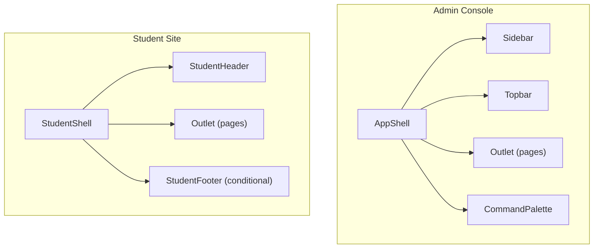
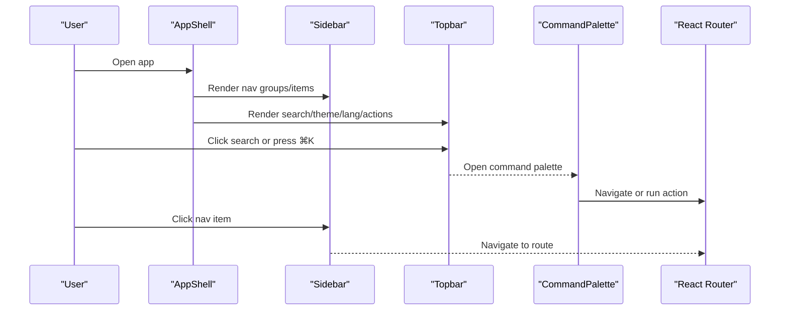
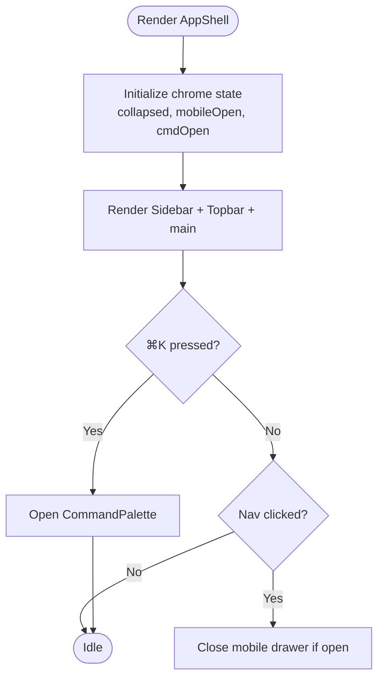
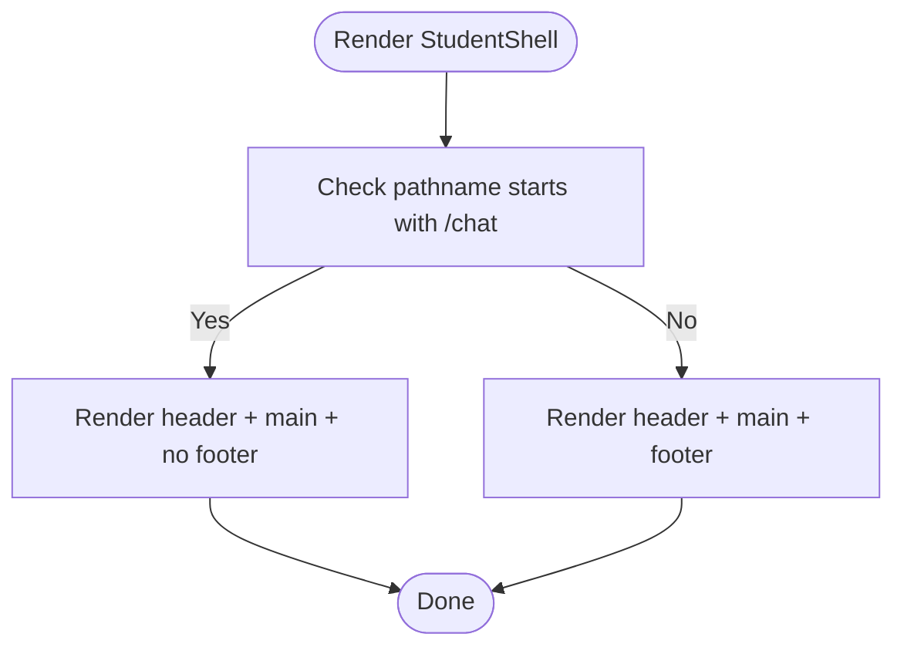
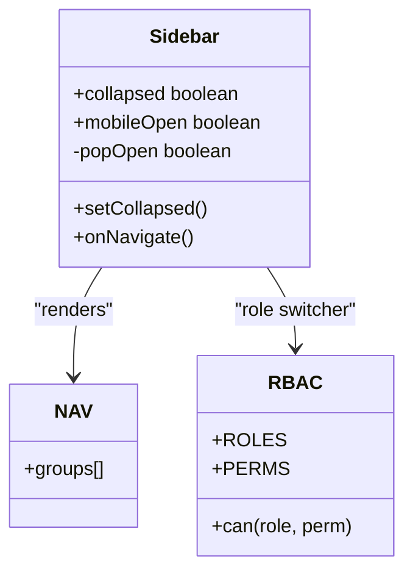
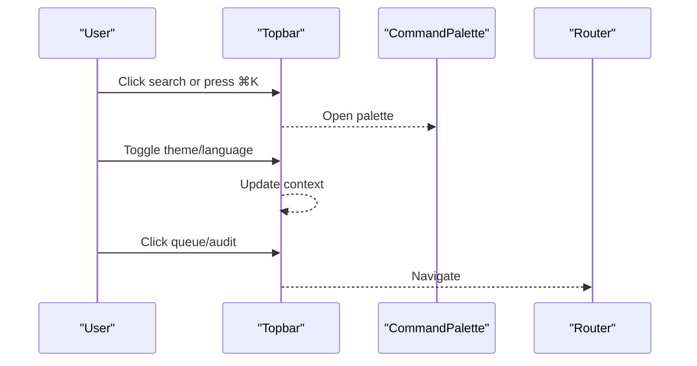
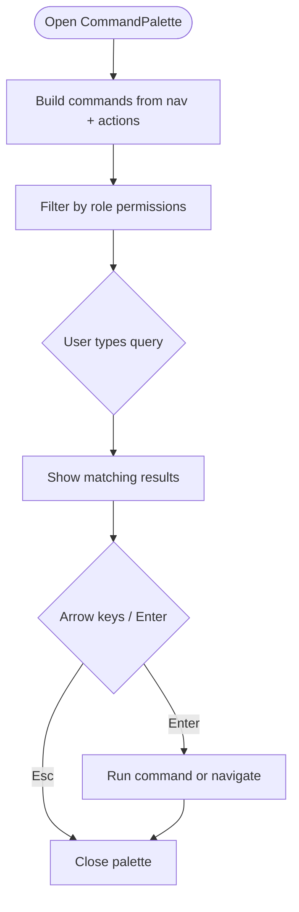
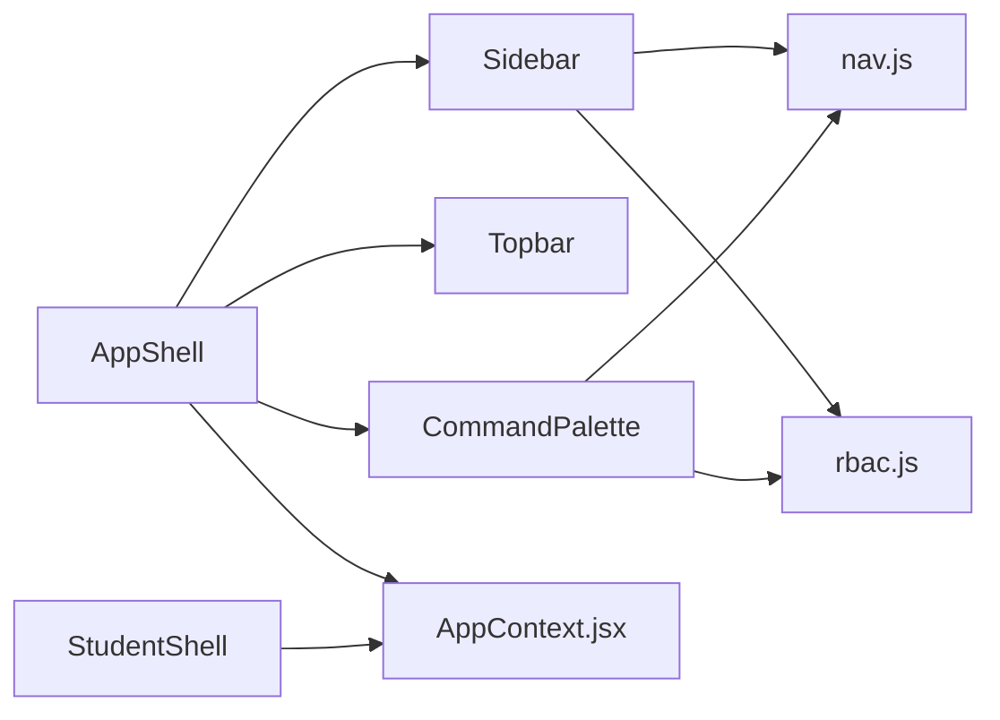

# Layout Components

<cite>
**Referenced Files in This Document**
- [AppShell.jsx](file://src/components/layout/AppShell.jsx)
- [StudentShell.jsx](file://src/components/student/StudentShell.jsx)
- [Sidebar.jsx](file://src/components/layout/Sidebar.jsx)
- [Topbar.jsx](file://src/components/layout/Topbar.jsx)
- [CommandPalette.jsx](file://src/components/layout/CommandPalette.jsx)
- [nav.js](file://src/components/layout/nav.js)
- [AppContext.jsx](file://src/context/AppContext.jsx)
- [rbac.js](file://src/lib/rbac.js)
- [layout.css](file://src/styles/layout.css)
- [student.css](file://src/styles/student.css)
</cite>

## Table of Contents
1. [Introduction](#introduction)
2. [Project Structure](#project-structure)
3. [Core Components](#core-components)
4. [Architecture Overview](#architecture-overview)
5. [Detailed Component Analysis](#detailed-component-analysis)
6. [Dependency Analysis](#dependency-analysis)
7. [Performance Considerations](#performance-considerations)
8. [Troubleshooting Guide](#troubleshooting-guide)
9. [Conclusion](#conclusion)
10. [Appendices](#appendices)

## Introduction
This document explains the layout and shell components that provide the application structure for both staff (admin console) and students. It focuses on:
- AppShell as the main container for the admin console, organizing sidebar navigation, topbar actions, and page content.
- StudentShell as the main container for student-facing pages, with a header, content area, and conditional footer.
- Sidebar for navigation management, role-based visibility, and user controls.
- Topbar for global actions like search, language toggle, theme switch, and quick links.
- CommandPalette for keyboard-driven quick actions and navigation filtered by permissions.

It also covers responsive behavior, accessibility considerations, and customization options to adapt layouts across screen sizes and use cases.

## Project Structure
The layout is split into two shells:
- Admin Console Shell: AppShell wraps Sidebar, Topbar, and an Outlet for pages. It manages chrome state (sidebar collapse, mobile drawer, command palette).
- Student Shell: StudentShell wraps StudentHeader, StudentFooter, and an Outlet for student pages. It hides the footer on chat routes to keep the composer pinned.

**Diagram sources**
- [AppShell.jsx:14-46](file://src/components/layout/AppShell.jsx#L14-L46)
- [StudentShell.jsx:8-23](file://src/components/student/StudentShell.jsx#L8-L23)
- [Sidebar.jsx:9-108](file://src/components/layout/Sidebar.jsx#L9-L108)
- [Topbar.jsx:5-49](file://src/components/layout/Topbar.jsx#L5-L49)
- [CommandPalette.jsx:11-121](file://src/components/layout/CommandPalette.jsx#L11-L121)

**Section sources**
- [AppShell.jsx:14-46](file://src/components/layout/AppShell.jsx#L14-L46)
- [StudentShell.jsx:8-23](file://src/components/student/StudentShell.jsx#L8-L23)

## Core Components
- AppShell: Provides the chrome frame for admin pages, owns sidebar/mobile drawer/command palette state, and renders pages via Outlet. Uses hotkeys to open the command palette and applies theme context.
- StudentShell: Provides the chrome frame for student pages, conditionally hides the footer on chat routes to keep the composer visible.
- Sidebar: Renders grouped navigation from nav.js, supports collapsed mode, mobile drawer, role switcher popover, and a link to the student site.
- Topbar: Offers mobile menu trigger, command palette trigger, language toggle, theme toggle, and quick links to queue and audit.
- CommandPalette: Opens with ⌘K, filters commands by role permissions, supports keyboard navigation, and executes actions or navigations.

**Section sources**
- [AppShell.jsx:14-46](file://src/components/layout/AppShell.jsx#L14-L46)
- [StudentShell.jsx:8-23](file://src/components/student/StudentShell.jsx#L8-L23)
- [Sidebar.jsx:9-108](file://src/components/layout/Sidebar.jsx#L9-L108)
- [Topbar.jsx:5-49](file://src/components/layout/Topbar.jsx#L5-L49)
- [CommandPalette.jsx:11-121](file://src/components/layout/CommandPalette.jsx#L11-L121)

## Architecture Overview
The shells compose reusable layout primitives to create consistent experiences:
- AppShell composes Sidebar, Topbar, and CommandPalette around page content.
- StudentShell composes StudentHeader and StudentFooter around page content.
- Both shells consume AppContext for theme, language, role, and user data.
- Navigation and permissions are centralized in nav.js and rbac.js, driving Sidebar items and CommandPalette actions.

**Diagram sources**
- [AppShell.jsx:14-46](file://src/components/layout/AppShell.jsx#L14-L46)
- [Topbar.jsx:5-49](file://src/components/layout/Topbar.jsx#L5-L49)
- [CommandPalette.jsx:11-121](file://src/components/layout/CommandPalette.jsx#L11-L121)
- [Sidebar.jsx:9-108](file://src/components/layout/Sidebar.jsx#L9-L108)

## Detailed Component Analysis

### AppShell
- Responsibilities:
  - Owns chrome state: sidebar collapsed/open, mobile drawer open/close, command palette open/close.
  - Applies theme via context and renders a root wrapper with ambient glow.
  - Renders Sidebar, Topbar, and a scrollable main area with Outlet keyed by pathname to reset per-page state.
  - Listens for hotkey to open CommandPalette.
- Integration points:
  - Context: theme, role, user via AppContext.
  - Routing: uses React Router’s Outlet and location.
  - Hotkeys: opens command palette.
- Responsive behavior:
  - On small screens, Sidebar becomes a slide-out drawer with a backdrop; Topbar exposes a mobile menu button.
- Accessibility:
  - Uses semantic elements (header, aside, main) and aria-labels where appropriate.
  - Keyboard shortcut support improves efficiency.

**Diagram sources**
- [AppShell.jsx:14-46](file://src/components/layout/AppShell.jsx#L14-L46)

**Section sources**
- [AppShell.jsx:14-46](file://src/components/layout/AppShell.jsx#L14-L46)

### StudentShell
- Responsibilities:
  - Wraps student pages with a header and optional footer.
  - Detects chat routes to hide the footer so the composer remains pinned at the bottom.
- Integration points:
  - Context: theme via AppContext.
  - Routing: uses location to determine route prefix for chat.
- Responsive behavior:
  - Footer is hidden on chat routes to optimize composition space.
- Accessibility:
  - Semantic structure with header/main/footer.

**Diagram sources**
- [StudentShell.jsx:8-23](file://src/components/student/StudentShell.jsx#L8-L23)

**Section sources**
- [StudentShell.jsx:8-23](file://src/components/student/StudentShell.jsx#L8-L23)

### Sidebar
- Responsibilities:
  - Renders navigation groups and items from nav.js.
  - Supports collapsed mode to show icons only.
  - Mobile drawer with click-away backdrop.
  - Role switcher popover to preview different access levels and update UI accordingly.
  - Link to student site.
- Integration points:
  - Context: urdu flag, role, user via AppContext.
  - Permissions: uses rbac to highlight current role.
  - Routing: NavLink for active states and navigation.
- Accessibility:
  - Uses semantic nav and link elements.
  - Title attributes for collapsed items improve discoverability.

**Diagram sources**
- [Sidebar.jsx:9-108](file://src/components/layout/Sidebar.jsx#L9-L108)
- [nav.js:19-48](file://src/components/layout/nav.js#L19-L48)
- [rbac.js:10-50](file://src/lib/rbac.js#L10-L50)

**Section sources**
- [Sidebar.jsx:9-108](file://src/components/layout/Sidebar.jsx#L9-L108)
- [nav.js:19-48](file://src/components/layout/nav.js#L19-L48)
- [rbac.js:10-50](file://src/lib/rbac.js#L10-L50)

### Topbar
- Responsibilities:
  - Mobile menu trigger to open Sidebar drawer.
  - Search trigger to open CommandPalette.
  - Language toggle between English and Urdu.
  - Theme toggle between light and dark.
  - Quick links to review queue and audit log.
- Integration points:
  - Context: theme and urdu flags via AppContext.
  - Routing: navigate to admin endpoints.
- Accessibility:
  - Buttons have aria-labels for screen readers.
  - Keyboard shortcuts indicated visually.

**Diagram sources**
- [Topbar.jsx:5-49](file://src/components/layout/Topbar.jsx#L5-L49)
- [CommandPalette.jsx:11-121](file://src/components/layout/CommandPalette.jsx#L11-L121)

**Section sources**
- [Topbar.jsx:5-49](file://src/components/layout/Topbar.jsx#L5-L49)

### CommandPalette
- Responsibilities:
  - Builds a list of commands from nav.js and additional actions.
  - Filters commands based on current role permissions using rbac.can.
  - Supports keyboard navigation (arrow keys, Enter) and Escape to close.
  - Executes actions or navigates to routes.
- Integration points:
  - Context: role via AppContext.
  - Toast notifications for feedback.
  - Hooks: useEscape for closing on Escape key.
- Accessibility:
  - Dialog role and aria-label.
  - Focus management when opened.
  - Keyboard-only operation supported.

**Diagram sources**
- [CommandPalette.jsx:11-121](file://src/components/layout/CommandPalette.jsx#L11-L121)
- [nav.js:19-48](file://src/components/layout/nav.js#L19-L48)
- [rbac.js:10-50](file://src/lib/rbac.js#L10-L50)

**Section sources**
- [CommandPalette.jsx:11-121](file://src/components/layout/CommandPalette.jsx#L11-L121)

## Dependency Analysis
- AppShell depends on:
  - Sidebar, Topbar, CommandPalette for chrome.
  - AppContext for theme and user info.
  - React Router for routing and location.
  - useHotkey hook for keyboard shortcuts.
- StudentShell depends on:
  - StudentHeader, StudentFooter for student chrome.
  - AppContext for theme.
  - React Router for location detection.
- Sidebar depends on:
  - nav.js for navigation structure.
  - AppContext for language, role, user.
  - rbac.js for role labels and switching.
  - ToastContext for feedback.
- Topbar depends on:
  - AppContext for theme and language.
  - React Router for navigation.
- CommandPalette depends on:
  - nav.js for page commands.
  - rbac.js for permission filtering.
  - AppContext for role.
  - ToastContext for feedback.
  - useEscape hook for closing.

**Diagram sources**
- [AppShell.jsx:14-46](file://src/components/layout/AppShell.jsx#L14-L46)
- [Sidebar.jsx:9-108](file://src/components/layout/Sidebar.jsx#L9-L108)
- [Topbar.jsx:5-49](file://src/components/layout/Topbar.jsx#L5-L49)
- [CommandPalette.jsx:11-121](file://src/components/layout/CommandPalette.jsx#L11-L121)
- [nav.js:19-48](file://src/components/layout/nav.js#L19-L48)
- [rbac.js:10-50](file://src/lib/rbac.js#L10-L50)
- [AppContext.jsx:34-133](file://src/context/AppContext.jsx#L34-L133)

**Section sources**
- [AppShell.jsx:14-46](file://src/components/layout/AppShell.jsx#L14-L46)
- [Sidebar.jsx:9-108](file://src/components/layout/Sidebar.jsx#L9-L108)
- [Topbar.jsx:5-49](file://src/components/layout/Topbar.jsx#L5-L49)
- [CommandPalette.jsx:11-121](file://src/components/layout/CommandPalette.jsx#L11-L121)
- [nav.js:19-48](file://src/components/layout/nav.js#L19-L48)
- [rbac.js:10-50](file://src/lib/rbac.js#L10-L50)
- [AppContext.jsx:34-133](file://src/context/AppContext.jsx#L34-L133)

## Performance Considerations
- AppShell keys the main outlet by pathname to reset local state and scroll position on navigation, avoiding stale state issues.
- CommandPalette builds commands with useMemo to avoid recomputation on every render.
- Sidebar collapses text and counts on small widths to reduce layout thrashing and improve readability.
- Topbar and CommandPalette minimize re-renders by keeping lightweight state and delegating heavy logic to hooks and memoization.

[No sources needed since this section provides general guidance]

## Troubleshooting Guide
- CommandPalette not opening:
  - Ensure hotkey binding is active and focus is not trapped elsewhere.
  - Verify role permissions allow listed actions; some commands may be filtered out.
- Sidebar not responding on mobile:
  - Confirm mobile drawer state toggles correctly and backdrop closes it on outside clicks.
- Language toggle not reflecting:
  - Check that AppContext urdu flag is updated and components read it from context.
- Theme toggle not applying:
  - Ensure data-theme attribute is set on the root wrapper and CSS variables respond to theme changes.

**Section sources**
- [CommandPalette.jsx:11-121](file://src/components/layout/CommandPalette.jsx#L11-L121)
- [Sidebar.jsx:9-108](file://src/components/layout/Sidebar.jsx#L9-L108)
- [Topbar.jsx:5-49](file://src/components/layout/Topbar.jsx#L5-L49)
- [AppContext.jsx:34-133](file://src/context/AppContext.jsx#L34-L133)

## Conclusion
AppShell and StudentShell provide consistent, role-aware layouts for admin and student experiences. Sidebar, Topbar, and CommandPalette deliver robust navigation, global actions, and quick access patterns. The design emphasizes responsiveness, accessibility, and customization through shared context and centralized configuration.

[No sources needed since this section summarizes without analyzing specific files]

## Appendices

### Responsive Behavior
- Admin Console:
  - Sidebar collapses to icon-only mode and slides in as a drawer on small screens with a backdrop overlay.
  - Topbar exposes a mobile menu button and a compact search field.
- Student Site:
  - Header remains sticky; footer is hidden on chat routes to keep the composer visible.
  - Grids and panels adapt to single-column on narrow screens and multi-column on wider screens.

**Section sources**
- [layout.css:445-470](file://src/styles/layout.css#L445-L470)
- [student.css:10-85](file://src/styles/student.css#L10-L85)

### Accessibility Considerations
- Use of semantic elements (aside, header, main, footer) improves structure.
- Buttons include aria-labels for clarity.
- CommandPalette uses dialog role and keyboard navigation (arrows, Enter, Escape).
- Collapsed sidebar items expose titles for tooltips.

**Section sources**
- [Topbar.jsx:5-49](file://src/components/layout/Topbar.jsx#L5-L49)
- [CommandPalette.jsx:11-121](file://src/components/layout/CommandPalette.jsx#L11-L121)
- [Sidebar.jsx:9-108](file://src/components/layout/Sidebar.jsx#L9-L108)

### Customization Options
- Navigation:
  - Edit nav.js to add, remove, or reorder groups and items; icons and labels are defined there.
- Roles and Permissions:
  - Adjust ROLES and PERMS in rbac.js to control which commands appear in CommandPalette and how roles are presented.
- Theming:
  - Toggle theme via AppContext; CSS variables drive colors and spacing.
- Language:
  - Toggle urdu flag in AppContext; Sidebar and StudentHeader render bilingual labels based on this flag.

**Section sources**
- [nav.js:19-48](file://src/components/layout/nav.js#L19-L48)
- [rbac.js:10-50](file://src/lib/rbac.js#L10-L50)
- [AppContext.jsx:34-133](file://src/context/AppContext.jsx#L34-L133)
- [layout.css:5-470](file://src/styles/layout.css#L5-L470)
- [student.css:10-658](file://src/styles/student.css#L10-L658)