# Student Interface Components

<cite>
**Referenced Files in This Document**
- [StudentShell.jsx](file://src/components/student/StudentShell.jsx)
- [StudentHeader.jsx](file://src/components/student/StudentHeader.jsx)
- [StudentFooter.jsx](file://src/components/student/StudentFooter.jsx)
- [DepartmentCard.jsx](file://src/components/student/DepartmentCard.jsx)
- [ServiceCard.jsx](file://src/components/student/ServiceCard.jsx)
- [AskBar.jsx](file://src/components/student/AskBar.jsx)
- [Ladder.jsx](file://src/components/ui/Ladder.jsx)
- [AppContext.jsx](file://src/context/AppContext.jsx)
- [student.css](file://src/styles/student.css)
- [Services/index.jsx](file://src/pages/student/Services/index.jsx)
- [Directory/index.jsx](file://src/pages/student/Directory/index.jsx)
- [Landing/Hero.jsx](file://src/pages/student/Landing/Hero.jsx)
</cite>

## Table of Contents
1. Introduction
2. Project Structure
3. Core Components
4. Architecture Overview
5. Detailed Component Analysis
6. Dependency Analysis
7. Performance Considerations
8. Troubleshooting Guide
9. Conclusion

## Introduction
This document explains the student-facing interface components that power the educational assistant experience. It focuses on how StudentShell frames student pages, how StudentHeader and StudentFooter provide consistent branding and navigation, how DepartmentCard and ServiceCard present university services and contacts clearly, and how AskBar serves as the primary entry point to the chat. The documentation emphasizes accessibility, mobile responsiveness, and engagement patterns that make the interface approachable for students under time pressure.

## Project Structure
The student experience is built from a small set of focused components:
- Shell and layout: StudentShell wraps every student page with header, main content area, and footer (hidden during chat).
- Navigation and branding: StudentHeader provides links, language toggle, theme switcher, and staff link.
- Footer: StudentFooter offers quick actions and real campus phone numbers.
- Content cards: DepartmentCard and ServiceCard display contact details and service summaries with freshness indicators.
- Primary interaction: AskBar lets students type or select questions and navigate to the chat with their question preserved.

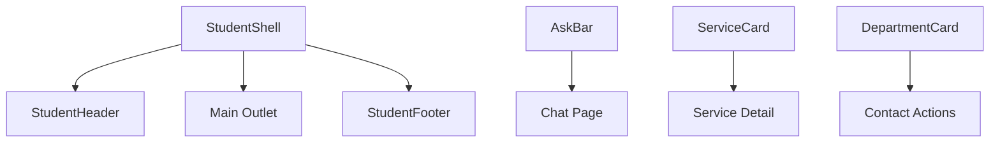

**Diagram sources**
- [StudentShell.jsx:1-25](file://src/components/student/StudentShell.jsx#L1-L25)
- [StudentHeader.jsx:1-64](file://src/components/student/StudentHeader.jsx#L1-L64)
- [StudentFooter.jsx:1-50](file://src/components/student/StudentFooter.jsx#L1-L50)
- [AskBar.jsx:1-41](file://src/components/student/AskBar.jsx#L1-L41)
- [ServiceCard.jsx:1-57](file://src/components/student/ServiceCard.jsx#L1-L57)
- [DepartmentCard.jsx:1-42](file://src/components/student/DepartmentCard.jsx#L1-L42)

**Section sources**
- [StudentShell.jsx:1-25](file://src/components/student/StudentShell.jsx#L1-L25)
- [student.css:10-88](file://src/styles/student.css#L10-L88)

## Core Components
- StudentShell: Frames each student page, conditionally hides the footer when in chat so the composer remains pinned at the bottom.
- StudentHeader: Sticky header with logo, navigation links, language toggle (English/Urdu), theme toggle (light/dark), and a staff-only link.
- StudentFooter: Provides quick links and regional campus phone numbers; uses tel: links for immediate dialing on mobile.
- DepartmentCard: Displays department name in both languages, phone (tel:), email (mailto:), campus location, hours, and verification status via Ladder.
- ServiceCard: Summarizes a service with category badge, required documents count, fee, deadline date, and verification status; navigates to detail page.
- AskBar: Compact input with search icon and send button; preserves the typed question in navigation state to avoid re-typing in chat.

Accessibility highlights:
- Semantic landmarks: header, main, footer used by shell and pages.
- ARIA labels on interactive controls (language group, theme toggle, ask input, send button).
- Keyboard support: Enter key submits AskBar; focus states are styled for visibility.
- Language-aware text direction and Urdu class usage where appropriate.

Mobile responsiveness:
- Sticky header keeps navigation accessible.
- Cards use responsive grids that adapt from single-column to multi-column layouts.
- Phone/email links enable direct action on mobile devices.
- Footer hides non-essential items on small screens.

Engagement patterns:
- Prominent AskBar above the fold on landing and within pages.
- Quick ask chips to reduce friction.
- Clear visual hierarchy with eyebrow labels, headings, and lede text.
- Freshness indicators build trust through transparency.

**Section sources**
- [StudentShell.jsx:1-25](file://src/components/student/StudentShell.jsx#L1-L25)
- [StudentHeader.jsx:1-64](file://src/components/student/StudentHeader.jsx#L1-L64)
- [StudentFooter.jsx:1-50](file://src/components/student/StudentFooter.jsx#L1-L50)
- [DepartmentCard.jsx:1-42](file://src/components/student/DepartmentCard.jsx#L1-L42)
- [ServiceCard.jsx:1-57](file://src/components/student/ServiceCard.jsx#L1-L57)
- [AskBar.jsx:1-41](file://src/components/student/AskBar.jsx#L1-L41)
- [student.css:163-228](file://src/styles/student.css#L163-L228)

## Architecture Overview
The student UI composes a consistent frame around route-specific content. The shell renders header and footer while delegating page rendering to React Router’s Outlet. AskBar drives navigation to the chat with the user’s question embedded in navigation state. Cards render data from the application context store and link to detailed views.

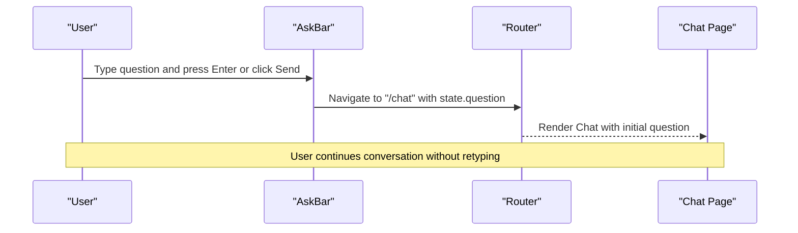

**Diagram sources**
- [AskBar.jsx:10-39](file://src/components/student/AskBar.jsx#L10-L39)

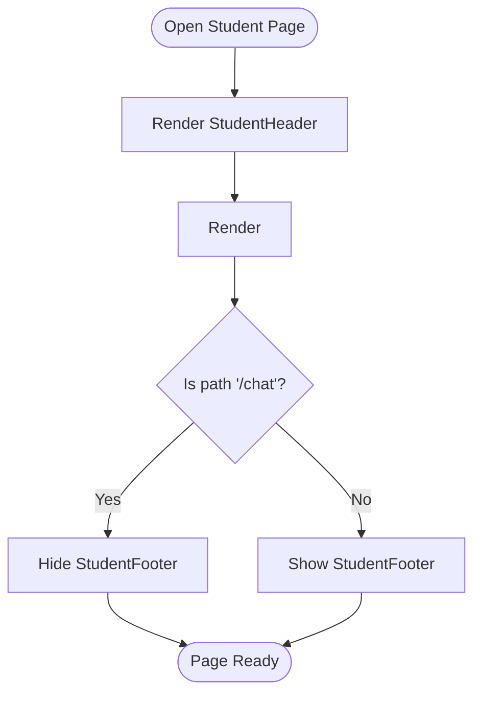

**Diagram sources**
- [StudentShell.jsx:8-23](file://src/components/student/StudentShell.jsx#L8-L23)

**Section sources**
- [StudentShell.jsx:1-25](file://src/components/student/StudentShell.jsx#L1-L25)
- [AskBar.jsx:1-41](file://src/components/student/AskBar.jsx#L1-L41)

## Detailed Component Analysis

### StudentShell
- Purpose: Provide a consistent frame for all student routes, including sticky header, scrollable main area, and conditional footer.
- Behavior: Detects if current route starts with /chat to hide the footer, keeping the chat composer pinned to the viewport bottom.
- Theming: Applies a root theme attribute for light/dark mode.

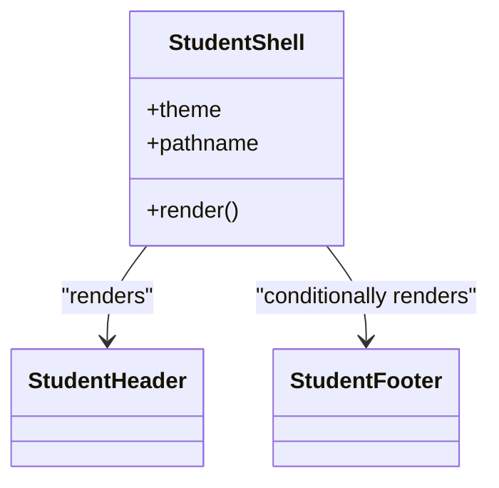

**Diagram sources**
- [StudentShell.jsx:1-25](file://src/components/student/StudentShell.jsx#L1-L25)

**Section sources**
- [StudentShell.jsx:1-25](file://src/components/student/StudentShell.jsx#L1-L25)

### StudentHeader
- Purpose: Branding and navigation hub for the student experience.
- Features:
  - Logo linking to home.
  - Navigation links to Ask, Services, Departments, and Staff.
  - Language toggle between English and Urdu.
  - Theme toggle between light and dark modes.
- Accessibility:
  - Grouped language toggle with aria-label.
  - Descriptive aria-labels for theme toggle.
  - Keyboard-focusable links and buttons.

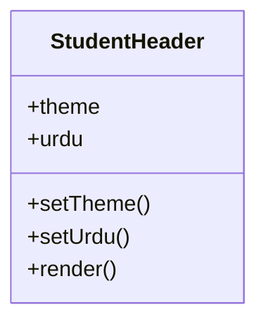

**Diagram sources**
- [StudentHeader.jsx:1-64](file://src/components/student/StudentHeader.jsx#L1-L64)

**Section sources**
- [StudentHeader.jsx:1-64](file://src/components/student/StudentHeader.jsx#L1-L64)

### StudentFooter
- Purpose: Provide quick actions and real campus phone numbers for students who need immediate help.
- Features:
  - Links to Ask, All services, Departments, and Staff console.
  - Regional campus list with tel: links for one-tap calling.
  - Brief messaging about source-backed answers and human fallback.

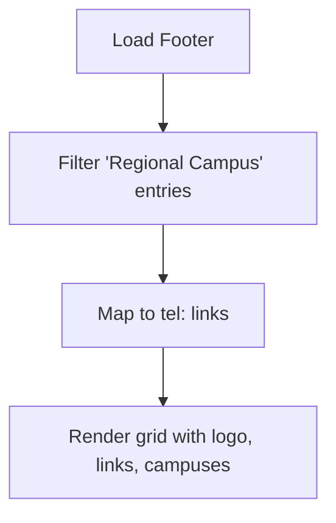

**Diagram sources**
- [StudentFooter.jsx:8-47](file://src/components/student/StudentFooter.jsx#L8-L47)

**Section sources**
- [StudentFooter.jsx:1-50](file://src/components/student/StudentFooter.jsx#L1-L50)

### DepartmentCard
- Purpose: Present a department’s contact information in a scannable card optimized for mobile users.
- Features:
  - Bilingual title and subtitle (English/Urdu).
  - Click-to-call phone link (tel:).
  - Click-to-email mailto: link.
  - Campus location and office hours.
  - Verification status via Ladder component.

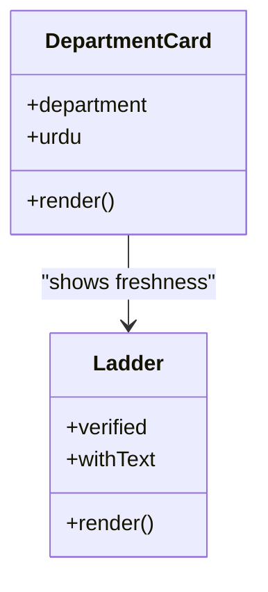

**Diagram sources**
- [DepartmentCard.jsx:1-42](file://src/components/student/DepartmentCard.jsx#L1-L42)
- [Ladder.jsx:1-32](file://src/components/ui/Ladder.jsx#L1-L32)

**Section sources**
- [DepartmentCard.jsx:1-42](file://src/components/student/DepartmentCard.jsx#L1-L42)
- [Ladder.jsx:1-32](file://src/components/ui/Ladder.jsx#L1-L32)

### ServiceCard
- Purpose: Summarize a service with essential details students care about: cost, deadlines, required documents, and verification status.
- Features:
  - Category badge.
  - Documents count from checklist.
  - Fee amount formatted in local currency.
  - Deadline date formatted for readability.
  - Navigation to service detail page.
  - Verification status via Ladder.

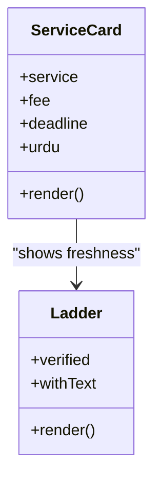

**Diagram sources**
- [ServiceCard.jsx:1-57](file://src/components/student/ServiceCard.jsx#L1-L57)
- [Ladder.jsx:1-32](file://src/components/ui/Ladder.jsx#L1-L32)

**Section sources**
- [ServiceCard.jsx:1-57](file://src/components/student/ServiceCard.jsx#L1-L57)
- [Ladder.jsx:1-32](file://src/components/ui/Ladder.jsx#L1-L32)

### AskBar
- Purpose: Provide a prominent, low-friction way to start a conversation with the assistant.
- Features:
  - Search icon and input with placeholder text in selected language.
  - Enter key triggers submission.
  - Navigates to /chat with the question preserved in navigation state.
  - Disabled send button until there is valid input.

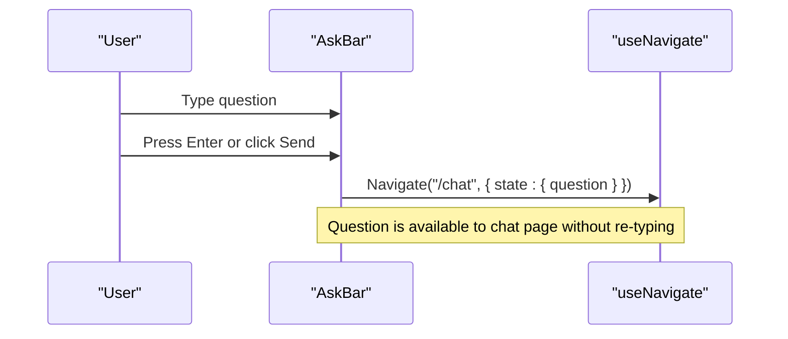

**Diagram sources**
- [AskBar.jsx:10-39](file://src/components/student/AskBar.jsx#L10-L39)

**Section sources**
- [AskBar.jsx:1-41](file://src/components/student/AskBar.jsx#L1-L41)

### Integration with Pages
- Landing Hero: Uses AskBar and quick ask chips to drive immediate engagement.
- Services page: Filters and searches services, then renders ServiceCard instances with fees and deadlines.
- Directory page: Groups departments into main campus and regional campuses, rendering DepartmentCard instances.

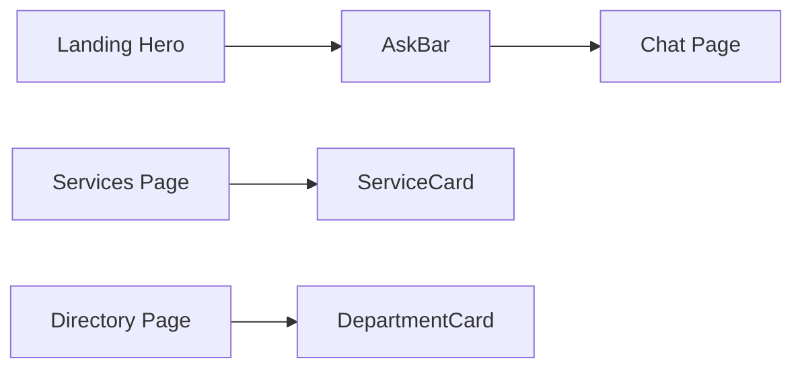

**Diagram sources**
- [Landing/Hero.jsx:1-40](file://src/pages/student/Landing/Hero.jsx#L1-L40)
- [Services/index.jsx:17-125](file://src/pages/student/Services/index.jsx#L17-L125)
- [Directory/index.jsx:18-80](file://src/pages/student/Directory/index.jsx#L18-L80)

**Section sources**
- [Landing/Hero.jsx:1-40](file://src/pages/student/Landing/Hero.jsx#L1-L40)
- [Services/index.jsx:1-125](file://src/pages/student/Services/index.jsx#L1-L125)
- [Directory/index.jsx:1-80](file://src/pages/student/Directory/index.jsx#L1-L80)

## Dependency Analysis
- AppContext supplies shared state: theme, language (urdu), and data store (services, fees, deadlines, departments).
- StudentHeader reads theme and language and exposes toggles.
- StudentFooter reads departments from store to surface regional campus phone numbers.
- DepartmentCard and ServiceCard read language preference and render localized text and freshness via Ladder.
- AskBar reads language preference and navigates to chat with state.

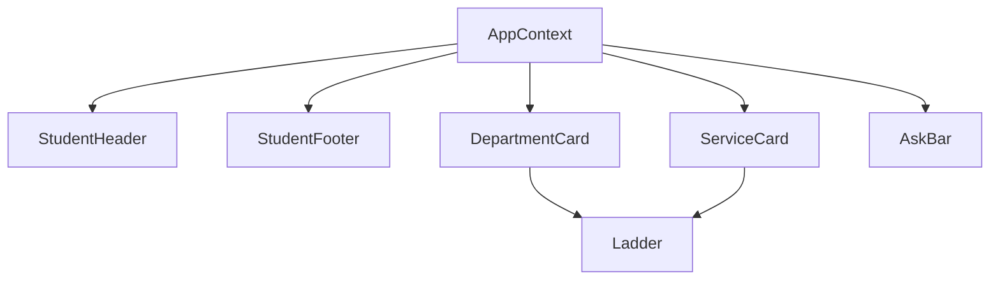

**Diagram sources**
- [AppContext.jsx:1-135](file://src/context/AppContext.jsx#L1-L135)
- [StudentHeader.jsx:1-64](file://src/components/student/StudentHeader.jsx#L1-L64)
- [StudentFooter.jsx:1-50](file://src/components/student/StudentFooter.jsx#L1-L50)
- [DepartmentCard.jsx:1-42](file://src/components/student/DepartmentCard.jsx#L1-L42)
- [ServiceCard.jsx:1-57](file://src/components/student/ServiceCard.jsx#L1-L57)
- [AskBar.jsx:1-41](file://src/components/student/AskBar.jsx#L1-L41)
- [Ladder.jsx:1-32](file://src/components/ui/Ladder.jsx#L1-L32)

**Section sources**
- [AppContext.jsx:1-135](file://src/context/AppContext.jsx#L1-L135)

## Performance Considerations
- Debounced search: Services and Directory pages debounce user input to reduce re-renders during typing.
- Conditional rendering: StudentShell hides footer during chat to minimize DOM and improve scrolling performance.
- Lightweight cards: Cards render minimal metadata and rely on CSS for responsive behavior, avoiding heavy computations.
- Mobile-first styles: Responsive grids and sticky header reduce layout shifts and improve perceived performance on constrained devices.

[No sources needed since this section provides general guidance]

## Troubleshooting Guide
- Language not switching: Ensure AppProvider wraps the app and that urdu state is toggled via setUrdu in StudentHeader. Verify that components read urdu from useApp().
- Footer missing in chat: Confirm pathname check in StudentShell matches the chat route prefix. If customizing routes, adjust the condition accordingly.
- Phone links not working: Ensure department.phone values are valid and that tel: links are rendered. On desktop, test with a configured handler; on mobile, verify device supports tel: protocol.
- AskBar does not submit: Check that input value is trimmed before navigation and that the send button is enabled only when there is content. Validate keyboard event handling for Enter key.
- Freshness indicator not updating: Verify that verified dates are set correctly in the store and that Ladder receives updated props when records change.

**Section sources**
- [StudentShell.jsx:8-23](file://src/components/student/StudentShell.jsx#L8-L23)
- [StudentHeader.jsx:11-51](file://src/components/student/StudentHeader.jsx#L11-L51)
- [AskBar.jsx:10-39](file://src/components/student/AskBar.jsx#L10-L39)
- [Ladder.jsx:10-30](file://src/components/ui/Ladder.jsx#L10-L30)

## Conclusion
These student-facing components create an intuitive, accessible, and mobile-friendly educational assistant experience. StudentShell provides a stable frame, StudentHeader and StudentFooter ensure consistent branding and easy access to critical actions, DepartmentCard and ServiceCard deliver clear, trustworthy information with verification signals, and AskBar lowers the barrier to starting a conversation. Together, they form a cohesive interface that prioritizes clarity, speed, and reliability for students navigating university services.