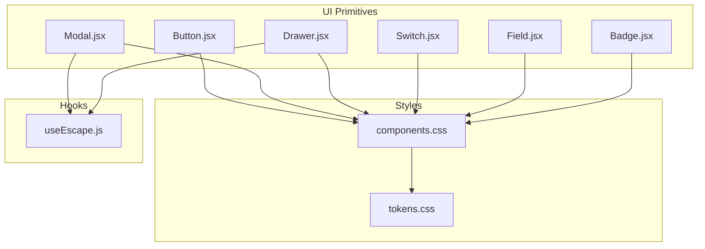
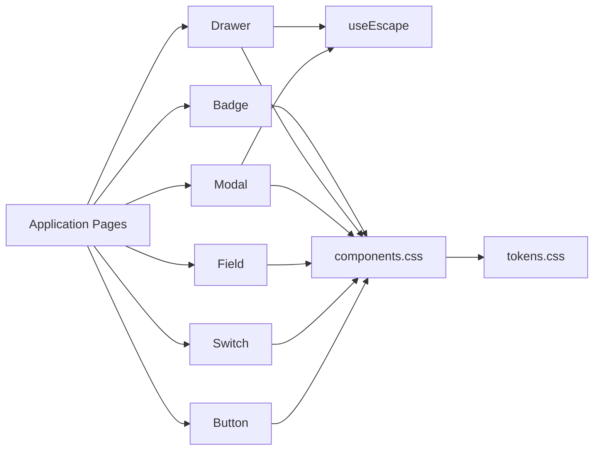
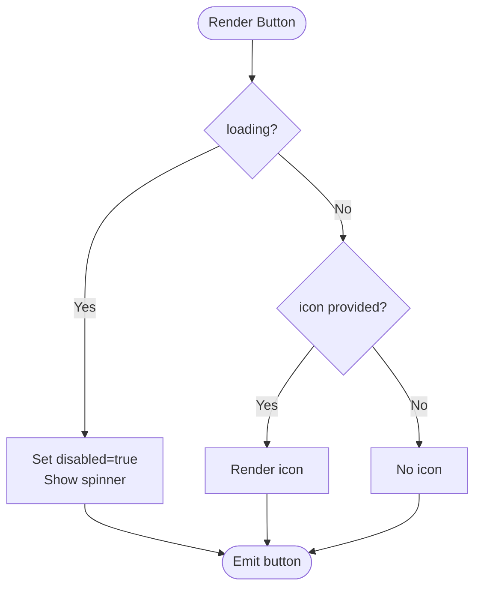
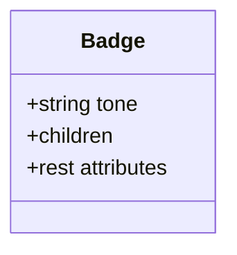
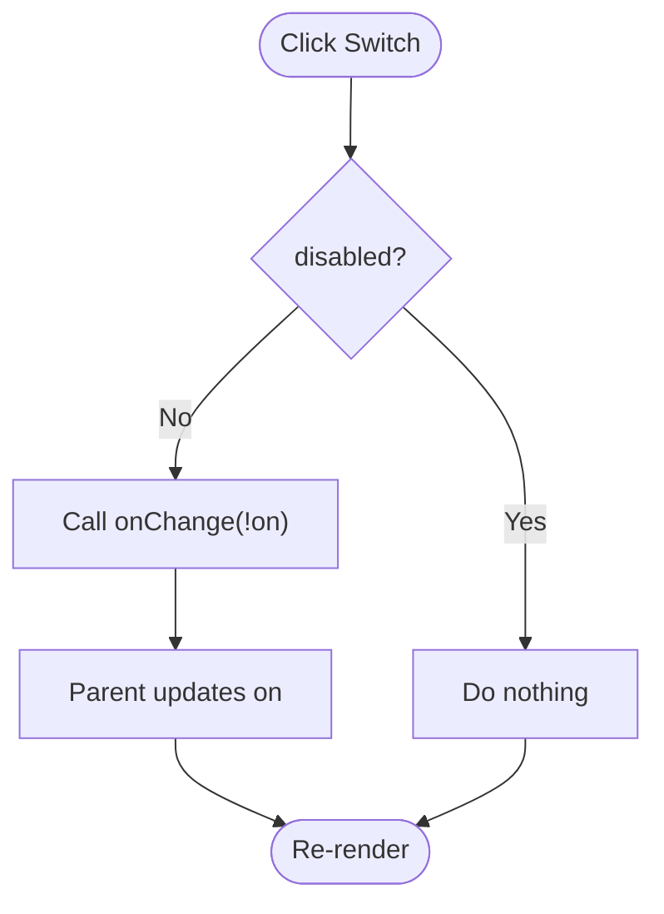
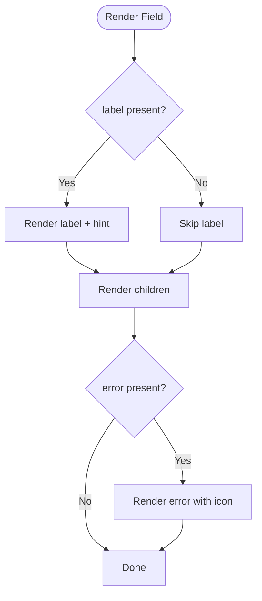
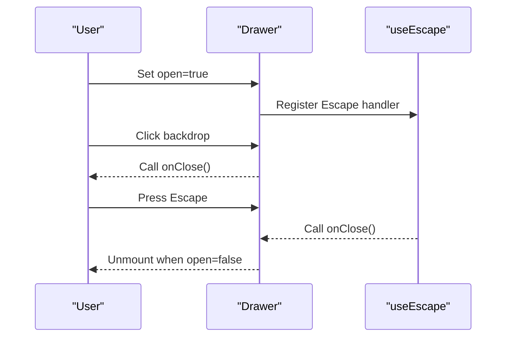
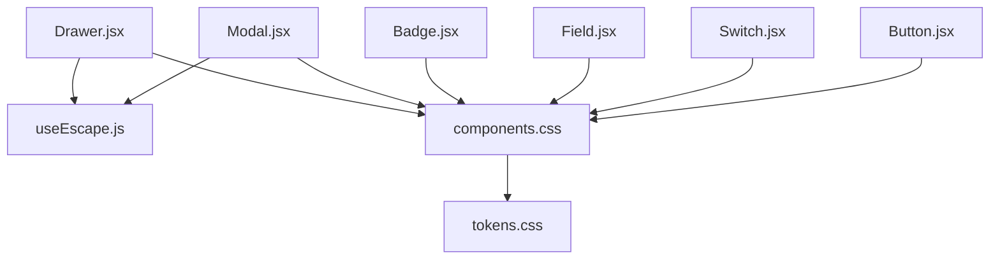

# UI Primitives

<cite>
**Referenced Files in This Document**
- [Button.jsx](file://src/components/ui/Button.jsx)
- [Modal.jsx](file://src/components/ui/Modal.jsx)
- [Badge.jsx](file://src/components/ui/Badge.jsx)
- [Switch.jsx](file://src/components/ui/Switch.jsx)
- [Field.jsx](file://src/components/ui/Field.jsx)
- [Drawer.jsx](file://src/components/ui/Drawer.jsx)
- [useEscape.js](file://src/hooks/useEscape.js)
- [tokens.css](file://src/styles/tokens.css)
- [components.css](file://src/styles/components.css)
</cite>

## Table of Contents
1. [Introduction](#introduction)
2. [Project Structure](#project-structure)
3. [Core Components](#core-components)
4. [Architecture Overview](#architecture-overview)
5. [Detailed Component Analysis](#detailed-component-analysis)
6. [Dependency Analysis](#dependency-analysis)
7. [Performance Considerations](#performance-considerations)
8. [Troubleshooting Guide](#troubleshooting-guide)
9. [Conclusion](#conclusion)

## Introduction
This document describes the base UI primitive components that form the foundation of the component system: Button, Modal, Badge, Switch, Field, and Drawer. It explains their props interfaces, styling options, accessibility features, event handling patterns, state management within components, and integration with the application’s design tokens. It also outlines design system principles such as consistent prop naming, theme integration via CSS custom properties, and responsive behavior.

## Project Structure
The primitives live under src/components/ui and are styled by src/styles/components.css using design tokens defined in src/styles/tokens.css. Shared overlay behavior (closing on Escape) is provided by src/hooks/useEscape.js.

**Diagram sources**
- [Button.jsx:1-29](file://src/components/ui/Button.jsx#L1-L29)
- [Modal.jsx:1-39](file://src/components/ui/Modal.jsx#L1-L39)
- [Drawer.jsx:1-33](file://src/components/ui/Drawer.jsx#L1-L33)
- [Switch.jsx:1-34](file://src/components/ui/Switch.jsx#L1-L34)
- [Field.jsx:1-23](file://src/components/ui/Field.jsx#L1-L23)
- [Badge.jsx:1-12](file://src/components/ui/Badge.jsx#L1-L12)
- [useEscape.js:1-14](file://src/hooks/useEscape.js#L1-L14)
- [tokens.css:15-131](file://src/styles/tokens.css#L15-L131)
- [components.css:135-725](file://src/styles/components.css#L135-L725)

**Section sources**
- [Button.jsx:1-29](file://src/components/ui/Button.jsx#L1-L29)
- [Modal.jsx:1-39](file://src/components/ui/Modal.jsx#L1-L39)
- [Drawer.jsx:1-33](file://src/components/ui/Drawer.jsx#L1-L33)
- [Switch.jsx:1-34](file://src/components/ui/Switch.jsx#L1-L34)
- [Field.jsx:1-23](file://src/components/ui/Field.jsx#L1-L23)
- [Badge.jsx:1-12](file://src/components/ui/Badge.jsx#L1-L12)
- [useEscape.js:1-14](file://src/hooks/useEscape.js#L1-L14)
- [tokens.css:15-131](file://src/styles/tokens.css#L15-L131)
- [components.css:135-725](file://src/styles/components.css#L135-L725)

## Core Components
- Button: A native button with built-in loading state and optional icon. Supports variants and sizes via class names. Disables itself when loading or disabled.
- Modal: A centered dialog with header, body, and footer. Closes on backdrop click and Escape key. Accessible via role="dialog" and aria attributes.
- Badge: A small status pill with tone-based color mapping to semantic tokens.
- Switch: A labelled toggle with accessible switch semantics and disabled state.
- Field: A label + control wrapper with optional hint and inline error display.
- Drawer: A right-side panel for contextual content beside the page. Shares overlay and escape behavior with Modal.

Design system principles:
- Consistent prop naming: open/onClose for overlays; variant/size for visual modifiers; on/onChange for controlled toggles; label/hint/error for fields.
- Theme integration: All colors, spacing, shadows, and radii come from CSS custom properties in tokens.css. Components apply utility classes that consume these tokens.
- Responsive behavior: Overlays use full-screen overlays with flexible widths; badges and buttons wrap naturally; tables and lists adapt via CSS grid/flex.

**Section sources**
- [Button.jsx:1-29](file://src/components/ui/Button.jsx#L1-L29)
- [Modal.jsx:1-39](file://src/components/ui/Modal.jsx#L1-L39)
- [Badge.jsx:1-12](file://src/components/ui/Badge.jsx#L1-L12)
- [Switch.jsx:1-34](file://src/components/ui/Switch.jsx#L1-L34)
- [Field.jsx:1-23](file://src/components/ui/Field.jsx#L1-L23)
- [Drawer.jsx:1-33](file://src/components/ui/Drawer.jsx#L1-L33)
- [tokens.css:15-131](file://src/styles/tokens.css#L15-L131)
- [components.css:135-725](file://src/styles/components.css#L135-L725)

## Architecture Overview
Primitives compose a cohesive UI layer:
- Visual primitives (Button, Badge, Switch, Field) provide building blocks for forms and actions.
- Overlay primitives (Modal, Drawer) manage focus traps, backdrop interactions, and keyboard dismissal.
- Styling is centralized in components.css and themed via tokens.css.
- Accessibility is implemented through semantic roles and ARIA attributes.

**Diagram sources**
- [Button.jsx:1-29](file://src/components/ui/Button.jsx#L1-L29)
- [Switch.jsx:1-34](file://src/components/ui/Switch.jsx#L1-L34)
- [Field.jsx:1-23](file://src/components/ui/Field.jsx#L1-L23)
- [Modal.jsx:1-39](file://src/components/ui/Modal.jsx#L1-L39)
- [Drawer.jsx:1-33](file://src/components/ui/Drawer.jsx#L1-L33)
- [Badge.jsx:1-12](file://src/components/ui/Badge.jsx#L1-L12)
- [useEscape.js:1-14](file://src/hooks/useEscape.js#L1-L14)
- [components.css:135-725](file://src/styles/components.css#L135-L725)
- [tokens.css:15-131](file://src/styles/tokens.css#L15-L131)

## Detailed Component Analysis

### Button
- Props: children, variant, size, loading, icon, disabled, className, and any additional button attributes passed through rest.
- Behavior: When loading is true, the button disables itself and shows a spinner instead of the icon or children. Otherwise, renders an optional icon and children.
- Styling: Uses a base class plus variant and size classes to adjust appearance. Disabled state uses reduced opacity and no pointer events.
- Accessibility: Inherits native button semantics; ensure meaningful labels when used without text.
- Usage patterns: Use for primary actions, destructive actions (danger variant), and ghost actions. Combine with icons for clarity.

**Diagram sources**
- [Button.jsx:8-27](file://src/components/ui/Button.jsx#L8-L27)

**Section sources**
- [Button.jsx:1-29](file://src/components/ui/Button.jsx#L1-L29)
- [components.css:135-202](file://src/styles/components.css#L135-L202)

### Modal
- Props: open, onClose, title, desc, children, footer, wide.
- Behavior: Renders nothing when closed. On open, displays a centered dialog with header, body, and optional footer. Closes on backdrop mousedown and Escape key.
- Accessibility: role="dialog", aria-modal="true", aria-label set to title; close button has aria-label.
- Styling: Backdrop overlay with blur; modal card with rounded corners and shadow; wide variant increases max width.
- Usage patterns: Use for confirmations, forms, or detail views. Provide clear titles and descriptions. Use footer for action buttons.

**Diagram sources**
- [Modal.jsx:1-39](file://src/components/ui/Modal.jsx#L1-L39)
- [useEscape.js:1-14](file://src/hooks/useEscape.js#L1-L14)

**Section sources**
- [Modal.jsx:1-39](file://src/components/ui/Modal.jsx#L1-L39)
- [useEscape.js:1-14](file://src/hooks/useEscape.js#L1-L14)
- [components.css:648-705](file://src/styles/components.css#L648-L705)

### Badge
- Props: tone (default grey), children, and any span attributes via rest.
- Behavior: Renders a small inline pill with tone-based theming.
- Styling: Tone maps to semantic tokens (jade, amber, rose, sky, violet, brass, grey).
- Accessibility: Semantic span; pair with context or aria-label if needed.
- Usage patterns: Use for statuses like verified, warning, info, or neutral states.

**Diagram sources**
- [Badge.jsx:1-12](file://src/components/ui/Badge.jsx#L1-L12)

**Section sources**
- [Badge.jsx:1-12](file://src/components/ui/Badge.jsx#L1-L12)
- [components.css:92-109](file://src/styles/components.css#L92-L109)
- [tokens.css:15-131](file://src/styles/tokens.css#L15-L131)

### Switch
- Props: on, onChange, label, desc, disabled.
- Behavior: Controlled toggle that calls onChange with the inverted value unless disabled. Visual state reflects on.
- Accessibility: role="switch", aria-checked bound to on; visually indicates disabled state.
- Styling: Label area with title and optional description; toggle track and knob animate between states.
- Usage patterns: Use for binary settings where immediate feedback is required. Always provide a descriptive label.

**Diagram sources**
- [Switch.jsx:1-34](file://src/components/ui/Switch.jsx#L1-L34)

**Section sources**
- [Switch.jsx:1-34](file://src/components/ui/Switch.jsx#L1-L34)
- [components.css:300-335](file://src/styles/components.css#L300-L335)

### Field
- Props: label, hint, error, children (the input/control).
- Behavior: Wraps a control with a label and optional hint. Displays an inline error message when provided.
- Accessibility: Associates label with the child control via DOM structure; errors convey meaning via text and color.
- Styling: Vertical stack layout; inputs inherit focus rings and error states from shared styles.
- Usage patterns: Wrap inputs, selects, or textareas. Pass error only after user interaction to avoid premature validation messages.

**Diagram sources**
- [Field.jsx:1-23](file://src/components/ui/Field.jsx#L1-L23)

**Section sources**
- [Field.jsx:1-23](file://src/components/ui/Field.jsx#L1-L23)
- [components.css:204-282](file://src/styles/components.css#L204-L282)

### Drawer
- Props: open, onClose, title, desc, children, footer.
- Behavior: Renders a right-side panel when open. Closes on backdrop mousedown and Escape key.
- Accessibility: role="dialog", aria-modal="true", aria-label set to title; close button has aria-label.
- Styling: Full-height slide-in panel with backdrop blur; scrollable content area and optional footer.
- Usage patterns: Use for contextual details, history, or side-by-side editing. Keep content focused and scannable.

**Diagram sources**
- [Drawer.jsx:1-33](file://src/components/ui/Drawer.jsx#L1-L33)
- [useEscape.js:1-14](file://src/hooks/useEscape.js#L1-L14)

**Section sources**
- [Drawer.jsx:1-33](file://src/components/ui/Drawer.jsx#L1-L33)
- [useEscape.js:1-14](file://src/hooks/useEscape.js#L1-L14)
- [components.css:706-725](file://src/styles/components.css#L706-L725)

## Dependency Analysis
- Modal and Drawer depend on useEscape for keyboard dismissal.
- All primitives depend on components.css for visual presentation.
- components.css consumes tokens.css for colors, spacing, shadows, and radii.
- Button optionally depends on an icon component passed via props.

**Diagram sources**
- [Modal.jsx:1-39](file://src/components/ui/Modal.jsx#L1-L39)
- [Drawer.jsx:1-33](file://src/components/ui/Drawer.jsx#L1-L33)
- [useEscape.js:1-14](file://src/hooks/useEscape.js#L1-L14)
- [components.css:135-725](file://src/styles/components.css#L135-L725)
- [tokens.css:15-131](file://src/styles/tokens.css#L15-L131)

**Section sources**
- [Modal.jsx:1-39](file://src/components/ui/Modal.jsx#L1-L39)
- [Drawer.jsx:1-33](file://src/components/ui/Drawer.jsx#L1-L33)
- [useEscape.js:1-14](file://src/hooks/useEscape.js#L1-L14)
- [components.css:135-725](file://src/styles/components.css#L135-L725)
- [tokens.css:15-131](file://src/styles/tokens.css#L15-L131)

## Performance Considerations
- Avoid unnecessary re-renders by keeping Modal and Drawer closed when not needed; they return null when closed.
- Prefer controlled state for Switch and overlays to minimize internal state complexity.
- Use CSS transitions and transforms for animations to leverage GPU acceleration.
- Keep overlay content minimal to reduce initial render cost.

[No sources needed since this section provides general guidance]

## Troubleshooting Guide
- Modal/Drawer not closing on Escape: Ensure open state is controlled and onClose updates it; verify useEscape is called with active open and onClose.
- Switch not updating: Confirm onChange is wired and parent state updates on each call; check disabled prop prevents toggling.
- Field error not showing: Ensure error prop is provided only after user interaction to match expected UX; verify child control is wrapped inside Field.
- Inconsistent colors across themes: Verify tokens.css is loaded and data-theme is set correctly; all components derive colors from CSS variables.

**Section sources**
- [Modal.jsx:1-39](file://src/components/ui/Modal.jsx#L1-L39)
- [Drawer.jsx:1-33](file://src/components/ui/Drawer.jsx#L1-L33)
- [useEscape.js:1-14](file://src/hooks/useEscape.js#L1-L14)
- [Switch.jsx:1-34](file://src/components/ui/Switch.jsx#L1-L34)
- [Field.jsx:1-23](file://src/components/ui/Field.jsx#L1-L23)
- [tokens.css:15-131](file://src/styles/tokens.css#L15-L131)

## Conclusion
These primitives provide a consistent, accessible, and theme-aware foundation for building the interface. By adhering to the documented props, styling conventions, and accessibility practices, you can extend and compose these components confidently while maintaining a unified design system.

[No sources needed since this section summarizes without analyzing specific files]