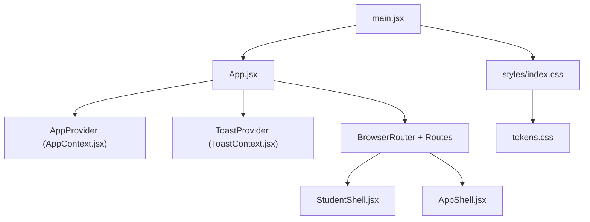
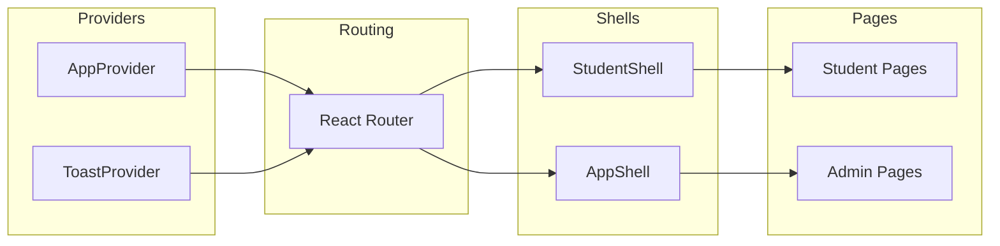
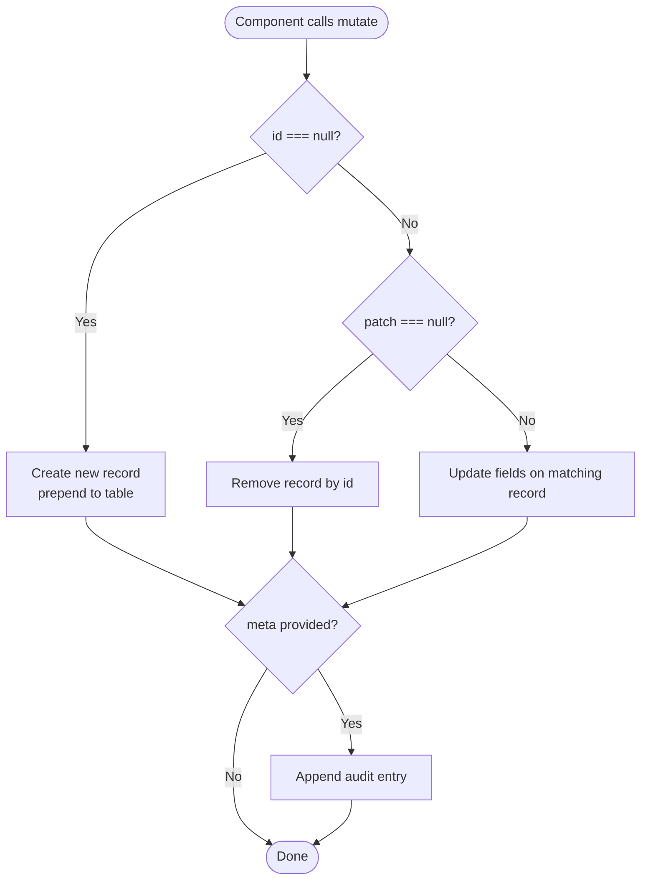
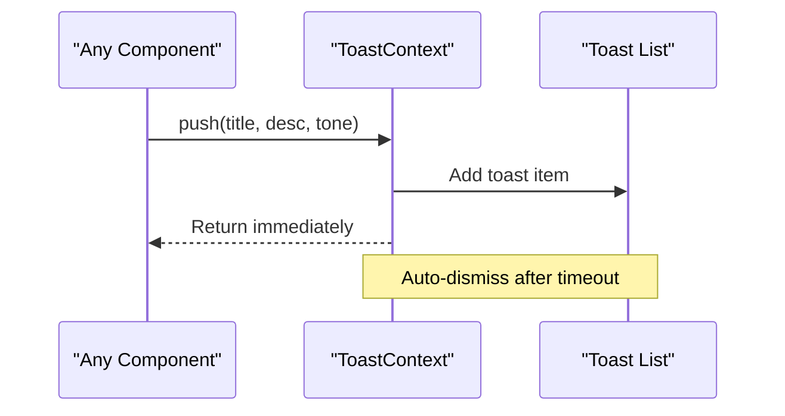
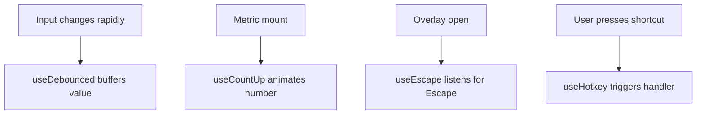
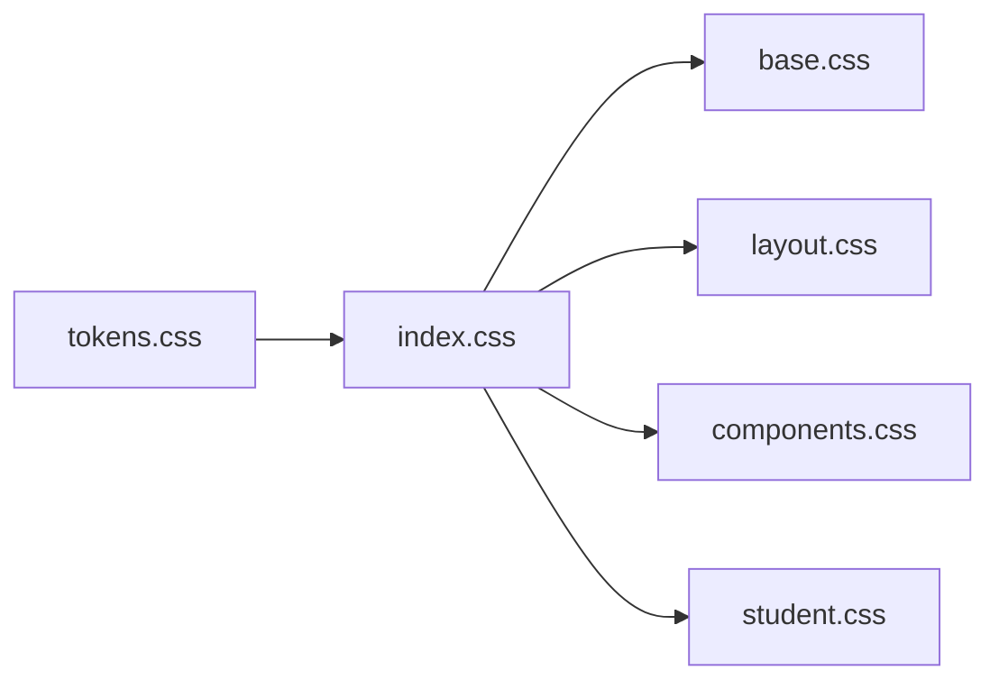
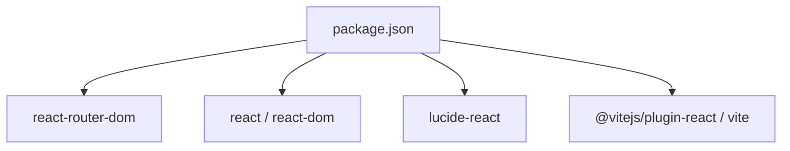

# Frontend Architecture

<cite>
**Referenced Files in This Document**
- [main.jsx](file://src/main.jsx)
- [App.jsx](file://src/App.jsx)
- [AppContext.jsx](file://src/context/AppContext.jsx)
- [ToastContext.jsx](file://src/context/ToastContext.jsx)
- [useDebounced.js](file://src/hooks/useDebounced.js)
- [useCountUp.js](file://src/hooks/useCountUp.js)
- [useEscape.js](file://src/hooks/useEscape.js)
- [useHotkey.js](file://src/hooks/useHotkey.js)
- [AppShell.jsx](file://src/components/layout/AppShell.jsx)
- [StudentShell.jsx](file://src/components/student/StudentShell.jsx)
- [Button.jsx](file://src/components/ui/Button.jsx)
- [Modal.jsx](file://src/components/ui/Modal.jsx)
- [tokens.css](file://src/styles/tokens.css)
- [index.css](file://src/styles/index.css)
- [package.json](file://package.json)
</cite>

## Table of Contents
1. Introduction
2. Project Structure
3. Core Components
4. Architecture Overview
5. Detailed Component Analysis
6. Dependency Analysis
7. Performance Considerations
8. Troubleshooting Guide
9. Conclusion

## Introduction
This document explains the React frontend architecture for a dual-surface application: a student-facing site and an admin console that shares the same data layer. The app uses React Router for routing, a centralized AppContext for state, a ToastContext for user feedback, a small library of custom hooks for common behaviors, and a design system built on CSS tokens with responsive patterns.

## Project Structure
The application is bootstrapped by a single entry point that renders the root App component inside StrictMode. The App component configures providers (AppProvider and ToastProvider) and defines two route groups:
- Student routes at the root path, wrapped by StudentShell
- Admin routes under /admin, wrapped by AppShell

Styling is imported once from a central index that layers tokens, base styles, layout, components, and student-specific styles.



**Diagram sources**
- [main.jsx:1-11](file://src/main.jsx#L1-L11)
- [App.jsx:1-70](file://src/App.jsx#L1-L70)
- [index.css:1-8](file://src/styles/index.css#L1-L8)
- [tokens.css:1-140](file://src/styles/tokens.css#L1-L140)

**Section sources**
- [main.jsx:1-11](file://src/main.jsx#L1-L11)
- [App.jsx:1-70](file://src/App.jsx#L1-L70)
- [index.css:1-8](file://src/styles/index.css#L1-L8)

## Core Components
- Routing and shells
  - App.jsx defines two route trees: student pages under root and admin pages under /admin. Each tree is wrapped by a shell component that provides chrome and global behavior.
  - StudentShell.jsx wraps student pages with header/footer and hides footer on chat to keep the composer pinned.
  - AppShell.jsx wraps admin pages with sidebar, topbar, scrollable main area, and command palette. It also integrates keyboard shortcuts via useHotkey.

- State management
  - AppContext.jsx provides theme, role, language toggle, a store of tables (services, fees, deadlines, departments, documents, flows, adapters), audit log, and mutation helpers (mutate, verifyRecord). It exposes a stable API surface so pages can read/write without prop drilling.
  - ToastContext.jsx provides a push(title, desc, tone) function to show transient notifications that auto-dismiss after a fixed duration.

- UI primitives
  - Button.jsx encapsulates loading state and icon rendering, preventing callers from duplicating logic.
  - Modal.jsx implements accessible overlay behavior, Escape-to-close, and backdrop dismissal semantics.

**Section sources**
- [App.jsx:24-67](file://src/App.jsx#L24-L67)
- [StudentShell.jsx:1-25](file://src/components/student/StudentShell.jsx#L1-L25)
- [AppShell.jsx:1-49](file://src/components/layout/AppShell.jsx#L1-L49)
- [AppContext.jsx:1-135](file://src/context/AppContext.jsx#L1-L135)
- [ToastContext.jsx:1-33](file://src/context/ToastContext.jsx#L1-L33)
- [Button.jsx:1-29](file://src/components/ui/Button.jsx#L1-L29)
- [Modal.jsx:1-39](file://src/components/ui/Modal.jsx#L1-L39)

## Architecture Overview
The app follows a provider-based architecture:
- Providers wrap the entire tree to supply global state and side effects.
- Shells provide consistent chrome per audience (student vs admin).
- Pages focus on domain features and consume context via hooks.
- Custom hooks encapsulate reusable behaviors (debounce, animations, keyboard interactions).



**Diagram sources**
- [App.jsx:34-67](file://src/App.jsx#L34-L67)
- [AppContext.jsx:34-135](file://src/context/AppContext.jsx#L34-L135)
- [ToastContext.jsx:13-33](file://src/context/ToastContext.jsx#L13-L33)
- [StudentShell.jsx:1-25](file://src/components/student/StudentShell.jsx#L1-L25)
- [AppShell.jsx:1-49](file://src/components/layout/AppShell.jsx#L1-L49)

## Detailed Component Analysis

### Routing and Shell Composition
- Two distinct audiences share one data layer:
  - Student routes render within StudentShell, which manages header/footer visibility based on current route.
  - Admin routes render within AppShell, which owns chrome state (sidebar collapse, mobile drawer, command palette) and integrates hotkeys.
- Navigation resets local page state by keying the main element on pathname.

```mermaid
sequenceDiagram
participant User as "User"
participant Router as "React Router"
participant Shell as "Shell (Student/Admin)"
participant Page as "Page Component"
User->>Router : Navigate to URL
Router->>Shell : Render shell wrapper
Shell->>Page : Render <Outlet/> content
Note over Shell,Page : Shell owns chrome; Page owns feature state
```

**Diagram sources**
- [App.jsx:39-63](file://src/App.jsx#L39-L63)
- [StudentShell.jsx:1-25](file://src/components/student/StudentShell.jsx#L1-L25)
- [AppShell.jsx:1-49](file://src/components/layout/AppShell.jsx#L1-L49)

**Section sources**
- [App.jsx:39-63](file://src/App.jsx#L39-L63)
- [StudentShell.jsx:1-25](file://src/components/student/StudentShell.jsx#L1-L25)
- [AppShell.jsx:1-49](file://src/components/layout/AppShell.jsx#L1-L49)

### Centralized State with AppContext
- Provides:
  - Theme, role, and language toggles
  - Store object containing multiple tables (services, fees, deadlines, departments, documents, flows, adapters)
  - Audit log entries appended immutably
  - mutate(table, id, patch, meta) to create/update/delete records and optionally record audit metadata
  - verifyRecord(table, record, nameOf) to mark verification with timestamp and actor
- Designed as an API seam for future server integration without changing consumers.



**Diagram sources**
- [AppContext.jsx:79-103](file://src/context/AppContext.jsx#L79-L103)
- [AppContext.jsx:51-67](file://src/context/AppContext.jsx#L51-L67)

**Section sources**
- [AppContext.jsx:18-22](file://src/context/AppContext.jsx#L18-L22)
- [AppContext.jsx:34-49](file://src/context/AppContext.jsx#L34-L49)
- [AppContext.jsx:79-103](file://src/context/AppContext.jsx#L79-L103)
- [AppContext.jsx:105-116](file://src/context/AppContext.jsx#L105-L116)

### Toast Notifications with ToastContext
- Exposes a push(title, desc, tone) function used anywhere in the tree.
- Renders a list of toast items that auto-dismiss after a fixed duration.
- Enforces usage inside ToastProvider to avoid runtime errors.



**Diagram sources**
- [ToastContext.jsx:6-20](file://src/context/ToastContext.jsx#L6-L20)
- [ToastContext.jsx:22-31](file://src/context/ToastContext.jsx#L22-L31)

**Section sources**
- [ToastContext.jsx:1-33](file://src/context/ToastContext.jsx#L1-L33)

### Custom Hooks Library
- useDebounced(value, ms): Delays fast-changing inputs (e.g., search boxes) to reduce re-renders or downstream work.
- useCountUp(target, run, ms): Animates a number to its target using requestAnimationFrame with easing.
- useEscape(active, onClose): Adds/removes a window keydown listener to close overlays when Escape is pressed.
- useHotkey(key, handler): Registers Cmd/Ctrl + key shortcuts and prevents default browser actions.



**Diagram sources**
- [useDebounced.js:1-12](file://src/hooks/useDebounced.js#L1-L12)
- [useCountUp.js:1-31](file://src/hooks/useCountUp.js#L1-L31)
- [useEscape.js:1-14](file://src/hooks/useEscape.js#L1-L14)
- [useHotkey.js:1-20](file://src/hooks/useHotkey.js#L1-L20)

**Section sources**
- [useDebounced.js:1-12](file://src/hooks/useDebounced.js#L1-L12)
- [useCountUp.js:1-31](file://src/hooks/useCountUp.js#L1-L31)
- [useEscape.js:1-14](file://src/hooks/useEscape.js#L1-L14)
- [useHotkey.js:1-20](file://src/hooks/useHotkey.js#L1-L20)

### Styling Approach: Tokens, Modules, and Responsiveness
- Design tokens define colors, shadows, radii, and layout constants for light and dark themes via CSS variables.
- A single CSS entry point imports tokens first, then base, layout, components, and student-specific styles to ensure variable availability.
- Components apply token-driven classes and rely on theme attributes for color switching.



**Diagram sources**
- [tokens.css:1-140](file://src/styles/tokens.css#L1-L140)
- [index.css:1-8](file://src/styles/index.css#L1-L8)

**Section sources**
- [tokens.css:1-140](file://src/styles/tokens.css#L1-L140)
- [index.css:1-8](file://src/styles/index.css#L1-L8)

### Component Composition Patterns and Prop Drilling Avoidance
- Composition:
  - Shells compose chrome (header/sidebar/topbar) around page content via Outlet.
  - Primitives like Button and Modal encapsulate behavior and accessibility, keeping pages focused on domain logic.
- Prop drilling avoidance:
  - Global state (theme, role, store, mutations) is accessed via useApp hook from AppContext.
  - Notifications are triggered via useToast from ToastContext.
  - Keyboard behaviors are encapsulated in hooks rather than passed down as props.

**Section sources**
- [App.jsx:34-67](file://src/App.jsx#L34-L67)
- [AppContext.jsx:18-22](file://src/context/AppContext.jsx#L18-L22)
- [ToastContext.jsx:6-11](file://src/context/ToastContext.jsx#L6-L11)
- [useHotkey.js:1-20](file://src/hooks/useHotkey.js#L1-L20)

### Performance Optimization Techniques
- Debounced input handling reduces unnecessary computations during rapid typing.
- Count-up animation uses requestAnimationFrame for smooth updates without blocking the main thread.
- Shell keys the main content on pathname to reset local state efficiently between navigations.
- Context values are memoized where appropriate to minimize re-renders in consumers.

**Section sources**
- [useDebounced.js:1-12](file://src/hooks/useDebounced.js#L1-L12)
- [useCountUp.js:1-31](file://src/hooks/useCountUp.js#L1-L31)
- [AppShell.jsx:19-41](file://src/components/layout/AppShell.jsx#L19-L41)
- [AppContext.jsx:79-103](file://src/context/AppContext.jsx#L79-L103)

## Dependency Analysis
- Runtime dependencies include React, ReactDOM, react-router-dom, and lucide-react icons.
- Build tooling uses Vite for development and builds.



**Diagram sources**
- [package.json:12-21](file://package.json#L12-L21)

**Section sources**
- [package.json:1-23](file://package.json#L1-L23)

## Performance Considerations
- Prefer debouncing user inputs to limit expensive operations.
- Use animation frames for visual transitions instead of timers.
- Keep shell state minimal and isolated from page state to prevent unnecessary re-renders.
- Leverage context selectively; consider splitting contexts if they grow large.
- Ensure CSS tokens are defined before other styles to avoid layout thrashing.

[No sources needed since this section provides general guidance]

## Troubleshooting Guide
- Context usage outside providers:
  - Using useApp or useToast outside their respective providers throws an error to signal misconfiguration.
- Modal behavior:
  - Modal closes on Escape and on backdrop click; ensure onClose handlers are correctly wired.
- Hotkeys:
  - useHotkey prevents default browser actions for registered shortcuts; verify no conflicting listeners exist.

**Section sources**
- [AppContext.jsx:18-22](file://src/context/AppContext.jsx#L18-L22)
- [ToastContext.jsx:6-11](file://src/context/ToastContext.jsx#L6-L11)
- [Modal.jsx:1-39](file://src/components/ui/Modal.jsx#L1-L39)
- [useHotkey.js:1-20](file://src/hooks/useHotkey.js#L1-L20)

## Conclusion
The frontend architecture cleanly separates concerns through providers, shells, and pages. Centralized state and toast systems enable consistent behavior across the app, while a small set of custom hooks standardizes common interactions. The styling system leverages design tokens for theming and consistency. This structure supports both student-facing experiences and an admin console sharing the same data layer, with clear paths for future server integration and performance improvements.