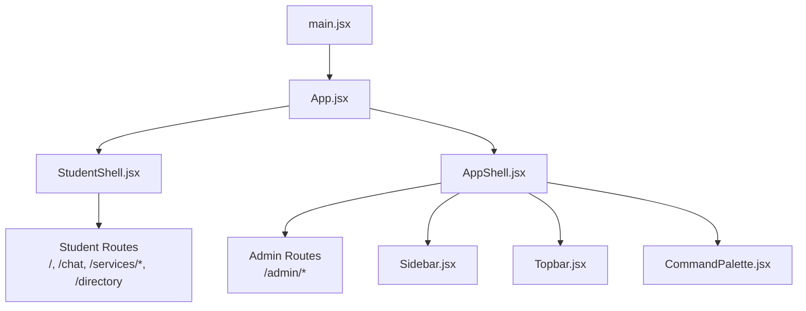
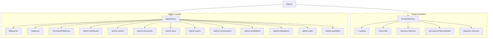
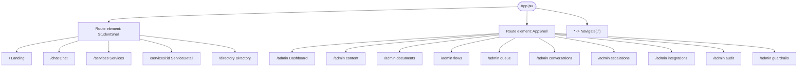
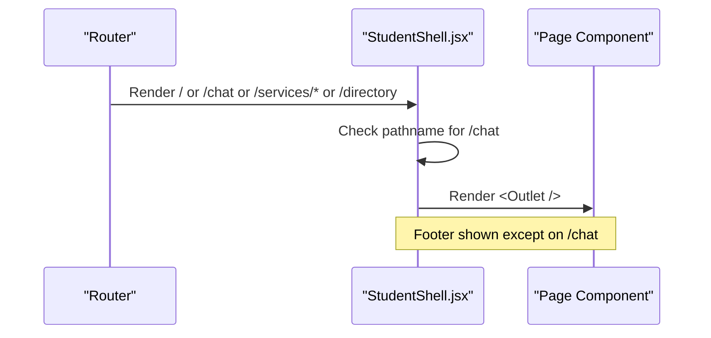
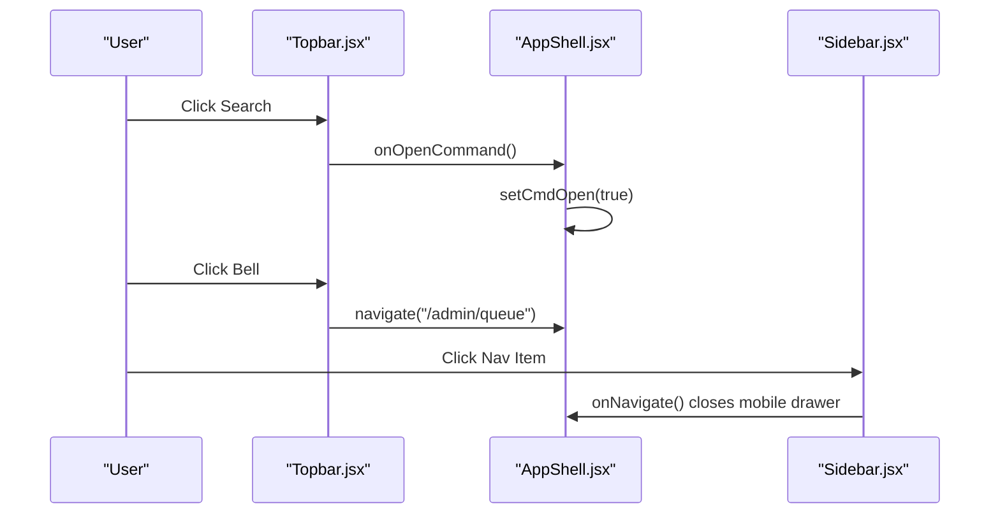
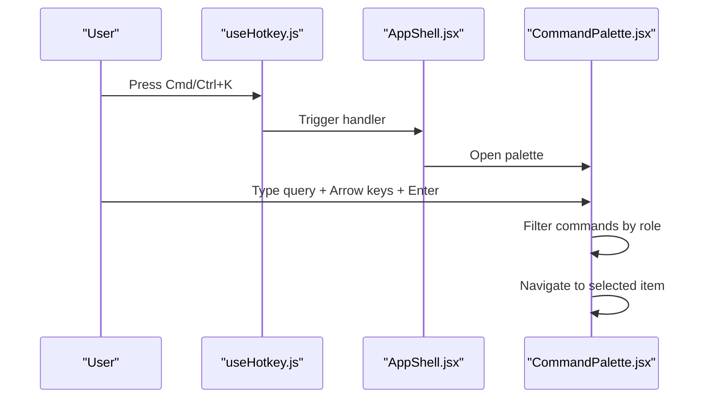
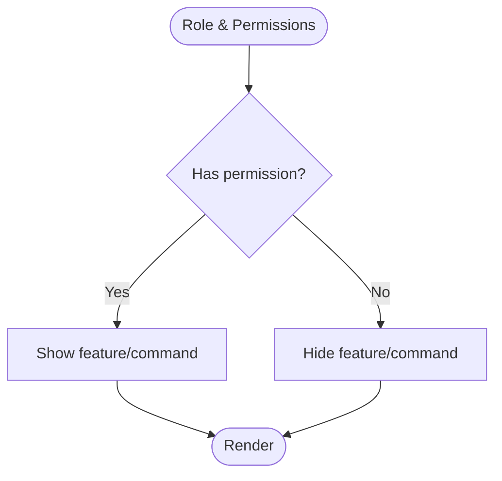
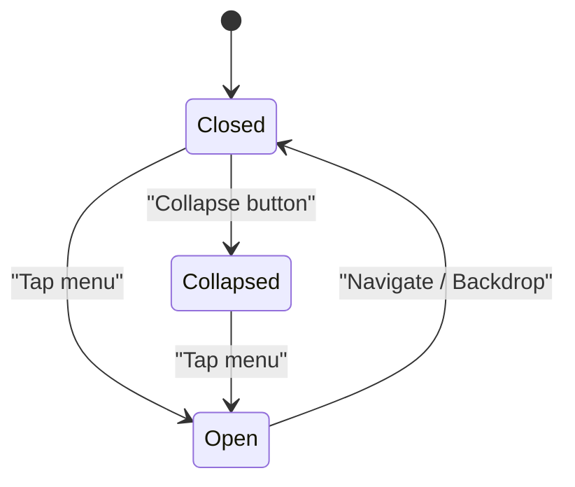
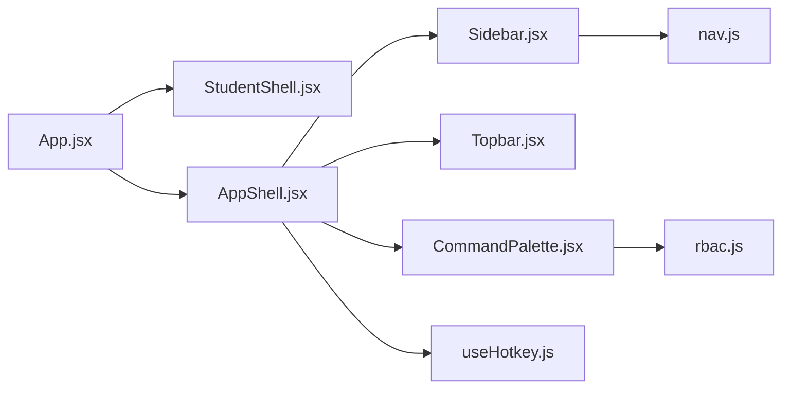

# Routing and Navigation

<cite>
**Referenced Files in This Document**
- [App.jsx](file://src/App.jsx)
- [main.jsx](file://src/main.jsx)
- [AppShell.jsx](file://src/components/layout/AppShell.jsx)
- [Sidebar.jsx](file://src/components/layout/Sidebar.jsx)
- [Topbar.jsx](file://src/components/layout/Topbar.jsx)
- [CommandPalette.jsx](file://src/components/layout/CommandPalette.jsx)
- [nav.js](file://src/components/layout/nav.js)
- [StudentShell.jsx](file://src/components/student/StudentShell.jsx)
- [rbac.js](file://src/lib/rbac.js)
- [useHotkey.js](file://src/hooks/useHotkey.js)
</cite>

## Table of Contents
1. Introduction
2. Project Structure
3. Core Components
4. Architecture Overview
5. Detailed Component Analysis
6. Dependency Analysis
7. Performance Considerations
8. Troubleshooting Guide
9. Conclusion
10. Appendices

## Introduction
This document explains the routing and navigation system for a dual-interface application that serves both students and staff from a single codebase. It covers:
- Route-based structure separating student-facing routes (/) from admin console routes (/admin).
- Navigation patterns including sidebar, topbar, and command palette access.
- Route protection mechanisms using role-based access control (RBAC).
- Lazy loading strategies and nested routing structures.
- Navigation state management, breadcrumbs, and mobile-responsive behavior.
- Practical examples for adding new routes and implementing protected navigation.

## Project Structure
The application is bootstrapped by the entry file and defines two primary route groups:
- Student site at root paths with its own shell layout.
- Admin console under /admin with a shared shell containing sidebar, topbar, and command palette.

**Diagram sources**
- [main.jsx:1-11](file://src/main.jsx#L1-L11)
- [App.jsx:1-70](file://src/App.jsx#L1-L70)
- [StudentShell.jsx:1-25](file://src/components/student/StudentShell.jsx#L1-L25)
- [AppShell.jsx:1-49](file://src/components/layout/AppShell.jsx#L1-L49)

**Section sources**
- [main.jsx:1-11](file://src/main.jsx#L1-L11)
- [App.jsx:1-70](file://src/App.jsx#L1-L70)

## Core Components
- App: Central router defining two route trees (student and admin), wrapping providers and a catch-all redirect.
- StudentShell: Layout for student pages; conditionally hides footer on chat to pin composer.
- AppShell: Layout for admin pages; owns chrome state (sidebar collapse, mobile drawer, command palette) and renders Outlet for nested routes.
- Sidebar: Renders grouped navigation items from a central config, supports collapsed mode and mobile open/close.
- Topbar: Provides search/command trigger, language toggle, theme toggle, and quick links to key admin sections.
- CommandPalette: Global command center driven by keyboard shortcut, filtering commands by current role permissions.
- nav.js: Single source of truth for admin navigation items and their target paths.
- rbac.js: Role definitions and permission checks used to gate UI actions and commands.

**Section sources**
- [App.jsx:1-70](file://src/App.jsx#L1-L70)
- [StudentShell.jsx:1-25](file://src/components/student/StudentShell.jsx#L1-L25)
- [AppShell.jsx:1-49](file://src/components/layout/AppShell.jsx#L1-L49)
- [Sidebar.jsx:1-109](file://src/components/layout/Sidebar.jsx#L1-L109)
- [Topbar.jsx:1-51](file://src/components/layout/Topbar.jsx#L1-L51)
- [CommandPalette.jsx:1-122](file://src/components/layout/CommandPalette.jsx#L1-L122)
- [nav.js:1-49](file://src/components/layout/nav.js#L1-L49)
- [rbac.js:1-51](file://src/lib/rbac.js#L1-L51)

## Architecture Overview
The app uses React Router v6 with nested routes and layout shells. The student interface sits at the root path, while the admin console is nested under /admin. Both share the same data layer but present different UIs.

**Diagram sources**
- [App.jsx:1-70](file://src/App.jsx#L1-L70)
- [StudentShell.jsx:1-25](file://src/components/student/StudentShell.jsx#L1-L25)
- [AppShell.jsx:1-49](file://src/components/layout/AppShell.jsx#L1-L49)

## Detailed Component Analysis

### Route Configuration and Nested Routing
- Two top-level route groups are defined:
  - Student routes wrapped in StudentShell.
  - Admin routes wrapped in AppShell.
- Nested routes render via Outlet inside each shell, enabling consistent chrome around page content.
- A catch-all route redirects unknown paths to the student landing.

**Diagram sources**
- [App.jsx:1-70](file://src/App.jsx#L1-L70)

**Section sources**
- [App.jsx:1-70](file://src/App.jsx#L1-L70)

### Student Shell Navigation
- StudentShell provides header, main area, and conditional footer.
- Footer is hidden when the pathname starts with /chat so the composer remains pinned.
- Uses Outlet to render child routes.

**Diagram sources**
- [StudentShell.jsx:1-25](file://src/components/student/StudentShell.jsx#L1-L25)

**Section sources**
- [StudentShell.jsx:1-25](file://src/components/student/StudentShell.jsx#L1-L25)

### Admin Shell, Sidebar, and Topbar
- AppShell manages chrome state:
  - Sidebar collapsed/open state.
  - Mobile drawer open/close.
  - Command palette open/close via hotkey.
  - Resets scroll and local state between pages using a key on pathname.
- Sidebar renders grouped navigation items from nav.js and highlights active links.
- Topbar exposes:
  - Mobile menu trigger.
  - Command palette trigger.
  - Language toggle (EN/اردو).
  - Theme toggle (light/dark).
  - Quick links to Review Queue and Audit Log.

**Diagram sources**
- [Topbar.jsx:1-51](file://src/components/layout/Topbar.jsx#L1-L51)
- [AppShell.jsx:1-49](file://src/components/layout/AppShell.jsx#L1-L49)
- [Sidebar.jsx:1-109](file://src/components/layout/Sidebar.jsx#L1-L109)

**Section sources**
- [AppShell.jsx:1-49](file://src/components/layout/AppShell.jsx#L1-L49)
- [Sidebar.jsx:1-109](file://src/components/layout/Sidebar.jsx#L1-L109)
- [Topbar.jsx:1-51](file://src/components/layout/Topbar.jsx#L1-L51)

### Command Palette and Keyboard Navigation
- Global command palette opens via Cmd/Ctrl+K using a custom hook.
- Commands include “Go to” entries derived from nav.js and action shortcuts filtered by RBAC.
- Supports keyboard navigation (arrow keys, Enter) and Escape to close.
- Filters commands based on current role permissions.

**Diagram sources**
- [useHotkey.js:1-19](file://src/hooks/useHotkey.js#L1-L19)
- [AppShell.jsx:1-49](file://src/components/layout/AppShell.jsx#L1-L49)
- [CommandPalette.jsx:1-122](file://src/components/layout/CommandPalette.jsx#L1-L122)

**Section sources**
- [CommandPalette.jsx:1-122](file://src/components/layout/CommandPalette.jsx#L1-L122)
- [useHotkey.js:1-19](file://src/hooks/useHotkey.js#L1-L19)

### Route Protection and Access Control
- RBAC defines roles and permissions.
- UI gating:
  - CommandPalette filters actions by permission before rendering.
  - Sidebar user popover allows switching roles to preview access.
- Notes:
  - Current implementation gates UI only; server-side enforcement is required for security.

**Diagram sources**
- [rbac.js:1-51](file://src/lib/rbac.js#L1-L51)
- [CommandPalette.jsx:1-122](file://src/components/layout/CommandPalette.jsx#L1-L122)
- [Sidebar.jsx:1-109](file://src/components/layout/Sidebar.jsx#L1-L109)

**Section sources**
- [rbac.js:1-51](file://src/lib/rbac.js#L1-L51)
- [CommandPalette.jsx:1-122](file://src/components/layout/CommandPalette.jsx#L1-L122)
- [Sidebar.jsx:1-109](file://src/components/layout/Sidebar.jsx#L1-L109)

### Mobile-Responsive Navigation
- Sidebar collapses on desktop and becomes an overlay drawer on mobile.
- Topbar includes a hamburger button to open the drawer.
- Closing the drawer occurs after navigation or clicking backdrop.

**Diagram sources**
- [AppShell.jsx:1-49](file://src/components/layout/AppShell.jsx#L1-L49)
- [Sidebar.jsx:1-109](file://src/components/layout/Sidebar.jsx#L1-L109)
- [Topbar.jsx:1-51](file://src/components/layout/Topbar.jsx#L1-L51)

**Section sources**
- [AppShell.jsx:1-49](file://src/components/layout/AppShell.jsx#L1-L49)
- [Sidebar.jsx:1-109](file://src/components/layout/Sidebar.jsx#L1-L109)
- [Topbar.jsx:1-51](file://src/components/layout/Topbar.jsx#L1-L51)

### Breadcrumbs
- No explicit breadcrumb component is implemented in the analyzed files.
- Recommended approach: derive breadcrumb segments from the matched route path within each shell’s header or a dedicated breadcrumb component.

[No sources needed since this section doesn't analyze specific files]

### Lazy Loading Strategy
- Current route configuration imports all pages statically.
- To implement route-based code splitting:
  - Replace static imports with dynamic imports inside lazy wrappers.
  - Wrap each route element with lazy and provide Suspense boundaries.
  - Keep shells (StudentShell, AppShell) loaded eagerly for consistent chrome.

Example pattern (conceptual):
- Replace static import with dynamic import in route definition.
- Use React.lazy to load page components on demand.
- Provide fallback UI during loading.

[No sources needed since this section provides general guidance]

## Dependency Analysis
Key relationships among routing and navigation components:

**Diagram sources**
- [App.jsx:1-70](file://src/App.jsx#L1-L70)
- [StudentShell.jsx:1-25](file://src/components/student/StudentShell.jsx#L1-L25)
- [AppShell.jsx:1-49](file://src/components/layout/AppShell.jsx#L1-L49)
- [Sidebar.jsx:1-109](file://src/components/layout/Sidebar.jsx#L1-L109)
- [Topbar.jsx:1-51](file://src/components/layout/Topbar.jsx#L1-L51)
- [CommandPalette.jsx:1-122](file://src/components/layout/CommandPalette.jsx#L1-L122)
- [nav.js:1-49](file://src/components/layout/nav.js#L1-L49)
- [rbac.js:1-51](file://src/lib/rbac.js#L1-L51)
- [useHotkey.js:1-19](file://src/hooks/useHotkey.js#L1-L19)

**Section sources**
- [App.jsx:1-70](file://src/App.jsx#L1-L70)
- [AppShell.jsx:1-49](file://src/components/layout/AppShell.jsx#L1-L49)
- [Sidebar.jsx:1-109](file://src/components/layout/Sidebar.jsx#L1-L109)
- [CommandPalette.jsx:1-122](file://src/components/layout/CommandPalette.jsx#L1-L122)
- [nav.js:1-49](file://src/components/layout/nav.js#L1-L49)
- [rbac.js:1-51](file://src/lib/rbac.js#L1-L51)
- [useHotkey.js:1-19](file://src/hooks/useHotkey.js#L1-L19)

## Performance Considerations
- Keep shells (StudentShell, AppShell) eagerly loaded to avoid chrome flicker.
- Implement route-based code splitting for heavy pages to reduce initial bundle size.
- Use React.Suspense with fallbacks for lazy-loaded routes.
- Avoid unnecessary re-renders in shells by memoizing stable callbacks where appropriate.
- Resetting scroll and local state per route via key on pathname prevents stale state across navigations.

[No sources needed since this section provides general guidance]

## Troubleshooting Guide
- Command palette not opening:
  - Ensure Cmd/Ctrl+K is handled and not intercepted by the browser.
  - Verify useHotkey is mounted and AppShell sets cmdOpen state.
- Sidebar links not highlighting:
  - Confirm NavLink props and exact match flags are correct.
  - Check that nav.js paths match route definitions.
- Permission-gated commands missing:
  - Validate current role and permissions in rbac.js.
  - Ensure CommandPalette filters commands using can(role, perm).
- Mobile drawer not closing:
  - Verify onNavigate callback is passed and invoked from Sidebar.
  - Ensure backdrop click handler closes the drawer.

**Section sources**
- [useHotkey.js:1-19](file://src/hooks/useHotkey.js#L1-L19)
- [AppShell.jsx:1-49](file://src/components/layout/AppShell.jsx#L1-L49)
- [Sidebar.jsx:1-109](file://src/components/layout/Sidebar.jsx#L1-L109)
- [CommandPalette.jsx:1-122](file://src/components/layout/CommandPalette.jsx#L1-L122)
- [rbac.js:1-51](file://src/lib/rbac.js#L1-L51)

## Conclusion
The application cleanly separates student and admin interfaces through nested routes and shared shells. Navigation is centralized via a configuration-driven sidebar and enhanced by a global command palette with role-based filtering. While route protection currently gates UI elements, server-side enforcement should be added for robust security. Adopting lazy loading will further improve performance and maintainability as the app grows.

[No sources needed since this section summarizes without analyzing specific files]

## Appendices

### Adding a New Admin Route
Steps:
- Add a new route under the admin group in App.jsx.
- Create or import the page component.
- Optionally add a corresponding item in nav.js for sidebar visibility.
- If the route requires restricted access, ensure permissions exist in rbac.js and gate UI accordingly.

Reference locations:
- [App.jsx:49-61](file://src/App.jsx#L49-L61)
- [nav.js:19-48](file://src/components/layout/nav.js#L19-L48)
- [rbac.js:25-48](file://src/lib/rbac.js#L25-L48)

**Section sources**
- [App.jsx:49-61](file://src/App.jsx#L49-L61)
- [nav.js:19-48](file://src/components/layout/nav.js#L19-L48)
- [rbac.js:25-48](file://src/lib/rbac.js#L25-L48)

### Implementing Protected Navigation
Approach:
- Define permissions in rbac.js for new features.
- Gate UI elements using can(role, perm).
- For route-level protection, wrap admin routes with a guard component that checks permissions and redirects if unauthorized.

Reference locations:
- [rbac.js:1-51](file://src/lib/rbac.js#L1-L51)
- [CommandPalette.jsx:29-53](file://src/components/layout/CommandPalette.jsx#L29-L53)

**Section sources**
- [rbac.js:1-51](file://src/lib/rbac.js#L1-L51)
- [CommandPalette.jsx:29-53](file://src/components/layout/CommandPalette.jsx#L29-L53)

### Enabling Route-Based Code Splitting
Recommended changes:
- Replace static imports with dynamic imports in route definitions.
- Wrap each route element with React.lazy and provide a Suspense boundary.
- Keep shells eagerly loaded for consistent chrome.

[No sources needed since this section provides general guidance]