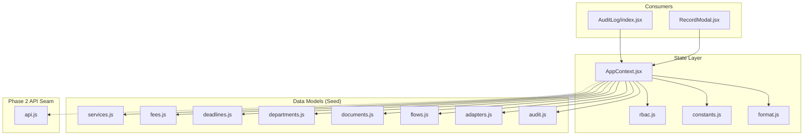
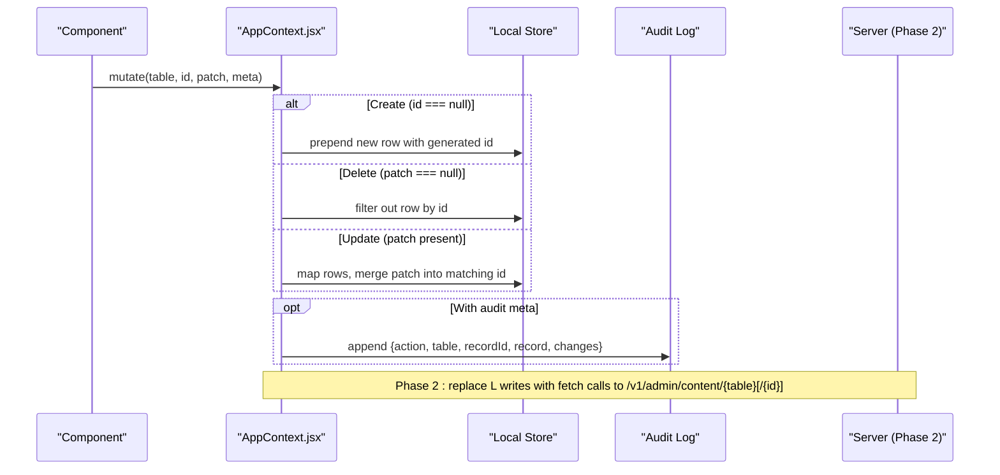
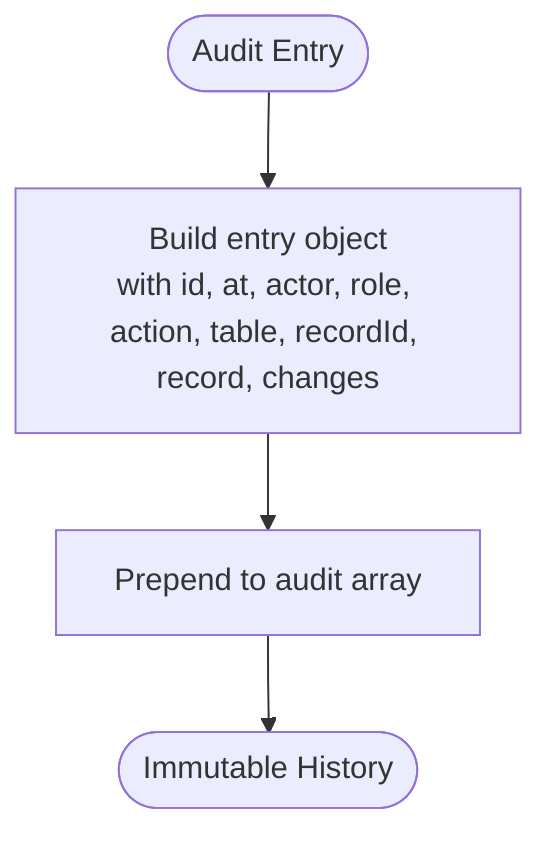
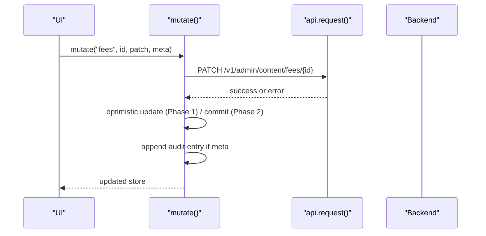
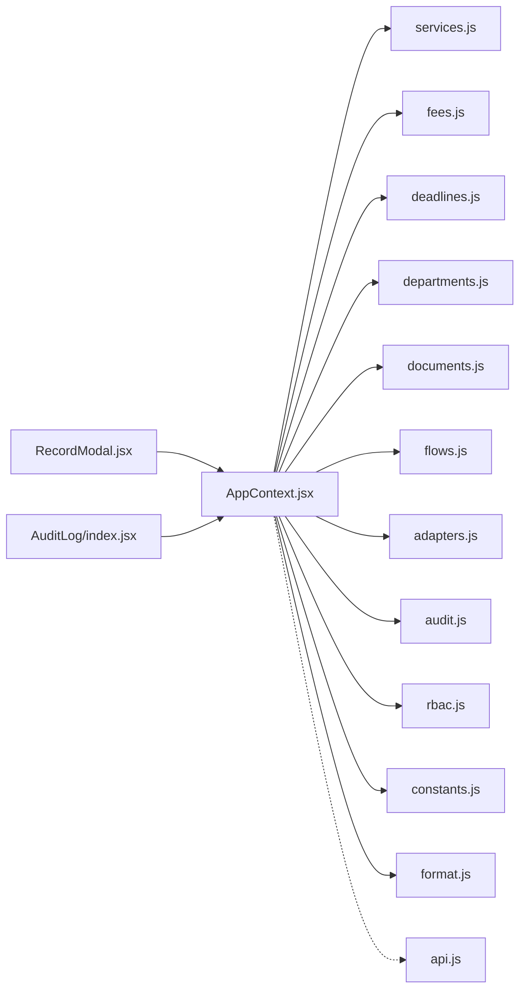

# AppContext - Global State Management

<cite>
**Referenced Files in This Document**
- [AppContext.jsx](file://src/context/AppContext.jsx)
- [rbac.js](file://src/lib/rbac.js)
- [constants.js](file://src/lib/constants.js)
- [format.js](file://src/lib/format.js)
- [api.js](file://src/lib/api.js)
- [adapters.js](file://src/mocks/adapters.js)
- [audit.js](file://src/mocks/audit.js)
- [services.js](file://src/mocks/services.js)
- [fees.js](file://src/mocks/fees.js)
- [deadlines.js](file://src/mocks/deadlines.js)
- [departments.js](file://src/mocks/departments.js)
- [documents.js](file://src/mocks/documents.js)
- [flows.js](file://src/mocks/flows.js)
- [RecordModal.jsx](file://src/components/content/RecordModal.jsx)
- [AuditLog/index.jsx](file://src/pages/AuditLog/index.jsx)
</cite>

## Table of Contents
1. Introduction
2. Project Structure
3. Core Components
4. Architecture Overview
5. Detailed Component Analysis
6. Dependency Analysis
7. Performance Considerations
8. Troubleshooting Guide
9. Conclusion

## Introduction
AppContext is the centralized state management system for the console application. It provides a single source of truth for domain data (services, fees, deadlines, departments, documents, flows, adapters), user context (theme, role, language), and an append-only audit trail. The mutate() function is the exclusive entry point for all state changes, enabling a clean migration path to server-backed state in Phase 2 without touching components.

## Project Structure
The state layer lives under src/context with supporting utilities in src/lib and seed data in src/mocks. Pages and content components consume the context via a custom hook and perform mutations through mutate(). Audit views render from the same append-only log.

**Diagram sources**
- [AppContext.jsx:34-134](file://src/context/AppContext.jsx#L34-L134)
- [services.js:10-309](file://src/mocks/services.js#L10-L309)
- [fees.js:5-20](file://src/mocks/fees.js#L5-L20)
- [deadlines.js:6-16](file://src/mocks/deadlines.js#L6-L16)
- [departments.js:5-17](file://src/mocks/departments.js#L5-L17)
- [documents.js:6-14](file://src/mocks/documents.js#L6-L14)
- [flows.js:19-116](file://src/mocks/flows.js#L19-L116)
- [adapters.js:18-63](file://src/mocks/adapters.js#L18-L63)
- [audit.js:8-21](file://src/mocks/audit.js#L8-L21)
- [RecordModal.jsx:21-41](file://src/components/content/RecordModal.jsx#L21-L41)
- [AuditLog/index.jsx:20-67](file://src/pages/AuditLog/index.jsx#L20-L67)

**Section sources**
- [AppContext.jsx:34-134](file://src/context/AppContext.jsx#L34-L134)
- [services.js:10-309](file://src/mocks/services.js#L10-L309)
- [fees.js:5-20](file://src/mocks/fees.js#L5-L20)
- [deadlines.js:6-16](file://src/mocks/deadlines.js#L6-L16)
- [departments.js:5-17](file://src/mocks/departments.js#L5-L17)
- [documents.js:6-14](file://src/mocks/documents.js#L6-L14)
- [flows.js:19-116](file://src/mocks/flows.js#L19-L116)
- [adapters.js:18-63](file://src/mocks/adapters.js#L18-L63)
- [audit.js:8-21](file://src/mocks/audit.js#L8-L21)

## Core Components
- Store shape: services, fees, deadlines, departments, documents, flows, adapters arrays.
- User context: theme, role, urdu (language toggle).
- Audit log: append-only entries with actor, role, timestamp, action, table, recordId, record snapshot, and field-level changes.
- Mutator: mutate(table, id, patch, meta) as the single source of truth for create/update/delete.
- Helpers: verifyRecord(table, record, nameOf) stamps verification metadata.

Key responsibilities:
- Centralize read access to store via React context.
- Enforce mutation semantics through mutate().
- Record audit events with actor and role derived from current context.
- Expose constants for today’s date and current user identity.

**Section sources**
- [AppContext.jsx:34-134](file://src/context/AppContext.jsx#L34-L134)
- [constants.js:1-35](file://src/lib/constants.js#L1-L35)
- [format.js:25-31](file://src/lib/format.js#L25-L31)

## Architecture Overview
AppContext exposes a stable API seam that isolates UI from storage details. In Phase 1, mutate() updates local store; in Phase 2, it will be rewritten to call server endpoints while preserving the same signature and behavior. Components remain unchanged.

**Diagram sources**
- [AppContext.jsx:69-103](file://src/context/AppContext.jsx#L69-L103)
- [api.js:108-166](file://src/lib/api.js#L108-L166)

## Detailed Component Analysis

### Store Data Structures
- Services: catalogue items with bilingual labels, category, verification metadata, document checklist, and procedure text.
- Fees: tariff entries per program/category with effective dates and sources.
- Deadlines: service-specific due dates tied to semesters.
- Departments: campus and department contact info with hours and verified metadata.
- Documents: ingestion pipeline records with status, versioning, and chunk counts.
- Flows: guided multi-step journeys modeled as state machines with step types (ask, lookup, inform, confirm, handoff).
- Adapters: integration registry abstracting external systems behind a consistent interface.

Complexity notes:
- All tables are plain arrays; operations are O(n) per mutate for update/delete and O(1) prepend for create.
- Filtering and sorting are performed in consuming components; keep lists reasonably sized or paginate where applicable.

**Section sources**
- [services.js:10-309](file://src/mocks/services.js#L10-L309)
- [fees.js:5-20](file://src/mocks/fees.js#L5-L20)
- [deadlines.js:6-16](file://src/mocks/deadlines.js#L6-L16)
- [departments.js:5-17](file://src/mocks/departments.js#L5-L17)
- [documents.js:6-14](file://src/mocks/documents.js#L6-L14)
- [flows.js:19-116](file://src/mocks/flows.js#L19-L116)
- [adapters.js:18-63](file://src/mocks/adapters.js#L18-L63)

### mutate(): Single Source of Truth
Behavior:
- Create: id is null → prepend a new row with a generated id.
- Delete: patch is null → remove row by id.
- Update: patch present → shallow merge patch into matching row.
- Audit: if meta provided, append an audit entry with action, table, recordId, record snapshot, and changes.

Optimistic pattern:
- mutate() applies changes immediately to local store so UI stays responsive.
- In Phase 2, wrap server calls around this immediate update; on failure, revert or reconcile using stored snapshots.

Error handling:
- Current implementation does not throw; future server calls should propagate errors to callers for rollback and user feedback.

**Section sources**
- [AppContext.jsx:69-103](file://src/context/AppContext.jsx#L69-L103)

### Audit Logging
- Append-only list seeded from mock data.
- Each entry includes: id, at (timestamp), actor, role, action, table, recordId, record snapshot, and field-level changes.
- Timestamps use a deterministic format aligned with mock “today.”
- Views: global audit page and per-record history drawer both derive from the same log, ensuring consistency.

**Diagram sources**
- [AppContext.jsx:51-67](file://src/context/AppContext.jsx#L51-L67)
- [audit.js:8-21](file://src/mocks/audit.js#L8-L21)
- [AuditLog/index.jsx:20-67](file://src/pages/AuditLog/index.jsx#L20-L67)

**Section sources**
- [AppContext.jsx:51-67](file://src/context/AppContext.jsx#L51-L67)
- [audit.js:8-21](file://src/mocks/audit.js#L8-L21)
- [AuditLog/index.jsx:20-67](file://src/pages/AuditLog/index.jsx#L20-L67)

### Role-Based Access Control and User Context
- Roles and permissions are defined centrally and consumed by UI to gate actions.
- Current user identity and role are available via context and constants.
- Permissions include write, verify, delete, and read across domains like content, documents, queues, escalations, flows, integrations, guardrails, and audit.

Integration points:
- mutate() logs the actor and role for every change.
- UI can hide/disable controls based on can(role, perm).

**Section sources**
- [rbac.js:10-51](file://src/lib/rbac.js#L10-L51)
- [constants.js:11-16](file://src/lib/constants.js#L11-L16)
- [AppContext.jsx:34-67](file://src/context/AppContext.jsx#L34-L67)

### Theme and Language Preferences
- Theme toggles between light/dark modes.
- Urdu toggle switches language rendering paths.
- These preferences are part of the context value and can be persisted in Phase 2 via settings store or backend.

**Section sources**
- [AppContext.jsx:34-47](file://src/context/AppContext.jsx#L34-L47)
- [AppContext.jsx:118-131](file://src/context/AppContext.jsx#L118-L131)

### API Seam Design for Phase 2 Migration
- mutate() signature remains constant: mutate(table, id, patch, meta).
- Phase 2 replaces local store writes with HTTP calls to /v1/admin/content/{table}[/{id}].
- Existing components continue to call mutate() unchanged.
- api.js already contains admin endpoints and a request helper for error handling and headers.

**Diagram sources**
- [AppContext.jsx:69-103](file://src/context/AppContext.jsx#L69-L103)
- [api.js:16-31](file://src/lib/api.js#L16-L31)
- [api.js:108-166](file://src/lib/api.js#L108-L166)

### Optimistic Updates and Error Handling Patterns
- Optimistic updates: mutate() applies changes immediately to store for instant feedback.
- Error handling:
  - Wrap mutate() calls in try/catch when integrating server calls.
  - On error, revert last optimistic change using previous snapshot or refetch.
  - Surface user-facing messages via toast or inline errors.
- Verification flow: verifyRecord uses mutate() with verification metadata and audit action.

**Section sources**
- [AppContext.jsx:105-116](file://src/context/AppContext.jsx#L105-L116)
- [RecordModal.jsx:26-41](file://src/components/content/RecordModal.jsx#L26-L41)
- [api.js:16-31](file://src/lib/api.js#L16-L31)

### Large Dataset Performance Considerations
- Keep mutate() operations minimal and avoid deep cloning beyond necessary merges.
- Prefer pagination or virtualization in consumers for large tables (e.g., services, documents).
- Debounce search/filter inputs to reduce re-renders.
- Consider memoizing derived lists in components using useMemo.
- For audits, limit visible entries and provide filtering/export rather than rendering all at once.

[No sources needed since this section provides general guidance]

## Dependency Analysis
AppContext depends on mock data modules for initial store values and on lib utilities for formatting and constants. Consumers depend on AppContext for store and mutate. The API module is decoupled but intended to replace store writes in Phase 2.

**Diagram sources**
- [AppContext.jsx:34-134](file://src/context/AppContext.jsx#L34-L134)
- [services.js:10-309](file://src/mocks/services.js#L10-L309)
- [fees.js:5-20](file://src/mocks/fees.js#L5-L20)
- [deadlines.js:6-16](file://src/mocks/deadlines.js#L6-L16)
- [departments.js:5-17](file://src/mocks/departments.js#L5-L17)
- [documents.js:6-14](file://src/mocks/documents.js#L6-L14)
- [flows.js:19-116](file://src/mocks/flows.js#L19-L116)
- [adapters.js:18-63](file://src/mocks/adapters.js#L18-L63)
- [audit.js:8-21](file://src/mocks/audit.js#L8-L21)
- [RecordModal.jsx:21-41](file://src/components/content/RecordModal.jsx#L21-L41)
- [AuditLog/index.jsx:20-67](file://src/pages/AuditLog/index.jsx#L20-L67)
- [api.js:108-166](file://src/lib/api.js#L108-L166)

**Section sources**
- [AppContext.jsx:34-134](file://src/context/AppContext.jsx#L34-L134)
- [api.js:108-166](file://src/lib/api.js#L108-L166)

## Performance Considerations
- Use immutable updates within mutate() to minimize re-renders.
- Avoid unnecessary re-computation in consumers by memoizing filtered/sorted lists.
- For audits, implement virtualized lists or server-side pagination when the log grows large.
- Batch multiple small mutations when possible to reduce store churn.
- Defer heavy computations (e.g., diff generation) until save time.

[No sources needed since this section provides general guidance]

## Troubleshooting Guide
Common issues and resolutions:
- Missing context usage: ensure components are wrapped by the provider and use the custom hook to access context.
- Unexpected re-renders: check for unstable references passed to mutate callbacks or missing memoization in consumers.
- Audit gaps: verify that meta is provided with mutate() calls to capture changes; ensure logAudit is invoked.
- Export failures: browser security may block downloads; instruct users to retry outside sandboxed frames.

**Section sources**
- [AppContext.jsx:18-22](file://src/context/AppContext.jsx#L18-L22)
- [AppContext.jsx:92-100](file://src/context/AppContext.jsx#L92-L100)
- [AuditLog/index.jsx:43-67](file://src/pages/AuditLog/index.jsx#L43-L67)

## Conclusion
AppContext centralizes state, enforces a single mutation surface, and maintains a robust audit trail. Its design enables a seamless transition to server-backed state in Phase 2 without component changes. By combining immutable updates, clear APIs, and strong auditing, it supports compliance, reliability, and scalability for a university-facing console.