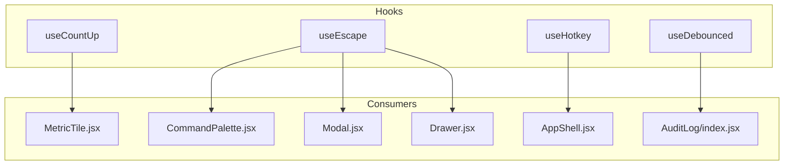
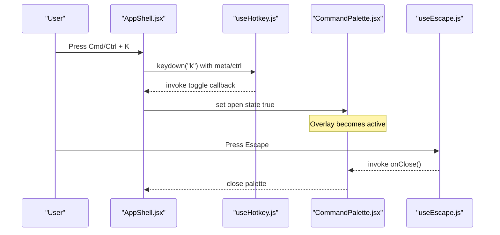
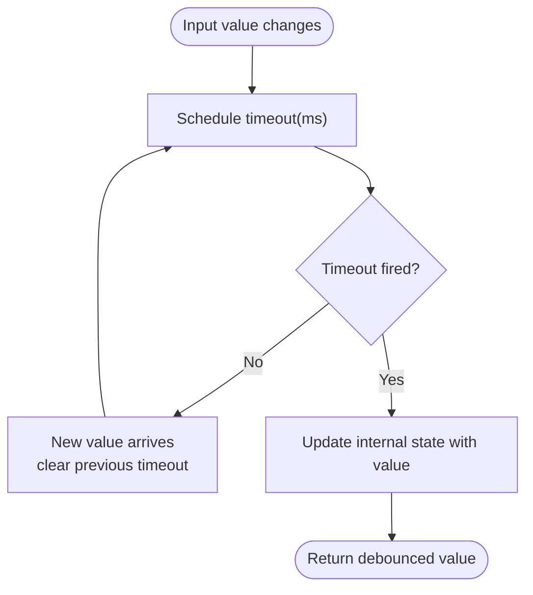
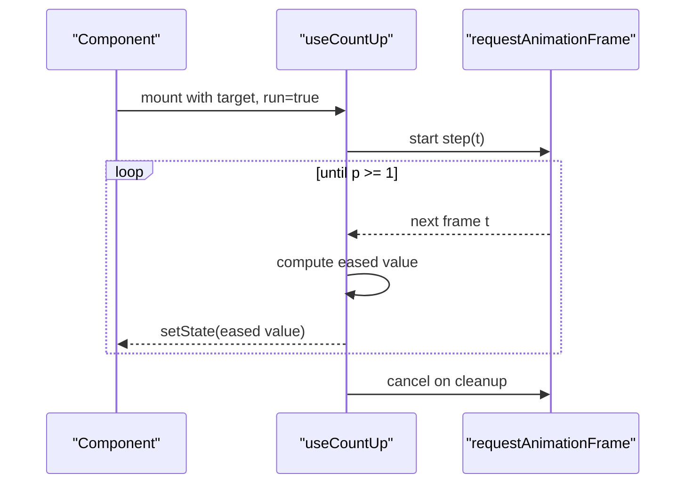
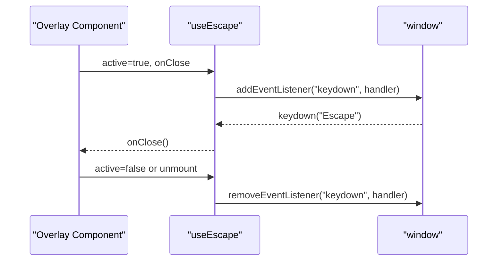
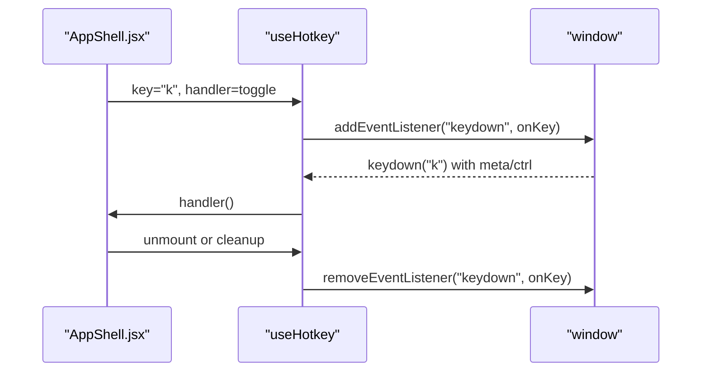
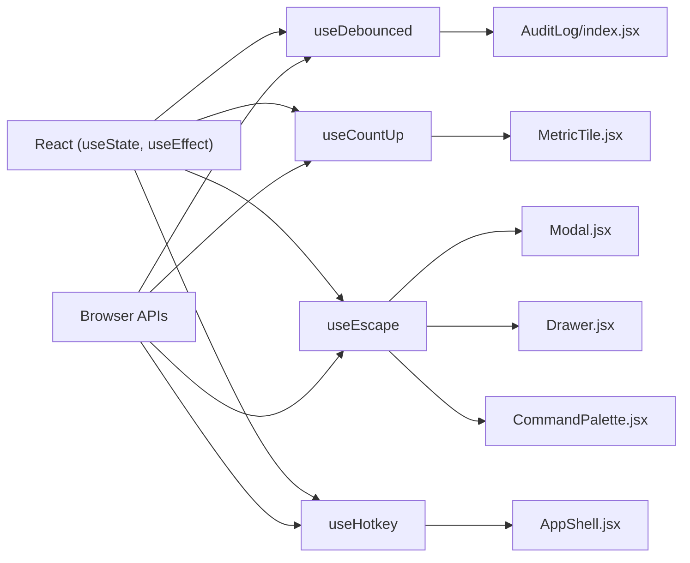

# Custom Hooks Library

<cite>
**Referenced Files in This Document**
- [useDebounced.js](file://src/hooks/useDebounced.js)
- [useCountUp.js](file://src/hooks/useCountUp.js)
- [useEscape.js](file://src/hooks/useEscape.js)
- [useHotkey.js](file://src/hooks/useHotkey.js)
- [MetricTile.jsx](file://src/pages/Dashboard/MetricTile.jsx)
- [CommandPalette.jsx](file://src/components/layout/CommandPalette.jsx)
- [Modal.jsx](file://src/components/ui/Modal.jsx)
- [Drawer.jsx](file://src/components/ui/Drawer.jsx)
- [AppShell.jsx](file://src/components/layout/AppShell.jsx)
- [AuditLog/index.jsx](file://src/pages/AuditLog/index.jsx)
</cite>

## Table of Contents
1. [Introduction](#introduction)
2. [Project Structure](#project-structure)
3. [Core Components](#core-components)
4. [Architecture Overview](#architecture-overview)
5. [Detailed Component Analysis](#detailed-component-analysis)
6. [Dependency Analysis](#dependency-analysis)
7. [Performance Considerations](#performance-considerations)
8. [Troubleshooting Guide](#troubleshooting-guide)
9. [Conclusion](#conclusion)
10. [Appendices](#appendices)

## Introduction
This document provides comprehensive documentation for the custom React hooks library located under src/hooks. It focuses on four reusable hooks that power performance, animation, keyboard interaction, and global shortcuts across the application:
- useDebounced: delays updates to fast-changing values (e.g., search input).
- useCountUp: animates a number from 0 to a target with easing.
- useEscape: listens for Escape key to close overlays when active.
- useHotkey: registers global Cmd/Ctrl + key shortcuts with default prevention.

The guide includes parameter specifications, return values, usage examples, best practices, performance considerations, memory leak prevention, and testing strategies.

## Project Structure
The hooks live in src/hooks and are consumed by components and pages throughout the app:
- useDebounced is used in search/filter contexts to reduce re-renders and expensive computations.
- useCountUp powers animated metric tiles on the dashboard.
- useEscape is integrated into overlay-like UI primitives (Modal, Drawer, CommandPalette).
- useHotkey enables global keyboard shortcuts (e.g., opening the command palette).

**Diagram sources**
- [useDebounced.js:1-12](file://src/hooks/useDebounced.js#L1-L12)
- [useCountUp.js:1-31](file://src/hooks/useCountUp.js#L1-L31)
- [useEscape.js:1-14](file://src/hooks/useEscape.js#L1-L14)
- [useHotkey.js:1-20](file://src/hooks/useHotkey.js#L1-L20)
- [MetricTile.jsx:1-33](file://src/pages/Dashboard/MetricTile.jsx#L1-L33)
- [CommandPalette.jsx:1-122](file://src/components/layout/CommandPalette.jsx#L1-L122)
- [Modal.jsx:1-39](file://src/components/ui/Modal.jsx#L1-L39)
- [Drawer.jsx:1-33](file://src/components/ui/Drawer.jsx#L1-L33)
- [AppShell.jsx:1-49](file://src/components/layout/AppShell.jsx#L1-L49)
- [AuditLog/index.jsx:1-150](file://src/pages/AuditLog/index.jsx#L1-L150)

**Section sources**
- [useDebounced.js:1-12](file://src/hooks/useDebounced.js#L1-L12)
- [useCountUp.js:1-31](file://src/hooks/useCountUp.js#L1-L31)
- [useEscape.js:1-14](file://src/hooks/useEscape.js#L1-L14)
- [useHotkey.js:1-20](file://src/hooks/useHotkey.js#L1-L20)
- [MetricTile.jsx:1-33](file://src/pages/Dashboard/MetricTile.jsx#L1-L33)
- [CommandPalette.jsx:1-122](file://src/components/layout/CommandPalette.jsx#L1-L122)
- [Modal.jsx:1-39](file://src/components/ui/Modal.jsx#L1-L39)
- [Drawer.jsx:1-33](file://src/components/ui/Drawer.jsx#L1-L33)
- [AppShell.jsx:1-49](file://src/components/layout/AppShell.jsx#L1-L49)
- [AuditLog/index.jsx:1-150](file://src/pages/AuditLog/index.jsx#L1-L150)

## Core Components
This section summarizes each hook’s purpose, parameters, return value, behavior, and typical usage patterns.

- useDebounced(value, ms = 220)
  - Purpose: Delay updates to a rapidly changing value to reduce re-renders and downstream work.
  - Parameters:
    - value: The source value to debounce.
    - ms: Optional delay in milliseconds; defaults to 220.
  - Returns: Debounced value that updates after the specified delay.
  - Behavior: Uses a timeout per change; clears previous timeout on new changes or cleanup.
  - Usage example: Applied to search inputs to filter lists without triggering every keystroke.
  - Best practices:
    - Use for high-frequency events like typing, scroll, resize.
    - Tune ms based on UX needs; too long feels sluggish, too short reduces benefit.
    - Ensure consumers depend on the debounced value, not the raw one, for filtering.
  - Performance: Reduces render frequency and heavy computations triggered by rapid state changes.
  - Memory safety: Clears timeouts via effect cleanup to prevent leaks.

- useCountUp(target, run, ms = 850)
  - Purpose: Animate a numeric value from 0 to target using an ease-out cubic curve.
  - Parameters:
    - target: Final numeric value to animate to.
    - run: Boolean flag controlling whether animation runs; if false, sets value immediately to target.
    - ms: Optional duration in milliseconds; defaults to 850.
  - Returns: Animated number that transitions smoothly over time.
  - Behavior: Uses requestAnimationFrame loop; cancels on unmount or dependency changes.
  - Usage example: Dashboard metric tiles animate their values once on mount.
  - Best practices:
    - Gate animation with a run flag to avoid repeated animations on re-renders.
    - Keep ms reasonable for perceived responsiveness.
  - Performance: Efficient animation via rAF; avoids unnecessary renders outside the frame loop.
  - Memory safety: Cancels rAF on cleanup to prevent leaks.

- useEscape(active, onClose)
  - Purpose: Close overlays when the user presses Escape while the overlay is active.
  - Parameters:
    - active: Boolean indicating if the overlay is currently open.
    - onClose: Function to call when Escape is pressed.
  - Returns: void (side-effect only).
  - Behavior: Adds a keydown listener to window when active; removes it on cleanup or when inactive.
  - Usage example: Modal, Drawer, and CommandPalette all use this to support Escape-to-close.
  - Best practices:
    - Only attach listeners when the overlay is visible to avoid unnecessary overhead.
    - Ensure onClose is stable or memoized to avoid re-registering listeners frequently.
  - Memory safety: Removes event listener on cleanup.

- useHotkey(key, handler)
  - Purpose: Register a global shortcut for Cmd/Ctrl + key combinations.
  - Parameters:
    - key: Single character key to match (case-insensitive).
    - handler: Callback invoked when the shortcut is triggered.
  - Returns: void (side-effect only).
  - Behavior: Listens for keydown on window; prevents default browser action for the combination.
  - Usage example: Toggles the command palette with Cmd/Ctrl + K.
  - Best practices:
    - Provide a stable handler reference (e.g., useCallback) to avoid re-binding.
    - Choose keys unlikely to conflict with native browser actions.
  - Memory safety: Removes event listener on cleanup.

**Section sources**
- [useDebounced.js:1-12](file://src/hooks/useDebounced.js#L1-L12)
- [useCountUp.js:1-31](file://src/hooks/useCountUp.js#L1-L31)
- [useEscape.js:1-14](file://src/hooks/useEscape.js#L1-L14)
- [useHotkey.js:1-20](file://src/hooks/useHotkey.js#L1-L20)
- [AuditLog/index.jsx:1-150](file://src/pages/AuditLog/index.jsx#L1-L150)
- [MetricTile.jsx:1-33](file://src/pages/Dashboard/MetricTile.jsx#L1-L33)
- [CommandPalette.jsx:1-122](file://src/components/layout/CommandPalette.jsx#L1-L122)
- [Modal.jsx:1-39](file://src/components/ui/Modal.jsx#L1-L39)
- [Drawer.jsx:1-33](file://src/components/ui/Drawer.jsx#L1-L33)
- [AppShell.jsx:1-49](file://src/components/layout/AppShell.jsx#L1-L49)

## Architecture Overview
The hooks are small, focused utilities that encapsulate side effects and state management for common interactions. They integrate cleanly with existing components and pages, enabling consistent behavior across the app.

**Diagram sources**
- [AppShell.jsx:1-49](file://src/components/layout/AppShell.jsx#L1-L49)
- [useHotkey.js:1-20](file://src/hooks/useHotkey.js#L1-L20)
- [CommandPalette.jsx:1-122](file://src/components/layout/CommandPalette.jsx#L1-L122)
- [useEscape.js:1-14](file://src/hooks/useEscape.js#L1-L14)

## Detailed Component Analysis

### useDebounced
- Implementation highlights:
  - Maintains internal state for the debounced value.
  - Schedules a timeout on each change; clears previous timeout on new changes or cleanup.
  - Returns the delayed value to consumers.
- Data flow:
  - Raw input changes frequently.
  - Debounced value updates after ms delay.
  - Consumers compute derived data (e.g., filtered list) based on the debounced value.
- Complexity:
  - Time: O(1) per update; scheduling and clearing timeouts are constant time.
  - Space: O(1) additional state per instance.
- Optimization opportunities:
  - Consider adding leading/trailing options if needed for specific UX patterns.
  - For very large datasets, combine with memoization in consumers.
- Error handling:
  - No explicit error handling; ensure consumers handle empty or invalid states gracefully.
- Testing strategy:
  - Verify that the returned value does not change until ms has elapsed after the last input.
  - Confirm cleanup clears pending timeouts.
  - Example test scenarios:
    - Rapid updates within ms should result in a single delayed update.
    - Changing ms mid-run should reschedule correctly.
    - Unmounting before timeout completes should not trigger updates.

**Diagram sources**
- [useDebounced.js:1-12](file://src/hooks/useDebounced.js#L1-L12)

**Section sources**
- [useDebounced.js:1-12](file://src/hooks/useDebounced.js#L1-L12)
- [AuditLog/index.jsx:1-150](file://src/pages/AuditLog/index.jsx#L1-L150)

### useCountUp
- Implementation highlights:
  - Animates from 0 to target using requestAnimationFrame.
  - Applies an ease-out cubic curve for smooth deceleration.
  - Supports immediate setting when run is false.
- Data flow:
  - On mount or when dependencies change, starts animation if run is true.
  - Updates internal state each frame until completion.
  - Cancels animation on cleanup or dependency changes.
- Complexity:
  - Time: O(n) frames where n ≈ ms / frameInterval; typically ~60fps.
  - Space: O(1) per instance.
- Optimization opportunities:
  - Avoid frequent re-runs by stabilizing dependencies or gating with run.
  - Consider pausing/resuming if component goes off-screen.
- Error handling:
  - No explicit error handling; ensure target is a valid number.
- Testing strategy:
  - Mock requestAnimationFrame to control time progression.
  - Assert intermediate values follow expected easing curve.
  - Verify cleanup cancels animation.

**Diagram sources**
- [useCountUp.js:1-31](file://src/hooks/useCountUp.js#L1-L31)
- [MetricTile.jsx:1-33](file://src/pages/Dashboard/MetricTile.jsx#L1-L33)

**Section sources**
- [useCountUp.js:1-31](file://src/hooks/useCountUp.js#L1-L31)
- [MetricTile.jsx:1-33](file://src/pages/Dashboard/MetricTile.jsx#L1-L33)

### useEscape
- Implementation highlights:
  - Attaches a keydown listener to window when active is true.
  - Calls onClose when Escape is pressed.
  - Removes listener on cleanup or when active becomes false.
- Data flow:
  - When overlay opens, listener is attached.
  - On Escape, overlay closes.
  - When overlay closes or component unmounts, listener is removed.
- Complexity:
  - Time: O(1) per event.
  - Space: O(1) per instance.
- Optimization opportunities:
  - Ensure onClose is memoized to avoid re-binding.
- Error handling:
  - No explicit error handling; ensure onClose is a function.
- Testing strategy:
  - Simulate keydown events and verify onClose is called.
  - Verify listener removal on unmount or when active toggles.

**Diagram sources**
- [useEscape.js:1-14](file://src/hooks/useEscape.js#L1-L14)
- [Modal.jsx:1-39](file://src/components/ui/Modal.jsx#L1-L39)
- [Drawer.jsx:1-33](file://src/components/ui/Drawer.jsx#L1-L33)
- [CommandPalette.jsx:1-122](file://src/components/layout/CommandPalette.jsx#L1-L122)

**Section sources**
- [useEscape.js:1-14](file://src/hooks/useEscape.js#L1-L14)
- [Modal.jsx:1-39](file://src/components/ui/Modal.jsx#L1-L39)
- [Drawer.jsx:1-33](file://src/components/ui/Drawer.jsx#L1-L33)
- [CommandPalette.jsx:1-122](file://src/components/layout/CommandPalette.jsx#L1-L122)

### useHotkey
- Implementation highlights:
  - Registers a global keydown listener for Cmd/Ctrl + key.
  - Prevents default browser behavior for the combination.
  - Invokes provided handler when matched.
- Data flow:
  - Listener is attached on mount.
  - On matching keydown, handler is executed.
  - Listener is removed on cleanup.
- Complexity:
  - Time: O(1) per event.
  - Space: O(1) per instance.
- Optimization opportunities:
  - Stabilize handler references to avoid re-binding.
- Error handling:
  - No explicit error handling; ensure handler is a function.
- Testing strategy:
  - Dispatch keydown events with appropriate modifiers and verify handler invocation.
  - Verify default prevention occurs.
  - Confirm listener removal on unmount.

**Diagram sources**
- [useHotkey.js:1-20](file://src/hooks/useHotkey.js#L1-L20)
- [AppShell.jsx:1-49](file://src/components/layout/AppShell.jsx#L1-L49)

**Section sources**
- [useHotkey.js:1-20](file://src/hooks/useHotkey.js#L1-L20)
- [AppShell.jsx:1-49](file://src/components/layout/AppShell.jsx#L1-L49)

## Dependency Analysis
- Coupling:
  - Hooks are decoupled from UI specifics; they rely on standard DOM APIs and React lifecycle.
  - Consumers depend on stable references for callbacks to minimize re-bindings.
- Direct dependencies:
  - React hooks: useState, useEffect.
  - Browser APIs: setTimeout, clearTimeout, requestAnimationFrame, cancelAnimationFrame, window.addEventListener/removeEventListener.
- Indirect dependencies:
  - Components consuming these hooks may introduce additional state and rendering logic.
- External integrations:
  - None beyond standard web platform features.

**Diagram sources**
- [useDebounced.js:1-12](file://src/hooks/useDebounced.js#L1-L12)
- [useCountUp.js:1-31](file://src/hooks/useCountUp.js#L1-L31)
- [useEscape.js:1-14](file://src/hooks/useEscape.js#L1-L14)
- [useHotkey.js:1-20](file://src/hooks/useHotkey.js#L1-L20)
- [AuditLog/index.jsx:1-150](file://src/pages/AuditLog/index.jsx#L1-L150)
- [MetricTile.jsx:1-33](file://src/pages/Dashboard/MetricTile.jsx#L1-L33)
- [Modal.jsx:1-39](file://src/components/ui/Modal.jsx#L1-L39)
- [Drawer.jsx:1-33](file://src/components/ui/Drawer.jsx#L1-L33)
- [CommandPalette.jsx:1-122](file://src/components/layout/CommandPalette.jsx#L1-L122)
- [AppShell.jsx:1-49](file://src/components/layout/AppShell.jsx#L1-L49)

**Section sources**
- [useDebounced.js:1-12](file://src/hooks/useDebounced.js#L1-L12)
- [useCountUp.js:1-31](file://src/hooks/useCountUp.js#L1-L31)
- [useEscape.js:1-14](file://src/hooks/useEscape.js#L1-L14)
- [useHotkey.js:1-20](file://src/hooks/useHotkey.js#L1-L20)

## Performance Considerations
- useDebounced:
  - Reduces re-renders and expensive computations during rapid input.
  - Tune ms to balance responsiveness and performance.
  - Combine with memoization in consumers for large datasets.
- useCountUp:
  - Uses requestAnimationFrame for smooth, efficient animation.
  - Avoid unnecessary re-runs by stabilizing dependencies or gating with run.
- useEscape and useHotkey:
  - Minimal overhead; ensure handlers are stable to avoid redundant listener registration.
  - Prefer memoized callbacks (e.g., useCallback) for onClose and hotkey handlers.

[No sources needed since this section provides general guidance]

## Troubleshooting Guide
- Common issues:
  - Debounce not triggering:
    - Verify ms is not zero and that the component remains mounted.
    - Check that consumers read the debounced value, not the raw input.
  - Animation not playing:
    - Ensure run is true and target is a valid number.
    - Confirm requestAnimationFrame is supported in the environment.
  - Escape not closing overlay:
    - Confirm active is true when overlay is visible.
    - Ensure onClose is passed correctly and not overridden.
  - Hotkey not firing:
    - Verify modifier keys (Cmd/Ctrl) are held and key matches exactly.
    - Check that no other listener prevents propagation earlier.
- Debugging tips:
  - Log dependency changes to identify unexpected re-runs.
  - Use browser dev tools to inspect event listeners and timers.
  - Temporarily disable hooks to isolate issues.

**Section sources**
- [useDebounced.js:1-12](file://src/hooks/useDebounced.js#L1-L12)
- [useCountUp.js:1-31](file://src/hooks/useCountUp.js#L1-L31)
- [useEscape.js:1-14](file://src/hooks/useEscape.js#L1-L14)
- [useHotkey.js:1-20](file://src/hooks/useHotkey.js#L1-L20)

## Conclusion
The custom hooks library provides concise, reusable solutions for common React patterns:
- Debouncing improves performance for high-frequency inputs.
- Count-up animations enhance user experience with smooth transitions.
- Escape handling ensures consistent overlay dismissal.
- Global hotkeys enable efficient keyboard navigation.

By following best practices—stable references, proper cleanup, and thoughtful parameter tuning—you can leverage these hooks to build responsive, accessible, and maintainable interfaces.

[No sources needed since this section summarizes without analyzing specific files]

## Appendices

### Usage Examples and Best Practices
- useDebounced:
  - Apply to search inputs to filter lists efficiently.
  - Example consumer: AuditLog page uses debounced query to filter entries.
  - Best practice: Keep ms between 150–300ms for snappy yet performant feedback.
- useCountUp:
  - Use for dashboard metrics that animate once on mount.
  - Example consumer: MetricTile animates values with easing.
  - Best practice: Gate with run to avoid repeated animations.
- useEscape:
  - Integrate into any overlay component to support Escape-to-close.
  - Example consumers: Modal, Drawer, CommandPalette.
  - Best practice: Ensure active reflects visibility state accurately.
- useHotkey:
  - Register global shortcuts for primary actions.
  - Example consumer: AppShell toggles command palette with Cmd/Ctrl + K.
  - Best practice: Use stable handlers and choose non-conflicting keys.

**Section sources**
- [AuditLog/index.jsx:1-150](file://src/pages/AuditLog/index.jsx#L1-L150)
- [MetricTile.jsx:1-33](file://src/pages/Dashboard/MetricTile.jsx#L1-L33)
- [Modal.jsx:1-39](file://src/components/ui/Modal.jsx#L1-L39)
- [Drawer.jsx:1-33](file://src/components/ui/Drawer.jsx#L1-L33)
- [CommandPalette.jsx:1-122](file://src/components/layout/CommandPalette.jsx#L1-L122)
- [AppShell.jsx:1-49](file://src/components/layout/AppShell.jsx#L1-L49)

### Testing Strategies
- useDebounced:
  - Use fake timers to advance time and assert delayed updates.
  - Verify cleanup clears timeouts.
- useCountUp:
  - Mock requestAnimationFrame to simulate frames.
  - Assert intermediate values and final target.
- useEscape:
  - Dispatch keydown events and assert onClose calls.
  - Verify listener removal on unmount.
- useHotkey:
  - Dispatch keydown with modifiers and assert handler invocation.
  - Confirm default prevention occurs.

[No sources needed since this section provides general guidance]