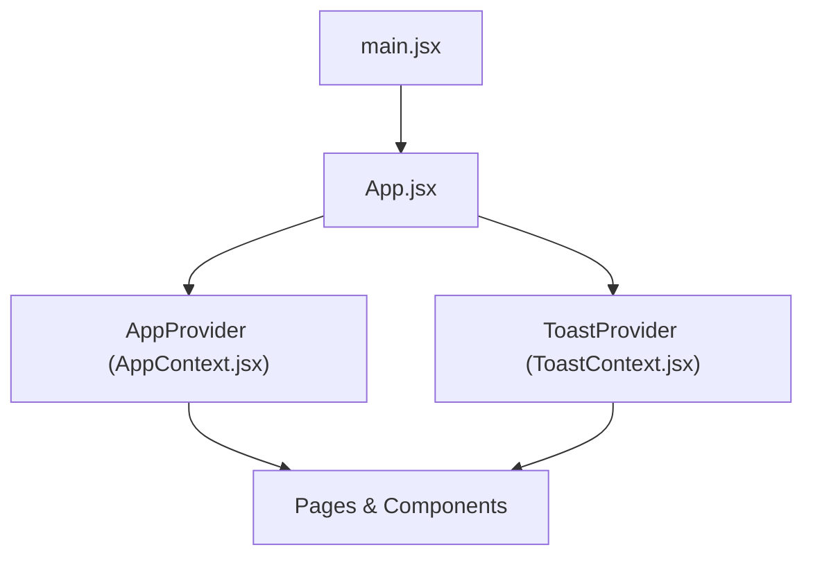
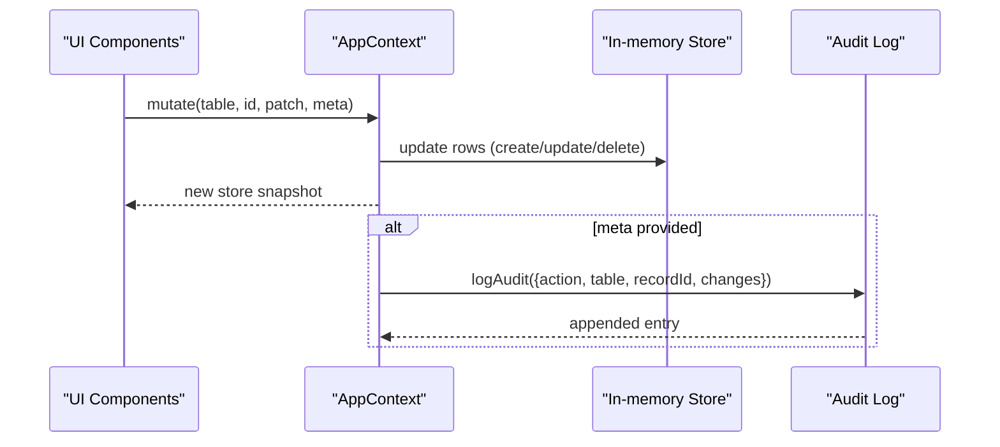
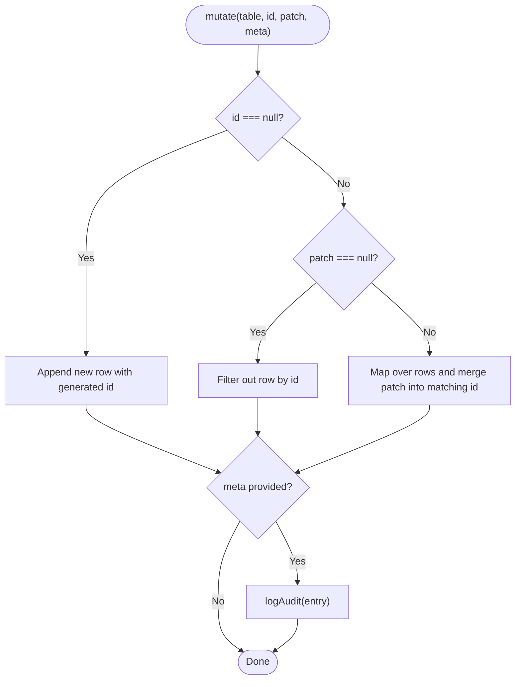
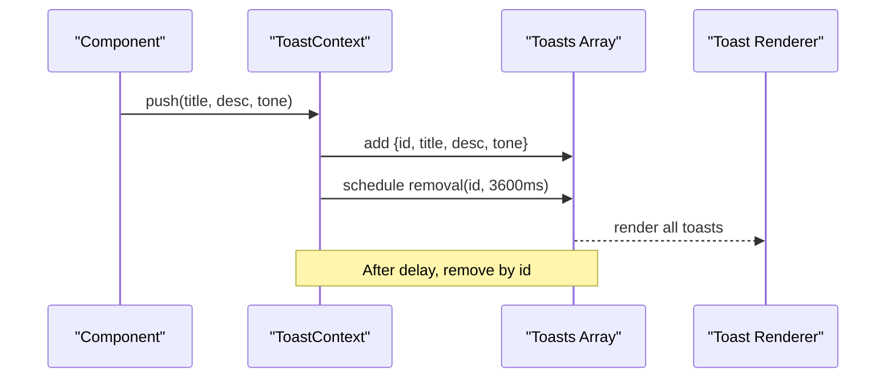
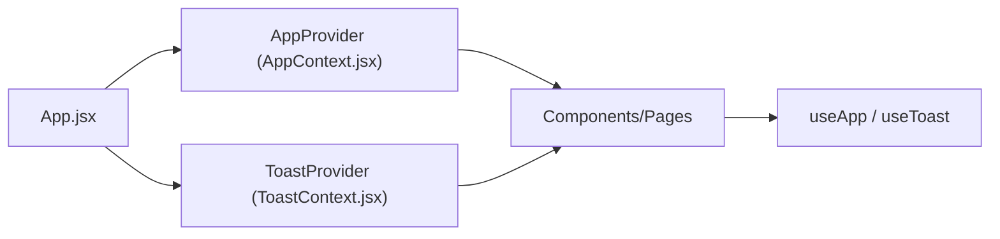

# State Management

<cite>
**Referenced Files in This Document**
- [AppContext.jsx](file://src/context/AppContext.jsx)
- [ToastContext.jsx](file://src/context/ToastContext.jsx)
- [useDebounced.js](file://src/hooks/useDebounced.js)
- [useCountUp.js](file://src/hooks/useCountUp.js)
- [useEscape.js](file://src/hooks/useEscape.js)
- [useHotkey.js](file://src/hooks/useHotkey.js)
- [App.jsx](file://src/App.jsx)
- [main.jsx](file://src/main.jsx)
- [Modal.jsx](file://src/components/ui/Modal.jsx)
- [MetricTile.jsx](file://src/pages/Dashboard/MetricTile.jsx)
- [constants.js](file://src/lib/constants.js)
</cite>

## Table of Contents
1. [Introduction](#introduction)
2. [Project Structure](#project-structure)
3. [Core Components](#core-components)
4. [Architecture Overview](#architecture-overview)
5. [Detailed Component Analysis](#detailed-component-analysis)
6. [Dependency Analysis](#dependency-analysis)
7. [Performance Considerations](#performance-considerations)
8. [Troubleshooting Guide](#troubleshooting-guide)
9. [Conclusion](#conclusion)

## Introduction
This document explains the application’s state management strategy built on React Context and custom hooks. It covers:
- Centralized global state via AppContext for data, theme, role, language, and audit logging
- User feedback via ToastContext with automatic dismissal
- Custom hooks for performance and UX: useDebounced, useCountUp, useEscape, useHotkey
- Data flow patterns, synchronization strategies, and considerations for large datasets

## Project Structure
The app bootstraps providers at the root to make global state and toast notifications available throughout the component tree.

**Diagram sources**
- [main.jsx:6-9](file://src/main.jsx#L6-L9)
- [App.jsx:34-68](file://src/App.jsx#L34-L68)

**Section sources**
- [main.jsx:1-11](file://src/main.jsx#L1-L11)
- [App.jsx:1-70](file://src/App.jsx#L1-L70)

## Core Components
- AppContext: Single source of truth for store data, user settings, and mutations; includes optimistic updates and audit logging.
- ToastContext: Global notification system with auto-dismissal and tone-based visuals.
- Custom Hooks:
  - useDebounced: Delays fast-changing values to reduce re-renders and downstream work.
  - useCountUp: Animated numeric transitions for metrics.
  - useEscape: Keyboard accessibility for overlays.
  - useHotkey: Global keyboard shortcuts.

**Section sources**
- [AppContext.jsx:16-135](file://src/context/AppContext.jsx#L16-L135)
- [ToastContext.jsx:1-33](file://src/context/ToastContext.jsx#L1-L33)
- [useDebounced.js:1-12](file://src/hooks/useDebounced.js#L1-L12)
- [useCountUp.js:1-31](file://src/hooks/useCountUp.js#L1-L31)
- [useEscape.js:1-14](file://src/hooks/useEscape.js#L1-L14)
- [useHotkey.js:1-20](file://src/hooks/useHotkey.js#L1-L20)

## Architecture Overview
High-level data flow from UI to context and back to UI.

**Diagram sources**
- [AppContext.jsx:79-103](file://src/context/AppContext.jsx#L79-L103)
- [AppContext.jsx:51-67](file://src/context/AppContext.jsx#L51-L67)

## Detailed Component Analysis

### AppContext: Global State and Mutations
Responsibilities:
- Provides theme, role, language toggles, current user, and a centralized store for multiple tables.
- Exposes mutate() for create/update/delete with optimistic updates.
- Maintains an append-only audit log with actor, timestamp, and change details.
- Offers verifyRecord() to mark records verified today by the current user.

Key behaviors:
- Optimistic updates: store is updated synchronously before any server call (placeholder for Phase 2).
- Audit trail: every mutation can emit an audit entry when metadata is provided.
- Error handling: throws if used outside provider; future phases should wrap mutate with error boundaries or try/catch around network calls.

**Diagram sources**
- [AppContext.jsx:79-103](file://src/context/AppContext.jsx#L79-L103)
- [AppContext.jsx:51-67](file://src/context/AppContext.jsx#L51-L67)

**Section sources**
- [AppContext.jsx:16-135](file://src/context/AppContext.jsx#L16-L135)
- [constants.js:1-35](file://src/lib/constants.js#L1-L35)

### ToastContext: User Feedback
Responsibilities:
- Pushes toasts with title, description, and tone.
- Auto-dismisses each toast after a fixed duration.
- Renders a stack of active toasts.

Behavior:
- Each toast gets a unique id and is removed automatically via timeout.
- Tone controls visual iconography and color semantics.

**Diagram sources**
- [ToastContext.jsx:13-31](file://src/context/ToastContext.jsx#L13-L31)

**Section sources**
- [ToastContext.jsx:1-33](file://src/context/ToastContext.jsx#L1-L33)

### Custom Hooks

#### useDebounced
- Purpose: Delay rapid input changes to reduce expensive operations (e.g., search/filter).
- Behavior: Updates internal state after a configurable delay; cleans up timers on unmount or dependency change.

Use cases:
- Search inputs across pages and components.

**Section sources**
- [useDebounced.js:1-12](file://src/hooks/useDebounced.js#L1-L12)

#### useCountUp
- Purpose: Animate numbers to their target value on mount or when triggered.
- Behavior: Uses requestAnimationFrame with ease-out cubic timing; supports conditional run flag.

Use cases:
- Dashboard metric tiles that animate on first render.

**Section sources**
- [useCountUp.js:1-31](file://src/hooks/useCountUp.js#L1-L31)
- [MetricTile.jsx:1-33](file://src/pages/Dashboard/MetricTile.jsx#L1-L33)

#### useEscape
- Purpose: Close overlays (modals, drawers, command palette) when Escape is pressed.
- Behavior: Attaches/detaches keydown listener based on active state.

**Section sources**
- [useEscape.js:1-14](file://src/hooks/useEscape.js#L1-L14)
- [Modal.jsx:1-39](file://src/components/ui/Modal.jsx#L1-L39)

#### useHotkey
- Purpose: Register global keyboard shortcuts (Cmd/Ctrl + key).
- Behavior: Prevents default browser actions for common shortcuts; attaches/detaches listeners.

**Section sources**
- [useHotkey.js:1-20](file://src/hooks/useHotkey.js#L1-L20)

## Dependency Analysis
Providers are mounted once at the app root; consumers anywhere in the tree can access them via hooks.

**Diagram sources**
- [App.jsx:34-68](file://src/App.jsx#L34-L68)
- [AppContext.jsx:16-22](file://src/context/AppContext.jsx#L16-L22)
- [ToastContext.jsx:4-11](file://src/context/ToastContext.jsx#L4-L11)

**Section sources**
- [App.jsx:1-70](file://src/App.jsx#L1-L70)

## Performance Considerations
- Debounce heavy operations: Use useDebounced for search inputs to minimize re-renders and downstream computations.
- Minimize context churn: Keep frequently changing values out of AppContext; prefer local state or memoization where appropriate.
- Optimize list rendering: For large datasets, consider virtualization, pagination, and stable keys.
- Avoid unnecessary re-renders: Memoize callbacks and derived data; split contexts if they grow too large.
- Animation efficiency: useCountUp uses requestAnimationFrame for smooth, low-cost animations.

[No sources needed since this section provides general guidance]

## Troubleshooting Guide
Common issues and resolutions:
- Using contexts outside providers: Both useApp and useToast throw errors if not wrapped in their respective providers. Ensure App.jsx mounts both providers.
- Toast not dismissing: Verify that the push function is called and that the timeout is not cleared elsewhere.
- Modal not closing on Escape: Confirm useEscape is called with correct active state and onClose handler.
- Hotkeys not firing: Ensure useHotkey is registered and preventDefault is allowed; check for conflicting listeners.

**Section sources**
- [AppContext.jsx:18-22](file://src/context/AppContext.jsx#L18-L22)
- [ToastContext.jsx:7-11](file://src/context/ToastContext.jsx#L7-L11)
- [Modal.jsx:9-11](file://src/components/ui/Modal.jsx#L9-L11)
- [useHotkey.js:8-18](file://src/hooks/useHotkey.js#L8-L18)

## Conclusion
The application uses a simple yet effective state architecture:
- AppContext centralizes data and mutations with optimistic updates and audit logging.
- ToastContext provides consistent user feedback with auto-dismissal.
- Custom hooks encapsulate reusable logic for performance and UX.
For Phase 2, replace in-memory store with server state while keeping the same API surface, ensuring minimal changes to consuming components.

[No sources needed since this section summarizes without analyzing specific files]