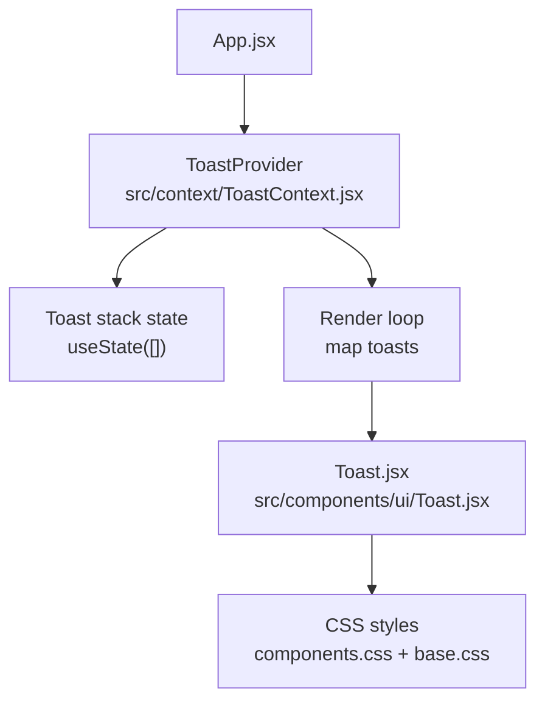
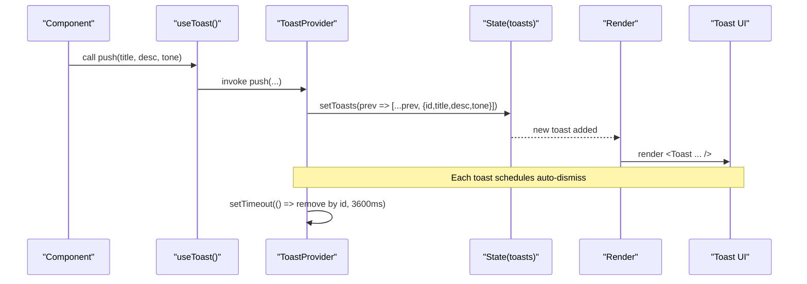
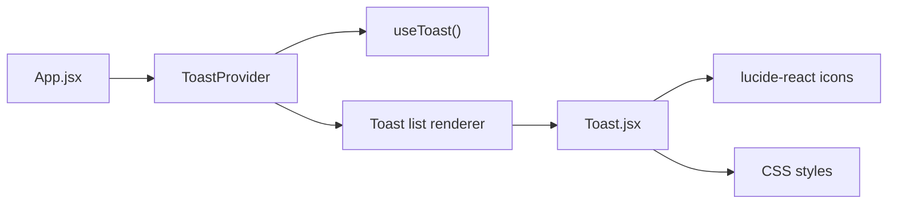

# ToastContext - User Feedback System

<cite>
**Referenced Files in This Document**
- [ToastContext.jsx](file://src/context/ToastContext.jsx)
- [Toast.jsx](file://src/components/ui/Toast.jsx)
- [components.css](file://src/styles/components.css)
- [base.css](file://src/styles/base.css)
- [App.jsx](file://src/App.jsx)
- [Dashboard/index.jsx](file://src/pages/Dashboard/index.jsx)
- [Sidebar.jsx](file://src/components/layout/Sidebar.jsx)
- [CommandPalette.jsx](file://src/components/layout/CommandPalette.jsx)
</cite>

## Table of Contents
1. [Introduction](#introduction)
2. [Project Structure](#project-structure)
3. [Core Components](#core-components)
4. [Architecture Overview](#architecture-overview)
5. [Detailed Component Analysis](#detailed-component-analysis)
6. [Dependency Analysis](#dependency-analysis)
7. [Performance Considerations](#performance-considerations)
8. [Troubleshooting Guide](#troubleshooting-guide)
9. [Conclusion](#conclusion)
10. [Appendices](#appendices)

## Introduction
ToastContext provides a lightweight, global user feedback and notification system for the application. It enables components to display transient messages with automatic dismissal, consistent styling, and simple programmatic control via a context-based API. The system supports two semantic tones (success and error), stacks multiple notifications, and positions them in a fixed corner of the viewport.

## Project Structure
The toast system is implemented as a React Context provider and a presentational component:
- Provider and hook live in the context layer.
- A small UI component renders individual toasts.
- CSS defines positioning, layout, and animations.
- The provider is mounted at the app root so all pages can use it.

**Diagram sources**
- [App.jsx:35-67](file://src/App.jsx#L35-L67)
- [ToastContext.jsx:13-32](file://src/context/ToastContext.jsx#L13-L32)
- [Toast.jsx:4-15](file://src/components/ui/Toast.jsx#L4-L15)
- [components.css:783-817](file://src/styles/components.css#L783-L817)
- [base.css:107-110](file://src/styles/base.css#L107-L110)

**Section sources**
- [App.jsx:35-67](file://src/App.jsx#L35-L67)
- [ToastContext.jsx:1-32](file://src/context/ToastContext.jsx#L1-L32)
- [Toast.jsx:1-16](file://src/components/ui/Toast.jsx#L1-L16)
- [components.css:783-817](file://src/styles/components.css#L783-L817)
- [base.css:98-142](file://src/styles/base.css#L98-L142)

## Core Components
- ToastProvider: Supplies a push function via context and manages the toast stack. It renders a container that lists current toasts.
- useToast: Hook to access the push function from any descendant component. Throws if used outside the provider.
- Toast: Presentational component that renders a single toast with an icon based on tone, title, and description.

Key behaviors:
- Each toast receives a unique id and is appended to the stack.
- Auto-dismissal occurs after a fixed delay using a timeout per toast.
- Tones map to icons: success uses a check icon; error uses an alert icon.

**Section sources**
- [ToastContext.jsx:6-20](file://src/context/ToastContext.jsx#L6-L20)
- [Toast.jsx:4-15](file://src/components/ui/Toast.jsx#L4-L15)

## Architecture Overview
The system follows a unidirectional data flow:
- Consumers call the push function returned by useToast.
- The provider updates state with a new toast entry.
- The provider renders the Toast list, which triggers re-renders.
- Each toast has a scheduled removal via setTimeout.

**Diagram sources**
- [ToastContext.jsx:16-20](file://src/context/ToastContext.jsx#L16-L20)
- [ToastContext.jsx:22-30](file://src/context/ToastContext.jsx#L22-L30)
- [Toast.jsx:4-15](file://src/components/ui/Toast.jsx#L4-L15)

## Detailed Component Analysis

### ToastProvider and useToast
Responsibilities:
- Provide a stable push function via context.
- Manage the toast stack with useState.
- Schedule automatic removal per toast.

API:
- useToast(): returns push(title, desc, tone).
- Tone values:
  - "jade": success (default)
  - "rose": error

Behavior details:
- Unique id generation ensures safe filtering during removal.
- Auto-dismissal uses a fixed 3600 ms delay per toast.
- If used outside ToastProvider, useToast throws an error to signal misconfiguration.

Integration example patterns:
- Form submission: call push on success or failure branches.
- API calls: show success on resolve, error on reject.
- User actions: confirm role changes, command executions, etc.

Accessibility considerations:
- Toasts are visually prominent and animated; ensure screen readers can announce them. Currently, there are no explicit ARIA attributes on the toast container or items. For improved accessibility, consider adding aria-live regions and roles to the toast container and each toast item.

Positioning strategy:
- Fixed position in the bottom-right corner with a column layout and gap spacing.
- Responsive width constraints prevent overflow on narrow screens.

Styling options:
- Two semantic tones with distinct icons and colors.
- Consistent typography and spacing via CSS variables.

Memory management:
- Each toast is removed after its timeout completes, preventing unbounded growth under normal usage.
- For high-frequency scenarios, consider debouncing or batching to avoid excessive timers and DOM nodes.

**Section sources**
- [ToastContext.jsx:6-20](file://src/context/ToastContext.jsx#L6-L20)
- [ToastContext.jsx:22-30](file://src/context/ToastContext.jsx#L22-L30)
- [components.css:783-817](file://src/styles/components.css#L783-L817)
- [base.css:107-110](file://src/styles/base.css#L107-L110)

### Toast UI Component
Rendering:
- Displays an icon based on tone, followed by bold title and descriptive text.
- Uses CSS classes for layout and animation.

Tone mapping:
- "rose" maps to an alert icon.
- Any other tone (default "jade") maps to a check icon.

Customization:
- Extend tone handling to support additional types (e.g., warning, info) by updating the icon selection logic and corresponding CSS tokens.

**Section sources**
- [Toast.jsx:4-15](file://src/components/ui/Toast.jsx#L4-L15)

### Styling and Positioning
Layout:
- Container uses fixed positioning at bottom-right with z-index above typical content.
- Column flex layout stacks toasts vertically with consistent gaps.
- Individual toasts have min/max widths, padding, borders, and shadows for clarity.

Animation:
- Slide-in animation on appearance for smooth entry.
- Respects reduced motion preferences by disabling animations when requested by the OS.

**Section sources**
- [components.css:783-817](file://src/styles/components.css#L783-L817)
- [base.css:107-110](file://src/styles/base.css#L107-L110)
- [base.css:135-142](file://src/styles/base.css#L135-L142)

### Usage Examples Across the App
- Dashboard export action shows success or error toasts depending on outcome.
- Sidebar role switch confirms the change with a toast.
- Command palette triggers a toast when starting background tasks like reindexing.

These examples demonstrate integration with user actions and asynchronous operations.

**Section sources**
- [Dashboard/index.jsx:48-65](file://src/pages/Dashboard/index.jsx#L48-L65)
- [Sidebar.jsx:62-66](file://src/components/layout/Sidebar.jsx#L62-L66)
- [CommandPalette.jsx:42-48](file://src/components/layout/CommandPalette.jsx#L42-L48)

## Dependency Analysis
The toast system has minimal dependencies:
- React primitives for context, state, and callbacks.
- Lucide icons for visual cues.
- CSS modules for layout and animation.

**Diagram sources**
- [App.jsx:35-67](file://src/App.jsx#L35-L67)
- [ToastContext.jsx:1-32](file://src/context/ToastContext.jsx#L1-L32)
- [Toast.jsx:1-15](file://src/components/ui/Toast.jsx#L1-L15)

**Section sources**
- [ToastContext.jsx:1-32](file://src/context/ToastContext.jsx#L1-L32)
- [Toast.jsx:1-15](file://src/components/ui/Toast.jsx#L1-L15)

## Performance Considerations
- Auto-dismissal per toast avoids long-lived timers beyond the configured duration.
- Rendering is efficient due to small component size and minimal state shape.
- High-frequency notifications:
  - Consider debouncing or coalescing rapid pushes to reduce DOM churn.
  - Limit concurrent toasts by capping stack size or replacing older entries.
- Memory management:
  - Ensure timeouts are cleared on unmount if you extend behavior to keep references.
  - Avoid storing large payloads in toast objects; keep titles and descriptions concise.

[No sources needed since this section provides general guidance]

## Troubleshooting Guide
Common issues:
- Using useToast outside ToastProvider results in an error. Wrap your app or relevant subtree with ToastProvider.
- Toast not appearing: verify the provider is mounted at the app root and that the push function is called with valid arguments.
- No dismissal: ensure the timeout is not being canceled elsewhere and that the id remains unique.

Validation tips:
- Confirm CSS classes are applied and styles are loaded.
- Check browser console for errors thrown by useToast when misconfigured.

**Section sources**
- [ToastContext.jsx:7-11](file://src/context/ToastContext.jsx#L7-L11)
- [ToastContext.jsx:16-20](file://src/context/ToastContext.jsx#L16-L20)

## Conclusion
ToastContext offers a simple, effective mechanism for delivering transient user feedback. Its context-based API makes it easy to integrate across the application, while consistent styling and automatic dismissal improve usability. For advanced needs such as priority handling, custom types, and enhanced accessibility, the system can be extended with minimal effort.

[No sources needed since this section summarizes without analyzing specific files]

## Appendices

### Integration Patterns
- Form submissions:
  - On success: push("Success", "Your changes were saved.", "jade").
  - On error: push("Error", "Something went wrong. Please try again.", "rose").
- API calls:
  - Success branch: push("Request complete", "Data updated successfully.", "jade").
  - Error branch: push("Request failed", "Network error or server issue.", "rose").
- User actions:
  - Confirm actions like role switches or command executions with contextual toasts.

**Section sources**
- [Dashboard/index.jsx:48-65](file://src/pages/Dashboard/index.jsx#L48-L65)
- [Sidebar.jsx:62-66](file://src/components/layout/Sidebar.jsx#L62-L66)
- [CommandPalette.jsx:42-48](file://src/components/layout/CommandPalette.jsx#L42-L48)

### Accessibility Notes
- Current implementation does not include ARIA attributes for live regions. To improve screen reader support:
  - Add aria-live="polite" to the toast container.
  - Optionally add role="alert" for critical messages.
  - Ensure focus management does not trap users unexpectedly.

[No sources needed since this section provides general guidance]

### Customization Options
- Additional tones:
  - Extend tone handling in the Toast component to support warning and info types.
  - Update icon selection logic and ensure color tokens exist in CSS.
- Styling:
  - Adjust container positioning, sizes, and animations via CSS variables and classes.
  - Respect reduced motion preferences already handled in base styles.

**Section sources**
- [Toast.jsx:4-15](file://src/components/ui/Toast.jsx#L4-L15)
- [components.css:783-817](file://src/styles/components.css#L783-L817)
- [base.css:135-142](file://src/styles/base.css#L135-L142)