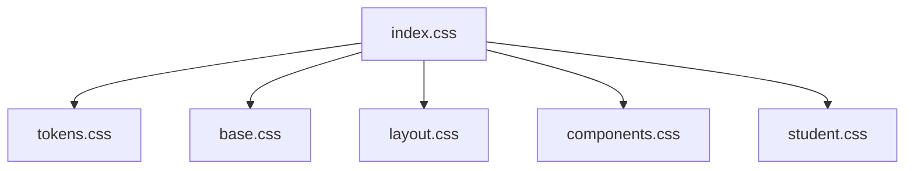
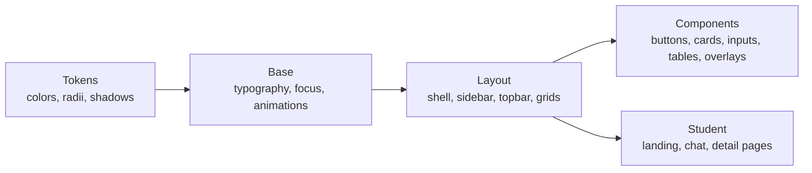
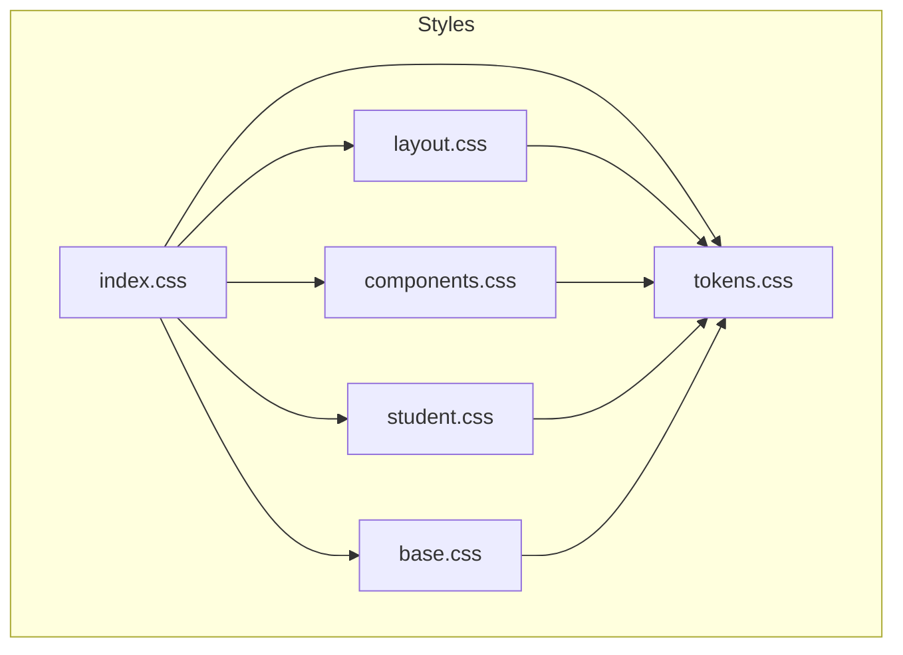

# Styling and Theming

<cite>
**Referenced Files in This Document**
- [tokens.css](file://src/styles/tokens.css)
- [base.css](file://src/styles/base.css)
- [components.css](file://src/styles/components.css)
- [layout.css](file://src/styles/layout.css)
- [student.css](file://src/styles/student.css)
- [index.css](file://src/styles/index.css)
- [AppShell.jsx](file://src/components/layout/AppShell.jsx)
- [Button.jsx](file://src/components/ui/Button.jsx)
- [Modal.jsx](file://src/components/ui/Modal.jsx)
- [FreshnessRing.jsx](file://src/components/charts/FreshnessRing.jsx)
- [AppContext.jsx](file://src/context/AppContext.jsx)
</cite>

## Table of Contents
1. [Introduction](#introduction)
2. [Project Structure](#project-structure)
3. [Core Components](#core-components)
4. [Architecture Overview](#architecture-overview)
5. [Detailed Component Analysis](#detailed-component-analysis)
6. [Dependency Analysis](#dependency-analysis)
7. [Performance Considerations](#performance-considerations)
8. [Troubleshooting Guide](#troubleshooting-guide)
9. [Conclusion](#conclusion)
10. [Appendices](#appendices)

## Introduction
This document explains the styling architecture and theming system used across the application. It covers design tokens, base styles, component styles, layout and page-specific styles, responsive design patterns, and dark mode support. You will learn how to extend the design system, create consistent UI components, and implement custom themes using CSS custom properties.

## Project Structure
The styling is organized into a layered CSS architecture:
- Tokens define theme variables for colors, spacing, radii, and structural dimensions.
- Base resets and shared utilities set typography, focus states, scrollbars, and animations.
- Layout defines the app shell, sidebar, topbar, page frame, and grids.
- Components provide reusable UI primitives (cards, buttons, inputs, tables, overlays).
- Student-facing styles tailor the experience for end users with larger type and more breathing room.
- A single entry file imports styles in a strict order so tokens are available before any consumer.

**Diagram sources**
- [index.css:1-8](file://src/styles/index.css#L1-L8)

**Section sources**
- [index.css:1-8](file://src/styles/index.css#L1-L8)

## Core Components
The design system centers on CSS custom properties that power both light and dark themes. The root container applies a data attribute to switch themes, and all layers read from these variables consistently.

Key token categories:
- Backgrounds and panels: --bg, --bg-2, --panel, --panel-2
- Lines and borders: --line, --line-2
- Text: --t1 (primary), --t2 (secondary), --t3 (tertiary)
- Semantic color families: brass, jade, amber, rose, sky, violet — each with -bright, -soft, -line variants
- Interaction: --hover, --hover-2
- Shadows: --sh-1, --sh-2, --sh-3
- Overlays and scrollbars: --scrim, --thumb, --thumb-h
- Structural constants: --r-sm, --r, --r-lg, --sidebar, --topbar

Theme switching:
- The root element carries data-theme="light" or data-theme="dark".
- Theme values are scoped under .uaea[data-theme="..."], enabling instant global updates without JS recalculation of styles.

Typography and accessibility:
- Global font stack and antialiasing are applied at the root.
- Focus-visible outlines use an accent token for clear keyboard navigation.
- Reduced motion preference disables animations and transitions for users who prefer it.

**Section sources**
- [tokens.css:15-139](file://src/styles/tokens.css#L15-L139)
- [base.css:12-56](file://src/styles/base.css#L12-L56)
- [base.css:98-142](file://src/styles/base.css#L98-L142)
- [AppShell.jsx:23-25](file://src/components/layout/AppShell.jsx#L23-L25)

## Architecture Overview
The styling architecture follows a clear separation of concerns:
- Tokens layer: declares all visual variables and theme variants.
- Base layer: normalizes defaults, typography, focus, scrollbars, and animations.
- Layout layer: composes the application chrome and responsive grids.
- Components layer: builds UI primitives that consume tokens exclusively.
- Student layer: adapts pacing and density for student-facing experiences.

**Diagram sources**
- [tokens.css:15-139](file://src/styles/tokens.css#L15-L139)
- [base.css:12-56](file://src/styles/base.css#L12-L56)
- [layout.css:5-53](file://src/styles/layout.css#L5-L53)
- [components.css:6-203](file://src/styles/components.css#L6-L203)
- [student.css:10-25](file://src/styles/student.css#L10-L25)

## Detailed Component Analysis

### Design Tokens and Theming
- Light and dark palettes are defined as CSS custom properties under scoped selectors.
- Each semantic color family includes:
  - Primary text/accent token
  - Bright variant for fills and chart strokes
  - Soft variant for backgrounds
  - Line variant for borders and subtle separators
- Structural tokens standardize radii and layout dimensions.

Usage examples:
- Buttons and badges consume semantic tokens for consistent meaning.
- Cards and metrics use panel and line tokens for depth and separation.
- Charts dynamically reference tokens via inline style expressions.

Extending tokens:
- Add new semantic colors by defining light and dark blocks with matching variants.
- Introduce new radii or spacing tokens where needed, then apply them in components.

Dark mode support:
- Toggle the data-theme attribute on the root container to switch themes globally.
- Ensure all new tokens have both light and dark definitions to avoid contrast issues.

**Section sources**
- [tokens.css:15-139](file://src/styles/tokens.css#L15-L139)
- [components.css:93-109](file://src/styles/components.css#L93-L109)
- [components.css:136-203](file://src/styles/components.css#L136-L203)
- [FreshnessRing.jsx:44-65](file://src/components/charts/FreshnessRing.jsx#L44-L65)
- [AppShell.jsx:23-25](file://src/components/layout/AppShell.jsx#L23-L25)

### Base Styles
- Resets ensure consistent box sizing and inherited fonts.
- Focus-visible uses an accent token for accessible keyboard navigation.
- Scrollbars are styled with theme-aware thumb colors.
- Shared keyframes provide consistent motion primitives; reduced-motion media query respects user preferences.

Guidelines:
- Prefer tokens over hard-coded colors or sizes.
- Use shared animation classes for consistent motion behavior.
- Respect prefers-reduced-motion to maintain accessibility.

**Section sources**
- [base.css:12-56](file://src/styles/base.css#L12-L56)
- [base.css:77-96](file://src/styles/base.css#L77-L96)
- [base.css:98-142](file://src/styles/base.css#L98-L142)

### Layout System
- App shell provides a flexible layout with a collapsible sidebar and sticky topbar.
- Page frame constrains content width and adds responsive padding.
- Grid utilities (.ua-cols, .ua-split, .ua-grid2) adapt column layouts at breakpoints.
- Mobile behavior moves the sidebar off-screen and shows a backdrop when open.

Responsive highlights:
- Sidebar collapses to icon-only mode via a CSS variable override.
- Page padding increases at larger widths.
- Grid columns shift from single-column to multi-column at specific breakpoints.

**Section sources**
- [layout.css:5-53](file://src/styles/layout.css#L5-L53)
- [layout.css:274-387](file://src/styles/layout.css#L274-L387)
- [layout.css:410-471](file://src/styles/layout.css#L410-L471)

### Component Styles
Reusable primitives include:
- Cards and metric tiles with hover elevation and token-driven borders.
- Badges with semantic color variants.
- Buttons with primary, ghost, danger, size, and disabled states.
- Inputs, selects, and textareas with focus rings and error states.
- Switches, tabs, toolbars, and pagination controls.
- Tables with sortable headers, row actions, and bulk action bars.
- Overlays, modals, drawers, command palette, and toasts.

Design principles:
- All visuals derive from tokens for consistency across themes.
- Interactions use subtle transitions and token-based hover/focus states.
- Accessibility considerations include visible focus indicators and keyboard-friendly behaviors.

**Section sources**
- [components.css:6-203](file://src/styles/components.css#L6-L203)
- [components.css:204-336](file://src/styles/components.css#L204-L336)
- [components.css:337-543](file://src/styles/components.css#L337-L543)
- [components.css:545-800](file://src/styles/components.css#L545-L800)

### Student-Facing Styles
- Larger type, more spacing, and fewer elements per screen improve readability and reduce cognitive load.
- Hero section, ask bar, and chat interface are optimized for mobile-first usage.
- Grids and cards adapt gracefully across screen sizes.

Guidelines:
- Keep content concise and above the fold.
- Use tokens to maintain brand consistency while adjusting pacing.

**Section sources**
- [student.css:1-8](file://src/styles/student.css#L1-L8)
- [student.css:10-25](file://src/styles/student.css#L10-L25)
- [student.css:112-161](file://src/styles/student.css#L112-L161)
- [student.css:163-228](file://src/styles/student.css#L163-L228)
- [student.css:307-389](file://src/styles/student.css#L307-L389)

### Responsive Design Patterns
- Media queries adjust layouts at common breakpoints (e.g., 560px, 640px, 720px, 900px, 960px, 1000px, 1024px, 1080px).
- Sidebar becomes a slide-in drawer on small screens with a backdrop overlay.
- Grids transition from single-column to multi-column layouts based on viewport width.
- Touch devices receive adjustments such as always-visible row actions.

Accessibility:
- prefers-reduced-motion disables animations and transitions for users who request reduced motion.

**Section sources**
- [layout.css:410-471](file://src/styles/layout.css#L410-L471)
- [student.css:71-75](file://src/styles/student.css#L71-L75)
- [student.css:222-228](file://src/styles/student.css#L222-L228)
- [student.css:317-322](file://src/styles/student.css#L317-L322)
- [base.css:135-142](file://src/styles/base.css#L135-L142)

### Dark Mode Implementation
- Theme state is managed in application context and applied to the root container via data-theme.
- CSS rules under .uaea[data-theme="dark"] redefine tokens for a cohesive dark palette.
- All components automatically adopt the new theme because they consume tokens.

Best practices:
- Always define both light and dark tokens for new colors.
- Verify contrast ratios for text and interactive elements in both themes.
- Test overlays and modals to ensure scrim and shadow tokens remain legible.

**Section sources**
- [AppContext.jsx:34-37](file://src/context/AppContext.jsx#L34-L37)
- [AppShell.jsx:23-25](file://src/components/layout/AppShell.jsx#L23-L25)
- [tokens.css:74-131](file://src/styles/tokens.css#L74-L131)

## Dependency Analysis
The styling dependency chain ensures tokens are loaded first, followed by base, layout, components, and student styles. Components depend on tokens and base utilities; layout depends on tokens and base; student styles depend on tokens and base.

**Diagram sources**
- [index.css:1-8](file://src/styles/index.css#L1-L8)
- [tokens.css:15-139](file://src/styles/tokens.css#L15-L139)
- [base.css:12-56](file://src/styles/base.css#L12-L56)
- [layout.css:5-53](file://src/styles/layout.css#L5-L53)
- [components.css:6-203](file://src/styles/components.css#L6-L203)
- [student.css:10-25](file://src/styles/student.css#L10-L25)

**Section sources**
- [index.css:1-8](file://src/styles/index.css#L1-L8)

## Performance Considerations
- Token-driven styling minimizes recalculations; changing a theme updates all dependent styles efficiently.
- Avoid excessive custom properties in tight loops; prefer class-based tokens for repeated elements.
- Use shared animations and transitions sparingly; respect prefers-reduced-motion.
- Keep component styles modular to reduce CSS specificity conflicts and improve maintainability.

[No sources needed since this section provides general guidance]

## Troubleshooting Guide
Common issues and resolutions:
- Colors not updating in dark mode:
  - Ensure the root container has data-theme set correctly.
  - Verify that tokens exist for both light and dark themes.
- Inconsistent focus visibility:
  - Confirm focus-visible outline uses the accent token and is not overridden.
- Animations too aggressive:
  - Check prefers-reduced-motion media query; ensure animations are disabled when requested.
- Sidebar not collapsing on mobile:
  - Verify the open/closed state classes and backdrop presence.
- Chart colors not reflecting theme:
  - Ensure dynamic color references use token names consistently.

**Section sources**
- [tokens.css:15-139](file://src/styles/tokens.css#L15-L139)
- [base.css:52-56](file://src/styles/base.css#L52-L56)
- [base.css:135-142](file://src/styles/base.css#L135-L142)
- [layout.css:449-471](file://src/styles/layout.css#L449-L471)
- [FreshnessRing.jsx:44-65](file://src/components/charts/FreshnessRing.jsx#L44-L65)

## Conclusion
The styling system is built around a robust token layer that powers consistent, accessible, and themeable UIs. By separating tokens, base styles, layout, components, and student-specific styles, the codebase remains maintainable and scalable. Responsive design is implemented through media queries and adaptive layouts, while dark mode is supported via scoped CSS custom properties. Following the guidelines here will help you extend the design system confidently and keep the interface coherent across features and themes.

[No sources needed since this section summarizes without analyzing specific files]

## Appendices

### How to Create a New Semantic Color
- Define light and dark blocks with primary, bright, soft, and line variants.
- Apply the tokens in components and badges consistently.
- Test contrast in both themes and update charts if needed.

**Section sources**
- [tokens.css:15-139](file://src/styles/tokens.css#L15-L139)
- [components.css:93-109](file://src/styles/components.css#L93-L109)

### How to Extend the Layout Grid
- Use existing grid classes and add new breakpoint rules as needed.
- Keep gaps and column ratios consistent with the design system.

**Section sources**
- [layout.css:410-443](file://src/styles/layout.css#L410-L443)

### How to Implement Custom Themes
- Override tokens under a new data-theme selector on the root container.
- Maintain the same token structure to ensure compatibility with components.
- Validate accessibility and visual hierarchy in the new theme.

**Section sources**
- [tokens.css:15-139](file://src/styles/tokens.css#L15-L139)
- [AppShell.jsx:23-25](file://src/components/layout/AppShell.jsx#L23-L25)