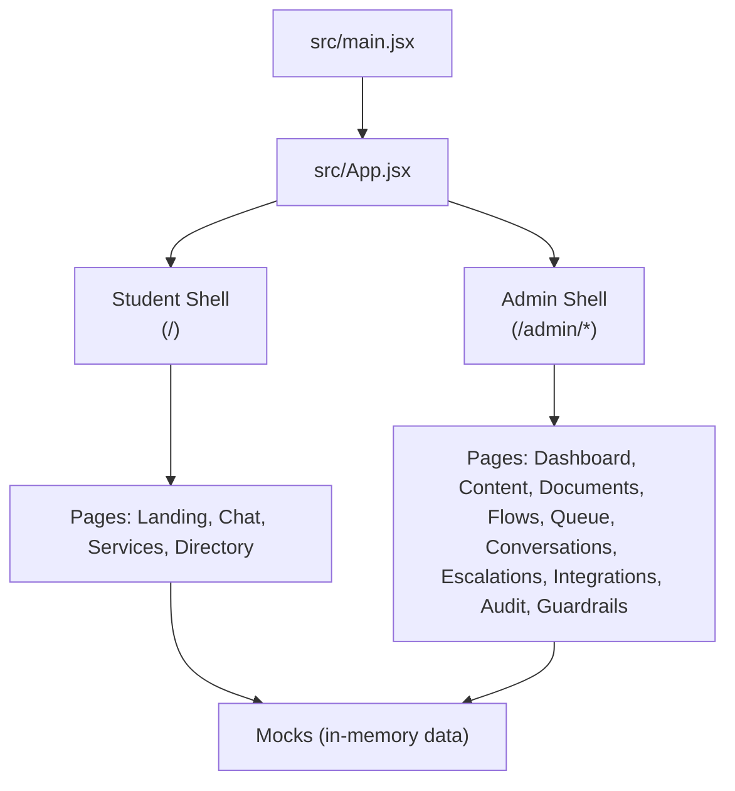
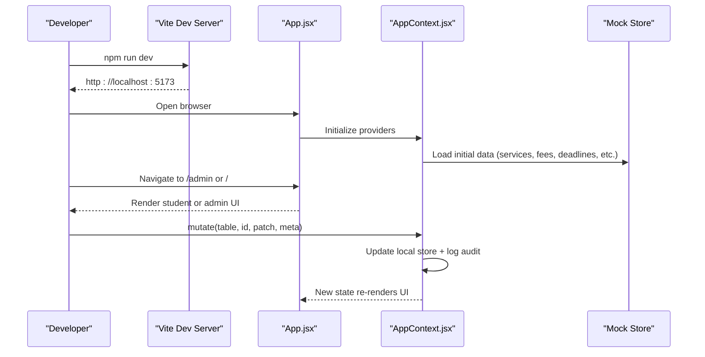
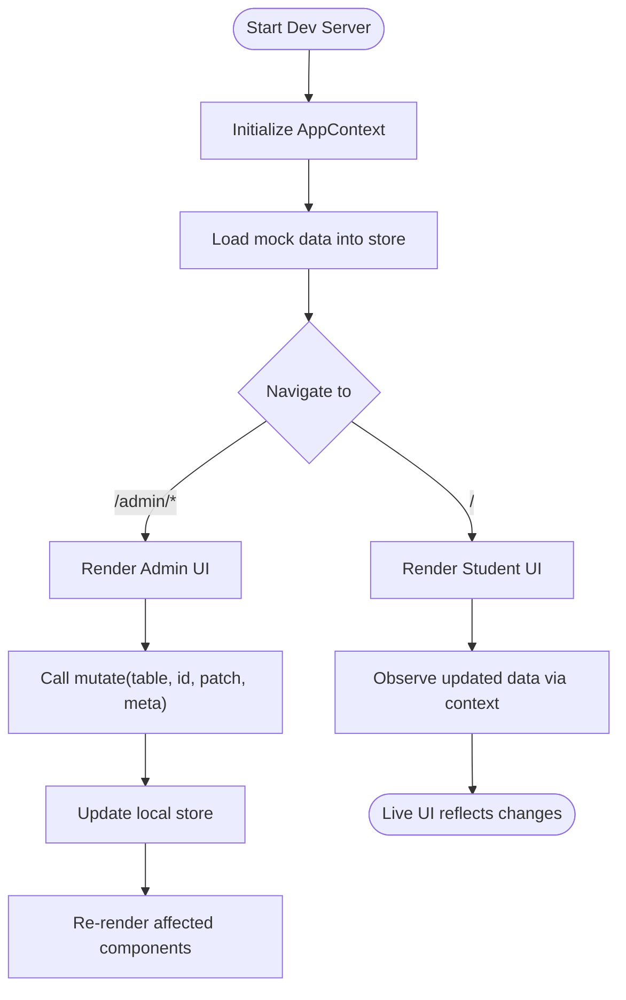
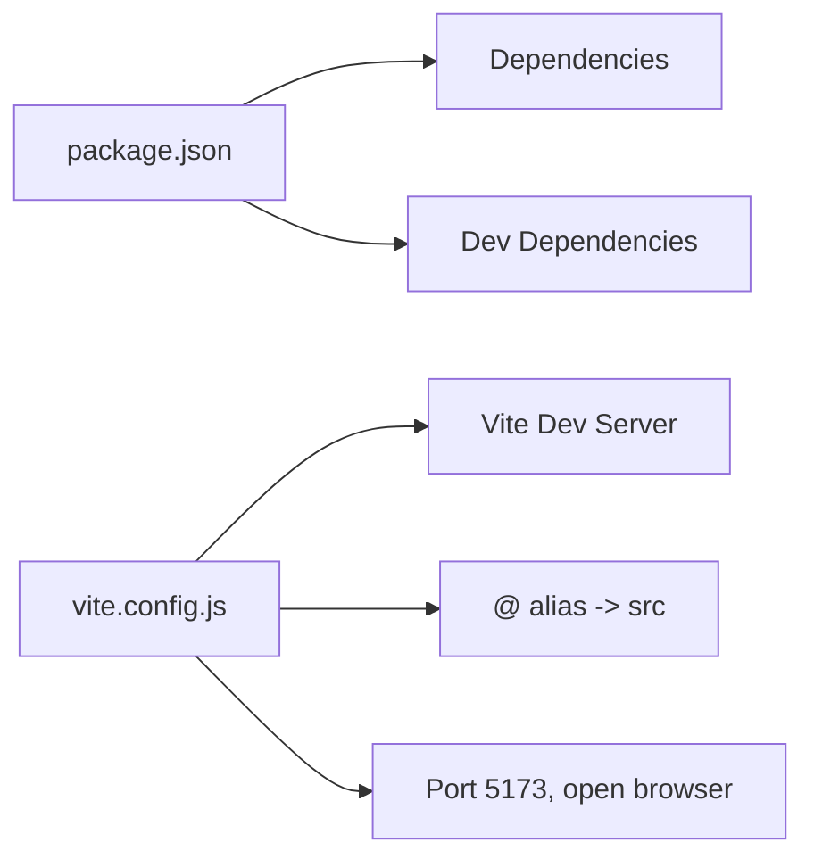

# Getting Started

<cite>
**Referenced Files in This Document**
- [package.json](file://package.json)
- [README.md](file://README.md)
- [vite.config.js](file://vite.config.js)
- [src/main.jsx](file://src/main.jsx)
- [src/App.jsx](file://src/App.jsx)
- [src/context/AppContext.jsx](file://src/context/AppContext.jsx)
- [src/lib/rbac.js](file://src/lib/rbac.js)
- [src/mocks/index.js](file://src/mocks/index.js)
</cite>

## Table of Contents
1. [Introduction](#introduction)
2. [Project Structure](#project-structure)
3. [Core Components](#core-components)
4. [Architecture Overview](#architecture-overview)
5. [Detailed Component Analysis](#detailed-component-analysis)
6. [Dependency Analysis](#dependency-analysis)
7. [Performance Considerations](#performance-considerations)
8. [Troubleshooting Guide](#troubleshooting-guide)
9. [Conclusion](#conclusion)

## Introduction
This guide helps you set up the UAEA Console development environment and start building immediately using a fully mock-based workflow. The console runs entirely on fixtures with no backend or database required, so you can develop both student and admin interfaces locally.

Key points:
- Node.js 18+ is required.
- Install dependencies once, then run the dev server to get live reloading at http://localhost:5173.
- Build production bundles into dist/ and preview them locally.
- Switch between student and admin views by navigating routes or using the sidebar link.

**Section sources**
- [README.md:11-21](file://README.md#L11-L21)
- [package.json:7-11](file://package.json#L7-L11)
- [vite.config.js:5-12](file://vite.config.js#L5-L12)

## Project Structure
At a high level:
- Entry point renders React under StrictMode and loads global styles.
- Routing separates two faces:
  - Student site at root paths (/, /chat, /services, /directory).
  - Admin console under /admin for governance tasks.
- All data is provided by mocks; there is no network call during development.

**Diagram sources**
- [src/main.jsx:1-11](file://src/main.jsx#L1-L11)
- [src/App.jsx:1-70](file://src/App.jsx#L1-L70)
- [src/mocks/index.js:1-19](file://src/mocks/index.js#L1-L19)

**Section sources**
- [src/main.jsx:1-11](file://src/main.jsx#L1-L11)
- [src/App.jsx:1-70](file://src/App.jsx#L1-L70)
- [src/mocks/index.js:1-19](file://src/mocks/index.js#L1-L19)

## Core Components
- Development server: Vite serves the app with hot module replacement and auto-open at port 5173.
- Build pipeline: Production build outputs static assets to dist/.
- Preview: Serve the built output locally to validate production behavior.
- Data layer: In-memory store seeded from mocks; all writes go through a single mutate function that updates local state and logs audit entries.

What this means for you:
- No backend setup is needed to develop features.
- You can edit content in the admin console and see changes reflected instantly in the student interface because both share the same in-memory store.

**Section sources**
- [vite.config.js:5-12](file://vite.config.js#L5-L12)
- [package.json:7-11](file://package.json#L7-L11)
- [src/context/AppContext.jsx:24-33](file://src/context/AppContext.jsx#L24-L33)
- [src/context/AppContext.jsx:69-103](file://src/context/AppContext.jsx#L69-L103)
- [src/mocks/index.js:1-19](file://src/mocks/index.js#L1-L19)

## Architecture Overview
The app uses React Router to switch between two UIs that share one data context. During development, the context provider initializes state from mocks and exposes a mutate API used by pages to create, update, and delete records.

**Diagram sources**
- [vite.config.js:5-12](file://vite.config.js#L5-L12)
- [src/App.jsx:1-70](file://src/App.jsx#L1-L70)
- [src/context/AppContext.jsx:34-135](file://src/context/AppContext.jsx#L34-L135)
- [src/mocks/index.js:1-19](file://src/mocks/index.js#L1-L19)

## Detailed Component Analysis

### Development Workflow (Mock-Based)
- All data comes from src/mocks. There are no network calls during development.
- The AppProvider initializes the store from mocks and exposes mutate() for all writes.
- Changes made in the admin console are immediately visible on the student site because both read from the same store.

**Diagram sources**
- [src/context/AppContext.jsx:34-135](file://src/context/AppContext.jsx#L34-L135)
- [src/mocks/index.js:1-19](file://src/mocks/index.js#L1-L19)

**Section sources**
- [src/context/AppContext.jsx:24-33](file://src/context/AppContext.jsx#L24-L33)
- [src/context/AppContext.jsx:69-103](file://src/context/AppContext.jsx#L69-L103)
- [src/mocks/index.js:1-19](file://src/mocks/index.js#L1-L19)

### Role Switching and Interface Navigation
- Student interface: root routes like /, /chat, /services, /directory.
- Admin interface: /admin and its subroutes.
- From the admin sidebar, you can open the student site directly to verify how edits appear to students.
- Roles control which actions are visible in the UI. Use roles to simulate different permissions while developing.

How to switch during development:
- Visit / for the student site.
- Visit /admin for the staff console.
- Use the sidebar “Student site” link when inside the admin console to quickly toggle views.
- Change role via the user menu in the sidebar to test permission gating.

**Section sources**
- [src/App.jsx:24-63](file://src/App.jsx#L24-L63)
- [src/components/layout/Sidebar.jsx:79-108](file://src/components/layout/Sidebar.jsx#L79-L108)
- [src/lib/rbac.js:10-51](file://src/lib/rbac.js#L10-L51)

## Dependency Analysis
- Runtime dependencies include React, ReactDOM, react-router-dom, and lucide-react icons.
- Development dependencies include Vite and the React plugin.
- Vite config sets up the React plugin, path alias (@ -> src), and dev server defaults (port 5173, auto-open).

**Diagram sources**
- [package.json:12-21](file://package.json#L12-L21)
- [vite.config.js:5-12](file://vite.config.js#L5-L12)

**Section sources**
- [package.json:1-23](file://package.json#L1-L23)
- [vite.config.js:1-13](file://vite.config.js#L1-L13)

## Performance Considerations
- The dev server uses Vite’s fast HMR; keep components small and avoid heavy synchronous work in render paths.
- Since everything runs in memory during development, large datasets should be paginated or filtered in UI logic.
- When moving to a real backend later, replace the in-memory mutate with fetch calls at the designated seam without changing page code.

[No sources needed since this section provides general guidance]

## Troubleshooting Guide
Common issues and fixes:
- Node version too old:
  - Ensure Node.js 18 or newer is installed.
  - If your system has multiple versions, use a version manager to select 18+.
- Missing dependencies:
  - Run npm install to populate node_modules.
- Port already in use:
  - The dev server defaults to port 5173. If it fails, stop other processes using that port or change the port in vite.config.js.
- Browser does not open automatically:
  - Open http://localhost:5173 manually if auto-open is blocked by your OS or firewall.
- Build errors:
  - Clean node_modules and reinstall if lockfile mismatches occur.
  - Run npm run build to validate the production bundle before deployment.
- Previewing built assets:
  - After building, run npm run preview to serve dist/ locally and verify the production build.

Where these come from:
- Scripts and commands are defined in package.json.
- Dev server configuration (port and auto-open) is in vite.config.js.
- README confirms Node 18+ requirement and mock-only workflow.

**Section sources**
- [package.json:7-11](file://package.json#L7-L11)
- [vite.config.js:5-12](file://vite.config.js#L5-L12)
- [README.md:11-21](file://README.md#L11-L21)

## Conclusion
You can develop the entire UAEA Console locally without a backend or database. Install Node.js 18+, run npm install, and start the dev server. Use / for the student interface and /admin for the staff console. Make changes in the admin area and see them reflected instantly on the student side. When ready, build and preview the production bundle to validate your work.

[No sources needed since this section summarizes without analyzing specific files]