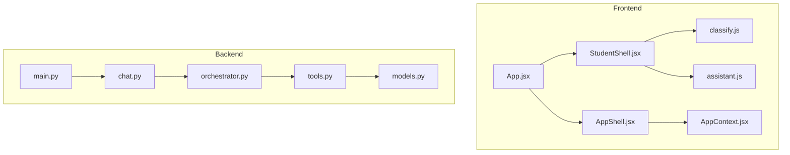
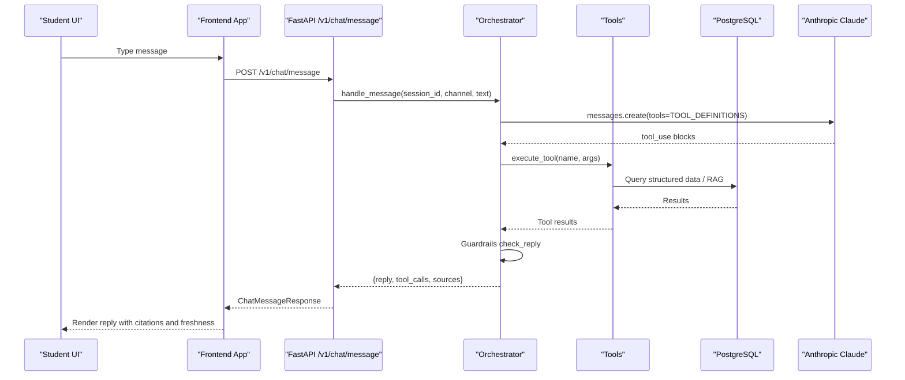
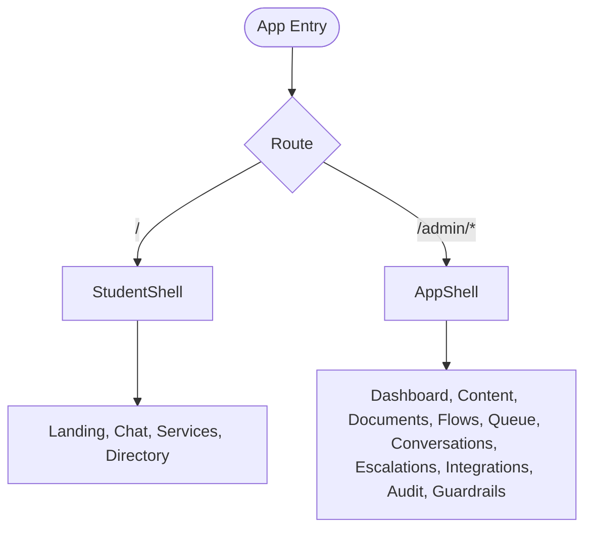
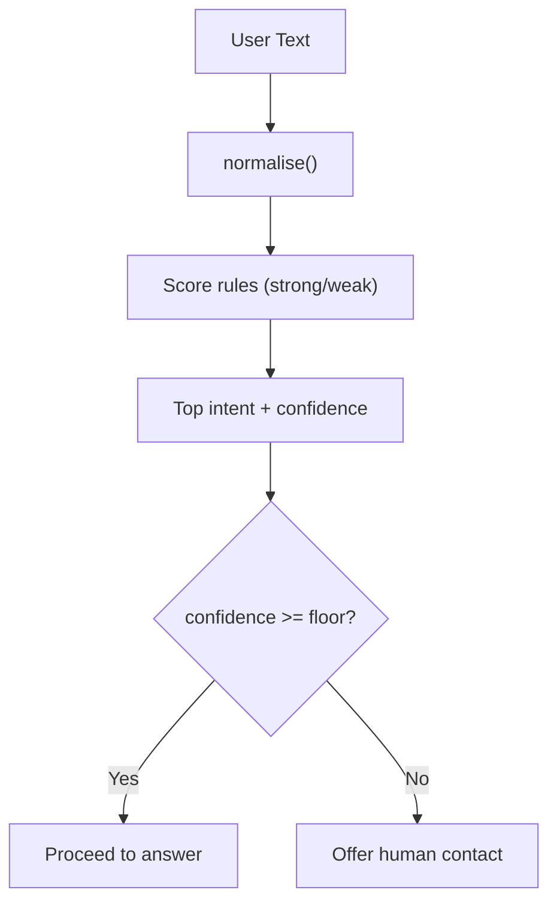
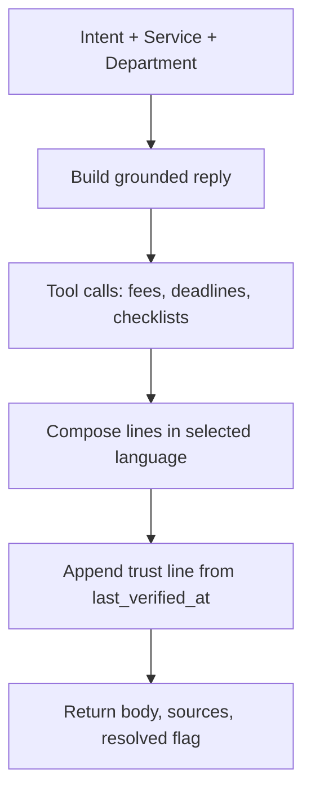
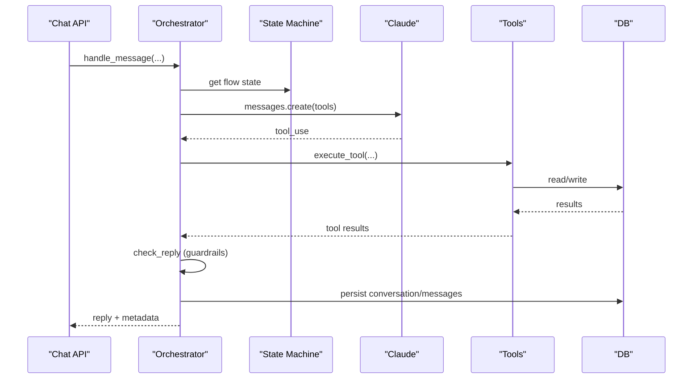
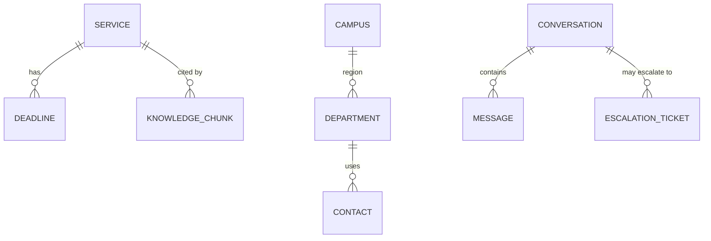
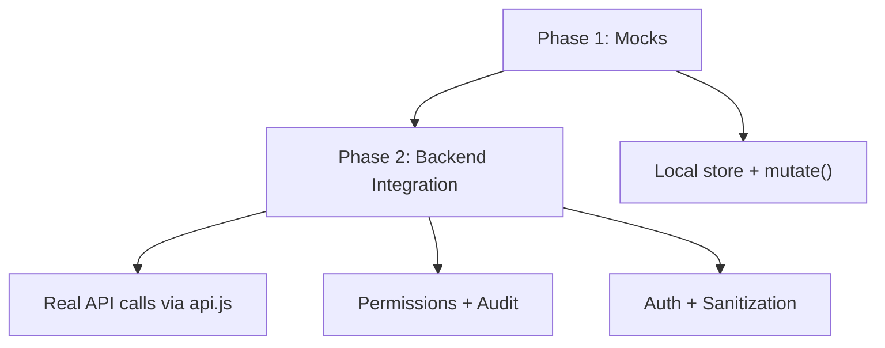
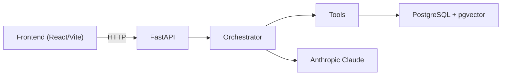

# Project Overview

<cite>
**Referenced Files in This Document**
- [README.md](file://README.md)
- [package.json](file://package.json)
- [uaea-backend/README.md](file://uaea-backend/README.md)
- [src/App.jsx](file://src/App.jsx)
- [src/context/AppContext.jsx](file://src/context/AppContext.jsx)
- [src/lib/classify.js](file://src/lib/classify.js)
- [src/lib/assistant.js](file://src/lib/assistant.js)
- [src/components/student/StudentShell.jsx](file://src/components/student/StudentShell.jsx)
- [src/components/layout/AppShell.jsx](file://src/components/layout/AppShell.jsx)
- [uaea-backend/app/main.py](file://uaea-backend/app/main.py)
- [uaea-backend/app/api/chat.py](file://uaea-backend/app/api/chat.py)
- [uaea-backend/app/orchestrator/orchestrator.py](file://uaea-backend/app/orchestrator/orchestrator.py)
- [uaea-backend/app/orchestrator/tools.py](file://uaea-backend/app/orchestrator/tools.py)
- [uaea-backend/app/db/models.py](file://uaea-backend/app/db/models.py)
</cite>

## Table of Contents
1. Introduction
2. Project Structure
3. Core Components
4. Architecture Overview
5. Detailed Component Analysis
6. Dependency Analysis
7. Performance Considerations
8. Troubleshooting Guide
9. Conclusion

## Introduction
UAEA Console is a dual-interface system that serves two audiences from one shared data layer:
- Students access the student-facing site for Urdu AI educational assistance, including chat, services, and directory.
- Staff use the governance console to maintain accurate, verified content that powers the assistant’s answers.

The design philosophy is governance-first: the LLM is never a source of truth. Every fee, deadline, or document requirement must come from governed tables or cited chunks. Freshness tracking (last verified dates) and human verification workflows are central to ensuring accuracy. The project follows a phased development approach: Phase 1 runs entirely on mocks; Phase 2 wires the frontend to a Python FastAPI backend with PostgreSQL and Anthropic Claude integration.

Key mission: provide reliable, Urdu-friendly AI assistance while enforcing strict data governance through freshness tracking and human verification.

**Section sources**
- [README.md:1-20](file://README.md#L1-L20)
- [README.md:25-57](file://README.md#L25-L57)
- [uaea-backend/README.md:1-6](file://uaea-backend/README.md#L1-L6)

## Project Structure
The repository is organized into two primary parts:
- Frontend (React + Vite): routes, pages, components, context, and mock data for Phase 1.
- Backend (FastAPI + PostgreSQL + pgvector + Anthropic): orchestrates chat flows, tools, RAG retrieval, and admin endpoints.

**Diagram sources**
- [src/App.jsx:1-70](file://src/App.jsx#L1-L70)
- [src/components/student/StudentShell.jsx:1-25](file://src/components/student/StudentShell.jsx#L1-L25)
- [src/components/layout/AppShell.jsx:1-49](file://src/components/layout/AppShell.jsx#L1-L49)
- [src/lib/classify.js:1-270](file://src/lib/classify.js#L1-L270)
- [src/lib/assistant.js:1-364](file://src/lib/assistant.js#L1-L364)
- [src/context/AppContext.jsx:1-135](file://src/context/AppContext.jsx#L1-L135)
- [uaea-backend/app/main.py:1-104](file://uaea-backend/app/main.py#L1-L104)
- [uaea-backend/app/api/chat.py:1-115](file://uaea-backend/app/api/chat.py#L1-L115)
- [uaea-backend/app/orchestrator/orchestrator.py:1-405](file://uaea-backend/app/orchestrator/orchestrator.py#L1-L405)
- [uaea-backend/app/orchestrator/tools.py:1-235](file://uaea-backend/app/orchestrator/tools.py#L1-L235)
- [uaea-backend/app/db/models.py:1-228](file://uaea-backend/app/db/models.py#L1-L228)

**Section sources**
- [README.md:134-159](file://README.md#L134-L159)
- [package.json:1-23](file://package.json#L1-L23)

## Core Components
- Dual interfaces:
  - Student shell under root routes for landing, chat, services, and directory.
  - Admin shell under /admin for dashboard, content library, documents, guided flows, review queue, conversations, escalations, integrations, audit log, and guardrails.
- Shared data layer concept:
  - In Phase 1, a single React context holds all entities (services, fees, deadlines, departments, documents, flows, adapters).
  - A single mutate function is the entry point for all writes, designed to be replaced by API calls in Phase 2 without touching other components.
- Governance-focused answer engine:
  - Deterministic intent classification before answering.
  - Answer composition strictly uses tool results; no guessing.
  - Freshness cues and trust lines ensure students see when information was last verified.

**Section sources**
- [src/App.jsx:24-63](file://src/App.jsx#L24-L63)
- [src/context/AppContext.jsx:24-103](file://src/context/AppContext.jsx#L24-L103)
- [src/lib/classify.js:4-16](file://src/lib/classify.js#L4-L16)
- [src/lib/assistant.js:5-16](file://src/lib/assistant.js#L5-L16)
- [README.md:25-57](file://README.md#L25-L57)

## Architecture Overview
The system enforces a clear separation between user-facing surfaces and the governance backend:
- Frontend routes split into student and staff shells.
- Backend exposes chat, lookup, and admin APIs.
- Orchestrator coordinates normalization, intent routing, guided flows, LLM tool-calling, guardrails, and persistence.
- Tools query structured data (PostgreSQL) and RAG knowledge base.

**Diagram sources**
- [uaea-backend/app/api/chat.py:21-39](file://uaea-backend/app/api/chat.py#L21-L39)
- [uaea-backend/app/orchestrator/orchestrator.py:46-143](file://uaea-backend/app/orchestrator/orchestrator.py#L46-L143)
- [uaea-backend/app/orchestrator/tools.py:18-87](file://uaea-backend/app/orchestrator/tools.py#L18-L87)
- [uaea-backend/app/db/models.py:124-140](file://uaea-backend/app/db/models.py#L124-L140)

**Section sources**
- [uaea-backend/README.md:158-217](file://uaea-backend/README.md#L158-L217)
- [uaea-backend/app/main.py:75-86](file://uaea-backend/app/main.py#L75-L86)

## Detailed Component Analysis

### Dual-Interface Routing and Shells
- Student shell provides header, main area, and optional footer; hides footer on chat to keep composer pinned.
- Admin shell provides sidebar navigation, topbar, command palette, and page outlet.
- Routes define student pages at root and admin pages under /admin.

**Diagram sources**
- [src/App.jsx:34-63](file://src/App.jsx#L34-L63)
- [src/components/student/StudentShell.jsx:1-25](file://src/components/student/StudentShell.jsx#L1-L25)
- [src/components/layout/AppShell.jsx:1-49](file://src/components/layout/AppShell.jsx#L1-L49)

**Section sources**
- [src/App.jsx:24-63](file://src/App.jsx#L24-L63)
- [src/components/student/StudentShell.jsx:1-25](file://src/components/student/StudentShell.jsx#L1-L25)
- [src/components/layout/AppShell.jsx:1-49](file://src/components/layout/AppShell.jsx#L1-L49)

### Intent Classification and Language Detection
- Normalizer folds Roman Urdu variants before scoring.
- Keyword rules assign strong/weak scores per intent; confidence computed and compared against a floor.
- Below threshold, the system avoids guessing and offers human handoff.

**Diagram sources**
- [src/lib/classify.js:18-57](file://src/lib/classify.js#L18-L57)
- [src/lib/classify.js:63-190](file://src/lib/classify.js#L63-L190)
- [src/lib/classify.js:195-269](file://src/lib/classify.js#L195-L269)

**Section sources**
- [src/lib/classify.js:4-16](file://src/lib/classify.js#L4-L16)
- [src/lib/classify.js:195-269](file://src/lib/classify.js#L195-L269)

### Answer Composition and Freshness
- Answer builder only states facts returned by tools; if no data, it declines to guess and suggests human help.
- Trust line shows last verified date and freshness tone; stale indicators warn users.
- Follow-ups guide next questions based on intent and language.

**Diagram sources**
- [src/lib/assistant.js:128-161](file://src/lib/assistant.js#L128-L161)
- [src/lib/assistant.js:163-317](file://src/lib/assistant.js#L163-L317)
- [src/lib/assistant.js:319-328](file://src/lib/assistant.js#L319-L328)

**Section sources**
- [src/lib/assistant.js:5-16](file://src/lib/assistant.js#L5-L16)
- [src/lib/assistant.js:128-328](file://src/lib/assistant.js#L128-L328)

### Backend Orchestration and Guardrails
- Message pipeline: normalize → classify → state machine → LLM tool-calling → guardrails → persist.
- Guided flows manage slot-filling across messages for complex intents.
- Guardrails strip ungrounded claims; escalation tickets created when needed.

**Diagram sources**
- [uaea-backend/app/api/chat.py:21-39](file://uaea-backend/app/api/chat.py#L21-L39)
- [uaea-backend/app/orchestrator/orchestrator.py:46-143](file://uaea-backend/app/orchestrator/orchestrator.py#L46-L143)
- [uaea-backend/app/orchestrator/tools.py:218-235](file://uaea-backend/app/orchestrator/tools.py#L218-L235)
- [uaea-backend/app/db/models.py:142-179](file://uaea-backend/app/db/models.py#L142-L179)

**Section sources**
- [uaea-backend/README.md:199-217](file://uaea-backend/README.md#L199-L217)
- [uaea-backend/app/orchestrator/orchestrator.py:46-143](file://uaea-backend/app/orchestrator/orchestrator.py#L46-L143)

### Data Layer and Models
- Structured tables include services, fee tariffs, deadlines, departments, campuses, contacts, knowledge chunks (pgvector), conversations, messages, escalation tickets, audit logs, and unanswered queries.
- last_verified_at fields support freshness tracking across services and knowledge chunks.
- Relationships link services to fees and deadlines; messages belong to conversations.

**Diagram sources**
- [uaea-backend/app/db/models.py:30-122](file://uaea-backend/app/db/models.py#L30-L122)
- [uaea-backend/app/db/models.py:124-179](file://uaea-backend/app/db/models.py#L124-L179)
- [uaea-backend/app/db/models.py:181-228](file://uaea-backend/app/db/models.py#L181-L228)

**Section sources**
- [uaea-backend/app/db/models.py:30-228](file://uaea-backend/app/db/models.py#L30-L228)

### Phased Development Approach
- Phase 1: Entirely mock-based frontend with local store and mutate function; no backend required.
- Phase 2: Replace mutate with real API calls; add permissions middleware and audit table first; implement schema/ORM models from mocks; swap store for server state; add auth, sanitization, error handling.

**Diagram sources**
- [README.md:163-191](file://README.md#L163-L191)
- [src/context/AppContext.jsx:24-103](file://src/context/AppContext.jsx#L24-L103)

**Section sources**
- [README.md:163-191](file://README.md#L163-L191)
- [src/context/AppContext.jsx:24-103](file://src/context/AppContext.jsx#L24-L103)

## Dependency Analysis
- Frontend dependencies: React, React Router DOM, Lucide icons; built with Vite.
- Backend dependencies: FastAPI, SQLAlchemy, asyncpg, pgvector, Anthropic SDK, slowapi for rate limiting.
- Coupling:
  - Frontend routes depend on shells and pages; context centralizes state and mutations.
  - Backend routers mount chat, lookup, admin; orchestrator depends on tools and models.
- External integrations:
  - Anthropic Claude for LLM responses and tool-calling.
  - PostgreSQL with pgvector for vector similarity search in RAG.

**Diagram sources**
- [package.json:12-20](file://package.json#L12-L20)
- [uaea-backend/app/main.py:75-86](file://uaea-backend/app/main.py#L75-L86)
- [uaea-backend/app/orchestrator/orchestrator.py:229-318](file://uaea-backend/app/orchestrator/orchestrator.py#L229-L318)
- [uaea-backend/app/orchestrator/tools.py:218-235](file://uaea-backend/app/orchestrator/tools.py#L218-L235)
- [uaea-backend/app/db/models.py:124-140](file://uaea-backend/app/db/models.py#L124-L140)

**Section sources**
- [package.json:12-20](file://package.json#L12-L20)
- [uaea-backend/app/main.py:1-104](file://uaea-backend/app/main.py#L1-L104)

## Performance Considerations
- Rate limiting: Per-IP limiter configured; per-session placeholder exists for chat endpoints.
- Conversation history windowing: Last 20 messages used for LLM context to control token usage.
- Tool call loops: Maximum rounds capped to prevent excessive LLM interactions.
- RAG retrieval: Vector similarity search with chunk-level sources; ingestion pipelines should be optimized for chunk size and embedding dimensions.

[No sources needed since this section provides general guidance]

## Troubleshooting Guide
- Low-confidence queries: Tracked in unanswered queue for staff review and content growth loop.
- Escalation workflow: When data is missing or student requests human help, escalation tickets are created and conversations marked escalated.
- Guardrail failures: Ungrounded claims stripped; replies may prompt re-asking with grounded data or escalate.
- Frontend seam: If backend integration fails, verify mutate replacement points and API URLs; grep for “API SEAM” markers to locate swap points.

**Section sources**
- [uaea-backend/app/orchestrator/orchestrator.py:123-130](file://uaea-backend/app/orchestrator/orchestrator.py#L123-L130)
- [uaea-backend/app/orchestrator/tools.py:200-215](file://uaea-backend/app/orchestrator/tools.py#L200-L215)
- [README.md:119-131](file://README.md#L119-L131)
- [README.md:163-191](file://README.md#L163-L191)

## Conclusion
UAEA Console delivers a governance-first AI assistant for university services, serving both students and staff from a shared data layer. The architecture ensures factual accuracy by grounding every response in structured data and verified sources, with freshness tracking and human verification at its core. The phased approach enables rapid prototyping with mocks and a smooth transition to a robust backend integrating FastAPI, PostgreSQL, pgvector, and Anthropic Claude. This foundation supports scalable, trustworthy educational assistance in Urdu, Roman Urdu, and English.

[No sources needed since this section summarizes without analyzing specific files]