# Chat Interface

<cite>
**Referenced Files in This Document**
- [index.jsx](file://src/pages/student/Chat/index.jsx)
- [Composer.jsx](file://src/pages/student/Chat/Composer.jsx)
- [MessageBubble.jsx](file://src/pages/student/Chat/MessageBubble.jsx)
- [RoutingCard.jsx](file://src/pages/student/Chat/RoutingCard.jsx)
- [SourceChip.jsx](file://src/pages/student/Chat/SourceChip.jsx)
- [ToolTrace.jsx](file://src/pages/student/Chat/ToolTrace.jsx)
- [EscalationCard.jsx](file://src/pages/student/Chat/EscalationCard.jsx)
- [ChatSidebar.jsx](file://src/pages/student/Chat/ChatSidebar.jsx)
- [classify.js](file://src/lib/classify.js)
- [assistant.js](file://src/lib/assistant.js)
- [api.js](file://src/lib/api.js)
- [AppContext.jsx](file://src/context/AppContext.jsx)
- [chat.py](file://uaea-backend/app/api/chat.py)
- [orchestrator.py](file://uaea-backend/app/orchestrator/orchestrator.py)
- [intent_router.py](file://uaea-backend/app/orchestrator/intent_router.py)
</cite>

## Table of Contents
1. Introduction
2. Project Structure
3. Core Components
4. Architecture Overview
5. Detailed Component Analysis
6. Dependency Analysis
7. Performance Considerations
8. Troubleshooting Guide
9. Conclusion

## Introduction
This document explains the student chat interface end-to-end: how messages are composed and sent, how language is detected and supported (Urdu, Roman Urdu, English), how intent classification works, how answers are built from verified records, how conversation history is managed, and how real-time responses and escalations are handled. It also covers the chat sidebar for navigation and context, message bubble rendering with rich content support, and integration points with the backend orchestrator.

## Project Structure
The student chat lives under a dedicated page folder with small, focused components for composition, rendering, routing visibility, source citation, tool trace, escalation, and a sidebar that shows service, department, and upcoming deadlines. The chat logic uses a local classifier and answer composer for demonstration, while an API seam exists to integrate with the backend orchestrator.

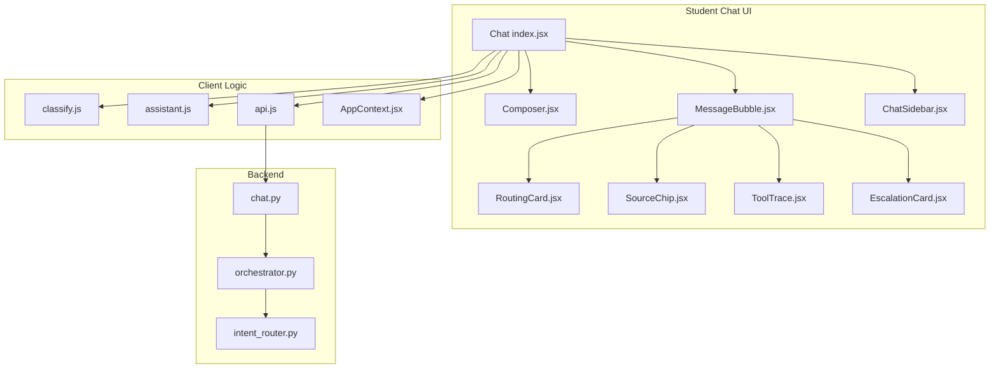

**Diagram sources**
- [index.jsx:1-200](file://src/pages/student/Chat/index.jsx#L1-L200)
- [Composer.jsx:1-54](file://src/pages/student/Chat/Composer.jsx#L1-L54)
- [MessageBubble.jsx:1-82](file://src/pages/student/Chat/MessageBubble.jsx#L1-L82)
- [RoutingCard.jsx:1-44](file://src/pages/student/Chat/RoutingCard.jsx#L1-L44)
- [SourceChip.jsx:1-40](file://src/pages/student/Chat/SourceChip.jsx#L1-L40)
- [ToolTrace.jsx:1-30](file://src/pages/student/Chat/ToolTrace.jsx#L1-L30)
- [EscalationCard.jsx:1-42](file://src/pages/student/Chat/EscalationCard.jsx#L1-L42)
- [ChatSidebar.jsx:1-97](file://src/pages/student/Chat/ChatSidebar.jsx#L1-L97)
- [classify.js:1-270](file://src/lib/classify.js#L1-L270)
- [assistant.js:1-364](file://src/lib/assistant.js#L1-L364)
- [api.js:1-169](file://src/lib/api.js#L1-L169)
- [AppContext.jsx:1-135](file://src/context/AppContext.jsx#L1-L135)
- [chat.py:1-115](file://uaea-backend/app/api/chat.py#L1-L115)
- [orchestrator.py:1-405](file://uaea-backend/app/orchestrator/orchestrator.py#L1-L405)
- [intent_router.py:1-103](file://uaea-backend/app/orchestrator/intent_router.py#L1-L103)

**Section sources**
- [index.jsx:1-200](file://src/pages/student/Chat/index.jsx#L1-L200)
- [AppContext.jsx:1-135](file://src/context/AppContext.jsx#L1-L135)

## Core Components
- Chat entry and pipeline: Orchestrates message lifecycle, language detection, classification, answer composition, follow-ups, and state updates.
- Composer: Auto-growing input with keyboard shortcuts and placeholder text supporting multiple languages.
- MessageBubble: Renders user and assistant turns, including routing card, options chips, source citations, tool traces, and escalation cards.
- RoutingCard: Shows where the question was routed and confidence level; highlights low-confidence cases.
- SourceChip: Displays source and freshness status; warns when data may be stale.
- ToolTrace: Collapsible “how I found this” section listing tool calls used to build the answer.
- EscalationCard: Provides direct contact details when the system cannot answer confidently.
- ChatSidebar: Context panel showing current service, department, related deadlines, and reset action.
- Classification and Answering: Deterministic keyword-based classifier with Roman Urdu normalization and multi-language templates for grounded replies.
- API Seam: Client module exposing endpoints to send messages, fetch sessions, escalate, and perform lookups.

**Section sources**
- [index.jsx:1-200](file://src/pages/student/Chat/index.jsx#L1-L200)
- [Composer.jsx:1-54](file://src/pages/student/Chat/Composer.jsx#L1-L54)
- [MessageBubble.jsx:1-82](file://src/pages/student/Chat/MessageBubble.jsx#L1-L82)
- [RoutingCard.jsx:1-44](file://src/pages/student/Chat/RoutingCard.jsx#L1-L44)
- [SourceChip.jsx:1-40](file://src/pages/student/Chat/SourceChip.jsx#L1-L40)
- [ToolTrace.jsx:1-30](file://src/pages/student/Chat/ToolTrace.jsx#L1-L30)
- [EscalationCard.jsx:1-42](file://src/pages/student/Chat/EscalationCard.jsx#L1-L42)
- [ChatSidebar.jsx:1-97](file://src/pages/student/Chat/ChatSidebar.jsx#L1-L97)
- [classify.js:1-270](file://src/lib/classify.js#L1-L270)
- [assistant.js:1-364](file://src/lib/assistant.js#L1-L364)
- [api.js:1-169](file://src/lib/api.js#L1-L169)

## Architecture Overview
The chat follows a clear pipeline: detect language → classify intent → route to answer builder or escalation → render evidence-rich response. On the backend, the FastAPI endpoint delegates to an orchestrator that normalizes input, classifies intent, manages guided flows, executes tools via an LLM loop, applies guardrails, persists messages, and returns structured results.

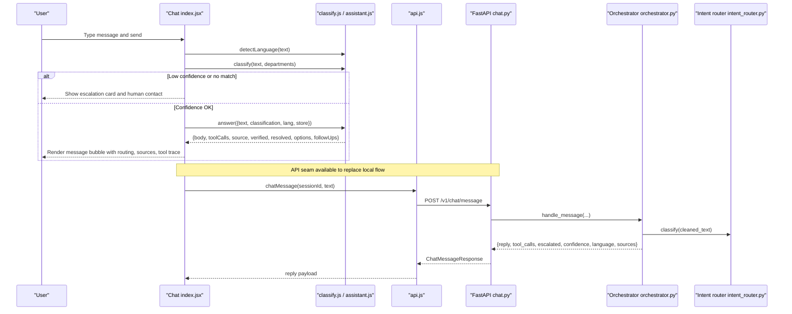

**Diagram sources**
- [index.jsx:62-138](file://src/pages/student/Chat/index.jsx#L62-L138)
- [classify.js:51-57](file://src/lib/classify.js#L51-L57)
- [assistant.js:135-317](file://src/lib/assistant.js#L135-L317)
- [api.js:42-47](file://src/lib/api.js#L42-L47)
- [chat.py:21-39](file://uaea-backend/app/api/chat.py#L21-L39)
- [orchestrator.py:46-143](file://uaea-backend/app/orchestrator/orchestrator.py#L46-L143)
- [intent_router.py:65-102](file://uaea-backend/app/orchestrator/intent_router.py#L65-L102)

## Detailed Component Analysis

### Multi-Language Support (Urdu, Roman Urdu, English)
- Language detection distinguishes Urdu script, Roman Urdu function words, and English.
- Greeting and placeholders adapt based on app language preference.
- Answer templates exist for all three languages; follow-up suggestions are localized per intent.
- Normalization folds common Roman Urdu spelling variants before scoring to improve robustness.

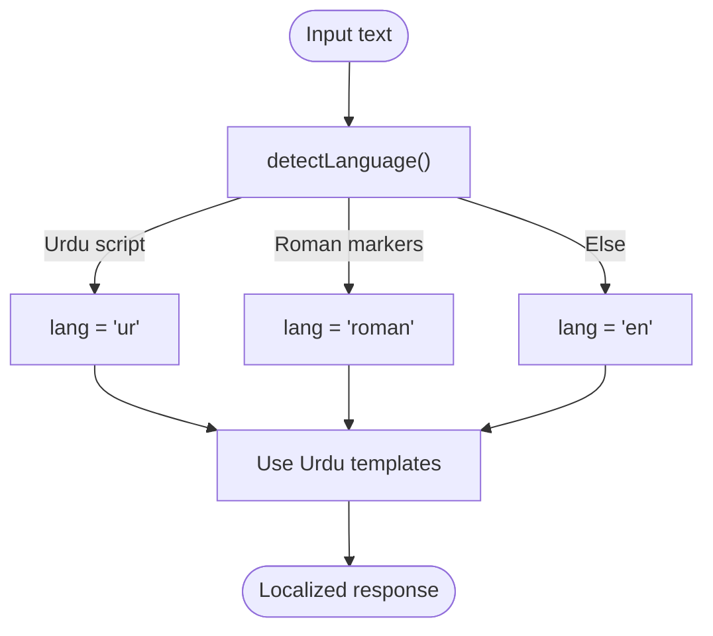

**Diagram sources**
- [classify.js:51-57](file://src/lib/classify.js#L51-L57)
- [assistant.js:20-78](file://src/lib/assistant.js#L20-L78)
- [index.jsx:14-18](file://src/pages/student/Chat/index.jsx#L14-L18)
- [Composer.jsx:33-35](file://src/pages/student/Chat/Composer.jsx#L33-L35)

**Section sources**
- [classify.js:18-57](file://src/lib/classify.js#L18-L57)
- [assistant.js:20-78](file://src/lib/assistant.js#L20-L78)
- [index.jsx:14-18](file://src/pages/student/Chat/index.jsx#L14-L18)
- [Composer.jsx:33-35](file://src/pages/student/Chat/Composer.jsx#L33-L35)

### Intent Classification Mechanism
- Deterministic keyword scoring with strong and weak terms across both scripts.
- Confidence computed from top score capped at a maximum; alternatives provided when close.
- A floor threshold triggers escalation rather than guessing.
- Backend mirrors similar rules and integrates with guided flows and LLM tool loops.

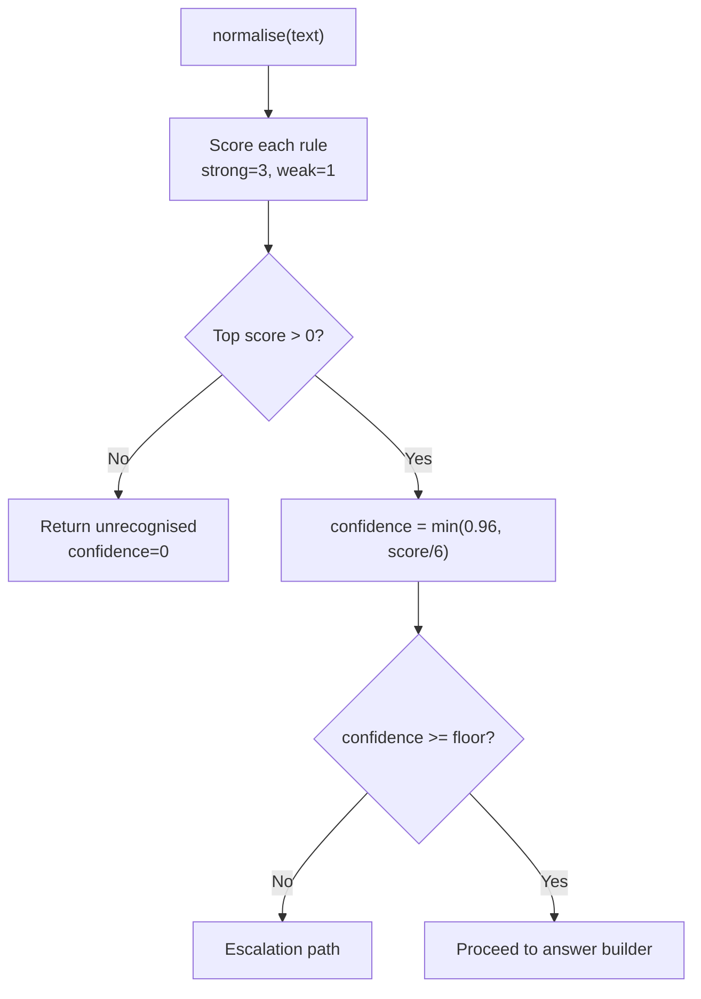

**Diagram sources**
- [classify.js:37-44](file://src/lib/classify.js#L37-L44)
- [classify.js:201-265](file://src/lib/classify.js#L201-L265)
- [classify.js:268-270](file://src/lib/classify.js#L268-L270)
- [intent_router.py:65-102](file://uaea-backend/app/orchestrator/intent_router.py#L65-L102)

**Section sources**
- [classify.js:63-190](file://src/lib/classify.js#L63-L190)
- [classify.js:201-270](file://src/lib/classify.js#L201-L270)
- [intent_router.py:14-62](file://uaea-backend/app/orchestrator/intent_router.py#L14-L62)

### Message Composition and Sending
- Auto-growing textarea supports Enter to send and Shift+Enter for new lines.
- Placeholder adapts to language mode.
- Send handler detects language, appends user message, sets thinking state, then runs classification and answer composition with simulated latency for clarity.

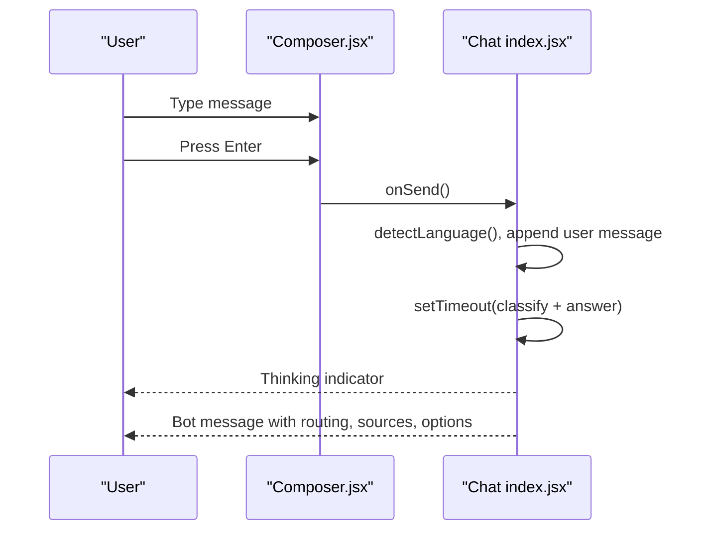

**Diagram sources**
- [Composer.jsx:17-22](file://src/pages/student/Chat/Composer.jsx#L17-L22)
- [index.jsx:62-138](file://src/pages/student/Chat/index.jsx#L62-L138)

**Section sources**
- [Composer.jsx:1-54](file://src/pages/student/Chat/Composer.jsx#L1-L54)
- [index.jsx:62-138](file://src/pages/student/Chat/index.jsx#L62-L138)

### Conversation History Management
- Frontend maintains a local message list with unique IDs and renders them in order.
- Backend persists conversations and messages, supports fetching full session history, and tracks escalation flags.
- Guided flows persist intermediate state as tool messages within the same conversation.

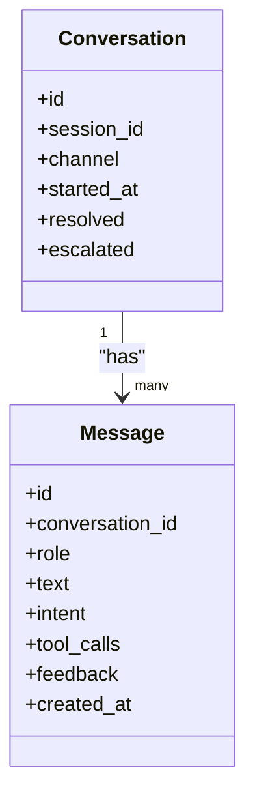

**Diagram sources**
- [orchestrator.py:321-364](file://uaea-backend/app/orchestrator/orchestrator.py#L321-L364)
- [chat.py:42-85](file://uaea-backend/app/api/chat.py#L42-L85)

**Section sources**
- [index.jsx:34-60](file://src/pages/student/Chat/index.jsx#L34-L60)
- [chat.py:42-85](file://uaea-backend/app/api/chat.py#L42-L85)
- [orchestrator.py:66-130](file://uaea-backend/app/orchestrator/orchestrator.py#L66-L130)

### Real-Time Response Handling
- Frontend simulates processing delay to make the pipeline visible and legible.
- Backend orchestrator runs up to a fixed number of LLM rounds with tool execution, collects tool calls, applies guardrails, and returns a final reply.
- If tool use exhausts rounds without a final text, the system escalates gracefully.

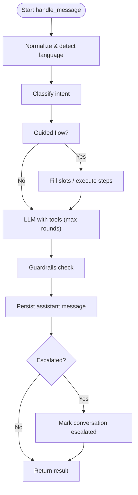

**Diagram sources**
- [orchestrator.py:46-143](file://uaea-backend/app/orchestrator/orchestrator.py#L46-L143)
- [orchestrator.py:229-318](file://uaea-backend/app/orchestrator/orchestrator.py#L229-L318)

**Section sources**
- [index.jsx:75-138](file://src/pages/student/Chat/index.jsx#L75-L138)
- [orchestrator.py:229-318](file://uaea-backend/app/orchestrator/orchestrator.py#L229-L318)

### Chat Sidebar for Navigation and Context
- Displays current service and department when known.
- Shows related deadlines filtered by service or upcoming dates.
- Provides quick links to service details and phone contact.
- Includes a reset button to restart the conversation.

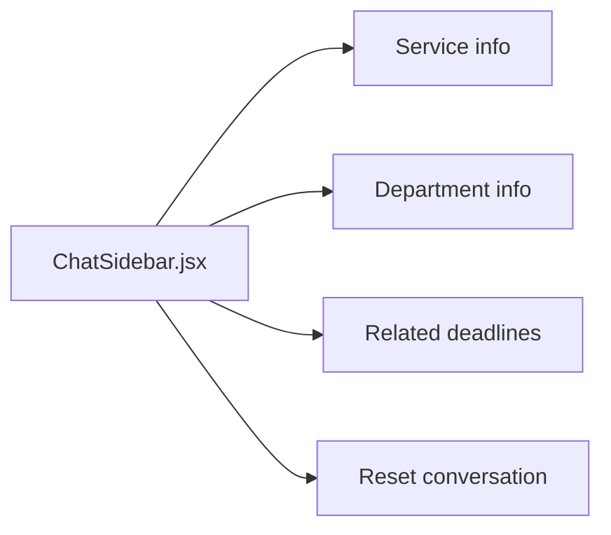

**Diagram sources**
- [ChatSidebar.jsx:13-94](file://src/pages/student/Chat/ChatSidebar.jsx#L13-L94)

**Section sources**
- [ChatSidebar.jsx:1-97](file://src/pages/student/Chat/ChatSidebar.jsx#L1-L97)

### Message Bubble Rendering with Rich Content
- Renders user vs bot avatars and RTL support for Urdu.
- Shows routing card with confidence and category.
- Supports mixed content lines (paragraphs and lists).
- Presents follow-up options as chips.
- Displays source citation badge, verification ladder, and freshness warning.
- Collapsible tool trace reveals lookups behind the answer.
- Escalation card appears when not resolved.

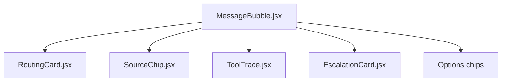

**Diagram sources**
- [MessageBubble.jsx:8-79](file://src/pages/student/Chat/MessageBubble.jsx#L8-L79)
- [RoutingCard.jsx:11-41](file://src/pages/student/Chat/RoutingCard.jsx#L11-L41)
- [SourceChip.jsx:12-36](file://src/pages/student/Chat/SourceChip.jsx#L12-L36)
- [ToolTrace.jsx:9-27](file://src/pages/student/Chat/ToolTrace.jsx#L9-L27)
- [EscalationCard.jsx:10-39](file://src/pages/student/Chat/EscalationCard.jsx#L10-L39)

**Section sources**
- [MessageBubble.jsx:1-82](file://src/pages/student/Chat/MessageBubble.jsx#L1-L82)

### Escalation Handling When Confidence Thresholds Are Not Met
- Frontend checks confidence against a floor; if below, it posts a human-handoff message with department contact details.
- Backend tracks low-confidence queries and can mark conversations as escalated when tool loops fail or explicit escalation tools are invoked.

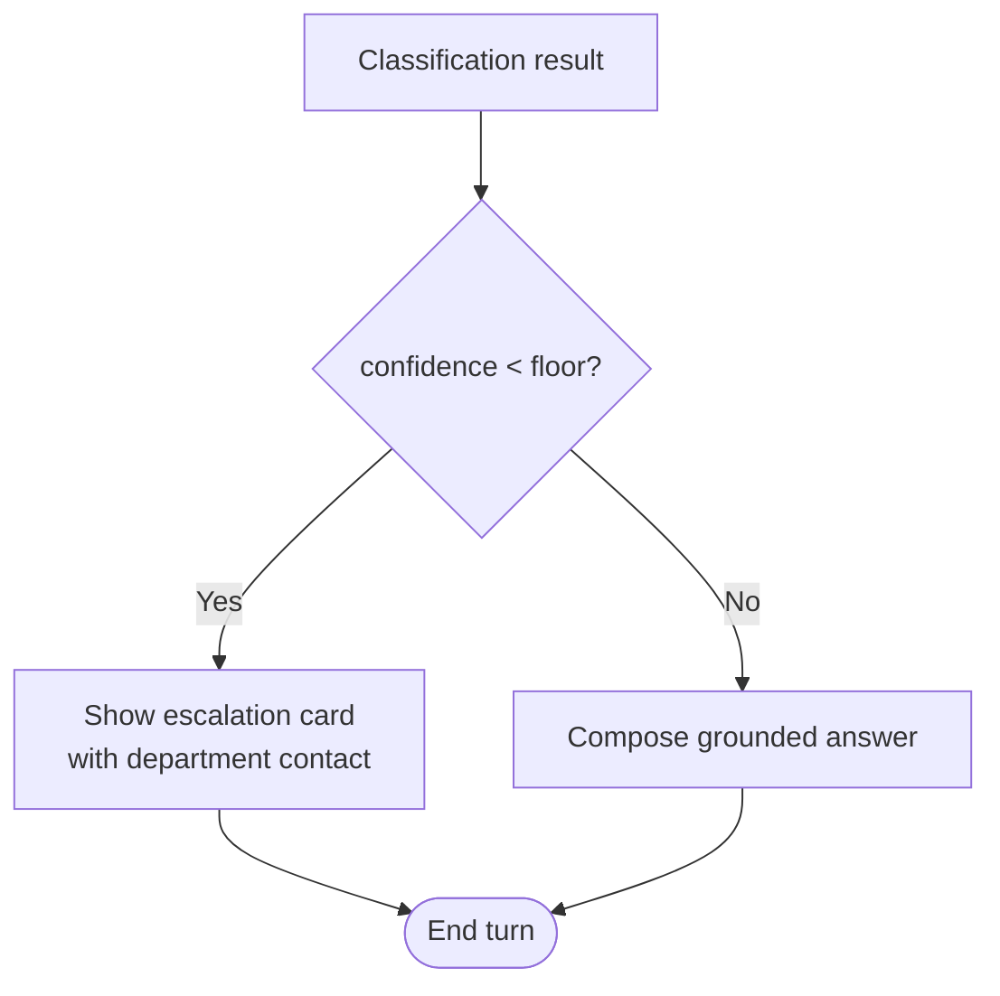

**Diagram sources**
- [index.jsx:80-110](file://src/pages/student/Chat/index.jsx#L80-L110)
- [RoutingCard.jsx:11-41](file://src/pages/student/Chat/RoutingCard.jsx#L11-L41)
- [EscalationCard.jsx:10-39](file://src/pages/student/Chat/EscalationCard.jsx#L10-L39)
- [orchestrator.py:123-130](file://uaea-backend/app/orchestrator/orchestrator.py#L123-L130)

**Section sources**
- [index.jsx:80-110](file://src/pages/student/Chat/index.jsx#L80-L110)
- [RoutingCard.jsx:11-41](file://src/pages/student/Chat/RoutingCard.jsx#L11-L41)
- [EscalationCard.jsx:10-39](file://src/pages/student/Chat/EscalationCard.jsx#L10-L39)
- [orchestrator.py:123-130](file://uaea-backend/app/orchestrator/orchestrator.py#L123-L130)

### Chat Pipeline and State Management
- Local state holds messages, draft, thinking flag, and last classification context.
- AppContext provides shared store (services, fees, deadlines, departments) and language toggle.
- Backend orchestrator manages conversation persistence, guided flow state, tool execution, and guardrails.

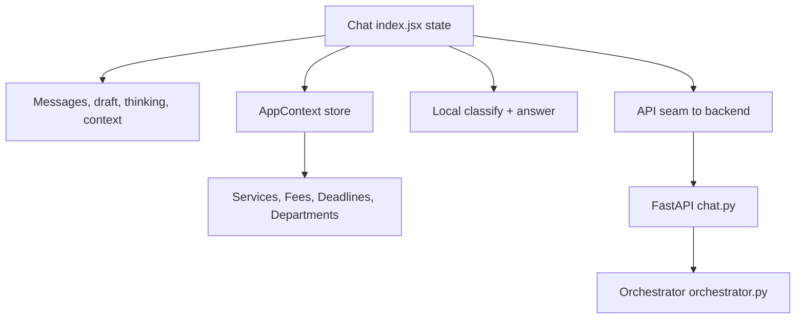

**Diagram sources**
- [index.jsx:31-38](file://src/pages/student/Chat/index.jsx#L31-L38)
- [AppContext.jsx:34-47](file://src/context/AppContext.jsx#L34-L47)
- [api.js:42-47](file://src/lib/api.js#L42-L47)
- [chat.py:21-39](file://uaea-backend/app/api/chat.py#L21-L39)
- [orchestrator.py:46-143](file://uaea-backend/app/orchestrator/orchestrator.py#L46-L143)

**Section sources**
- [index.jsx:31-38](file://src/pages/student/Chat/index.jsx#L31-L38)
- [AppContext.jsx:34-47](file://src/context/AppContext.jsx#L34-L47)
- [api.js:42-47](file://src/lib/api.js#L42-L47)
- [chat.py:21-39](file://uaea-backend/app/api/chat.py#L21-L39)
- [orchestrator.py:46-143](file://uaea-backend/app/orchestrator/orchestrator.py#L46-L143)

### Integration with Backend Orchestrator
- The client API module exposes chatMessage, getSession, escalate, and lookup endpoints.
- The FastAPI endpoint maps requests to the orchestrator’s handle_message, which performs normalization, classification, guided flow handling, LLM tool loops, guardrails, and persistence.
- Responses include reply text, intent, tool calls, escalation flag, confidence, language, and sources for citation.

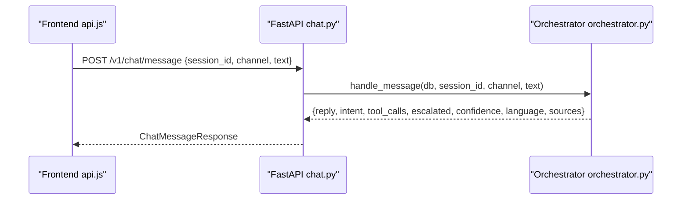

**Diagram sources**
- [api.js:42-47](file://src/lib/api.js#L42-L47)
- [chat.py:21-39](file://uaea-backend/app/api/chat.py#L21-L39)
- [orchestrator.py:46-143](file://uaea-backend/app/orchestrator/orchestrator.py#L46-L143)

**Section sources**
- [api.js:1-169](file://src/lib/api.js#L1-L169)
- [chat.py:1-115](file://uaea-backend/app/api/chat.py#L1-L115)
- [orchestrator.py:1-405](file://uaea-backend/app/orchestrator/orchestrator.py#L1-L405)

## Dependency Analysis
- Chat index depends on classify, assistant, and optional api modules; it composes UI state and renders components.
- MessageBubble composes RoutingCard, SourceChip, ToolTrace, and EscalationCard.
- Assistant depends on format utilities and freshness to produce grounded replies.
- Backend orchestrator depends on normalizer, intent router, state machine, tools, and guardrails.

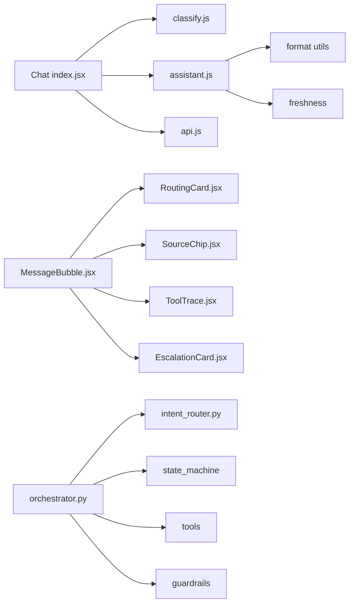

**Diagram sources**
- [index.jsx:1-9](file://src/pages/student/Chat/index.jsx#L1-L9)
- [MessageBubble.jsx:1-5](file://src/pages/student/Chat/MessageBubble.jsx#L1-L5)
- [assistant.js:1-3](file://src/lib/assistant.js#L1-L3)
- [orchestrator.py:17-25](file://uaea-backend/app/orchestrator/orchestrator.py#L17-L25)

**Section sources**
- [index.jsx:1-9](file://src/pages/student/Chat/index.jsx#L1-L9)
- [MessageBubble.jsx:1-5](file://src/pages/student/Chat/MessageBubble.jsx#L1-L5)
- [assistant.js:1-3](file://src/lib/assistant.js#L1-L3)
- [orchestrator.py:17-25](file://uaea-backend/app/orchestrator/orchestrator.py#L17-L25)

## Performance Considerations
- Simulated latency in the frontend makes the pipeline observable but should be removed or parameterized in production.
- The orchestrator limits LLM rounds to prevent runaway loops; tune MAX_ROUNDS based on expected complexity.
- Keep message history window bounded (last 20 messages) to control context size and cost.
- Use deterministic classification locally to reduce unnecessary backend calls during development.

[No sources needed since this section provides general guidance]

## Troubleshooting Guide
- Low confidence: Ensure keywords and normalization cover common Roman Urdu variants; consider expanding RULES or adjusting thresholds.
- Missing sources: Verify tool calls return source metadata; confirm freshness checks display appropriately.
- Escalation loops: Confirm escalation paths provide actionable contacts; verify backend marks conversations as escalated when appropriate.
- API errors: Check base URL configuration and network connectivity; inspect error payloads thrown by the request helper.

**Section sources**
- [classify.js:18-57](file://src/lib/classify.js#L18-L57)
- [classify.js:201-270](file://src/lib/classify.js#L201-L270)
- [api.js:16-31](file://src/lib/api.js#L16-L31)
- [orchestrator.py:255-318](file://uaea-backend/app/orchestrator/orchestrator.py#L255-L318)

## Conclusion
The student chat interface combines a transparent, evidence-backed answer process with multi-language support and clear escalation paths. The frontend focuses on usability and trust signals (routing visibility, sources, freshness, tool traces), while the backend orchestrator ensures grounded replies through deterministic classification, guided flows, and controlled LLM tool usage. Together, they deliver a reliable, auditable experience for students seeking university services information.

[No sources needed since this section summarizes without analyzing specific files]