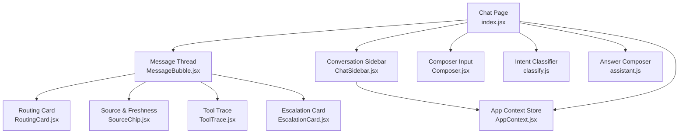
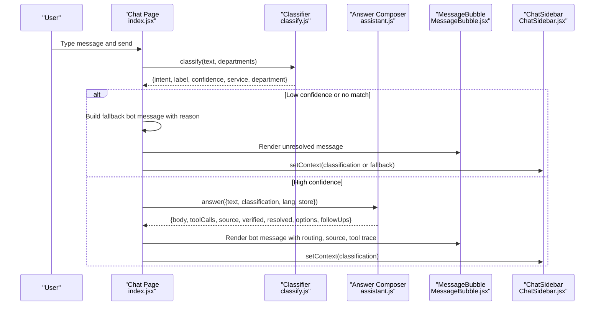
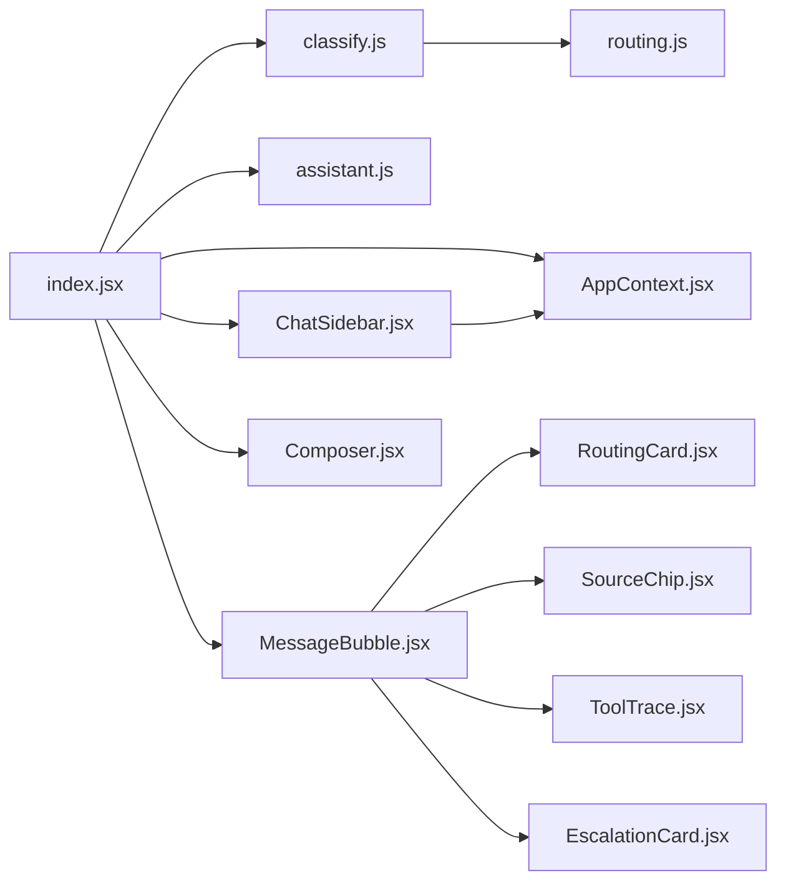

# Conversation Sidebar

<cite>
**Referenced Files in This Document**
- [ChatSidebar.jsx](file://src/pages/student/Chat/ChatSidebar.jsx)
- [index.jsx](file://src/pages/student/Chat/index.jsx)
- [MessageBubble.jsx](file://src/pages/student/Chat/MessageBubble.jsx)
- [RoutingCard.jsx](file://src/pages/student/Chat/RoutingCard.jsx)
- [ToolTrace.jsx](file://src/pages/student/Chat/ToolTrace.jsx)
- [SourceChip.jsx](file://src/pages/student/Chat/SourceChip.jsx)
- [EscalationCard.jsx](file://src/pages/student/Chat/EscalationCard.jsx)
- [Composer.jsx](file://src/pages/student/Chat/Composer.jsx)
- [classify.js](file://src/lib/classify.js)
- [assistant.js](file://src/lib/assistant.js)
- [routing.js](file://src/mocks/routing.js)
- [AppContext.jsx](file://src/context/AppContext.jsx)
- [student.css](file://src/styles/student.css)
</cite>

## Table of Contents
1. [Introduction](#introduction)
2. [Project Structure](#project-structure)
3. [Core Components](#core-components)
4. [Architecture Overview](#architecture-overview)
5. [Detailed Component Analysis](#detailed-component-analysis)
6. [Dependency Analysis](#dependency-analysis)
7. [Performance Considerations](#performance-considerations)
8. [Troubleshooting Guide](#troubleshooting-guide)
9. [Conclusion](#conclusion)

## Introduction
This document explains the conversation sidebar component and its integration with the student chat interface. It covers how the sidebar displays conversation context, classification results, department mapping, related deadlines, and reset functionality. It also details how intent classification, confidence scores, routing information, and tool traces are visualized in the main chat thread and how the sidebar preserves and reflects conversation state across messages.

## Project Structure
The student chat is composed of a message thread and a right-hand sidebar:
- The chat page orchestrates message sending, classification, answer composition, and state updates.
- The sidebar renders contextual panels for the current conversation: service/topic, handling department, upcoming dates, and a reset action.
- Message bubbles display routing cards, source citations, tool traces, escalation options, and follow-up suggestions.

**Diagram sources**
- [index.jsx:30-199](file://src/pages/student/Chat/index.jsx#L30-L199)
- [ChatSidebar.jsx:13-96](file://src/pages/student/Chat/ChatSidebar.jsx#L13-L96)
- [MessageBubble.jsx:8-81](file://src/pages/student/Chat/MessageBubble.jsx#L8-L81)
- [RoutingCard.jsx:11-43](file://src/pages/student/Chat/RoutingCard.jsx#L11-L43)
- [SourceChip.jsx:12-39](file://src/pages/student/Chat/SourceChip.jsx#L12-L39)
- [ToolTrace.jsx:9-29](file://src/pages/student/Chat/ToolTrace.jsx#L9-L29)
- [EscalationCard.jsx:10-41](file://src/pages/student/Chat/EscalationCard.jsx#L10-L41)
- [Composer.jsx:6-53](file://src/pages/student/Chat/Composer.jsx#L6-L53)
- [classify.js:201-269](file://src/lib/classify.js#L201-L269)
- [assistant.js:135-317](file://src/lib/assistant.js#L135-L317)
- [AppContext.jsx:34-133](file://src/context/AppContext.jsx#L34-L133)

**Section sources**
- [index.jsx:30-199](file://src/pages/student/Chat/index.jsx#L30-L199)
- [student.css:307-580](file://src/styles/student.css#L307-L580)

## Core Components
- Chat page (index.jsx): Manages conversation state, sends messages, classifies intents, composes answers, and passes the latest classification to the sidebar as context.
- ChatSidebar.jsx: Displays “This is about” (service), “Handled by” (department), “Related dates” or “Coming up”, and a “Start over” reset button.
- MessageBubble.jsx: Renders user/bot messages, shows routing card, source/freshness, tool trace, escalation, and feedback controls.
- RoutingCard.jsx: Shows intent label, category, department, and confidence percentage; highlights low confidence.
- SourceChip.jsx: Shows source citation, verification status, freshness note, and stale warning when applicable.
- ToolTrace.jsx: Collapsible “How I found this” panel listing tool calls used to generate an answer.
- EscalationCard.jsx: Provides contact details when the assistant cannot resolve the query from records.
- Composer.jsx: Auto-growing input with send behavior and accessibility labels.
- classify.js: Keyword-based classifier that returns intent, confidence, service, category, and department mapping.
- assistant.js: Composes grounded answers from tools, formats responses per language, and provides trust lines and follow-ups.
- AppContext.jsx: Central store for services, fees, deadlines, departments, documents, flows, adapters, and utilities like mutate/verifyRecord.
- routing.js: Category-to-department mapping and quick ask starters.

**Section sources**
- [ChatSidebar.jsx:13-96](file://src/pages/student/Chat/ChatSidebar.jsx#L13-L96)
- [index.jsx:62-148](file://src/pages/student/Chat/index.jsx#L62-L148)
- [MessageBubble.jsx:8-81](file://src/pages/student/Chat/MessageBubble.jsx#L8-L81)
- [RoutingCard.jsx:11-43](file://src/pages/student/Chat/RoutingCard.jsx#L11-L43)
- [SourceChip.jsx:12-39](file://src/pages/student/Chat/SourceChip.jsx#L12-L39)
- [ToolTrace.jsx:9-29](file://src/pages/student/Chat/ToolTrace.jsx#L9-L29)
- [EscalationCard.jsx:10-41](file://src/pages/student/Chat/EscalationCard.jsx#L10-L41)
- [Composer.jsx:6-53](file://src/pages/student/Chat/Composer.jsx#L6-L53)
- [classify.js:201-269](file://src/lib/classify.js#L201-L269)
- [assistant.js:135-317](file://src/lib/assistant.js#L135-L317)
- [routing.js:11-76](file://src/mocks/routing.js#L11-L76)
- [AppContext.jsx:34-133](file://src/context/AppContext.jsx#L34-L133)

## Architecture Overview
The chat flow processes each user message through classification before answering. The sidebar receives the latest classification as context and renders relevant panels.

**Diagram sources**
- [index.jsx:62-148](file://src/pages/student/Chat/index.jsx#L62-L148)
- [classify.js:201-269](file://src/lib/classify.js#L201-L269)
- [assistant.js:135-317](file://src/lib/assistant.js#L135-L317)
- [MessageBubble.jsx:8-81](file://src/pages/student/Chat/MessageBubble.jsx#L8-L81)
- [ChatSidebar.jsx:13-96](file://src/pages/student/Chat/ChatSidebar.jsx#L13-L96)

## Detailed Component Analysis

### Conversation Sidebar (ChatSidebar)
Responsibilities:
- Displays “This is about” section with service name, category badge, and link to full requirements.
- Displays “Handled by” section with department name, hours, verification ladder, and phone link.
- Displays “Related dates” if a service is selected, otherwise “Coming up” showing upcoming deadlines sorted by date.
- Provides a “Start over” button to reset the conversation.

Data flow:
- Receives `classification` from the chat page as props.
- Uses `store.deadlines` from AppContext to compute related/upcoming dates.
- Calls `onReset` to clear context and reinitialize messages.

Visual representation:
- Panels styled via `.st-panel`, headers via `.st-panel h4`, rows via `.st-row`.
- Dates use formatting helpers and badges indicating urgency based on days remaining.

Reset functionality:
- Resets context to null and restores initial greeting message in the thread.

**Section sources**
- [ChatSidebar.jsx:13-96](file://src/pages/student/Chat/ChatSidebar.jsx#L13-L96)
- [student.css:531-580](file://src/styles/student.css#L531-L580)
- [index.jsx:143-148](file://src/pages/student/Chat/index.jsx#L143-L148)

### Intent Classification and Confidence Visualization
Classification:
- Normalizes text, applies spelling folds for Roman Urdu, and scores rules with strong/weak terms.
- Returns intent, label, confidence, service, category, department, matched terms, and alternatives when close matches exist.

Confidence visualization:
- RoutingCard shows intent label, optional category, department, and a percentage match.
- Low confidence triggers an amber background and warning icon.

Department mapping:
- Department is derived from rule-specific deptId or category-to-department mapping.
- If no department is found, a default fallback may be used for unrecognised queries.

**Section sources**
- [classify.js:37-57](file://src/lib/classify.js#L37-L57)
- [classify.js:63-190](file://src/lib/classify.js#L63-L190)
- [classify.js:201-269](file://src/lib/classify.js#L201-L269)
- [routing.js:11-18](file://src/mocks/routing.js#L11-L18)
- [RoutingCard.jsx:11-43](file://src/pages/student/Chat/RoutingCard.jsx#L11-L43)

### Conversation History Navigation and Context Preservation
- Messages are stored in local state and rendered sequentially; new messages scroll into view automatically.
- Each message carries metadata: role, language, classification, lines, toolCalls, source, verified, trust, resolved, options, followUps.
- The last message’s followUps or quick asks provide navigation prompts to continue the conversation.
- Context (classification) is preserved in the chat page state and passed to the sidebar to keep panels aligned with the current topic.

Integration with main chat interface:
- MessageBubble renders routing card, source chip, tool trace, escalation card, and feedback buttons.
- Composer handles input, auto-resizing, and send behavior; disabled while thinking.

**Section sources**
- [index.jsx:34-60](file://src/pages/student/Chat/index.jsx#L34-L60)
- [index.jsx:62-148](file://src/pages/student/Chat/index.jsx#L62-L148)
- [index.jsx:150-199](file://src/pages/student/Chat/index.jsx#L150-L199)
- [MessageBubble.jsx:8-81](file://src/pages/student/Chat/MessageBubble.jsx#L8-L81)
- [Composer.jsx:6-53](file://src/pages/student/Chat/Composer.jsx#L6-L53)

### Visual Representation of Conversation Metadata
- RoutingCard: Shows intent, category, department, and confidence percentage; uses icons and color cues for low confidence.
- SourceChip: Shows source badge, verification ladder, freshness text, and stale warning when needed.
- ToolTrace: Collapsible panel listing tool calls with names, arguments, and results.
- EscalationCard: Provides phone, email, and office hours when the assistant cannot resolve the query.

Interaction patterns:
- Feedback thumbs allow users to mark helpfulness.
- Follow-up chips enable quick next questions.
- Links to service detail pages and department contacts are provided where available.

**Section sources**
- [RoutingCard.jsx:11-43](file://src/pages/student/Chat/RoutingCard.jsx#L11-L43)
- [SourceChip.jsx:12-39](file://src/pages/student/Chat/SourceChip.jsx#L12-L39)
- [ToolTrace.jsx:9-29](file://src/pages/student/Chat/ToolTrace.jsx#L9-L29)
- [EscalationCard.jsx:10-41](file://src/pages/student/Chat/EscalationCard.jsx#L10-L41)
- [MessageBubble.jsx:8-81](file://src/pages/student/Chat/MessageBubble.jsx#L8-L81)

### Reset Functionality
- The sidebar’s “Start over” button triggers a reset handler in the chat page.
- Reset clears context and restores the initial greeting message, effectively starting a fresh conversation.

**Section sources**
- [ChatSidebar.jsx:90-93](file://src/pages/student/Chat/ChatSidebar.jsx#L90-L93)
- [index.jsx:143-148](file://src/pages/student/Chat/index.jsx#L143-L148)

## Dependency Analysis
Key dependencies and relationships:
- Chat page depends on classify and assistant modules to process messages and compose answers.
- Sidebar depends on AppContext store for deadlines and departments.
- Message components depend on routing configuration and mock data for categories and quick asks.
- Styles define layout and visual presentation for chat thread and sidebar.

**Diagram sources**
- [index.jsx:30-199](file://src/pages/student/Chat/index.jsx#L30-L199)
- [classify.js:201-269](file://src/lib/classify.js#L201-L269)
- [assistant.js:135-317](file://src/lib/assistant.js#L135-L317)
- [AppContext.jsx:34-133](file://src/context/AppContext.jsx#L34-L133)
- [routing.js:11-76](file://src/mocks/routing.js#L11-L76)

**Section sources**
- [index.jsx:30-199](file://src/pages/student/Chat/index.jsx#L30-L199)
- [classify.js:201-269](file://src/lib/classify.js#L201-L269)
- [assistant.js:135-317](file://src/lib/assistant.js#L135-L317)
- [AppContext.jsx:34-133](file://src/context/AppContext.jsx#L34-L133)
- [routing.js:11-76](file://src/mocks/routing.js#L11-L76)

## Performance Considerations
- Classification runs synchronously on the client; ensure keyword rules remain concise to avoid heavy string operations.
- Answer composition builds tool call logs; keep tool call payloads minimal to reduce rendering overhead.
- Sidebar computes related dates per render; consider memoization if deadlines list grows large.
- Auto-scrolling and typing indicators should be debounced if message volume increases significantly.

[No sources needed since this section provides general guidance]

## Troubleshooting Guide
Common issues and resolutions:
- No classification result: Ensure input text is non-empty and not overly generic; check normalisation and spelling folds.
- Low confidence routing: Review rule weights and strong/weak terms; adjust thresholds if necessary.
- Missing department mapping: Verify category-to-department mapping and service assignments.
- Stale source warnings: Check verification dates and freshness logic; update records as needed.
- Unresolved messages: Confirm tool calls return expected data; handle empty results gracefully with escalation.

**Section sources**
- [classify.js:201-269](file://src/lib/classify.js#L201-L269)
- [assistant.js:135-317](file://src/lib/assistant.js#L135-L317)
- [EscalationCard.jsx:10-41](file://src/pages/student/Chat/EscalationCard.jsx#L10-L41)
- [SourceChip.jsx:12-39](file://src/pages/student/Chat/SourceChip.jsx#L12-L39)

## Conclusion
The conversation sidebar enhances the student chat experience by providing immediate visibility into intent classification, routing, department ownership, and related deadlines. It integrates tightly with the main chat interface to preserve context across messages and supports reset functionality for fresh conversations. The design emphasizes transparency through confidence scores, source citations, tool traces, and escalation paths, ensuring students understand how answers are derived and when to seek human assistance.

[No sources needed since this section summarizes without analyzing specific files]