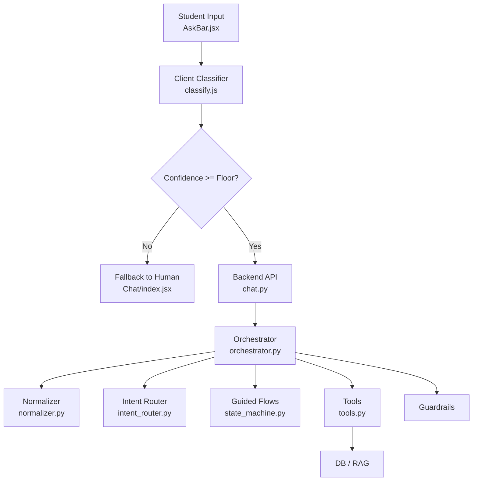
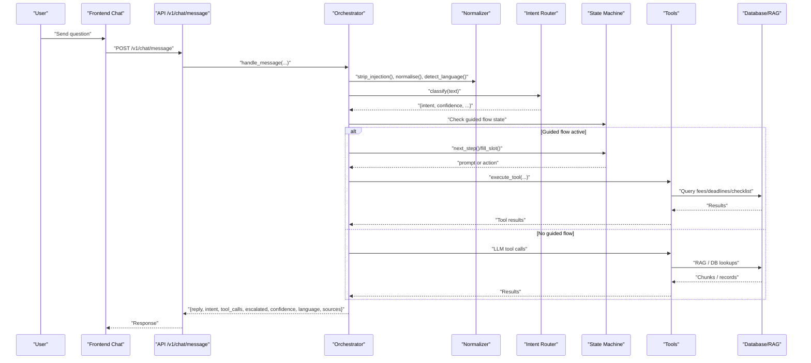
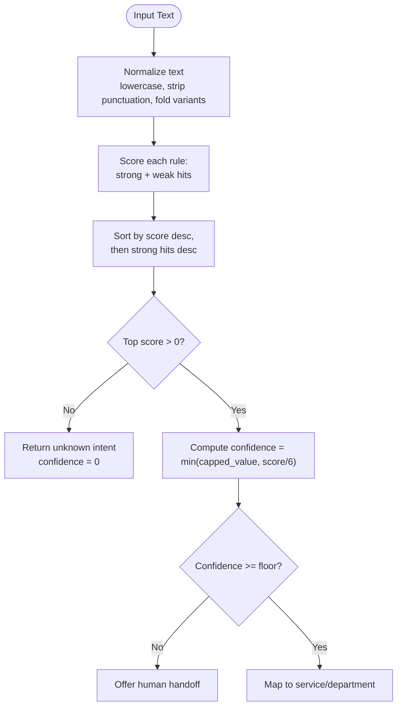
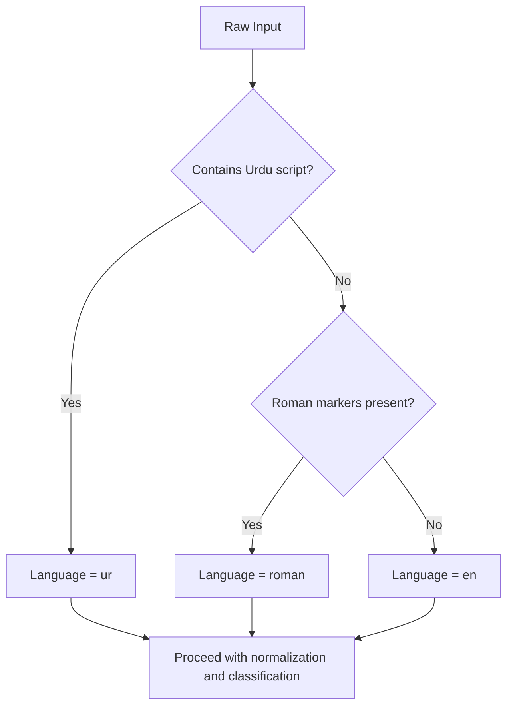
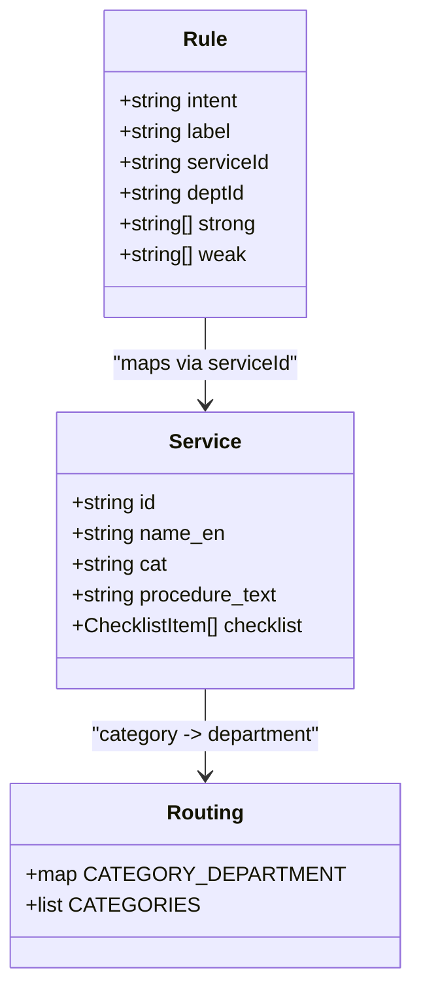
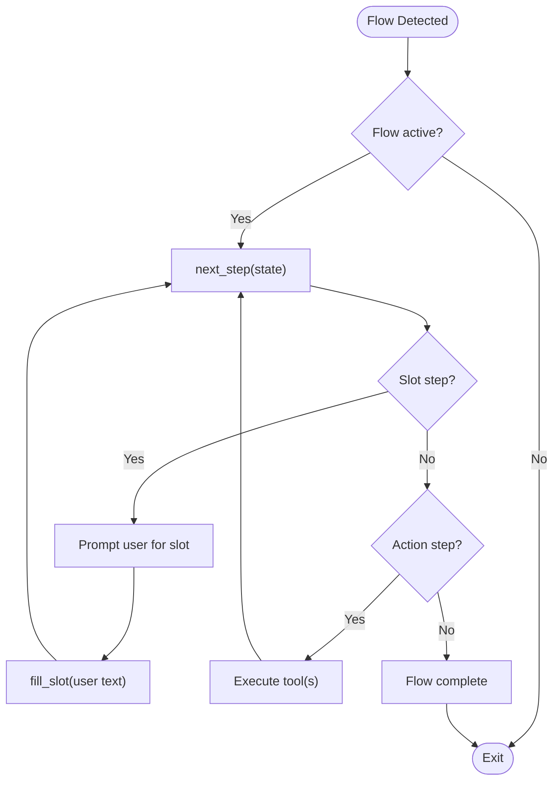
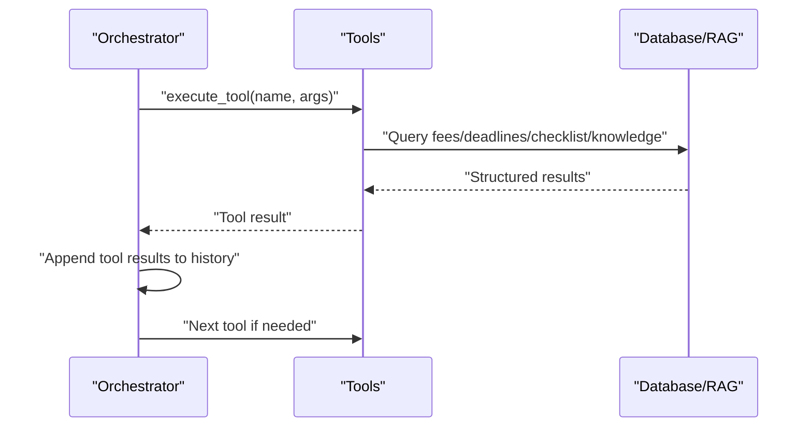
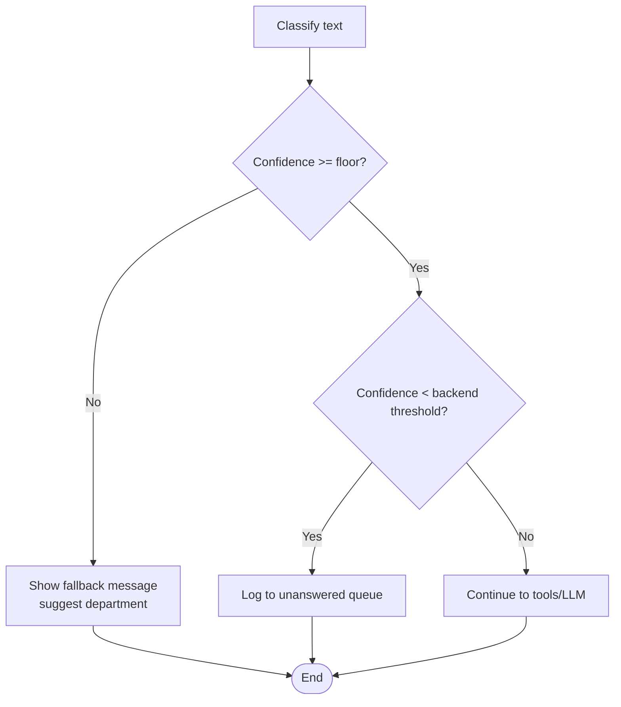
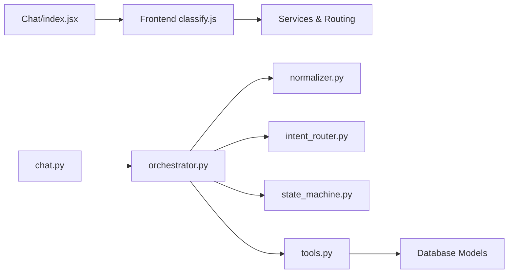

# Intent Classification System

<cite>
**Referenced Files in This Document**
- [classify.js](file://src/lib/classify.js)
- [intent_router.py](file://uaea-backend/app/orchestrator/intent_router.py)
- [normalizer.py](file://uaea-backend/app/orchestrator/normalizer.py)
- [orchestrator.py](file://uaea-backend/app/orchestrator/orchestrator.py)
- [chat.py](file://uaea-backend/app/api/chat.py)
- [state_machine.py](file://uaea-backend/app/orchestrator/state_machine.py)
- [tools.py](file://uaea-backend/app/orchestrator/tools.py)
- [routing.js](file://src/mocks/routing.js)
- [services.js](file://src/mocks/services.js)
- [Chat/index.jsx](file://src/pages/student/Chat/index.jsx)
- [AskBar.jsx](file://src/components/student/AskBar.jsx)
</cite>

## Table of Contents
1. [Introduction](#introduction)
2. [Project Structure](#project-structure)
3. [Core Components](#core-components)
4. [Architecture Overview](#architecture-overview)
5. [Detailed Component Analysis](#detailed-component-analysis)
6. [Dependency Analysis](#dependency-analysis)
7. [Performance Considerations](#performance-considerations)
8. [Troubleshooting Guide](#troubleshooting-guide)
9. [Conclusion](#conclusion)

## Introduction
This document explains the intent classification system that processes student queries and routes them to the appropriate university departments or guided flows. The system uses a deterministic, keyword-based classifier with confidence scoring and multi-language support (English, Urdu script, and Roman Urdu). It detects query intent before answering, maps intents to services and departments, and applies fallback strategies when confidence is low or no rule matches.

## Project Structure
The intent classification spans both frontend and backend:
- Frontend client-side classifier for quick demos and routing decisions, including language detection and department mapping via service catalog and category-to-department lookup.
- Backend orchestrator pipeline that normalizes input, classifies intent, optionally runs guided flows, calls tools (RAG, DB lookups), enforces guardrails, and tracks low-confidence queries.

**Diagram sources**
- [AskBar.jsx:10-39](file://src/components/student/AskBar.jsx#L10-L39)
- [classify.js:18-57](file://src/lib/classify.js#L18-L57)
- [Chat/index.jsx:62-135](file://src/pages/student/Chat/index.jsx#L62-L135)
- [chat.py:21-39](file://uaea-backend/app/api/chat.py#L21-L39)
- [orchestrator.py:46-143](file://uaea-backend/app/orchestrator/orchestrator.py#L46-L143)
- [normalizer.py:29-49](file://uaea-backend/app/orchestrator/normalizer.py#L29-L49)
- [intent_router.py:65-102](file://uaea-backend/app/orchestrator/intent_router.py#L65-L102)
- [state_machine.py:16-59](file://uaea-backend/app/orchestrator/state_machine.py#L16-L59)
- [tools.py:18-87](file://uaea-backend/app/orchestrator/tools.py#L18-L87)

**Section sources**
- [AskBar.jsx:10-39](file://src/components/student/AskBar.jsx#L10-L39)
- [Chat/index.jsx:62-135](file://src/pages/student/Chat/index.jsx#L62-L135)
- [chat.py:21-39](file://uaea-backend/app/api/chat.py#L21-L39)
- [orchestrator.py:46-143](file://uaea-backend/app/orchestrator/orchestrator.py#L46-L143)

## Core Components
- Keyword rules and scoring: Both frontend and backend define rules with strong and weak keywords per intent. Strong hits score higher than weak hits.
- Normalization: Removes punctuation, lowercases, and folds common Roman Urdu spelling variants to improve matching robustness.
- Language detection: Detects Urdu script, Roman Urdu, or English to tailor responses and prompts.
- Confidence calculation: Normalizes raw scores into a capped confidence value; thresholds determine whether to answer or escalate.
- Department mapping: Maps intents to services and categories, then resolves to a department using a lookup table.
- Guided flows: For specific intents, a state machine collects slots and executes actions before returning answers.
- Tool execution: Retrieves fees, deadlines, document checklists, department info, and knowledge base chunks from the database or RAG.

**Section sources**
- [classify.js:63-190](file://src/lib/classify.js#L63-L190)
- [intent_router.py:14-59](file://uaea-backend/app/orchestrator/intent_router.py#L14-L59)
- [normalizer.py:9-49](file://uaea-backend/app/orchestrator/normalizer.py#L9-L49)
- [routing.js:11-18](file://src/mocks/routing.js#L11-L18)
- [services.js:10-309](file://src/mocks/services.js#L10-L309)
- [state_machine.py:16-59](file://uaea-backend/app/orchestrator/state_machine.py#L16-L59)
- [tools.py:18-87](file://uaea-backend/app/orchestrator/tools.py#L18-L87)

## Architecture Overview
End-to-end flow for a chat message:
1. Client sends text via AskBar to Chat page.
2. Client may classify locally to decide immediate fallback vs sending to backend.
3. Backend API receives request and orchestrates processing:
   - Normalize and detect language.
   - Classify intent with keyword rules and confidence.
   - If a guided flow intent is detected and active, collect slots and execute actions.
   - Otherwise, call LLM with tool definitions to retrieve data and produce a reply.
   - Apply guardrails to ensure safe, sourced replies.
   - Persist messages and track low-confidence queries.
4. Response includes reply, intent, tool calls, escalation flag, confidence, language, and sources.

**Diagram sources**
- [chat.py:21-39](file://uaea-backend/app/api/chat.py#L21-L39)
- [orchestrator.py:46-143](file://uaea-backend/app/orchestrator/orchestrator.py#L46-L143)
- [normalizer.py:29-49](file://uaea-backend/app/orchestrator/normalizer.py#L29-L49)
- [intent_router.py:65-102](file://uaea-backend/app/orchestrator/intent_router.py#L65-L102)
- [state_machine.py:94-146](file://uaea-backend/app/orchestrator/state_machine.py#L94-L146)
- [tools.py:218-235](file://uaea-backend/app/orchestrator/tools.py#L218-L235)

## Detailed Component Analysis

### Keyword-Based Classification Algorithm
- Rules define intents with strong and weak keywords in multiple scripts (English and Urdu).
- Scoring:
  - Each strong match adds a fixed weight; each weak match adds a smaller weight.
  - Scores are computed per rule, then sorted by total score and number of strong hits.
- Confidence:
  - Raw top score is normalized to a capped confidence value.
  - Thresholds determine behavior:
    - Frontend: below a floor threshold, the assistant declines to guess and offers human handoff.
    - Backend: low-confidence queries are tracked for review and can trigger escalation paths.

**Diagram sources**
- [classify.js:18-57](file://src/lib/classify.js#L18-L57)
- [classify.js:63-190](file://src/lib/classify.js#L63-L190)
- [classify.js:195-269](file://src/lib/classify.js#L195-L269)
- [intent_router.py:65-102](file://uaea-backend/app/orchestrator/intent_router.py#L65-L102)

**Section sources**
- [classify.js:63-190](file://src/lib/classify.js#L63-L190)
- [intent_router.py:14-59](file://uaea-backend/app/orchestrator/intent_router.py#L14-L59)
- [classify.js:195-269](file://src/lib/classify.js#L195-L269)
- [intent_router.py:65-102](file://uaea-backend/app/orchestrator/intent_router.py#L65-L102)

### Multi-Language Support
- Normalization folds common Roman Urdu spelling variants to reduce fragmentation across spellings.
- Language detection identifies:
  - Urdu script (Arabic Unicode range).
  - Roman Urdu (presence of function words like “kya”, “kitni”, “kaise”).
  - English otherwise.
- Responses are tailored to the detected language throughout the pipeline.

**Diagram sources**
- [normalizer.py:29-49](file://uaea-backend/app/orchestrator/normalizer.py#L29-L49)
- [classify.js:37-57](file://src/lib/classify.js#L37-L57)

**Section sources**
- [normalizer.py:9-49](file://uaea-backend/app/orchestrator/normalizer.py#L9-L49)
- [classify.js:18-57](file://src/lib/classify.js#L18-L57)

### Department Mapping and Service Catalog
- Intents map to services via rule metadata (serviceId).
- Services have categories (e.g., Admissions, Finance, Examinations).
- Category-to-department mapping resolves the owning department for routing and display.
- Some intents override default category mapping to ensure correct department assignment.

**Diagram sources**
- [classify.js:63-190](file://src/lib/classify.js#L63-L190)
- [routing.js:11-18](file://src/mocks/routing.js#L11-L18)
- [services.js:10-309](file://src/mocks/services.js#L10-L309)

**Section sources**
- [classify.js:63-190](file://src/lib/classify.js#L63-L190)
- [routing.js:11-18](file://src/mocks/routing.js#L11-L18)
- [services.js:10-309](file://src/mocks/services.js#L10-L309)

### Guided Flows and Slot-Filling
- Certain intents trigger guided flows (e.g., admission, fee challan, degree).
- State machine tracks active flow, filled slots, and next steps.
- Flow steps either prompt for missing slots or execute actions (fee lookup, deadline lookup, document checklist).
- After slot collection, the orchestrator falls through to LLM/tool execution to finalize the response.

**Diagram sources**
- [state_machine.py:16-59](file://uaea-backend/app/orchestrator/state_machine.py#L16-L59)
- [state_machine.py:94-146](file://uaea-backend/app/orchestrator/state_machine.py#L94-L146)
- [orchestrator.py:146-227](file://uaea-backend/app/orchestrator/orchestrator.py#L146-L227)

**Section sources**
- [state_machine.py:16-59](file://uaea-backend/app/orchestrator/state_machine.py#L16-L59)
- [state_machine.py:94-146](file://uaea-backend/app/orchestrator/state_machine.py#L94-L146)
- [orchestrator.py:146-227](file://uaea-backend/app/orchestrator/orchestrator.py#L146-L227)

### Tool Execution and Data Retrieval
- Tools provide authoritative data:
  - get_department: returns contact details and campus info.
  - get_fee_tariff: returns official fee amounts with currency and source.
  - get_deadline: returns official deadlines with semester and source.
  - get_document_checklist: returns required documents and procedures.
  - create_escalation_ticket: creates a human handoff ticket.
  - search_knowledge_base: retrieves relevant chunks from verified documents.
- Orchestrator loops up to a maximum number of rounds to resolve tool outputs before responding.

**Diagram sources**
- [tools.py:18-87](file://uaea-backend/app/orchestrator/tools.py#L18-L87)
- [tools.py:92-235](file://uaea-backend/app/orchestrator/tools.py#L92-L235)
- [orchestrator.py:229-318](file://uaea-backend/app/orchestrator/orchestrator.py#L229-L318)

**Section sources**
- [tools.py:18-87](file://uaea-backend/app/orchestrator/tools.py#L18-L87)
- [tools.py:92-235](file://uaea-backend/app/orchestrator/tools.py#L92-L235)
- [orchestrator.py:229-318](file://uaea-backend/app/orchestrator/orchestrator.py#L229-L318)

### Fallback Strategies for Unrecognized Queries
- Frontend:
  - If classification returns null or confidence below a defined floor, the assistant declines to guess and suggests contacting a department (defaulting to Admissions if none mapped).
- Backend:
  - Low-confidence queries (below a threshold) are logged to an unanswered queue for review.
  - Escalation tickets can be created via tools when data is insufficient or the student requests human assistance.

**Diagram sources**
- [classify.js:195-269](file://src/lib/classify.js#L195-L269)
- [Chat/index.jsx:77-110](file://src/pages/student/Chat/index.jsx#L77-L110)
- [orchestrator.py:123-126](file://uaea-backend/app/orchestrator/orchestrator.py#L123-L126)
- [orchestrator.py:367-384](file://uaea-backend/app/orchestrator/orchestrator.py#L367-L384)

**Section sources**
- [classify.js:195-269](file://src/lib/classify.js#L195-L269)
- [Chat/index.jsx:77-110](file://src/pages/student/Chat/index.jsx#L77-L110)
- [orchestrator.py:123-126](file://uaea-backend/app/orchestrator/orchestrator.py#L123-L126)
- [orchestrator.py:367-384](file://uaea-backend/app/orchestrator/orchestrator.py#L367-L384)

## Dependency Analysis
Key dependencies and relationships:
- Frontend classifier depends on service catalog and category-to-department mapping to resolve departments.
- Backend orchestrator depends on normalizer, intent router, state machine, tools, and guardrails.
- Tools depend on database models and adapters to fetch authoritative data.
- API layer exposes endpoints that orchestrate the full pipeline and return structured responses.

**Diagram sources**
- [classify.js:1-57](file://src/lib/classify.js#L1-L57)
- [routing.js:11-18](file://src/mocks/routing.js#L11-L18)
- [services.js:10-309](file://src/mocks/services.js#L10-L309)
- [Chat/index.jsx:62-135](file://src/pages/student/Chat/index.jsx#L62-L135)
- [chat.py:21-39](file://uaea-backend/app/api/chat.py#L21-L39)
- [orchestrator.py:46-143](file://uaea-backend/app/orchestrator/orchestrator.py#L46-L143)
- [normalizer.py:29-49](file://uaea-backend/app/orchestrator/normalizer.py#L29-L49)
- [intent_router.py:65-102](file://uaea-backend/app/orchestrator/intent_router.py#L65-L102)
- [state_machine.py:16-59](file://uaea-backend/app/orchestrator/state_machine.py#L16-L59)
- [tools.py:218-235](file://uaea-backend/app/orchestrator/tools.py#L218-L235)

**Section sources**
- [classify.js:1-57](file://src/lib/classify.js#L1-L57)
- [routing.js:11-18](file://src/mocks/routing.js#L11-L18)
- [services.js:10-309](file://src/mocks/services.js#L10-L309)
- [Chat/index.jsx:62-135](file://src/pages/student/Chat/index.jsx#L62-L135)
- [chat.py:21-39](file://uaea-backend/app/api/chat.py#L21-L39)
- [orchestrator.py:46-143](file://uaea-backend/app/orchestrator/orchestrator.py#L46-L143)
- [normalizer.py:29-49](file://uaea-backend/app/orchestrator/normalizer.py#L29-L49)
- [intent_router.py:65-102](file://uaea-backend/app/orchestrator/intent_router.py#L65-L102)
- [state_machine.py:16-59](file://uaea-backend/app/orchestrator/state_machine.py#L16-L59)
- [tools.py:218-235](file://uaea-backend/app/orchestrator/tools.py#L218-L235)

## Performance Considerations
- Deterministic keyword scoring avoids heavy ML inference latency at classification time.
- Normalization reduces false negatives due to spelling variations, improving accuracy without extra computation.
- Guided flows minimize unnecessary LLM calls by collecting required slots first.
- Tool calls are bounded by a maximum round limit to prevent runaway loops.
- Sources and citations are extracted from tool results to avoid redundant retrieval.

[No sources needed since this section provides general guidance]

## Troubleshooting Guide
Common issues and resolutions:
- Misclassification due to ambiguous phrasing:
  - Review rule keywords and consider adding strong/weak terms for new patterns.
  - Adjust confidence thresholds if necessary to balance safety and responsiveness.
- Low-confidence queries not escalating:
  - Verify backend threshold usage and ensure unanswered tracking is enabled.
  - Confirm escalation tools are invoked when data is missing or student requests human help.
- Incorrect department routing:
  - Check category-to-department mapping and any rule-level overrides.
  - Validate service catalog categories align with organizational structure.
- Language detection failures:
  - Expand Roman Urdu marker list if certain phrases are missed.
  - Ensure normalization correctly folds variants before detection.

**Section sources**
- [intent_router.py:65-102](file://uaea-backend/app/orchestrator/intent_router.py#L65-L102)
- [classify.js:195-269](file://src/lib/classify.js#L195-L269)
- [routing.js:11-18](file://src/mocks/routing.js#L11-L18)
- [normalizer.py:9-49](file://uaea-backend/app/orchestrator/normalizer.py#L9-L49)
- [orchestrator.py:123-126](file://uaea-backend/app/orchestrator/orchestrator.py#L123-L126)
- [tools.py:200-215](file://uaea-backend/app/orchestrator/tools.py#L200-L215)

## Conclusion
The intent classification system combines deterministic keyword rules, robust normalization, and multi-language detection to reliably route student queries to the correct departments or guided flows. Confidence scoring ensures cautious behavior when uncertain, while guided flows and tools provide precise, sourced answers. Fallback strategies protect against misclassification by offering human handoff and tracking unresolved queries for continuous improvement.

[No sources needed since this section summarizes without analyzing specific files]