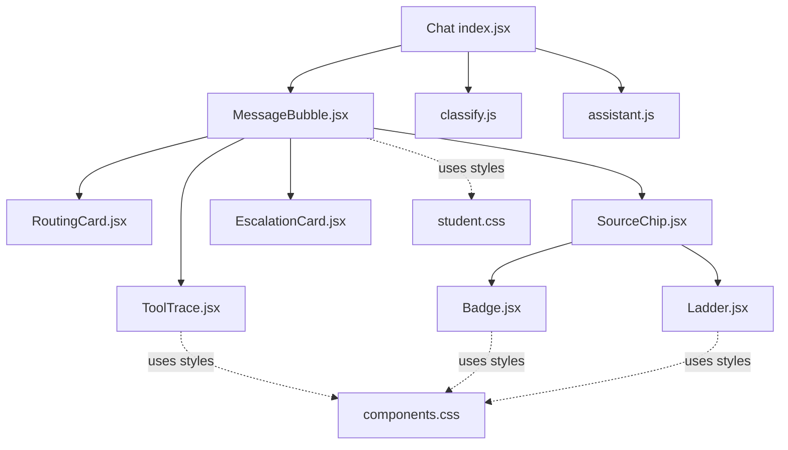
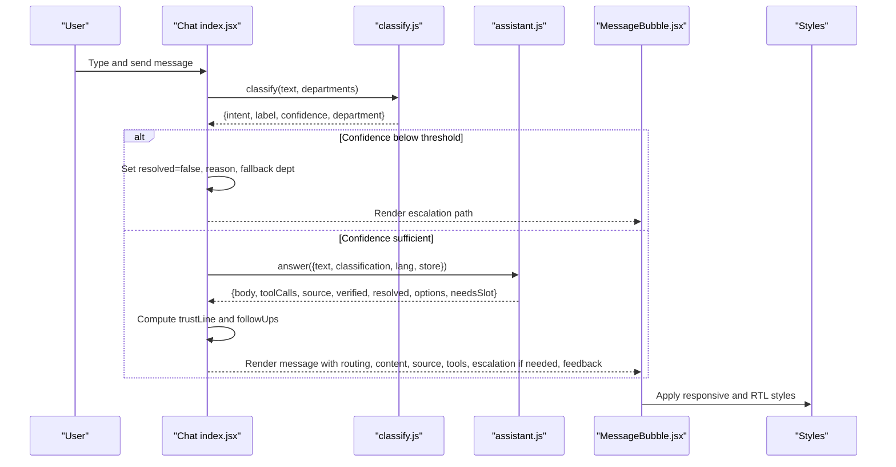
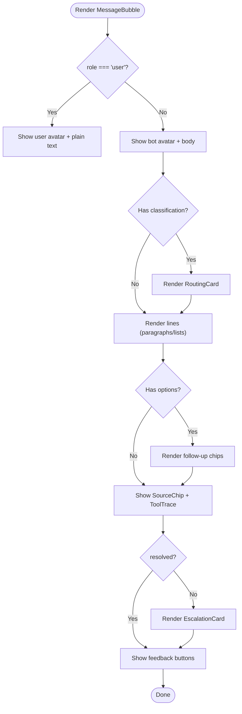
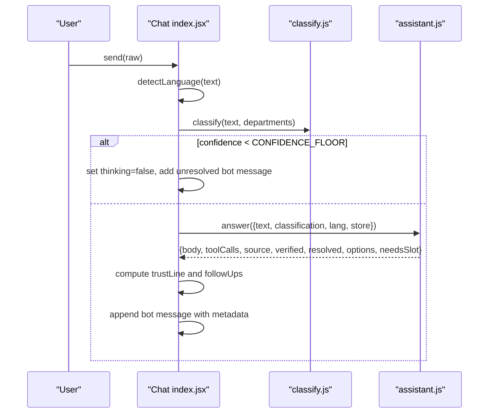
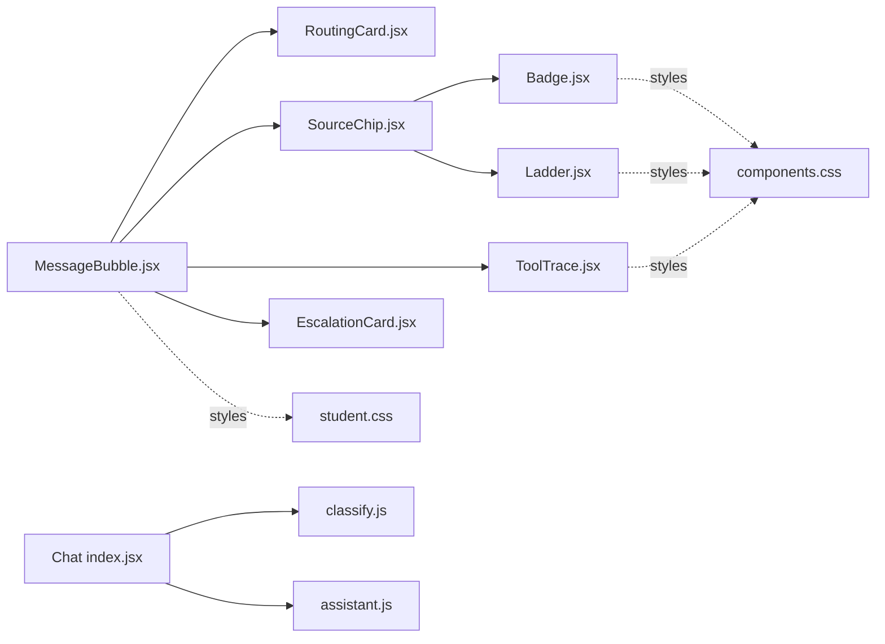

# Message Bubble Rendering

<cite>
**Referenced Files in This Document**
- [MessageBubble.jsx](file://src/pages/student/Chat/MessageBubble.jsx)
- [Chat index.jsx](file://src/pages/student/Chat/index.jsx)
- [ToolTrace.jsx](file://src/pages/student/Chat/ToolTrace.jsx)
- [SourceChip.jsx](file://src/pages/student/Chat/SourceChip.jsx)
- [EscalationCard.jsx](file://src/pages/student/Chat/EscalationCard.jsx)
- [RoutingCard.jsx](file://src/pages/student/Chat/RoutingCard.jsx)
- [classify.js](file://src/lib/classify.js)
- [assistant.js](file://src/lib/assistant.js)
- [Badge.jsx](file://src/components/ui/Badge.jsx)
- [Ladder.jsx](file://src/components/ui/Ladder.jsx)
- [student.css](file://src/styles/student.css)
- [components.css](file://src/styles/components.css)
- [tokens.css](file://src/styles/tokens.css)
</cite>

## Table of Contents
1. [Introduction](#introduction)
2. [Project Structure](#project-structure)
3. [Core Components](#core-components)
4. [Architecture Overview](#architecture-overview)
5. [Detailed Component Analysis](#detailed-component-analysis)
6. [Dependency Analysis](#dependency-analysis)
7. [Performance Considerations](#performance-considerations)
8. [Troubleshooting Guide](#troubleshooting-guide)
9. [Conclusion](#conclusion)

## Introduction
This document explains the message bubble component that renders both user and bot messages in the student chat interface. It covers rich content rendering (text, lists), tool call visualization, source citations, freshness indicators, feedback collection, follow-up suggestions, and escalation handling when confidence thresholds are not met. It also documents responsive design, accessibility considerations, and styling customization options used by the message bubbles and their supporting components.

## Project Structure
The message bubble is part of a small chat subsystem under the student-facing pages. The key files include:
- MessageBubble: renders a single turn for user or bot
- Chat index: orchestrates message flow, classification, answer composition, and UI state
- Supporting visuals: RoutingCard, SourceChip, ToolTrace, EscalationCard
- Logic libraries: classify (intent routing and language detection), assistant (answer composer and trust/follow-ups)
- Shared UI primitives: Badge, Ladder
- Styles: tokens, components, and student-specific chat styles

**Diagram sources**
- [Chat index.jsx:1-200](file://src/pages/student/Chat/index.jsx#L1-L200)
- [MessageBubble.jsx:1-82](file://src/pages/student/Chat/MessageBubble.jsx#L1-L82)
- [RoutingCard.jsx:1-44](file://src/pages/student/Chat/RoutingCard.jsx#L1-L44)
- [SourceChip.jsx:1-40](file://src/pages/student/Chat/SourceChip.jsx#L1-L40)
- [ToolTrace.jsx:1-30](file://src/pages/student/Chat/ToolTrace.jsx#L1-L30)
- [EscalationCard.jsx:1-42](file://src/pages/student/Chat/EscalationCard.jsx#L1-L42)
- [classify.js:1-270](file://src/lib/classify.js#L1-L270)
- [assistant.js:1-364](file://src/lib/assistant.js#L1-L364)
- [Badge.jsx:1-12](file://src/components/ui/Badge.jsx#L1-L12)
- [Ladder.jsx:1-32](file://src/components/ui/Ladder.jsx#L1-L32)
- [student.css:307-530](file://src/styles/student.css#L307-L530)
- [components.css:92-134](file://src/styles/components.css#L92-L134)

**Section sources**
- [Chat index.jsx:1-200](file://src/pages/student/Chat/index.jsx#L1-L200)
- [MessageBubble.jsx:1-82](file://src/pages/student/Chat/MessageBubble.jsx#L1-L82)

## Core Components
- MessageBubble: Renders a single message turn with avatar, body text, optional routing card, source citation, tool trace, escalation card, and feedback buttons. Supports right-to-left layout for Urdu.
- RoutingCard: Shows where the question was routed (label, category, department) and confidence percentage; highlights low confidence.
- SourceChip: Displays source badge, verification ladder, and trust text; shows stale warning when records are not recently verified.
- ToolTrace: Collapsible “How I found this” section listing tool calls made to produce the answer.
- EscalationCard: Presents human hand-off with contact details when the assistant cannot resolve the query.
- Chat index: Orchestrates send flow, classification, answer composition, follow-up suggestions, and feedback state.

Key responsibilities:
- Rich content: supports paragraphs and ordered lists within bot answers.
- Evidence: shows source, verification status, and tool calls.
- Safety: escalates when confidence is below threshold.
- Feedback: collects thumbs up/down per message.
- Follow-ups: suggests next questions based on intent and language.

**Section sources**
- [MessageBubble.jsx:1-82](file://src/pages/student/Chat/MessageBubble.jsx#L1-L82)
- [RoutingCard.jsx:1-44](file://src/pages/student/Chat/RoutingCard.jsx#L1-L44)
- [SourceChip.jsx:1-40](file://src/pages/student/Chat/SourceChip.jsx#L1-L40)
- [ToolTrace.jsx:1-30](file://src/pages/student/Chat/ToolTrace.jsx#L1-L30)
- [EscalationCard.jsx:1-42](file://src/pages/student/Chat/EscalationCard.jsx#L1-L42)
- [Chat index.jsx:62-138](file://src/pages/student/Chat/index.jsx#L62-L138)

## Architecture Overview
The chat flow classifies the user’s input before answering, then composes a grounded response with evidence and safety rails.

**Diagram sources**
- [Chat index.jsx:62-138](file://src/pages/student/Chat/index.jsx#L62-L138)
- [classify.js:201-269](file://src/lib/classify.js#L201-L269)
- [assistant.js:135-317](file://src/lib/assistant.js#L135-L317)
- [MessageBubble.jsx:18-77](file://src/pages/student/Chat/MessageBubble.jsx#L18-L77)
- [student.css:307-530](file://src/styles/student.css#L307-L530)

## Detailed Component Analysis

### MessageBubble
- Purpose: Renders one turn of conversation for either user or bot.
- Behavior:
  - Detects role and language to apply layout and direction (RTL for Urdu).
  - For bot messages:
    - Shows RoutingCard with classification and confidence.
    - Renders lines: strings become paragraphs; structured items render as lists.
    - Shows follow-up chips when provided via message.options.
    - Shows SourceChip with source badge, verification ladder, and trust text.
    - Shows ToolTrace when toolCalls exist.
    - Shows EscalationCard when not resolved.
    - Provides feedback buttons (“Was this right?”) with accessible labels and visual state.
- Data contract:
  - message.role: "user" | "bot"
  - message.lang: "en" | "roman" | "ur"
  - message.lines: array of strings or list objects
  - message.classification: { label, category, department, confidence }
  - message.toolCalls: array of { name, args, result }
  - message.source: string or null
  - message.verified: date or null
  - message.trust: { text, tone, stale }
  - message.resolved: boolean
  - message.options: array of strings (follow-up suggestions)
  - message.feedback: "up" | "down" | null
  - message.id: unique identifier

**Diagram sources**
- [MessageBubble.jsx:8-77](file://src/pages/student/Chat/MessageBubble.jsx#L8-L77)

**Section sources**
- [MessageBubble.jsx:8-77](file://src/pages/student/Chat/MessageBubble.jsx#L8-L77)

### RoutingCard
- Displays intent label, category, and department, plus confidence percentage.
- Highlights low-confidence routes using an amber style when confidence falls below the configured floor.

**Section sources**
- [RoutingCard.jsx:11-41](file://src/pages/student/Chat/RoutingCard.jsx#L11-L41)
- [classify.js:268-269](file://src/lib/classify.js#L268-L269)

### SourceChip
- Shows source badge and verification ladder when present.
- Adds trust text computed from verification date and language.
- Displays a stale warning note when the record has not been checked recently.

**Section sources**
- [SourceChip.jsx:12-37](file://src/pages/student/Chat/SourceChip.jsx#L12-L37)
- [assistant.js:319-328](file://src/lib/assistant.js#L319-L328)
- [Ladder.jsx:10-29](file://src/components/ui/Ladder.jsx#L10-L29)
- [Badge.jsx:5-9](file://src/components/ui/Badge.jsx#L5-L9)

### ToolTrace
- Collapsible section titled “How I found this — N lookup(s)” that lists each tool call with name, arguments, and result.
- Uses native details/summary for accessibility and keyboard support.

**Section sources**
- [ToolTrace.jsx:9-27](file://src/pages/student/Chat/ToolTrace.jsx#L9-L27)
- [components.css:628-646](file://src/styles/components.css#L628-L646)

### EscalationCard
- Appears when the assistant cannot resolve the query (resolved=false).
- Provides a clear “Talk to a person” message with department name, phone link, email link, and office hours.

**Section sources**
- [EscalationCard.jsx:10-40](file://src/pages/student/Chat/EscalationCard.jsx#L10-L40)

### Chat index (message orchestration)
- Handles sending messages, detecting language, classifying intent, and composing answers.
- Enforces confidence threshold: if below threshold, posts a bot message indicating uncertainty and offers a human hand-off.
- Computes trust line and follow-up suggestions based on classification and language.
- Manages feedback state per message id.

**Diagram sources**
- [Chat index.jsx:62-138](file://src/pages/student/Chat/index.jsx#L62-L138)
- [classify.js:201-269](file://src/lib/classify.js#L201-L269)
- [assistant.js:135-317](file://src/lib/assistant.js#L135-L317)

**Section sources**
- [Chat index.jsx:62-138](file://src/pages/student/Chat/index.jsx#L62-L138)
- [Chat index.jsx:140-151](file://src/pages/student/Chat/index.jsx#L140-L151)

## Dependency Analysis
- MessageBubble depends on:
  - RoutingCard (classification display)
  - SourceChip (source and freshness)
  - ToolTrace (tool call transparency)
  - EscalationCard (human hand-off)
- Chat index depends on:
  - classify.js for intent detection and language detection
  - assistant.js for answer composition, trust calculation, and follow-ups
- SourceChip depends on:
  - Badge (visual pill)
  - Ladder (freshness indicator)
- Styles:
  - student.css defines chat layout, message bubbles, routing cards, source area, tool trace container, composer, and sidebar
  - components.css defines shared badges, ladder, tool call blocks, and mini buttons
  - tokens.css provides theme tokens for colors, shadows, and spacing

**Diagram sources**
- [MessageBubble.jsx:1-82](file://src/pages/student/Chat/MessageBubble.jsx#L1-L82)
- [Chat index.jsx:1-200](file://src/pages/student/Chat/index.jsx#L1-L200)
- [classify.js:1-270](file://src/lib/classify.js#L1-L270)
- [assistant.js:1-364](file://src/lib/assistant.js#L1-L364)
- [student.css:307-530](file://src/styles/student.css#L307-L530)
- [components.css:92-134](file://src/styles/components.css#L92-L134)

**Section sources**
- [MessageBubble.jsx:1-82](file://src/pages/student/Chat/MessageBubble.jsx#L1-L82)
- [Chat index.jsx:1-200](file://src/pages/student/Chat/index.jsx#L1-L200)

## Performance Considerations
- Classification and answer composition run synchronously in-memory; latency is simulated for UX clarity but can be replaced with API calls without changing UI contracts.
- ToolTrace is collapsed by default to reduce initial paint cost; users expand only when needed.
- Message list scrolls smoothly to the latest message after updates.
- Styling uses CSS variables and minimal reflows; avoid heavy inline styles beyond what is necessary for dynamic state.

[No sources needed since this section provides general guidance]

## Troubleshooting Guide
- No answer shown:
  - Check if classification returned below the confidence floor; the system will intentionally show an escalation path instead of guessing.
  - Verify that assistant.answer produced non-empty lines; otherwise it returns unresolved with a human hand-off suggestion.
- Missing source or freshness:
  - Ensure the answer includes source and verified fields; SourceChip only renders when these are present.
  - If trust text is missing, verify trustLine received a valid verified date.
- ToolTrace not visible:
  - ToolTrace only renders when toolCalls array is non-empty; confirm that assistant.answer recorded tool calls for the chosen intent.
- Feedback not updating:
  - Confirm that onFeedback is wired and that message ids are stable; feedback toggles per message id.
- RTL issues:
  - Ensure message.lang is set correctly; MessageBubble applies RTL classes when lang is "ur".

**Section sources**
- [Chat index.jsx:77-138](file://src/pages/student/Chat/index.jsx#L77-L138)
- [MessageBubble.jsx:21-77](file://src/pages/student/Chat/MessageBubble.jsx#L21-L77)
- [SourceChip.jsx:12-37](file://src/pages/student/Chat/SourceChip.jsx#L12-L37)
- [ToolTrace.jsx:9-27](file://src/pages/student/Chat/ToolTrace.jsx#L9-L27)

## Conclusion
The message bubble component delivers a transparent, trustworthy student experience by combining rich content rendering with clear evidence, freshness indicators, and safe escalation paths. It integrates tightly with classification and answer composition logic to ensure responses are grounded and actionable. Responsive and accessible patterns keep the interface usable across devices and languages, while flexible styling allows customization through tokens and component classes.

[No sources needed since this section summarizes without analyzing specific files]