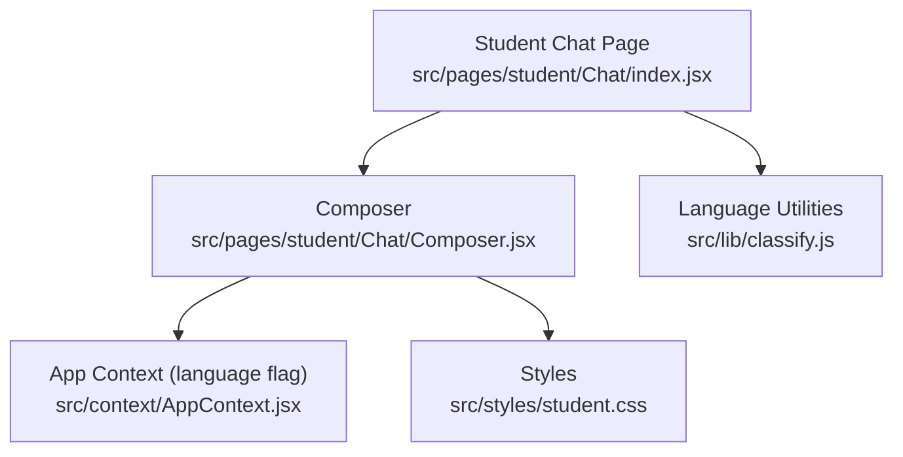
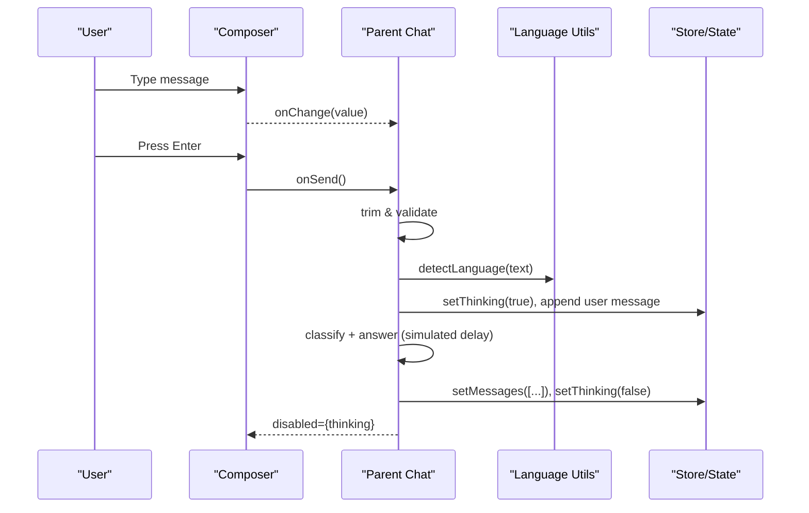
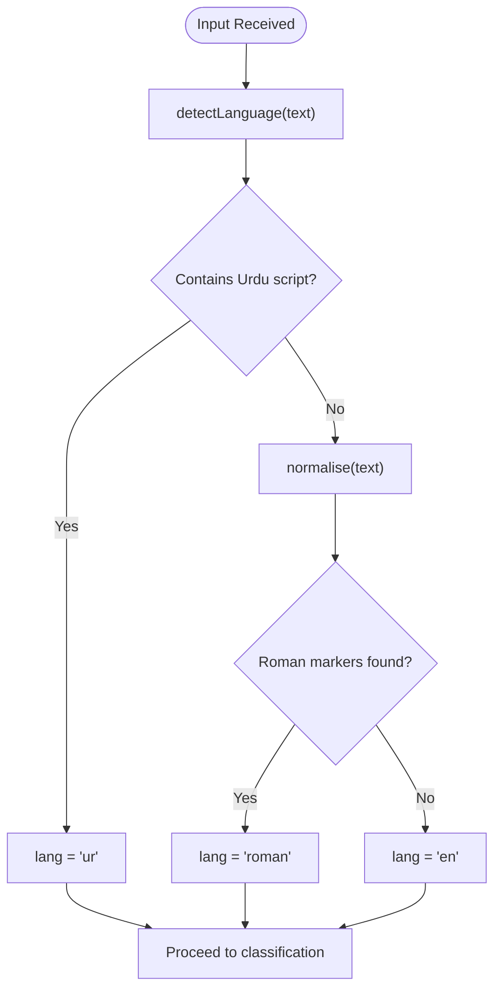
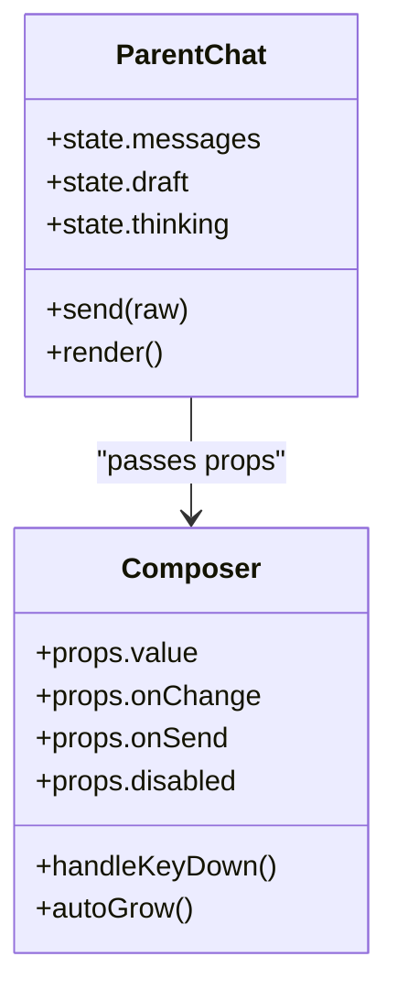
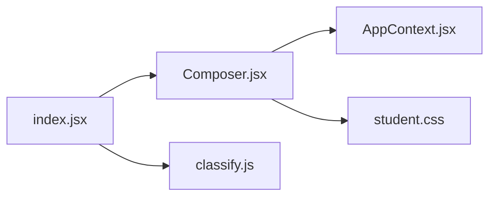

# Message Composer

<cite>
**Referenced Files in This Document**
- [Composer.jsx](file://src/pages/student/Chat/Composer.jsx)
- [index.jsx](file://src/pages/student/Chat/index.jsx)
- [classify.js](file://src/lib/classify.js)
- [AppContext.jsx](file://src/context/AppContext.jsx)
- [student.css](file://src/styles/student.css)
</cite>

## Table of Contents
1. [Introduction](#introduction)
2. [Project Structure](#project-structure)
3. [Core Components](#core-components)
4. [Architecture Overview](#architecture-overview)
5. [Detailed Component Analysis](#detailed-component-analysis)
6. [Dependency Analysis](#dependency-analysis)
7. [Performance Considerations](#performance-considerations)
8. [Troubleshooting Guide](#troubleshooting-guide)
9. [Conclusion](#conclusion)

## Introduction
This document explains the message composer component used in the student chat experience. It covers how text input is handled, multi-language support (Urdu script, Roman Urdu, and English), character validation, send button behavior, disabled state management during processing, keyboard shortcuts, accessibility features, input sanitization, auto-focus behavior, and integration with the parent chat component. It also documents props, events, and customization options available to developers.

## Project Structure
The composer lives under the student chat feature and integrates tightly with the parent chat page and shared language utilities:
- Composer component: handles user input, keyboard interactions, and sends messages.
- Parent chat page: manages conversation state, triggers classification and responses, and controls composer disabled state.
- Language utilities: detect language and normalize text for consistent intent matching.
- Styling: styles the composer’s layout, focus states, and send button.

**Diagram sources**
- [index.jsx:1-200](file://src/pages/student/Chat/index.jsx#L1-L200)
- [Composer.jsx:1-54](file://src/pages/student/Chat/Composer.jsx#L1-L54)
- [classify.js:1-270](file://src/lib/classify.js#L1-L270)
- [AppContext.jsx:1-135](file://src/context/AppContext.jsx#L1-L135)
- [student.css:455-509](file://src/styles/student.css#L455-L509)

**Section sources**
- [Composer.jsx:1-54](file://src/pages/student/Chat/Composer.jsx#L1-L54)
- [index.jsx:1-200](file://src/pages/student/Chat/index.jsx#L1-L200)
- [classify.js:1-270](file://src/lib/classify.js#L1-L270)
- [AppContext.jsx:1-135](file://src/context/AppContext.jsx#L1-L135)
- [student.css:455-509](file://src/styles/student.css#L455-L509)

## Core Components
- Composer: A controlled textarea with auto-growing height, keyboard handling (Enter to send, Shift+Enter for newline), placeholder localization, and a send button that is disabled when empty or while the parent is processing.
- Parent Chat: Owns draft state, invokes language detection and classification, updates messages, and toggles composer disabled state based on processing status.
- Language Utilities: Detect language (Urdu script, Roman Urdu, English) and normalize text to improve intent matching robustness.

Key behaviors:
- Auto-grow textarea up to a max height.
- Enter sends; Shift+Enter inserts a line break.
- Send button disabled if no trimmed text or if parent is thinking.
- Placeholder adapts to current language mode from context.
- Accessibility labels provided for screen readers.

**Section sources**
- [Composer.jsx:1-54](file://src/pages/student/Chat/Composer.jsx#L1-L54)
- [index.jsx:62-138](file://src/pages/student/Chat/index.jsx#L62-L138)
- [classify.js:37-57](file://src/lib/classify.js#L37-L57)
- [student.css:455-509](file://src/styles/student.css#L455-L509)

## Architecture Overview
The composer is a presentational and interaction layer. The parent chat orchestrates the flow: receiving input, detecting language, classifying intent, generating an answer, and updating UI state. The composer remains focused on input handling and dispatching send actions.

**Diagram sources**
- [Composer.jsx:17-22](file://src/pages/student/Chat/Composer.jsx#L17-L22)
- [index.jsx:62-138](file://src/pages/student/Chat/index.jsx#L62-L138)
- [classify.js:51-57](file://src/lib/classify.js#L51-L57)

## Detailed Component Analysis

### Text Input Handling
- Controlled value: The textarea is bound to the parent’s draft state via props.
- Auto-grow: On value changes, the textarea height adjusts to content, capped at a maximum height.
- Keyboard shortcuts:
  - Enter without Shift: prevents default newline and triggers send.
  - Shift+Enter: allows multiline input by not preventing default.
- Placeholder localization: Uses the app’s language flag to show either Urdu or Roman Urdu/English placeholder text.

**Section sources**
- [Composer.jsx:10-22](file://src/pages/student/Chat/Composer.jsx#L10-L22)
- [Composer.jsx:27-37](file://src/pages/student/Chat/Composer.jsx#L27-L37)

### Multi-Language Support
- Language detection: The parent detects language using utility functions that identify:
  - Urdu script presence.
  - Roman Urdu via function words after normalization.
  - Fallback to English.
- Normalization: Before scoring, common Roman Urdu spelling variants are normalized to improve intent matching.
- Greeting and responses: The parent selects greeting and response language based on detected language and context.

**Diagram sources**
- [classify.js:37-57](file://src/lib/classify.js#L37-L57)
- [index.jsx:67-71](file://src/pages/student/Chat/index.jsx#L67-L71)

**Section sources**
- [classify.js:18-57](file://src/lib/classify.js#L18-L57)
- [index.jsx:67-71](file://src/pages/student/Chat/index.jsx#L67-L71)

### Character Validation and Input Sanitization
- Trim validation: The parent trims input before sending; empty strings are ignored.
- No explicit sanitization in the composer; the parent relies on trimming and the classification pipeline.
- Robustness: The language utilities normalize text to handle inconsistent Roman Urdu spellings before scoring.

**Section sources**
- [index.jsx:62-66](file://src/pages/student/Chat/index.jsx#L62-L66)
- [classify.js:37-44](file://src/lib/classify.js#L37-L44)

### Send Button Functionality
- Triggers send when clicked.
- Disabled conditions:
  - While the parent is processing (thinking).
  - When the trimmed input is empty.
- Visual feedback: Disabled state reduces opacity and sets cursor to not-allowed.

**Section sources**
- [Composer.jsx:38-45](file://src/pages/student/Chat/Composer.jsx#L38-L45)
- [student.css:492-509](file://src/styles/student.css#L492-L509)
- [index.jsx:193](file://src/pages/student/Chat/index.jsx#L193)

### Disabled State Management During Processing
- The parent sets a thinking flag when a message is sent and clears it after processing completes.
- The composer receives disabled={thinking}, ensuring users cannot submit multiple requests concurrently.

**Section sources**
- [index.jsx:72-73](file://src/pages/student/Chat/index.jsx#L72-L73)
- [index.jsx:133](file://src/pages/student/Chat/index.jsx#L133)
- [index.jsx:193](file://src/pages/student/Chat/index.jsx#L193)

### Keyboard Shortcuts
- Enter: Sends the message (prevents default newline).
- Shift+Enter: Inserts a line break in the textarea.

**Section sources**
- [Composer.jsx:17-22](file://src/pages/student/Chat/Composer.jsx#L17-L22)

### Accessibility Features
- aria-label on textarea: “Your message”.
- aria-label on send button: “Send”.
- Focus styling: The composer container highlights on focus-within for clear visual indication.

**Section sources**
- [Composer.jsx:36-42](file://src/pages/student/Chat/Composer.jsx#L36-L42)
- [student.css:473-476](file://src/styles/student.css#L473-L476)

### Auto-Focus Behavior
- No explicit auto-focus is implemented in the composer.
- Developers can add auto-focus by focusing the textarea on mount or after clearing the draft if needed.

[No sources needed since this section describes a non-implemented behavior]

### Integration with Parent Chat Component
- Props passed to composer:
  - value: current draft string.
  - onChange: handler to update draft.
  - onSend: callback to trigger send logic.
  - disabled: boolean to disable input and send during processing.
- Parent responsibilities:
  - Maintains messages, draft, thinking state.
  - Detects language, classifies intent, generates answers, and updates UI.
  - Controls composer disabled state based on processing.

**Diagram sources**
- [Composer.jsx:6-45](file://src/pages/student/Chat/Composer.jsx#L6-L45)
- [index.jsx:34-38](file://src/pages/student/Chat/index.jsx#L34-L38)
- [index.jsx:62-138](file://src/pages/student/Chat/index.jsx#L62-L138)
- [index.jsx:193](file://src/pages/student/Chat/index.jsx#L193)

**Section sources**
- [Composer.jsx:6-45](file://src/pages/student/Chat/Composer.jsx#L6-L45)
- [index.jsx:34-38](file://src/pages/student/Chat/index.jsx#L34-L38)
- [index.jsx:62-138](file://src/pages/student/Chat/index.jsx#L62-L138)
- [index.jsx:193](file://src/pages/student/Chat/index.jsx#L193)

## Dependency Analysis
- Composer depends on:
  - AppContext for language flag to localize placeholder.
  - Styles for layout and interactive states.
- Parent chat depends on:
  - Language utilities for detection and normalization.
  - Store data for classification and answer generation.
- Shared utilities:
  - Language detection and normalization ensure consistent routing across languages.

**Diagram sources**
- [Composer.jsx:1-8](file://src/pages/student/Chat/Composer.jsx#L1-L8)
- [index.jsx:7-9](file://src/pages/student/Chat/index.jsx#L7-L9)
- [student.css:455-509](file://src/styles/student.css#L455-L509)

**Section sources**
- [Composer.jsx:1-8](file://src/pages/student/Chat/Composer.jsx#L1-L8)
- [index.jsx:7-9](file://src/pages/student/Chat/index.jsx#L7-L9)
- [classify.js:18-57](file://src/lib/classify.js#L18-L57)
- [student.css:455-509](file://src/styles/student.css#L455-L509)

## Performance Considerations
- Auto-grow uses scrollHeight to adjust height; capping at a max height avoids excessive DOM reflows.
- Debouncing or throttling could be considered if frequent large inputs cause performance issues, though current usage is lightweight.
- Avoid unnecessary re-renders by keeping composer stateless and controlled by parent.

[No sources needed since this section provides general guidance]

## Troubleshooting Guide
- Send does not trigger:
  - Ensure the parent’s onSend is wired correctly and disabled is false.
  - Verify that the input is not empty after trimming.
- Multiline not working:
  - Confirm Shift+Enter is used to insert newlines; Enter alone sends.
- Placeholder not localized:
  - Check that the app context provides the correct language flag.
- Disabled state stuck:
  - Inspect parent’s thinking state; ensure it resets after processing.

**Section sources**
- [Composer.jsx:17-22](file://src/pages/student/Chat/Composer.jsx#L17-L22)
- [Composer.jsx:38-45](file://src/pages/student/Chat/Composer.jsx#L38-L45)
- [index.jsx:62-73](file://src/pages/student/Chat/index.jsx#L62-L73)
- [index.jsx:133](file://src/pages/student/Chat/index.jsx#L133)

## Conclusion
The message composer provides a streamlined, accessible, and multilingual input experience integrated with a robust parent chat workflow. It supports natural language inputs in Urdu script, Roman Urdu, and English, with reliable language detection and normalization. Keyboard shortcuts, disabled state management, and accessibility labels enhance usability. Developers can customize behavior through props and leverage the existing language utilities for consistent classification and responses.