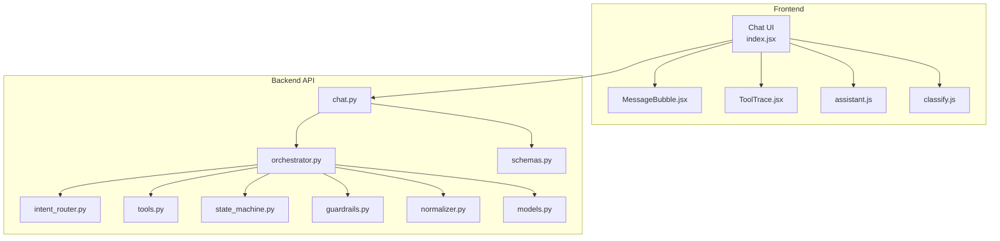
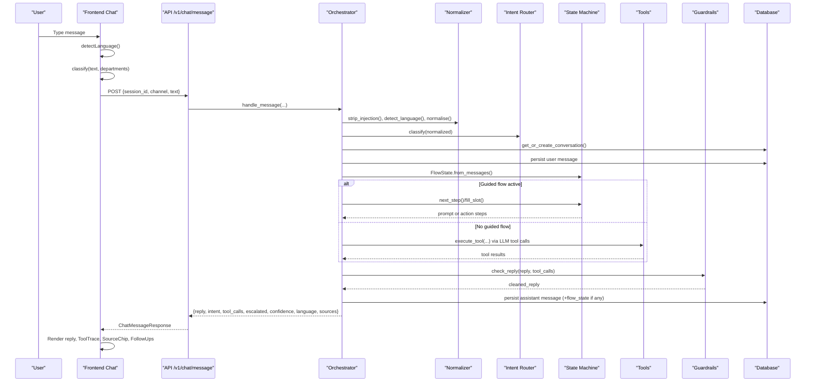
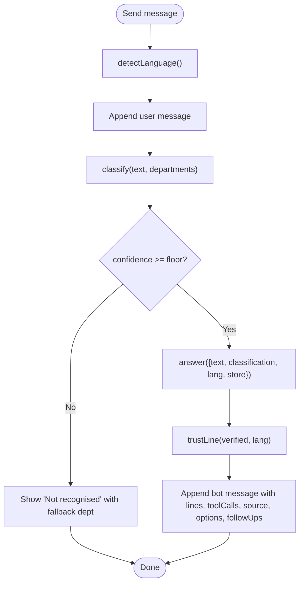
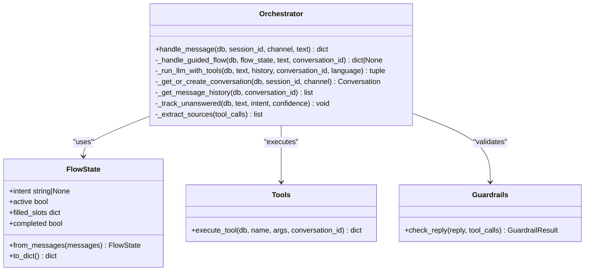
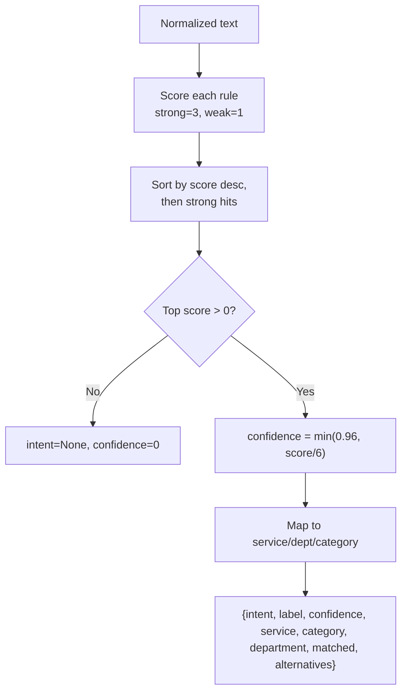
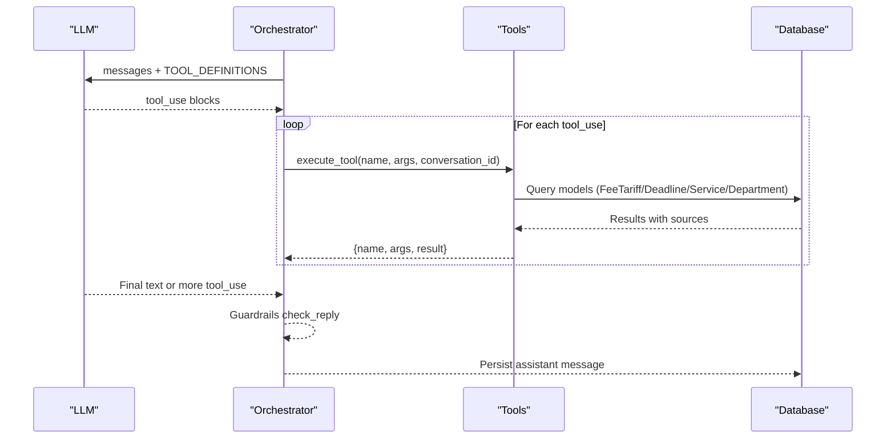
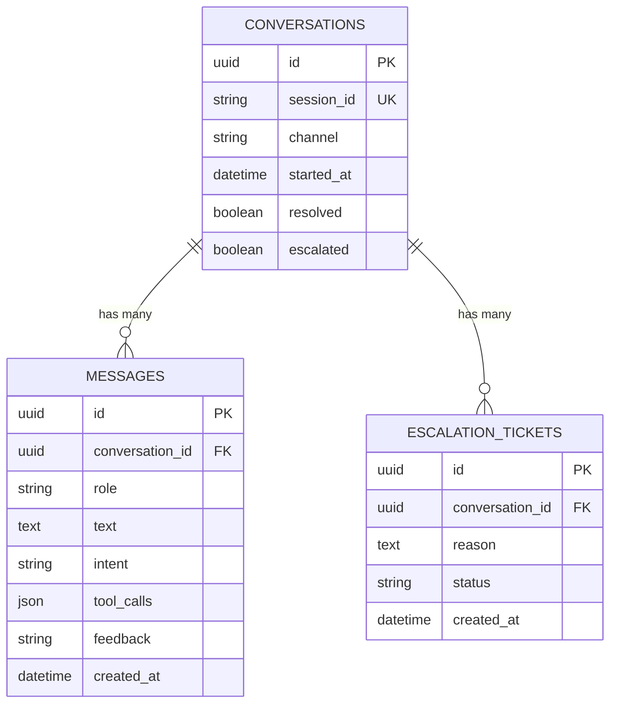
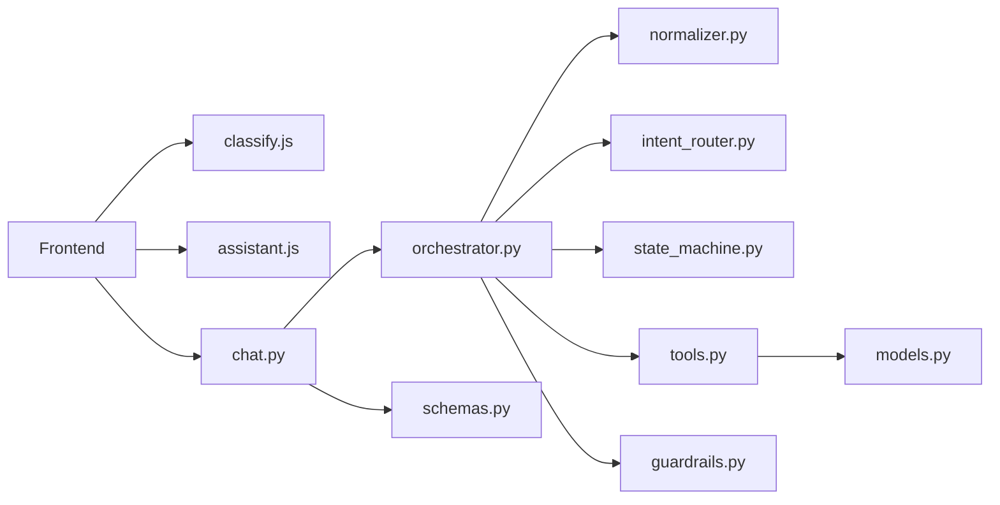

# Message Handling & Pipeline

<cite>
**Referenced Files in This Document**
- [index.jsx](file://src/pages/student/Chat/index.jsx)
- [MessageBubble.jsx](file://src/pages/student/Chat/MessageBubble.jsx)
- [ToolTrace.jsx](file://src/pages/student/Chat/ToolTrace.jsx)
- [assistant.js](file://src/lib/assistant.js)
- [classify.js](file://src/lib/classify.js)
- [chat.py](file://uaea-backend/app/api/chat.py)
- [orchestrator.py](file://uaea-backend/app/orchestrator/orchestrator.py)
- [intent_router.py](file://uaea-backend/app/orchestrator/intent_router.py)
- [tools.py](file://uaea-backend/app/orchestrator/tools.py)
- [state_machine.py](file://uaea-backend/app/orchestrator/state_machine.py)
- [guardrails.py](file://uaea-backend/app/orchestrator/guardrails.py)
- [normalizer.py](file://uaea-backend/app/orchestrator/normalizer.py)
- [models.py](file://uaea-backend/app/db/models.py)
- [schemas.py](file://uaea-backend/app/schemas.py)
</cite>

## Table of Contents
1. Introduction
2. Project Structure
3. Core Components
4. Architecture Overview
5. Detailed Component Analysis
6. Dependency Analysis
7. Performance Considerations
8. Troubleshooting Guide
9. Conclusion

## Introduction
This document explains the complete chat message handling pipeline from user input to response generation. It covers language detection, intent classification, confidence scoring, fallback mechanisms, message state management, thread persistence, real-time updates, department routing, answer composition, tool call execution and display, lifecycle, error handling, and performance optimizations. The system includes both a frontend client flow (React) and a backend orchestrator (FastAPI + Anthropic tools).

## Project Structure
The chat pipeline spans two layers:
- Frontend React components that render messages, collect input, detect language, classify locally for immediate feedback, compose answers, and display tool traces and follow-ups.
- Backend FastAPI endpoints that persist conversations, orchestrate guided flows, call an LLM with tools, enforce guardrails, and return structured responses.

**Diagram sources**
- [index.jsx:1-200](file://src/pages/student/Chat/index.jsx#L1-L200)
- [MessageBubble.jsx:1-82](file://src/pages/student/Chat/MessageBubble.jsx#L1-L82)
- [ToolTrace.jsx:1-30](file://src/pages/student/Chat/ToolTrace.jsx#L1-L30)
- [assistant.js:1-364](file://src/lib/assistant.js#L1-L364)
- [classify.js:1-270](file://src/lib/classify.js#L1-L270)
- [chat.py:1-115](file://uaea-backend/app/api/chat.py#L1-L115)
- [orchestrator.py:1-405](file://uaea-backend/app/orchestrator/orchestrator.py#L1-L405)
- [intent_router.py:1-103](file://uaea-backend/app/orchestrator/intent_router.py#L1-L103)
- [tools.py:1-235](file://uaea-backend/app/orchestrator/tools.py#L1-L235)
- [state_machine.py:1-146](file://uaea-backend/app/orchestrator/state_machine.py#L1-L146)
- [guardrails.py:1-120](file://uaea-backend/app/orchestrator/guardrails.py#L1-L120)
- [normalizer.py:1-66](file://uaea-backend/app/orchestrator/normalizer.py#L1-L66)
- [models.py:1-228](file://uaea-backend/app/db/models.py#L1-L228)
- [schemas.py:1-178](file://uaea-backend/app/schemas.py#L1-L178)

**Section sources**
- [index.jsx:1-200](file://src/pages/student/Chat/index.jsx#L1-L200)
- [chat.py:1-115](file://uaea-backend/app/api/chat.py#L1-L115)

## Core Components
- Language detection and normalization: Detects English, Roman Urdu, or Urdu script; normalizes spelling variants before classification.
- Intent classification: Deterministic keyword-scoring classifier with strong/weak terms and confidence calculation.
- Guided flows: State machine drives multi-step workflows like admission, fee challan, and degree application.
- Tool execution: LLM requests tools to fetch fees, deadlines, checklists, departments, knowledge base chunks, or create escalation tickets.
- Answer composition: Builds grounded replies strictly from tool results; provides citations, freshness indicators, and follow-up prompts.
- Persistence: Conversations and messages are stored with intents, tool calls, and feedback; sessions can be retrieved.
- Guardrails: Post-LLM reply scrubbing removes ungrounded numbers, dates, and requirements; escalates when too many ungrounded claims exist.
- Real-time UX: Typing indicator, smooth scroll, collapsible tool trace, and suggestion chips.

**Section sources**
- [classify.js:1-270](file://src/lib/classify.js#L1-L270)
- [assistant.js:1-364](file://src/lib/assistant.js#L1-L364)
- [orchestrator.py:1-405](file://uaea-backend/app/orchestrator/orchestrator.py#L1-L405)
- [tools.py:1-235](file://uaea-backend/app/orchestrator/tools.py#L1-L235)
- [guardrails.py:1-120](file://uaea-backend/app/orchestrator/guardrails.py#L1-L120)
- [models.py:142-179](file://uaea-backend/app/db/models.py#L142-L179)

## Architecture Overview
End-to-end flow per message:
1. User types a message in the UI.
2. Frontend detects language, classifies intent, and shows immediate routing feedback.
3. If using the backend seam, a POST /v1/chat/message is sent with session_id, channel, and text.
4. Backend normalizes input, detects language, classifies intent, manages conversation state, runs guided flows if applicable, calls LLM with tools, enforces guardrails, persists messages, and returns a structured response.
5. Frontend renders the assistant’s reply, source citations, tool trace, and follow-ups; offers escalation when unresolved.

**Diagram sources**
- [chat.py:21-39](file://uaea-backend/app/api/chat.py#L21-L39)
- [orchestrator.py:46-143](file://uaea-backend/app/orchestrator/orchestrator.py#L46-L143)
- [normalizer.py:29-66](file://uaea-backend/app/orchestrator/normalizer.py#L29-L66)
- [intent_router.py:65-103](file://uaea-backend/app/orchestrator/intent_router.py#L65-L103)
- [state_machine.py:62-146](file://uaea-backend/app/orchestrator/state_machine.py#L62-L146)
- [tools.py:18-235](file://uaea-backend/app/orchestrator/tools.py#L18-L235)
- [guardrails.py:74-120](file://uaea-backend/app/orchestrator/guardrails.py#L74-L120)
- [models.py:142-179](file://uaea-backend/app/db/models.py#L142-L179)

## Detailed Component Analysis

### Frontend Message Lifecycle
- Input handling: Captures draft, trims empty inputs, detects language, appends user message, sets thinking state.
- Classification and fallback: Uses local classifier to route immediately; if confidence below threshold, shows a human handoff message with reason and fallback department.
- Answer composition: Calls assistant.answer to build grounded replies, trust line, options, and follow-ups based on intent/service.
- Rendering: Displays routing card, lines, options, source chip, tool trace, escalation card if unresolved, and thumbs up/down feedback.

**Diagram sources**
- [index.jsx:62-138](file://src/pages/student/Chat/index.jsx#L62-L138)
- [assistant.js:128-317](file://src/lib/assistant.js#L128-L317)
- [classify.js:195-269](file://src/lib/classify.js#L195-L269)

**Section sources**
- [index.jsx:62-138](file://src/pages/student/Chat/index.jsx#L62-L138)
- [MessageBubble.jsx:1-82](file://src/pages/student/Chat/MessageBubble.jsx#L1-L82)
- [ToolTrace.jsx:1-30](file://src/pages/student/Chat/ToolTrace.jsx#L1-L30)
- [assistant.js:128-317](file://src/lib/assistant.js#L128-L317)

### Backend Orchestration
- Input sanitization and language detection: Removes injection patterns, detects language for LLM context.
- Intent classification: Keyword-based scoring with confidence capped at 0.96.
- Conversation management: Gets or creates open conversation by session_id; persists user message.
- Guided flows: Reconstructs FlowState from history; prompts for slots; executes actions; persists flow state.
- LLM tool loop: Up to MAX_ROUNDS; collects tool_use blocks, executes tools, appends results, loops until final text or exhaustion.
- Guardrails: Strips ungrounded numbers/dates/requirements; replaces with placeholders or escalates if too many flags.
- Persistence: Saves assistant message and optional flow_state message; tracks low-confidence queries; marks escalation.

**Diagram sources**
- [orchestrator.py:46-143](file://uaea-backend/app/orchestrator/orchestrator.py#L46-L143)
- [state_machine.py:62-146](file://uaea-backend/app/orchestrator/state_machine.py#L62-L146)
- [tools.py:218-235](file://uaea-backend/app/orchestrator/tools.py#L218-L235)
- [guardrails.py:74-120](file://uaea-backend/app/orchestrator/guardrails.py#L74-L120)

**Section sources**
- [orchestrator.py:46-143](file://uaea-backend/app/orchestrator/orchestrator.py#L46-L143)
- [state_machine.py:62-146](file://uaea-backend/app/orchestrator/state_machine.py#L62-L146)
- [tools.py:18-235](file://uaea-backend/app/orchestrator/tools.py#L18-L235)
- [guardrails.py:1-120](file://uaea-backend/app/orchestrator/guardrails.py#L1-L120)

### Classification System and Routing
- Deterministic rules with strong and weak terms; confidence computed as min(0.96, score/6).
- Maps intents to services and departments; supports alternatives when top scores are close.
- Frontend uses this to show routing cards and offer follow-ups; backend uses it to drive guided flows and tool selection.

**Diagram sources**
- [classify.js:195-269](file://src/lib/classify.js#L195-L269)
- [intent_router.py:65-103](file://uaea-backend/app/orchestrator/intent_router.py#L65-L103)

**Section sources**
- [classify.js:1-270](file://src/lib/classify.js#L1-L270)
- [intent_router.py:1-103](file://uaea-backend/app/orchestrator/intent_router.py#L1-L103)

### Answer Composition and Tool Execution
- Answer composer builds replies strictly from tool results; never fabricates fees, dates, or documents.
- Tool definitions include search_knowledge_base, get_department, get_fee_tariff, get_deadline, get_document_checklist, create_escalation_ticket.
- Tool execution queries database models (FeeTariff, Deadline, Service, Department) and returns structured results with sources.
- LLM tool loop executes multiple rounds up to MAX_ROUNDS; tracks all tool calls and escalations.

**Diagram sources**
- [orchestrator.py:229-318](file://uaea-backend/app/orchestrator/orchestrator.py#L229-L318)
- [tools.py:18-235](file://uaea-backend/app/orchestrator/tools.py#L18-L235)
- [models.py:71-122](file://uaea-backend/app/db/models.py#L71-L122)

**Section sources**
- [assistant.js:128-317](file://src/lib/assistant.js#L128-L317)
- [tools.py:18-235](file://uaea-backend/app/orchestrator/tools.py#L18-L235)
- [orchestrator.py:229-318](file://uaea-backend/app/orchestrator/orchestrator.py#L229-L318)

### Message State Management and Thread Persistence
- Conversation model tracks session_id, channel, timestamps, resolved/escalated flags.
- Message model stores role, text, intent, tool_calls, feedback, created_at.
- Session retrieval endpoint returns full conversation history ordered by creation time.
- Escalation endpoint creates tickets and marks conversation escalated.

**Diagram sources**
- [models.py:142-195](file://uaea-backend/app/db/models.py#L142-L195)
- [chat.py:42-85](file://uaea-backend/app/api/chat.py#L42-L85)
- [chat.py:88-115](file://uaea-backend/app/api/chat.py#L88-L115)

**Section sources**
- [models.py:142-195](file://uaea-backend/app/db/models.py#L142-L195)
- [chat.py:42-115](file://uaea-backend/app/api/chat.py#L42-L115)

### Real-Time Updates and UX
- Thinking state shows typing indicator while processing.
- Smooth scroll to latest message after append.
- Collapsible “How I found this” panel lists tool calls and results.
- Options chips enable slot-filling or quick follow-ups.
- Feedback buttons allow thumbs up/down per message.

**Section sources**
- [index.jsx:58-60](file://src/pages/student/Chat/index.jsx#L58-L60)
- [index.jsx:161-188](file://src/pages/student/Chat/index.jsx#L161-L188)
- [MessageBubble.jsx:34-42](file://src/pages/student/Chat/MessageBubble.jsx#L34-L42)
- [ToolTrace.jsx:1-30](file://src/pages/student/Chat/ToolTrace.jsx#L1-L30)

### Error Handling and Fallbacks
- Low confidence (< floor) triggers human handoff with reason and fallback department.
- LLM API errors return a friendly message and do not escalate unless tool loop exhausts rounds.
- Guardrails replace ungrounded claims with placeholders; if too many, entire reply replaced with escalation note.
- Unanswered queries tracked for review.

**Section sources**
- [index.jsx:80-110](file://src/pages/student/Chat/index.jsx#L80-L110)
- [orchestrator.py:255-271](file://uaea-backend/app/orchestrator/orchestrator.py#L255-L271)
- [orchestrator.py:311-318](file://uaea-backend/app/orchestrator/orchestrator.py#L311-L318)
- [guardrails.py:100-120](file://uaea-backend/app/orchestrator/guardrails.py#L100-L120)
- [orchestrator.py:367-384](file://uaea-backend/app/orchestrator/orchestrator.py#L367-L384)

## Dependency Analysis
Key dependencies and coupling:
- Frontend depends on classify.js and assistant.js for immediate routing and grounded replies; renders via MessageBubble and ToolTrace.
- Backend API depends on orchestrator for end-to-end processing; schemas define request/response contracts.
- Orchestrator depends on normalizer, intent_router, state_machine, tools, guardrails, and database models.
- Tools depend on SQLAlchemy models for data access; guardrails depend on tool results for grounding checks.

**Diagram sources**
- [index.jsx:1-200](file://src/pages/student/Chat/index.jsx#L1-L200)
- [classify.js:1-270](file://src/lib/classify.js#L1-L270)
- [assistant.js:1-364](file://src/lib/assistant.js#L1-L364)
- [chat.py:1-115](file://uaea-backend/app/api/chat.py#L1-L115)
- [orchestrator.py:1-405](file://uaea-backend/app/orchestrator/orchestrator.py#L1-L405)
- [tools.py:1-235](file://uaea-backend/app/orchestrator/tools.py#L1-L235)
- [models.py:1-228](file://uaea-backend/app/db/models.py#L1-L228)
- [schemas.py:1-178](file://uaea-backend/app/schemas.py#L1-L178)

**Section sources**
- [orchestrator.py:1-405](file://uaea-backend/app/orchestrator/orchestrator.py#L1-L405)
- [tools.py:1-235](file://uaea-backend/app/orchestrator/tools.py#L1-L235)
- [models.py:1-228](file://uaea-backend/app/db/models.py#L1-L228)

## Performance Considerations
- Local classification and language detection reduce latency for immediate UI feedback.
- Guided flows short-circuit complex queries by collecting slots first, minimizing unnecessary LLM rounds.
- LLM tool loop bounded by MAX_ROUNDS to prevent runaway iterations.
- History truncated to last 20 messages to control token usage and memory.
- Database queries use selective joins and indexes (e.g., program, category) for faster lookups.
- Guardrails operate post-reply to avoid blocking LLM calls; only modify output when needed.

[No sources needed since this section provides general guidance]

## Troubleshooting Guide
Common issues and resolutions:
- Misrouted intent: Check normalized text and rule matches; adjust strong/weak terms or add variants.
- No tool results: Verify tool arguments and database entries; ensure service names match exactly.
- Excessive ungrounded claims: Review tool outputs and LLM prompts; refine guardrails thresholds.
- Session not found: Ensure session_id is consistent across requests; verify conversation creation logic.
- Escalation loops: Confirm flow completion and state transitions; validate next_step logic.

**Section sources**
- [classify.js:195-269](file://src/lib/classify.js#L195-L269)
- [tools.py:125-198](file://uaea-backend/app/orchestrator/tools.py#L125-L198)
- [guardrails.py:74-120](file://uaea-backend/app/orchestrator/guardrails.py#L74-L120)
- [chat.py:42-85](file://uaea-backend/app/api/chat.py#L42-L85)
- [state_machine.py:94-146](file://uaea-backend/app/orchestrator/state_machine.py#L94-L146)

## Conclusion
The chat message handling pipeline combines deterministic classification, guided flows, grounded answer composition, robust tool execution, and strict guardrails to deliver accurate, traceable, and safe responses. The frontend provides immediate feedback and rich UX, while the backend ensures persistence, scalability, and reliability. Together, they form a cohesive system that routes queries appropriately, composes verified answers, and gracefully handles edge cases and failures.