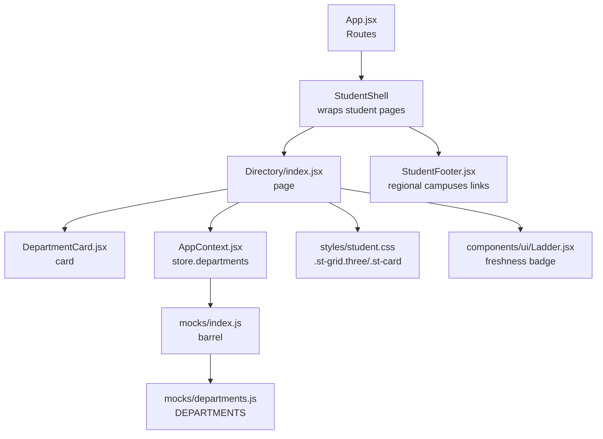
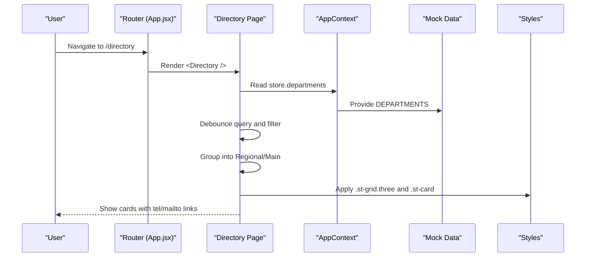
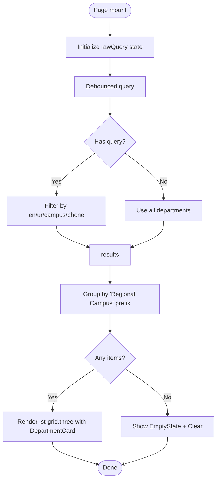
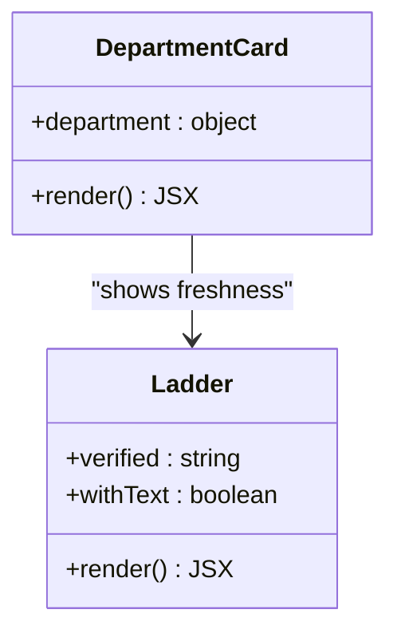
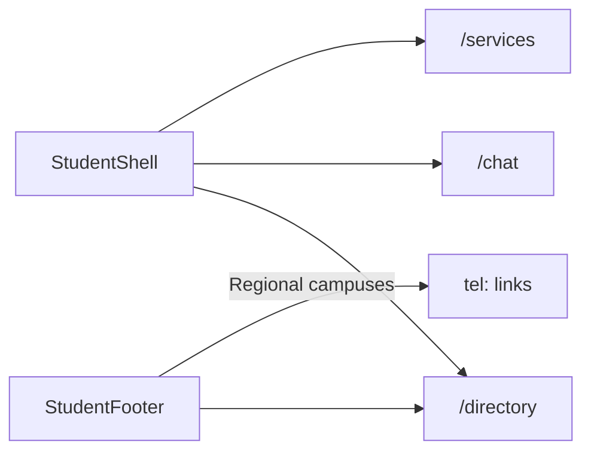
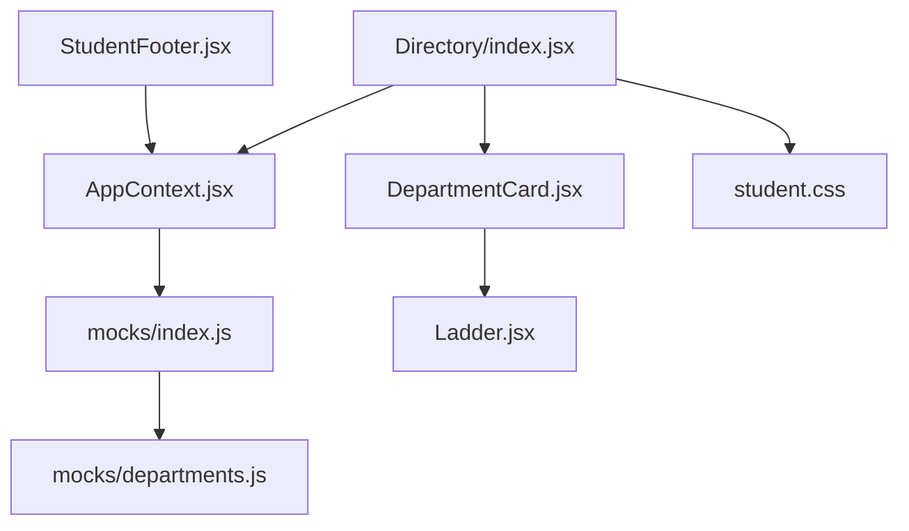

# Department Directory

<cite>
**Referenced Files in This Document**
- [index.jsx](file://src/pages/student/Directory/index.jsx)
- [DepartmentCard.jsx](file://src/components/student/DepartmentCard.jsx)
- [departments.js](file://src/mocks/departments.js)
- [AppContext.jsx](file://src/context/AppContext.jsx)
- [index.js](file://src/mocks/index.js)
- [student.css](file://src/styles/student.css)
- [Ladder.jsx](file://src/components/ui/Ladder.jsx)
- [App.jsx](file://src/App.jsx)
- [StudentFooter.jsx](file://src/components/student/StudentFooter.jsx)
- [constants.js](file://src/lib/constants.js)
</cite>

## Table of Contents
1. [Introduction](#introduction)
2. [Project Structure](#project-structure)
3. [Core Components](#core-components)
4. [Architecture Overview](#architecture-overview)
5. [Detailed Component Analysis](#detailed-component-analysis)
6. [Dependency Analysis](#dependency-analysis)
7. [Performance Considerations](#performance-considerations)
8. [Troubleshooting Guide](#troubleshooting-guide)
9. [Conclusion](#conclusion)

## Introduction
This document describes the department contact directory feature for students. It explains how departments are organized by campus, how contact details are presented, and how search and filtering work. It also covers the responsive card layout and integration with the broader student navigation system. The directory is a deterministic lookup from verified records, not model-generated output, ensuring accuracy for phone numbers and office hours.

## Project Structure
The directory feature spans a small set of focused files:
- Page component that renders the directory UI and handles search
- Card component that displays each department’s contact information
- Mock data source providing department records
- Context provider that centralizes state and exposes store.departments to components
- Styles that define responsive grid and card behavior
- Routing that wires the directory into the student shell
- Footer that reuses department data to surface regional campus contacts

**Diagram sources**
- [App.jsx:34-47](file://src/App.jsx#L34-L47)
- [index.jsx:1-80](file://src/pages/student/Directory/index.jsx#L1-L80)
- [DepartmentCard.jsx:1-42](file://src/components/student/DepartmentCard.jsx#L1-L42)
- [AppContext.jsx:34-47](file://src/context/AppContext.jsx#L34-L47)
- [index.js:1-19](file://src/mocks/index.js#L1-L19)
- [departments.js:1-18](file://src/mocks/departments.js#L1-L18)
- [student.css:216-245](file://src/styles/student.css#L216-L245)
- [Ladder.jsx:1-32](file://src/components/ui/Ladder.jsx#L1-L32)
- [StudentFooter.jsx:1-49](file://src/components/student/StudentFooter.jsx#L1-L49)

**Section sources**
- [App.jsx:34-47](file://src/App.jsx#L34-L47)
- [index.jsx:1-80](file://src/pages/student/Directory/index.jsx#L1-L80)
- [DepartmentCard.jsx:1-42](file://src/components/student/DepartmentCard.jsx#L1-L42)
- [AppContext.jsx:34-47](file://src/context/AppContext.jsx#L34-L47)
- [index.js:1-19](file://src/mocks/index.js#L1-L19)
- [departments.js:1-18](file://src/mocks/departments.js#L1-L18)
- [student.css:216-245](file://src/styles/student.css#L216-L245)
- [Ladder.jsx:1-32](file://src/components/ui/Ladder.jsx#L1-L32)
- [StudentFooter.jsx:1-49](file://src/components/student/StudentFooter.jsx#L1-L49)

## Core Components
- Directory page: Provides title, description, debounced search input, grouped results (regional campuses vs main campus), empty state, and responsive grid rendering.
- Department card: Displays bilingual name, phone (tel link), email (mailto link), campus location, office hours, and verification freshness indicator.
- Data source: Centralized mock dataset of departments with fields for identification, names, campus, phone, email, hours, verification date, and verifier.
- State management: AppContext holds store.departments and exposes it via useApp; future phase replaces this with server state through mutate().

Key responsibilities:
- Search: Debounced substring matching across English name, Urdu name, campus, and phone.
- Grouping: Two groups based on whether the department name starts with “Regional Campus”.
- Presentation: Responsive grid and accessible links for calling or emailing.
- Freshness: Visual ladder indicating days since last human verification.

**Section sources**
- [index.jsx:9-30](file://src/pages/student/Directory/index.jsx#L9-L30)
- [DepartmentCard.jsx:6-40](file://src/components/student/DepartmentCard.jsx#L6-L40)
- [departments.js:5-17](file://src/mocks/departments.js#L5-L17)
- [AppContext.jsx:39-47](file://src/context/AppContext.jsx#L39-L47)

## Architecture Overview
The directory reads from a single source of truth (store.departments) provided by AppContext. The page filters and groups data client-side, then renders cards using shared UI primitives. The footer reuses the same data to expose quick-dial links to regional campuses.

**Diagram sources**
- [App.jsx:34-47](file://src/App.jsx#L34-L47)
- [index.jsx:18-79](file://src/pages/student/Directory/index.jsx#L18-L79)
- [AppContext.jsx:34-47](file://src/context/AppContext.jsx#L34-L47)
- [departments.js:5-17](file://src/mocks/departments.js#L5-L17)
- [student.css:216-245](file://src/styles/student.css#L216-L245)

## Detailed Component Analysis

### Directory Page
- Groups: Two static groups separate “Regional campuses” from “Main campus departments” based on the English name prefix.
- Search: Debounced input matches against concatenated fields (English name, Urdu name, campus, phone). Case-insensitive substring match.
- Empty state: When no results match, shows guidance and a clear button.
- Layout: Uses a responsive three-column grid that collapses to two columns on medium screens and one column on small screens.

**Diagram sources**
- [index.jsx:18-79](file://src/pages/student/Directory/index.jsx#L18-L79)

**Section sources**
- [index.jsx:9-79](file://src/pages/student/Directory/index.jsx#L9-L79)
- [student.css:216-228](file://src/styles/student.css#L216-L228)

### Department Card
- Contact actions: Phone number is a tel: link; email is a mailto: link.
- Information shown: Bilingual titles, campus location, office hours, and verification status.
- Verification: Uses Ladder to show freshness based on verified date.

**Diagram sources**
- [DepartmentCard.jsx:6-40](file://src/components/student/DepartmentCard.jsx#L6-L40)
- [Ladder.jsx:10-31](file://src/components/ui/Ladder.jsx#L10-L31)

**Section sources**
- [DepartmentCard.jsx:6-40](file://src/components/student/DepartmentCard.jsx#L6-L40)
- [Ladder.jsx:10-31](file://src/components/ui/Ladder.jsx#L10-L31)

### Data Model: Department Record
Fields used by the directory and related components:
- id: Unique identifier
- en: English name
- ur: Urdu name
- campus: Campus or location label
- phone: Contact phone number
- email: Contact email address
- hours: Office hours text
- verified: Last verification date (used for freshness)
- by: Verifier name

These fields support search, display, and verification indicators across the UI.

**Section sources**
- [departments.js:5-17](file://src/mocks/departments.js#L5-L17)
- [index.jsx:23-30](file://src/pages/student/Directory/index.jsx#L23-L30)
- [DepartmentCard.jsx:11-38](file://src/components/student/DepartmentCard.jsx#L11-L38)
- [Ladder.jsx:10-31](file://src/components/ui/Ladder.jsx#L10-L31)

### Integration with Student Navigation
- Routing: The directory is registered under /directory within the student shell routes.
- Footer: Reuses department data to list top regional campuses with direct tel links.
- Services cross-link: Category-based browsing can route users to services owned by departments, complementing the directory.

**Diagram sources**
- [App.jsx:34-47](file://src/App.jsx#L34-L47)
- [StudentFooter.jsx:10-44](file://src/components/student/StudentFooter.jsx#L10-L44)

**Section sources**
- [App.jsx:34-47](file://src/App.jsx#L34-L47)
- [StudentFooter.jsx:10-44](file://src/components/student/StudentFooter.jsx#L10-L44)

## Dependency Analysis
- Directory depends on:
  - AppContext for store.departments
  - Mock barrel to provide DEPARTMENTS
  - Shared UI components (EmptyState, Button, Ladder)
  - Styles for grid and card layout
- DepartmentCard depends on:
  - Icons for visual cues
  - Ladder for freshness
  - AppContext for language toggle (urdu)
- Footer depends on:
  - store.departments to render regional campus quick-dials

**Diagram sources**
- [index.jsx:1-80](file://src/pages/student/Directory/index.jsx#L1-L80)
- [AppContext.jsx:34-47](file://src/context/AppContext.jsx#L34-L47)
- [index.js:1-19](file://src/mocks/index.js#L1-L19)
- [departments.js:1-18](file://src/mocks/departments.js#L1-L18)
- [DepartmentCard.jsx:1-42](file://src/components/student/DepartmentCard.jsx#L1-L42)
- [Ladder.jsx:1-32](file://src/components/ui/Ladder.jsx#L1-L32)
- [student.css:216-245](file://src/styles/student.css#L216-L245)
- [StudentFooter.jsx:1-49](file://src/components/student/StudentFooter.jsx#L1-L49)

**Section sources**
- [index.jsx:1-80](file://src/pages/student/Directory/index.jsx#L1-L80)
- [AppContext.jsx:34-47](file://src/context/AppContext.jsx#L34-L47)
- [index.js:1-19](file://src/mocks/index.js#L1-L19)
- [departments.js:1-18](file://src/mocks/departments.js#L1-L18)
- [DepartmentCard.jsx:1-42](file://src/components/student/DepartmentCard.jsx#L1-L42)
- [Ladder.jsx:1-32](file://src/components/ui/Ladder.jsx#L1-L32)
- [student.css:216-245](file://src/styles/student.css#L216-L245)
- [StudentFooter.jsx:1-49](file://src/components/student/StudentFooter.jsx#L1-L49)

## Performance Considerations
- Debounced search reduces re-renders during typing.
- useMemo computes filtered results only when query or departments change.
- Client-side filtering is appropriate for the current dataset size; if departments grow significantly, consider server-side search or pagination.
- Avoid unnecessary re-renders by keeping group definitions stable and memoizing derived lists if needed.

[No sources needed since this section provides general guidance]

## Troubleshooting Guide
- No results: Ensure the query matches fields used in filtering (English name, Urdu name, campus, phone). Use the “Clear search” action to reset.
- Incorrect grouping: Verify department names start with “Regional Campus” for regional grouping; otherwise they appear under main campus departments.
- Links not working: Confirm phone and email fields are present and correctly formatted in the data source.
- Stale verification: Check the verified date; older dates will show lower freshness on the ladder.

**Section sources**
- [index.jsx:23-30](file://src/pages/student/Directory/index.jsx#L23-L30)
- [index.jsx:53-60](file://src/pages/student/Directory/index.jsx#L53-L60)
- [DepartmentCard.jsx:17-31](file://src/components/student/DepartmentCard.jsx#L17-L31)
- [Ladder.jsx:10-31](file://src/components/ui/Ladder.jsx#L10-L31)

## Conclusion
The department directory provides a reliable, searchable, and responsive way for students to find campus-specific contacts. It uses deterministic data, presents clear contact actions, and integrates seamlessly with the student site’s navigation and footer. The design emphasizes clarity, accessibility, and mobile usability while maintaining a consistent verification signal through the freshness ladder.

[No sources needed since this section summarizes without analyzing specific files]