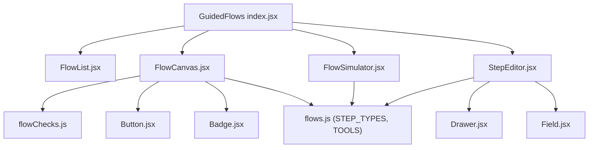
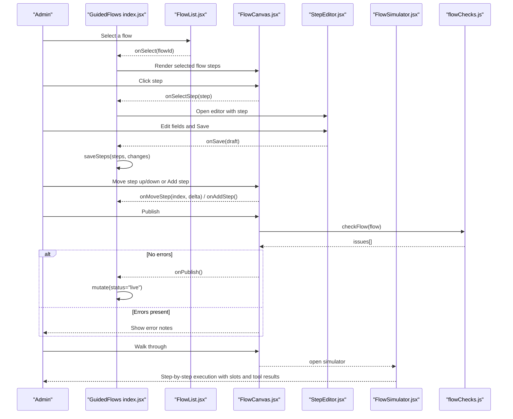
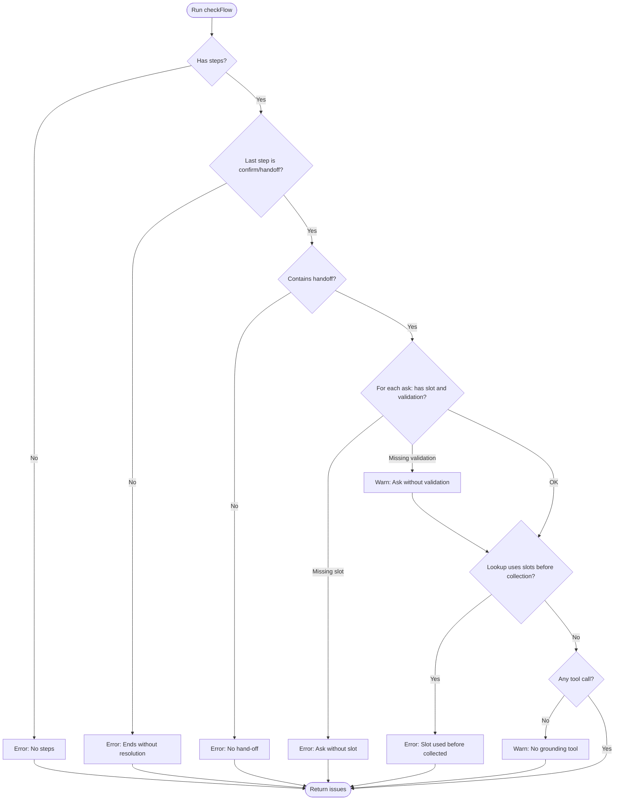
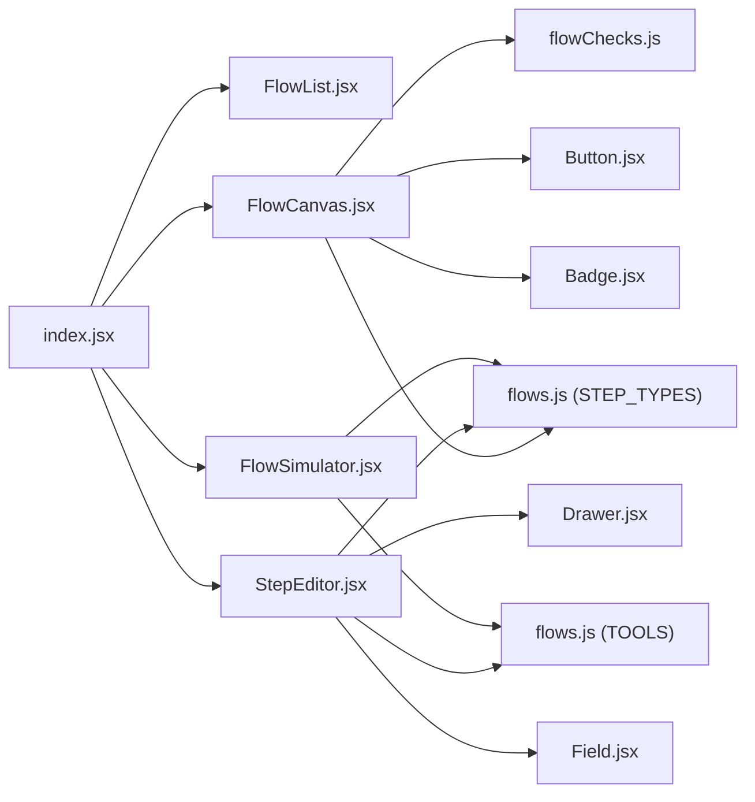

# Flow Builder Interface

<cite>
**Referenced Files in This Document**
- [index.jsx](file://src/pages/GuidedFlows/index.jsx)
- [FlowCanvas.jsx](file://src/pages/GuidedFlows/FlowCanvas.jsx)
- [FlowList.jsx](file://src/pages/GuidedFlows/FlowList.jsx)
- [StepEditor.jsx](file://src/pages/GuidedFlows/StepEditor.jsx)
- [flowChecks.js](file://src/pages/GuidedFlows/flowChecks.js)
- [FlowSimulator.jsx](file://src/pages/GuidedFlows/FlowSimulator.jsx)
- [flows.js](file://src/mocks/flows.js)
- [Drawer.jsx](file://src/components/ui/Drawer.jsx)
- [Button.jsx](file://src/components/ui/Button.jsx)
- [Badge.jsx](file://src/components/ui/Badge.jsx)
- [Field.jsx](file://src/components/ui/Field.jsx)
</cite>

## Table of Contents
1. Introduction
2. Project Structure
3. Core Components
4. Architecture Overview
5. Detailed Component Analysis
6. Dependency Analysis
7. Performance Considerations
8. Troubleshooting Guide
9. Conclusion

## Introduction
This document explains the Flow Builder interface that enables administrators to create and manage guided flows as explicit state machines. It covers the visual canvas for designing flows, flow list management, step creation and editing, validation rules, and real-time preview via a simulator. The goal is to help administrators build reliable, grounded conversations that collect required information, call tools to retrieve accurate data, confirm outcomes, and hand off to humans when needed.

## Project Structure
The Guided Flows feature is implemented as a set of focused React components under src/pages/GuidedFlows, with shared UI primitives from src/components/ui and mock definitions for step types and tools under src/mocks.

**Diagram sources**
- [index.jsx:1-152](file://src/pages/GuidedFlows/index.jsx#L1-L152)
- [FlowCanvas.jsx:1-157](file://src/pages/GuidedFlows/FlowCanvas.jsx#L1-L157)
- [FlowList.jsx:1-52](file://src/pages/GuidedFlows/FlowList.jsx#L1-L52)
- [StepEditor.jsx:1-161](file://src/pages/GuidedFlows/StepEditor.jsx#L1-L161)
- [flowChecks.js:1-68](file://src/pages/GuidedFlows/flowChecks.js#L1-L68)
- [flows.js:1-137](file://src/mocks/flows.js#L1-L137)
- [Drawer.jsx:1-33](file://src/components/ui/Drawer.jsx#L1-L33)
- [Button.jsx:1-29](file://src/components/ui/Button.jsx#L1-L29)
- [Badge.jsx:1-12](file://src/components/ui/Badge.jsx#L1-L12)
- [Field.jsx:1-23](file://src/components/ui/Field.jsx#L1-L23)

**Section sources**
- [index.jsx:1-152](file://src/pages/GuidedFlows/index.jsx#L1-L152)
- [flows.js:1-137](file://src/mocks/flows.js#L1-L137)

## Core Components
- Flow List: Displays all flows with status badges (Live/Draft), step counts, completion metrics, and last updated time. Selecting a flow switches the active flow in the canvas.
- Flow Canvas: Shows the ordered steps of the selected flow. Each step shows its type badge, label, optional slot, tool usage, and prompt preview. Provides controls to move steps up/down, add new steps, simulate, and publish.
- Step Editor: A side drawer that opens when a step is selected. Presents fields based on step type (ask, lookup, inform, confirm, handoff). Supports saving changes and deleting steps.
- Flow Simulator: A walkthrough mode that executes the flow step-by-step, showing prompts, tool calls, and filled slots to validate behavior before publishing.
- Validation: Real-time checks run against the current flow to prevent publishing invalid flows.

**Section sources**
- [FlowList.jsx:1-52](file://src/pages/GuidedFlows/FlowList.jsx#L1-L52)
- [FlowCanvas.jsx:1-157](file://src/pages/GuidedFlows/FlowCanvas.jsx#L1-L157)
- [StepEditor.jsx:1-161](file://src/pages/GuidedFlows/StepEditor.jsx#L1-L161)
- [FlowSimulator.jsx:1-160](file://src/pages/GuidedFlows/FlowSimulator.jsx#L1-L160)
- [flowChecks.js:1-68](file://src/pages/GuidedFlows/flowChecks.js#L1-L68)

## Architecture Overview
The Guided Flows page orchestrates user interactions across list selection, canvas editing, step editing, simulation, and publishing. State is held at the page level and passed down to child components. Publishing triggers validation and updates flow status.

**Diagram sources**
- [index.jsx:21-149](file://src/pages/GuidedFlows/index.jsx#L21-L149)
- [FlowCanvas.jsx:16-157](file://src/pages/GuidedFlows/FlowCanvas.jsx#L16-L157)
- [StepEditor.jsx:16-161](file://src/pages/GuidedFlows/StepEditor.jsx#L16-L161)
- [FlowSimulator.jsx:27-160](file://src/pages/GuidedFlows/FlowSimulator.jsx#L27-L160)
- [flowChecks.js:8-67](file://src/pages/GuidedFlows/flowChecks.js#L8-L67)

## Detailed Component Analysis

### Flow List
- Purpose: Browse and select flows; shows live/draft status, step count, completions, and update timestamp.
- Interaction: Clicking a flow item selects it and updates the active flow in the parent page.
- Visual cues: Status badges indicate whether a flow is Live or Draft.

**Section sources**
- [FlowList.jsx:1-52](file://src/pages/GuidedFlows/FlowList.jsx#L1-L52)

### Flow Canvas
- Purpose: Visualize the ordered sequence of steps for the selected flow.
- Features:
  - Step rows show step number, label, type badge, optional slot badge, and tool call preview if present.
  - Prompt previews are shown when no tool is used.
  - Controls allow moving steps up/down and adding new steps.
  - Publish button is disabled while validation errors exist.
  - Issues panel displays validation feedback with severity levels.
- Validation integration: Runs checkFlow on render to compute issues and errors.

**Section sources**
- [FlowCanvas.jsx:16-157](file://src/pages/GuidedFlows/FlowCanvas.jsx#L16-L157)
- [flowChecks.js:8-67](file://src/pages/GuidedFlows/flowChecks.js#L8-L67)

### Step Editor
- Purpose: Edit properties of a single step in a side drawer.
- Dynamic fields:
  - ask: Slot name and validation rule inputs.
  - lookup or confirm: Tool selector and arguments input.
  - Non-lookup steps: English and Urdu prompt text areas.
- Actions: Save step (persists changes), Remove step (deletes from flow), Cancel.
- Read-only: When mayWrite is false, editing controls are disabled.

**Section sources**
- [StepEditor.jsx:16-161](file://src/pages/GuidedFlows/StepEditor.jsx#L16-L161)
- [flows.js:118-137](file://src/mocks/flows.js#L118-L137)

### Flow Simulator
- Purpose: Step through the flow to validate behavior, including slot collection order and tool calls.
- Behavior:
  - Starts at cursor -1; pressing Start advances to the first step.
  - For ask steps with a slot, the simulator fills the slot with a placeholder value.
  - Lookup steps display the tool call and sample result.
  - Completed flows show a completion message.
- Language: Uses app language setting to choose between English and Urdu prompts.

**Section sources**
- [FlowSimulator.jsx:27-160](file://src/pages/GuidedFlows/FlowSimulator.jsx#L27-L160)
- [flows.js:118-137](file://src/mocks/flows.js#L118-L137)

### Validation Rules (flowChecks)
- Enforces publishability:
  - Flow must have at least one step.
  - Last step must be confirm or handoff.
  - Must include at least one handoff step.
  - All ask steps must define a slot; missing validation is warned.
  - Slots used by lookup toolArgs must be collected before use.
  - Warns if no tool call exists in the flow.
- Returns an array of issues with level (error/warn) and descriptive text.

**Diagram sources**
- [flowChecks.js:8-67](file://src/pages/GuidedFlows/flowChecks.js#L8-L67)

**Section sources**
- [flowChecks.js:8-67](file://src/pages/GuidedFlows/flowChecks.js#L8-L67)

### Data Model and Types
- Steps support multiple types: ask, lookup, inform, confirm, handoff.
- ask steps capture values into named slots and can include validation rules.
- lookup steps call tools with arguments referencing slots or literals.
- confirm steps summarize or read back information; handoff steps terminate the flow and connect to a human.
- Tools available include fee tariff, deadlines, document checklists, department info, eligibility, knowledge base search, and escalation ticket creation.

**Section sources**
- [flows.js:19-116](file://src/mocks/flows.js#L19-L116)
- [flows.js:118-137](file://src/mocks/flows.js#L118-L137)

## Dependency Analysis
- index.jsx coordinates state and actions, passing props to FlowList, FlowCanvas, StepEditor, and FlowSimulator.
- FlowCanvas depends on flowChecks for validation and STEP_TYPES metadata for rendering.
- StepEditor depends on STEP_TYPES and TOOLS metadata to render appropriate fields.
- FlowSimulator depends on STEP_TYPES and TOOLS metadata to simulate behavior and display sample results.
- Shared UI components (Drawer, Button, Badge, Field) provide consistent interaction patterns.

**Diagram sources**
- [index.jsx:1-152](file://src/pages/GuidedFlows/index.jsx#L1-L152)
- [FlowCanvas.jsx:1-157](file://src/pages/GuidedFlows/FlowCanvas.jsx#L1-L157)
- [StepEditor.jsx:1-161](file://src/pages/GuidedFlows/StepEditor.jsx#L1-L161)
- [FlowSimulator.jsx:1-160](file://src/pages/GuidedFlows/FlowSimulator.jsx#L1-L160)
- [flowChecks.js:1-68](file://src/pages/GuidedFlows/flowChecks.js#L1-L68)
- [flows.js:1-137](file://src/mocks/flows.js#L1-L137)
- [Drawer.jsx:1-33](file://src/components/ui/Drawer.jsx#L1-L33)
- [Button.jsx:1-29](file://src/components/ui/Button.jsx#L1-L29)
- [Badge.jsx:1-12](file://src/components/ui/Badge.jsx#L1-L12)
- [Field.jsx:1-23](file://src/components/ui/Field.jsx#L1-L23)

**Section sources**
- [index.jsx:1-152](file://src/pages/GuidedFlows/index.jsx#L1-L152)
- [FlowCanvas.jsx:1-157](file://src/pages/GuidedFlows/FlowCanvas.jsx#L1-L157)
- [StepEditor.jsx:1-161](file://src/pages/GuidedFlows/StepEditor.jsx#L1-L161)
- [FlowSimulator.jsx:1-160](file://src/pages/GuidedFlows/FlowSimulator.jsx#L1-L160)
- [flowChecks.js:1-68](file://src/pages/GuidedFlows/flowChecks.js#L1-L68)
- [flows.js:1-137](file://src/mocks/flows.js#L1-L137)

## Performance Considerations
- Validation runs on render of the canvas; keep flows reasonably sized to avoid heavy re-renders.
- Avoid excessive nested state updates; the page-level state centralizes mutations to minimize churn.
- Use the simulator to catch ordering issues early rather than relying solely on static checks.

[No sources needed since this section provides general guidance]

## Troubleshooting Guide
Common issues surfaced by validation:
- No steps: Add at least one step to make the flow valid.
- Ending without resolution: Ensure the last step is confirm or handoff.
- Missing handoff: Include a handoff step so users can reach a human.
- Ask without slot: Every ask must fill a named slot.
- Ask without validation: Add a validation rule to ensure data quality.
- Slot used before collected: Reorder steps so asks precede lookups that consume those slots.
- No tool call: Add a lookup step to ground responses in catalogue data.

Actions:
- Fix errors shown in the canvas issues panel before publishing.
- Use the simulator to verify step order and slot filling.
- Adjust step order using the move controls in the canvas.

**Section sources**
- [flowChecks.js:8-67](file://src/pages/GuidedFlows/flowChecks.js#L8-L67)
- [FlowCanvas.jsx:145-153](file://src/pages/GuidedFlows/FlowCanvas.jsx#L145-L153)

## Conclusion
The Flow Builder provides a clear, linear canvas for designing guided flows as explicit state machines. Administrators can add and reorder steps, configure step-specific properties, validate structure in real time, and preview behavior with the simulator. Robust validation ensures flows end with resolution and offer human handoff, while tool-based lookups keep answers grounded. This design helps maintain high-quality, predictable student journeys.

[No sources needed since this section summarizes without analyzing specific files]