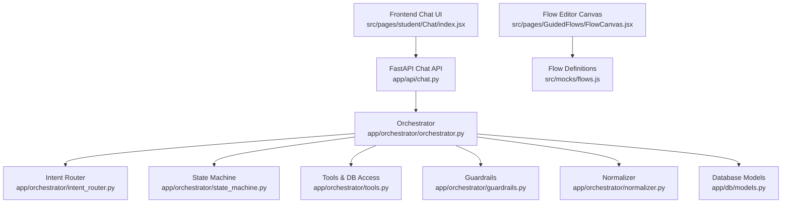
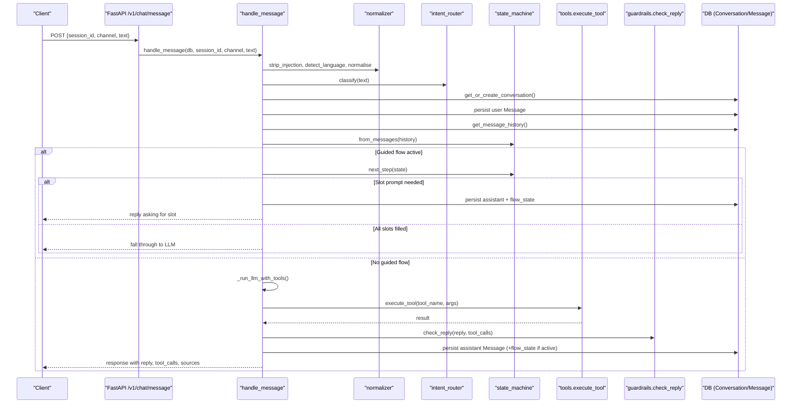
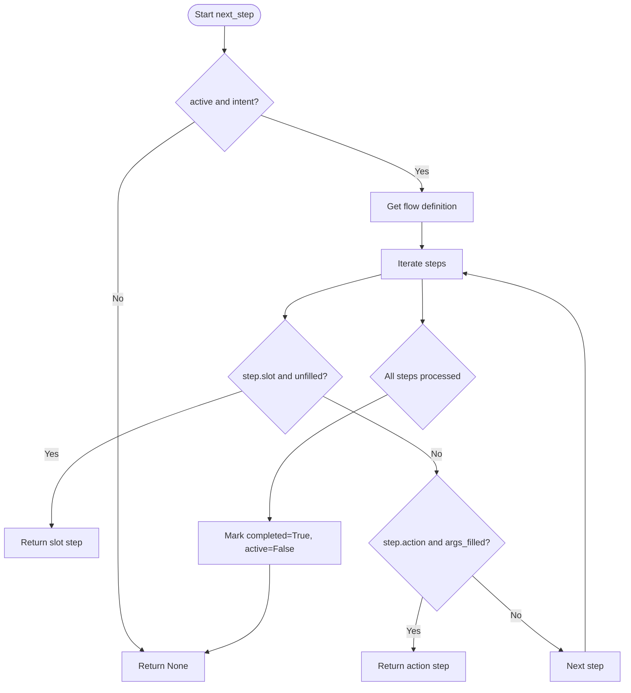
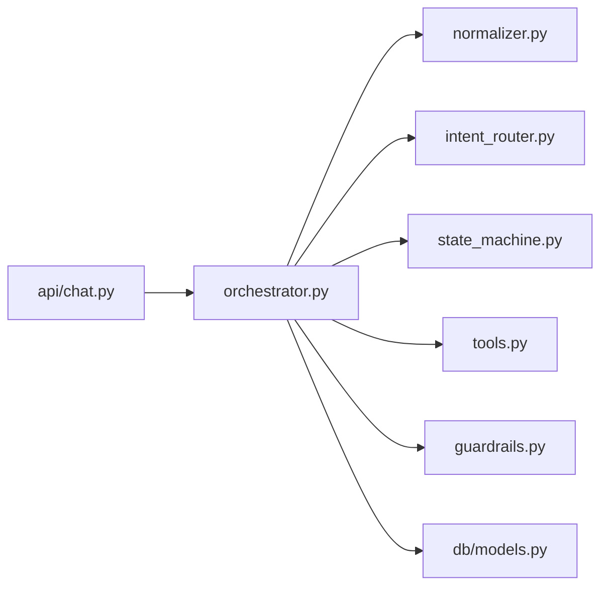

# Flow Execution Engine

<cite>
**Referenced Files in This Document**
- [orchestrator.py](file://uaea-backend/app/orchestrator/orchestrator.py)
- [state_machine.py](file://uaea-backend/app/orchestrator/state_machine.py)
- [intent_router.py](file://uaea-backend/app/orchestrator/intent_router.py)
- [tools.py](file://uaea-backend/app/orchestrator/tools.py)
- [guardrails.py](file://uaea-backend/app/orchestrator/guardrails.py)
- [normalizer.py](file://uaea-backend/app/orchestrator/normalizer.py)
- [chat.py](file://uaea-backend/app/api/chat.py)
- [models.py](file://uaea-backend/app/db/models.py)
- [schemas.py](file://uaea-backend/app/schemas.py)
- [FlowCanvas.jsx](file://src/pages/GuidedFlows/FlowCanvas.jsx)
- [flows.js](file://src/mocks/flows.js)
- [Chat index.jsx](file://src/pages/student/Chat/index.jsx)
- [test_chat_flow.py](file://uaea-backend/tests/test_chat_flow.py)
</cite>

## Table of Contents
1. [Introduction](#introduction)
2. [Project Structure](#project-structure)
3. [Core Components](#core-components)
4. [Architecture Overview](#architecture-overview)
5. [Detailed Component Analysis](#detailed-component-analysis)
6. [Dependency Analysis](#dependency-analysis)
7. [Performance Considerations](#performance-considerations)
8. [Troubleshooting Guide](#troubleshooting-guide)
9. [Conclusion](#conclusion)
10. [Appendices](#appendices)

## Introduction
This document explains the backend execution engine that processes guided flows during live conversations. It covers how chat messages trigger flows, how a per-conversation state machine manages multi-turn flow steps, and how conditional logic is evaluated to decide prompts, tool calls, and termination. It also documents the integration between frontend flow definitions and backend execution, data passing between steps, error handling, and flow termination conditions. Finally, it includes examples of flow execution patterns and troubleshooting guidance for common issues.

## Project Structure
The backend is organized around an orchestrator pipeline that normalizes input, classifies intent, manages guided flow state, executes tools via an LLM, applies guardrails, and persists conversation history. The API layer exposes endpoints for sending messages and retrieving session history. Frontend components define flow structures and simulate or publish flows.

**Diagram sources**
- [chat.py:21-39](file://uaea-backend/app/api/chat.py#L21-L39)
- [orchestrator.py:46-143](file://uaea-backend/app/orchestrator/orchestrator.py#L46-L143)
- [intent_router.py:65-102](file://uaea-backend/app/orchestrator/intent_router.py#L65-L102)
- [state_machine.py:16-59](file://uaea-backend/app/orchestrator/state_machine.py#L16-L59)
- [tools.py:18-87](file://uaea-backend/app/orchestrator/tools.py#L18-L87)
- [guardrails.py:74-119](file://uaea-backend/app/orchestrator/guardrails.py#L74-L119)
- [normalizer.py:29-65](file://uaea-backend/app/orchestrator/normalizer.py#L29-L65)
- [models.py:144-178](file://uaea-backend/app/db/models.py#L144-L178)
- [FlowCanvas.jsx:16-155](file://src/pages/GuidedFlows/FlowCanvas.jsx#L16-L155)
- [flows.js:19-116](file://src/mocks/flows.js#L19-L116)

**Section sources**
- [chat.py:21-39](file://uaea-backend/app/api/chat.py#L21-L39)
- [orchestrator.py:46-143](file://uaea-backend/app/orchestrator/orchestrator.py#L46-L143)
- [FlowCanvas.jsx:16-155](file://src/pages/GuidedFlows/FlowCanvas.jsx#L16-L155)
- [flows.js:19-116](file://src/mocks/flows.js#L19-L116)

## Core Components
- Orchestrator: End-to-end message handler that coordinates normalization, classification, guided flow management, LLM tool loops, guardrails, and persistence.
- State Machine: Per-conversation flow state with slot tracking, step selection, and completion logic.
- Intent Router: Deterministic keyword-based classifier that identifies guided flow intents and other categories.
- Tools: Tool definitions and implementations for database lookups (fees, deadlines, checklists), department info, knowledge base search, and escalation.
- Guardrails: Post-reply scanner that strips ungrounded numbers/dates/requirements not backed by tool results.
- Normalizer: Input cleaning, language detection, and Roman Urdu variant folding.
- API: FastAPI routes for chat messaging and session retrieval.
- Data Models: SQLAlchemy models for conversations, messages, services, deadlines, fees, and tickets.
- Frontend Flow Definitions: Declarative flow definitions and editor canvas used by admins to design flows; these inform the backend’s flow behavior and expectations.

**Section sources**
- [orchestrator.py:46-143](file://uaea-backend/app/orchestrator/orchestrator.py#L46-L143)
- [state_machine.py:62-146](file://uaea-backend/app/orchestrator/state_machine.py#L62-L146)
- [intent_router.py:65-102](file://uaea-backend/app/orchestrator/intent_router.py#L65-L102)
- [tools.py:18-235](file://uaea-backend/app/orchestrator/tools.py#L18-L235)
- [guardrails.py:74-119](file://uaea-backend/app/orchestrator/guardrails.py#L74-L119)
- [normalizer.py:29-65](file://uaea-backend/app/orchestrator/normalizer.py#L29-L65)
- [chat.py:21-39](file://uaea-backend/app/api/chat.py#L21-L39)
- [models.py:144-178](file://uaea-backend/app/db/models.py#L144-L178)
- [flows.js:19-116](file://src/mocks/flows.js#L19-L116)

## Architecture Overview
The message processing pipeline ensures reliable, grounded responses while supporting guided flows as deterministic state machines.

**Diagram sources**
- [chat.py:21-39](file://uaea-backend/app/api/chat.py#L21-L39)
- [orchestrator.py:46-143](file://uaea-backend/app/orchestrator/orchestrator.py#L46-L143)
- [state_machine.py:94-146](file://uaea-backend/app/orchestrator/state_machine.py#L94-L146)
- [tools.py:218-235](file://uaea-backend/app/orchestrator/tools.py#L218-L235)
- [guardrails.py:74-119](file://uaea-backend/app/orchestrator/guardrails.py#L74-L119)
- [models.py:144-178](file://uaea-backend/app/db/models.py#L144-L178)

## Detailed Component Analysis

### Orchestrator Pipeline
- Input sanitization and language detection occur before classification to ensure robust matching.
- Conversation lifecycle is managed per session; user messages are persisted immediately.
- Guided flow state is reconstructed from message history using a special “tool” message that stores flow state.
- If a guided flow is active, slot-filling takes precedence; otherwise, the LLM is invoked with tool definitions.
- Tool calls are executed iteratively up to a maximum round limit; escalation can be triggered by specific tools.
- Guardrails post-process replies to remove ungrounded claims; final response includes sources extracted from tool results.

Key behaviors:
- Guided flow activation: when intent matches a set of guided flow intents and no flow is active, a new flow state is created.
- Slot filling: prompts for missing slots; acknowledges filled values; proceeds to actions when all slots are complete.
- LLM loop: collects tool_use blocks, executes them, appends results to message context, and repeats until a text reply or max rounds.
- Persistence: assistant messages include tool_calls metadata; flow state is stored as a tool message for recovery across restarts.

**Section sources**
- [orchestrator.py:46-143](file://uaea-backend/app/orchestrator/orchestrator.py#L46-L143)
- [orchestrator.py:146-227](file://uaea-backend/app/orchestrator/orchestrator.py#L146-L227)
- [orchestrator.py:229-318](file://uaea-backend/app/orchestrator/orchestrator.py#L229-L318)
- [orchestrator.py:321-405](file://uaea-backend/app/orchestrator/orchestrator.py#L321-L405)

### State Machine and Flow Definitions
- Flow definitions declare name, service_id, slots, and ordered steps. Steps can be slot prompts or actions requiring tool execution.
- next_step determines the next action:
  - If a slot is unfilled, return the slot prompt.
  - If an action step has all required arguments available (from slots or step-level constants), return the action.
  - When all steps are completed, mark flow as completed and inactive.
- fill_slot assigns the first unfilled slot value from user text.
- Flow state is reconstructed from message history by reading a special “flow_state” tool call result stored in messages.

**Diagram sources**
- [state_machine.py:94-146](file://uaea-backend/app/orchestrator/state_machine.py#L94-L146)

**Section sources**
- [state_machine.py:16-59](file://uaea-backend/app/orchestrator/state_machine.py#L16-L59)
- [state_machine.py:62-146](file://uaea-backend/app/orchestrator/state_machine.py#L62-L146)

### Intent Router
- Uses deterministic rules with strong and weak keyword matches to classify messages into intents such as admission, fee_challan, degree, result, transcript, department_lookup, small_talk, or knowledge_question.
- GUIDED_FLOW_INTENTS enumerates intents that activate the state machine: admission, fee_challan, degree.
- Confidence scoring combines strong/weak hits and caps at a maximum confidence.

**Section sources**
- [intent_router.py:1-103](file://uaea-backend/app/orchestrator/intent_router.py#L1-L103)

### Tools and Data Passing
- Tool definitions expose schemas for knowledge base search, department lookup, fee tariff, deadline, document checklist, and escalation creation.
- Implementations query database models (FeeTariff, Deadline, Service, Department) and return structured results including source references.
- execute_tool dispatches by tool name; unknown tools return an error.
- Data passing:
  - Slots collected in the state machine become arguments for action steps.
  - Step-level constants (e.g., service_name) provide additional arguments.
  - Tool results are appended to message history for subsequent LLM rounds and included in the final response.

**Section sources**
- [tools.py:18-87](file://uaea-backend/app/orchestrator/tools.py#L18-L87)
- [tools.py:92-235](file://uaea-backend/app/orchestrator/tools.py#L92-L235)
- [models.py:73-122](file://uaea-backend/app/db/models.py#L73-L122)

### Guardrails and Error Handling
- After LLM drafts a reply, guardrails scan for numbers, dates, and requirement phrases.
- Grounding values are extracted from tool call results; any claim not present is flagged and replaced with “[unconfirmed]”.
- If too many ungrounded claims are detected, the entire reply is replaced with an escalation note.
- Errors:
  - LLM API errors return a friendly fallback message without escalation unless tool loops exhaust rounds.
  - Unknown tools produce an error result; escalation can be triggered by create_escalation_ticket.

**Section sources**
- [guardrails.py:74-119](file://uaea-backend/app/orchestrator/guardrails.py#L74-L119)
- [orchestrator.py:229-318](file://uaea-backend/app/orchestrator/orchestrator.py#L229-L318)

### Normalizer and Language Handling
- Strips prompt injection patterns to prevent adversarial inputs.
- Detects language (Urdu script, Roman Urdu, English) to tailor system prompts and replies.
- Normalizes Roman Urdu variants to improve intent matching reliability.

**Section sources**
- [normalizer.py:29-65](file://uaea-backend/app/orchestrator/normalizer.py#L29-L65)

### API Integration and Session History
- POST /v1/chat/message invokes the orchestrator and returns a standardized response including reply, intent, tool_calls, escalation flag, confidence, language, and sources.
- GET /v1/chat/session/{session_id} retrieves conversation history with messages and metadata.
- Escalation endpoint creates tickets and marks conversations as escalated.

**Section sources**
- [chat.py:21-39](file://uaea-backend/app/api/chat.py#L21-L39)
- [chat.py:42-85](file://uaea-backend/app/api/chat.py#L42-L85)
- [chat.py:88-115](file://uaea-backend/app/api/chat.py#L88-L115)
- [schemas.py:81-122](file://uaea-backend/app/schemas.py#L81-L122)

### Frontend Flow Definitions and Backend Integration
- Frontend defines flows declaratively with steps like ask, lookup, inform, confirm, handoff. These guide administrators in designing flows and serve as documentation for expected behavior.
- The backend’s state machine implements a simplified but compatible execution model:
  - Slots map to “ask” steps.
  - Actions map to “lookup” or “confirm” steps invoking tools.
  - Termination occurs when all steps are completed; handoff can be offered via escalation tools.
- Data passing:
  - User inputs fill slots; slots feed into tool arguments.
  - Tool results are persisted and later used by the LLM to compose grounded replies.
- The frontend chat component integrates with the backend API seam, replacing local classification/answer logic with server-side orchestration.

**Section sources**
- [flows.js:19-116](file://src/mocks/flows.js#L19-L116)
- [FlowCanvas.jsx:16-155](file://src/pages/GuidedFlows/FlowCanvas.jsx#L16-L155)
- [Chat index.jsx:20-135](file://src/pages/student/Chat/index.jsx#L20-L135)
- [orchestrator.py:146-227](file://uaea-backend/app/orchestrator/orchestrator.py#L146-L227)

## Dependency Analysis
The orchestrator depends on several modules to process messages reliably:

**Diagram sources**
- [orchestrator.py:1-40](file://uaea-backend/app/orchestrator/orchestrator.py#L1-L40)
- [chat.py:1-17](file://uaea-backend/app/api/chat.py#L1-L17)

**Section sources**
- [orchestrator.py:1-40](file://uaea-backend/app/orchestrator/orchestrator.py#L1-L40)
- [chat.py:1-17](file://uaea-backend/app/api/chat.py#L1-L17)

## Performance Considerations
- Maximum LLM rounds limit prevents runaway tool-call loops; consider tuning based on typical flow complexity.
- Message history is truncated to last 20 messages for LLM context to control token usage and latency.
- Database queries are scoped to current conversation; ensure indexes exist on frequently filtered fields (e.g., session_id).
- Guardrails operate on final replies only; avoid excessive regex scanning by keeping patterns focused.
- Tool implementations use simple string matching; consider adding more robust fuzzy matching or caching for large datasets.

[No sources needed since this section provides general guidance]

## Troubleshooting Guide
Common issues and resolutions:
- Flow does not start:
  - Ensure intent matches GUIDED_FLOW_INTENTS and no active flow exists.
  - Verify flow definitions contain valid steps and slots.
- Slot not being filled:
  - Confirm user input contains the expected slot value; check normalization and variant folding.
  - Validate that next_step correctly identifies unfilled slots.
- Tool calls not executing:
  - Check tool names and argument keys match tool definitions.
  - Inspect execute_tool dispatch and database query results.
- Unverified claims in replies:
  - Review guardrails flags; ensure tool results include grounding values.
  - Adjust tool outputs to include explicit numeric/date strings where needed.
- Excessive escalation:
  - Tune MAX_ROUNDS and guardrails thresholds.
  - Provide clearer prompts and better tool coverage.

Validation and tests:
- Use test_chat_flow.py to verify guided flow triggers, slot filling, session history, and escalation endpoints.
- Run prompt injection stripping tests to ensure malicious inputs are sanitized.

**Section sources**
- [test_chat_flow.py:44-176](file://uaea-backend/tests/test_chat_flow.py#L44-L176)
- [guardrails.py:74-119](file://uaea-backend/app/orchestrator/guardrails.py#L74-L119)
- [state_machine.py:94-146](file://uaea-backend/app/orchestrator/state_machine.py#L94-L146)
- [tools.py:218-235](file://uaea-backend/app/orchestrator/tools.py#L218-L235)

## Conclusion
The flow execution engine combines deterministic guided flows with flexible LLM-powered tool use to deliver accurate, grounded responses. The state machine ensures consistent multi-turn interactions, while guardrails protect against hallucinations. Frontend flow definitions provide a clear blueprint for administrators, and the backend enforces execution semantics. With proper configuration and monitoring, the system supports robust student-service automation and seamless human handoff when needed.

[No sources needed since this section summarizes without analyzing specific files]

## Appendices

### Example Flow Execution Patterns
- Admission flow:
  - Triggered by intent “admission”; asks for programme and campus; fetches deadline, fee, and checklist; confirms summary; offers handoff.
- Fee challan flow:
  - Asks for programme and enrolment type; fetches amount and due date; instructs payment; offers handoff.
- Degree application flow:
  - Collects graduating semester; fetches deadline and fee; reads back checklist; states processing time; offers handoff.

These patterns align with backend steps and tool calls, ensuring consistent user experiences.

**Section sources**
- [flows.js:19-116](file://src/mocks/flows.js#L19-L116)
- [state_machine.py:16-59](file://uaea-backend/app/orchestrator/state_machine.py#L16-L59)
- [tools.py:92-235](file://uaea-backend/app/orchestrator/tools.py#L92-L235)