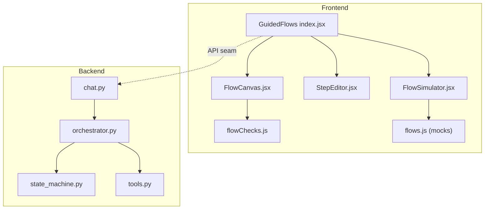
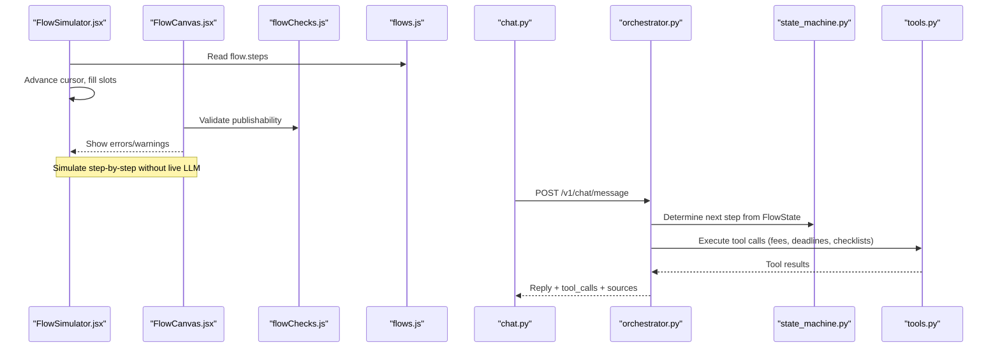
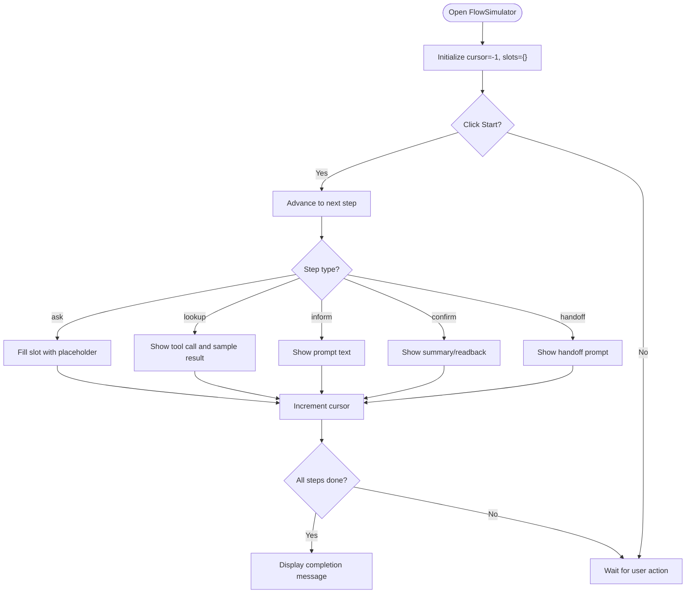
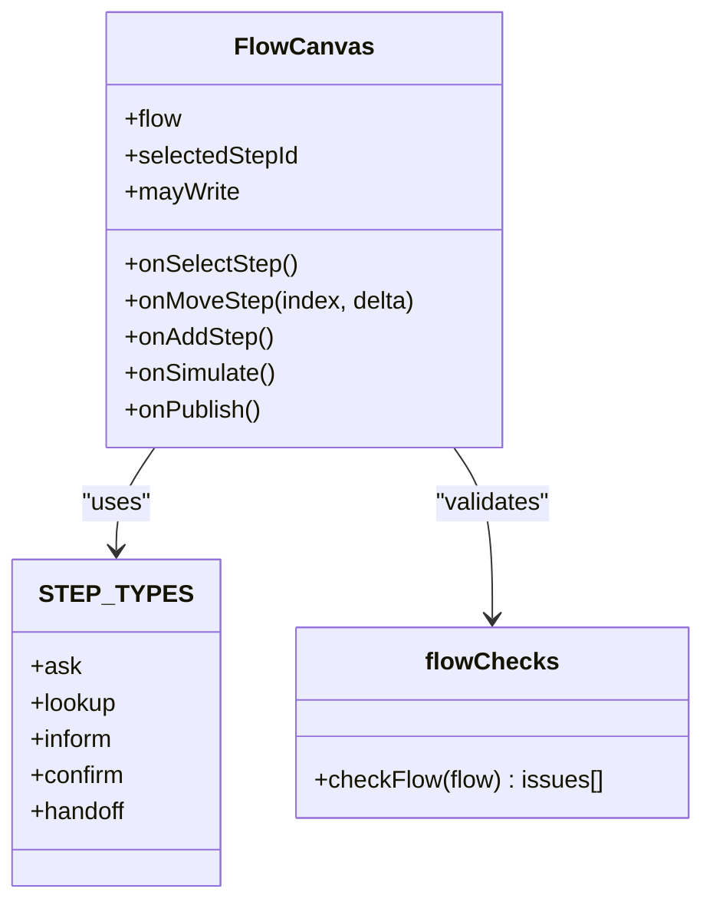
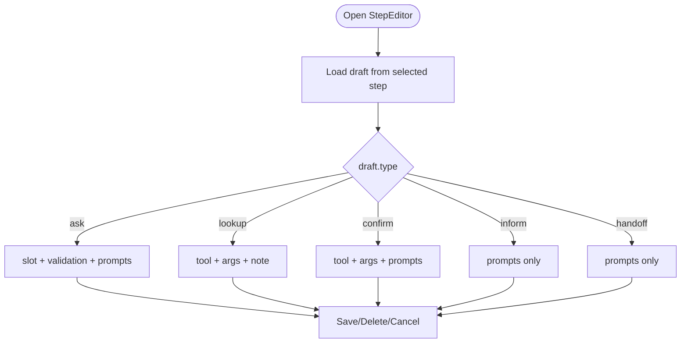
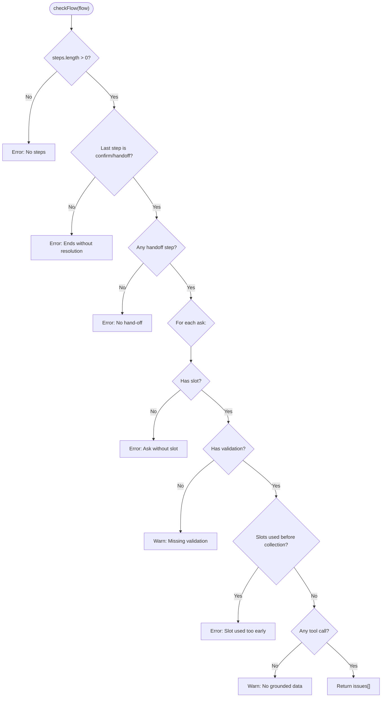
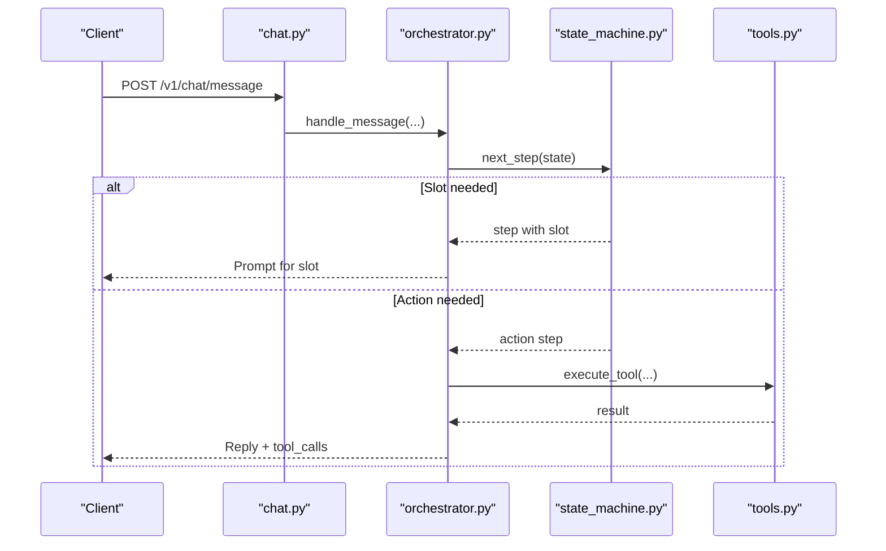
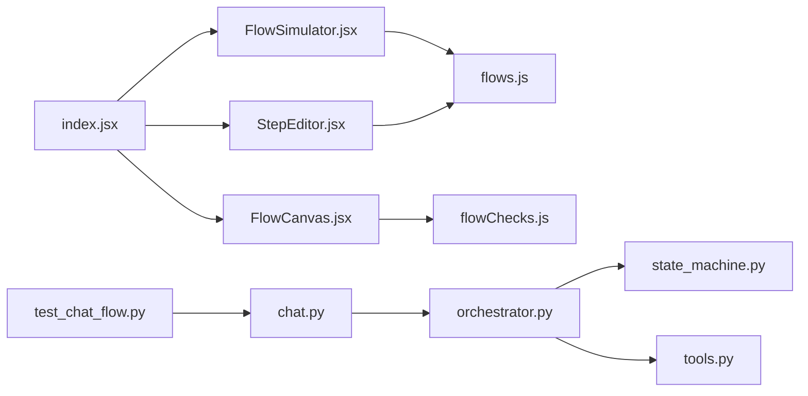

# Flow Simulator

<cite>
**Referenced Files in This Document**
- [FlowSimulator.jsx](file://src/pages/GuidedFlows/FlowSimulator.jsx)
- [index.jsx](file://src/pages/GuidedFlows/index.jsx)
- [flowChecks.js](file://src/pages/GuidedFlows/flowChecks.js)
- [flows.js](file://src/mocks/flows.js)
- [FlowCanvas.jsx](file://src/pages/GuidedFlows/FlowCanvas.jsx)
- [StepEditor.jsx](file://src/pages/GuidedFlows/StepEditor.jsx)
- [state_machine.py](file://uaea-backend/app/orchestrator/state_machine.py)
- [orchestrator.py](file://uaea-backend/app/orchestrator/orchestrator.py)
- [chat.py](file://uaea-backend/app/api/chat.py)
- [tools.py](file://uaea-backend/app/orchestrator/tools.py)
- [test_chat_flow.py](file://uaea-backend/tests/test_chat_flow.py)
</cite>

## Table of Contents
1. [Introduction](#introduction)
2. [Project Structure](#project-structure)
3. [Core Components](#core-components)
4. [Architecture Overview](#architecture-overview)
5. [Detailed Component Analysis](#detailed-component-analysis)
6. [Dependency Analysis](#dependency-analysis)
7. [Performance Considerations](#performance-considerations)
8. [Troubleshooting Guide](#troubleshooting-guide)
9. [Conclusion](#conclusion)
10. [Appendices](#appendices)

## Introduction
This document explains the flow simulation system that lets you test guided flows before publishing them to production. It covers how to simulate conversations through predefined flows, test different user inputs, verify conditional branching logic, and identify potential issues in flow design. You will learn how to use the simulation interface, create and run test cases, analyze results, and debug problems using built-in tools and checks.

The system models multi-turn journeys as explicit state machines rather than relying on free-form LLM improvisation. This ensures required steps (like collecting slots or calling grounding tools) are executed in a predictable order and that conversations end with resolution or handoff.

## Project Structure
The flow simulator spans both frontend and backend:
- Frontend Guided Flows editor and simulator live under src/pages/GuidedFlows.
- Mock flow definitions and step metadata live under src/mocks.
- Backend orchestrator implements per-conversation state machine logic and tool execution.
- Tests demonstrate end-to-end flow behavior via HTTP requests.

**Diagram sources**
- [index.jsx:1-152](file://src/pages/GuidedFlows/index.jsx#L1-L152)
- [FlowCanvas.jsx:1-157](file://src/pages/GuidedFlows/FlowCanvas.jsx#L1-L157)
- [StepEditor.jsx:1-161](file://src/pages/GuidedFlows/StepEditor.jsx#L1-L161)
- [FlowSimulator.jsx:1-160](file://src/pages/GuidedFlows/FlowSimulator.jsx#L1-L160)
- [flowChecks.js:1-68](file://src/pages/GuidedFlows/flowChecks.js#L1-L68)
- [flows.js:1-137](file://src/mocks/flows.js#L1-L137)
- [orchestrator.py:1-405](file://uaea-backend/app/orchestrator/orchestrator.py#L1-L405)
- [state_machine.py:1-146](file://uaea-backend/app/orchestrator/state_machine.py#L1-L146)
- [tools.py:1-235](file://uaea-backend/app/orchestrator/tools.py#L1-L235)
- [chat.py:1-115](file://uaea-backend/app/api/chat.py#L1-L115)

**Section sources**
- [index.jsx:1-152](file://src/pages/GuidedFlows/index.jsx#L1-L152)
- [flows.js:1-137](file://src/mocks/flows.js#L1-L137)
- [orchestrator.py:1-405](file://uaea-backend/app/orchestrator/orchestrator.py#L1-L405)

## Core Components
- FlowSimulator: Step-by-step walkthrough of a flow’s state machine, showing prompts, tool calls, and slot filling.
- FlowCanvas: Visual list of steps with move/add controls and publishability warnings.
- StepEditor: Edit step fields based on type (ask, lookup, confirm, inform, handoff).
- flowChecks: Publishability rules ensuring flows end correctly and collect required data.
- State machine (backend): Tracks active flow intent, filled slots, and determines next step.
- Orchestrator: End-to-end message handling, guided flow integration, tool execution, guardrails.
- Tools: Grounding functions for fees, deadlines, checklists, departments, escalation, knowledge base search.
- Tests: Example scenarios validating guided flow behavior via HTTP endpoints.

**Section sources**
- [FlowSimulator.jsx:1-160](file://src/pages/GuidedFlows/FlowSimulator.jsx#L1-L160)
- [FlowCanvas.jsx:1-157](file://src/pages/GuidedFlows/FlowCanvas.jsx#L1-L157)
- [StepEditor.jsx:1-161](file://src/pages/GuidedFlows/StepEditor.jsx#L1-L161)
- [flowChecks.js:1-68](file://src/pages/GuidedFlows/flowChecks.js#L1-L68)
- [state_machine.py:1-146](file://uaea-backend/app/orchestrator/state_machine.py#L1-L146)
- [orchestrator.py:1-405](file://uaea-backend/app/orchestrator/orchestrator.py#L1-L405)
- [tools.py:1-235](file://uaea-backend/app/orchestrator/tools.py#L1-L235)
- [test_chat_flow.py:1-176](file://uaea-backend/tests/test_chat_flow.py#L1-L176)

## Architecture Overview
The flow simulator is a pre-publish validation tool integrated into the Guided Flows editor. It simulates the conversation by stepping through each defined step, showing prompts and tool calls, and tracking which slots are filled. The backend orchestrator enforces similar logic at runtime: it detects guided flow intents, collects slots, executes actions (tool calls), and returns responses.

**Diagram sources**
- [FlowSimulator.jsx:20-160](file://src/pages/GuidedFlows/FlowSimulator.jsx#L20-L160)
- [FlowCanvas.jsx:16-157](file://src/pages/GuidedFlows/FlowCanvas.jsx#L16-L157)
- [flowChecks.js:8-68](file://src/pages/GuidedFlows/flowChecks.js#L8-L68)
- [flows.js:19-137](file://src/mocks/flows.js#L19-L137)
- [chat.py:21-39](file://uaea-backend/app/api/chat.py#L21-L39)
- [orchestrator.py:46-143](file://uaea-backend/app/orchestrator/orchestrator.py#L46-L143)
- [state_machine.py:94-146](file://uaea-backend/app/orchestrator/state_machine.py#L94-L146)
- [tools.py:18-235](file://uaea-backend/app/orchestrator/tools.py#L18-L235)

## Detailed Component Analysis

### FlowSimulator: Step-by-step Simulation Interface
- Purpose: Walk through a flow one step at a time to see exactly how the state machine would behave.
- Behavior:
  - Maintains a cursor and slots map; advances step-by-step.
  - For ask steps, fills a placeholder value into the slot and shows “student answers” bubble.
  - For lookup steps, displays tool name and arguments with sample results.
  - Shows completed state when all steps are traversed.
- Controls: Start, Next step, Reset.

**Diagram sources**
- [FlowSimulator.jsx:27-160](file://src/pages/GuidedFlows/FlowSimulator.jsx#L27-L160)

**Section sources**
- [FlowSimulator.jsx:20-160](file://src/pages/GuidedFlows/FlowSimulator.jsx#L20-L160)

### FlowCanvas: Visual Flow Editor and Publishability Warnings
- Displays ordered steps with labels, types, slots, and tool calls.
- Provides move up/down, add step, and simulate buttons.
- Integrates flowChecks to show errors and warnings preventing publish until fixed.

**Diagram sources**
- [FlowCanvas.jsx:16-157](file://src/pages/GuidedFlows/FlowCanvas.jsx#L16-L157)
- [flows.js:118-125](file://src/mocks/flows.js#L118-L125)
- [flowChecks.js:8-68](file://src/pages/GuidedFlows/flowChecks.js#L8-L68)

**Section sources**
- [FlowCanvas.jsx:16-157](file://src/pages/GuidedFlows/FlowCanvas.jsx#L16-L157)
- [flowChecks.js:8-68](file://src/pages/GuidedFlows/flowChecks.js#L8-L68)

### StepEditor: Type-Specific Step Editing
- Renders fields based on step type:
  - ask: label, slot, validation rule, prompts (EN/UR).
  - lookup/confirm: tool selection and arguments.
  - inform/handoff: prompts (EN/UR).
- Supports saving changes and deleting steps.

**Diagram sources**
- [StepEditor.jsx:16-161](file://src/pages/GuidedFlows/StepEditor.jsx#L16-L161)

**Section sources**
- [StepEditor.jsx:16-161](file://src/pages/GuidedFlows/StepEditor.jsx#L16-L161)

### flowChecks: Publishability Rules
Ensures flows are safe to publish:
- Must have at least one step.
- Last step must be confirm or handoff.
- Must include a handoff step.
- Every ask must have a slot and validation rule (warn if missing).
- Slots used by lookups must be collected before the lookup.
- Warns if no tool calls exist (no grounded data).

**Diagram sources**
- [flowChecks.js:8-68](file://src/pages/GuidedFlows/flowChecks.js#L8-L68)

**Section sources**
- [flowChecks.js:8-68](file://src/pages/GuidedFlows/flowChecks.js#L8-L68)

### Backend State Machine and Orchestrator
- State machine tracks active flow intent, filled slots, and determines next step.
- Orchestrator integrates guided flows with LLM tool calls and guardrails.
- Chat API exposes endpoints to send messages and retrieve session history.

**Diagram sources**
- [state_machine.py:94-146](file://uaea-backend/app/orchestrator/state_machine.py#L94-L146)
- [orchestrator.py:46-143](file://uaea-backend/app/orchestrator/orchestrator.py#L46-L143)
- [chat.py:21-39](file://uaea-backend/app/api/chat.py#L21-L39)
- [tools.py:218-235](file://uaea-backend/app/orchestrator/tools.py#L218-L235)

**Section sources**
- [state_machine.py:14-146](file://uaea-backend/app/orchestrator/state_machine.py#L14-L146)
- [orchestrator.py:46-227](file://uaea-backend/app/orchestrator/orchestrator.py#L46-L227)
- [chat.py:21-85](file://uaea-backend/app/api/chat.py#L21-L85)

### Tools: Grounding Functions
- get_fee_tariff: Returns official fee info with currency and source.
- get_deadline: Returns service deadline with source reference.
- get_document_checklist: Returns required documents and procedure.
- get_department: Returns department/campus contact details.
- create_escalation_ticket: Creates human handoff ticket.
- search_knowledge_base: Retrieves cited chunks from verified sources.

**Section sources**
- [tools.py:18-235](file://uaea-backend/app/orchestrator/tools.py#L18-L235)

### Test Cases: Validating Flow Behavior
- Demonstrates triggering admission flow, filling slots, retrieving session history, escalating, and admin endpoint access.
- Uses mock LLM responses to avoid external dependencies during tests.

**Section sources**
- [test_chat_flow.py:44-176](file://uaea-backend/tests/test_chat_flow.py#L44-L176)

## Dependency Analysis
- Frontend components depend on shared UI primitives and context.
- FlowCanvas depends on flowChecks for publishability.
- FlowSimulator depends on mock flow definitions for step metadata.
- Backend orchestrator depends on state machine and tools.
- Tests depend on chat API endpoints and mocked LLM responses.

**Diagram sources**
- [FlowSimulator.jsx:1-160](file://src/pages/GuidedFlows/FlowSimulator.jsx#L1-L160)
- [flows.js:1-137](file://src/mocks/flows.js#L1-L137)
- [FlowCanvas.jsx:1-157](file://src/pages/GuidedFlows/FlowCanvas.jsx#L1-L157)
- [flowChecks.js:1-68](file://src/pages/GuidedFlows/flowChecks.js#L1-L68)
- [StepEditor.jsx:1-161](file://src/pages/GuidedFlows/StepEditor.jsx#L1-L161)
- [index.jsx:1-152](file://src/pages/GuidedFlows/index.jsx#L1-L152)
- [chat.py:1-115](file://uaea-backend/app/api/chat.py#L1-L115)
- [orchestrator.py:1-405](file://uaea-backend/app/orchestrator/orchestrator.py#L1-L405)
- [state_machine.py:1-146](file://uaea-backend/app/orchestrator/state_machine.py#L1-L146)
- [tools.py:1-235](file://uaea-backend/app/orchestrator/tools.py#L1-L235)
- [test_chat_flow.py:1-176](file://uaea-backend/tests/test_chat_flow.py#L1-L176)

**Section sources**
- [index.jsx:1-152](file://src/pages/GuidedFlows/index.jsx#L1-L152)
- [orchestrator.py:1-405](file://uaea-backend/app/orchestrator/orchestrator.py#L1-L405)

## Performance Considerations
- Keep flows concise to reduce step count and improve readability.
- Avoid excessive tool calls per flow; group related lookups where possible.
- Use validation rules to prevent unnecessary retries or invalid inputs.
- Prefer deterministic steps (ask → lookup → confirm → handoff) to minimize branching complexity.
- In tests, mock LLM responses to keep runs fast and stable.

[No sources needed since this section provides general guidance]

## Troubleshooting Guide
Common issues and how to resolve them:
- Flow ends without resolution: Ensure last step is confirm or handoff.
- Missing handoff: Add a handoff step to offer human assistance.
- Ask without slot or validation: Provide slot name and validation rule.
- Slot used before collection: Reorder steps so asks precede lookups that consume those slots.
- No tool calls: Include at least one lookup or confirm to ground responses.
- Publish blocked: Fix all error-level issues shown in FlowCanvas before publishing.

Debugging tips:
- Use FlowSimulator to step through and observe slot filling and tool calls.
- Inspect FlowCanvas warnings to quickly spot structural issues.
- Run backend tests to validate flow behavior via HTTP endpoints.
- Review tool results in orchestrator logs to ensure correct data retrieval.

**Section sources**
- [flowChecks.js:8-68](file://src/pages/GuidedFlows/flowChecks.js#L8-L68)
- [FlowCanvas.jsx:145-153](file://src/pages/GuidedFlows/FlowCanvas.jsx#L145-L153)
- [FlowSimulator.jsx:98-155](file://src/pages/GuidedFlows/FlowSimulator.jsx#L98-L155)
- [test_chat_flow.py:44-176](file://uaea-backend/tests/test_chat_flow.py#L44-L176)

## Conclusion
The flow simulator provides a safe, visual way to validate guided flows before they go live. By stepping through states, verifying slot collection, and ensuring proper termination, you can catch design issues early. Combine the frontend simulator with backend state machine logic and tests to build robust, grounded conversations that reliably guide students to resolution or human support.

[No sources needed since this section summarizes without analyzing specific files]

## Appendices

### How to Simulate Conversations Through Predefined Flows
- Open the Guided Flows page and select a flow.
- Click Walk through to open the FlowSimulator.
- Press Start, then repeatedly click Next step to advance through the flow.
- Observe prompts, tool calls, and slot filling as they occur.

**Section sources**
- [FlowSimulator.jsx:27-160](file://src/pages/GuidedFlows/FlowSimulator.jsx#L27-L160)
- [FlowCanvas.jsx:40-55](file://src/pages/GuidedFlows/FlowCanvas.jsx#L40-L55)

### How to Test Different User Input Scenarios
- Create ask steps with clear slot names and validation rules.
- Use FlowSimulator to simulate student answers and verify subsequent steps.
- For backend testing, send multiple messages to the chat API to simulate multi-turn interactions.

**Section sources**
- [StepEditor.jsx:78-99](file://src/pages/GuidedFlows/StepEditor.jsx#L78-L99)
- [test_chat_flow.py:44-81](file://uaea-backend/tests/test_chat_flow.py#L44-L81)

### How to Verify Conditional Branching Logic
- Ensure lookups depend on previously collected slots.
- Use flowChecks to detect ordering issues where slots are consumed too early.
- Reorder steps in FlowCanvas to enforce correct dependency order.

**Section sources**
- [flowChecks.js:42-57](file://src/pages/GuidedFlows/flowChecks.js#L42-L57)
- [FlowCanvas.jsx:109-130](file://src/pages/GuidedFlows/FlowCanvas.jsx#L109-L130)

### How to Identify Potential Issues in Flow Design
- Review FlowCanvas warnings and errors before publishing.
- Ensure every path ends in confirm or handoff.
- Include grounding tool calls to avoid ungrounded statements.

**Section sources**
- [flowChecks.js:8-68](file://src/pages/GuidedFlows/flowChecks.js#L8-L68)
- [FlowCanvas.jsx:145-153](file://src/pages/GuidedFlows/FlowCanvas.jsx#L145-L153)

### Interpreting Simulation Results
- Slots filled panel shows which variables were captured during the walk-through.
- Tool call entries indicate which grounding functions were invoked and their sample outputs.
- Completion message confirms the flow reached a terminal state without leaving the student waiting.

**Section sources**
- [FlowSimulator.jsx:71-88](file://src/pages/GuidedFlows/FlowSimulator.jsx#L71-L88)
- [FlowSimulator.jsx:101-108](file://src/pages/GuidedFlows/FlowSimulator.jsx#L101-L108)
- [FlowSimulator.jsx:151-155](file://src/pages/GuidedFlows/FlowSimulator.jsx#L151-L155)