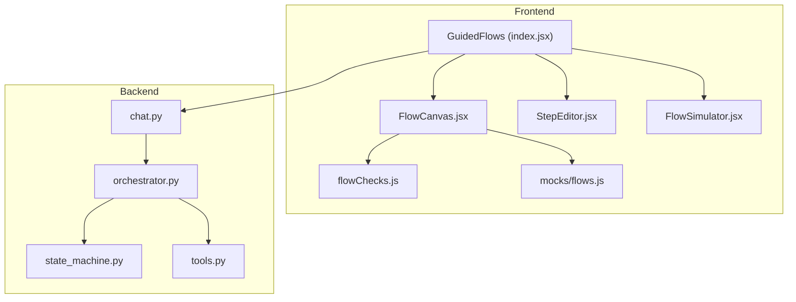
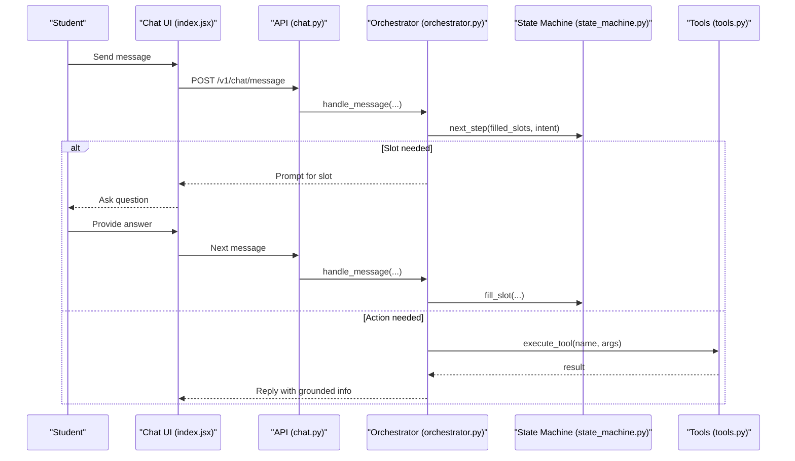
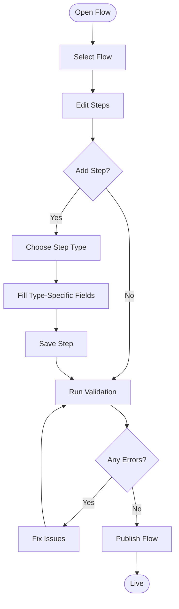
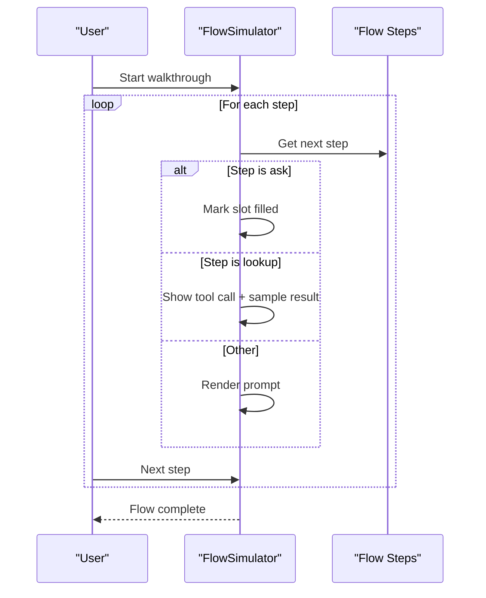
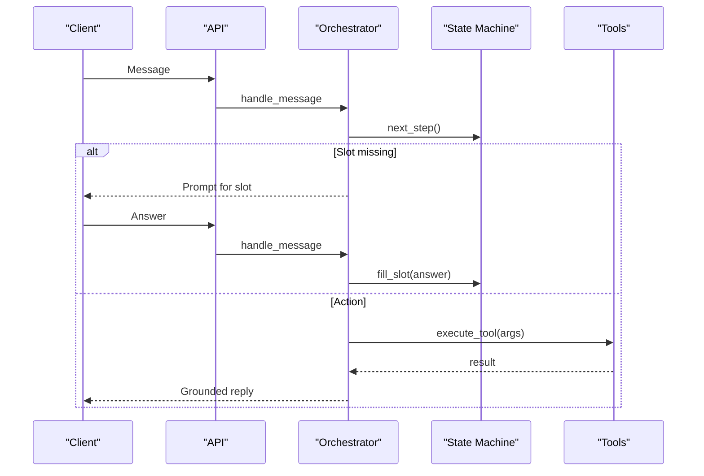
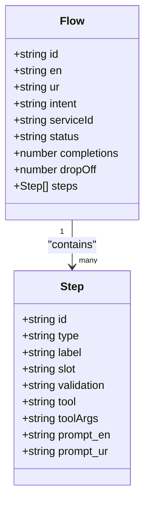
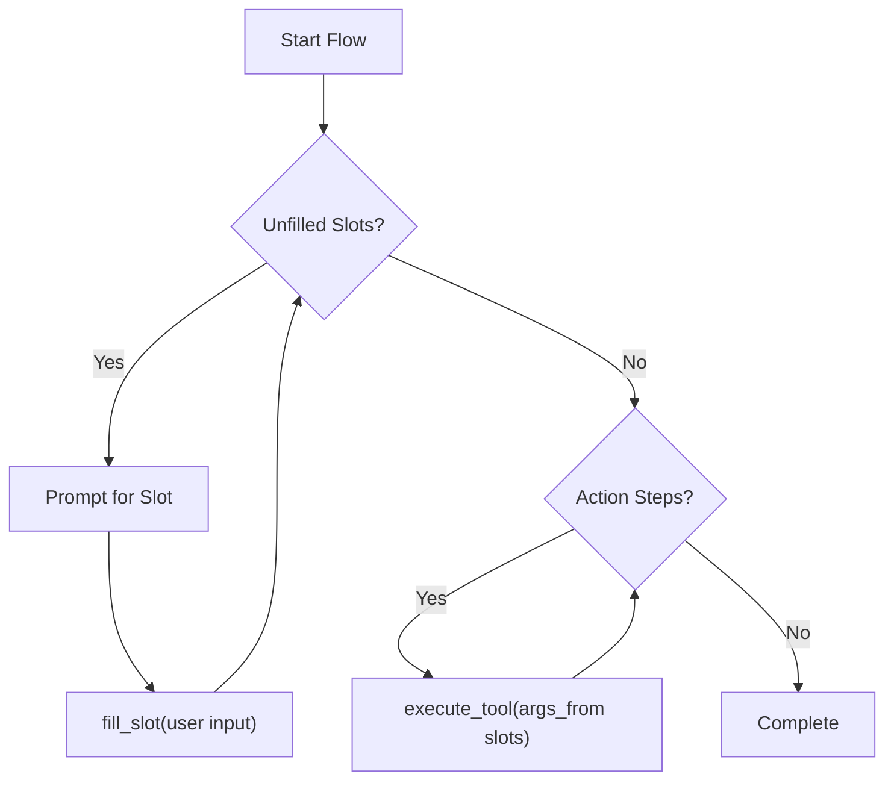
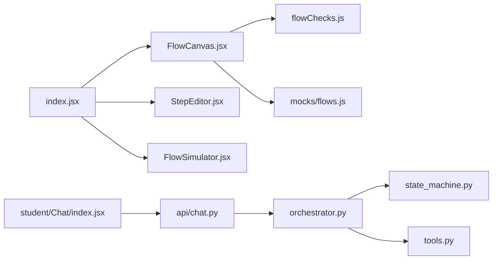

# Guided Flows

<cite>
**Referenced Files in This Document**
- [index.jsx](file://src/pages/GuidedFlows/index.jsx)
- [FlowCanvas.jsx](file://src/pages/GuidedFlows/FlowCanvas.jsx)
- [StepEditor.jsx](file://src/pages/GuidedFlows/StepEditor.jsx)
- [FlowSimulator.jsx](file://src/pages/GuidedFlows/FlowSimulator.jsx)
- [flowChecks.js](file://src/pages/GuidedFlows/flowChecks.js)
- [flows.js](file://src/mocks/flows.js)
- [index.js](file://src/mocks/index.js)
- [Chat index.jsx](file://src/pages/student/Chat/index.jsx)
- [orchestrator.py](file://uaea-backend/app/orchestrator/orchestrator.py)
- [state_machine.py](file://uaea-backend/app/orchestrator/state_machine.py)
- [tools.py](file://uaea-backend/app/orchestrator/tools.py)
- [chat.py](file://uaea-backend/app/api/chat.py)
</cite>

## Table of Contents
1. Introduction
2. Project Structure
3. Core Components
4. Architecture Overview
5. Detailed Component Analysis
6. Dependency Analysis
7. Performance Considerations
8. Troubleshooting Guide
9. Conclusion
10. Appendices

## Introduction
This document explains the guided flow system that provides structured, step-by-step interactions for students. It covers:
- The flow builder interface used to create and edit flows
- Flow simulation capabilities for testing before publishing
- The execution engine that guides users through predefined workflows
- Available step types and validation rules
- Conditional branching logic via slot collection and tool calls
- Integration with the chat system for dynamic flow execution

Guided flows are explicit state machines rather than LLM improvisation. This ensures required information is collected in order, prevents skipped steps, and guarantees a clear resolution or handoff at the end of each flow.

## Project Structure
The guided flow feature spans both frontend and backend:
- Frontend pages under src/pages/GuidedFlows provide the editor, canvas, simulator, and validation
- Mock data defines sample flows, step types, and tools
- Backend orchestrator coordinates intent classification, guided flow state, tool execution, and guardrails
- Student chat integrates guided flows into live conversations

**Diagram sources**
- [index.jsx:21-148](file://src/pages/GuidedFlows/index.jsx#L21-L148)
- [FlowCanvas.jsx:16-156](file://src/pages/GuidedFlows/FlowCanvas.jsx#L16-L156)
- [StepEditor.jsx:16-160](file://src/pages/GuidedFlows/StepEditor.jsx#L16-L160)
- [FlowSimulator.jsx:27-159](file://src/pages/GuidedFlows/FlowSimulator.jsx#L27-L159)
- [flowChecks.js:8-67](file://src/pages/GuidedFlows/flowChecks.js#L8-L67)
- [flows.js:19-137](file://src/mocks/flows.js#L19-L137)
- [chat.py:21-39](file://uaea-backend/app/api/chat.py#L21-L39)
- [orchestrator.py:46-143](file://uaea-backend/app/orchestrator/orchestrator.py#L46-L143)
- [state_machine.py:16-146](file://uaea-backend/app/orchestrator/state_machine.py#L16-L146)
- [tools.py:18-235](file://uaea-backend/app/orchestrator/tools.py#L18-L235)

**Section sources**
- [index.jsx:21-148](file://src/pages/GuidedFlows/index.jsx#L21-L148)
- [flows.js:19-137](file://src/mocks/flows.js#L19-L137)
- [orchestrator.py:46-143](file://uaea-backend/app/orchestrator/orchestrator.py#L46-L143)

## Core Components
- Flow list and selection: displays available flows and their status
- Flow canvas: shows ordered steps, metadata, tool usage, and issues
- Step editor: creates and edits steps with type-specific fields
- Flow simulator: walks through a flow step by step to validate behavior
- Validation checks: enforces publishability rules and data ordering
- Execution engine: manages guided flow state, slots, and tool calls during chat

Key responsibilities:
- Builder UI: compose, reorder, and validate flows
- Simulator: simulate slot filling and tool calls without affecting live data
- Engine: persist flow state across messages, collect slots, execute actions, and return responses

**Section sources**
- [FlowCanvas.jsx:16-156](file://src/pages/GuidedFlows/FlowCanvas.jsx#L16-L156)
- [StepEditor.jsx:16-160](file://src/pages/GuidedFlows/StepEditor.jsx#L16-L160)
- [FlowSimulator.jsx:27-159](file://src/pages/GuidedFlows/FlowSimulator.jsx#L27-L159)
- [flowChecks.js:8-67](file://src/pages/GuidedFlows/flowChecks.js#L8-L67)
- [orchestrator.py:146-226](file://uaea-backend/app/orchestrator/orchestrator.py#L146-L226)

## Architecture Overview
The guided flow architecture combines a frontend builder/simulator with a backend state machine integrated into the chat pipeline.

**Diagram sources**
- [Chat index.jsx:62-138](file://src/pages/student/Chat/index.jsx#L62-L138)
- [chat.py:21-39](file://uaea-backend/app/api/chat.py#L21-L39)
- [orchestrator.py:46-143](file://uaea-backend/app/orchestrator/orchestrator.py#L46-L143)
- [state_machine.py:94-146](file://uaea-backend/app/orchestrator/state_machine.py#L94-L146)
- [tools.py:218-235](file://uaea-backend/app/orchestrator/tools.py#L218-L235)

## Detailed Component Analysis

### Flow Builder Interface
- Flow list: selects active flow and shows counts, completions, and update time
- Flow canvas: renders ordered steps with labels, badges, tool calls, and prompts; allows moving steps up/down and adding new steps
- Step editor: type-aware form for creating/editing steps
  - ask: slot name and validation rule
  - lookup: tool selection and arguments
  - inform/confirm/handoff: prompts and notes
- Publish gating: errors from validation prevent publishing

**Diagram sources**
- [FlowCanvas.jsx:16-156](file://src/pages/GuidedFlows/FlowCanvas.jsx#L16-L156)
- [StepEditor.jsx:16-160](file://src/pages/GuidedFlows/StepEditor.jsx#L16-L160)
- [flowChecks.js:8-67](file://src/pages/GuidedFlows/flowChecks.js#L8-L67)
- [index.jsx:91-105](file://src/pages/GuidedFlows/index.jsx#L91-L105)

**Section sources**
- [FlowCanvas.jsx:16-156](file://src/pages/GuidedFlows/FlowCanvas.jsx#L16-L156)
- [StepEditor.jsx:16-160](file://src/pages/GuidedFlows/StepEditor.jsx#L16-L160)
- [flowChecks.js:8-67](file://src/pages/GuidedFlows/flowChecks.js#L8-L67)
- [index.jsx:91-105](file://src/pages/GuidedFlows/index.jsx#L91-L105)

### Flow Simulation Capabilities
- Walk-through mode simulates one step at a time
- Fills slots when an ask step is encountered
- Shows tool call invocations with sample results
- Displays language-aware prompts and completion state

**Diagram sources**
- [FlowSimulator.jsx:27-159](file://src/pages/GuidedFlows/FlowSimulator.jsx#L27-L159)

**Section sources**
- [FlowSimulator.jsx:27-159](file://src/pages/GuidedFlows/FlowSimulator.jsx#L27-L159)

### Execution Engine and Chat Integration
- Intent classification triggers guided flows for specific intents
- Flow state tracks active intent, filled slots, and completion
- Slot collection prompts until all required slots are filled
- Actions execute tools to gather grounded data
- Final replies include tool results and citations

**Diagram sources**
- [orchestrator.py:46-143](file://uaea-backend/app/orchestrator/orchestrator.py#L46-L143)
- [state_machine.py:94-146](file://uaea-backend/app/orchestrator/state_machine.py#L94-L146)
- [tools.py:218-235](file://uaea-backend/app/orchestrator/tools.py#L218-L235)
- [chat.py:21-39](file://uaea-backend/app/api/chat.py#L21-L39)

**Section sources**
- [orchestrator.py:46-143](file://uaea-backend/app/orchestrator/orchestrator.py#L46-L143)
- [state_machine.py:16-146](file://uaea-backend/app/orchestrator/state_machine.py#L16-L146)
- [tools.py:18-235](file://uaea-backend/app/orchestrator/tools.py#L18-L235)
- [chat.py:21-39](file://uaea-backend/app/api/chat.py#L21-L39)

### Step Types and Data Model
Available step types:
- ask: collects a value into a named slot; supports validation rules
- lookup: calls a grounding tool; no direct text output
- inform: states known information; no tool needed
- confirm: reads back checklist or summary; may call a tool
- handoff: terminal step that passes to a human

Common fields:
- id, type, label
- slot (for ask)
- validation (for ask)
- tool, toolArgs (for lookup/confirm)
- prompt_en, prompt_ur (for non-lookup steps)

**Diagram sources**
- [flows.js:19-137](file://src/mocks/flows.js#L19-L137)

**Section sources**
- [flows.js:19-137](file://src/mocks/flows.js#L19-L137)
- [StepEditor.jsx:63-156](file://src/pages/GuidedFlows/StepEditor.jsx#L63-L156)

### Conditional Branching Logic
- Slot-driven sequencing: the engine asks for unfilled slots in order
- Action execution: once required slots are present, actions run using those values
- Completion: after all steps finish, control returns to the LLM for final summarization or handoff

**Diagram sources**
- [state_machine.py:94-146](file://uaea-backend/app/orchestrator/state_machine.py#L94-L146)
- [orchestrator.py:146-226](file://uaea-backend/app/orchestrator/orchestrator.py#L146-L226)

**Section sources**
- [state_machine.py:94-146](file://uaea-backend/app/orchestrator/state_machine.py#L94-L146)
- [orchestrator.py:146-226](file://uaea-backend/app/orchestrator/orchestrator.py#L146-L226)

### Common Flow Patterns
Examples from mock flows:
- Service requests: Admission & Enrolment, Degree Application, Transcript/PRC
- Status checks: Result Enquiry
- Troubleshooting: Offer human handoff when data is missing or student requests assistance

These patterns demonstrate:
- Collecting required inputs via ask steps
- Retrieving official data via lookup steps
- Summarizing and confirming outcomes
- Providing escalation paths

**Section sources**
- [flows.js:19-137](file://src/mocks/flows.js#L19-L137)

## Dependency Analysis
- Frontend components depend on shared UI primitives and mock definitions
- Validation depends on flow structure and step ordering
- Backend orchestrator depends on state machine and tools
- Chat UI delegates to API which invokes orchestrator

**Diagram sources**
- [index.jsx:21-148](file://src/pages/GuidedFlows/index.jsx#L21-L148)
- [FlowCanvas.jsx:16-156](file://src/pages/GuidedFlows/FlowCanvas.jsx#L16-L156)
- [StepEditor.jsx:16-160](file://src/pages/GuidedFlows/StepEditor.jsx#L16-L160)
- [FlowSimulator.jsx:27-159](file://src/pages/GuidedFlows/FlowSimulator.jsx#L27-L159)
- [flowChecks.js:8-67](file://src/pages/GuidedFlows/flowChecks.js#L8-L67)
- [flows.js:19-137](file://src/mocks/flows.js#L19-L137)
- [Chat index.jsx:62-138](file://src/pages/student/Chat/index.jsx#L62-L138)
- [chat.py:21-39](file://uaea-backend/app/api/chat.py#L21-L39)
- [orchestrator.py:46-143](file://uaea-backend/app/orchestrator/orchestrator.py#L46-L143)
- [state_machine.py:94-146](file://uaea-backend/app/orchestrator/state_machine.py#L94-L146)
- [tools.py:218-235](file://uaea-backend/app/orchestrator/tools.py#L218-L235)

**Section sources**
- [index.jsx:21-148](file://src/pages/GuidedFlows/index.jsx#L21-L148)
- [orchestrator.py:46-143](file://uaea-backend/app/orchestrator/orchestrator.py#L46-L143)

## Performance Considerations
- Keep flows concise to minimize conversation turns and tool calls
- Prefer targeted tool arguments to reduce search space and improve accuracy
- Use confirm steps to summarize results and avoid redundant queries
- Avoid excessive nested loops; the orchestrator limits rounds to prevent long chains
- Validate early in the editor to catch misordered dependencies before publishing

[No sources needed since this section provides general guidance]

## Troubleshooting Guide
Common issues and resolutions:
- Flow ends without resolution: ensure last step is confirm or handoff
- Missing handoff: add a handoff step to guarantee human availability
- Unfilled slots used too early: reorder steps so ask precedes lookup that consumes the slot
- No tool calls: add lookup or confirm steps to ground answers in official data
- Publishing blocked: fix errors reported by validation checks

Operational tips:
- Use the simulator to walk through flows and verify slot filling order
- Inspect tool call sequences in chat responses to confirm grounding
- Review validation notes in the canvas to identify warnings and errors

**Section sources**
- [flowChecks.js:8-67](file://src/pages/GuidedFlows/flowChecks.js#L8-L67)
- [FlowCanvas.jsx:145-153](file://src/pages/GuidedFlows/FlowCanvas.jsx#L145-L153)
- [FlowSimulator.jsx:98-155](file://src/pages/GuidedFlows/FlowSimulator.jsx#L98-L155)

## Conclusion
The guided flow system provides a robust, verifiable way to deliver consistent student support. The builder ensures correct step ordering and validation, the simulator enables safe testing, and the backend orchestrator executes flows deterministically within the chat experience. By combining explicit state management with grounded tool calls, the system avoids hallucination risks and maintains clarity throughout multi-turn interactions.

[No sources needed since this section summarizes without analyzing specific files]

## Appendices

### Step Types Reference
- ask: collects user-provided values into slots with optional validation
- lookup: executes a tool to retrieve official data
- inform: presents known information without tool calls
- confirm: summarizes or reads back checklists; may call a tool
- handoff: terminal step that escalates to a human

**Section sources**
- [flows.js:118-125](file://src/mocks/flows.js#L118-L125)
- [StepEditor.jsx:63-156](file://src/pages/GuidedFlows/StepEditor.jsx#L63-L156)

### Tool Catalog
- get_fee_tariff: retrieves official fee amounts and currency
- get_deadline: retrieves official deadlines with source references
- get_document_checklist: retrieves required documents and procedures
- get_department: retrieves department/campus contact details
- search_knowledge_base: searches verified knowledge base chunks
- create_escalation_ticket: creates a ticket for human follow-up

**Section sources**
- [tools.py:18-87](file://uaea-backend/app/orchestrator/tools.py#L18-L87)
- [flows.js:127-136](file://src/mocks/flows.js#L127-L136)