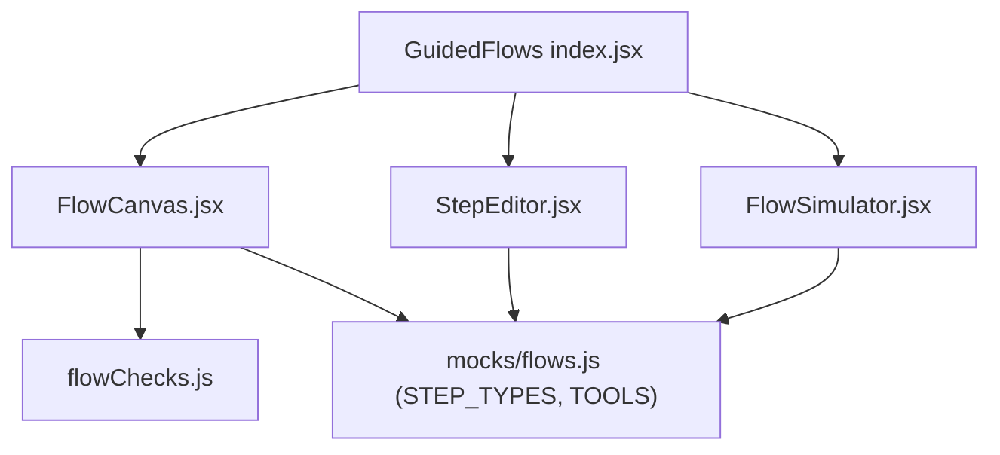
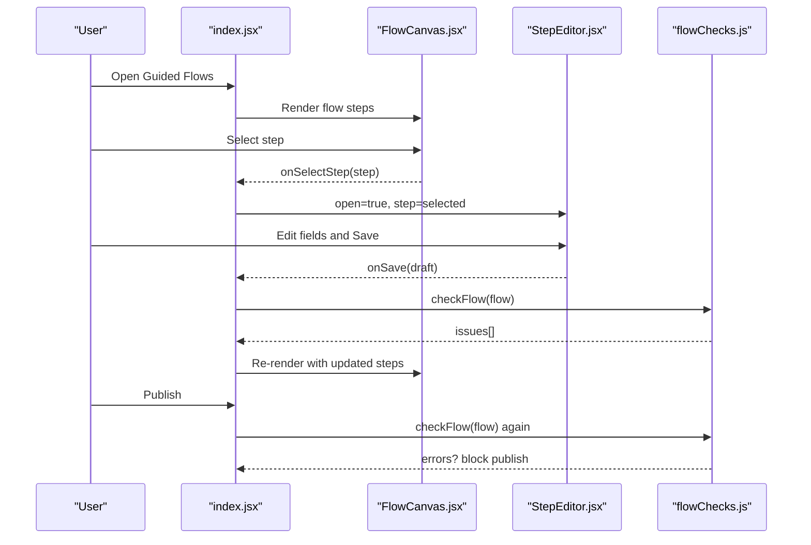
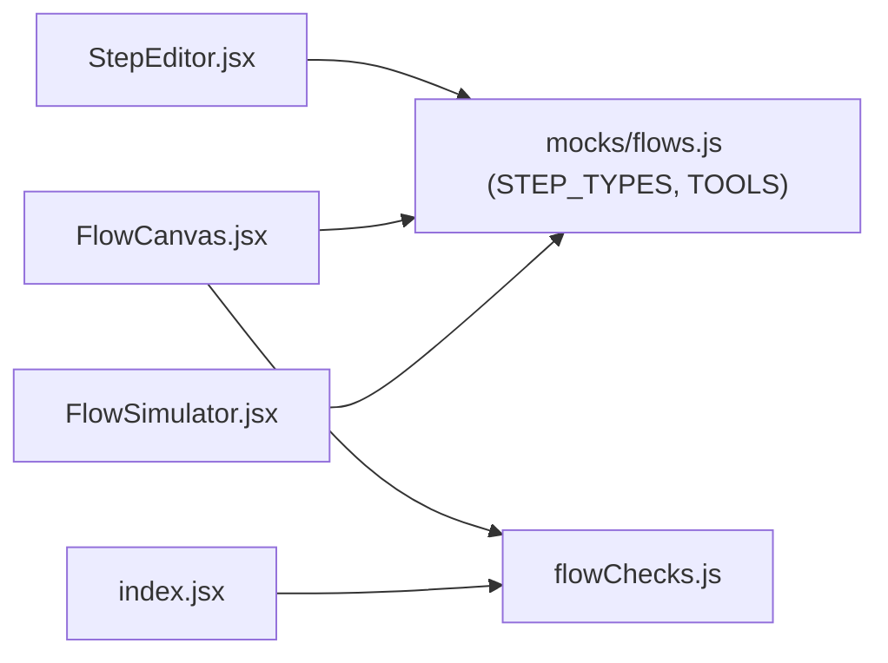

# Step Editor

<cite>
**Referenced Files in This Document**
- [StepEditor.jsx](file://src/pages/GuidedFlows/StepEditor.jsx)
- [flowChecks.js](file://src/pages/GuidedFlows/flowChecks.js)
- [FlowCanvas.jsx](file://src/pages/GuidedFlows/FlowCanvas.jsx)
- [index.jsx](file://src/pages/GuidedFlows/index.jsx)
- [flows.js](file://src/mocks/flows.js)
- [FlowSimulator.jsx](file://src/pages/GuidedFlows/FlowSimulator.jsx)
</cite>

## Table of Contents
1. [Introduction](#introduction)
2. [Project Structure](#project-structure)
3. [Core Components](#core-components)
4. [Architecture Overview](#architecture-overview)
5. [Detailed Component Analysis](#detailed-component-analysis)
6. [Dependency Analysis](#dependency-analysis)
7. [Performance Considerations](#performance-considerations)
8. [Troubleshooting Guide](#troubleshooting-guide)
9. [Conclusion](#conclusion)
10. [Appendices](#appendices)

## Introduction
This document explains the step editor component that configures individual steps in a guided flow. It covers all supported step types, their properties, validation rules, and how to configure prompts in English and Urdu. It also clarifies how flows are validated before publishing and how transitions work through ordered steps. The goal is to help you author reliable, grounded conversations where every path ends with a clear resolution or handoff to a human.

## Project Structure
The step editor lives within the Guided Flows feature:
- Flow list and selection
- Flow canvas showing ordered steps
- Step editor drawer for editing a single step
- Flow simulator to walk through a flow
- Validation checks that prevent publishing broken flows

**Diagram sources**
- [index.jsx:107-149](file://src/pages/GuidedFlows/index.jsx#L107-L149)
- [FlowCanvas.jsx:1-157](file://src/pages/GuidedFlows/FlowCanvas.jsx#L1-L157)
- [StepEditor.jsx:1-161](file://src/pages/GuidedFlows/StepEditor.jsx#L1-L161)
- [flowChecks.js:1-68](file://src/pages/GuidedFlows/flowChecks.js#L1-L68)
- [flows.js:118-136](file://src/mocks/flows.js#L118-L136)

**Section sources**
- [index.jsx:107-149](file://src/pages/GuidedFlows/index.jsx#L107-L149)
- [FlowCanvas.jsx:1-157](file://src/pages/GuidedFlows/FlowCanvas.jsx#L1-L157)
- [StepEditor.jsx:1-161](file://src/pages/GuidedFlows/StepEditor.jsx#L1-L161)
- [flowChecks.js:1-68](file://src/pages/GuidedFlows/flowChecks.js#L1-L68)
- [flows.js:118-136](file://src/mocks/flows.js#L118-L136)

## Core Components
- StepEditor: Renders a per-step configuration drawer. Fields shown depend on the step type. Supports saving, deleting, and canceling edits.
- FlowCanvas: Displays the ordered steps, shows metadata from STEP_TYPES, and runs publishability checks.
- flowChecks: Validates flows to ensure they end properly, include handoffs, collect slots before use, and warn about missing validations or tool calls.
- FlowSimulator: Walks through a flow step-by-step, simulating slot filling and tool usage.
- mocks/flows: Defines available step types, tools, and example flows demonstrating typical configurations.

**Section sources**
- [StepEditor.jsx:9-161](file://src/pages/GuidedFlows/StepEditor.jsx#L9-L161)
- [FlowCanvas.jsx:9-157](file://src/pages/GuidedFlows/FlowCanvas.jsx#L9-L157)
- [flowChecks.js:1-68](file://src/pages/GuidedFlows/flowChecks.js#L1-L68)
- [FlowSimulator.jsx:20-160](file://src/pages/GuidedFlows/FlowSimulator.jsx#L20-L160)
- [flows.js:1-137](file://src/mocks/flows.js#L1-L137)

## Architecture Overview
The step editor integrates into a state-machine-like flow editor:
- Users select a flow and view its steps in order.
- Editing a step opens a drawer tailored to the step’s type.
- Publishing is blocked if validation checks fail.
- Simulation helps verify behavior before publishing.

**Diagram sources**
- [index.jsx:33-105](file://src/pages/GuidedFlows/index.jsx#L33-L105)
- [FlowCanvas.jsx:26-54](file://src/pages/GuidedFlows/FlowCanvas.jsx#L26-L54)
- [StepEditor.jsx:16-49](file://src/pages/GuidedFlows/StepEditor.jsx#L16-L49)
- [flowChecks.js:8-66](file://src/pages/GuidedFlows/flowChecks.js#L8-L66)

## Detailed Component Analysis

### Step Types and Properties
Supported step types and their purpose:
- ask: Collects a value into a named slot. Requires a slot name and optionally a validation rule.
- lookup: Calls a grounding tool with arguments. Produces no words of its own; output must come from tool results.
- inform: States something already known; no tool needed.
- confirm: Reads back a checklist or summary; often paired with a tool.
- handoff: Passes to a human; always terminal.

Properties used by the editor:
- label: Display name for the step in the canvas.
- type: One of the supported step types.
- slot: For ask steps, the variable name filled by user input.
- validation: For ask steps, a rule describing acceptable values.
- tool: For lookup/confirm steps, which tool to call.
- toolArgs: For lookup/confirm steps, comma-separated slot names or literals used by the tool.
- prompt_en: English text displayed to the user.
- prompt_ur: Urdu text displayed to the user.
- terminal: For handoff steps, indicates the step ends the flow.

Validation rules enforced by the system:
- Every flow must have at least one step.
- The last step must be confirm or handoff; otherwise, the conversation ends without resolution.
- Every flow must include at least one handoff step.
- Ask steps must define a slot; missing slot is an error.
- Ask steps should define a validation rule; missing rule is a warning.
- Slots referenced by lookup toolArgs must be collected before the lookup that uses them.
- If no tool is called anywhere, a warning is raised indicating outputs may not be grounded.

Examples of step configurations and expected behavior:
- Ask step: Prompts the user for a value and fills a slot. Example flows show asking for programme, campus, semester, urgency, etc., with validation rules like “must match a programme in the fee tariff” or “one of: new, repeat”.
- Lookup step: Calls a tool such as get_fee_tariff or get_deadline using previously collected slots or literals. No direct prompt text is required; the orchestrator uses tool results.
- Confirm step: Often pairs with a tool to read back information, e.g., document checklist or eligibility summary.
- Handoff step: Offers a human connection; marked terminal.

Note on branching:
- The current implementation models flows as an ordered list of steps. There is no explicit branch node type in the editor UI. Conditional branching would need to be modeled by ordering steps so that earlier asks collect necessary inputs before later lookups consume them. The validation ensures slots are collected before being used.

**Section sources**
- [flows.js:1-18](file://src/mocks/flows.js#L1-L18)
- [flows.js:118-136](file://src/mocks/flows.js#L118-L136)
- [flowChecks.js:8-66](file://src/pages/GuidedFlows/flowChecks.js#L8-L66)
- [StepEditor.jsx:78-156](file://src/pages/GuidedFlows/StepEditor.jsx#L78-L156)

### Multi-Language Prompts (English and Urdu)
- Each non-lookup step can include both English and Urdu prompts.
- The editor exposes two text areas: one for English and one for Urdu.
- During simulation, the language preference determines which prompt is shown.

Behavior:
- When urdu is enabled in the app context, the simulator displays Urdu prompts; otherwise, it displays English.
- If neither prompt is provided, the simulator notes that no prompt was written.

Best practices:
- Always provide both languages for consistent UX across locales.
- Keep prompts concise and aligned with the step’s intent.

**Section sources**
- [StepEditor.jsx:130-149](file://src/pages/GuidedFlows/StepEditor.jsx#L130-L149)
- [FlowSimulator.jsx:111-134](file://src/pages/GuidedFlows/FlowSimulator.jsx#L111-L134)

### Conditional Branching Logic
- The editor does not expose a dedicated “branch” step type.
- To simulate conditional behavior, structure your flow so that earlier ask steps collect required inputs, and subsequent lookup steps consume those inputs via toolArgs.
- The validation enforces that slots are collected before being used by lookups, preventing out-of-order consumption.

Recommended pattern:
- Ask for key decision variables first.
- Follow with lookups that use those variables.
- End with confirm or handoff to resolve the conversation.

**Section sources**
- [flowChecks.js:42-57](file://src/pages/GuidedFlows/flowChecks.js#L42-L57)
- [flows.js:31-39](file://src/mocks/flows.js#L31-L39)

### Validation Rules for User Input
- Define a validation rule on each ask step to constrain acceptable answers.
- Examples include matching catalogue entries or restricting to enumerated options.
- Missing validation triggers a warning; missing slot triggers an error.

Impact:
- Ensures data quality and enables grounded tool calls downstream.
- Helps avoid ambiguous or invalid inputs that could break lookups.

**Section sources**
- [flowChecks.js:32-40](file://src/pages/GuidedFlows/flowChecks.js#L32-L40)
- [flows.js:31-39](file://src/mocks/flows.js#L31-L39)

### Configuring Step Transitions
- Steps execute in the order defined in the flow.
- Use move-up/move-down controls to reorder steps.
- Ensure the final step is confirm or handoff to avoid leaving users mid-conversation.
- Include at least one handoff to guarantee human escalation availability.

Publish gating:
- Publishing is disabled when there are errors reported by the flow checks.

**Section sources**
- [FlowCanvas.jsx:109-130](file://src/pages/GuidedFlows/FlowCanvas.jsx#L109-L130)
- [flowChecks.js:17-30](file://src/pages/GuidedFlows/flowChecks.js#L17-L30)
- [index.jsx:91-105](file://src/pages/GuidedFlows/index.jsx#L91-L105)

### Examples of Step Configurations and Expected Behavior
- Admission & Enrolment flow:
  - Asks for programme and campus, then performs lookups for eligibility, deadline, and fee, followed by a confirm and handoff.
  - Demonstrates collecting multiple slots and using them in tool calls.
- Fee Challan flow:
  - Asks for programme and enrolment type, looks up fee and due date, confirms payment instructions, and offers handoff.
- Result Enquiry flow:
  - Asks for semester, informs about result publication, points to portal, and offers handoff.
- Degree Application flow:
  - Asks for graduating semester, looks up deadline and fee, reads back documents, states processing time, and offers handoff.

Expected behavior:
- Each ask step collects a slot with optional validation.
- Lookup steps call tools using previously collected slots or literals.
- Confirm steps summarize or read back information.
- Handoff steps terminate the flow and offer human assistance.

**Section sources**
- [flows.js:19-116](file://src/mocks/flows.js#L19-L116)

## Dependency Analysis
The step editor depends on shared metadata and validation logic:
- STEP_TYPES and TOOLS define available step types and tools.
- flowChecks validates flows before publishing and during editing.
- FlowCanvas renders steps and integrates validation feedback.
- FlowSimulator demonstrates runtime behavior using the same metadata.

**Diagram sources**
- [StepEditor.jsx:7-8](file://src/pages/GuidedFlows/StepEditor.jsx#L7-L8)
- [FlowCanvas.jsx:5-7](file://src/pages/GuidedFlows/FlowCanvas.jsx#L5-L7)
- [FlowSimulator.jsx:6-7](file://src/pages/GuidedFlows/FlowSimulator.jsx#L6-L7)
- [index.jsx:7-8](file://src/pages/GuidedFlows/index.jsx#L7-L8)
- [flows.js:118-136](file://src/mocks/flows.js#L118-L136)

**Section sources**
- [StepEditor.jsx:7-8](file://src/pages/GuidedFlows/StepEditor.jsx#L7-L8)
- [FlowCanvas.jsx:5-7](file://src/pages/GuidedFlows/FlowCanvas.jsx#L5-L7)
- [FlowSimulator.jsx:6-7](file://src/pages/GuidedFlows/FlowSimulator.jsx#L6-L7)
- [index.jsx:7-8](file://src/pages/GuidedFlows/index.jsx#L7-L8)
- [flows.js:118-136](file://src/mocks/flows.js#L118-L136)

## Performance Considerations
- The editor maintains local draft state for the selected step, minimizing re-renders until save.
- Flow checks run on render to provide immediate feedback; keep flows reasonably sized to avoid heavy computations.
- Avoid excessive nested conditions in prompts; keep text concise for faster rendering and better readability.

[No sources needed since this section provides general guidance]

## Troubleshooting Guide
Common issues and resolutions:
- Cannot publish flow:
  - Check for errors reported under the flow. Ensure the last step is confirm or handoff and that at least one handoff exists.
- Ask step missing slot:
  - Add a slot name to capture user input; otherwise, the flow cannot use the answer downstream.
- Ask step missing validation:
  - Add a validation rule to constrain acceptable answers; this is a warning but recommended for robust flows.
- Lookup uses a slot too early:
  - Move the corresponding ask step before the lookup that consumes the slot.
- No tool calls in flow:
  - Add lookups or confirm steps to ground responses in catalogue data; otherwise, outputs may not be accurate.

Where to find these checks:
- Errors and warnings are surfaced in the FlowCanvas below the step list.
- Publishing is blocked when errors exist.

**Section sources**
- [flowChecks.js:8-66](file://src/pages/GuidedFlows/flowChecks.js#L8-L66)
- [FlowCanvas.jsx:145-153](file://src/pages/GuidedFlows/FlowCanvas.jsx#L145-L153)
- [index.jsx:91-105](file://src/pages/GuidedFlows/index.jsx#L91-L105)

## Conclusion
The step editor provides a focused interface for configuring individual steps in guided flows. By using the supported step types, defining clear prompts in English and Urdu, setting validation rules for user input, and ensuring proper ordering of steps, you can build reliable, grounded conversations. The built-in validation prevents publishing flows that leave users without resolution or human support. Use the simulator to verify behavior before going live.

[No sources needed since this section summarizes without analyzing specific files]

## Appendices

### Step Editor Field Reference
- label: Display name for the step in the canvas.
- type: Supported values: ask, lookup, inform, confirm, handoff.
- slot: Required for ask steps; defines the variable filled by user input.
- validation: Recommended for ask steps; describes acceptable values.
- tool: For lookup/confirm steps; selects a grounding tool.
- toolArgs: For lookup/confirm steps; comma-separated slot names or literals.
- prompt_en: English text shown to the user.
- prompt_ur: Urdu text shown to the user.
- terminal: For handoff steps; marks the step as ending the flow.

**Section sources**
- [StepEditor.jsx:53-156](file://src/pages/GuidedFlows/StepEditor.jsx#L53-L156)
- [flows.js:118-136](file://src/mocks/flows.js#L118-L136)

### Flow Validation Summary
- Must have at least one step.
- Last step must be confirm or handoff.
- Must include at least one handoff.
- Ask steps must define a slot; missing validation is a warning.
- Slots must be collected before being used by lookups.
- Prefer including tool calls to ground responses.

**Section sources**
- [flowChecks.js:8-66](file://src/pages/GuidedFlows/flowChecks.js#L8-L66)