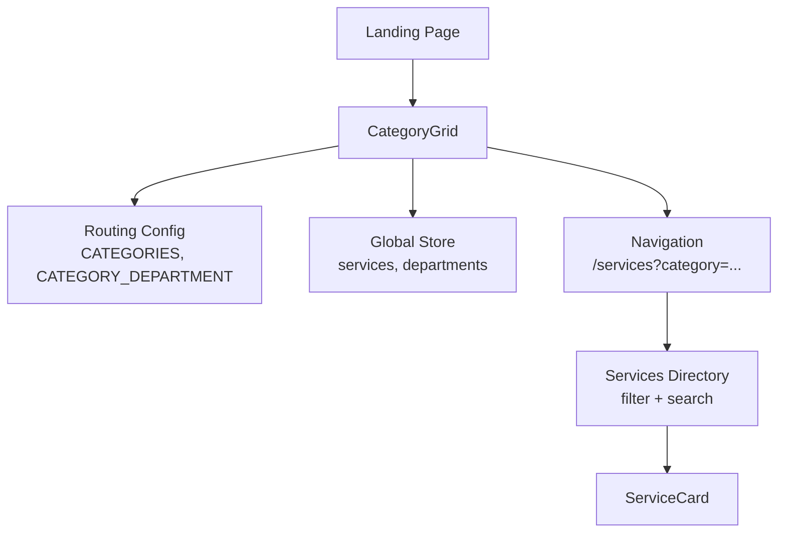
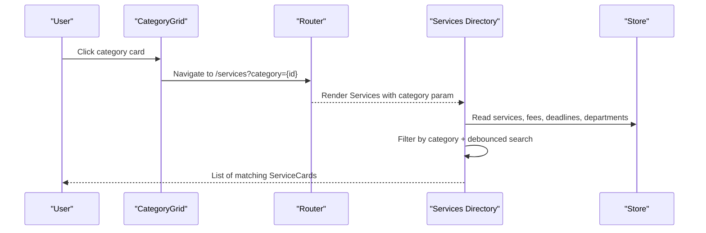
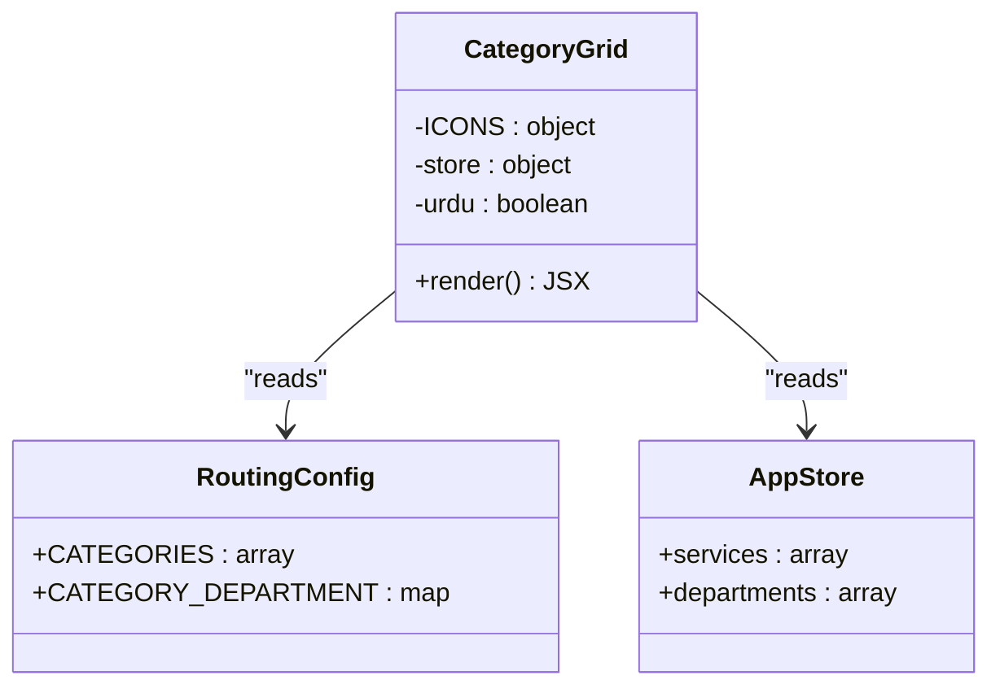
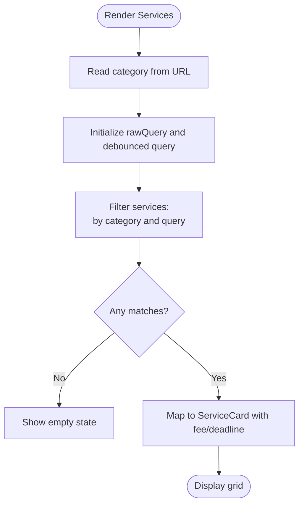
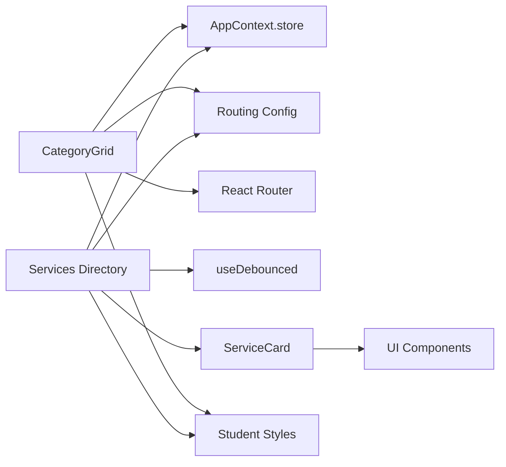

# Category Grid

<cite>
**Referenced Files in This Document**
- [CategoryGrid.jsx](file://src/pages/student/Landing/CategoryGrid.jsx)
- [ServiceCard.jsx](file://src/components/student/ServiceCard.jsx)
- [Services index.jsx](file://src/pages/student/Services/index.jsx)
- [routing.js](file://src/mocks/routing.js)
- [services.js](file://src/mocks/services.js)
- [AppContext.jsx](file://src/context/AppContext.jsx)
- [student.css](file://src/styles/student.css)
</cite>

## Table of Contents
1. [Introduction](#introduction)
2. [Project Structure](#project-structure)
3. [Core Components](#core-components)
4. [Architecture Overview](#architecture-overview)
5. [Detailed Component Analysis](#detailed-component-analysis)
6. [Dependency Analysis](#dependency-analysis)
7. [Performance Considerations](#performance-considerations)
8. [Troubleshooting Guide](#troubleshooting-guide)
9. [Conclusion](#conclusion)

## Introduction
This document explains the CategoryGrid component that organizes university services by department and presents them in a responsive grid. It covers how categories are defined, how service counts are computed, how navigation routes to the Services directory with category filtering, and how search works on the destination page. It also documents data binding from global state, user interaction patterns for discovery, and the grid’s responsiveness across screen sizes.

## Project Structure
The CategoryGrid is part of the student-facing landing experience and integrates with:
- Global application state (services, departments, language preference)
- Routing configuration (categories and department mapping)
- The Services directory page where users can filter and search services
- Shared UI styles for grids and cards

**Diagram sources**
- [CategoryGrid.jsx:1-60](file://src/pages/student/Landing/CategoryGrid.jsx#L1-L60)
- [routing.js:1-77](file://src/mocks/routing.js#L1-L77)
- [AppContext.jsx:34-47](file://src/context/AppContext.jsx#L34-L47)
- [Services index.jsx:17-125](file://src/pages/student/Services/index.jsx#L17-L125)
- [ServiceCard.jsx:1-57](file://src/components/student/ServiceCard.jsx#L1-L57)

**Section sources**
- [CategoryGrid.jsx:1-60](file://src/pages/student/Landing/CategoryGrid.jsx#L1-L60)
- [routing.js:1-77](file://src/mocks/routing.js#L1-L77)
- [AppContext.jsx:34-47](file://src/context/AppContext.jsx#L34-L47)
- [Services index.jsx:17-125](file://src/pages/student/Services/index.jsx#L17-L125)
- [ServiceCard.jsx:1-57](file://src/components/student/ServiceCard.jsx#L1-L57)

## Core Components
- CategoryGrid: Renders a department-based grid of category cards with icons, titles, blurbs, service counts, and department names. Each card navigates to the Services directory filtered by category.
- Services directory: Provides category chips and a debounced search input to filter services. Displays ServiceCard items with fee and deadline context when available.
- ServiceCard: Summarizes a single service with title, category badge, document count, optional fee and deadline, and verification status.

Key responsibilities:
- CategoryGrid: Data binding to store, category-to-department lookup, icon mapping, and navigation.
- Services directory: URL-driven category filter, debounced text search across service fields, and rendering results.
- ServiceCard: Displaying concise service details and linking to the detail page.

**Section sources**
- [CategoryGrid.jsx:17-59](file://src/pages/student/Landing/CategoryGrid.jsx#L17-L59)
- [Services index.jsx:17-125](file://src/pages/student/Services/index.jsx#L17-L125)
- [ServiceCard.jsx:8-56](file://src/components/student/ServiceCard.jsx#L8-L56)

## Architecture Overview
The CategoryGrid reads shared state and routing metadata to present an intuitive entry point for students to discover services by department. Clicking a category navigates to the Services directory with a query parameter that pre-filters the list. Users can further refine results using category chips or free-text search.

**Diagram sources**
- [CategoryGrid.jsx:34-55](file://src/pages/student/Landing/CategoryGrid.jsx#L34-L55)
- [Services index.jsx:17-39](file://src/pages/student/Services/index.jsx#L17-L39)
- [AppContext.jsx:34-47](file://src/context/AppContext.jsx#L34-L47)

## Detailed Component Analysis

### CategoryGrid
Purpose:
- Present university services grouped by department so students can find what they need without knowing exact terminology.
- Show each category’s icon, bilingual title and description, number of services, and owning department.

Implementation highlights:
- Reads global store for services and departments; computes per-category counts by filtering services on their category field.
- Maps category IDs to icons via a local map.
- Uses routing config to resolve the owning department name for display.
- Navigates to the Services directory with a category query parameter for deep-linkable filters.

Responsiveness:
- Uses a CSS grid class that adapts columns based on breakpoints.

Accessibility and UX:
- Cards are links with clear headings and supporting metadata.
- Supports Urdu/English content via a language flag from context.

Data binding:
- Services array from AppContext store.
- Departments array from AppContext store.
- Categories and category-to-department mapping from routing config.

Navigation:
- Links to /services?category={categoryId}.

**Section sources**
- [CategoryGrid.jsx:1-60](file://src/pages/student/Landing/CategoryGrid.jsx#L1-L60)
- [routing.js:11-64](file://src/mocks/routing.js#L11-L64)
- [AppContext.jsx:34-47](file://src/context/AppContext.jsx#L34-L47)

#### Class Diagram

**Diagram sources**
- [CategoryGrid.jsx:1-60](file://src/pages/student/Landing/CategoryGrid.jsx#L1-L60)
- [routing.js:11-64](file://src/mocks/routing.js#L11-L64)
- [AppContext.jsx:34-47](file://src/context/AppContext.jsx#L34-L47)

### Services Directory (Filtering and Search)
Purpose:
- Provide a browsable, searchable list of services filtered by category and/or text.

Implementation highlights:
- Reads category from URL query parameters; defaults to “all”.
- Debounces user input to avoid excessive re-renders during typing.
- Filters services by category and then by a combined haystack of English/Urdu titles, category, and checklist items.
- Computes associated fee and deadline for display on ServiceCard.
- Shows active department info when a specific category is selected.

Search behavior:
- Case-insensitive substring match across multiple fields.
- Empty state guidance when no results match.

**Section sources**
- [Services index.jsx:17-125](file://src/pages/student/Services/index.jsx#L17-L125)

#### Flowchart: Filtering and Search

**Diagram sources**
- [Services index.jsx:17-39](file://src/pages/student/Services/index.jsx#L17-L39)
- [Services index.jsx:45-125](file://src/pages/student/Services/index.jsx#L45-L125)

### ServiceCard
Purpose:
- Display a compact summary of a service including title, category badge, document count, optional fee and deadline, and verification status.

Implementation highlights:
- Links to the service detail page.
- Uses formatting utilities for currency and dates.
- Integrates with global language preference for bilingual labels.

**Section sources**
- [ServiceCard.jsx:1-57](file://src/components/student/ServiceCard.jsx#L1-L57)

## Dependency Analysis
- CategoryGrid depends on:
  - AppContext store for services and departments
  - Routing config for categories and department mapping
  - React Router for navigation
- Services directory depends on:
  - AppContext store for services, fees, deadlines, departments
  - Routing config for categories and department mapping
  - Debounce hook for efficient search
- Shared UI components and styles:
  - Badge, Ladder, EmptyState, Button
  - CSS classes for grids and cards

**Diagram sources**
- [CategoryGrid.jsx:1-60](file://src/pages/student/Landing/CategoryGrid.jsx#L1-L60)
- [Services index.jsx:1-125](file://src/pages/student/Services/index.jsx#L1-L125)
- [AppContext.jsx:34-47](file://src/context/AppContext.jsx#L34-L47)
- [routing.js:11-64](file://src/mocks/routing.js#L11-L64)
- [ServiceCard.jsx:1-57](file://src/components/student/ServiceCard.jsx#L1-L57)
- [student.css:217-228](file://src/styles/student.css#L217-L228)

**Section sources**
- [CategoryGrid.jsx:1-60](file://src/pages/student/Landing/CategoryGrid.jsx#L1-L60)
- [Services index.jsx:1-125](file://src/pages/student/Services/index.jsx#L1-L125)
- [AppContext.jsx:34-47](file://src/context/AppContext.jsx#L34-L47)
- [routing.js:11-64](file://src/mocks/routing.js#L11-L64)
- [ServiceCard.jsx:1-57](file://src/components/student/ServiceCard.jsx#L1-L57)
- [student.css:217-228](file://src/styles/student.css#L217-L228)

## Performance Considerations
- Debounced search: The Services directory uses a debounced input to minimize re-renders while typing. This improves responsiveness on large datasets.
- Memoized filtering: Results are computed with memoization to avoid unnecessary recalculations when inputs haven’t changed.
- Efficient counting: CategoryGrid computes service counts by filtering the services array per category; this is O(n) per category but acceptable given typical dataset sizes. For very large catalogs, consider caching counts or precomputing aggregates.
- Styling performance: CSS grid and transitions are hardware-accelerated; hover effects use transform and box-shadow changes which are generally performant.

[No sources needed since this section provides general guidance]

## Troubleshooting Guide
Common issues and resolutions:
- No services appear after selecting a category:
  - Verify the category query parameter is set correctly in the URL.
  - Ensure services have the expected category values matching the routing config.
- Search returns no results:
  - Check that the search string matches content in service titles, Urdu titles, categories, or checklist items.
  - Clear the search input to reset filters.
- Incorrect department shown in CategoryGrid:
  - Confirm CATEGORY_DEPARTMENT mapping includes the category.
  - Ensure departments array contains the expected department entries.
- Language not switching:
  - Verify the urdu flag in AppContext is toggled and passed to components.

**Section sources**
- [Services index.jsx:17-39](file://src/pages/student/Services/index.jsx#L17-L39)
- [routing.js:11-64](file://src/mocks/routing.js#L11-L64)
- [AppContext.jsx:34-47](file://src/context/AppContext.jsx#L34-L47)

## Conclusion
CategoryGrid provides a department-centric entry point for discovering university services, leveraging shared state and routing configuration to present accurate counts and contextual information. Navigation to the Services directory enables precise filtering and powerful search, while responsive styling ensures a good experience across devices. The design balances clarity, accessibility, and performance, making it straightforward to extend with new categories or services.

[No sources needed since this section summarizes without analyzing specific files]