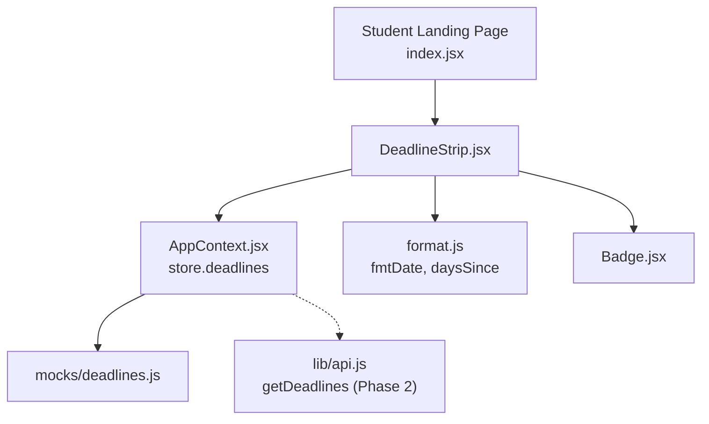
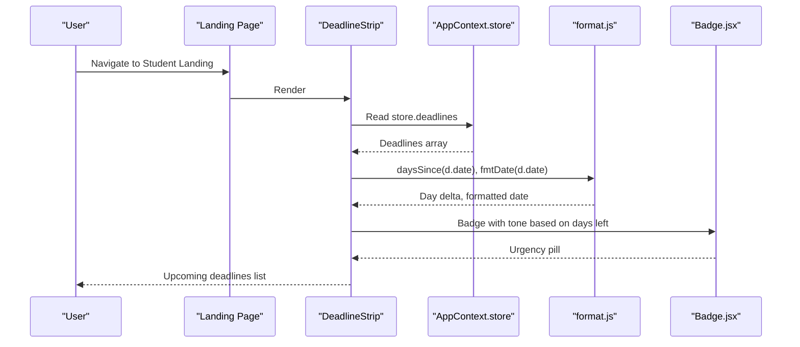
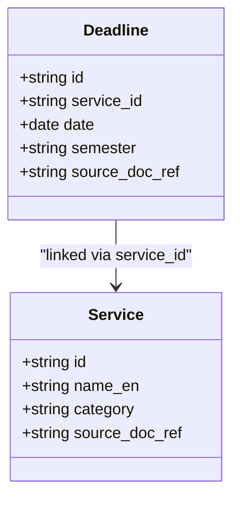
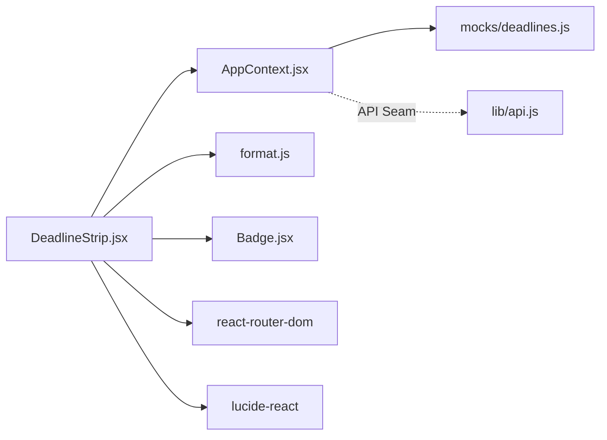

# Deadline Strip

<cite>
**Referenced Files in This Document**
- [DeadlineStrip.jsx](file://src/pages/student/Landing/DeadlineStrip.jsx)
- [AppContext.jsx](file://src/context/AppContext.jsx)
- [format.js](file://src/lib/format.js)
- [constants.js](file://src/lib/constants.js)
- [Badge.jsx](file://src/components/ui/Badge.jsx)
- [deadlines.js](file://src/mocks/deadlines.js)
- [index.jsx](file://src/pages/student/Landing/index.jsx)
- [api.js](file://src/lib/api.js)
- [tools.py](file://uaea-backend/app/orchestrator/tools.py)
- [models.py](file://uaea-backend/app/db/models.py)
</cite>

## Table of Contents
1. [Introduction](#introduction)
2. [Project Structure](#project-structure)
3. [Core Components](#core-components)
4. [Architecture Overview](#architecture-overview)
5. [Detailed Component Analysis](#detailed-component-analysis)
6. [Dependency Analysis](#dependency-analysis)
7. [Performance Considerations](#performance-considerations)
8. [Troubleshooting Guide](#troubleshooting-guide)
9. [Conclusion](#conclusion)

## Introduction
The Deadline Strip is a student-facing component that highlights upcoming academic deadlines from the shared deadline store. It filters, sorts, and displays the most relevant upcoming dates with urgency indicators and links to services. The component reads live data from the application context store, which currently seeds from mock data but is designed to be replaced by server state in Phase 2.

## Project Structure
The Deadline Strip lives under the student landing area and composes UI primitives (icons, badges) and formatting utilities. It integrates with the global app context for data access and navigation via React Router.

**Diagram sources**
- [index.jsx:1-24](file://src/pages/student/Landing/index.jsx#L1-L24)
- [DeadlineStrip.jsx:1-72](file://src/pages/student/Landing/DeadlineStrip.jsx#L1-L72)
- [AppContext.jsx:34-47](file://src/context/AppContext.jsx#L34-L47)
- [format.js:1-32](file://src/lib/format.js#L1-L32)
- [Badge.jsx:1-12](file://src/components/ui/Badge.jsx#L1-L12)
- [deadlines.js:1-17](file://src/mocks/deadlines.js#L1-L17)
- [api.js:91-98](file://src/lib/api.js#L91-L98)

**Section sources**
- [index.jsx:1-24](file://src/pages/student/Landing/index.jsx#L1-L24)
- [DeadlineStrip.jsx:1-72](file://src/pages/student/Landing/DeadlineStrip.jsx#L1-L72)
- [AppContext.jsx:34-47](file://src/context/AppContext.jsx#L34-L47)

## Core Components
- DeadlineStrip: Renders upcoming deadlines with service name, formatted date, semester, and urgency badge.
- AppContext store: Holds deadlines array; currently seeded from mocks, with an explicit seam to replace with server state later.
- Formatting utilities: Provide consistent date formatting and day delta calculations against a pinned “today”.
- Badge: Displays urgency tone based on proximity to deadline.

Key behaviors:
- Filters only future deadlines using a negative day delta.
- Sorts by ascending date and limits to four items.
- Shows nothing when there are no upcoming deadlines.
- Provides a link to all services for further exploration.

**Section sources**
- [DeadlineStrip.jsx:12-20](file://src/pages/student/Landing/DeadlineStrip.jsx#L12-L20)
- [format.js:3-14](file://src/lib/format.js#L3-L14)
- [AppContext.jsx:39-47](file://src/context/AppContext.jsx#L39-L47)
- [Badge.jsx:1-12](file://src/components/ui/Badge.jsx#L1-L12)

## Architecture Overview
The component follows a unidirectional data flow:
- Data source: store.deadlines (currently mock-backed).
- Processing: filter → sort → slice within the component.
- Rendering: map each deadline to a card with icon, title, formatted date, semester, and urgency badge.
- Navigation: link to /services.

**Diagram sources**
- [DeadlineStrip.jsx:12-72](file://src/pages/student/Landing/DeadlineStrip.jsx#L12-L72)
- [AppContext.jsx:39-47](file://src/context/AppContext.jsx#L39-L47)
- [format.js:3-14](file://src/lib/format.js#L3-L14)
- [Badge.jsx:1-12](file://src/components/ui/Badge.jsx#L1-L12)

## Detailed Component Analysis

### Data Fetching and Real-Time Updates
- Current behavior: Reads deadlines directly from store.deadlines provided by AppContext. The store is initialized with mock data from mocks/deadlines.js.
- Real-time updates: Because the component reads from React state (store), any update to store.deadlines triggers re-render automatically. In the current implementation, this means local mutations or future server-driven updates will reflect instantly.
- Future integration: The codebase includes a getDeadlines API helper and comments indicating Phase 2 will replace the store with server state. Until then, data is static until mutated locally.

Implementation references:
- Store initialization with deadlines: [AppContext.jsx:39-47](file://src/context/AppContext.jsx#L39-L47)
- Mock seed data: [deadlines.js:1-17](file://src/mocks/deadlines.js#L1-L17)
- API helper for deadlines: [api.js:91-98](file://src/lib/api.js#L91-L98)

**Section sources**
- [AppContext.jsx:39-47](file://src/context/AppContext.jsx#L39-L47)
- [deadlines.js:1-17](file://src/mocks/deadlines.js#L1-L17)
- [api.js:91-98](file://src/lib/api.js#L91-L98)

### Filtering, Categorization, and Sorting
- Filter: Only deadlines where daysSince(date) < 0 (future deadlines) are shown.
- Sort: Ascending by date to show the soonest first.
- Limit: Top 4 upcoming deadlines are displayed.
- Empty state: If no upcoming deadlines exist, the component renders nothing.

These rules ensure students see only actionable, near-term deadlines without overwhelming them.

**Section sources**
- [DeadlineStrip.jsx:15-20](file://src/pages/student/Landing/DeadlineStrip.jsx#L15-L20)

### Deadline Formatting and Urgency Indicators
- Date formatting: Uses fmtDate to render dates in a localized format suitable for notices.
- Days calculation: daysSince computes whole days between today and the deadline date. Negative values indicate future deadlines.
- Urgency badge: Computes absolute days since deadline and applies a tone:
  - Amber if within 21 days.
  - Jade otherwise.
- Visual cues: Calendar icon and semantic color tokens provide quick recognition of urgency.

**Section sources**
- [format.js:3-14](file://src/lib/format.js#L3-L14)
- [constants.js:1-9](file://src/lib/constants.js#L1-L9)
- [DeadlineStrip.jsx:47-66](file://src/pages/student/Landing/DeadlineStrip.jsx#L47-L66)
- [Badge.jsx:1-12](file://src/components/ui/Badge.jsx#L1-L12)

### Integration With Deadline Management System
- Shared data model: The frontend store mirrors backend concepts. Backend models define Service and Deadline relationships, enabling lookup by service and retrieval of related metadata.
- Assistant integration: The orchestrator tool queries deadlines by service and returns structured results used across the assistant and UI.
- API seam: A dedicated endpoint exists to list deadlines, supporting future real-time synchronization.

**Diagram sources**
- [models.py:86-112](file://uaea-backend/app/db/models.py#L86-L112)

**Section sources**
- [models.py:86-112](file://uaea-backend/app/db/models.py#L86-L112)
- [tools.py:155-178](file://uaea-backend/app/orchestrator/tools.py#L155-L178)
- [api.js:91-98](file://src/lib/api.js#L91-L98)

### User Interaction Patterns
- Navigation: A link to “All services” directs users to the services page for deeper exploration.
- Visibility: The strip appears only when there are upcoming deadlines, keeping the landing page focused.
- Responsiveness: Layout uses flexbox and grid classes to adapt to different screen sizes.

**Section sources**
- [DeadlineStrip.jsx:22-45](file://src/pages/student/Landing/DeadlineStrip.jsx#L22-L45)
- [index.jsx:14-22](file://src/pages/student/Landing/index.jsx#L14-L22)

## Dependency Analysis
- Internal dependencies:
  - React Router Link for navigation.
  - Lucide icons for visual cues.
  - Badge for status pills.
  - format utilities for date logic.
  - AppContext for data access.
- External dependencies:
  - CSS classes for layout and styling.
  - Backend models and tools for unified deadline semantics (for future integration).

**Diagram sources**
- [DeadlineStrip.jsx:1-72](file://src/pages/student/Landing/DeadlineStrip.jsx#L1-L72)
- [AppContext.jsx:34-47](file://src/context/AppContext.jsx#L34-L47)
- [format.js:1-32](file://src/lib/format.js#L1-L32)
- [Badge.jsx:1-12](file://src/components/ui/Badge.jsx#L1-L12)
- [api.js:91-98](file://src/lib/api.js#L91-L98)
- [deadlines.js:1-17](file://src/mocks/deadlines.js#L1-L17)

**Section sources**
- [DeadlineStrip.jsx:1-72](file://src/pages/student/Landing/DeadlineStrip.jsx#L1-L72)
- [AppContext.jsx:34-47](file://src/context/AppContext.jsx#L34-L47)
- [format.js:1-32](file://src/lib/format.js#L1-L32)
- [Badge.jsx:1-12](file://src/components/ui/Badge.jsx#L1-L12)
- [api.js:91-98](file://src/lib/api.js#L91-L98)
- [deadlines.js:1-17](file://src/mocks/deadlines.js#L1-L17)

## Performance Considerations
- Minimal computation: Filtering, sorting, and slicing operate on a small dataset (mock deadlines).
- Re-renders: Since data is read from React state, updates propagate efficiently. No additional memoization is required for this scope.
- Styling: Inline styles are used sparingly; consider extracting into CSS classes if further customization is needed.

[No sources needed since this section provides general guidance]

## Troubleshooting Guide
- No deadlines shown:
  - Ensure store.deadlines contains entries with future dates relative to TODAY.
  - Verify daysSince logic and that dates are valid ISO strings.
- Incorrect urgency tone:
  - Confirm the threshold logic uses absolute days since deadline and that the comparison aligns with desired urgency thresholds.
- Data not updating:
  - In current setup, store.deadlines is seeded from mocks. Mutate via AppContext.mutate to trigger updates.
  - For Phase 2, integrate getDeadlines to fetch live data and hydrate store.

**Section sources**
- [DeadlineStrip.jsx:15-20](file://src/pages/student/Landing/DeadlineStrip.jsx#L15-L20)
- [format.js:3-14](file://src/lib/format.js#L3-L14)
- [AppContext.jsx:79-103](file://src/context/AppContext.jsx#L79-L103)
- [api.js:91-98](file://src/lib/api.js#L91-L98)

## Conclusion
The Deadline Strip delivers a concise, timely view of upcoming academic deadlines to students. It leverages shared formatting utilities and a global store for consistency and real-time responsiveness. Its design anticipates a future shift to server-backed state while maintaining simplicity and clarity in the current mock-driven environment.

[No sources needed since this section summarizes without analyzing specific files]