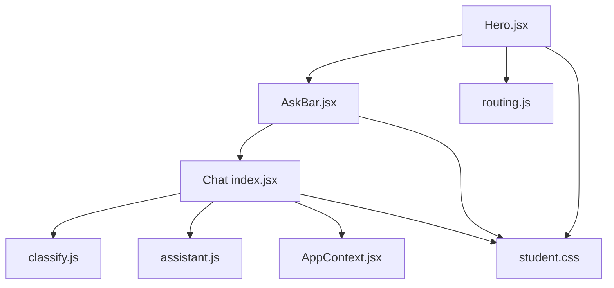
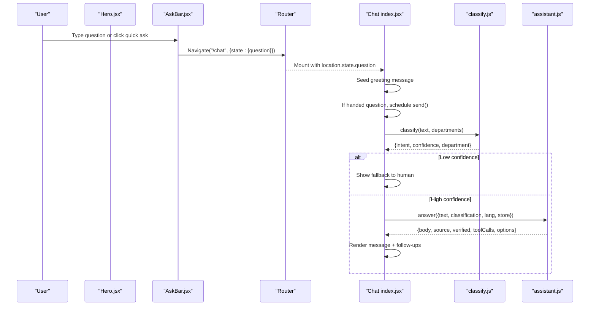
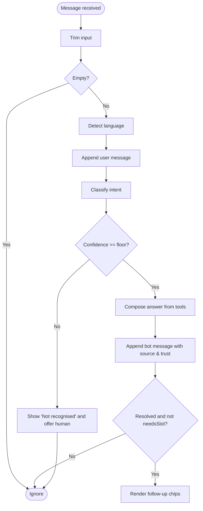
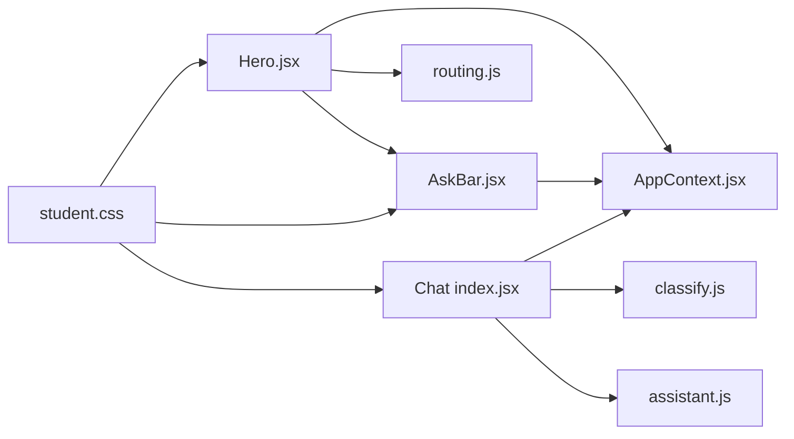

# Hero Section

<cite>
**Referenced Files in This Document**
- [Hero.jsx](file://src/pages/student/Landing/Hero.jsx)
- [AskBar.jsx](file://src/components/student/AskBar.jsx)
- [Chat index.jsx](file://src/pages/student/Chat/index.jsx)
- [Composer.jsx](file://src/pages/student/Chat/Composer.jsx)
- [routing.js](file://src/mocks/routing.js)
- [classify.js](file://src/lib/classify.js)
- [assistant.js](file://src/lib/assistant.js)
- [AppContext.jsx](file://src/context/AppContext.jsx)
- [student.css](file://src/styles/student.css)
</cite>

## Table of Contents
1. [Introduction](#introduction)
2. [Project Structure](#project-structure)
3. [Core Components](#core-components)
4. [Architecture Overview](#architecture-overview)
5. [Detailed Component Analysis](#detailed-component-analysis)
6. [Dependency Analysis](#dependency-analysis)
7. [Performance Considerations](#performance-considerations)
8. [Troubleshooting Guide](#troubleshooting-guide)
9. [Conclusion](#conclusion)

## Introduction
The Hero section is the primary entry point for students to start a conversation with the student chat system. It presents a clear headline, a short description, and an input bar that routes questions directly into the chat flow without requiring users to retype their query. The component also exposes quick-start prompts that navigate to the chat page with a pre-filled question.

Key responsibilities:
- Provide the main chat entry point from the landing page
- Capture user input and route it to the chat interface via navigation state
- Offer quick-start prompts to initiate conversations immediately
- Maintain responsive, accessible, and multilingual behavior consistent with the student-facing design system

## Project Structure
The Hero section lives under the student-facing pages and integrates with shared components and libraries:
- Hero component renders the landing hero area and embeds the AskBar
- AskBar handles text input and navigates to /chat with the question in navigation state
- Chat page consumes the passed question and starts the conversation flow
- Classification and answer composition are handled by classification and assistant modules
- Styling is provided by the student theme CSS

**Diagram sources**
- [Hero.jsx:1-39](file://src/pages/student/Landing/Hero.jsx#L1-L39)
- [AskBar.jsx:1-41](file://src/components/student/AskBar.jsx#L1-L41)
- [Chat index.jsx:1-200](file://src/pages/student/Chat/index.jsx#L1-L200)
- [routing.js:1-77](file://src/mocks/routing.js#L1-L77)
- [classify.js:1-270](file://src/lib/classify.js#L1-L270)
- [assistant.js:1-364](file://src/lib/assistant.js#L1-L364)
- [AppContext.jsx:1-135](file://src/context/AppContext.jsx#L1-L135)
- [student.css:112-215](file://src/styles/student.css#L112-L215)

**Section sources**
- [Hero.jsx:1-39](file://src/pages/student/Landing/Hero.jsx#L1-L39)
- [AskBar.jsx:1-41](file://src/components/student/AskBar.jsx#L1-L41)
- [Chat index.jsx:1-200](file://src/pages/student/Chat/index.jsx#L1-L200)
- [routing.js:1-77](file://src/mocks/routing.js#L1-L77)
- [classify.js:1-270](file://src/lib/classify.js#L1-L270)
- [assistant.js:1-364](file://src/lib/assistant.js#L1-L364)
- [AppContext.jsx:1-135](file://src/context/AppContext.jsx#L1-L135)
- [student.css:112-215](file://src/styles/student.css#L112-L215)

## Core Components
- Hero: Renders the landing hero content and embeds AskBar and quick-start chips. Uses AppContext for language preference and navigates to /chat with a question when a chip is clicked.
- AskBar: Provides the main input field, supports Enter to send, and navigates to /chat with the typed question in navigation state.
- Chat page: Initializes a greeting message, picks up any handed-over question from the landing page, classifies input, composes answers, and manages follow-up suggestions.
- Composer: Auto-growing textarea for composing messages in the chat thread.

Responsibilities summary:
- Input handling: AskBar captures and validates input; Composer handles multi-line input and sending
- Navigation: Both Hero chips and AskBar use router navigation to pass the question to the chat page
- Conversation initiation: Chat page seeds a greeting and processes the handed-over question after a short delay
- Language support: Multilingual UI based on AppContext’s urdu flag

**Section sources**
- [Hero.jsx:1-39](file://src/pages/student/Landing/Hero.jsx#L1-L39)
- [AskBar.jsx:1-41](file://src/components/student/AskBar.jsx#L1-L41)
- [Chat index.jsx:1-200](file://src/pages/student/Chat/index.jsx#L1-L200)
- [Composer.jsx:1-54](file://src/pages/student/Chat/Composer.jsx#L1-L54)
- [AppContext.jsx:1-135](file://src/context/AppContext.jsx#L1-L135)

## Architecture Overview
The Hero section initiates conversations by routing user queries to the chat system. The flow emphasizes clarity and transparency: classify first, then compose an answer grounded in records, and show trust indicators.

**Diagram sources**
- [AskBar.jsx:15-19](file://src/components/student/AskBar.jsx#L15-L19)
- [Hero.jsx:25-35](file://src/pages/student/Landing/Hero.jsx#L25-L35)
- [Chat index.jsx:42-56](file://src/pages/student/Chat/index.jsx#L42-L56)
- [Chat index.jsx:62-138](file://src/pages/student/Chat/index.jsx#L62-L138)
- [classify.js:201-266](file://src/lib/classify.js#L201-L266)
- [assistant.js:135-317](file://src/lib/assistant.js#L135-L317)

## Detailed Component Analysis

### Hero Component
- Purpose: Landing hero with headline, description, AskBar, and quick-start chips
- Behavior:
  - Reads language preference from AppContext to render Urdu or English copy
  - Renders AskBar for free-form input
  - Displays quick-start chips sourced from routing configuration
  - Navigates to /chat with the selected question in navigation state
- Visual patterns:
  - Centered layout with large heading and supporting text
  - Chips styled consistently with hover effects and spacing
- Accessibility:
  - Semantic heading hierarchy
  - Buttons for quick asks provide keyboard focus and click handlers

**Section sources**
- [Hero.jsx:1-39](file://src/pages/student/Landing/Hero.jsx#L1-L39)
- [routing.js:66-77](file://src/mocks/routing.js#L66-L77)
- [student.css:112-215](file://src/styles/student.css#L112-L215)

### AskBar Component
- Purpose: Primary input for initiating a chat from anywhere on the site
- Behavior:
  - Maintains local input value
  - On Enter or Send button click, navigates to /chat with the trimmed question
  - Applies Urdu class when language is set to Urdu for right-to-left styling
- Accessibility:
  - aria-label on input and button
  - Keyboard support via Enter key
  - Focus ring styling for visibility

**Section sources**
- [AskBar.jsx:1-41](file://src/components/student/AskBar.jsx#L1-L41)
- [student.css:163-215](file://src/styles/student.css#L163-L215)

### Chat Integration (Conversation Initiation)
- Purpose: Receive handed-over question, greet the user, and process messages
- Behavior:
  - Seeds a greeting message based on language preference
  - If a question was passed via navigation state, schedules sending it after mount
  - For each message:
    - Detects language
    - Classifies intent and confidence
    - If confidence is below threshold, shows a fallback message offering human contact
    - Otherwise, composes an answer using assistant module and displays results with source and verification info
  - Shows follow-up suggestions based on resolved intents
- Message composition:
  - Composer provides auto-growing textarea and send control
  - Enter sends; Shift+Enter adds line breaks

**Diagram sources**
- [Chat index.jsx:62-138](file://src/pages/student/Chat/index.jsx#L62-L138)
- [classify.js:201-266](file://src/lib/classify.js#L201-L266)
- [assistant.js:135-317](file://src/lib/assistant.js#L135-L317)

**Section sources**
- [Chat index.jsx:1-200](file://src/pages/student/Chat/index.jsx#L1-L200)
- [Composer.jsx:1-54](file://src/pages/student/Chat/Composer.jsx#L1-L54)
- [classify.js:1-270](file://src/lib/classify.js#L1-L270)
- [assistant.js:1-364](file://src/lib/assistant.js#L1-L364)

### Visual Design Patterns and Responsive Behavior
- Hero typography scales on larger screens; Urdu headline uses distinct color and size
- AskBar has a rounded container with focus states and shadow elevation
- Chips wrap and center under the input; hover lifts slightly
- Chat thread adapts to single-column on small screens and two-column with sidebar on larger screens
- Composer sticks to the bottom with gradient fade and auto-expanding textarea

**Section sources**
- [student.css:112-215](file://src/styles/student.css#L112-L215)
- [student.css:307-529](file://src/styles/student.css#L307-L529)

### Accessibility Features
- Semantic headings and descriptive labels for inputs and buttons
- Keyboard interactions: Enter to send, focus-visible styles for controls
- Language-aware direction and styling for Urdu content
- Clear visual feedback for disabled states and focus rings

**Section sources**
- [AskBar.jsx:21-39](file://src/components/student/AskBar.jsx#L21-L39)
- [Composer.jsx:24-51](file://src/pages/student/Chat/Composer.jsx#L24-L51)
- [student.css:163-215](file://src/styles/student.css#L163-L215)
- [student.css:455-529](file://src/styles/student.css#L455-L529)

## Dependency Analysis
- Hero depends on:
  - Router for navigation
  - AskBar for input capture
  - routing.js for quick-start prompts
  - AppContext for language preference
- AskBar depends on:
  - Router for navigation
  - AppContext for language preference
- Chat depends on:
  - classify.js for intent detection and confidence scoring
  - assistant.js for grounded answer composition and follow-ups
  - AppContext for store data and language preference
- Styling is centralized in student.css

**Diagram sources**
- [Hero.jsx:1-39](file://src/pages/student/Landing/Hero.jsx#L1-L39)
- [AskBar.jsx:1-41](file://src/components/student/AskBar.jsx#L1-L41)
- [Chat index.jsx:1-200](file://src/pages/student/Chat/index.jsx#L1-L200)
- [routing.js:1-77](file://src/mocks/routing.js#L1-L77)
- [classify.js:1-270](file://src/lib/classify.js#L1-L270)
- [assistant.js:1-364](file://src/lib/assistant.js#L1-L364)
- [AppContext.jsx:1-135](file://src/context/AppContext.jsx#L1-L135)
- [student.css:112-215](file://src/styles/student.css#L112-L215)

**Section sources**
- [Hero.jsx:1-39](file://src/pages/student/Landing/Hero.jsx#L1-L39)
- [AskBar.jsx:1-41](file://src/components/student/AskBar.jsx#L1-L41)
- [Chat index.jsx:1-200](file://src/pages/student/Chat/index.jsx#L1-L200)
- [routing.js:1-77](file://src/mocks/routing.js#L1-L77)
- [classify.js:1-270](file://src/lib/classify.js#L1-L270)
- [assistant.js:1-364](file://src/lib/assistant.js#L1-L364)
- [AppContext.jsx:1-135](file://src/context/AppContext.jsx#L1-L135)
- [student.css:112-215](file://src/styles/student.css#L112-L215)

## Performance Considerations
- Client-side classification and answer composition avoid network latency in this implementation
- Short timeouts simulate processing time to make flows legible during development
- Auto-growing textarea minimizes layout thrashing by capping max height
- Avoid unnecessary re-renders by keeping localized state within components and passing minimal props

[No sources needed since this section provides general guidance]

## Troubleshooting Guide
- Question not routed to chat:
  - Ensure navigation state includes the question key and that the chat page reads from location.state
- No response shown:
  - Check classification confidence threshold; low confidence triggers a fallback message instead of an answer
- Incorrect language display:
  - Verify AppContext urdu flag is set correctly and components apply the appropriate classes
- Input not sending:
  - Confirm Enter key handler is wired and the send button is not disabled due to empty input

**Section sources**
- [Chat index.jsx:42-56](file://src/pages/student/Chat/index.jsx#L42-L56)
- [Chat index.jsx:62-138](file://src/pages/student/Chat/index.jsx#L62-L138)
- [AskBar.jsx:15-19](file://src/components/student/AskBar.jsx#L15-L19)
- [Composer.jsx:17-22](file://src/pages/student/Chat/Composer.jsx#L17-L22)

## Conclusion
The Hero section serves as a streamlined, accessible entry point to the student chat system. It captures user intent early, passes it seamlessly to the chat interface, and leverages classification and grounded answer composition to deliver reliable, transparent responses. Its design prioritizes clarity, responsiveness, and accessibility, ensuring students can quickly find answers to university-related questions in their preferred language.

[No sources needed since this section summarizes without analyzing specific files]