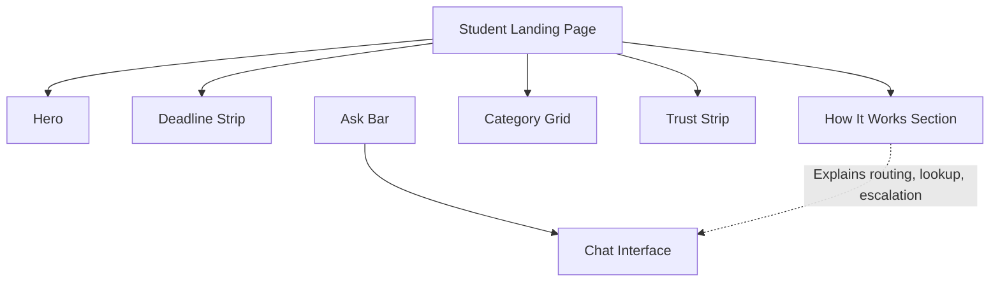
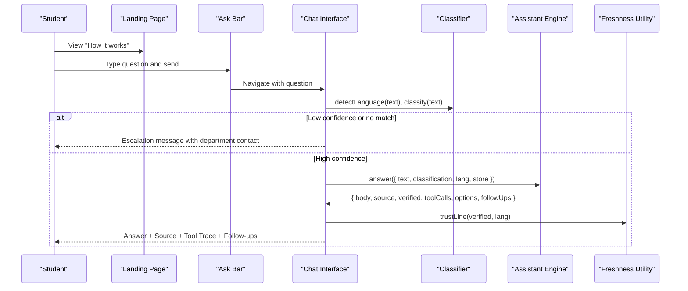
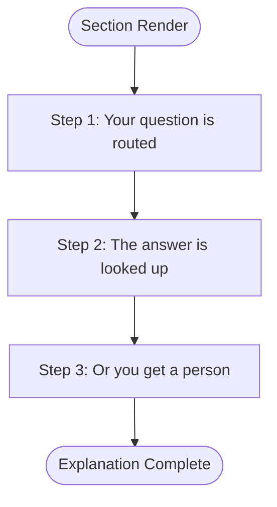
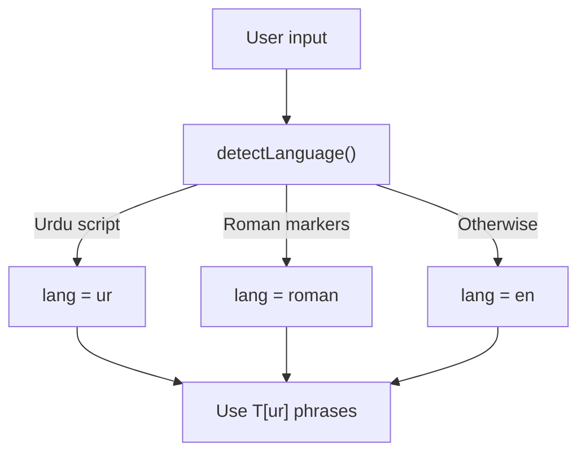
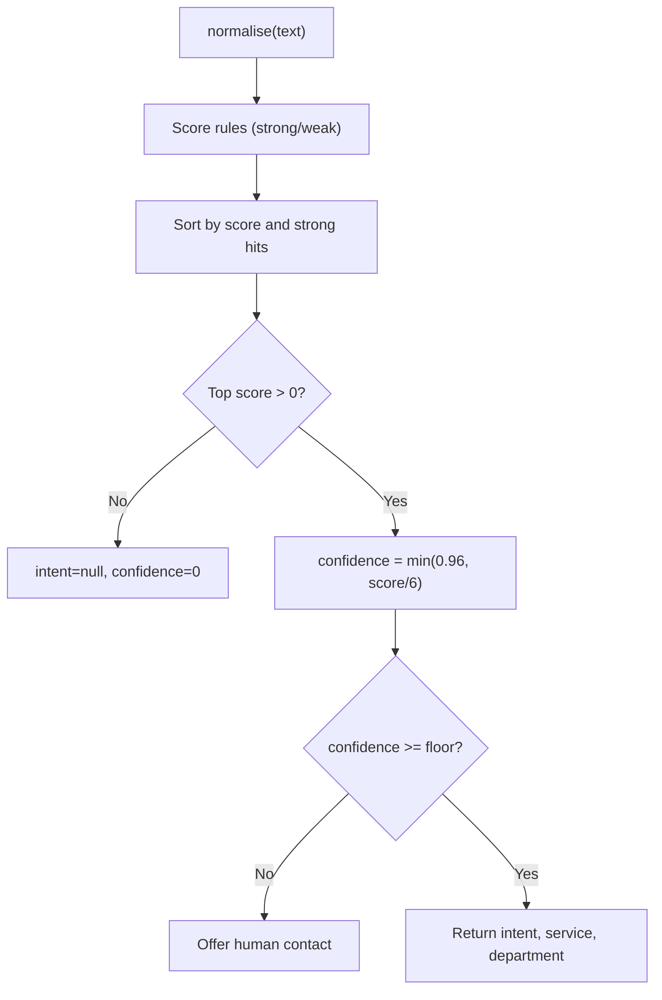
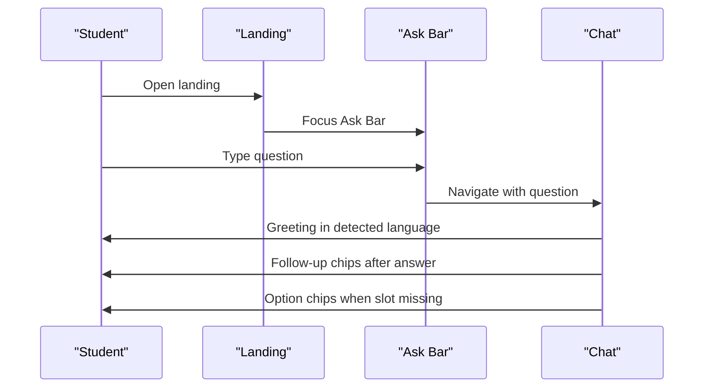
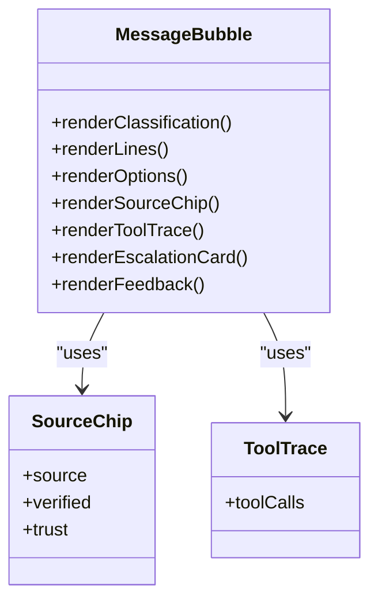
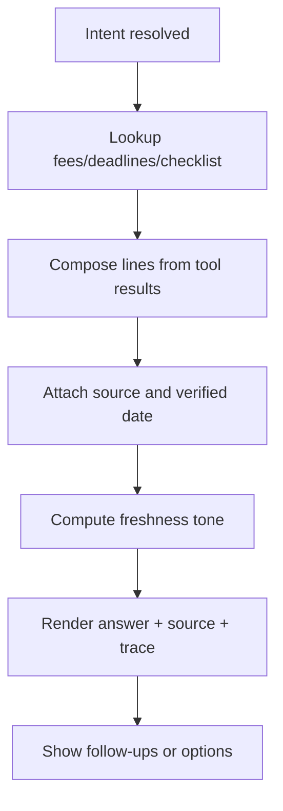
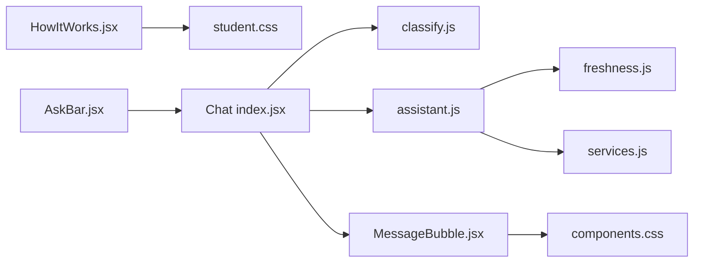

# How It Works Section

<cite>
**Referenced Files in This Document**
- [HowItWorks.jsx](file://src/pages/student/Landing/HowItWorks.jsx)
- [index.jsx (Landing)](file://src/pages/student/Landing/index.jsx)
- [AskBar.jsx](file://src/components/student/AskBar.jsx)
- [Chat index.jsx](file://src/pages/student/Chat/index.jsx)
- [MessageBubble.jsx](file://src/pages/student/Chat/MessageBubble.jsx)
- [assistant.js](file://src/lib/assistant.js)
- [classify.js](file://src/lib/classify.js)
- [freshness.js](file://src/lib/freshness.js)
- [services.js](file://src/mocks/services.js)
- [student.css](file://src/styles/student.css)
- [components.css](file://src/styles/components.css)
</cite>

## Table of Contents
1. [Introduction](#introduction)
2. [Project Structure](#project-structure)
3. [Core Components](#core-components)
4. [Architecture Overview](#architecture-overview)
5. [Detailed Component Analysis](#detailed-component-analysis)
6. [Dependency Analysis](#dependency-analysis)
7. [Performance Considerations](#performance-considerations)
8. [Troubleshooting Guide](#troubleshooting-guide)
9. [Conclusion](#conclusion)

## Introduction
This document explains the How It Works section and how it introduces students to the AI assistant’s capabilities: multi-language support, intent classification, grounded answers with sources, and guided flows that escalate to a human when needed. It also covers educational content presentation, interactive elements, and the onboarding flow from the landing page into the chat experience.

## Project Structure
The How It Works section is part of the student-facing landing page. It sits between the hero area and the category grid, providing a concise explanation of the assistant’s trust model before users start asking questions.

**Diagram sources**
- [index.jsx (Landing):1-25](file://src/pages/student/Landing/index.jsx#L1-L25)
- [HowItWorks.jsx:1-55](file://src/pages/student/Landing/HowItWorks.jsx#L1-L55)
- [AskBar.jsx:1-41](file://src/components/student/AskBar.jsx#L1-L41)
- [Chat index.jsx:1-200](file://src/pages/student/Chat/index.jsx#L1-L200)

**Section sources**
- [index.jsx (Landing):1-25](file://src/pages/student/Landing/index.jsx#L1-L25)
- [HowItWorks.jsx:1-55](file://src/pages/student/Landing/HowItWorks.jsx#L1-L55)

## Core Components
- How It Works section: A three-step explanation of routing, lookup, and escalation.
- Ask Bar: The entry point for students to type a question and navigate to the chat.
- Chat interface: Implements classify → route → look up → answer → cite, with language detection and follow-ups.
- Assistant engine: Composes grounded replies from tool results, supports English, Roman Urdu, and Urdu script, and attaches freshness cues.
- Classifier: Detects language and classifies intent using keyword scoring with confidence thresholds.
- Freshness utility: Converts verification dates into visual “rungs” indicating recency.

**Section sources**
- [HowItWorks.jsx:1-55](file://src/pages/student/Landing/HowItWorks.jsx#L1-L55)
- [AskBar.jsx:1-41](file://src/components/student/AskBar.jsx#L1-L41)
- [Chat index.jsx:1-200](file://src/pages/student/Chat/index.jsx#L1-L200)
- [assistant.js:1-364](file://src/lib/assistant.js#L1-L364)
- [classify.js:1-270](file://src/lib/classify.js#L1-L270)
- [freshness.js:1-37](file://src/lib/freshness.js#L1-L37)

## Architecture Overview
The How It Works section educates users about the assistant’s behavior. When they proceed to ask a question via the Ask Bar, the chat applies the same principles explained in the section:

**Diagram sources**
- [Chat index.jsx:62-138](file://src/pages/student/Chat/index.jsx#L62-L138)
- [classify.js:37-57](file://src/lib/classify.js#L37-L57)
- [classify.js:201-266](file://src/lib/classify.js#L201-L266)
- [assistant.js:135-317](file://src/lib/assistant.js#L135-L317)
- [assistant.js:319-328](file://src/lib/assistant.js#L319-L328)

## Detailed Component Analysis

### How It Works Section
- Purpose: Explain the trust model in plain terms so students understand why answers are reliable.
- Content: Three steps—routing to the right service, looking up official records, and escalating to a person if not recorded.
- Presentation: Uses icons, numbered steps, and concise copy to reduce cognitive load.
- Educational value: Sets expectations for sourced answers and human handoff.

**Diagram sources**
- [HowItWorks.jsx:10-26](file://src/pages/student/Landing/HowItWorks.jsx#L10-L26)

**Section sources**
- [HowItWorks.jsx:1-55](file://src/pages/student/Landing/HowItWorks.jsx#L1-L55)

### Multi-Language Support
- Language detection: Identifies English, Roman Urdu, and Urdu script based on character ranges and function words.
- Response templates: Phrasebook contains English, Roman Urdu, and Urdu strings for consistent tone and clarity.
- UI adaptation: Input placeholder and greeting adapt to detected language; RTL rendering is supported for Urdu script.

**Diagram sources**
- [classify.js:51-57](file://src/lib/classify.js#L51-L57)
- [assistant.js:20-78](file://src/lib/assistant.js#L20-L78)
- [Chat index.jsx:14-18](file://src/pages/student/Chat/index.jsx#L14-L18)

**Section sources**
- [classify.js:51-57](file://src/lib/classify.js#L51-L57)
- [assistant.js:20-78](file://src/lib/assistant.js#L20-L78)
- [Chat index.jsx:14-18](file://src/pages/student/Chat/index.jsx#L14-L18)

### Intent Classification
- Scoring: Strong and weak keywords per intent are scored; top result determines intent, label, service, and department.
- Confidence: Normalized score capped at a high threshold; below a floor, the system escalates rather than guessing.
- Alternatives: When close scores occur, alternatives are surfaced to help disambiguate.

**Diagram sources**
- [classify.js:37-44](file://src/lib/classify.js#L37-L44)
- [classify.js:201-266](file://src/lib/classify.js#L201-L266)
- [classify.js:268-270](file://src/lib/classify.js#L268-L270)

**Section sources**
- [classify.js:201-266](file://src/lib/classify.js#L201-L266)
- [classify.js:268-270](file://src/lib/classify.js#L268-L270)

### Guided Flows and User Onboarding
- Entry: Students can start from the landing page’s Ask Bar or directly in the chat.
- Greeting: The chat greets in the detected language and invites questions about fees, deadlines, documents, and departments.
- Follow-ups: After an answer, contextual next questions appear to keep the flow moving.
- Options: When missing slots (e.g., programme or campus) are needed, chips prompt selection.

**Diagram sources**
- [AskBar.jsx:15-38](file://src/components/student/AskBar.jsx#L15-L38)
- [Chat index.jsx:43-56](file://src/pages/student/Chat/index.jsx#L43-L56)
- [Chat index.jsx:150-193](file://src/pages/student/Chat/index.jsx#L150-L193)
- [assistant.js:331-363](file://src/lib/assistant.js#L331-L363)

**Section sources**
- [AskBar.jsx:15-38](file://src/components/student/AskBar.jsx#L15-L38)
- [Chat index.jsx:43-56](file://src/pages/student/Chat/index.jsx#L43-L56)
- [Chat index.jsx:150-193](file://src/pages/student/Chat/index.jsx#L150-L193)
- [assistant.js:331-363](file://src/lib/assistant.js#L331-L363)

### Educational Content Presentation and Interactive Elements
- How It Works cards: Use icons, step numbers, and short paragraphs to explain routing, lookup, and escalation.
- Message bubbles: Show classification context, lines of text, lists (e.g., checklists), source citations, tool traces, and feedback controls.
- Freshness indicators: Visual “ladder” shows recency of verified data to build trust.
- Styling: Larger type, more spacing, and mobile-friendly layout to reduce anxiety and improve readability.

**Diagram sources**
- [MessageBubble.jsx:1-82](file://src/pages/student/Chat/MessageBubble.jsx#L1-L82)

**Section sources**
- [MessageBubble.jsx:1-82](file://src/pages/student/Chat/MessageBubble.jsx#L1-L82)
- [components.css:111-134](file://src/styles/components.css#L111-L134)
- [student.css:86-110](file://src/styles/student.css#L86-L110)

### Implementation Details for Content Rendering and Engagement
- Grounded answers: The assistant composes replies strictly from tool results; if nothing matches, it offers a human instead of guessing.
- Sources and verification: Each answer includes a source and last-checked date; freshness is computed and displayed.
- Service-backed intents: Checklists and procedures are pulled from service definitions and rendered as lists or instructions.
- Engagement patterns: Follow-ups and option chips guide students to the next relevant action without confusion.

**Diagram sources**
- [assistant.js:135-317](file://src/lib/assistant.js#L135-L317)
- [assistant.js:319-328](file://src/lib/assistant.js#L319-L328)
- [services.js:10-309](file://src/mocks/services.js#L10-L309)

**Section sources**
- [assistant.js:135-317](file://src/lib/assistant.js#L135-L317)
- [assistant.js:319-328](file://src/lib/assistant.js#L319-L328)
- [services.js:10-309](file://src/mocks/services.js#L10-L309)

## Dependency Analysis
The How It Works section sets expectations that the chat implementation fulfills through tightly coupled modules:

**Diagram sources**
- [HowItWorks.jsx:1-55](file://src/pages/student/Landing/HowItWorks.jsx#L1-L55)
- [AskBar.jsx:1-41](file://src/components/student/AskBar.jsx#L1-L41)
- [Chat index.jsx:1-200](file://src/pages/student/Chat/index.jsx#L1-L200)
- [classify.js:1-270](file://src/lib/classify.js#L1-L270)
- [assistant.js:1-364](file://src/lib/assistant.js#L1-L364)
- [freshness.js:1-37](file://src/lib/freshness.js#L1-L37)
- [services.js:1-309](file://src/mocks/services.js#L1-L309)
- [MessageBubble.jsx:1-82](file://src/pages/student/Chat/MessageBubble.jsx#L1-L82)
- [student.css:1-200](file://src/styles/student.css#L1-L200)
- [components.css:1-200](file://src/styles/components.css#L1-L200)

**Section sources**
- [Chat index.jsx:1-200](file://src/pages/student/Chat/index.jsx#L1-L200)
- [assistant.js:1-364](file://src/lib/assistant.js#L1-L364)
- [classify.js:1-270](file://src/lib/classify.js#L1-L270)

## Performance Considerations
- Client-side classification and response composition are lightweight and deterministic, suitable for quick interactions.
- Simulated latency in the chat makes the process visible and reduces perceived abruptness.
- Freshness computation is O(1) per answer; list rendering uses simple arrays and keys for efficient updates.
- Mobile-first styling ensures responsive performance on low-end devices.

[No sources needed since this section provides general guidance]

## Troubleshooting Guide
- No intent matched or low confidence: The chat displays a human contact suggestion instead of guessing. Verify classifier rules and ensure keywords align with expected queries.
- Missing slots (programme/campus): The assistant returns options; confirm that services and departments data include required fields.
- Stale information: If freshness indicates stale data, update verification dates in service records to restore trust signals.
- Language mismatch: Ensure language detection logic remains aligned with common Roman Urdu markers and Urdu script presence.

**Section sources**
- [Chat index.jsx:80-110](file://src/pages/student/Chat/index.jsx#L80-L110)
- [assistant.js:163-187](file://src/lib/assistant.js#L163-L187)
- [assistant.js:259-283](file://src/lib/assistant.js#L259-L283)
- [freshness.js:17-23](file://src/lib/freshness.js#L17-L23)

## Conclusion
The How It Works section clearly communicates the assistant’s trust model: routing to the right service, reading from official records, and escalating to a person when necessary. The chat implements these principles with robust multi-language support, intent classification, grounded answers with sources, and guided flows that keep students engaged and informed. Together, the educational content and interactive components create a transparent, user-friendly onboarding experience.

[No sources needed since this section summarizes without analyzing specific files]